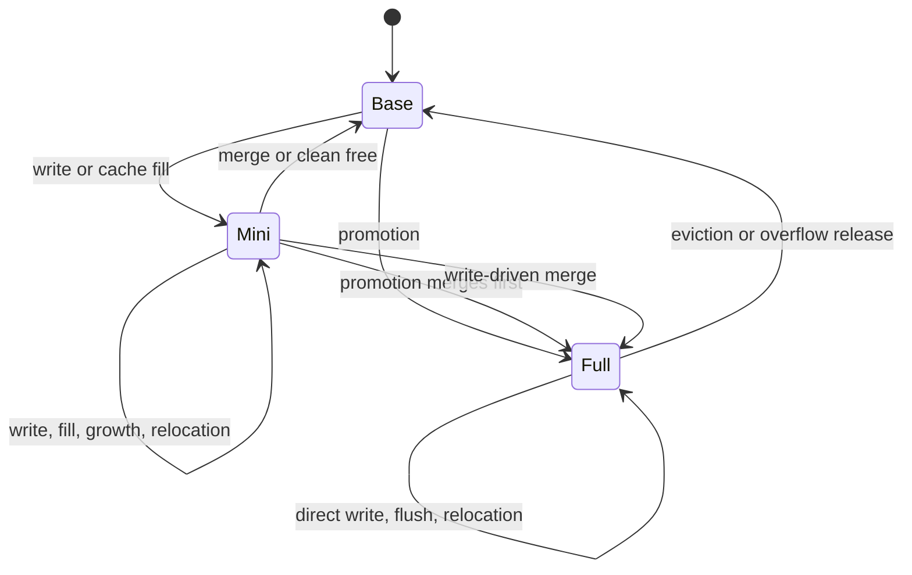
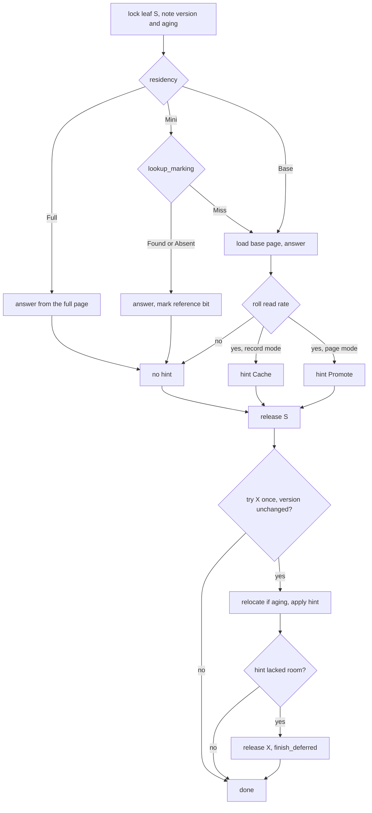
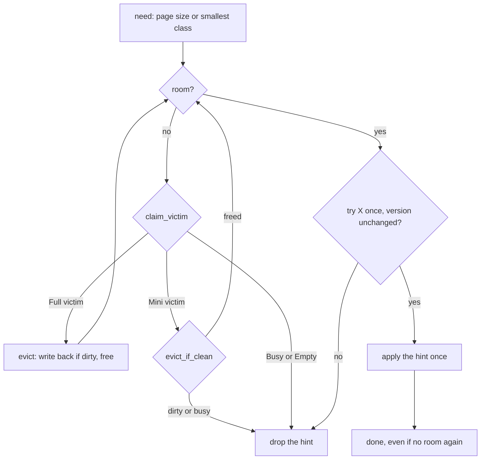

# BF-Tree caching policy

The circular buffer holds more than buffered writes. A read, a scan, or a
write can leave behind state that makes later reads cheaper: a cached
record, a cached absence, or the whole leaf page. This document records
what the tree keeps, when it keeps it, how it stays correct, and how it
gives memory back. It follows the BF-Tree paper's §§3.1, 4, and 5, with the
deviations listed in [Relationship to upstream](#relationship-to-upstream).

[Plan 0015](../plans/0015-bf-tree-caching.md) built this design. Related
documents: [circular buffer](bf-tree-circular-buffer.md) (blocks, eviction,
the second chance), [mini-pages](bf-tree-mini-page.md) (record kinds,
growth, reference bits), [concurrency](bf-tree-concurrency.md) (locks and
hint locking), and [leaf storage](bf-tree-leaf-store.md) (the leaf mapping
table, `load_base`, `write_through`).

The code is in `crates/bf-tree/src/`: `maintain.rs` (hints, promotion,
deferral), `policy.rs` (the random generator), `write.rs` (direct writes
into full pages), `leaf_map.rs` (the entry and its residency), `read.rs`,
`scan.rs`, and `evict.rs`.

## Terms

- **Base page:** the leaf's page in the page store.
- **Clean record:** a `Cache` record (the key exists with this value) or a
  `Phantom` record (the key does not exist). A clean record repeats the
  base page.
- **Dirty record:** an `Insert` or `Delete` record, newer than the base
  page.
- **Full page:** a complete copy of the leaf page in a circular-buffer
  block of kind `Kind::Full`.
- **Promotion:** keeping the whole page in the circular buffer.
- **Hint:** cache maintenance that a reader found worth doing under its
  shared (S) lock, applied after it releases that lock.
- **Roll:** one random decision, true with a configured probability.

## Residency

Each leaf is in exactly one of three states. The `LeafEntry` fields
`block` and `refs` encode the state, as `Residency` shows:

| State | `block` | `refs` | Meaning |
| --- | --- | --- | --- |
| `Base` | `None` | `None` | Only the store holds the leaf. |
| `Mini` | `Kind::Mini` block | `Some` | A mini-page overlays the base page in the store. |
| `Full` | `Kind::Full` block | `None` | The circular buffer holds the complete leaf. It answers every key in the leaf's range. |

There is never a resident base page beside a mini-page. A `Full` leaf has
no mini-page, so a direct write goes into the page itself.

`LeafEntry::dirty` is true only for a `Full` leaf whose page is newer than
the store. A direct write that changes a byte sets it. A write-back
(`LeafMap::write_back`) clears it. `take_full` moves the block and the flag
out together, and `set_full(block, dirty)` puts them back, so relocation
keeps the flag. The entry stays within one 64-byte cache line
(`the_entry_stays_within_a_cache_line`).



Every change of block bumps `LeafEntry::version`: `take_mini`, `take_full`,
and `set_full` all bump it. Direct writes into a full page do not bump it,
because no hint depends on the content of a full page.

## Configuration

| Field | Default | Meaning |
| --- | --- | --- |
| `read_promotion_percent` | 20 | Chance that a read served by the base page leaves something behind. |
| `read_record_cache` | `true` | A promoting read caches the record (`true`) or promotes the page (`false`). |
| `scan_promotion_percent` | 20 | Chance that a scan over a `Base` leaf promotes its page. |
| `write_load_full_page` | `true` | A write-driven merge keeps the merged page as a full page. |
| `policy_seed` | `0x5eed` | Seed of the rolls. |

`TreeConfig::validate` rejects a rate above 100. Rates 0 and 100 are exact
and draw no random number. All five fields are process settings. The
superblock does not store them: `Tree::open` uses the defaults, and
`Tree::open_with` takes them for an existing store.

The paper's §§3.1 and 5.1 use 1 percent as the example record promotion
rate, its §6.11 evaluation uses 20 percent, and upstream defaults to 30
percent in release builds (`src/config.rs`). With rate `p`, a hot key is
cached after about `1/p` base reads. A higher rate also caches more keys
that are read only once; reference bits limit that pollution. peppydb uses
20 percent. Plan 0023 measures the choice.

## Reads

`Tree::get_with` reads the leaf under S. Only a read that the base page
serves rolls the read rate: a `Base` leaf, or a `Mini` leaf whose
mini-page misses the key. A `Full` leaf and a mini-page hit answer without
the store and roll nothing.



`Tree::note` records a `Noted` value under S: the leaf ID, its version, an
`aging` flag (the block is in the second-chance region), and an optional
`Hint`. One read can therefore both relocate a block and promote a page.

```rust
pub(super) enum Hint {
    /// Leave a cached record (`Some`) or a phantom (`None`) for the key.
    Cache { key: Vec<u8>, value: Option<Vec<u8>> },
    /// Keep the whole page in the circular buffer.
    Promote,
}
```

## Hints and their validity

`Tree::maintain` applies a `Noted` value after the reader has released S:

1. If there is nothing to do, return.
2. Try the leaf's exclusive (X) lock once with `LeafMap::try_write`. If the
   lock is busy, drop the hint.
3. If the version differs from the noted one, drop the hint.
4. Relocate the block if it is aging, then apply the hint (`apply_hint`).
5. If the hint lacked room, release X and finish it with no lock held
   ([Deferral](#deferral)).

A reader never waits for its own leaf's lock to apply a hint. Correctness
never depends on a hint: a dropped hint only costs a later base read.

Each hint is valid because of the version rule:

- **`Cache`** needs the base page unchanged since the read, and it must not
  hide a newer write of the same key. Every base-page change bumps the
  version (see [Guarantees](#guarantees)). Every call to `LeafMap::buffer`
  also bumps it, because it goes through `take_mini`. A buffered write
  between the read and the hint therefore makes the hint stale. As a second
  guard, `MiniPage::apply` never lets a clean record replace a dirty one:
  the fill returns `SkippedDirty`
  (`apply_follows_the_record_table_cell_by_cell` in
  `bf-tree-mini-page`). `a_fill_never_hides_a_newer_buffered_write` checks
  both a `Cache` and a `Phantom` fill against a newer write.
- **`Promote`** needs the residency unchanged, which the version covers
  (`a_stale_promotion_is_skipped`). `promote` reads the base page again
  under X. It cannot reuse the read's copy, because scratch is per thread
  and every tree on the thread shares it.

**Known cost.** A promotion from `Base` reads the base page twice: once for
the read under S, and once in `promote` under X. A scan promotion costs the
same. `a_promoting_read_keeps_the_page_and_the_next_read_loads_nothing`
records the two reads. A later change can carry the loaded page into the
hint; plan 0023 measures it.

## Record and negative caching

In record mode, a promoting read returns `Hint::Cache`. A found key gives
a `Cache` record with its value. A missing key gives a `Phantom` record,
the negative cache: the next read of that key answers "absent" without the
base page. `cache_fill` buffers the record through `LeafMap::buffer`,
which creates a mini-page at the smallest class or grows the existing one.
The fill follows three rules:

- **On a `Full` leaf it does nothing.** The full page already answers the
  key.
- **It never evicts under the lock.** If the circular buffer has no room,
  the fill returns `Promotion::NoRoom` and is deferred.
- **It never merges.** `WriteOutcome::NeedsMerge` means the mini-page is
  full at the largest class. A leaf that is hot enough to fill a mini-page
  is a candidate for the whole page, so the fill becomes a promotion.

Tests: `the_second_read_of_a_present_or_absent_key_reads_no_base_page`,
`rate_zero_caches_nothing`, and
`a_moving_working_set_keeps_being_cached_without_writes` (a 2 KiB buffer
over many leaves: second reads hit, nothing is written, and older cached
records are freed).

### Clean mini-pages merge without I/O

A mini-page that holds no dirty record only repeats the base page.
`Tree::merge_leaf` frees its block without reading or writing the base
page, and leaves scratch untouched. Eviction and `flush` of a cache-only
mini-page therefore write nothing, and cached records never reach the
store (`cache_only_mini_pages_are_freed_by_flush_and_eviction_without_writes`).
A caller that keeps the page as a full page calls `merge_keeping_page`,
which loads the base page after such a no-op merge.

### Reference bits

- A mini-page hit (`Found` or `Absent`) marks the record's bit through
  `lookup_marking` under S.
- Every copy of a mini-page (growth in `buffer`, relocation) passes
  `discard_cold_clean = true`: an unreferenced clean record is dropped, a
  referenced one survives with a clear bit, and dirty records always
  survive.
- A merge drops every clean record, because only dirty records feed it.

A fill leaves the new record's bit clear. A cached record that is not hit
before the next copy is dropped. The bits are policy state with no
durability role
(`growth_drops_unreferenced_clean_records_and_keeps_the_rest`).

## Page promotion

```rust
fn promote(&self, leaf: &mut LeafWrite<'_>, scratch: &mut Scratch) -> Result<Promotion, TreeError> {
    match leaf.residency() {
        Residency::Full(_) => return Ok(Promotion::Promoted),
        // A merge without room for the page would be wasted.
        Residency::Mini { .. } if !buffer.has_room(n) => return Ok(Promotion::NoRoom),
        Residency::Mini { .. } => drop(self.merge_keeping_page(leaf, scratch)?),
        Residency::Base => { self.leaves.load_base(leaf, &mut scratch.page[..n])?; }
    }
    let Ok(mut block) = buffer.alloc(n, Kind::Full, leaf.id()) else {
        return Ok(Promotion::NoRoom);
    };
    block.as_mut().copy_from_slice(&scratch.page[..n]);
    leaf.set_full(block, false);
    Ok(Promotion::Promoted)
}
```

`promote` never evicts. It checks for room before a merge, because a merge
without a page to keep is wasted I/O.

**Merge by split.** A `Mini` leaf merges its mini-page first, as upstream's
`upgrade_to_full_page` does. This merge writes the leaf's own buffered
records to the store. If the merged records do not fit one page, the merge
splits the leaf (plan 0013's `merge_leaf` and `split_leaf`). The left half,
which the hint names, becomes `Full`; the right half stays `Base`. Without
the split, a leaf whose buffered writes outgrew its page could never be
promoted, and every read would keep paying for the base page.

Tests: `a_mini_page_leaf_promotes_by_merging_in_place` and
`a_mini_page_whose_merge_overflows_splits_and_keeps_the_left_half` (the
leaf count goes from 1 to 2, the left half is `Full`, and the oracle
agrees).

## Write-load promotion

When a write's mini-page needs a merge and `write_load_full_page` is set,
`write_attempt` calls `merge_keeping_page`, then `keep_merged`. If a
`Kind::Full` block fits without eviction, the merged page stays as the
leaf's full page. Otherwise the leaf becomes `Base` as before. On a split,
the left half (the leaf being written) is kept, as upstream does. The
pending record then goes into the half that owns the key: directly into
the full page, or buffered. The write path never evicts for a promotion.
Eviction and `flush` merges never keep a page, because eviction must not
allocate from the circular buffer.

**Direct writes.** `Tree::place` writes into a full page with `write_full`:

- `Insert` calls `Page::try_upsert`. On `PageFull` with reclaimable bytes,
  it compacts the page and tries once more.
- `Delete` calls `Page::remove`.
- `Cache` and `Phantom` change nothing.

A direct write costs one record shift instead of a page rebuild, and it
never splits. If a byte changed, the leaf is marked dirty.

**Overflow.** If the record does not fit, `LeafMap::release_full` writes
the page back if it is dirty, frees the block, and makes the leaf `Base`.
The record is then buffered by the ordinary path. A fresh mini-page always
takes one record (the admission rule), so the fallback cannot fail for
mini-page space. It may still need circular-buffer room, which the
ordinary write path makes by eviction with no lock held.

Tests: `a_write_driven_merge_keeps_the_page_and_later_writes_go_in_directly`,
`a_full_page_that_overflows_is_written_back_released_and_buffered`, and
`with_the_knob_off_merges_leave_the_leaf_base`.

## Scan promotion

Each leaf of a scan is read under S. `Tree::scan_hint` rolls
`scan_promotion_percent` only for a `Base` leaf, and returns
`Hint::Promote`. A scan never merges: a `Mini` leaf is served through the
`LeafRef` view of the base page and the mini-page, and gets no hint. A
`Full` leaf is served from its page. Because `maintain` checks the version,
a scan's `Promote` reaches `promote` only for a leaf that is still `Base`,
so the merge branch is unreachable from scans.

Tests: `at_scan_rate_100_every_scanned_leaf_ends_full` (a second scan, in
both forms, reads nothing), `at_scan_rate_0_a_scan_allocates_nothing`, and
`a_scan_over_mini_page_leaves_writes_nothing_and_leaves_them_mini`.

## Deferral

`promote` and `cache_fill` run under the leaf's X lock, so they must not
evict. When either lacks room, `maintain` releases the lock and calls
`finish_deferred` with the leaf ID, the current version, and the hint:



- **Full victims** go through `Tree::evict`: a clean full page is freed
  with no store write, and a dirty one is written back once.
- **Mini victims** go through `evict_if_clean`. It locks the owner with
  `try_write`. If the owner no longer holds the block, it retires the
  claim. If the mini-page holds no dirty record, it frees the block with no
  I/O and retires the claim. If the owner is busy or the mini-page holds a
  dirty record, it unclaims the block and the deferral stops.
- **`Busy` or `Empty`** stops the deferral. A hint does not wait for other
  evictors.
- **Retry.** The hint's own leaf is locked again with `try_write`. If the
  version is unchanged, the hint is applied once. If it lacks room again,
  it is dropped.

**Why.** A dirty mini-page holds buffered writes. Evicting it costs a merge
and possibly a split. Spending that to make room for a clean record or a
clean page copy inverts the priority, so a read never pays to merge other
leaves' buffered writes. A clean mini-page repeats the base page, so
freeing it loses nothing. Without this deferral, a circular buffer full of
cache-only mini-pages would never be evicted by reads, every later fill
would fail, and the cache would freeze on its first contents. With it,
read-only workloads keep adapting.

**Trade-off.** Claims are FIFO, so a dirty mini-page at the head stops
every deferral until a writer's eviction takes it. A read can still do one
write-back when it evicts a dirty full page.

Tests: `deferral_evicts_clean_full_pages_without_io` and
`deferral_stops_at_a_dirty_mini_page_and_unclaims_it` (a later `evict_one`
still evicts the dirty mini-page, so the claim was released).

## Eviction, relocation, and flush of full pages

- **Eviction.** `Tree::evict` has a `Full` arm: `release_full` writes the
  page back if dirty and frees the block, then the claim retires. On a
  write error the leaf stays `Full` and dirty, and the claim is returned
  (`eviction_writes_back_dirty_full_pages_and_nothing_for_clean_ones`).
- **Relocation.** `Tree::relocate` copies an aging full page into a fresh
  `Kind::Full` block of the same size and keeps `dirty`
  (`relocation_copies_a_full_page_and_keeps_it_dirty`).
- **`flush`.** After it merges each mini-page, `flush` writes back each
  dirty full page and clears `dirty`, then syncs. The page stays `Full`
  (`flush_writes_back_dirty_full_pages_and_reopen_agrees`).

## The policy generator

Each tree owns a `Policy` with its seed, a process-unique tree identity,
and an atomic stream counter. Each thread has one thread-local generator
state, tagged with the tree it belongs to:

```rust
thread_local! {
    /// The tree this thread's generator belongs to (0: none) and its state.
    static RNG: Cell<(u64, u64)> = const { Cell::new((0, 0)) };
}
```

When a thread rolls for a tree other than the tagged one, it takes the
next stream number from the tree's counter and seeds its state with
`splitmix64(seed ^ splitmix64(stream))`. Each roll then advances a
SplitMix64 sequence.

- **Reproducible single-threaded runs.** The first thread to roll for a
  fresh tree gets stream 0, so its sequence depends only on the tree's
  seed, whatever other trees the thread used before
  (`rolls_depend_only_on_the_seed`).
- **No shared writes on reads.** A roll writes only thread-local state.
  The atomic counter is touched only when a thread switches trees.
- **Calibrated.** Rate 20 lands between 17 and 23 percent over 10,000
  rolls; rates 0 and 100 are exact
  (`a_rate_of_twenty_lands_near_twenty_percent`).
- **Not part of correctness.** Multi-threaded runs need not be
  reproducible.

The generator is a separate thread-local, not part of the scratch page, so
a roll never borrows the scratch.

## Guarantees

- **Results never depend on the policy.** Every combination of rates,
  modes, write-load promotion, and buffer size agrees with the oracle
  (`every_caching_policy_matches_the_oracle`, 60 policies on memory,
  memory-reopen, and file-reopen backends), including under concurrency
  (`threads_agree_under_constant_eviction`).
- **A clean record always agrees with the leaf's current base page.** The
  base page changes in only two ways. A merge consumes the whole mini-page
  and drops every clean record. A full-page write-back happens only while
  the leaf is `Full`, when no mini-page exists. A fill is applied only if
  the version is unchanged since the read that produced it, and a dirty
  record always wins over a clean one.
- **The budget is never exceeded.** Promotion, fills, and relocation
  allocate only when room exists without eviction. The models assert
  `circular_buffer_used() <= circular_buffer_bytes` after every step, and
  the concurrent test asserts it in a looping `flush`.
- **Rate 0 allocates nothing on reads and scans.** With every rate and the
  second chance at 0, the model asserts that reads and scans leave
  `circular_buffer_used()` unchanged.
- **Clean state never reaches the store.** Cached records and clean full
  pages are freed with no store write. Dirty full pages are written back
  on eviction, overflow, and `flush`.
- **A hint never evicts a dirty mini-page and a scan never merges.**
  Promotion merges only the hinted leaf's own mini-page.
- **Correctness never depends on a roll or a hint.** A dropped hint only
  costs a later base read.

## Mode guidance

- **Record mode** (`read_record_cache = true`, the default) suits skewed
  point reads spread over many leaves. A cached record costs a few bytes in
  a mini-page instead of a whole page, so more hot keys fit the budget.
- **Page mode** (`read_record_cache = false`) suits workloads whose hot
  leaves fit the circular buffer, and reads of many keys per leaf. A full
  page answers every key in its range, present or absent, and takes writes
  directly.
- **`scan_promotion_percent`** keeps scanned pages. Lower it for large
  one-time scans that would push out the point-read working set.
- **`write_load_full_page`** keeps hot written leaves as full pages and
  avoids repeated mini-page merges. Turn it off if the budget should hold
  only mini-pages, for example under writes spread over many leaves.
- **Rates of 0** turn the tree back into a bounded write buffer: reads
  and scans keep nothing.

## Relationship to upstream

The design follows the [BF-Tree paper](../references.md#bf-tree-paper):
§§3.1 and 5.1 (record promotion and the 1 percent example), §4 (eviction
of mini-pages and full pages), §5 (operations, full-page caching, record
kinds and their replacement rules), and §6.11 (the 20 percent rate). It
was checked against the
[Microsoft implementation](../references.md#microsoft-bf-tree-implementation)
at revision `f442e6172bf7e5483ff320d8e3ac16a70e31bbd6`:
[`src/tree.rs`](https://github.com/microsoft/bf-tree/blob/f442e6172bf7e5483ff320d8e3ac16a70e31bbd6/src/tree.rs)
(`should_promote_read`, `should_promote_scan_page`, `upgrade_to_full_page`),
[`src/mini_page_op.rs`](https://github.com/microsoft/bf-tree/blob/f442e6172bf7e5483ff320d8e3ac16a70e31bbd6/src/mini_page_op.rs)
(write-load promotion; `merge_full_page` writes back only a changed page),
[`src/range_scan.rs`](https://github.com/microsoft/bf-tree/blob/f442e6172bf7e5483ff320d8e3ac16a70e31bbd6/src/range_scan.rs)
(`promote_or_merge_mini_page`), and
[`src/config.rs`](https://github.com/microsoft/bf-tree/blob/f442e6172bf7e5483ff320d8e3ac16a70e31bbd6/src/config.rs)
(the rates and modes).

peppydb deviates in these ways:

- **Phantoms on misses.** Upstream caches only found records on reads.
  The paper's record kinds include the phantom for this negative cache. The
  cost is one small record per cached miss.
- **Hints evict only what costs no merge.** Upstream evicts on any read
  whose cache insert finds the buffer full, merges included ("read
  promotion failed, started evict" in `src/tree.rs`). peppydb's deferral
  evicts full pages and clean mini-pages only, and stops at a dirty
  mini-page.
- **Scans never merge.** Upstream merges a scanned leaf's mini-page to
  promote it. peppydb promotes only `Base` leaves on scans.
- **Maintenance after the shared lock.** peppydb applies hints after the
  reader releases S, validated by the leaf version, instead of under the
  read's lock.
- **Per-tree generator.** Rolls depend on a per-tree seed, not a
  process-wide random source.
