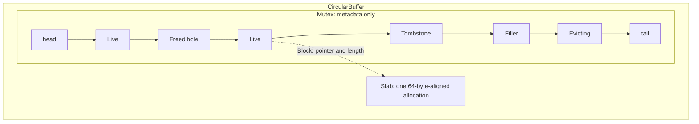
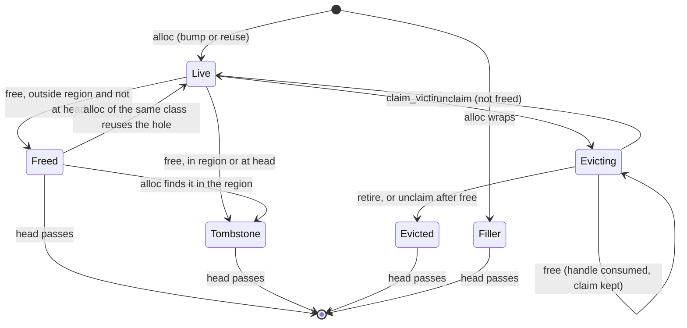

# Circular buffer

The circular buffer bounds the memory that mini-pages, and later cached full
pages, use. It follows the BF-Tree paper's §4 and the upstream
implementation. Its crate, `bf-tree-circular-buffer`, knows nothing about
pages: it hands out blocks of bytes. [Plan 0010](../plans/0010-bf-tree-circular-buffer.md)
built it; [plan 0011](../plans/0011-bf-tree-mini-page.md) allocates
mini-pages from it, [plan 0013](../plans/0013-bf-tree-mini-tree.md) puts it
into the tree, and [plan 0014](../plans/0014-bf-tree-eviction.md) evicts
from it.

## Shape

- **One slab.** Every block lives in one allocation of `capacity` bytes, a
  power of two. A block at logical address `addr` occupies
  `[addr, addr + 16 + size)`; its slab offset is `addr & (capacity - 1)`.
  Logical addresses only increase.
- **Physical budget.** `used = tail - head <= capacity`. A dead block keeps
  its space until the head passes it, so a block that dies behind the head
  makes room only when the head reaches it.
- **Wrap fillers.** A block never crosses the end of the slab. When it
  would, a dead filler covers the rest of the slab first. With
  `capacity >= 2 * (largest class + 16)`, an empty buffer always fits the
  largest block after a filler.
- **Metadata outside the slab.** Block states live in a `VecDeque` behind
  the mutex, not in inline headers as upstream does, so a bug in page code
  cannot corrupt the buffer's bookkeeping. The 16 header bytes per block are
  still charged, which keeps the paper's accounting; debug builds store a
  canary there.

## Block states

- **Holes, as in the paper and upstream.** A block freed behind the head
  and outside the second-chance region becomes a hole on its class's free
  list. An allocation reuses a hole of its own class only (the newest
  first), so a reused hole always has exactly the requested size. Holes of
  larger classes are not used for smaller requests. A reused hole keeps its
  old position, so its block reaches the head sooner than a fresh one would.
- **Second-chance region.** The oldest `p` percent of the buffer, measured
  back from the tail. Blocks freed there become tombstones, and holes that
  age into it are tombstoned instead of reused. An evictor can relocate a
  hot block out of the region (plan 0014).
- **Claims.** `claim_victim` marks the oldest live block `Evicting`. A
  claimed block is never reused and the head waits for it, so blocks leave
  in FIFO order. Several evictors hold distinct claims. A `Victim` names a
  block and gives no access to its bytes; the evictor reaches them through
  the owner's entry, under the owner's lock.

## Safety

`bf-tree-circular-buffer` is the only crate on the `tools/check-unsafe`
allowlist ([build system](build-system.md)). Within it, only `slab.rs` and
`block.rs` allow `unsafe` code. The unsafe operations are allocating and
freeing the slab, building slices from a `Block`, and declaring `Block`
`Send` and `Sync`. They rely on four invariants:

1. **No two handles cover one byte.** A range is handed out only from the
   tail or from a `Freed` hole, and becomes reusable only after `free`
   consumed its `Block`. `retire` asserts that the claimed block was freed,
   because otherwise the head would pass bytes that a handle still covers.
   `alloc` panics on a size that is not a class, because such a size could
   overlap the next block when it lands in a hole.
2. **A block belongs to its buffer.** `free` asserts that the block lies in
   this slab and matches a live or claimed entry's sequence number,
   address, and span.
3. **The slab outlives every handle.** If blocks are still outstanding when
   the buffer is dropped, the slab is leaked instead of freed.
4. **Access follows the handle.** `AsMut` needs `&mut Block` and `AsRef`
   gives `&[u8]`, so the borrow checker enforces aliasing per handle.

Block bytes are leaf-level data, read and written only under the owning
leaf's lock, so no optimistic reader touches the slab. (Inner nodes, which
readers traverse optimistically, use immutable images; see plan 0016.)

The tests run under Miri through Buck2 (`@build/mode/miri`), including a
threaded stress test.

## Locking

One `std::sync::Mutex` guards the metadata and is innermost: callers may
hold a leaf lock when they call the buffer, and the buffer calls nothing
while holding it. It is never held while block bytes are read, written, or
zeroed. A range changes hands only through the mutex (`free`, then a later
`alloc`), which orders the previous owner's writes before the next owner's
zeroing. Poisoning is ignored, which is safe because every critical section
checks before it mutates. Plan 0012 moves the mutex onto `bf-tree-sync`.

`in_second_chance` reads a relaxed copy of the tail without the mutex. A
stale value only shifts which block gets a second chance.

## Use in the tree

Since [plan 0013](../plans/0013-bf-tree-mini-tree.md), each tree has one
circular buffer, owned by its `LeafMap`
([leaf storage](bf-tree-leaf-store.md)):

- **Budget.** `TreeConfig::circular_buffer_bytes` sets the capacity
  (default `DEFAULT_CIRCULAR_BUFFER_BYTES`, 32 MiB). It is a runtime
  setting: the superblock does not record it, and `Tree::open_with` takes it
  for an existing store. `TreeConfig::validate` builds a buffer with
  `CircularBuffer::new` to check the budget, so construction cannot fail on
  a validated configuration. The second-chance share is 0 until plan 0014.
- **Classes.** The buffer's classes are the
  [mini-page ladder](bf-tree-mini-page.md#size-classes-and-the-admission-rule)
  followed by the leaf page size `L`. The `L` class is for full pages in
  [plan 0015](../plans/0015-bf-tree-caching.md) and has no user yet.
- **Ownership.** A mini-page block is owned by its leaf. The leaf's entry
  holds the `Block` handle, and the block's owner is the leaf's ID.
  `LeafMap::buffer` is the only call site that allocates mini-page blocks,
  and it runs under the leaf's X lock. Growth frees the old block there
  too. `Tree::merge_leaf` frees the block under the same X lock after the
  merged pages are written. `LeafMap::into_store` frees every remaining
  block.
- **Locking.** The buffer's mutex is innermost in the
  [lock order](bf-tree-concurrency.md#lock-order): a thread takes it under
  a leaf's X lock and never waits for a leaf lock while it holds it.
- **A full buffer.** A failed allocation is interim
  `TreeError::CircularBufferFull`: the write did not happen, and the caller
  can `flush` to free blocks and retry. (If the failure follows a merge, the
  merge stays done; see the [mini-page design](bf-tree-mini-page.md#in-the-tree).) A freed block makes room only when
  the head passes it; a single-threaded `flush` frees every block, so the
  head passes them all. Plan 0014 replaces the error with eviction.

## Measurements

`circular_buffer_cost` (release, one thread, Apple M4 Pro, 2026-11-04):
one `alloc` plus one `free` with 10,000, 100,000, and 300,000 live blocks
of classes 64 to 512 bytes costs 37, 81, and 123 ns. In that workload about
99.9 percent of allocations reuse a hole: reuse does not move the tail, so
with spare capacity few holes age into the second-chance region. Plan 0023
compares free lists with tombstone-on-free under eviction pressure.

## Sources

- [BF-Tree paper](../references.md#bf-tree-paper), §4.
- Upstream at `f442e6172bf7e5483ff320d8e3ac16a70e31bbd6`:
  `src/circular_buffer/mod.rs` and `freelist.rs`. peppydb differs by keeping
  metadata outside the slab, claiming the oldest live block instead of
  reserving a range with an eviction cursor, letting `free` advance a dead
  head, and using one mutex for all free lists (upstream tombstones a block
  when its list's lock is contended).
