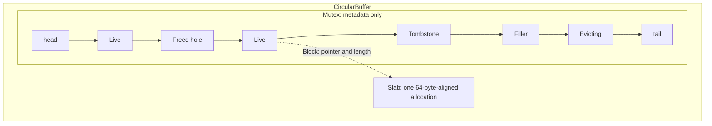
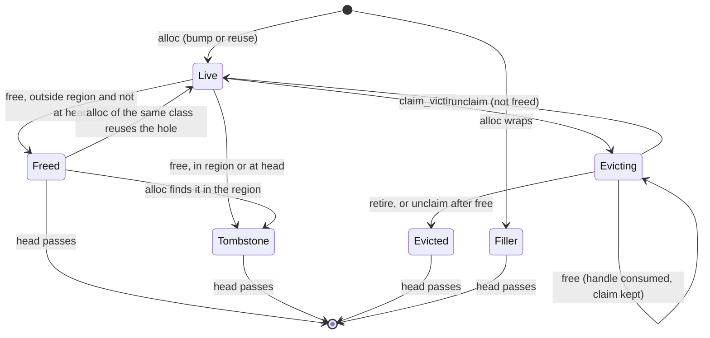
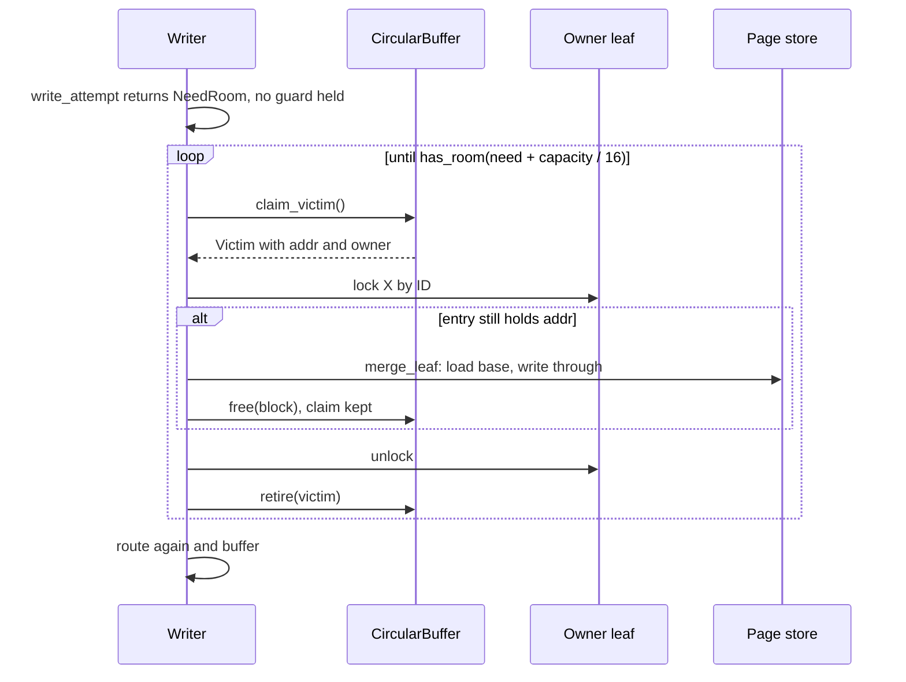

# Circular buffer

The circular buffer bounds the memory that mini-pages and cached full pages
use. It follows the BF-Tree paper's §4 and the upstream
implementation. Its crate, `bf-tree-circular-buffer`, knows nothing about
pages: it hands out blocks of bytes. [Plan 0010](../plans/0010-bf-tree-circular-buffer.md)
built it; [plan 0011](../plans/0011-bf-tree-mini-page.md) allocates
mini-pages from it, [plan 0013](../plans/0013-bf-tree-mini-tree.md) puts it
into the tree, [plan 0014](../plans/0014-bf-tree-eviction.md) evicts
from it, and [plan 0015](../plans/0015-bf-tree-caching.md) keeps full pages
in it ([caching policy](bf-tree-caching.md)).

## Shape

- **One slab.** Every block lives in one allocation of `capacity` bytes, a
  power of two. A block at logical address `addr` occupies
  `[addr, addr + 16 + size)`; its slab offset is `addr & (capacity - 1)`.
  Logical addresses only increase.
- **Physical budget.** `used = tail - head <= capacity`. A dead block keeps
  its space until the head passes it, so a block that dies behind the head
  makes room only when the head reaches it.
- **Wrap fillers.** A block never crosses the end of the slab. When it
  would, a dead filler covers the rest of the slab first. With
  `capacity >= 2 * (largest class + 16)`, an empty buffer always fits the
  largest block after a filler.
- **Metadata outside the slab.** Block states live in a `VecDeque` behind
  the mutex, not in inline headers as upstream does, so a bug in page code
  cannot corrupt the buffer's bookkeeping. The 16 header bytes per block are
  still charged, which keeps the paper's accounting; debug builds store a
  canary there.

## Block states

- **Holes, as in the paper and upstream.** A block freed behind the head
  and outside the second-chance region becomes a hole on its class's free
  list. An allocation reuses a hole of its own class only (the newest
  first), so a reused hole always has exactly the requested size. Holes of
  larger classes are not used for smaller requests. A reused hole keeps its
  old position, so its block reaches the head sooner than a fresh one would.
- **Second-chance region.** The oldest `p` percent of the buffer, measured
  back from the tail. Blocks freed there become tombstones, and holes that
  age into it are tombstoned instead of reused. The tree copies a block
  that is accessed in the region to the tail instead of leaving it for
  eviction (plan 0014; see [the second chance](#the-second-chance)).
- **Claims.** `claim_victim` marks the oldest live block `Evicting`. A
  claimed block is never reused and the head waits for it, so blocks leave
  in FIFO order. Several evictors hold distinct claims. A `Victim` names a
  block and gives no access to its bytes; the evictor reaches them through
  the owner's entry, under the owner's lock.

## Safety

`bf-tree-circular-buffer` is the only crate on the `tools/check-unsafe`
allowlist ([build system](build-system.md)). Within it, only `slab.rs` and
`block.rs` allow `unsafe` code. The unsafe operations are allocating and
freeing the slab, building slices from a `Block`, and declaring `Block`
`Send` and `Sync`. They rely on four invariants:

1. **No two handles cover one byte.** A range is handed out only from the
   tail or from a `Freed` hole, and becomes reusable only after `free`
   consumed its `Block`. `retire` asserts that the claimed block was freed,
   because otherwise the head would pass bytes that a handle still covers.
   `alloc` panics on a size that is not a class, because such a size could
   overlap the next block when it lands in a hole.
2. **A block belongs to its buffer.** `free` asserts that the block lies in
   this slab and matches a live or claimed entry's sequence number,
   address, and span.
3. **The slab outlives every handle.** If blocks are still outstanding when
   the buffer is dropped, the slab is leaked instead of freed.
4. **Access follows the handle.** `AsMut` needs `&mut Block` and `AsRef`
   gives `&[u8]`, so the borrow checker enforces aliasing per handle.

Block bytes are leaf-level data, read and written only under the owning
leaf's lock, so no optimistic reader touches the slab. (Inner nodes, which
readers traverse optimistically, use immutable images; see the
[concurrency design](bf-tree-concurrency.md#frames).)

The tests run under Miri through Buck2 (`@build/mode/miri`), including a
threaded stress test.

## Locking

One `std::sync::Mutex` guards the metadata and is innermost: callers may
hold a leaf lock when they call the buffer, and the buffer calls nothing
while holding it. It is never held while block bytes are read, written, or
zeroed. A range changes hands only through the mutex (`free`, then a later
`alloc`), which orders the previous owner's writes before the next owner's
zeroing. Poisoning is ignored, which is safe because every critical section
checks before it mutates. Plan 0012 moves the mutex onto `bf-tree-sync`.

`in_second_chance` reads a relaxed copy of the tail without the mutex. A
stale value only shifts which block gets a second chance.

## Use in the tree

Since [plan 0013](../plans/0013-bf-tree-mini-tree.md), each tree has one
circular buffer, owned by its `LeafMap`
([leaf storage](bf-tree-leaf-store.md)):

- **Budget.** `TreeConfig::circular_buffer_bytes` sets the capacity
  (default `DEFAULT_CIRCULAR_BUFFER_BYTES`, 32 MiB). It is a runtime
  setting: the superblock does not record it, and `Tree::open_with` takes it
  for an existing store. `TreeConfig::validate` builds a buffer with
  `CircularBuffer::new` to check the budget, so construction cannot fail on
  a validated configuration. `TreeConfig::second_chance_percent` sets the
  second-chance share (see [Configuration](#configuration)).
- **Classes.** The buffer's classes are the
  [mini-page ladder](bf-tree-mini-page.md#size-classes-and-the-admission-rule)
  followed by the leaf page size `L`. Full pages use the `L` class
  ([plan 0015](../plans/0015-bf-tree-caching.md)).
- **Ownership.** A block is owned by its leaf. The leaf's entry holds the
  `Block` handle, and the block's owner is the leaf's ID. A leaf holds at
  most one block: a mini-page or a full page.
  Two call sites allocate mini-page blocks, both under the leaf's X lock:
  `LeafMap::buffer` (creation and growth; growth frees the old block there
  too) and `Tree::relocate` (the second chance). `Tree::merge_leaf` frees
  the block under the same X lock after the merged pages are written, or at
  once for a mini-page with no dirty record.
  Full-page blocks are covered in [Full blocks](#full-blocks).
  `LeafMap::into_store` frees every remaining block.
- **Locking.** The buffer's mutex is innermost in the
  [lock order](bf-tree-concurrency.md#lock-order): a thread takes it under
  a leaf's X lock and never waits for a leaf lock while it holds it.

### Full blocks

A block of kind `Kind::Full` holds a complete leaf page of `L` bytes. The
leaf is then `Full`: the block answers every key in the leaf's range, and
`LeafEntry::dirty` says whether it is newer than the store. The
[caching design](bf-tree-caching.md) describes when the tree keeps a page.
The block's events, all under the owner's X lock:

| Event | Code | Effect on the block |
| --- | --- | --- |
| Promotion on a read or scan | `Tree::promote` | Allocates a clean `Kind::Full` block, only if it fits without eviction. |
| Write-driven merge | `Tree::keep_merged` | Allocates a clean block for the merged page, only if it fits without eviction. |
| Direct write | `Tree::place` | Changes bytes in place and sets `dirty`. No allocation. |
| Overflow | `LeafMap::release_full` | Writes the page back if dirty, then frees the block. |
| Eviction | `Tree::evict` | Writes the page back if dirty, or only frees it if clean, then retires the claim. |
| Relocation | `Tree::relocate` | Copies the page to a fresh `Kind::Full` block at the tail and keeps `dirty`. |
| Checkpoint pass | `LeafMap::write_back` | Writes a dirty page back and clears `dirty`. The block stays. |

Hints (promotions and cache fills) allocate only when room exists without
eviction. When they lack room, the reader releases its lock and the
deferred path (`Tree::finish_deferred`) evicts only `Kind::Full` blocks and
mini-pages with no dirty record (`Tree::evict_if_clean`). It stops at a
mini-page with a dirty record and unclaims it. See
[Deferral](bf-tree-caching.md#deferral).

### A full buffer

`LeafMap::buffer` returns `Ok(None)` when the buffer cannot supply a block.
Nothing changed then. The write path in `crates/bf-tree/src/write.rs`
loops over `write_attempt`, which returns `Attempt::Done` or
`Attempt::NeedRoom`. On `NeedRoom`, every leaf guard of the attempt has
already been dropped. `write` calls `make_room(classes.largest())` with no
leaf lock held, then routes the key again. If the failure follows a merge,
the merge stays done, and the retry buffers into whichever half now owns
the key (see the [mini-page design](bf-tree-mini-page.md#in-the-tree)).

A writer never evicts while it holds a leaf lock. Eviction must lock the
victim's owner, and that owner can be the writer's own leaf, or the leaf of
another writer that is evicting too. Holding one leaf while waiting for
another would allow a self-deadlock or an ABBA deadlock.

### Making room

`Tree::make_room(need)` in `crates/bf-tree/src/evict.rs` evicts until
`has_room(need + capacity / 16)`. Each round calls `evict_one`, which
returns one of three results:

| `Eviction` | Meaning | `make_room` does |
| --- | --- | --- |
| `Evicted` | One claimed block was evicted. | Checks `has_room` again. |
| `Busy` | Other evictors hold every live block. | Yields, then checks again. |
| `Empty` | No live block is left. | Stops. |

- **Target.** `need` is the largest mini-page class, so the retry's
  allocation fits whatever class it needs, including a wrap filler
  (`has_room` counts it).
- **Slack.** The extra 1/16 of the capacity makes each `make_room` evict a
  batch. Without it, the buffer stays full under write pressure.
  Relocation never evicts, so it then finds no room, and a hot block in
  the second-chance region is evicted at the head anyway: the second chance
  never happens. The hot-leaf test found this (plan 0014, Discoveries).
  Upstream gets the same slack by freeing about 1 KiB per eviction round
  (`TARGET_EVICT_SIZE` in `src/tree.rs`).
- **`Empty` never blocks a write.** With no live block, the head has
  reached the tail, and the capacity rule
  (`capacity >= 2 * (largest class + 16)`) guarantees that any allocation
  fits. The slack therefore never makes a write wait.
- **Room appears only when the head advances.** An eviction behind the
  head makes no room at once; the evicted block keeps its space until the
  head passes it.

**Over-eviction behind a stalled head is accepted, as upstream does.** A
slow evictor that holds the claim at the head blocks room for every
thread. Under pressure, the other threads evict live blocks behind it
without gaining room, until every live block is claimed and they see
`Busy`. The protocol stays live, because the holder of the head claim
locks at most one leaf and no waiting thread holds a leaf lock. The cost is
extra evictions, bounded by the number of live blocks, and only while a
head eviction is stalled.

Plan 0014 left open whether the tree needs room accounting for in-flight
evictions (`has_room_after_claims`) and a `Condvar` wait for the head to
move. Plan 0023 measured it with `bench_head_stall`
(`crates/bf-tree/src/tests/bench_io.rs`): 12 threads of replacing puts on
an in-memory tree with 1,000,000 keys of 8 bytes, 16-byte values, and a
4 MiB circular buffer, for 1 s. In the stalled case, a test-only hook
(`evict::EVICT_STALL_MICROS`, `cfg(test)` only) makes one eviction stall
for 20 ms every 100 ms while it holds the head claim and its owner's leaf
lock. Environment: Docker on macOS (aarch64), indicative (Docker Desktop
29.2.1 on macOS 27.0.1, Apple M4 Pro host, Linux VM with 12 CPUs, 8 GB of
RAM, kernel 6.12.72-linuxkit); release build.

| Case | M puts/s | Evictions per 1000 puts | p50 (µs) | p99 (µs) | Max (µs) |
| --- | --- | --- | --- | --- | --- |
| No stall | 1.95 | 82.3 | 1.0 | 53.0 | 39,587 |
| Stalled head | 1.71 | 88.6 | 1.0 | 60.1 | 53,230 |

**Answer.** With the stall, evictions per put rose by about 8 percent and
p99 latency by about 13 percent. That is no evidence that
`has_room_after_claims` and a `Condvar` wait are needed now, so the tree
keeps the current protocol. The benchmark counts evictions per 1000 puts,
not per allocation failure, because a failure counter would put a shared
counter on the put path. The question can return if the reference device
shows longer stalls, for example from slow device writes.

### Evicting one victim

`Tree::evict(victim)` runs with no leaf lock held:

1. `claim_victim` (in `evict_one`) marks the oldest live block `Evicting`
   and returns a `Victim` that names the block and its owner leaf.
2. `evict` locks the owner by ID with `LeafMap::write`, a blocking
   exclusive lock. If the owner cannot be locked (for example, its slot is
   no longer live), `evict` unclaims the block and returns the error.
3. `LeafMap::holds` checks whether the owner's entry still holds the block
   (`Block::is` compares addresses). If not, the owner grew, merged, or
   relocated the block after the claim and freed it. A freed block stays
   claimed, so `evict` only retires it.
4. If the block is a full page, `evict` calls `LeafMap::release_full`: it
   writes the page back if `dirty`, frees the block, and makes the leaf
   `Base`. Then `evict` retires the claim. A clean full page is evicted
   with no store write.
5. Otherwise `evict` calls `Tree::merge_leaf`, the same merge that writes
   and the checkpoint pass use. A mini-page with no dirty record is freed without I/O. It loads the base page into thread-local scratch,
   merges in place or splits into a fresh right leaf, writes the result
   through, and frees the block last. A split's right guard drops before
   the owner's guard. Then `evict` retires the claim.
6. If `merge_leaf` or the write-back fails (for example, a store error),
   the block stays in the entry, so no buffered record or dirty page is
   lost. `evict` unclaims the block and returns the error.

Merges never allocate from the circular buffer: both outputs go to the
store, and the leaf becomes `Base`. Eviction can therefore always complete
under a full buffer.

### The second chance

A block near the head is the next victim. If it is accessed there, the
tree copies it to the tail instead (paper §4.3, §5.5). Upstream does this
at access time too (`move_cache_page_to_tail` in `src/mini_page_op.rs`).
Eviction itself stays strictly FIFO. The code is in
`crates/bf-tree/src/maintain.rs`.

`Tree::relocate(leaf)` runs under the leaf's X lock:

1. If the leaf has no block, or the block is not in the second-chance
   region, it does nothing.
2. It allocates a block of the same size and kind. A full page is copied
   byte for byte and keeps its `dirty` flag; the old block is freed. If the
   allocation fails, it keeps the old block. Relocation is best effort and
   never evicts: an eviction to save one block could merge other leaves,
   which inverts the priority.
3. For a mini-page, it copies the records with
   `Mini::copy_into(fresh, true)`, which drops clean records whose
   reference bit is clear.
4. It puts the fresh mini-page in the entry and frees the old block. The
   old block is in the region, so it becomes a tombstone. Until the head
   passes it, the budget is charged for both copies.

Writes and reads reach `relocate` in different ways:

- **Writes** call `relocate` under their X lock after buffering. A write
  that grew the mini-page has already moved it to the tail, so relocating
  first would copy twice.
- **Reads and scans** hold only an S lock, which cannot change the entry.
  Under S, `Tree::note` returns a `Noted` value with the leaf ID, its
  `LeafEntry::version`, and an `aging` flag that is set if the block is in
  the region. A read may add a caching hint to it
  ([caching policy](bf-tree-caching.md#hints-and-their-validity)).
  After the S lock is dropped, `Tree::maintain` tries the X lock once with
  `LeafMap::try_write`. It skips everything if the lock is busy or the
  version changed. Otherwise it calls `relocate` if the block is aging,
  then applies the hint. A reader never waits
  for a hint. Under sustained contention a hot block may not be relocated,
  and FIFO eviction then merges it. That is acceptable: maintenance is
  best effort.

`LeafWrite::take_mini`, `take_full`, and `set_full` bump the version.
Every block change (growth, merge, relocation, promotion, release) goes
through one of them. A bump without a change only skips a hint.

### Configuration

| Setting | Default | Rule |
| --- | --- | --- |
| `circular_buffer_bytes` | `DEFAULT_CIRCULAR_BUFFER_BYTES` (32 MiB) | Power of two, at least `2 * (L + 16)` |
| `second_chance_percent` | `DEFAULT_SECOND_CHANCE_PERCENT` (10) | `validate` rejects values above 100 |

`second_chance_percent` is passed to `CircularBuffer::new`. It is a runtime
setting, like the budget: the superblock does not record it. `0` disables
relocation, and `free` then never tombstones for the region. The default
of 10 follows upstream (`cb_copy_on_access_ratio = 0.1` in `src/config.rs`).
Values near 100 relocate on almost every access and make `free` tombstone
almost every block, which costs a copy per access and fills the buffer
with dead space faster. Plan 0023 did not measure this cost; it remains
open.

### Guarantees

- **The budget is never exceeded.** `used() <= capacity` holds after every
  operation. The model tests assert it after every step with 1, 2, and
  4 KiB buffers and every caching policy. Full pages and cache fills
  allocate only when room exists without eviction.
- **No circular-buffer error reaches callers.** Under a validated
  configuration, no public operation fails because the buffer is full.
  `TreeError::CircularBufferFull` no longer exists. A write can still fail
  with a store error from an eviction.
- **Eviction is FIFO.** `claim_victim` always claims the oldest live block.
  Only access-time relocation changes which blocks are oldest.
- **A claim never leaks.** Every claim ends in `retire` or `unclaim`,
  including when the owner cannot be locked and when the merge fails. A
  leaked claim would hold the head forever.
- **No buffered record is lost.** The block is freed only after the merged
  pages are written through. A dirty full page is freed only after it is
  written back.

## Measurements

`circular_buffer_cost` (release, one thread, Apple M4 Pro, 2026-11-04):
one `alloc` plus one `free` with 10,000, 100,000, and 300,000 live blocks
of classes 64 to 512 bytes costs 37, 81, and 123 ns. In that workload about
99.9 percent of allocations reuse a hole: reuse does not move the tail, so
with spare capacity few holes age into the second-chance region.

The Linux measurements below are from plan 0023. Environment: *Docker on
macOS (aarch64), indicative*: Docker Desktop 29.2.1 on macOS 27.0.1, Apple
M4 Pro host; a Linux VM with 12 CPUs, 8 GB of RAM, and kernel
6.12.72-linuxkit; release builds; one thread.

`circular_buffer_cost` (the same workload as above): 31.7, 69.5, and
106.9 ns per `alloc` plus `free` with 10,000, 100,000, and 300,000 live
blocks.

`bench_circular_buffer_free` (`crates/bf-tree-circular-buffer/src/tests/bench.rs`)
compares size-class free lists with tombstone-on-free, a crate-private
switch (`without_holes`) that only this benchmark uses. The trace is
synthetic and seeded: 50,000 owners, 80 percent of steps on 20 percent of
them, classes 256 to 4096 bytes, a 16 MiB buffer, and 3,000,000 steps. A
step on an owner without a block allocates the smallest class; otherwise
the block grows by one class, and a block at the largest class is freed,
as a merge frees it. A failed allocation evicts the oldest block, as the
tree does. Utilisation is live bytes over capacity, sampled every 1024
steps.

| Variant | ns per step | Evictions | Utilisation |
| --- | --- | --- | --- |
| Free lists | 70.2 to 72.1 | 426,599 | 96.3% |
| Tombstone-on-free | 74.8 to 76.4 | 967,219 | 54.0% |

With tombstone-on-free, a freed block keeps its space until the head
passes it, so the buffer holds about half as many live bytes and evicts
about 2.3 times as often. Free lists also cost slightly less per step.
Plan 0010 keeps free lists to stay faithful to the paper and upstream;
this measurement supports that choice. The trace is synthetic, not
recorded from the tree, so it shows the direction of the effect rather
than the tree's exact numbers.

The circular-buffer mutex does not limit put scaling in plan 0023's
measurement ([concurrency](bf-tree-concurrency.md#the-circular-buffer-mutex)).

## Sources

- [BF-Tree paper](../references.md#bf-tree-paper), §4.
- Upstream at `f442e6172bf7e5483ff320d8e3ac16a70e31bbd6`:
  `src/circular_buffer/mod.rs` and `freelist.rs`. peppydb differs by keeping
  metadata outside the slab, claiming the oldest live block instead of
  reserving a range with an eviction cursor, letting `free` advance a dead
  head, and using one mutex for all free lists (upstream tombstones a block
  when its list's lock is contended).
