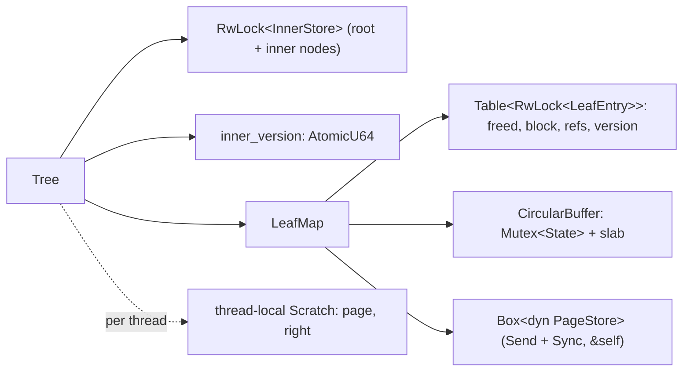
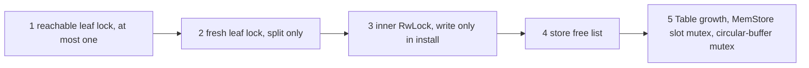
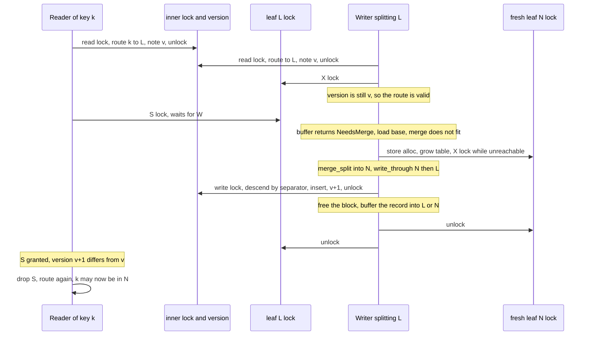

# BF-Tree concurrency

Many threads can share one `Tree`. The tree is `Send + Sync`, and every
operation takes `&self`. This document records which locks exist, what each
one protects, the order in which a thread may take them, the protocol that
every key operation follows, and the guarantees that result.
[Plan 0012](../plans/0012-bf-tree-shared-tree.md) built this design, and
[plan 0013](../plans/0013-bf-tree-mini-tree.md) added mini-pages in the
circular buffer under the same leaf locks, and
[plan 0014](../plans/0014-bf-tree-eviction.md) added eviction and
access-time relocation without a new lock rank.
[Plan 0016](../plans/0016-bf-tree-concurrency.md) replaces the interim
routing lock described below with per-node frames.

Related documents: [tree structure](bf-tree-structure.md) (writes, splits,
scans) and [leaf storage](bf-tree-leaf-store.md) (the leaf mapping table,
`load_base`, `write_through`, and durability).

## Shape



```rust
pub struct Tree {
    config: TreeConfig,
    inner: RwLock<InnerStore>,
    /// Bumped, under the inner write lock, by every structural change.
    inner_version: AtomicU64,
    leaves: LeafMap,
}
```

## Locks and what they protect

| Lock | Type | Protects | Taken by |
| --- | --- | --- | --- |
| Leaf lock | `RwLock<LeafEntry>`, one per `LeafId` | the entry (`freed`, `block`, `refs`, `version`), the mini-page bytes in its block, and the leaf's base page in the store | reads and scans (S), writes, merges, splits, and relocation (X), `flush` and eviction (X, by ID), `maintain` (X, by ID, `try_write` only) |
| Inner lock | `RwLock<InnerStore>` | the inner-node buffers and the root | `route` (read), `install` (write), `height`, `inner_count`, `check_invariants` (read) |
| Routing version | `AtomicU64` (not a lock) | detects structural changes since a route was taken | written only under the inner write lock |
| Circular-buffer mutex | `Mutex<State>` inside `CircularBuffer` | block metadata: head, tail, free lists, claims | `alloc`, `free`, `used`, `has_room`, `claim_victim`, `retire`, `unclaim` |
| Store locks | backend mutexes | free lists, slot bytes (`MemStore`), slot flags | `PageStore` methods only |
| Table growth | `Mutex<()>` inside `Table<T>` | chunk initialization and `len` | `Table::grow_to` only |

The leaf lock is the paper's per-leaf reader-writer lock (§3.3). Every base
write and every mini-page change happens under X, so a leaf that a thread
reads under S or X is consistent. A reader under S marks reference bits
through `AtomicU64`s beside the mini-page; the page bytes do not change. Only `LeafMap::load_base` reads a base page and only
`LeafMap::write_through` writes one; `load_base` takes a guard as proof
that the caller holds the lock.

Per-thread scratch buffers (`with_scratch`) are not shared, so they need no
lock. A nested call, for example from a user callback, gets a temporary
scratch instead of a `RefCell` panic.

## Lock order

Each lock has a rank. A thread may wait for a lock only if every lock that
it holds has a lower rank.



- Rank 1 is the leaf that routing named. An operation holds at most one.
- Rank 2 is the right half of a split. It is freshly allocated and no
  separator names it yet.
- Rank 3 is the inner lock. `route` takes it in read mode while it holds
  no other lock. `install` takes it in write mode while it holds ranks 1
  and 2.
- Ranks 4 and 5 are innermost. `MemStore::alloc` and `FileStore::alloc`
  hold the free-list mutex while they grow their slot table, and
  `MemStore::free` holds it while it zeroes a slot under the slot mutex.
  `MemStore::read` and `write` take only the slot mutex. `FileStore` reads
  and writes take no lock. No holder of a rank 4 or 5 lock takes a leaf
  lock or the inner lock.
- The circular-buffer mutex is innermost too. Allocation and free take it
  only under a leaf's X lock: `LeafMap::buffer` allocates and grows
  mini-pages, `Tree::relocate` allocates a copy and frees the old block,
  `merge_leaf` frees a block, and `into_store` frees the rest.
  `has_room`, `claim_victim`, `retire`, `unclaim`, and
  `circular_buffer_used` take it while the caller holds no leaf lock. The
  buffer calls nothing while it holds the mutex, so its holder never waits
  for a leaf lock.
- No thread waits for circular-buffer room while it holds a leaf lock. A
  full buffer ends the write attempt (`Attempt::NeedRoom`), every guard is
  dropped, and only then does the writer evict.

Plan 0014 added no rank. Eviction and `maintain` take a leaf lock by ID
while they hold no other leaf lock, exactly as `flush` does.

## Route, lock, validate, retry

Every operation on a key follows one protocol:

1. Take the inner read lock, descend to the leaf, read `inner_version`,
   and release the lock (`Tree::route`).
2. Lock the leaf: S for reads and scans (`Tree::read_leaf`), X for writes
   (`Tree::with_leaf_write`).
3. If `inner_version` differs from the noted value (`Tree::route_changed`),
   drop the leaf lock and start again.
4. Otherwise run the operation under the leaf lock.

```rust
fn with_leaf_write<R>(&self, key: &[u8],
    f: impl FnOnce(&mut LeafWrite<'_>) -> Result<R, TreeError>) -> Result<R, TreeError> {
    loop {
        let route = self.route(key);
        let mut leaf = self.leaves.write(route.leaf)?;
        if self.route_changed(&route) {
            continue; // the guard drops here
        }
        return f(&mut leaf);
    }
}
```

A split happens inside step 4, when a write's mini-page is full and
`merge_leaf` finds that the merge does not fit one page. `merge_leaf`
reuses `split_leaf` and `install` unchanged. `split_leaf` allocates and
X-locks a fresh right leaf, merges into it, writes both pages with one
`write_through` call, and calls `install`. `install` takes the inner write lock, finds the
parent by descending with the separator, inserts the separator, propagates
splits upward, and bumps `inner_version`. `merge_leaf` then frees the
mini-page's block, and the writer buffers its record into the half that
owns the key while it still holds both locks. The splitter then releases
the right leaf, and then the left leaf.



`install` needs no recorded path. The separator is a key of the right
half, so it lies in the left leaf's old range. That range cannot change
while the caller holds the left leaf's X lock, so the descent with the
separator reaches the left leaf, and its path is the path to update. A
debug assertion checks that the descent reaches `left`.

## Deadlock freedom

Every wait edge goes from a lower rank to a higher rank, so the wait graph
has no cycle. The cases:

1. **Routing** holds the inner read lock only while it descends in-memory
   nodes. It holds no leaf lock at that time and waits for nothing else. A
   retry drops the leaf lock before it routes again.
2. **A write** holds one reachable leaf. A split allocates a slot (ranks 4
   and 5, released before `alloc` returns) and then X-locks the fresh leaf.
   No route names the fresh leaf. Only a thread that locks leaves by ID can
   contend for it, and such a thread must hold no other leaf lock, so it
   releases the lock without waiting. `check_invariants`, `flush`,
   eviction, and `maintain` are such threads.
3. **`flush`** locks leaves by ID, one at a time, and holds no other leaf
   lock when it waits for one. Under that X lock it calls `merge_leaf`,
   which may split through `split_leaf` and `install` exactly as a write
   does, so the leaf it holds acts as rank 1 and the fresh right leaf as
   rank 2. It releases both before it locks the next ID.
4. **Eviction** runs only when the evicting thread holds no leaf lock: a
   writer returns `Attempt::NeedRoom` and drops every guard before it
   calls `make_room`. `Tree::evict` then locks exactly one leaf, the
   victim's owner, by ID with the blocking `LeafMap::write`. The victim can
   be the writer's own leaf or another evicting writer's leaf; because the
   writer holds nothing, neither case can deadlock. Under the owner's X
   lock, `merge_leaf` may split exactly as in a write or `flush`. The
   split's right guard drops before the owner's guard. `evict` releases
   both before it retires or unclaims the claim.
5. **`maintain`** applies a read's hint after the read drops its S lock.
   It holds no leaf lock and calls `LeafMap::try_write`, which never
   waits. If the lock is busy, the hint is skipped.
6. **`install`** takes the inner write lock while it holds leaf locks.
   Under the write lock it only edits `InnerStore` and allocates inner
   buffers. It never touches a leaf. No thread waits for a leaf lock while
   it holds the inner lock.
7. **Store, table, and circular-buffer locks** are innermost. Their holders
   take no leaf lock and no inner lock.
8. **`check_invariants`** copies the routing layer under the inner read
   lock, releases it, and then locks leaves one at a time. Its result is
   meaningful only at quiescence, but it cannot deadlock.

**Callbacks must not re-enter the tree.** `get_with` and `scan_with` run
user code under a leaf's S lock. A write to the same leaf from the callback
deadlocks on X. A second S request on the same leaf can also deadlock when
a writer is queued, because std's reader-writer lock may block new readers
behind a waiting writer. `Scan` holds no lock between `next` calls,
so iterator users are not affected.

## Hints and `maintain`

A read or scan holds only an S lock, which cannot change the entry. When
the leaf's block is in the second-chance region, `Tree::note` returns a
`Noted` value under S: the leaf ID, `LeafEntry::version`, and
`Hint::Relocate`. After it drops the S lock, the reader calls
`Tree::maintain`:

1. `LeafMap::try_write(leaf)`. If the lock is busy or the slot is not
   live, skip the hint.
2. If the version differs from the noted one, skip the hint. The block it
   named may be gone.
3. Otherwise call `Tree::relocate` under X.

`LeafWrite::take_mini` bumps the version, and every block change goes
through it. A stale hint therefore never passes the check. A reader never
blocks on maintenance, so readers of one leaf do not serialize. See the
[circular buffer design](bf-tree-circular-buffer.md#the-second-chance).

## Routing correctness

A leaf's key range changes only when the leaf splits. A split happens under
that leaf's X lock, and `install` bumps the version before the splitter
releases the lock. Suppose a thread routes key `k` to leaf `L` under version
`v` and then locks `L`. Two cases exist:

- No split of `L` completed since the thread read `v`. Then `L` still owns
  `k`, and the operation is correct whatever `route_changed` reports.
- A split of `L` completed. Its version bump happened before its release
  of `L`, which happened before this thread's acquisition of `L`. The
  thread therefore reads a version other than `v` and retries.

The memory orderings implement this order. `install` bumps the version with
`Release` under the inner write lock, the leaf unlock releases, the leaf
lock acquires, and `route_changed` loads with `Acquire`. `route` loads with
`Relaxed`, because only the inner write lock changes the version and
`route` holds the read lock.

A split that wrote its pages but has not yet installed its separator still
holds X on `L`, so no thread observes the intermediate state. A false
positive (a split of some other leaf) costs one retry.

As a guard against protocol bugs, `get_with` calls `page.check_key(key)`
when it loads the base page. A failure surfaces as the internal error
`TreeError::Page(PageError::KeyOutOfRange)`, never as wrong data. Scans
apply the cursor as the lower bound in every leaf instead. A blind write
loads no base page, so a misrouted record is caught when its leaf merges:
the merge's batch check rejects a key outside the base page's fences with
the same error. `check_invariants` also checks that every buffered key lies
within its leaf's fences. With the version bump removed from `install`, the
concurrent model test fails in 10 of 10 runs with this error, both under
plan 0012 and with blind writes.

## Guarantees

- **Writes on one key are linearizable.** Each operation on key `k` runs
  under the lock of the leaf that owns `k` at that moment, and a split moves
  `k` under the same lock. A `put` or `remove` returns after it has
  buffered its record in the leaf's mini-page under X (after a merge, if one
  was needed), so every later operation on `k` observes it. A key's value is
  the value of its last completed write.
- **Flush.** Every write that returned before `flush` began is in the store
  when `flush` returns, even with concurrent writers.
- **No multi-key atomicity.** Operations on different keys are independent.
- **Scans.** Both scan forms (`Scan` and `scan_with`) visit one leaf at a
  time under its S lock. A scan yields each key at most once and in
  increasing order. The records from one leaf reflect one consistent state
  of that leaf. A key that is present and unchanged for the whole scan, and
  lies in the range, is yielded. A scan is not a snapshot across leaves: it
  can see a concurrent write in one leaf and miss an earlier one in a leaf
  it already passed.
- **Progress.** The version changes only when a split completes, so every
  retry implies that some split completed and the system makes progress. A
  single thread can starve only under a continuous stream of splits.
- **Eviction progress.** Each `Evicted` round evicts one live block. If a
  slow claim holds the head, the other evictors eventually see `Busy` and
  yield. The holder of that claim locks at most one leaf, and no waiting
  thread holds a leaf lock, so it finishes and the head advances. A writer
  can lose its room to another thread and loop again, but some thread
  always makes progress.

## Interim routing layer

One `RwLock<InnerStore>` and one global `inner_version` give the final
protocol shape with a small, auditable implementation. They have two costs:

- Every descent writes the lock word of the one inner `RwLock`, so all
  threads contend on one cache line.
- Every split invalidates every in-flight route, which causes spurious
  retries, and structural changes are serialized.

[Plan 0016](../plans/0016-bf-tree-concurrency.md) replaces these with
per-node version-locked frames (the paper's optimistic latch coupling,
§3.4). `route`, `route_changed`, and `install` keep their signatures, and
readers stop taking any inner lock. The leaf locks, the lock order, and the
rule that every base read and write goes through `load_base` and
`write_through` do not change.

## `bf-tree-sync`

The `bf-tree-sync` crate is the one home for lock types in the tree crates.
`bf-tree-circular-buffer`, `bf-tree-store`, and `bf-tree` all use it. It
contains no `unsafe` code.

- **`Mutex<T>` and `RwLock<T>`** wrap the standard locks. Their guards are
  std's `MutexGuard`, `RwLockReadGuard`, and `RwLockWriteGuard`. `try_lock`,
  `try_read`, and `try_write` return `None` only on contention. Both types
  implement `Default`, so a `Table` can hold them.
- **Poisoning is ignored.** Every acquisition recovers the guard from a
  `PoisonError`. A panic inside a critical section is a bug that already
  failed its own operation. Poisoning would turn it into a failure of every
  later caller, including `Drop` paths and test harnesses that catch panics.
- **Check before mutating.** To make continuing after a panic safe, every
  critical section in the tree crates runs all fallible checks and
  assertions before its first write to the protected data. A panic then
  leaves the data consistent.
- **No spinning.** The wrappers add none. On Linux, std's futex-based
  `RwLock` spins briefly before it parks. On macOS, std's queue-based
  `RwLock` parks readers under reader contention, so contended benchmarks
  run on Linux only.

### `Table<T>`

`Table<T>` is an append-only, chunked collection that grows while other
threads read it. It holds the leaf entries and the `MemStore` slots, and the
`FileStore` freed flags. Plan 0016 uses it for inner frames.

```rust
pub struct Table<T> {
    chunks: Box<[OnceLock<Box<[T]>>]>, // chunk c holds 64 << c entries, 48 chunks
    len: AtomicUsize,
    grow: Mutex<()>,
}

impl<T: Default> Table<T> {
    pub fn len(&self) -> usize;                    // Acquire load
    pub fn get(&self, index: usize) -> Option<&T>; // lock-free, None at or beyond len
    pub fn grow_to(&self, len: usize);             // idempotent, serialized
}
```

- Chunks are never moved or freed, so a `&T` from `get` is valid for the
  life of the table, and `get` takes no lock.
- `grow_to` initializes every chunk below the new length with default
  entries and then publishes `len` with `Release`. A reader that sees an
  index below `len` therefore sees its initialized chunk.
- Growth is `grow_to(id + 1)`, not a push. The page store chooses leaf IDs:
  two concurrent splits can receive IDs 6 and 7 and reach the table in the
  opposite order, and a reopened store reuses freed IDs. `grow_to` is
  correct in every order. A new leaf entry is initialized through its own
  lock after growth.

## The shareable store contract

```rust
pub trait PageStore: Send + Sync + std::fmt::Debug {
    fn page_size(&self) -> usize;
    fn slots(&self) -> u64;
    fn alloc(&self) -> Result<LeafId, StoreError>;
    fn free(&self, id: LeafId) -> Result<(), StoreError>;
    fn read(&self, id: LeafId, buf: &mut [u8]) -> Result<(), StoreError>;
    fn write(&self, id: LeafId, buf: &[u8]) -> Result<(), StoreError>;
    fn sync(&self) -> Result<(), StoreError>;
    fn superblock(&self) -> &Superblock;
}
```

- Every method takes `&self`, and a store is shared between threads.
- Concurrent `alloc` calls return distinct IDs. `alloc` and `free` are
  serialized by the store's free-list mutex.
- **The store does not order concurrent accesses to one slot.** The caller
  must serialize them. The tree does so with the leaf lock: X for every
  write, S or X for every read.
- Accesses to distinct slots proceed in parallel. `MemStore` keeps its
  slots in a `Table<MemSlot>`, where each slot has its own page mutex and a
  `freed` flag; it allocates the page box before it takes the free-list
  mutex. `FileStore` uses positioned I/O through `&File`, keeps its freed
  flags in a `Table<AtomicBool>` whose length is the slot count, and takes
  no store-wide lock for reads and writes. Its `alloc` holds the free-list
  mutex while it extends the file.

The tests check the contract on both backends: concurrent allocations
return distinct IDs, and threads that write distinct slots read their own
bytes back.

## Verification

- `crates/bf-tree/src/tests/concurrent.rs` runs writers on disjoint key
  prefixes, each with its own `BTreeMap` oracle and a counter key with
  increasing values. Readers check that values are well formed and that
  counters never decrease. Scanners check order and values in both scan
  forms. Tiny nodes force frequent splits and root growth. After the
  threads join, the tree must equal the union of the oracles and pass
  `check_invariants`. The test runs with 2, 4, and 8 writers, on a
  `FileStore` with flush and reopen, and with 8 threads on one leaf's
  keys. A watchdog turns a deadlock into a failure. Since plan 0013 every
  write goes through mini-pages, so these runs exercise buffering, merges,
  and merge splits under contention. Since plan 0014,
  `threads_agree_under_constant_eviction` runs writers, readers, scanners,
  and a looping `flush` on 1 KiB and 2 KiB circular buffers (1 KiB with
  second-chance shares of 10 and 0 percent, 2 KiB with 100 percent), so
  every thread evicts and relocates. `a_writer_waits_while_every_block_is_claimed`
  claims every live block, starts a writer that needs room, and then
  evicts the claims; under a watchdog, the writer must finish.
- `crates/bf-tree/src/tests/buffered.rs` runs four writers on a
  `FileStore` while another thread calls `flush` in a loop. After a final
  `flush` and a reopen, the tree must hold every write. Plan 0013 ran the
  concurrent suites 20 times in release and 10 times in debug builds
  without a failure. Plan 0014 ran them 20 times in release and 5 times in
  debug builds without a failure.
- `crates/bf-tree/src/tests/route.rs` checks that a route taken before a
  split reports `route_changed`, that writes without a split do not, and
  that a write through a stale route lands in the right half.
- The `bf-tree-sync` tests check that a lock stays usable after a panic
  while it was held, and that `Table` growth is idempotent, order
  independent, and safe under concurrent reads.

## References

- [BF-Tree paper](../references.md#bf-tree-paper): §3.3 (mapping table and
  the per-page reader-writer lock), §3.4 (inner nodes and optimistic latch
  coupling, which plan 0016 completes), §5 (operations and scans).
- [Microsoft implementation](../references.md#microsoft-bf-tree-implementation),
  revision `f442e6172bf7e5483ff320d8e3ac16a70e31bbd6`: `src/tree.rs`
  (`traverse_to_leaf`, `check_parent!`), `src/storage.rs` (`PageTable` of
  `RwLock<PageLocation>`), `src/range_scan.rs` (one leaf lock at a time).
  peppydb differs by validating a route with a version after it takes the
  leaf lock, instead of during the descent (until plan 0016).
- Leis, Scheibner, Kemper, Neumann, "The ART of practical synchronization"
  (DaMoN 2016): the version-validated protocol that `route_changed`
  approximates with one global version.
