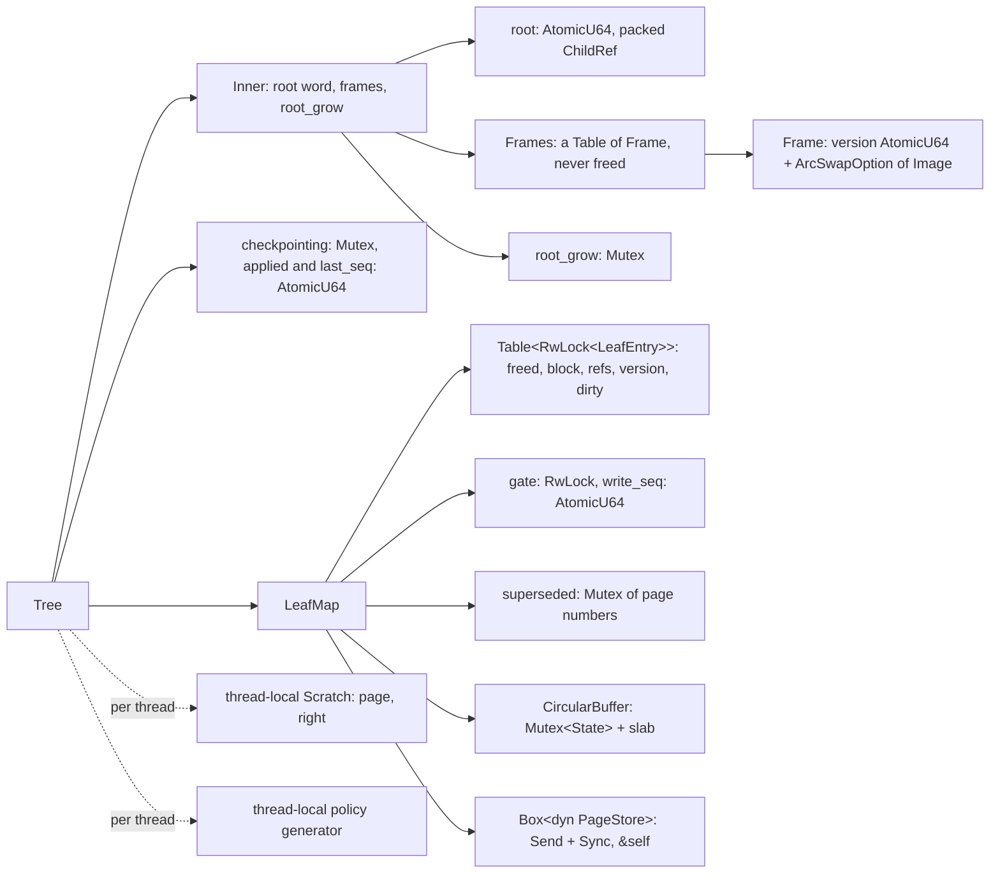
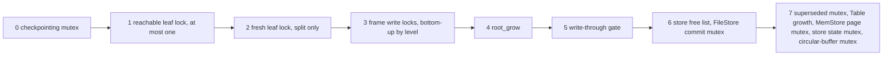
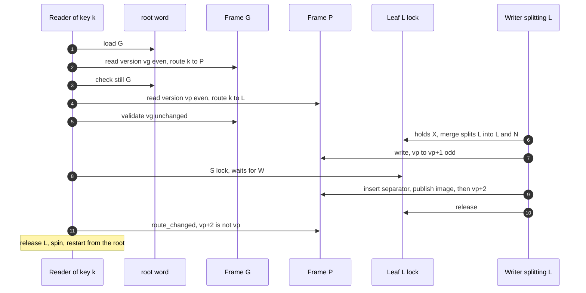
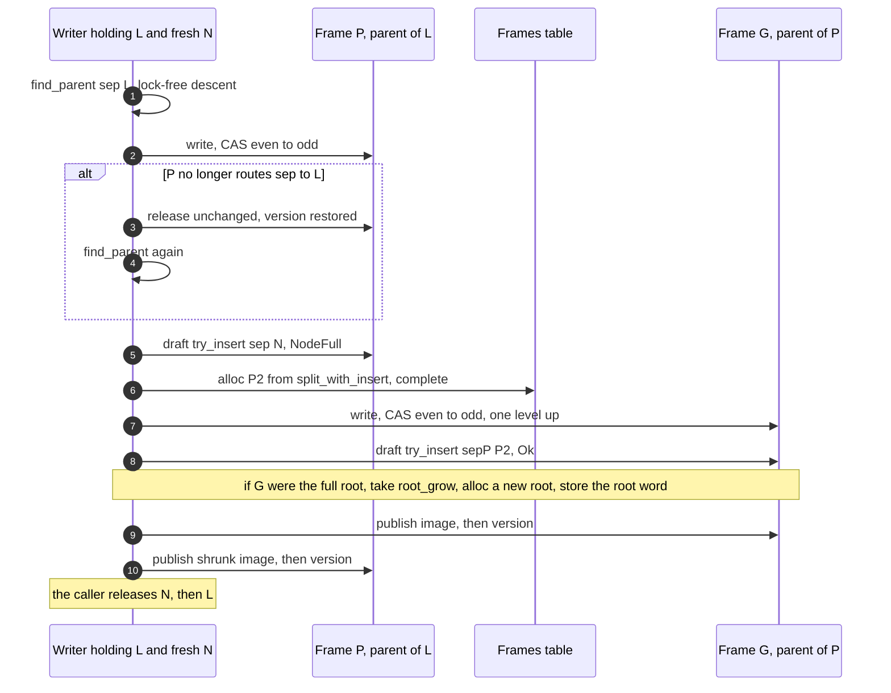

# BF-Tree concurrency

Many threads can share one `Tree`. The tree is `Send + Sync`, and every
operation takes `&self`. This document records which locks exist, what each
one protects, the order in which a thread may take them, the protocol that
every key operation follows, and the guarantees that result.
[Plan 0012](../plans/0012-bf-tree-shared-tree.md) built this design, and
[plan 0013](../plans/0013-bf-tree-mini-tree.md) added mini-pages in the
circular buffer under the same leaf locks, and
[plan 0014](../plans/0014-bf-tree-eviction.md) added eviction and
access-time relocation without a new lock rank.
[Plan 0015](../plans/0015-bf-tree-caching.md) added caching hints, full
pages, and deferred eviction, also without a new lock rank
([caching policy](bf-tree-caching.md)).
[Plan 0016](../plans/0016-bf-tree-concurrency.md) replaced the interim
tree-wide inner lock and its global routing version with per-node
version-locked frames: the paper's optimistic latch coupling (§3.4).
[Plan 0018](../plans/0018-bf-tree-checkpoint.md) added three locks for
shadow paging and checkpoints: the checkpointing mutex, the write-through
gate, and the superseded-page mutex
([persistence](bf-tree-persistence.md#the-checkpoint-protocol)).

Related documents: [tree structure](bf-tree-structure.md) (writes, splits,
scans), [inner nodes](bf-tree-inner-nodes.md) (the node format that frames
hold), and [leaf storage](bf-tree-leaf-store.md) (the leaf mapping table,
`load_base`, `write_through`, and durability).

Terms used below:

- **Frame:** the concurrent home of one inner node: a version word and the
  current image.
- **Image:** an immutable copy of the node bytes. A writer never changes a
  published image; it publishes a new one.
- **Version lock:** the frame's `AtomicU64`. An even value means that no
  writer holds the frame; an odd value means that a writer holds it.
- **Optimistic latch coupling (OLC):** a reader reads a node and its
  version without a lock, reads the child, and then validates that the
  parent's version did not change.
- **Level:** a frame's height above the leaves. The leaves' parents are at
  level 1. A frame never changes level, because the tree grows only at the
  root.

## Shape



```rust
pub struct Tree {
    config: TreeConfig,
    inner: Inner,
    leaves: LeafMap,
    /// Promotion rolls: a seed, a tree identity, and a stream counter.
    policy: Policy,
    /// A sync or commit failed (plan 0018).
    store_failed: AtomicBool,
    /// One checkpoint at a time.
    checkpointing: Mutex<()>,
    /// The applied watermark and the operation-sequence counter.
    applied: AtomicU64,
    last_seq: AtomicU64,
}

/// The routing layer (crates/bf-tree/src/inner.rs).
struct Inner {
    /// A packed `ChildRef`; bit 63 marks a leaf root.
    root: AtomicU64,
    frames: Frames,
    /// Held while the root word is replaced. Readers never take it.
    root_grow: Mutex<()>,
}
```

## Locks and what they protect

| Lock | Type | Protects | Taken by |
| --- | --- | --- | --- |
| Leaf lock | `RwLock<LeafEntry>`, one per `LeafId` | the entry (`freed`, `block`, `refs`, `version`, `dirty`), the mini-page or full-page bytes in its block, and the leaf's base page in the store | reads and scans (S), writes, merges, splits, and relocation (X), the checkpoint pass and eviction (X, by ID), `maintain`, the deferred retry, and `evict_if_clean` (X, by ID, `try_write` only) |
| Checkpointing mutex | `Mutex<()>` in `Tree` | one checkpoint at a time: the next checkpoint id and the free step | `Tree::checkpoint`, for the whole call; `create` commits before the tree is shared, without it |
| Write-through gate | `RwLock<()>` in `LeafMap` | the write watermark: no write-through is in flight while it is held exclusively | `LeafMap::write_through` (S, for the whole call); `LeafMap::write_watermark` in the checkpoint (X, for one load) |
| `superseded` mutex | `Mutex<Vec<(PageNumber, u64)>>` in `LeafMap` | the list of replaced pages and their replacing sequences | `write_through` (push), `take_superseded_through` (drain); the pages are freed after it is released |
| Frame version lock | `AtomicU64` in each `Frame` | the frame's image: only the holder publishes a new one | `Inner::install`, through `Inner::confirm` and `FrameRef::write`; readers only load the version |
| `root_grow` | `Mutex<()>` in `Inner` | replacement of the root word | `Inner::install`, only when the split node is the root |
| Root word | `AtomicU64` (not a lock) | the root `ChildRef` | stored by root growth under `root_grow`, and by `open` and test fixtures before the tree is shared |
| Circular-buffer mutex | `Mutex<State>` inside `CircularBuffer` | block metadata: head, tail, free lists, claims | `alloc`, `free`, `used`, `has_room`, `claim_victim`, `retire`, `unclaim` |
| Store locks | backend mutexes | free lists, page bytes (`MemStore`), freed flags, the committed state, commit serialization (`FileStore`) | `PageStore` methods only |
| Table growth | `Mutex<()>` inside `Table<T>` | chunk initialization and `len` | `Table::grow_to` only, including `Frames::alloc` |

The leaf lock is the paper's per-leaf reader-writer lock (§3.3). Every base
write and every mini-page change happens under X, so a leaf that a thread
reads under S or X is consistent. A reader under S marks reference bits
through `AtomicU64`s beside the mini-page; the page bytes do not change. Only `LeafMap::load_base` reads a base page and only
`LeafMap::write_through` writes one; `load_base` takes a guard as proof
that the caller holds the lock.

Inner nodes have no reader lock. A reader loads a frame's version and its
image, and validates the version later. The [frames](#frames) section
describes the protocol.

Per-thread scratch buffers (`with_scratch`) are not shared, so they need no
lock. A nested call, for example from a user callback, gets a temporary
scratch instead of a `RefCell` panic.

The policy generator is thread-local too: a `Cell` that holds the tree it
belongs to and its state. A roll writes only that cell. A thread touches
the tree's shared atomic stream counter only when it rolls for a different
tree than last time, so reads write no shared cache line for their rolls
([the policy generator](bf-tree-caching.md#the-policy-generator)).

## Frames

`crates/bf-tree/src/frames.rs` holds the inner nodes. Each inner node lives
in one `Frame`, addressed by its `InnerId`:

```rust
/// Every image has this many bytes; a node uses the first `capacity`.
const IMAGE_BYTES: usize = 4096;
struct Image { bytes: [u8; IMAGE_BYTES] }

struct Frame {
    /// Even: no writer. Odd: a writer holds the frame. A publication adds 2
    /// in total, so an even value names exactly one published image.
    version: AtomicU64,
    /// `None` only in table entries that were never allocated.
    image: ArcSwapOption<Image>,
}

struct Frames { table: Table<Frame>, next: AtomicUsize, capacity: usize }
```

- **Images are immutable.** A writer edits a private draft and publishes it
  as a new `Arc<Image>` through `arc-swap`. A reader therefore never sees a
  torn node, and the design needs no `unsafe` code. Reading bytes in place
  while a writer changes them would be a data race even if a later version
  check discarded the result. Images have a fixed size because `arc-swap`
  needs a sized type, and an inline array avoids a second pointer chase.
- **Reading.** `FrameRef::read_image` loads the version. If it is odd, it
  returns `Retry` at once. Otherwise it loads the image and returns the
  version with the result. `FrameRef::read` is the same through the
  `InnerNode` view. The result is trustworthy only after
  `FrameRef::validate(version)` succeeds.
- **Writing.** `FrameRef::write` spins until the version is even and takes
  it odd with a compare-and-swap (CAS). It backs off with
  `bf_tree_sync::spin`: 64 CPU spin hints, then thread yields. The guard,
  `FrameWrite`, keeps the current image as an `Arc<Image>` (`current`),
  loaded with `load_full` after the CAS. The image is stable while the guard
  exists, because only the holder publishes. `FrameWrite::node` reads the
  draft if there is one, else `current`. The first `node_mut` or
  `image_mut` copies `current` into a draft.
- **Publishing.** Dropping a `FrameWrite` that has a draft stores the draft
  image and then stores the version `v + 2` with `Release`. Dropping a guard
  without a draft stores `v` again: the image did not change, so `v` still
  names it. Earlier reads at `v` stay valid, and a parent that `install`
  rejects after locking costs no 4 KiB copy and no reader retries. Each
  publication still moves the even version strictly forward.
- **Allocation.** `Frames::alloc(image)` reserves an index with a relaxed
  `fetch_add`, calls `Table::grow_to(index + 1)`, and stores the image in
  the new frame before it returns the `InnerId`. A fresh frame is complete
  at version 0 and is never locked: no other thread can reach it until a
  published parent image or the root word names it. `Inner::alloc_with`
  builds the image in place through a closure; root growth and the bulk
  build on open use it.
- **Frames are never freed.** Inner nodes only split, so an `InnerId` never
  names a different node, and version validation has no ABA problem (a
  value that changes and changes back). A later merge of inner nodes must
  revisit this.
- **Quiescent snapshots.** `FrameRef::snapshot` returns the current
  `Arc<Image>` without validation. `Tree::height`, `Tree::inner_count`, and
  `check_invariants` use snapshots and `Frames::len`; their results are
  exact only at quiescence.

### Memory ordering

With `v` the even version that a reader saw:

- **Writer:** CAS `v` to `v + 1` (`Acquire`), `fence(Release)`, load the
  current image, store the new image, store `v + 2` (`Release`).
- **Reader:** load the version (`Acquire`), load the image (`arc-swap`
  load), and validate with a second version load (`Acquire`).

If the reader's image load returns the new image, the release fence orders
the CAS before that image store, so the CAS happens before the reader's
image load. The reader's validation then sees at least `v + 1` and fails.
An even version that validates therefore names exactly the image published
at it. Without the fence, the image store could become visible before the
odd version on weak memory, and a reader could pair the new image with the
old even version. This is the standard seqlock writer fence.

The argument needs the image load to be at least an acquire and the image
store at least a release. `arc-swap` 1.9 documents more: every concurrent
operation of the default strategy, `load` included, contains at least one
`SeqCst` read-modify-write (its `docs` module, "Atomic orderings"). The
version store with `Release` after the image store makes a reader that
loads `v + 2` see the new image.

`arc-swap`'s `load` writes only thread-local debt slots, so a reader
writes no shared cache line, which is the property that §3.4 asks for. A
descent holds at most one `arc-swap` guard at a time, because each thread
has few fast debt slots.

## Lock order

Each lock has a rank. A thread may wait for a lock only if every lock that
it holds has a lower rank. Frame locks are ordered among themselves by
level.



- Rank 0 is the checkpointing mutex. `Tree::checkpoint` takes it first,
  with no other lock held, and holds it for the whole call. Under it the
  checkpoint takes leaf locks one at a time in the pass, then the gate
  exclusively, then the store's locks for `sync`, `commit`, and `free`. No
  other thread takes it, so no thread waits for it while it holds another
  lock.
- Rank 1 is the leaf that routing named. An operation holds at most one.
- Rank 2 is the right half of a split. It is freshly allocated and no
  separator names it yet.
- Rank 3 is the frame write locks. Only `Inner::install` takes them, while
  it holds the lock of the node whose split it propagates: the leaf X locks
  at the bottom, then the frame below. It takes them bottom-up, at most one
  per level. A frame that `confirm` rejects is released before the next
  candidate is locked. Fresh frames are never locked.
- Rank 4 is `root_grow`. `install` takes it only while it holds the current
  root's lock: the root leaf's X lock, or the root frame's write lock.
- Rank 5 is the write-through gate. `write_through` takes it shared for
  its whole duration, under the X locks of the leaves it writes and never
  under a frame lock or `root_grow`: a split calls `write_through` before
  `install`. Under the shared gate it takes only rank 6 and 7 locks
  (`alloc`, `write`, a `free` of a failed page, and the `superseded` push),
  and it waits for nothing else. The checkpoint takes the gate exclusively
  in `write_watermark`, holding only the checkpointing mutex, with no leaf
  or frame lock, and releases it after one atomic load.
- Ranks 6 and 7 are innermost. `MemStore::alloc` and `FileStore::alloc`
  hold the free-list mutex while they grow their page table (and
  `FileStore::alloc` while it extends the file). `free` holds it while it
  sets the page's freed flag; it does not change page bytes.
  `MemStore::read` and `write` take only the page mutex. `FileStore` reads
  and writes take no lock. `state` and `commit` take the store's state
  mutex; `FileStore::commit` first takes its commit mutex and holds it
  across the copy write and its sync. The tree commits only from the
  checkpoint, under the checkpointing mutex alone, and from `create` before
  the tree is shared. The tree reaches the free list under leaf locks
  (`write_through` allocates every fresh page, and `LeafMap::discard` frees
  a discarded split half's page, never while `install` holds frame locks)
  and from the checkpoint's free step, which holds only the checkpointing
  mutex. `LeafMap::alloc` takes no store lock: it advances an atomic
  leaf-ID counter and grows the leaf tables (table growth) under the left
  leaf's X lock. `Frames::alloc` takes table growth under frame locks or
  `root_grow`. No holder of a rank 6 or 7 lock takes a leaf lock, a frame
  lock, `root_grow`, or the gate.
- The `superseded` mutex is innermost. `write_through` pushes under it
  while it holds the gate shared, and `take_superseded_through` drains it
  under the checkpointing mutex. Its holder calls nothing: the checkpoint
  frees the drained pages after it releases the mutex.
- The circular-buffer mutex is innermost too. Allocation and free take it
  only under a leaf's X lock: `LeafMap::buffer` allocates and grows
  mini-pages, `Tree::relocate` allocates a copy and frees the old block,
  `Tree::promote` and `keep_merged` allocate full pages,
  `merge_leaf`, `release_full`, and `evict_if_clean` free a block, and
  `into_store` frees the rest.
  `has_room`, `claim_victim`, `retire`, `unclaim`, and
  `circular_buffer_used` take it while the caller holds no leaf lock. The
  buffer calls nothing while it holds the mutex, so its holder never waits
  for a leaf lock.
- No thread waits for circular-buffer room while it holds a leaf lock. A
  full buffer ends the write attempt (`Attempt::NeedRoom`), every guard is
  dropped, and only then does the writer evict.

Readers take no frame lock and no `root_grow`, and hold at most one leaf S
lock. Scans release a leaf before they lock the next. Eviction and
`make_room` run with no leaf lock. Plans 0014 and 0015 added no rank.
Eviction, `maintain`, and the deferred path take a leaf lock by ID while
they hold no other leaf lock, exactly as the checkpoint pass does. Plan
0018 added ranks 0 and 5 and the `superseded` mutex. The `Tree` doc
comment in `crates/bf-tree/src/lib.rs` states the order of plan 0016 in
five groups (leaves, frames, `root_grow`, store locks, innermost); it does
not yet name the checkpointing mutex, the gate, or the `superseded` mutex.

**`checkpoint` must not be called with a leaf lock held.** The pass locks
every live leaf in turn. A caller that holds a leaf lock, for example a
`get_with` or `scan_with` callback, would wait for its own lock. This is
the same rule as for [callbacks](#deadlock-freedom).

## Route, lock, validate, retry

Every operation on a key follows one protocol:

1. Descend from the root to the leaf without a lock (`Tree::route`), and
   note the route's `Anchor`.
2. Lock the leaf: S for reads and scans (`Tree::read_leaf`), X for writes
   (`Tree::with_leaf_write`).
3. If the anchor changed (`Tree::route_changed`), drop the leaf lock and
   start again.
4. Otherwise run the operation under the leaf lock.

```rust
fn with_leaf_write<R>(&self, key: &[u8],
    f: impl FnOnce(&mut LeafWrite<'_>) -> Result<R, TreeError>) -> Result<R, TreeError> {
    loop {
        let route = self.route(key);
        let mut leaf = self.leaves.write(route.leaf)?;
        if self.route_changed(&route) {
            continue; // the guard drops here
        }
        return f(&mut leaf);
    }
}
```

### Validated descent

`Route` holds the leaf and the anchor that validates it:

```rust
pub(super) struct Route { pub(super) leaf: LeafId, pub(super) anchor: Anchor }

/// What validates a route: the node that named its last child.
pub(super) enum Anchor {
    /// The root word named the child, with this value.
    Root(u64),
    /// The frame that named the child, and the version it was read at.
    Parent(InnerId, u64),
}

fn try_descend(&self, key: &[u8], mut visit: impl FnMut(InnerId, usize))
    -> Result<(LeafId, Anchor), Retry> {
    let word = self.root.load(Acquire);
    let mut anchor = Anchor::Root(word);
    let mut child = unpack(word);
    loop {
        let id = match child {
            ChildRef::Leaf(leaf) => return Ok((leaf, anchor)),
            ChildRef::Inner(id) => id,
        };
        let (version, route) = self.frames.get(id).read(|node| node.route(key))?;
        self.check(anchor)?; // read the child, then validate its parent
        visit(id, route.index);
        anchor = Anchor::Parent(id, version);
        child = route.child;
    }
}
```

- `Inner::descend` loops over `try_descend` and calls `bf_tree_sync::spin`
  before each retry. `Tree::route` wraps it.
- `Inner::check(anchor)` compares the root word for `Anchor::Root` and
  calls `FrameRef::validate` for `Anchor::Parent`.
- `Tree::route_changed(route)` is `inner.check(route.anchor).is_err()`. For
  a route through inner nodes, the anchor is the leaf's parent frame and its
  version. For a leaf root, the anchor is the root word.
- The root word packs a `ChildRef`: bit 63 marks a leaf, and dense IDs never
  reach that bit. The word changes only by root growth, to a newly
  allocated frame, so it never returns to an earlier value.

A false positive now needs a change to the leaf's own parent frame (a
separator insert or a split of that frame) or root growth for a leaf root.
A split under another parent does not invalidate the route. The interim
design invalidated every in-flight route on any split.



### Splits and propagation

A split happens inside step 4, when a write's mini-page is full and
`merge_leaf` finds that the merge does not fit one page. `split_leaf`
allocates and X-locks a fresh right leaf, merges into it, writes both pages
with one `write_through` call, and calls `install`. `merge_leaf` then frees
the mini-page's block, and the writer buffers its record into the half
that owns the key while it still holds both locks. The splitter then
releases the right leaf, and then the left leaf.

`Inner::install(left, separator, right)` propagates the separator:

1. **Lock the parent bottom-up.** `lock_parent` calls `find_parent`, a
   validated lock-free descent with `separator` that stops at the frame
   whose route for `separator` names the child. `confirm` write-locks that
   frame and keeps it only if it still routes `separator` to the child. If
   a concurrent split moved the child to a new frame in between, `confirm`
   releases the frame unchanged, which restores its version, and
   `lock_parent` descends again. If the root word names the child,
   `lock_parent` takes `root_grow` and checks the root again.
2. **Insert or split.** `try_insert` into the draft. On `NodeFull`,
   `split_with_insert` writes the right half into a new owned image, which
   `Frames::alloc` allocates complete. The locked frame stays locked, and
   propagation continues one level up with the promoted separator. At the
   top, either a frame accepts the separator, or a new root is allocated
   complete with `first = left`.
3. **Publish top-down.** Store the new root word, if any, with `Release`.
   Then drop the locked guards from the highest to the lowest, so that each
   publishes its image and then its version. Release `root_grow` last.



`install` needs no recorded path. The separator is a key of the right
half, so it lies in the left node's old range. That range cannot change
while the caller holds the left node's lock (the leaf's X lock, or the
frame's write lock one level up), so every consistent descent with the
separator reaches the left node. Paths recorded before the leaf lock would
go stale under concurrent splits anyway, and without them no caller
(writes, `checkpoint`, eviction, promotion) carries a path.

Propagation blocks bottom-up instead of splitting on descent. Frame locks
wait rather than fail, and the level order makes waiting deadlock-free, so
`install` can split a full parent in the same pass. Splits stay exact and
reactive. Upstream's split-on-descent is needed when the bottom-up step is
a non-blocking CAS that cannot wait for a full parent.

A `FrameWrite` publishes its draft whenever it drops, including on an
error return or a panic. `install`'s error paths (`InnerError` other than
`NodeFull`, or a failed `split_with_insert`) are unreachable under the
admission rule, as for leaf splits. If one were reached, the guards would
drop bottom-up and a lower frame that already split would publish its
shrunk image without a parent link to its right half.

`root_grow` is not needed for mutual exclusion today: only the holder of
the current root's lock can replace the root. It makes root replacement one
critical section and keeps the order total if a later operation, such as a
rebuild or a root shrink, replaces the root without holding it.

## Correctness argument

The claims below refer to `crates/bf-tree/src/frames.rs` and
`crates/bf-tree/src/inner.rs`.

1. **An even version names one image.** A writer stores a new image only
   while the version is odd, and stores it before the version becomes even
   again. A reader loads the version before the image. If the reader sees
   even `v` at `read` and `v` again at `validate`, its image is the one
   published at `v`: a newer image was stored after the CAS to `v + 1` and
   the release fence, and loading it would make the later `validate` see
   at least `v + 1` ([memory ordering](#memory-ordering)). A guard released
   unchanged restores `v`, which is sound because the image did not change.
2. **Read the child, then validate the parent.** A frame's routing range
   changes only when that frame splits, and its split inserts a separator
   into its parent. The splitter locks the parent before it publishes the
   shrunk frame, and publishes the parent first. A reader that loaded the
   shrunk image therefore finds the parent's version odd or changed when it
   validates. A reader that loaded the old image saw a routing that was
   correct before the split. For the top frame, the root word is the
   parent: `install` stores a new root word before it publishes the old
   root's shrunk image.
3. **Fresh frames are complete before they are named.** A right half or a
   new root is allocated with its final image before any published parent
   image or root word names it. A reader that obtains its `InnerId` through
   an acquire load of the parent image or the root word therefore finds the
   frame in the table, with its image. `Table::get` is valid for every
   index obtained through such a happens-before chain, because `grow_to`
   publishes `len` with `Release` before `alloc` returns. The bulk build on
   open uses the same `alloc_with` before the tree is shared.
4. **Route validation after the leaf lock.** A leaf's range shrinks only by
   its own split. That split runs under the leaf's X lock and publishes the
   new parent image, or the new root word, before the lock is released. A
   leaf moves to a different parent only when its parent splits, which
   changes the parent's version. So if the leaf's parent version (or, for a
   leaf root, the root word) is unchanged after the thread holds the leaf
   lock, the leaf still owns the key. The leaf unlock releases and the leaf
   lock acquires, and `check` loads with `Acquire`, so the thread sees the
   publication. Point operations are therefore linearizable per key at the
   leaf lock.
5. **Propagation always finds its parent.** The caller holds the left
   node's lock, so the left node's range cannot change, and `separator`
   lies inside it. Every consistent descent with `separator` reaches the
   left node, so `find_parent` fails only when a concurrent publication
   invalidated its descent, and `confirm` rejects a frame only when a
   concurrent split moved the child. Once a child is split, its
   propagation is never abandoned.
6. **Readers never block on inner nodes.** Readers take no frame lock and
   no `root_grow`. An odd version or a failed validation ends the attempt
   at once, and the reader restarts from the root after `spin`. A reader
   waits only for a leaf lock held by a writer of that leaf. A reader can
   still retry repeatedly while a writer holds a frame on its path; such a
   critical section is a 4 KiB copy, an insert, and perhaps an allocation,
   and during a multi-level split it also covers the wait for the frame
   above. A retry happens only because a writer held or published a frame
   on the reader's path, or the root grew, so the system as a whole makes
   progress.
7. **Deadlock freedom.** Every thread acquires waitable locks in strictly
   increasing rank ([lock order](#lock-order)). The exceptions are a split's
   fresh right leaf, which no other thread can reach while it is acquired,
   and fresh frames, which are never locked. A thread never holds two
   reachable frames of one level, and no thread waits for a leaf lock while
   it holds a frame lock. The next section lists the cases.

## Deadlock freedom

Every wait edge goes from a lower rank to a higher rank, so the wait graph
has no cycle. The cases:

1. **Routing** takes no lock. It loads the root word, frame versions, and
   images, and it holds at most one `arc-swap` guard at a time. A retry
   drops the leaf lock before it routes again.
2. **A write** holds one reachable leaf. A split allocates a leaf ID (an
   atomic counter and table growth, rank 6, released before the entry is
   locked) and then X-locks the fresh leaf. Its `write_through` takes the
   gate shared (rank 5) and allocates fresh pages for both halves under
   both leaf locks (ranks 6 and 7, released before `alloc` returns).
   No route names the fresh leaf. Only a thread that locks leaves by ID can
   contend for it, and such a thread must hold no other leaf lock, so it
   releases the lock without waiting. `check_invariants`, the checkpoint
   pass, eviction, and `maintain` are such threads.
3. **The checkpoint pass** holds the checkpointing mutex (rank 0), locks
   leaves by ID, one at a time, and holds no other leaf lock when it waits
   for one. Under that X lock it calls `merge_leaf`, which may split
   through `split_leaf` and `install` exactly as a write does, so the leaf
   it holds acts as rank 1 and the fresh right leaf as rank 2. It releases
   both before it locks the next ID. No other thread waits for the
   checkpointing mutex while it holds a leaf lock: a second checkpoint
   waits for it holding nothing.
4. **The gate.** A write-through waits for the gate shared while it holds
   leaf X locks (ranks 1 and 2). The checkpoint waits for the gate
   exclusively while it holds only rank 0. The holders of the shared gate
   are write-throughs in flight; they wait only for rank 6 and 7 locks,
   whose holders wait for nothing, so they finish and release the gate.
   std's `RwLock` may block new shared requests behind the waiting
   exclusive request. Those write-throughs then wait for one atomic load,
   and no cycle forms, because the checkpoint holds no lock that a
   write-through needs.
5. **Eviction** runs only when the evicting thread holds no leaf lock: a
   writer returns `Attempt::NeedRoom` and drops every guard before it
   calls `make_room`. `Tree::evict` then locks exactly one leaf, the
   victim's owner, by ID with the blocking `LeafMap::write`. The victim can
   be the writer's own leaf or another evicting writer's leaf; because the
   writer holds nothing, neither case can deadlock. Under the owner's X
   lock, `merge_leaf` may split exactly as in a write or a checkpoint. The
   split's right guard drops before the owner's guard. `evict` releases
   both before it retires or unclaims the claim.
6. **`maintain`** applies a read's hint after the read drops its S lock.
   It holds no leaf lock and calls `LeafMap::try_write`, which never
   waits. If the lock is busy, the hint is skipped. A promotion under that
   X lock may merge and split exactly as a write does. A deferred hint
   releases the X lock first, so the deferred path holds no leaf lock
   while it evicts: a full-page victim is evicted through `Tree::evict` as
   in case 5, and `evict_if_clean` and the final retry use `try_write`.
7. **`install`** holds the leaf X locks (ranks 1 and 2) and takes frame
   locks bottom-up. While it holds frames up to level `k`, it waits only
   for the level `k + 1` parent. `find_parent` cannot read a held frame on
   its path, so it also retries while a frame above level `k + 1` is held;
   those frames are higher still. A frame that `confirm` rejects is
   released before the next attempt. `install` takes `root_grow` only while
   it holds the root's lock, and under frame locks or `root_grow` it only
   edits drafts and allocates frames (table growth). It never touches a
   leaf.
8. **Store, table, `superseded`, and circular-buffer locks** are
   innermost. Their holders take no leaf lock, no frame lock, no
   `root_grow`, and no gate.
9. **`check_invariants`** copies the routing layer from frame snapshots
   without a lock, and then locks leaves one at a time. Its result is
   meaningful only at quiescence, but it cannot deadlock.

**Callbacks must not re-enter the tree.** `get_with` and `scan_with` run
user code under a leaf's S lock. A write to the same leaf from the callback
deadlocks on X, and so does a `checkpoint`, whose pass X-locks every leaf. A second S request on the same leaf can also deadlock when
a writer is queued, because std's reader-writer lock may block new readers
behind a waiting writer. `Scan` holds no lock between `next` calls,
so iterator users are not affected.

## Hints and `maintain`

A read or scan holds only an S lock, which cannot change the entry. Under
S, `Tree::note` returns a `Noted` value: the leaf ID, `LeafEntry::version`,
an `aging` flag (the block is in the second-chance region), and an
optional caching hint (`Hint::Cache` or `Hint::Promote`). The reader
releases the S lock, then calls `Tree::maintain`:

1. If there is nothing to do, return.
2. `LeafMap::try_write(leaf)`, once. If the lock is busy or the leaf is not
   live, drop everything.
3. If the version differs from the noted one, drop everything. The block
   or base page that the hint relied on may have changed.
4. Otherwise, under X, call `Tree::relocate` if the block is aging, then
   apply the hint.
5. If the hint lacked room, note the current version, release X, and call
   `Tree::finish_deferred` with no lock held.

`finish_deferred` makes room without merging:

- It claims victims with `claim_victim`. A full-page victim goes through
  `Tree::evict`, which locks the owner with the blocking `LeafMap::write`.
  This is safe for the same reason as a writer's eviction: the thread holds
  no leaf lock. The owner may write back a dirty page under that lock.
- A mini-page victim goes through `Tree::evict_if_clean`, which locks the
  owner with `try_write`. If the lock is busy, or the mini-page holds a
  dirty record, it unclaims the block and the deferral stops. If the owner
  no longer holds the block, it retires the claim. Otherwise it frees the
  block and retires the claim.
- `Claim::Busy` or `Claim::Empty` stops the deferral; a hint never waits
  for other evictors.
- Finally it locks the hint's leaf again with `try_write`, checks the
  version once more, and applies the hint once.

`take_mini`, `take_full`, and `set_full` bump the version, and every block
change goes through one of them. A stale hint therefore never passes the
check. A reader never waits for its own leaf's X lock, so readers of one
leaf do not serialize. The only wait on the read path is the deferred
eviction of a full-page victim, which locks that victim's owner while the
reader holds nothing. See the
[circular buffer design](bf-tree-circular-buffer.md#the-second-chance) and
the [caching design](bf-tree-caching.md#deferral).

## Misrouting guards

A split that wrote its pages but has not yet published its separator still
holds X on the left leaf, so no thread observes the intermediate state.

As a guard against protocol bugs, `get_with` calls `page.check_key(key)`
when it loads the base page. A failure surfaces as the internal error
`TreeError::Page(PageError::KeyOutOfRange)`, never as wrong data. Scans
apply the cursor as the lower bound in every leaf instead. A blind write
loads no base page, so a misrouted record is caught when its leaf merges:
the merge's batch check rejects a key outside the base page's fences with
the same error. `check_invariants` also checks that every buffered key lies
within its leaf's fences. Under plan 0012's global version, removing the
version bump from `install` made the concurrent model test fail in 10 of
10 runs with this error.

## Guarantees

- **Writes on one key are linearizable.** Each operation on key `k` runs
  under the lock of the leaf that owns `k` at that moment, and a split moves
  `k` under the same lock. A `put` or `remove` returns after it has
  buffered its record in the leaf's mini-page, or written it into the
  leaf's full page, under X (after a merge, if one was needed), so every
  later operation on `k` observes it. A key's value is
  the value of its last completed write.
- **Checkpoint.** Every write that returned before `checkpoint` was called
  is in the commit when `checkpoint` returns, even with concurrent writers
  and concurrent checkpoints. Concurrent checkpoints commit consecutive
  ids. The [persistence design](bf-tree-persistence.md#why-n-is-complete)
  gives the argument.
- **No multi-key atomicity.** Operations on different keys are independent.
- **Scans.** Both scan forms (`Scan` and `scan_with`) visit one leaf at a
  time under its S lock. A scan yields each key at most once and in
  increasing order. The records from one leaf reflect one consistent state
  of that leaf. A key that is present and unchanged for the whole scan, and
  lies in the range, is yielded. A scan is not a snapshot across leaves: it
  can see a concurrent write in one leaf and miss an earlier one in a leaf
  it already passed.
- **Readers never block on inner nodes.** A reader takes no inner-node lock
  and writes no shared cache line during a descent. It waits only for the
  lock of its own leaf ([claim 6](#correctness-argument)).
- **Progress.** A routing retry happens only because a writer held or
  published a frame on the route, or the root grew. A route-validation
  retry happens only because the leaf's parent frame published or the root
  grew. The system therefore makes progress; a single thread can starve
  only under a continuous stream of structural changes on its path.
- **Eviction progress.** Each `Evicted` round evicts one live block. If a
  slow claim holds the head, the other evictors eventually see `Busy` and
  yield. The holder of that claim locks at most one leaf, and no waiting
  thread holds a leaf lock, so it finishes and the head advances. A writer
  can lose its room to another thread and loop again, but some thread
  always makes progress.

## `bf-tree-sync`

The `bf-tree-sync` crate is the one home for lock types in the tree crates.
`bf-tree-circular-buffer`, `bf-tree-store`, and `bf-tree` all use it. It
contains no `unsafe` code.

- **`Mutex<T>` and `RwLock<T>`** wrap the standard locks. Their guards are
  std's `MutexGuard`, `RwLockReadGuard`, and `RwLockWriteGuard`. `try_lock`,
  `try_read`, and `try_write` return `None` only on contention. Both types
  implement `Default`, so a `Table` can hold them.
- **`spin(&mut attempt)` and `atomic`.** `spin` backs off once in a retry
  or spin loop: the first 64 calls by one caller issue a CPU spin hint, and
  later calls yield the thread. Descents, `lock_parent`, and frame write
  locks use it. `bf_tree_sync::atomic` re-exports `std::sync::atomic`. Every
  atomic and spin in the tree's synchronization goes through this crate, so
  a later model-checking switch (for example, Shuttle) changes one crate.
- **Poisoning is ignored.** Every acquisition recovers the guard from a
  `PoisonError`. A panic inside a critical section is a bug that already
  failed its own operation. Poisoning would turn it into a failure of every
  later caller, including `Drop` paths and test harnesses that catch panics.
- **Check before mutating.** To make continuing after a panic safe, every
  critical section in the tree crates runs all fallible checks and
  assertions before its first write to the protected data. A panic then
  leaves the data consistent.
- **No spinning in the lock wrappers.** `Mutex` and `RwLock` add none. On
  Linux, std's futex-based `RwLock` spins briefly before it parks. On
  macOS, std's queue-based `RwLock` parks readers under reader contention,
  so contended macOS numbers understate leaf-lock scalability.

### `Table<T>`

`Table<T>` is an append-only, chunked collection that grows while other
threads read it. It holds the leaf entries, the leaf-to-page table, the
`MemStore` pages, the `FileStore` freed flags, and the inner frames.

```rust
pub struct Table<T> {
    chunks: Box<[OnceLock<Box<[T]>>]>, // chunk c holds 64 << c entries, 48 chunks
    len: AtomicUsize,
    grow: Mutex<()>,
}

impl<T: Default> Table<T> {
    pub fn len(&self) -> usize;                    // Acquire load
    pub fn get(&self, index: usize) -> Option<&T>; // lock-free, None at or beyond len
    pub fn grow_to(&self, len: usize);             // idempotent, serialized
}
```

- Chunks are never moved or freed, so a `&T` from `get` is valid for the
  life of the table, and `get` takes no lock.
- `grow_to` initializes every chunk below the new length with default
  entries and then publishes `len` with `Release`. A reader that sees an
  index below `len` therefore sees its initialized chunk.
- Growth is `grow_to(id + 1)`, not a push. `LeafMap::alloc` takes leaf IDs
  from an atomic counter: two concurrent splits can receive IDs 6 and 7 and
  reach the tables in the opposite order. `Frames::alloc` has the same
  pattern with its own counter. `grow_to` is correct in every
  order. A new leaf entry is initialized through its own lock after
  growth; a new frame receives its image before its ID is returned.

## The shareable store contract

```rust
pub trait PageStore: Send + Sync + std::fmt::Debug {
    fn page_size(&self) -> usize;
    fn page_count(&self) -> u64;
    fn alloc(&self) -> Result<PageNumber, StoreError>;
    fn free(&self, page_number: PageNumber) -> Result<(), StoreError>;
    fn read(&self, page_number: PageNumber, buf: &mut [u8]) -> Result<(), StoreError>;
    fn write(&self, page_number: PageNumber, buf: &[u8]) -> Result<(), StoreError>;
    fn sync(&self) -> Result<(), StoreError>;
    fn superblock(&self) -> &Superblock;
    fn state(&self) -> State;
    fn commit(&self, state: &State) -> Result<(), StoreError>;
}
```

- Every method takes `&self`, and a store is shared between threads.
- Concurrent `alloc` calls return distinct page numbers. `alloc` and `free`
  are serialized by the store's free-list mutex.
- **The store does not order concurrent accesses to one page.** The caller
  must serialize them. The tree does so with the leaf lock: X for every
  write, S or X for every read. A page number belongs to one leaf at a
  time, through the leaf-to-page table
  ([persistence](bf-tree-persistence.md#the-leaf-to-page-table)).
- Accesses to distinct pages proceed in parallel. `MemStore` keeps its
  pages in a `Table<MemPage>`, where each page has its own byte mutex and a
  `freed` flag; it allocates the page box before it takes the free-list
  mutex. `FileStore` uses positioned I/O through `&File`, keeps its freed
  flags in a `Table<AtomicBool>` whose length is the page count, and takes
  no store-wide lock for reads and writes. Its `alloc` holds the free-list
  mutex while it extends the file.
- Commits are serialized: `FileStore` holds a commit mutex across the copy
  write and its sync, and keeps the state in a separate short-held mutex,
  so `state()` never waits for a sync. A commit whose `checkpoint_id` does
  not succeed the current one is `CommitOrder`, which catches two
  concurrent committers. The tree never has two: its checkpointing mutex
  serializes checkpoints.

The tests check the contract on both backends: concurrent allocations
return distinct page numbers, and threads that write distinct pages read
their own bytes back.

## Verification

- `crates/bf-tree/src/tests/frames.rs` checks the frame primitive: a read
  validates until a publication; a held frame gives `Retry`; an unchanged
  release restores the version; snapshots are immutable; 4 writers doing
  2000 locked increments each lose no update (count 8000, version 16000);
  and 2 writers making 20,000 publications each against 4 readers produce
  no torn image, and every validated read holds the image published at its
  version.
- `crates/bf-tree/src/tests/route.rs` checks the reader protocol: a held
  frame makes `try_descend` return `Retry` at once; a route survives splits
  under other parents but not under its own; a leaf-root route is anchored
  at the root word and changes when the root grows; a route under the root
  changes when the root grows; `confirm` rejects a stale parent and releases
  it unchanged; `find_parent` reports the root until it grows. It also
  checks that writes without a split leave a route valid, and that a write
  through a stale route lands in the right half.
- `crates/bf-tree/src/tests/concurrent.rs` runs writers on disjoint key
  prefixes, each with its own `BTreeMap` oracle and a counter key with
  increasing values. Readers check that values are well formed and that
  counters never decrease. Scanners check order and values in both scan
  forms. Tiny nodes force frequent splits and root growth. After the
  threads join, the tree must equal the union of the oracles and pass
  `check_invariants`. The test runs with 2, 4, and 8 writers, on a
  `FileStore` with a checkpoint and reopen, and with 8 threads on one leaf's
  keys. A watchdog turns a deadlock into a failure. Since plan 0013 every
  write goes through mini-pages, so these runs exercise buffering, merges,
  and merge splits under contention. Since plan 0014,
  `threads_agree_under_constant_eviction` runs writers, readers, scanners,
  and a looping `checkpoint` on small circular buffers, so every thread evicts
  and relocates; since plan 0015 it runs five caching cases (page mode
  with full pages, record mode, record mode with full pages, and no
  caching, at 1 KiB and 2 KiB with second-chance shares of 0, 10, and 100
  percent). It checks invariants only after the checkpoint thread stops.
  `a_writer_waits_while_every_block_is_claimed` claims every live block,
  starts a writer that needs room, and then evicts the claims; under a
  watchdog, the writer must finish. Since plan 0016,
  `twelve_writers_on_interleaved_keys_split_concurrently` runs 12 writers
  on interleaved keys (leaf capacity 256, inner capacity 128), in ascending
  and scrambled order, so splits race with splits of their neighbours and
  parents. The tree must reach height 4 or more, equal the union oracle,
  and pass the invariants.
- `crates/bf-tree/src/tests/contention.rs` (plan 0016) has several writers
  write the same keys, with values tagged by key, writer, and a per-writer
  sequence number. Readers check that every value is well formed and that
  one writer's sequence number never decreases for one key; scanners check
  order. It runs 6 writers and 6 readers and scanners, 1500 operations per
  phase, in two phases with a checkpoint and reopen between them, for record
  caching, page caching with full pages, and no caching, each on a
  `MemStore` with a 1 KiB circular buffer and on a `FileStore` with a
  2 KiB circular buffer, plus an 8-writer run with 512-byte leaves. At quiescence every key holds one of its writers' last
  writes, the circular-buffer budget holds, and the invariants hold.
  `concurrent_soak` (ignored) repeats such rounds across policies, buffer
  sizes, and backends for `PEPPYDB_SOAK_SECS` seconds (default 60).
- `crates/bf-tree/src/tests/buffered.rs` runs four writers on a
  `FileStore` while another thread calls `checkpoint` in a loop. After a
  final checkpoint and a reopen, the tree must hold every write.
- `crates/bf-tree/src/tests/checkpoint.rs` (plan 0018):
  `concurrent_checkpoints_commit_consecutive_ids_beside_writers` runs three
  checkpoint threads beside two writers; the 60 checkpoints commit ids 2
  to 61 once each, every returned `applied_seq` is at least the value read
  before the call, and a reopen holds all 1600 writes.
  `a_write_through_in_flight_holds_back_the_commit` holds the gate shared
  and checks that the checkpoint waits for it.
- `crates/bf-tree/src/tests/crash.rs` (plan 0018):
  `crashes_with_checkpoints_beside_writers_recover_after_replay` runs four
  writers and a checkpoint thread on a fault-injecting store that dies
  after 200 to 3200 calls. A split during the pass into a new leaf is one
  of the races it covers. After recovery every key holds a value that the
  fuzzy bound allows, and replay above `N` gives the oracle
  ([persistence](bf-tree-persistence.md#guarantees-and-their-tests)).
- Repeated runs: plans 0013 to 0015 ran the concurrent suites 10 to 20
  times in release builds without a failure. Plan 0016 ran the concurrent,
  route, frames, and contention suites 30 of 30 and 20 of 20 times in
  release builds, and 48 of 48 times in debug builds with 12 copies in
  parallel. The soak test ran 30 s on macOS (125 rounds, 12 threads).
  Plan 0018 ran the concurrent, contention, checkpoint, buffered, and
  crash suites 20 of 20 times in release builds.
- The `bf-tree-sync` tests check that a lock stays usable after a panic
  while it was held, and that `Table` growth is idempotent, order
  independent, and safe under concurrent reads.

## Measurements

The benchmarks in `crates/bf-tree/src/tests/bench.rs` are informational,
not gates. Plan 0016 ran the same harness before the frames (at diff 2,
under the interim inner `RwLock` and global version) and after them (at
the tip of the stack).

### macOS

Conditions: Apple M4 Pro, 12 cores; release build;
`tools/buck2 run @build/mode/release //crates/bf-tree:bf-tree-unittest -- --ignored --nocapture tests::bench::`;
1,000,000 8-byte keys with 16-byte values; 32 MiB circular buffer; 1 s per
point.

**Caution.** The macOS standard `RwLock` parks readers under
reader-reader contention. Contended macOS numbers therefore understate how
well leaf locks scale; a hot single leaf is bound by that lock. The Linux
numbers below are the reference for contended paths once they exist.

Single-thread components (`baseline_components`), in ns per operation:

| Component | Before | After |
| --- | --- | --- |
| Descent (`route`, 4096 keys spread over the tree) | 126–132 | 127–129 |
| Leaf S lock and unlock | 6.1 | 6.2 |
| Leaf X lock and unlock | 2.8 | 2.8 |
| `get_with`, one hot leaf | 170–177 | 197–201 (+15%) |
| `put`, random leaves | 587–625 | 610–642 |

Uniform keys by thread count (`baseline_threads`), in M ops/s:

| Caching | Mix | | 1t | 2t | 4t | 8t | 12t |
| --- | --- | --- | --- | --- | --- | --- | --- |
| Record | get | before | 1.44 | 2.92 | 3.88 | 2.10 | 1.63 |
| Record | get | after | 1.39 | 2.91 | 6.36 | 12.26 | 14.19 |
| Record | put | before | 1.53 | 3.35 | 4.30 | 2.04 | 1.62 |
| Record | put | after | 1.47 | 3.40 | 6.94 | 12.87 | 14.31 |
| Record | 50/50 | before | 1.64 | 3.25 | 4.13 | 2.08 | 1.64 |
| Record | 50/50 | after | 1.62 | 3.42 | 6.91 | 13.08 | 14.75 |
| Page | get | before | 1.62 | 3.26 | 4.55 | 2.13 | 1.67 |
| Page | get | after | 1.57 | 3.39 | 6.79 | 9.02 | 6.06 |
| Page | put | before | 1.53 | 3.32 | 4.16 | 2.04 | 1.63 |
| Page | put | after | 1.53 | 3.43 | 7.00 | 12.77 | 14.26 |
| Page | 50/50 | before | 1.51 | 3.09 | 4.66 | 2.15 | 1.67 |
| Page | 50/50 | after | 1.48 | 3.12 | 6.19 | 9.76 | 9.81 |

Hot sets with record caching (`baseline_hot_set`), in M ops/s:

| Hot set | Mix | | 1t | 2t | 4t | 8t | 12t |
| --- | --- | --- | --- | --- | --- | --- | --- |
| 1 leaf (117 keys) | get | before | 5.24 | 5.52 | 3.64 | 2.25 | 2.00 |
| 1 leaf (117 keys) | get | after | 4.66 | 6.74 | 4.15 | 2.45 | 2.10 |
| 1 leaf (117 keys) | 90/10 | before | 5.23 | 5.23 | 5.98 | 2.44 | 2.36 |
| 1 leaf (117 keys) | 90/10 | after | 4.55 | 6.44 | 4.24 | 2.81 | 2.60 |
| 32 leaves (3945 keys) | get | before | 4.66 | 7.37 | 3.33 | 1.88 | 1.52 |
| 32 leaves (3945 keys) | get | after | 4.29 | 7.32 | 13.49 | 24.18 | 26.95 |
| 32 leaves (3945 keys) | 90/10 | before | 4.68 | 7.44 | 3.33 | 1.89 | 1.52 |
| 32 leaves (3945 keys) | 90/10 | after | 4.28 | 7.79 | 12.85 | 22.52 | 24.27 |

Interpretation:

- Before the frames, every descent wrote the cache line of the one inner
  `RwLock`, so throughput fell beyond 4 threads. After them, a descent
  writes no shared cache line, and throughput scales to 12 threads on
  uniform keys and on a 32-leaf hot set.
- A single hot leaf stays bound by its leaf lock, which is the macOS
  `RwLock` here.
- Page-caching `get` flattens at 8 to 12 threads. This was not
  investigated. Possible causes are contention on full-page promotion or
  macOS `RwLock` reader parking.
- Single-thread uniform `get` and `put` stay within about 5 percent of the
  interim design.
- **Regression.** The hot-leaf `get_with` component is about 15 percent
  slower, above the plan's 10 percent target. The likely cause is one
  `arc-swap` load per level, each with a `SeqCst` read-modify-write. It
  shows only when the whole descent is cached; the descent component, which
  spreads keys over the tree, is dominated by cache misses and did not
  change. This is not confirmed. It is recorded as a follow-up for
  [plan 0023](../plans/0023-bf-tree-io-perf.md), for example a cheaper
  per-level load such as a cached `arc-swap` load.

### Linux measurements: pending

The local Docker engine was unavailable while plan 0016 was implemented,
so no Linux numbers exist yet. To record them, run the benchmarks at diff 2
of plan 0016 and at its tip:

```sh
tools/linux-run tools/buck2 run @build/mode/release //crates/bf-tree:bf-tree-unittest -- --ignored --nocapture tests::bench::
```

and the soak test:

```sh
tools/linux-run tools/buck2 run @build/mode/release //crates/bf-tree:bf-tree-unittest -- --ignored concurrent_soak
```

`tools/linux-run` forwards the `PEPPYDB_BENCH_*` variables and
`PEPPYDB_SOAK_SECS`, so `PEPPYDB_SOAK_SECS=600 tools/linux-run tools/buck2 ...`
runs a ten-minute soak.
Contended benchmarks in the container see the CPUs of Docker's virtual
machine; record them with the results.

## References

- [BF-Tree paper](../references.md#bf-tree-paper): §3.3 (mapping table and
  the per-page reader-writer lock), §3.4 (inner nodes and optimistic latch
  coupling; readers write no shared cache line), §5 (operations and scans),
  §6.4 (scalability).
- [Microsoft implementation](../references.md#microsoft-bf-tree-implementation),
  revision `f442e6172bf7e5483ff320d8e3ac16a70e31bbd6`: `src/utils/inner_lock.rs`
  (`try_read`, `check_version`, upgrade by CAS, version bump on drop),
  `src/tree.rs` (`traverse_to_leaf`, `check_parent!`), `src/storage.rs`
  (`PageTable` of `RwLock<PageLocation>`), `src/range_scan.rs` (one leaf
  lock at a time). peppydb differs by reading immutable images instead of
  node bytes in place, by blocking bottom-up propagation instead of
  split-on-descent, by allocating fresh frames complete, and by validating
  the leaf's parent once more after it takes the leaf lock.
- Leis, Scheibner, Kemper, Neumann, "The ART of practical synchronization"
  (DaMoN 2016): the optimistic lock coupling protocol that the frame
  version word follows.
