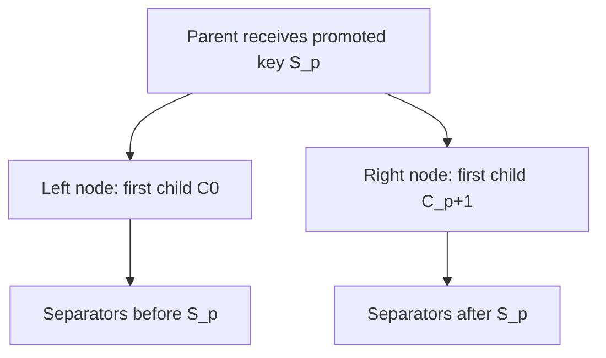

# BF-Tree inner nodes

`InnerNode` is the packed routing node of peppydb's [BF-Tree](architecture.md).
It stores sorted, variable-length separator keys and fixed-size child
references inside a caller-provided byte buffer. Inner nodes use their own
format: they do not wrap the [shared leaf `Page`](bf-tree-pages.md). They share
only the technique of viewing caller bytes through `zerocopy` and the borrowed
`KeyRef` logical-key view.

[Plan 0006](../plans/0006-bf-tree-inner-node.md) delivers this primitive. The
[upstream inner-node explanation](../explanations/bf-tree-upstream-inner-nodes.md)
describes the Microsoft implementation that informed it.

## Child identity

Children are opaque, typed IDs from `node_id`:

- `InnerId(u64)` and `LeafId(u64)` are distinct `#[repr(transparent)]` types.
  `new(u64) -> Option<Self>` accepts every value except the reserved `u64::MAX`,
  which matches the leaf page's no-backing-leaf sentinel. `raw()` returns the
  value. Zero is valid.
- `ChildRef` is `Inner(InnerId)` or `Leaf(LeafId)`. Equality includes the kind.
- IDs are neither addresses nor disk offsets. Allocation, resolution,
  uniqueness, and reuse belong to later owning components.

All children of one node have the same kind. The node stores the kind once in
its header and each child as an eight-byte raw ID. The node cannot verify that
a referenced node exists or has the right height; the owning tree must.

## Layout

```text
| header incl. C0 (16 B) | sorted slots --> | free gap | <-- [key tail][right child ID] |
```

Integers are little-endian, offsets are measured from the node start, and any
buffer alignment works. Capacities are multiples of 64 bytes from 64 through
4096, as for `Page`. The in-memory tree will normally use 4096-byte nodes;
smaller capacities make boundary tests inexpensive.

### Header

| Bytes | Field | Meaning |
| --- | --- | --- |
| `0..2` | `count` | Number of separators, excluding the first child |
| `2..4` | `capacity` | Node length in bytes |
| `4..6` | `remaining_size` | Free bytes between the slots and the payloads |
| `6..8` | `children_kind` | `0` = leaf IDs, `1` = inner IDs |
| `8..16` | `first_child` | Raw ID of the child left of every separator |

The header is structural only. Root identity, the optimistic-lock version, disk
location, and recovery metadata belong to a future owning frame, side table, or
tree, never to the node image. This is an in-memory structural format, not a
durable-node contract. Plan 0006's agent notes record the comparison with
upstream's 32-byte header and dummy leftmost entry.

`InnerNode::init(bytes, first)` validates the capacity, zeroes the buffer, and
writes a node with one child and no separators. The first child fixes the node's
child kind. An invalid capacity leaves the buffer unchanged.

### Separator slots

Each slot uses 8 bytes, following upstream's inner slot:

| Bytes | Meaning |
| --- | --- |
| `0..2` | Node-relative offset of the key tail |
| `2..4` | Full logical key length |
| `4..8` | First `min(key_len, 4)` key bytes, zero-padded |

Only the tail (`key_len - 4` bytes, or none) is stored in the payload, followed
by the eight-byte right child ID. Short separators still have an eight-byte
child payload. For capacity `C` and separator length `k`:

```text
entry_size(k) = 8 + max(k - 4, 0) + 8
free          = C - 16 - sum(entry_size(separator.len()))
payload_start = 16 + 8 * count + free
```

The node stays densely packed: separator keys are immutable after insertion,
and child replacement has a fixed width. There is no compaction or separator
removal.

## Routing

For `n` strictly increasing separators `S[0..n]`, the node stores `n + 1`
children:

```text
first_child = C0
entries     = [(S0, C1), (S1, C2), ..., (S[n-1], Cn)]

Separators:        m                 t
Children:    C0          C1                  C2
Ranges:    key < m    m <= key < t         t <= key
```

`route(key)` returns `Route { index, child }`, where `index` is the number of
separators less than or equal to `key`, in `0..=len()`. Equality routes to the
matching separator's right child, which matches the leaf pages'
lower-inclusive fence convention. Every byte slice is a valid query, including
an empty one. A node without separators routes to its first child; no dummy
key represents that child. A routing index can change after mutation; it is not
a stable handle.

The node guarantees only this local partition. The owning tree must ensure that
child ranges, heights, identities, and parent separators agree. Inner nodes do
not store their own fence interval.

Each binary-search probe compares the meaningful inline bytes first and loads
the tail only on a tie. This is `KeyRef::cmp_bytes` over the separator's inline
and tail parts, so queries shorter than four bytes need no special case.

### Borrowed reads

- `first_child()` and `child_at(index)` return copied `ChildRef` values.
  `child_at` returns `None` for `index >= child_count()`.
- `iter()`, and iteration over `&InnerNode`, yield `SeparatorRef { key,
  right_child }` in key order. The iterator is exact-sized and fused and
  excludes the first child.
- `SeparatorRef::key` is a `KeyRef` whose prefix borrows the inline bytes from
  the slot directory and whose suffix borrows the payload tail. Here the
  `KeyRef` prefix is a per-key leading slice, not a shared page prefix.
  Reads do not allocate.

## Insertion and child replacement

`try_insert(key, right)` inserts a distinct, nonempty separator and the child to
its right. The child left of the new separator and all other entries stay
unchanged. Validation checks, in order:

1. `EmptyKey`: separator keys must be nonempty.
2. `ChildKindMismatch`: the child must have the node's child kind.
3. `SeparatorTooLarge`: the entry must fit in an empty node of this capacity.
4. `DuplicateSeparator`: a duplicate is a tree bug, not an implicit update.
5. `NodeFull`: the entry must fit in the contiguous free gap.

Insertion shifts later slots by one and copies one tail and child payload into
the gap. It never rebuilds or splits the node. On `NodeFull`, the caller chooses
whether to split.

`replace_child(index, child)` replaces one existing reference, including index
zero, and returns the old one. It checks the index (`InvalidChildIndex`), then
the kind. Only the selected eight bytes change, so it succeeds on a full node.

Every returned error preserves all node bytes. All fallible checks precede
mutation. Mutations require `&mut InnerNode`.

## Splitting with a pending separator

The node never splits on its own. After `try_insert` returns `NodeFull`, or
earlier if the caller chooses, the owner calls
`split_with_insert(right_storage, key, right_child)`. It returns
`InnerSplit { separator, right }`: the owned promoted key and a view of the right
output in `right_storage`. `self` becomes the left output. The node does not
allocate a sibling ID or update a parent; the owner inserts the promoted key
into the parent with the right node's new ID as its right child.

The split merges the pending entry into the sorted sequence virtually, without
first inserting it. For `m` resulting separators `S[0..m]` with children
`C[0..=m]`, promoting index `p` produces:

```text
promote: S[p]
left:    first C0,     entries S[0..p]     with right children C[1..p+1]
right:   first C[p+1], entries S[p+1..m]   with right children C[p+2..m+1]
```



The promoted separator is absent from both outputs; its right child becomes the
right output's first child. Children are conserved: the outputs together hold
all `m + 1` children. Candidates are `1..m-1`, so each output keeps at least
one separator and two children.

Selection is byte-aware. One prefix-sum pass computes `left_used = 16 +
sum(entry_size(S[i]), i < p)` and `right_used = 16 + sum(entry_size(S[i]), i > p)`.
Candidates whose outputs exceed the capacity are discarded. The rest minimize
`(max(left_used, right_used), |left_used - right_used|, p)`. A count midpoint
can leave one output nearly full when key lengths differ: on a 128-byte node
with entry sizes `[64, 16, 16, 16, 16]`, promoting index 1 leaves 80 and 64 used
bytes, while the midpoint leaves 96 and 48.

Validation checks the right buffer's capacity (`InvalidCapacity`), then that it
equals the source capacity (`CapacityMismatch`), then insertion's key, kind,
size, and duplicate checks. It returns `CannotSplit` if fewer than three
separators result or no candidate fits. Every error preserves both buffers.

After validation, the split builds both outputs in two 4096-byte stack scratch
images from borrowed key parts, then copies them to `self` and `right_storage`.
Only the promoted key is heap-allocated, because it must survive rewriting its
source. This is an exclusive-access, in-memory guarantee, not a crash-atomic
tree update.

### Admission limit

The node accepts any separator that fits in an empty node, but that does not
guarantee a split. On a 64-byte node one 36-byte key fills the node, and adding
a second separator yields only two, so the split returns `CannotSplit`.

A sufficient inner-only admission rule is:

```text
entry_size(key) <= floor((capacity - 16) / 2)
```

Under this rule, insertion cannot fail on space with fewer than two separators,
and a same-capacity split of a node with at least two separators plus one
pending entry always has a legal candidate. The tree (plan 0007) must choose a
separator admission limit at least this strict so that `CannotSplit` is
unreachable, and must also settle leaf-split and database-wide key limits.

## Total reads

Methods that take `&self` must not panic or read outside the buffer for any
byte content. They clamp decoded counts, offsets, and lengths to the buffer and
may return meaningless results for bytes that no valid node contains. This
differs from `Page`, whose reads may panic on invalid bytes. The reason is
future optimistic latch coupling: a reader may observe a torn node and rely on
a version re-check to discard the result.

Mutating methods assume the bytes came from `init` and this type's operations.
Validating arbitrary stored bytes is a separate, future boundary.
