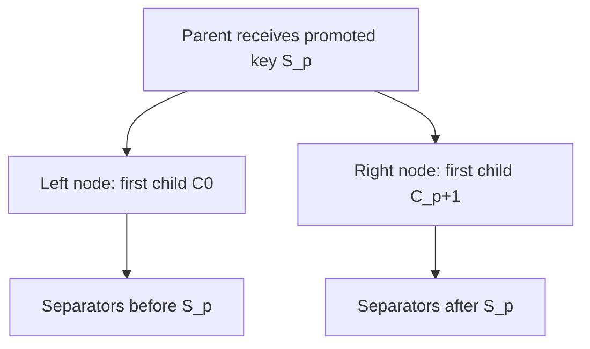

# BF-Tree inner nodes

`InnerNode` is the routing node of peppydb's [BF-Tree](architecture.md). Inner
nodes form every level above the leaves: a lookup descends from the root by
choosing one child per node, and a child split adds one separator to its
parent. Each node stores sorted, variable-length separator keys and fixed-size
child references inside a caller-provided byte buffer.

Inner nodes use their own format and do not wrap the
[shared leaf `Page`](bf-tree-pages.md). A separator needs no record kind, value
length, reference bit, or fences, and `n` separators need `n + 1` children. The
two formats share only the technique of viewing caller bytes through `zerocopy`
and the borrowed `KeyRef` logical-key view.

## Node layout

```text
| header incl. first child (16 B) | slot directory --> | free gap | <-- [key tail][right child ID] |
```

- The header starts the node and holds the first child. The slot directory
  follows it, with one slot per separator, sorted by key. Payloads grow backward
  from the end. Free space is the contiguous gap between the slots and the
  payloads.
- The node is always densely packed. Separator keys never change after
  insertion and child replacement has a fixed width, so no operation leaves a
  hole. There is no compaction and no separator removal.
- An `InnerNode` is the buffer itself, viewed in place; it owns no memory.
  Readers share `&InnerNode`, and a writer holds `&mut InnerNode`.
- Capacities are multiples of 64 bytes from 64 through 4096, as for `Page`.
  The tree normally uses 4096-byte nodes; small capacities make boundary and
  split tests inexpensive.
- Integers are little-endian, and offsets are measured from the node start.
  Any buffer alignment works.

## Header

| Bytes | Field | Meaning |
| --- | --- | --- |
| `0..2` | `count` | Number of separators, excluding the first child |
| `2..4` | `capacity` | Node length in bytes |
| `4..6` | `remaining_size` | Free bytes between the slots and the payloads |
| `6..8` | `children_kind` | `0` = leaf IDs, `1` = inner IDs |
| `8..16` | `first_child` | Raw ID of the child left of every separator |

`InnerNode::init(bytes, first)` checks the capacity, zeroes the buffer, and
writes a node with one child and no separators. An invalid capacity leaves the
buffer unchanged.

The header is structural only. Upstream's 32-byte header also holds an
optimistic-lock version, a disk offset, and a snapshot version with a root
flag. peppydb keeps that state outside the node image, in an owning frame, a
side table, or the tree:

- An `AtomicU64` lock cannot live in an unaligned byte view.
- `init` and splitting overwrite the whole buffer, which would clobber an
  in-image lock.
- Upstream writes the whole node to disk, so the stored lock value is
  meaningless after a reload. The snapshot version is checkpoint metadata and
  is unrelated to the lock version.

The first child has its own field instead of upstream's dummy slot with an
empty key. This saves 16 bytes per node (an 8-byte slot and an 8-byte payload),
makes `len()` count separators exactly, and lets every stored separator be
nonempty without an exception. The cost is that the first child is a special
case in child access, replacement, iteration, and splitting. Fixed overhead per
node is 16 bytes, compared with upstream's 48.

## Child references

Children are typed, opaque IDs from `node_id`. `InnerId(u64)` and `LeafId(u64)`
are distinct types; `new` accepts every value except `u64::MAX`, which matches
the leaf page's no-backing-leaf sentinel. `ChildRef` is `Inner(InnerId)` or
`Leaf(LeafId)`, and its equality includes the kind. IDs are neither addresses
nor disk offsets; their owner allocates and resolves them.

All children of one node have the same kind. The header stores that kind once,
the first child fixes it, and insertion and replacement reject the other kind.
Each child is an eight-byte raw ID.

Upstream stores a packed `PageID` that is a heap address for inner children and
a tagged ID for leaves. Typed IDs keep node images valid across a restart, make
a kind mismatch detectable at insertion, and keep `unsafe` code out of the node.
The cost is one ID-to-storage resolution per level during a descent. The node
cannot verify that a child exists or has the correct height; its owner must.

## Separator slots

Each slot uses 8 bytes, as upstream's inner slot does:

| Bytes | Meaning |
| --- | --- |
| `0..2` | Offset of the key tail from the node start |
| `2..4` | Full key length |
| `4..8` | First `min(key_len, 4)` key bytes, zero-padded |

The four inline bytes are part of the stored key, not a copy like the leaf
page's two-byte preview. The payload holds only the remaining tail, followed by
the eight-byte right child ID, so a key of at most four bytes still has an
eight-byte payload. For a separator of length `k` on a node of capacity `C`:

```text
entry_size(k) = 8 + max(k - 4, 0) + 8      // slot + tail + child
free          = C - 16 - sum(entry_size)
payload_start = 16 + 8 * count + free
```

Dense packing means the payloads exactly fill `payload_start..C`.

## Routing

For `n` strictly increasing separators, the node stores `n + 1` children. The
first child is in the header; every separator stores the child to its right:

```text
Separators:        m                 t
Children:    C0          C1                  C2
Ranges:    key < m    m <= key < t         t <= key
```

`route(key)` returns `Route { index, child }`, where `index` is the number of
separators less than or equal to `key`. A key equal to a separator routes to
that separator's right child. This matches the lower-inclusive fences of leaf
pages: a leaf's lower fence, the parent separator that leads to it, and the
upper fence of its left neighbor are the same bytes. Every byte slice is a valid
query; the empty slice reaches the leftmost child. A routing index is not a
stable handle, because insertion can shift it.

A node guarantees only this local partition. It stores no interval of its own,
so its owner must keep child ranges, heights, and parent separators consistent.

### Search

Routing is one binary search over the slot directory. Each probe compares the
meaningful inline bytes first and reads the tail only on a tie, so most
comparisons stay inside the slot directory. The comparison is
`KeyRef::cmp_bytes` over the separator's inline and tail parts, which gives
full lexicographic order, including zero bytes and keys shorter than four bytes.

### Borrowed reads

`first_child()` and `child_at(index)` return copied `ChildRef` values; index 0
is the first child, and index `i > 0` is the right child of separator `i - 1`.
`iter()` and iteration over `&InnerNode` yield `SeparatorRef { key,
right_child }` in key order, excluding the first child. The iterator is
exact-sized and fused. Each key is a `KeyRef` whose prefix borrows the inline
bytes from the slot directory and whose suffix borrows the tail. On an inner
node the prefix is a per-key leading slice, not a prefix shared across the node.
Reads never allocate. Upstream instead builds a `Vec` for each full key it
returns.

## Insertion and child replacement

`try_insert(key, right)` inserts a distinct, nonempty separator and the child to
its right. The child to the left of the new separator stays unchanged: the
separator divides that child's old range, and the new child takes the upper
part. Validation checks, in order:

1. `EmptyKey`: separator keys must be nonempty.
2. `ChildKindMismatch`: the child must have the node's child kind.
3. `SeparatorTooLarge`: the entry must fit in an empty node of this capacity.
4. `DuplicateSeparator`: the key must not already be a separator.
5. `NodeFull`: the entry must fit in the contiguous free gap.

A successful insertion copies one tail and child into the gap, shifts later
slots by one, and never rebuilds or splits the node. Upstream treats a duplicate
as a silent child update, after its space check. peppydb reports it, because a
duplicate separator indicates a tree bug.

`replace_child(index, child)` replaces one existing child, including the first
child, and returns the old one. Only that child's eight bytes change, so
replacement succeeds on a full node.

Every error leaves the node unchanged, because all checks precede mutation.

## Splitting with a pending separator

The node never splits on its own. When `try_insert` returns `NodeFull`, or
earlier if the owner chooses, the owner calls
`split_with_insert(right_storage, key, right_child)` with a second buffer of
the same capacity. The split treats the existing separators plus the pending
one as one sorted sequence, without first inserting the pending entry, and
promotes one separator `S[p]`:

```text
left  (self):          first C0,     separators before S[p]
right (right_storage): first C[p+1], separators after S[p]
parent receives:       S[p], with the right node's new ID as its right child
```



The promoted separator leaves both outputs, and its right child becomes the
right output's first child. Every child of the virtual sequence ends up in
exactly one output. The endpoints are never promoted, so each output keeps at
least one separator and two children. The split returns the promoted key as an
owned `Vec<u8>` and a view of the right node. It does not allocate an ID or
update the parent.

### Choosing the promotion

Separator lengths vary, so a split at the middle separator can leave one side
nearly full. The split instead chooses by bytes. One prefix-sum pass computes
each candidate's used bytes on both sides and discards candidates where either
side exceeds the capacity. The rest are ranked by the fuller side's used bytes,
then by the difference between the sides, then by index. Minimizing the fuller
side leaves the most room where it is scarcest.

For example, on a 128-byte node with entry sizes `[64, 16, 16, 16, 16]`,
promoting index 1 leaves 80 and 64 used bytes. The middle separator, index 2,
leaves 96 and 48.

Validation checks the destination capacity, then that it equals the source
capacity, then the same key and child checks as insertion. It returns
`CannotSplit` if fewer than three separators result or no candidate fits.
Every error leaves both buffers unchanged.

The split builds both outputs in two stack scratch images and then copies them
into place: the virtual sequence borrows from `self`, which becomes the left
output. Only the promoted key is heap-allocated, because it must outlive the
rewrite of its source. This guarantee assumes exclusive, in-memory access; a
split is not a crash-atomic tree update.

### Admission limit

The node accepts any separator that fits in an empty node, but that does not
guarantee that a later split succeeds. On a 64-byte node, one 36-byte separator
fills the node. A second separator gives only two in total, so no promotion can
leave one on each side, and the split returns `CannotSplit`.

An owner that needs every split to succeed must admit only separators that
satisfy:

```text
entry_size(key) <= floor((capacity - 16) / 2)
```

Under this rule, insertion cannot run out of space with fewer than two
separators. A full node with at least two separators plus one pending entry then
always has a candidate: promote the pending key if it falls inside the
sequence, or else the adjacent existing endpoint. The rule covers inner nodes
only; leaf splits impose their own limit. The tree's `TreeConfig::validate`
enforces both for the configured key limit; see
[BF-Tree structure](bf-tree-structure.md#admission-rule).

## Invariants

Every node produced by `init` and this type's operations satisfies:

1. Separators are nonempty and strictly increasing.
2. The node has `len() + 1` children, all of the header's kind, and no child
   uses the reserved raw ID.
3. Each slot's inline bytes are the key's first `min(key_len, 4)` bytes,
   followed by zero padding.
4. Payloads are disjoint and exactly fill `payload_start..capacity`; used bytes
   equal `16 + sum(entry_size)`.

The tests in `src/inner/tests/` check these invariants after every operation,
using a byte decoder independent of `Header` and `Slot`.

## Total reads and concurrency

Methods that take `&self` never panic or read outside the buffer, for any byte
content. They clamp decoded counts, offsets, and lengths to the buffer, and they
decode an unknown child kind or the reserved ID as a valid ID. Their results
are meaningless for bytes that no valid node contains. This differs from
`Page`, whose reads may panic on invalid bytes.

The reason is optimistic latch coupling. A reader reads a version, works on the
node without locking, and retries if the version changed. Such a reader can
observe a node in the middle of a write and must survive it. Total reads matter
already: `InnerNode` publicly derives `zerocopy`'s `FromBytes`, so safe code can
view any buffer of a valid length as a node.

Mutating methods assume valid bytes; nothing checks stored bytes yet. A
validating constructor for nodes loaded from storage is future work, which
should also decide whether the public derive stays.

The layout constrains the future concurrent owner. The version word lives in
the owning frame, not the node image. An inner node stores no interval, so a
reader cannot check from the node alone that it reached the right one. A
concurrent descent must re-validate the parent's version after it reads a child
reference.

## `InnerNode` in the tree

The node provides local operations; its owner composes them:

| Tree operation | Node operations |
| --- | --- |
| Descent | `route` at each level, starting at the root, until it returns a leaf |
| Child split | Allocate the sibling's ID, then `try_insert(promoted key, sibling)` in the parent |
| Full parent | `split_with_insert` into a new buffer, then continue one level up with the returned key |
| Root growth | `init(new buffer, first = old root)`, then `try_insert(promoted key, sibling)` |

The owner holds node buffers, resolves IDs to them, and enforces the admission
limit. Only the owner can check that the parts agree: that child heights match,
that leaf fences match parent separators, and that each ID refers to a live
node. [BF-Tree structure](bf-tree-structure.md) describes the current owner,
`Tree`.

## Staged integration

[Plan 0006](../plans/0006-bf-tree-inner-node.md) delivers the node primitive.
[Plan 0007](../plans/0007-bf-tree-in-memory-tree.md) composes the tree: leaf
splits, parent propagation, root growth, and the key admission limit. Later
milestones add stable frames for node ownership, a concurrency protocol, and
persistence. Plan 0006's agent notes record the intended frame arena and the
options for reader synchronization.

## References

- [Inner nodes in Microsoft's BF-Tree](../explanations/bf-tree-upstream-inner-nodes.md)
  explains the pinned implementation's slot layout, dummy leftmost entry,
  routing, insertion, and count-based splitting.
- [BF-Tree paper](../references.md#bf-tree-paper), §3.4: in-memory inner nodes
  and optimistic latch coupling; §3.5: layout optimizations.
- [Microsoft implementation](../references.md#microsoft-bf-tree-implementation),
  revision `f442e6172bf7e5483ff320d8e3ac16a70e31bbd6`: `InnerNode` and
  `InnerKVMeta` in `src/nodes/inner_node.rs`, `PageID` in
  `src/nodes/page_id.rs`. peppydb follows the eight-byte slot with four inline
  key bytes, the fixed eight-byte child payload, and right-on-equality routing.
  peppydb differs by using a 16-byte structural header, an explicit first child,
  typed IDs, an error for duplicate separators, byte-aware splitting that
  includes the pending separator, borrowed keys, capacities from 64 through
  4096 bytes, and reads that are total over any bytes.
