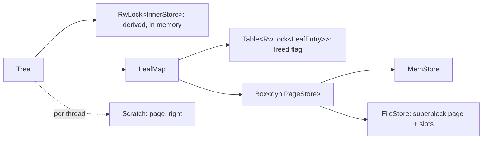
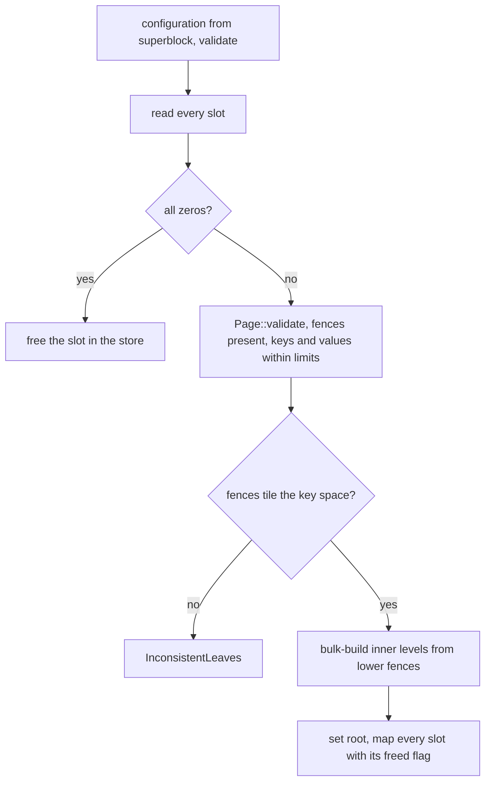

# BF-Tree leaf storage

Leaves of the [tree](bf-tree-structure.md) live in a `PageStore` behind a
leaf mapping table, the `LeafMap`. This document records the store boundary,
the file layout, how the tree locks, loads, writes, and reopens leaves, and
what the design does and does not guarantee about durability. It is the
paper's §3.3 base-leaf and mapping-table layer, with one reader-writer lock
per leaf, and without mini-pages or eviction. The
[concurrency design](bf-tree-concurrency.md) records the lock order and the
protocol that uses these locks.

## Shape



Inner nodes stay in memory and are rebuilt on open. Only leaves cross the
store boundary. No leaf page stays in memory between operations: each
access loads the base page into a thread-local scratch buffer, and each
write goes to the store at once.

## `PageStore`

```rust
pub trait PageStore: Send + Sync + std::fmt::Debug {
    fn page_size(&self) -> usize;
    fn slots(&self) -> u64;
    fn alloc(&self) -> Result<LeafId, StoreError>;
    fn free(&self, id: LeafId) -> Result<(), StoreError>;
    fn read(&self, id: LeafId, buf: &mut [u8]) -> Result<(), StoreError>;
    fn write(&self, id: LeafId, buf: &[u8]) -> Result<(), StoreError>;
    fn sync(&self) -> Result<(), StoreError>;
    fn superblock(&self) -> &Superblock;
}
```

- A store is a sequence of fixed-size slots. `LeafId` is the slot index.
  Reads and writes transfer exactly one page; a buffer of any other length is
  a `BufferLength` error.
- A store is shared between threads, and every method takes `&self`.
  Concurrent `alloc` calls return distinct IDs. The store does not order
  concurrent accesses to one slot: the caller must serialize them, and the
  tree does so with the leaf lock. The
  [concurrency design](bf-tree-concurrency.md#the-shareable-store-contract)
  records the full contract.
- `alloc` hands out a zeroed slot: a freed one if any, else a new slot at the
  end. `free` zeroes a slot and returns it for reuse. A write to a freed slot
  is an error; a read of one returns zeros. Leaves are never merged, so the
  tree calls `free` in two places only: `Tree::open` reclaims all-zero slots,
  and a split that fails after it allocated its right leaf returns that
  slot.
- Writes are durable only after `sync` returns.
- The tree holds a `Box<dyn PageStore>`, so one `Tree` type serves every
  backend. The virtual call sits next to a page read and costs nothing
  measurable.
- `StoreError` is `Copy` so that `TreeError` stays `Copy`. An I/O failure
  keeps the operation name, the `std::io::ErrorKind`, and the raw OS code
  rather than the boxed `io::Error`.

### Placement and the superblock

Slot `id` lives at byte offset `(id + 1) * page_size`, after a one-page
superblock. There is no catalogue: the file length determines the slot count,
and the slot index determines the offset. Fixed placement costs the ability to
resize a leaf in place, which fixed-capacity leaves never need.

A freed slot is all zeros. No valid page is all zeros, because its header
carries a nonzero capacity, so free slots are recoverable by scanning.
`FileStore::open` does not scan: on a 96 GiB file one probe per slot cost
three minutes. A reopened store treats every slot as live, and `Tree::open`,
which reads every slot anyway, returns the all-zero ones with `free`.

The superblock (version 1, magic `PEPPYBF\0`) records the page size and the
tree configuration: `inner_capacity`, `max_key_len`, and `max_value_len`,
all little-endian `u32`, zero-padded to one page. The configuration fixes the
admission rule for the file. `Tree::create` refuses a store whose superblock
disagrees with the requested configuration, and `Tree::open` takes its
configuration from the superblock, so a reopened tree never admits a key or
value that the stored pages could not split.

### Backends

`MemStore` is the fast test backend and the store behind `Tree::in_memory`.
It keeps its slots in a `Table<MemSlot>`; each slot has its own page mutex
and a `freed` flag, and a `Mutex<Vec<usize>>` holds the free list. A read or
write locks only its slot. `FileStore` wraps one `std::fs::File` with
positioned reads and writes and `sync_data`. Positioned I/O needs only
`&File`, so reads and writes take no store-wide lock. Its per-slot freed
flags live in a `Table<AtomicBool>` whose length is the slot count, and a
`Mutex<Vec<u64>>` holds the free list. `FileStore::create` fails if the path
exists; `FileStore::open` rejects a file whose length is not a whole number
of pages. `alloc` extends the file with a zeroed page before returning the
slot, while it holds the free-list mutex, so the file length stays
authoritative. Both backends are synchronous and portable; direct and
asynchronous I/O are later tuning. A shared contract test runs the same
scenarios against both, including threaded allocation and threaded writes
to distinct slots.

## `LeafMap`

The mapping table gives each `LeafId` a lock and resolves it to the leaf's
base page in the store.

```rust
pub(super) struct LeafMap {
    store: Box<dyn PageStore>,
    entries: Table<RwLock<LeafEntry>>,
}

#[derive(Debug, Default)]
pub(super) struct LeafEntry {
    /// The slot holds no page.
    freed: bool,
}

pub(super) struct LeafRead<'m>  { id: LeafId, _entry: RwLockReadGuard<'m, LeafEntry> }
pub(super) struct LeafWrite<'m> { id: LeafId, _entry: RwLockWriteGuard<'m, LeafEntry> }
```

### Locked entries

Entries are dense and indexed by the ID. They live in a `Table` from
[`bf-tree-sync`](bf-tree-concurrency.md#bf-tree-sync), so lookups take no
lock and the table grows while other threads read it. Each entry is a
`RwLock<LeafEntry>`: the paper's per-leaf reader-writer lock (§3.3). The
lock covers the entry and the leaf's base page in the store. Every base
write happens under X, so a base page read under S or X is consistent.

- `read(id)` takes S and `write(id)` takes X. Both return `UnknownLeaf` for
  an ID beyond the table or a freed slot.
- `alloc()` allocates a store slot, grows the table to `id + 1`, resets the
  entry, and returns it under X. The leaf is unreachable until a separator
  names it.
- `discard(leaf)` returns a fresh slot to the store and then marks its
  entry freed, so a failed free leaves the entry live. A split that fails
  after `alloc` uses it.
- `LeafEntry` holds only `freed` today. Later plans add fields (`block` and
  `refs` in plan 0013, `version` in plan 0014, `dirty` in plan 0015). A test
  requires `size_of::<RwLock<LeafEntry>>() <= 64`.

This is upstream's `PageTable` row of `RwLock<PageLocation>` without the
`Mini` variant and the circular-buffer pointer.

### Scratch

There are no resident copies. Each access loads the base page into a
per-thread scratch buffer:

```rust
pub(super) const MAX_PAGE: usize = 4096; // the largest legal page

pub(super) struct Scratch {
    pub(super) page: Box<[u8; MAX_PAGE]>,
    pub(super) right: Box<[u8; MAX_PAGE]>, // the right half of a split
}
```

`with_scratch(f)` takes this thread's scratch out of a `thread_local!`
cell, lends it to `f`, and puts it back. Tree code does not nest calls. A
nested call from a user callback finds the cell empty, gets a temporary
scratch, and drops it afterwards; the outer scratch returns to the thread.
The buffers have the largest legal page size and are sliced to the tree's
page size, so one thread can use trees with different page sizes.

### `load_base`: the one read path

```rust
fn load_base<'s>(&self, leaf: &impl Locked, buf: &'s mut [u8]) -> Result<&'s mut Page, TreeError>;
```

`load_base` is the only function that reads a base page. It takes a guard
(`Locked` is implemented by `LeafRead` and `LeafWrite`), so the caller must
hold S or X. It reads the slot and checks the header with the O(1)
`Page::check_header`: the capacity equals the page size, only known flags
are set, the fences are present, and the slot directory and free gap fit.
Debug builds also run the full `Page::validate` on every load, so that tests
exercise it. Release builds do not: `open` validates every slot fully, every
page written afterwards was produced by this process, and a full validation
costs far more than the read. A header failure is `CorruptLeaf { id,
reason }`. Bytes that another process changes while the tree is open can
cause a panic or an error, never undefined behaviour.

### `write_through`: the one write path

```rust
fn write_through(&self, pages: &mut [(LeafId, &mut [u8])]) -> Result<(), TreeError>;
```

`write_through` is the only function that writes a base page. The caller
must hold the X lock of every leaf in `pages` (a debug assertion checks it)
and must pass the reachable leaf first. The other pages are written before
the first one, so an error before the last write leaves the reachable
leaf's stored page unchanged. It takes no tree-level lock. A split passes
both halves in one call, so that later plans can give them one sequence
number and one atomic switch. The pages are `&mut` because plans 0017 and
0018 stamp the leaf ID and a sequence number into their headers. Persistence
changes only the bodies of `load_base` and `write_through`.

## Tree lifecycle

```rust
impl Tree {
    pub fn in_memory(config: TreeConfig) -> Result<Self, TreeError>;   // MemStore; not durable
    pub fn create(config: TreeConfig, store: Box<dyn PageStore>) -> Result<Self, TreeError>;
    pub fn open(store: Box<dyn PageStore>) -> Result<Self, TreeError>;
    pub fn flush(&self) -> Result<(), TreeError>;               // store.sync()
    pub fn into_store(self) -> Box<dyn PageStore>;              // close; nothing written is lost
    pub fn leaf_count(&self) -> usize;                          // slots, live or freed
    pub fn store(&self) -> &dyn PageStore;
}
```

`create` requires an empty store whose superblock matches the configuration.
It allocates the first unbounded leaf and writes it through at once.
`flush` calls `store.sync()`; it writes nothing, because every write is
already in the store. `Drop` does not sync.

### Open



1. The configuration comes from the superblock and must pass
   `TreeConfig::validate`.
2. Every slot is read once. An all-zero slot is free: a slot allocated for a
   split but never written. `open` returns it to the store's free list, so
   the next allocation reuses it. Every other slot must pass
   `Page::validate`, carry fences, and keep every fence, key, and value within
   the configured limits. Failures are `CorruptLeaf { id, reason }` or
   `InconsistentLeaves(reason)`.
3. Leaves are sorted by lower fence. There must be exactly one unbounded lower
   fence, exactly one unbounded upper fence, and `upper(i) == lower(i + 1)` for
   every adjacent pair. Any gap, overlap, or duplicate is
   `InconsistentLeaves`.
4. Inner levels are bulk-built from the sorted list. The separators are the
   lower fences of leaves `1..n`. Each level is filled left to right by entry
   size, exactly as `InnerNode::try_insert` would accept separators until
   `NodeFull`; the first child of every later node has its separator promoted
   to the level above. A trailing node that would get one child and no
   separator borrows the last entry of its left neighbour instead; under the
   admission rule a full node holds at least two separators, so the neighbour
   keeps at least one. A single leaf is its own root.
5. The `LeafMap` gets one entry per slot, with the freed flag from step 2.
   No page is loaded until an operation needs it.

Open is `O(leaves)` in I/O and memory and is the complete recovery path:
inner nodes are derived and nothing else is persisted. Bulk-built levels are
packed, so a reopened tree can be shorter than the incrementally built tree
that wrote it; the next inserts into full nodes simply split them. Upstream
instead checkpoints inner-node images; checkpointing can add that for fast
open on very large trees, keeping this rebuild as the repair path.

## Durability and consistency without a log

Every write goes to the store as it happens. A `put` or `remove` returns
after `write_through` has written the leaf's page, so the tree keeps no
state that the store lacks:

- **Drop loses nothing.** Dropping the tree or calling `into_store` loses no
  completed write. The writes are in the store, synced or not. (Plan 0013
  brings back buffered mini-page state, which a drop without a flush
  loses.)
- **`flush` syncs.** `flush` calls `store.sync()`. Every write that
  returned before `flush` began is durable when `flush` returns. Writes
  that are not yet synced survive a process stop on `FileStore`, because
  they are in the operating system's page cache, but not necessarily an
  operating-system crash or a power loss.

There is no per-operation atomicity across pages. A split writes two pages
(the right half first, then the left) and then updates the parent in
memory. A stop between the two page writes leaves a window:

- **Stop before the right page is written.** The right slot is all zeros
  (`alloc` extended the file with a zeroed page). The store still holds the
  pre-split leaf, so it is consistent, and `open` reclaims the slot.
- **Stop between the two writes.** The right page and the pre-split left
  page overlap. `open` refuses the store with `InconsistentLeaves`. Without
  a `sync` the device can also persist the left write and lose the right
  one, which leaves a gap that `open` also refuses.
- **Stop after both writes.** The pages tile the key space, and `open`
  rebuilds the parent from their fences.

The order in `write_through` keeps the reachable leaf intact when a write
returns an error, but it cannot make two writes atomic. The user accepted
this window until shadow paging in
[plan 0018](../plans/0018-bf-tree-checkpoint.md) removes it.

A torn page write leaves bytes that `Page::validate` rejects at the next
`open`. Within a running process, a split that fails at any point after
`alloc` frees the fresh right slot, because a written but unreachable right
page would overlap its left neighbour at the next `open`. A failed
`install` still leaves the left page rewritten; under the admission rule
that is an internal bug, and shadow paging (plan 0018) removes the window.

The write-ahead log and crash atomicity are separate components. The page header's
`lsn` and `snapshot_version` fields stay inactive.

## Baselines

All baselines are informational and single-threaded. They live in the tree
tests as ignored benchmarks. Contended numbers are not taken on macOS;
[plan 0016](../plans/0016-bf-tree-concurrency.md) takes them on Linux.

### Write-through without resident pages (plan 0012)

`tools/buck2 run @build/mode/release //crates/bf-tree:bf-tree-unittest -- --ignored --nocapture baseline`
(both `baseline_throughput` and `baseline_file_store`), on an Apple M4 Pro:
one million random 8-byte keys with 16-byte values and the default
configuration. "Before" is the resident-copy design of plan 0008, measured
on the same machine immediately before
[plan 0012](../plans/0012-bf-tree-shared-tree.md); "after" is the current
design.

| step | before | after |
| --- | --- | --- |
| `MemStore` put | 1.92 M ops/s | 0.11 M ops/s |
| `MemStore` get | 1.73 M ops/s | 1.96 M ops/s |
| `MemStore` scan | 140 M records/s | 27 M records/s |
| `FileStore` put | 1.63 M ops/s | 0.07 M ops/s |
| `FileStore` flush | 47 ms | 859 ms |
| `FileStore` get, warm | 1.92 M ops/s | 1.04 M ops/s |
| `FileStore` scan, warm | 138 M records/s | 22 M records/s |

The regression is expected. Nothing stays resident, so every `put` loads,
rebuilds, and writes a full 4 KiB page, and every read loads a page. The
flush rows measure different work. Before, `flush` wrote every dirty leaf
and then synced. Now the page writes happen during the put phase, and
`flush` only calls `sync_data`. Plan 0013 recovers write throughput with
blind buffering in mini-pages, and plan 0015 recovers read throughput with
caching.

### Resident copies (plan 0008)

The rest of this section records the baselines of the resident-copy design
that plan 0012 replaced. They were measured on an Apple laptop with 48 GiB
of RAM and an internal SSD, with `cargo test --release` before the
[Buck2 build](build-system.md). The Buck2 release platform uses the same
optimization flags, and a check after the move measured comparable figures.
They were not measured again for the current design.

#### Page cache (`baseline_file_store`)

`tools/buck2 run @build/mode/release //crates/bf-tree:bf-tree-unittest -- --ignored --nocapture baseline_file`:
one million random 8-byte keys with 16-byte values, default configuration,
8692 leaves, 34 MiB file, written and reopened immediately, so every read is
a page-cache hit.

| step | result |
| --- | --- |
| put (in memory) | ~2.1 M ops/s |
| flush of every leaf | ~35 ms |
| open (read, validate, tile, rebuild) | ~35 ms |
| get, cold (loads each leaf once from cache) | ~2.3 M ops/s |
| get, warm | ~2.5 M ops/s |
| scan, warm | ~120 M records/s |

The in-memory `Tree::in_memory` baseline is unchanged by the mapping table: about
2.1 M put/s and 2.0 M get/s.

#### Larger than memory (`disk_baseline`)

`PEPPYDB_DISK_GIB=96 tools/buck2 run @build/mode/release
//crates/bf-tree:bf-tree-unittest -- --ignored --nocapture disk_baseline`. Nothing evicts yet, so a tree cannot be
built through `put` beyond RAM; the benchmark writes the file directly in
the on-disk format (sorted keys, three 1000-byte records per 4 KiB leaf),
opens it, and measures 200,000 random gets, 5,000 scans of 100 records,
100,000 random replacements, and one flush. 96 GiB is twice RAM, so most
first touches miss the page cache; the percentiles show it.

| step | result |
| --- | --- |
| bulk write 96 GiB (25.2 M leaves, 75.5 M records) | ~19 s, ~5 GiB/s |
| `FileStore::open` | ~0.4 ms |
| `Tree::open` (read, validate, tile, rebuild; height 5, 123 k inner nodes) | ~21 s, ~4.6 GiB/s |
| get, first touch | ~14 k ops/s; p50 85 µs, p99 123 µs, max 1.6 ms |
| get, same keys warm | ~780 k ops/s; p50 1.2 µs |
| scan 100 records (~34 adjacent leaves, first touch) | ~2.6 k scans/s; p50 415 µs, about 12 µs per leaf with readahead |
| put, random replacement (one leaf load each) | ~14 k ops/s; p50 85 µs |
| flush of 99,816 dirty leaves | ~3.2 s; ~31 k leaves/s, ~120 MiB/s of random 4 KiB writes plus one `sync_data` |

A random 4 KiB read costs about 85 µs on this device, and a first-touch get
or put is exactly one such read. Sequential leaves are much cheaper per leaf
than random ones, which favours scans and `open`. `Tree::open` is bounded by
sequential read bandwidth and grows linearly with the file; checkpointed
inner nodes would remove the full read from the common path. In that design
memory grew by one page per touched leaf (1.8 GiB resident after this run);
the current design keeps no leaf page resident.

## References

- [BF-Tree paper](../references.md#bf-tree-paper), §3.3: base leaves, page
  I/O, the mapping table, and the per-leaf reader-writer lock.
- Plans [0008](../plans/0008-bf-tree-leaf-store.md) (the store boundary,
  validation, and open) and [0012](../plans/0012-bf-tree-shared-tree.md)
  (locked entries, scratch, and write-through).
- [Microsoft implementation](../references.md#microsoft-bf-tree-implementation),
  revision `f442e6172bf7e5483ff320d8e3ac16a70e31bbd6`: `src/storage.rs`
  (`PageTable`, `PageLocation`), `src/utils/mapping_table.rs`, `src/fs/mod.rs`
  (`VfsImpl`, which allocates offsets where peppydb uses fixed placement), and
  `src/snapshot.rs` (checkpointed inner images, which peppydb defers).
