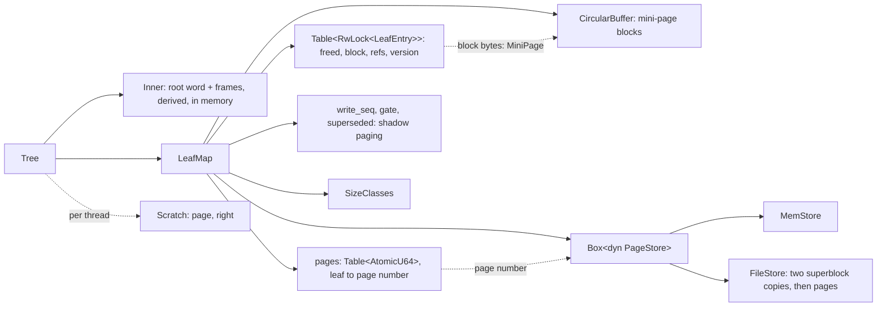
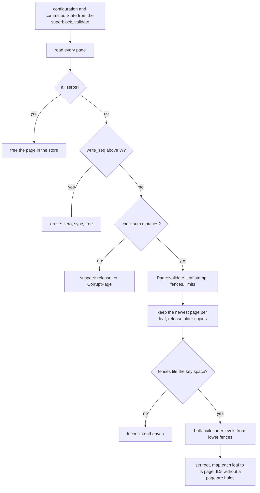

# BF-Tree leaf storage

Leaves of the [tree](bf-tree-structure.md) live in a `PageStore` behind a
leaf mapping table, the `LeafMap`. This document records the store boundary,
the file layout, how the tree locks, loads, writes, and reopens leaves, and
what the design does and does not guarantee about durability. It is the
paper's §3.3 base-leaf and mapping-table layer, with one reader-writer lock
per leaf. Each entry can also hold the leaf's
[mini-page](bf-tree-mini-page.md) in the
[circular buffer](bf-tree-circular-buffer.md). When the circular buffer is
full, eviction merges the oldest mini-pages into their base pages
([plan 0014](../plans/0014-bf-tree-eviction.md)).
The [concurrency design](bf-tree-concurrency.md) records the lock order and
the protocol that uses these locks.

## Shape



Inner nodes stay in memory and are rebuilt on open. Only leaves cross the
store boundary. The [persistence design](bf-tree-persistence.md) records
the durable format: the file layout, the checksummed superblock copies,
page numbers, and the leaf stamp and checksum in every stored page
([plan 0017](../plans/0017-bf-tree-store-format.md)), and shadow paging,
checkpoints, and recovery
([plan 0018](../plans/0018-bf-tree-checkpoint.md)). No base page stays in memory between operations: each
access that needs one loads it into a thread-local scratch buffer. Writes
buffer in mini-pages, which stay in memory until a merge writes them to the
store.

## `PageStore`

```rust
pub trait PageStore: Send + Sync + std::fmt::Debug {
    fn page_size(&self) -> usize;
    fn page_count(&self) -> u64;
    fn alloc(&self) -> Result<PageNumber, StoreError>;
    fn free(&self, page_number: PageNumber) -> Result<(), StoreError>;
    fn read(&self, page_number: PageNumber, buf: &mut [u8]) -> Result<(), StoreError>;
    fn write(&self, page_number: PageNumber, buf: &[u8]) -> Result<(), StoreError>;
    fn sync(&self) -> Result<(), StoreError>;
    fn superblock(&self) -> &Superblock;
    fn state(&self) -> State;
    fn commit(&self, state: &State) -> Result<(), StoreError>;
}
```

- A store is a sequence of fixed-size pages addressed by `PageNumber`, a
  position that is distinct from `LeafId`. The tree maps leaves to page
  numbers in its [page table](#the-page-table), and each stored page names
  its leaf in its header
  ([persistence](bf-tree-persistence.md#page-numbers-and-leaf-ids)). Reads
  and writes transfer exactly one page; a buffer of any other length is a
  `BufferLength` error.
- A store is shared between threads, and every method takes `&self`.
  Concurrent `alloc` calls return distinct page numbers. The store does not
  order concurrent accesses to one page: the caller must serialize them,
  and the tree does so with the leaf lock. The
  [concurrency design](bf-tree-concurrency.md#the-shareable-store-contract)
  records the full contract.
- `alloc` hands out a freed page if any, with its old bytes, else a new
  zero page at the end. `free` returns a page for reuse and does not change
  its bytes. A write to a freed page and a second `free` are
  `FreedPage`; a page number at or beyond `page_count()` is `UnknownPage`.
  `page_count()` counts every page ever allocated, live or freed. The tree
  calls `alloc` only in `write_through`, once for every page it writes.
  It calls `free` in `write_through` (a fresh page whose write failed), in
  the checkpoint's free step (pages that a commit no longer references), in
  `LeafMap::discard` (the zeroed page of a failed split's right half), and
  in `Tree::open` (zero, superseded, suspect, and erased pages)
  ([persistence](bf-tree-persistence.md#the-pagestore-contract)).
- Writes are durable only after `sync` returns.
- `state()` returns the last committed `State`, and `commit` replaces it
  durably and atomically through alternating superblock copies
  ([persistence](bf-tree-persistence.md#commit)). The tree commits from
  `Tree::checkpoint` and once at creation.
- The tree holds a `Box<dyn PageStore>`, so one `Tree` type serves every
  backend. The virtual call sits next to a page read and costs nothing
  measurable.
- `StoreError` is `Copy` so that `TreeError` stays `Copy`. An I/O failure
  keeps the operation name, the `std::io::ErrorKind`, and the raw OS code
  rather than the boxed `io::Error`.

### Placement

Two 4096-byte superblock copies fill the first 8 KiB of a file, and page
number `i` lives at byte offset `8192 + i * page_size`. There is no
catalogue: the file length determines the page count, and the page number
determines the offset. Fixed placement costs the ability to resize a page in
place, which fixed-capacity leaves never need. The
[persistence design](bf-tree-persistence.md#on-disk-layout) records the
layout and its alignment.

A new page is all zeros, and no valid stored page is all zeros, so `open`
recognizes a page that was allocated but never written. `FileStore` does
not persist its free list, and `FileStore::open` does not scan: on a 96 GiB
file one probe per page cost three minutes. A reopened store treats every
page as live, and `Tree::open`, which reads every page anyway, returns the
all-zero, superseded, and erased ones with `free`.

### The superblock

Each superblock copy (version 2, magic `PEPPYBF\0`) records the page size,
the tree configuration (`inner_capacity`, `max_key_len`, and
`max_value_len`), and the committed `State`, protected by a CRC32C. The
[persistence design](bf-tree-persistence.md#superblock-version-2) records
the encoding, the selection between the two copies, and the commit rule.
In memory, `Superblock` holds only the configuration. The configuration
fixes the admission rule for the file. `Tree::create` refuses a store whose
superblock disagrees with the requested configuration, and `Tree::open`
takes its configuration from the superblock, so a reopened tree never
admits a key or value that the stored pages could not split.

The superblock records only layout settings. `circular_buffer_bytes` and
`second_chance_percent` are runtime settings: `From<&TreeConfig> for
Superblock` ignores them, and `From<&Superblock> for TreeConfig` fills in
`DEFAULT_CIRCULAR_BUFFER_BYTES` and `DEFAULT_SECOND_CHANCE_PERCENT`.
`Tree::open_with(config, store)` opens a store with chosen runtime settings
and requires `Superblock::from(&config) == *store.superblock()`.
`Tree::open(store)` is `open_with` with the superblock's configuration.

### Backends

`MemStore` is the fast test backend and the store behind `Tree::in_memory`.
It keeps its pages in a `Table<MemPage>`; each page has its own byte mutex
and a `freed` flag, a `Mutex<Vec<usize>>` holds the free list, and a
`Mutex<State>` holds the committed state. A read or write locks only its
page. `FileStore` wraps one `std::fs::File` with positioned reads and
writes and `sync_data`. Positioned I/O needs only `&File`, so reads and
writes take no store-wide lock. Its per-page freed flags live in a
`Table<AtomicBool>` whose length is the page count, a `Mutex<Vec<u64>>`
holds the free list, a commit mutex serializes commits, and a separate
short-held mutex holds the state. `FileStore::create` fails if the path
exists and writes both superblock copies. `FileStore::open` selects the
newer intact copy and rejects a file shorter than the superblock area or
whose page area is not a whole number of pages (`TruncatedFile`). `alloc`
extends the file with a zero page before returning the page number, while
it holds the free-list mutex, so the file length stays authoritative. Both
backends are synchronous and portable; direct and asynchronous I/O are
later tuning. A shared contract test runs the same scenarios against both,
including threaded allocation, threaded writes to distinct pages, freed
pages that keep their bytes, and commit order.

## `LeafMap`

The mapping table gives each `LeafId` a lock and resolves it to the page
number of the leaf's base page in the store and to its mini-page, if any,
in the circular buffer.

```rust
pub(super) struct LeafMap {
    store: Box<dyn PageStore>,
    entries: Table<RwLock<LeafEntry>>,
    /// Page number of each leaf's stored page, or `NO_PAGE` (`u64::MAX`).
    pages: Table<AtomicU64>,
    /// The next leaf ID; holes are never reused.
    next: AtomicUsize,
    /// Last write sequence drawn (plan 0018).
    write_seq: AtomicU64,
    /// Shared by every write-through; exclusive for the checkpoint's `W`.
    gate: RwLock<()>,
    /// Replaced pages, each with its replacing sequence.
    superseded: Mutex<Vec<(PageNumber, u64)>>,
    circular_buffer: CircularBuffer,
    classes: SizeClasses,
}

#[derive(Debug, Default)]
pub(super) struct LeafEntry {
    /// The ID names no leaf: a hole left by a leaf that was never written,
    /// or a discarded split half.
    freed: bool,
    /// A circular-buffer block holding this leaf's mini-page, or, without
    /// `refs`, its full page.
    block: Option<Block>,
    /// Reference bits for the mini-page's slots; `Some` exactly when the
    /// block is a mini-page.
    refs: Option<Box<RefBits>>,
    /// Changes (wrapping) on every block change: allocation, growth,
    /// relocation, merge, promotion. A read's hint applies only if it is
    /// unchanged.
    version: u32,
    /// A full page is newer than the store. False in every other state.
    dirty: bool,
}

pub(super) struct LeafRead<'m>  { id: LeafId, entry: RwLockReadGuard<'m, LeafEntry> }
pub(super) struct LeafWrite<'m> { id: LeafId, entry: RwLockWriteGuard<'m, LeafEntry> }
```

`LeafMap::for_config` builds the map, its circular buffer, and its size
classes from a validated `TreeConfig`. The
[mini-page design](bf-tree-mini-page.md#in-the-tree) records the entry's
`Residency` view, `take_mini` and `put_mini`, and the two sites that
allocate mini-page blocks: `LeafMap::buffer` and `Tree::relocate`.

### Locked entries

Entries are dense and indexed by the ID. They live in a `Table` from
[`bf-tree-sync`](bf-tree-concurrency.md#bf-tree-sync), so lookups take no
lock and the table grows while other threads read it. Each entry is a
`RwLock<LeafEntry>`: the paper's per-leaf reader-writer lock (§3.3). The
lock covers the entry, the leaf's mini-page bytes, and the leaf's base page
in the store. Every base write and every mini-page change happens under X,
so a leaf read under S or X is consistent. (Readers set reference bits
under S through atomics.)

- `read(id)` takes S and `write(id)` takes X. Both return `UnknownLeaf` for
  an ID beyond the table or a hole. Eviction locks a victim's owner
  with `write(id)`.
- `try_write(id)` takes X without waiting and returns `None` if the lock is
  busy or the leaf is not live. `Tree::maintain` uses it to apply a read's
  hint.
- `holds(leaf, victim)` reports whether the X-locked entry still holds the
  block that an eviction claim names.
- `alloc()` takes the next leaf ID from the atomic counter `next`, grows
  both tables to `id + 1`, resets the entry, sets the page number to
  `NO_PAGE`, and returns the leaf under X. It does not touch the store: the
  leaf's first `write_through` allocates its page. The leaf is unreachable
  until a separator names it. Leaf IDs are append-only within a process,
  and at the 32-bit stamp limit `alloc` returns `TooManyLeaves`
  ([persistence](bf-tree-persistence.md#leaf-id-allocation)).
- `discard(leaf)` gives up a fresh, never-reachable leaf. If the leaf has a
  page, `discard` writes a zero page over it, frees it, and resets the page
  number; then it marks the entry freed. A failed step leaves the entry
  live with its page. A split that fails after `alloc` uses it. The zero
  write keeps a stamped but unreachable page from appearing as an extra
  leaf at the next `open`: `free` keeps bytes, and the next commit covers
  the page's write sequence, so selection alone would keep it.
- `LeafEntry` holds `freed`, `block`, and `refs`
  ([plan 0013](../plans/0013-bf-tree-mini-tree.md)) and `version`
  ([plan 0014](../plans/0014-bf-tree-eviction.md)). `LeafWrite::take_mini`
  bumps `version` (wrapping); every block change goes through it. A read
  notes the version under S, and its relocation hint applies only if the
  version is unchanged
  ([concurrency](bf-tree-concurrency.md#hints-and-maintain)).
  [Plan 0015](../plans/0015-bf-tree-caching.md) adds `dirty` and full
  pages; `take_full` and `set_full` bump `version` too
  ([caching policy](bf-tree-caching.md#residency)). A test requires
  `size_of::<RwLock<LeafEntry>>() <= 64`.
- `len()` is the number of leaf IDs; `write_if_live(id)` X-locks a live
  leaf or returns `None`. The checkpoint pass walks leaves by ID with them,
  and reads `len()` again on every step, so it also reaches leaves that a
  split creates during the pass.

This is upstream's `PageTable` row of `RwLock<PageLocation>`: `block` plays
the role of the `Mini` variant's circular-buffer pointer.

### The page table

`pages[id]` holds the page number of leaf `id`'s stored page, or `NO_PAGE`
for a leaf that has none yet and for a hole. `page_of(id)` returns it as
`Option<PageNumber>`. The table lives beside `entries`, not in
`LeafEntry`, so the entry lock stays within 64 bytes, and only base-page
I/O and `open` read it. A thread writes `pages[id]` only under the leaf's X
lock (`alloc`, `write_through`, `discard`) and reads it under S or X.
`write_through` swaps in a fresh page number on every write. `open` builds
the table from the pages it selects
([persistence](bf-tree-persistence.md#the-leaf-to-page-table)).

### Scratch

There are no resident base-page copies. Each access that needs the base
page loads it into a per-thread scratch buffer:

```rust
pub(super) const MAX_PAGE: usize = 4096; // the largest legal page

pub(super) struct Scratch {
    pub(super) page: Box<[u8; MAX_PAGE]>,
    pub(super) right: Box<[u8; MAX_PAGE]>, // the right half of a split
}
```

`with_scratch(f)` takes this thread's scratch out of a `thread_local!`
cell, lends it to `f`, and puts it back. Tree code does not nest calls. A
nested call from a user callback finds the cell empty, gets a temporary
scratch, and drops it afterwards; the outer scratch returns to the thread.
The buffers have the largest legal page size and are sliced to the tree's
page size, so one thread can use trees with different page sizes.

### `load_base`: the one read path

```rust
fn load_base<'s>(&self, leaf: &impl Locked, buf: &'s mut [u8]) -> Result<&'s mut Page, TreeError>;
```

`load_base` is the only function that reads a base page. It takes a guard
(`Locked` is implemented by `LeafRead` and `LeafWrite`), so the caller must
hold S or X. It resolves the leaf's page number (a leaf with none is
`CorruptLeaf { reason: "no stored page" }`), reads the page, and checks, in
order:

1. The page checksum, on the raw bytes. A mismatch is
   `CorruptLeaf { id, reason: "checksum mismatch" }`.
2. The header, with the O(1) `Page::check_header`: the capacity equals the
   page size, only known flags are set, the fences are present, and the
   slot directory and free gap fit. Debug builds also run the full
   `Page::validate` on every load, so that tests exercise it. Release
   builds do not: `open` validates every page fully, every page written
   afterwards was produced by this process, and a full validation costs far
   more than the read. A failure is `CorruptLeaf { id, reason }`.
3. The leaf stamp. A page that names another leaf is
   `CorruptLeaf { id, reason: "names another leaf" }`.

Bytes that another process changes while the tree is open can cause a panic
or an error, never undefined behaviour. The
[persistence design](bf-tree-persistence.md#load_base-checks) records why
the checksum comes first.

### `write_through`: the one write path

```rust
fn write_through(&self, pages: &mut [(LeafId, &mut [u8])]) -> Result<u64, TreeError>;
```

`write_through` is the only function that writes a base page for a leaf.
(`discard` and `open` also write, but only zero pages.) The caller must
hold the X lock of every leaf in `pages` (a debug assertion checks it) and
must pass the reachable leaf first. It takes no tree-level lock, and it
holds the write-through gate shared for the whole call. It draws one write
sequence for the call and returns it. The other pages are written before
the first one. For each page it:

1. stamps the write sequence and the leaf ID into the header, and seals
   the page checksum as the last change;
2. allocates a fresh page number from the store and writes the page there
   (if the write fails, it frees that page and returns the error);
3. swaps the fresh page number into the page table;
4. records the replaced page number, if any, with the sequence in the
   superseded list.

A committed page is therefore never overwritten. A replaced page is freed
only after a commit covers the replacing sequence. A split passes both
halves in one call, so both carry one sequence and a commit covers both or
neither. An error before the last write leaves the reachable leaf's page
table entry unchanged. The
[persistence design](bf-tree-persistence.md#shadow-paging) records the
rules and file growth.

## Tree lifecycle

```rust
impl Tree {
    pub fn in_memory(config: TreeConfig) -> Result<Self, TreeError>;   // MemStore; not durable
    pub fn create(config: TreeConfig, store: Box<dyn PageStore>) -> Result<Self, TreeError>;
    pub fn open(store: Box<dyn PageStore>) -> Result<Self, TreeError>;
    pub fn open_with(config: TreeConfig, store: Box<dyn PageStore>) -> Result<Self, TreeError>;
    pub fn checkpoint(&self) -> Result<State, TreeError>;       // merge, write back, sync, commit
    pub fn applied_seq(&self) -> u64;                           // the applied watermark
    pub fn committed(&self) -> State;                           // what a reopen selects
    pub fn store_failed(&self) -> bool;                         // a sync or commit failed
    pub fn into_store(self) -> Box<dyn PageStore>;              // close; uncommitted writes are lost
    pub fn leaf_count(&self) -> usize;                          // leaf IDs, live or holes
    pub fn buffered_leaves(&self) -> usize;                     // leaves holding a mini-page
    pub fn circular_buffer_used(&self) -> usize;                // used bytes, dead blocks included
    pub fn store(&self) -> &dyn PageStore;
}
```

`create` requires an empty store (`page_count() == 0`) with the default
committed state whose superblock matches the configuration. It allocates
the first unbounded leaf, writes it through (write sequence 1), syncs, and
commits checkpoint 1 ([persistence](bf-tree-persistence.md#create)).
`checkpoint` replaces plan 0013's `flush`: it merges every buffered
mini-page into its base page, writes back every dirty full page, syncs,
and commits the applied and write watermarks as one atomic step
([persistence](bf-tree-persistence.md#the-checkpoint-protocol)). `Drop`
neither merges, syncs, nor commits.

### Open



1. The configuration comes from the superblock (`open`) or from the caller
   (`open_with`, whose layout settings must equal the superblock's). It must
   pass `TreeConfig::validate`. The committed `State` gives the applied
   watermark `N` and the write watermark `W`.
2. Every page is read once, and `open` selects the committed image. An
   all-zero page is free: a page allocated but never written, or erased.
   `open` returns it to the store's free list, so the next allocation
   reuses it. A page whose header claims a write sequence above `W` was
   written after the last commit: `open` erases it (zeroes it and syncs)
   and then frees it. A page that fails its checksum is classified as torn
   (released) or damaged (`CorruptPage { page_number, reason }`). Every
   other page must pass `Page::validate` (else `CorruptPage`), name a
   leaf below a plausibility bound, carry fences, and keep every fence,
   key, and value within the configured limits (else
   `InconsistentLeaves(reason)`). Of the pages of one leaf, the one with
   the highest write sequence is kept and the others are released. The
   [persistence design](bf-tree-persistence.md#open-select-the-committed-image)
   records each step, its order, the selection table, and why erasure is
   needed.
3. Leaves are sorted by lower fence. There must be exactly one unbounded lower
   fence, exactly one unbounded upper fence, and `upper(i) == lower(i + 1)` for
   every adjacent pair. Any gap or overlap is `InconsistentLeaves`.
4. Inner levels are bulk-built from the sorted list. The separators are the
   lower fences of leaves `1..n`. Each level is filled left to right by entry
   size, exactly as `InnerNode::try_insert` would accept separators until
   `NodeFull`; the first child of every later node has its separator promoted
   to the level above. A trailing node that would get one child and no
   separator borrows the last entry of its left neighbour instead; under the
   admission rule a full node holds at least two separators, so the neighbour
   keeps at least one. A single leaf is its own root.
5. The `LeafMap` gets one entry per leaf ID up to the largest stamped leaf,
   with the page number from the stamps, and an empty circular buffer. IDs
   that no page names are holes. No leaf has a mini-page, and no page is
   loaded until an operation needs it.
6. The write-sequence counter continues above every sequence in the file,
   and the applied watermark and the operation counter restart at `N`.

Open is `O(pages)` in I/O and memory and is the complete recovery path:
inner nodes are derived and nothing else is persisted. Bulk-built levels are
packed, so a reopened tree can be shorter than the incrementally built tree
that wrote it; the next inserts into full nodes simply split them. Upstream
instead checkpoints inner-node images; checkpointing can add that for fast
open on very large trees, keeping this rebuild as the repair path.

## Durability and consistency without a log

A `put` or `remove` buffers its record in the leaf's mini-page, or writes
it into the leaf's full page, and returns. The record reaches the store
when a merge or write-back writes the leaf through: a merge when the
mini-page is full at its largest class, an eviction when the circular
buffer is full, or a checkpoint. A write-through goes to fresh pages at
once and does not sync. Only a checkpoint makes writes durable, and only
its commit changes what a reopen selects
([persistence](bf-tree-persistence.md#the-checkpoint-protocol)).

- **Only committed writes survive a reopen.** Dropping the tree or calling
  `into_store` loses every write after the last commit. Buffered records
  are lost in memory, and pages written through after the commit are
  erased by the next `open`, synced or not. Both return the blocks to the
  circular buffer, so its slab is freed normally. Call `checkpoint` first.
- **`checkpoint` commits atomically.** It merges every buffered mini-page
  and writes back every dirty full page, one leaf at a time, then syncs and
  commits the applied watermark `N` and the write watermark `W`. Every
  write that returned before `checkpoint` was called is in the commit.
  Writers may run during the checkpoint; the commit may also contain some
  of their writes.
- **Crashes return to the last commit.** A crash at any point, including
  in the middle of a split, a checkpoint pass, a commit, or an erase on
  open, reopens at the last durable commit. Each split writes both halves
  with one write sequence, so a commit covers both or neither. A torn page
  written after the commit is erased; a page that fails its checksum and
  claims to be committed is `CorruptPage`
  ([persistence](bf-tree-persistence.md#suspect-pages)).

Within a running process, a split that fails at any point after `alloc`
discards the fresh right leaf, and `discard` zeroes and frees its page if
it was written: the next commit covers the page's write sequence, so a
written but unreachable right page would overlap its left neighbour at the
next `open`. A failed `install` still leaves the left leaf's page table
entry pointing at the rewritten left half. Shadow paging keeps the
previous committed page until the next commit, but that commit would
select the left half without its right sibling, and the reopen would fail
the tiling check. Under the admission rule a failed `install` is an
internal bug.

The write-ahead log is a separate component (plan 0020). The page header's
`write_seq` stamp, `leaf` stamp, and `crc` checksum are active
([persistence](bf-tree-persistence.md#base-page-identity-and-the-page-checksum)).

## Baselines

All baselines are informational and single-threaded. They live in the tree
tests as ignored benchmarks. Contended numbers live in the
[concurrency design](bf-tree-concurrency.md#measurements)
([plan 0016](../plans/0016-bf-tree-concurrency.md)): macOS numbers with
their caveats, and Linux numbers once the Linux run is done.

### Mini-pages, write-through, eviction, and caching (plans 0012 to 0015)

`tools/buck2 run @build/mode/release //crates/bf-tree:bf-tree-unittest -- --ignored --nocapture baseline`
(both `baseline_throughput` and `baseline_file_store`), on an Apple M4 Pro:
one million random 8-byte keys with 16-byte values and the default
configuration. "Before 0012" is the resident-copy design of plan 0008,
measured on the same machine immediately before
[plan 0012](../plans/0012-bf-tree-shared-tree.md). "After 0012" is
write-through without resident pages. "After 0013" adds blind writes into
mini-pages ([plan 0013](../plans/0013-bf-tree-mini-tree.md)). The 0012 and
0013 columns used a 1 GiB circular buffer, because without eviction the
default 32 MiB could not hold the buffered leaves. "After 0014" is the
current design with eviction and the second chance
([plan 0014](../plans/0014-bf-tree-eviction.md)), measured with the
default 32 MiB circular buffer; the benchmarks no longer override it.
"After 0015" adds the default caching policy
([plan 0015](../plans/0015-bf-tree-caching.md)): write-load full pages,
record caching at a 20 percent read rate, and scan promotion at 20
percent.

| step | before 0012 | after 0012 | after 0013 | after 0014 (32 MiB) | after 0015 (32 MiB) |
| --- | --- | --- | --- | --- | --- |
| `MemStore` put | 1.92 M ops/s | 0.11 M ops/s | 1.42 M ops/s | 1.57 M ops/s | 1.55 M ops/s |
| `MemStore` get | 1.73 M ops/s | 1.96 M ops/s | 1.28 M ops/s | 1.65 to 1.89 M ops/s | 2.04 M ops/s |
| `MemStore` scan | 140 M records/s | 27 M records/s | 17 M records/s | ~19 M records/s | 22 M records/s |
| `FileStore` put | 1.63 M ops/s | 0.07 M ops/s | 1.15 M ops/s | 1.33 M ops/s | 1.27 M ops/s |
| `FileStore` flush | 47 ms | 859 ms (sync only) | 226 ms | 180 ms | 104 ms |
| `FileStore` open | not recorded | not recorded | ~31 ms | 26 ms | 28 ms |
| `FileStore` get, warm | 1.92 M ops/s | 1.04 M ops/s | 1.02 M ops/s | 1.29 M ops/s | 1.05 M ops/s |
| `FileStore` scan, warm | 138 M records/s | 22 M records/s | 24 M records/s | 25 M records/s | 20 M records/s |

The 0014 column is not a like-for-like comparison with the 0013 column,
because the circular-buffer budget differs. Under the smaller budget,
eviction merges mini-pages during the put phase, so fewer leaves are
buffered when `flush` and the reads run. The table records the outcomes;
the causes of the differences were not investigated. The 0015 column is
one run; its differences from the 0014 column are within the run-to-run
spread seen for 0014, except the faster `flush` (merged pages that stay as
clean full pages need no write) and the slower warm `FileStore` get, whose
cause was not investigated.

- **Writes.** Plan 0012 regressed writes as expected: nothing stayed
  resident, so every `put` loaded, rebuilt, and wrote a full 4 KiB page.
  Plan 0013 recovers most of that: a `put` to a leaf whose mini-page has
  room does no store I/O, and a merge writes many buffered records with one
  base read and one or two writes.
- **Flush.** The flush rows measure different work. Before 0012, `flush`
  wrote every dirty leaf and then synced. After 0012, the page writes
  happened during the put phase, and `flush` only called `sync_data`. From
  0013 to 0015, `flush` merges every buffered leaf (8192 leaves in this run) and then
  syncs. Since plan 0018 the benchmarks call `checkpoint` instead of
  `flush`. They still print `flush:` (and `disk_baseline` prints
  `flush (sync):`), but the line now measures a checkpoint: the pass, the
  sync, the commit, and the free step. The checkpoint has not been
  measured yet; the columns above predate it.
- **Reads.** Before plan 0015, reads always loaded base pages. Plan 0015
  adds record, negative, and page caching; this uniform-random benchmark
  reads each key about once, so it shows little of that benefit. The in-memory get rate fell from 1.96 to 1.28 M ops/s after
  0013. In that benchmark the keys are still buffered in mini-pages when the
  gets run, so most gets hit a mini-page. The cause of the slowdown was not
  investigated.

### Resident copies (plan 0008)

The rest of this section records the baselines of the resident-copy design
that plan 0012 replaced. They were measured on an Apple laptop with 48 GiB
of RAM and an internal SSD, with `cargo test --release` before the
[Buck2 build](build-system.md). The Buck2 release platform uses the same
optimization flags, and a check after the move measured comparable figures.
They were not measured again for the current design.

#### Page cache (`baseline_file_store`)

`tools/buck2 run @build/mode/release //crates/bf-tree:bf-tree-unittest -- --ignored --nocapture baseline_file`:
one million random 8-byte keys with 16-byte values, default configuration,
8692 leaves, 34 MiB file, written and reopened immediately, so every read is
a page-cache hit.

| step | result |
| --- | --- |
| put (in memory) | ~2.1 M ops/s |
| flush of every leaf | ~35 ms |
| open (read, validate, tile, rebuild) | ~35 ms |
| get, cold (loads each leaf once from cache) | ~2.3 M ops/s |
| get, warm | ~2.5 M ops/s |
| scan, warm | ~120 M records/s |

The in-memory `Tree::in_memory` baseline is unchanged by the mapping table: about
2.1 M put/s and 2.0 M get/s.

#### Larger than memory (`disk_baseline`)

`PEPPYDB_DISK_GIB=96 tools/buck2 run @build/mode/release
//crates/bf-tree:bf-tree-unittest -- --ignored --nocapture disk_baseline`. Nothing evicted in that design, so a tree could not be
built through `put` beyond RAM; the benchmark writes the file directly in
the on-disk format (sorted keys, three 1000-byte records per 4 KiB leaf),
opens it, and measures 200,000 random gets, 5,000 scans of 100 records,
100,000 random replacements, and one flush. 96 GiB is twice RAM, so most
first touches miss the page cache; the percentiles show it.

| step | result |
| --- | --- |
| bulk write 96 GiB (25.2 M leaves, 75.5 M records) | ~19 s, ~5 GiB/s |
| `FileStore::open` | ~0.4 ms |
| `Tree::open` (read, validate, tile, rebuild; height 5, 123 k inner nodes) | ~21 s, ~4.6 GiB/s |
| get, first touch | ~14 k ops/s; p50 85 µs, p99 123 µs, max 1.6 ms |
| get, same keys warm | ~780 k ops/s; p50 1.2 µs |
| scan 100 records (~34 adjacent leaves, first touch) | ~2.6 k scans/s; p50 415 µs, about 12 µs per leaf with readahead |
| put, random replacement (one leaf load each) | ~14 k ops/s; p50 85 µs |
| flush of 99,816 dirty leaves | ~3.2 s; ~31 k leaves/s, ~120 MiB/s of random 4 KiB writes plus one `sync_data` |

A random 4 KiB read costs about 85 µs on this device, and a first-touch get
or put is exactly one such read. Sequential leaves are much cheaper per leaf
than random ones, which favours scans and `open`. `Tree::open` is bounded by
sequential read bandwidth and grows linearly with the file; checkpointed
inner nodes would remove the full read from the common path. In that design
memory grew by one page per touched leaf (1.8 GiB resident after this run);
the current design keeps no base page resident.

## References

- [BF-Tree paper](../references.md#bf-tree-paper), §3.3: base leaves, page
  I/O, the mapping table, and the per-leaf reader-writer lock.
- Plans [0008](../plans/0008-bf-tree-leaf-store.md) (the store boundary,
  validation, and open), [0012](../plans/0012-bf-tree-shared-tree.md)
  (locked entries, scratch, and write-through),
  [0013](../plans/0013-bf-tree-mini-tree.md) (mini-pages in entries,
  `open_with`, and flush merges),
  [0014](../plans/0014-bf-tree-eviction.md) (eviction, `version`, and
  relocation), [0017](../plans/0017-bf-tree-store-format.md) (page
  numbers, the page table, leaf stamps, page checksums, and the version 2
  superblock), and [0018](../plans/0018-bf-tree-checkpoint.md) (fresh-page
  write-through, `checkpoint`, and open selection), recorded in the
  [persistence design](bf-tree-persistence.md).
- [Microsoft implementation](../references.md#microsoft-bf-tree-implementation),
  revision `f442e6172bf7e5483ff320d8e3ac16a70e31bbd6`: `src/storage.rs`
  (`PageTable`, `PageLocation`), `src/utils/mapping_table.rs`, `src/fs/mod.rs`
  (`VfsImpl`, which allocates offsets where peppydb uses fixed placement), and
  `src/snapshot.rs` (checkpointed inner images, which peppydb defers).
