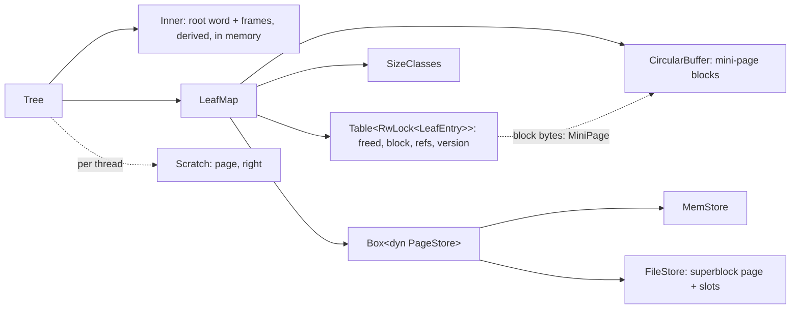
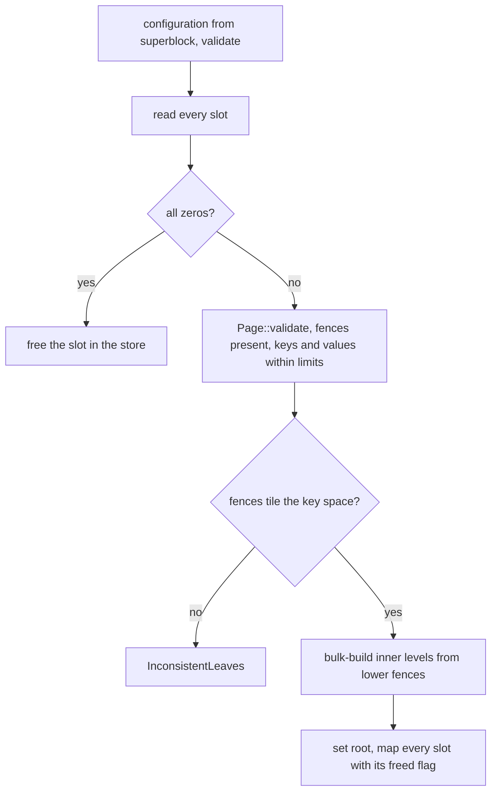

# BF-Tree leaf storage

Leaves of the [tree](bf-tree-structure.md) live in a `PageStore` behind a
leaf mapping table, the `LeafMap`. This document records the store boundary,
the file layout, how the tree locks, loads, writes, and reopens leaves, and
what the design does and does not guarantee about durability. It is the
paper's §3.3 base-leaf and mapping-table layer, with one reader-writer lock
per leaf. Each entry can also hold the leaf's
[mini-page](bf-tree-mini-page.md) in the
[circular buffer](bf-tree-circular-buffer.md). When the circular buffer is
full, eviction merges the oldest mini-pages into their base pages
([plan 0014](../plans/0014-bf-tree-eviction.md)).
The [concurrency design](bf-tree-concurrency.md) records the lock order and
the protocol that uses these locks.

## Shape



Inner nodes stay in memory and are rebuilt on open. Only leaves cross the
store boundary. No base page stays in memory between operations: each
access that needs one loads it into a thread-local scratch buffer. Writes
buffer in mini-pages, which stay in memory until a merge writes them to the
store.

## `PageStore`

```rust
pub trait PageStore: Send + Sync + std::fmt::Debug {
    fn page_size(&self) -> usize;
    fn slots(&self) -> u64;
    fn alloc(&self) -> Result<LeafId, StoreError>;
    fn free(&self, id: LeafId) -> Result<(), StoreError>;
    fn read(&self, id: LeafId, buf: &mut [u8]) -> Result<(), StoreError>;
    fn write(&self, id: LeafId, buf: &[u8]) -> Result<(), StoreError>;
    fn sync(&self) -> Result<(), StoreError>;
    fn superblock(&self) -> &Superblock;
}
```

- A store is a sequence of fixed-size slots. `LeafId` is the slot index.
  Reads and writes transfer exactly one page; a buffer of any other length is
  a `BufferLength` error.
- A store is shared between threads, and every method takes `&self`.
  Concurrent `alloc` calls return distinct IDs. The store does not order
  concurrent accesses to one slot: the caller must serialize them, and the
  tree does so with the leaf lock. The
  [concurrency design](bf-tree-concurrency.md#the-shareable-store-contract)
  records the full contract.
- `alloc` hands out a zeroed slot: a freed one if any, else a new slot at the
  end. `free` zeroes a slot and returns it for reuse. A write to a freed slot
  is an error; a read of one returns zeros. Leaves are never merged, so the
  tree calls `free` in two places only: `Tree::open` reclaims all-zero slots,
  and a split that fails after it allocated its right leaf returns that
  slot.
- Writes are durable only after `sync` returns.
- The tree holds a `Box<dyn PageStore>`, so one `Tree` type serves every
  backend. The virtual call sits next to a page read and costs nothing
  measurable.
- `StoreError` is `Copy` so that `TreeError` stays `Copy`. An I/O failure
  keeps the operation name, the `std::io::ErrorKind`, and the raw OS code
  rather than the boxed `io::Error`.

### Placement and the superblock

Slot `id` lives at byte offset `(id + 1) * page_size`, after a one-page
superblock. There is no catalogue: the file length determines the slot count,
and the slot index determines the offset. Fixed placement costs the ability to
resize a leaf in place, which fixed-capacity leaves never need.

A freed slot is all zeros. No valid page is all zeros, because its header
carries a nonzero capacity, so free slots are recoverable by scanning.
`FileStore::open` does not scan: on a 96 GiB file one probe per slot cost
three minutes. A reopened store treats every slot as live, and `Tree::open`,
which reads every slot anyway, returns the all-zero ones with `free`.

The superblock (version 1, magic `PEPPYBF\0`) records the page size and the
tree configuration: `inner_capacity`, `max_key_len`, and `max_value_len`,
all little-endian `u32`, zero-padded to one page. The configuration fixes the
admission rule for the file. `Tree::create` refuses a store whose superblock
disagrees with the requested configuration, and `Tree::open` takes its
configuration from the superblock, so a reopened tree never admits a key or
value that the stored pages could not split.

The superblock records only layout settings. `circular_buffer_bytes` and
`second_chance_percent` are runtime settings: `From<&TreeConfig> for
Superblock` ignores them, and `From<&Superblock> for TreeConfig` fills in
`DEFAULT_CIRCULAR_BUFFER_BYTES` and `DEFAULT_SECOND_CHANCE_PERCENT`.
`Tree::open_with(config, store)` opens a store with chosen runtime settings
and requires `Superblock::from(&config) == *store.superblock()`.
`Tree::open(store)` is `open_with` with the superblock's configuration.

### Backends

`MemStore` is the fast test backend and the store behind `Tree::in_memory`.
It keeps its slots in a `Table<MemSlot>`; each slot has its own page mutex
and a `freed` flag, and a `Mutex<Vec<usize>>` holds the free list. A read or
write locks only its slot. `FileStore` wraps one `std::fs::File` with
positioned reads and writes and `sync_data`. Positioned I/O needs only
`&File`, so reads and writes take no store-wide lock. Its per-slot freed
flags live in a `Table<AtomicBool>` whose length is the slot count, and a
`Mutex<Vec<u64>>` holds the free list. `FileStore::create` fails if the path
exists; `FileStore::open` rejects a file whose length is not a whole number
of pages. `alloc` extends the file with a zeroed page before returning the
slot, while it holds the free-list mutex, so the file length stays
authoritative. Both backends are synchronous and portable; direct and
asynchronous I/O are later tuning. A shared contract test runs the same
scenarios against both, including threaded allocation and threaded writes
to distinct slots.

## `LeafMap`

The mapping table gives each `LeafId` a lock and resolves it to the leaf's
base page in the store and its mini-page, if any, in the circular buffer.

```rust
pub(super) struct LeafMap {
    store: Box<dyn PageStore>,
    entries: Table<RwLock<LeafEntry>>,
    circular_buffer: CircularBuffer,
    classes: SizeClasses,
}

#[derive(Debug, Default)]
pub(super) struct LeafEntry {
    /// The slot holds no page.
    freed: bool,
    /// A circular-buffer block holding this leaf's mini-page, or, without
    /// `refs`, its full page.
    block: Option<Block>,
    /// Reference bits for the mini-page's slots; `Some` exactly when the
    /// block is a mini-page.
    refs: Option<Box<RefBits>>,
    /// Changes (wrapping) on every block change: allocation, growth,
    /// relocation, merge, promotion. A read's hint applies only if it is
    /// unchanged.
    version: u32,
    /// A full page is newer than the store. False in every other state.
    dirty: bool,
}

pub(super) struct LeafRead<'m>  { id: LeafId, entry: RwLockReadGuard<'m, LeafEntry> }
pub(super) struct LeafWrite<'m> { id: LeafId, entry: RwLockWriteGuard<'m, LeafEntry> }
```

`LeafMap::for_config` builds the map, its circular buffer, and its size
classes from a validated `TreeConfig`. The
[mini-page design](bf-tree-mini-page.md#in-the-tree) records the entry's
`Residency` view, `take_mini` and `put_mini`, and the two sites that
allocate mini-page blocks: `LeafMap::buffer` and `Tree::relocate`.

### Locked entries

Entries are dense and indexed by the ID. They live in a `Table` from
[`bf-tree-sync`](bf-tree-concurrency.md#bf-tree-sync), so lookups take no
lock and the table grows while other threads read it. Each entry is a
`RwLock<LeafEntry>`: the paper's per-leaf reader-writer lock (§3.3). The
lock covers the entry, the leaf's mini-page bytes, and the leaf's base page
in the store. Every base write and every mini-page change happens under X,
so a leaf read under S or X is consistent. (Readers set reference bits
under S through atomics.)

- `read(id)` takes S and `write(id)` takes X. Both return `UnknownLeaf` for
  an ID beyond the table or a freed slot. Eviction locks a victim's owner
  with `write(id)`.
- `try_write(id)` takes X without waiting and returns `None` if the lock is
  busy or the slot is not live. `Tree::maintain` uses it to apply a read's
  hint.
- `holds(leaf, victim)` reports whether the X-locked entry still holds the
  block that an eviction claim names.
- `alloc()` allocates a store slot, grows the table to `id + 1`, resets the
  entry, and returns it under X. The leaf is unreachable until a separator
  names it.
- `discard(leaf)` returns a fresh slot to the store and then marks its
  entry freed, so a failed free leaves the entry live. A split that fails
  after `alloc` uses it.
- `LeafEntry` holds `freed`, `block`, and `refs`
  ([plan 0013](../plans/0013-bf-tree-mini-tree.md)) and `version`
  ([plan 0014](../plans/0014-bf-tree-eviction.md)). `LeafWrite::take_mini`
  bumps `version` (wrapping); every block change goes through it. A read
  notes the version under S, and its relocation hint applies only if the
  version is unchanged
  ([concurrency](bf-tree-concurrency.md#hints-and-maintain)).
  [Plan 0015](../plans/0015-bf-tree-caching.md) adds `dirty` and full
  pages; `take_full` and `set_full` bump `version` too
  ([caching policy](bf-tree-caching.md#residency)). A test requires
  `size_of::<RwLock<LeafEntry>>() <= 64`.
- `ids()` yields `0..len()` at the time of the call; `write_if_live(id)`
  X-locks a live slot or returns `None`. `flush` walks leaves by ID with
  them.

This is upstream's `PageTable` row of `RwLock<PageLocation>`: `block` plays
the role of the `Mini` variant's circular-buffer pointer.

### Scratch

There are no resident base-page copies. Each access that needs the base
page loads it into a per-thread scratch buffer:

```rust
pub(super) const MAX_PAGE: usize = 4096; // the largest legal page

pub(super) struct Scratch {
    pub(super) page: Box<[u8; MAX_PAGE]>,
    pub(super) right: Box<[u8; MAX_PAGE]>, // the right half of a split
}
```

`with_scratch(f)` takes this thread's scratch out of a `thread_local!`
cell, lends it to `f`, and puts it back. Tree code does not nest calls. A
nested call from a user callback finds the cell empty, gets a temporary
scratch, and drops it afterwards; the outer scratch returns to the thread.
The buffers have the largest legal page size and are sliced to the tree's
page size, so one thread can use trees with different page sizes.

### `load_base`: the one read path

```rust
fn load_base<'s>(&self, leaf: &impl Locked, buf: &'s mut [u8]) -> Result<&'s mut Page, TreeError>;
```

`load_base` is the only function that reads a base page. It takes a guard
(`Locked` is implemented by `LeafRead` and `LeafWrite`), so the caller must
hold S or X. It reads the slot and checks the header with the O(1)
`Page::check_header`: the capacity equals the page size, only known flags
are set, the fences are present, and the slot directory and free gap fit.
Debug builds also run the full `Page::validate` on every load, so that tests
exercise it. Release builds do not: `open` validates every slot fully, every
page written afterwards was produced by this process, and a full validation
costs far more than the read. A header failure is `CorruptLeaf { id,
reason }`. Bytes that another process changes while the tree is open can
cause a panic or an error, never undefined behaviour.

### `write_through`: the one write path

```rust
fn write_through(&self, pages: &mut [(LeafId, &mut [u8])]) -> Result<(), TreeError>;
```

`write_through` is the only function that writes a base page. The caller
must hold the X lock of every leaf in `pages` (a debug assertion checks it)
and must pass the reachable leaf first. The other pages are written before
the first one, so an error before the last write leaves the reachable
leaf's stored page unchanged. It takes no tree-level lock. A split passes
both halves in one call, so that later plans can give them one sequence
number and one atomic switch. The pages are `&mut` because plans 0017 and
0018 stamp the leaf ID and a sequence number into their headers. Persistence
changes only the bodies of `load_base` and `write_through`.

## Tree lifecycle

```rust
impl Tree {
    pub fn in_memory(config: TreeConfig) -> Result<Self, TreeError>;   // MemStore; not durable
    pub fn create(config: TreeConfig, store: Box<dyn PageStore>) -> Result<Self, TreeError>;
    pub fn open(store: Box<dyn PageStore>) -> Result<Self, TreeError>;
    pub fn open_with(config: TreeConfig, store: Box<dyn PageStore>) -> Result<Self, TreeError>;
    pub fn flush(&self) -> Result<(), TreeError>;               // merge every mini-page, then sync
    pub fn into_store(self) -> Box<dyn PageStore>;              // close; buffered records are lost
    pub fn leaf_count(&self) -> usize;                          // slots, live or freed
    pub fn buffered_leaves(&self) -> usize;                     // leaves holding a mini-page
    pub fn circular_buffer_used(&self) -> usize;                // used bytes, dead blocks included
    pub fn store(&self) -> &dyn PageStore;
}
```

`create` requires an empty store whose superblock matches the configuration.
It allocates the first unbounded leaf and writes it through at once.
`flush` merges every buffered mini-page into its base page and then calls
`store.sync()`. `Drop` neither merges nor syncs.

### Open



1. The configuration comes from the superblock (`open`) or from the caller
   (`open_with`, whose layout settings must equal the superblock's). It must
   pass `TreeConfig::validate`.
2. Every slot is read once. An all-zero slot is free: a slot allocated for a
   split but never written. `open` returns it to the store's free list, so
   the next allocation reuses it. Every other slot must pass
   `Page::validate`, carry fences, and keep every fence, key, and value within
   the configured limits. Failures are `CorruptLeaf { id, reason }` or
   `InconsistentLeaves(reason)`.
3. Leaves are sorted by lower fence. There must be exactly one unbounded lower
   fence, exactly one unbounded upper fence, and `upper(i) == lower(i + 1)` for
   every adjacent pair. Any gap, overlap, or duplicate is
   `InconsistentLeaves`.
4. Inner levels are bulk-built from the sorted list. The separators are the
   lower fences of leaves `1..n`. Each level is filled left to right by entry
   size, exactly as `InnerNode::try_insert` would accept separators until
   `NodeFull`; the first child of every later node has its separator promoted
   to the level above. A trailing node that would get one child and no
   separator borrows the last entry of its left neighbour instead; under the
   admission rule a full node holds at least two separators, so the neighbour
   keeps at least one. A single leaf is its own root.
5. The `LeafMap` gets one entry per slot, with the freed flag from step 2,
   and an empty circular buffer. No leaf has a mini-page, and no page is
   loaded until an operation needs it.

Open is `O(leaves)` in I/O and memory and is the complete recovery path:
inner nodes are derived and nothing else is persisted. Bulk-built levels are
packed, so a reopened tree can be shorter than the incrementally built tree
that wrote it; the next inserts into full nodes simply split them. Upstream
instead checkpoints inner-node images; checkpointing can add that for fast
open on very large trees, keeping this rebuild as the repair path.

## Durability and consistency without a log

A `put` or `remove` buffers its record in the leaf's mini-page and returns.
The record lives only in memory until a merge writes it to the store: a
merge when the mini-page is full at its largest class, an eviction when the
circular buffer is full, or `flush`. A merge writes its pages with
`write_through` at once. An eviction does not sync.

- **Drop loses buffered records.** Dropping the tree or calling
  `into_store` loses every record that is still buffered. Merged records
  are in the store, synced or not, and the store still opens as a valid
  tree. Both return the blocks to the circular buffer, so its slab is
  freed normally. Call `flush` first.
- **`flush` merges, then syncs.** `flush` merges every buffered mini-page
  into its base page, one leaf at a time, and then calls `store.sync()`.
  Every write that returned before `flush` began is durable when `flush`
  returns. Writers may run during `flush`; a record buffered into a leaf
  that `flush` already visited may stay buffered. Merged writes that are not
  yet synced survive a process stop on `FileStore`, because they are in the
  operating system's page cache, but not necessarily an operating-system
  crash or a power loss.

There is no per-operation atomicity across pages. A split writes two pages
(the right half first, then the left) and then updates the parent in
memory. A stop between the two page writes leaves a window:

- **Stop before the right page is written.** The right slot is all zeros
  (`alloc` extended the file with a zeroed page). The store still holds the
  pre-split leaf, so it is consistent, and `open` reclaims the slot.
- **Stop between the two writes.** The right page and the pre-split left
  page overlap. `open` refuses the store with `InconsistentLeaves`. Without
  a `sync` the device can also persist the left write and lose the right
  one, which leaves a gap that `open` also refuses.
- **Stop after both writes.** The pages tile the key space, and `open`
  rebuilds the parent from their fences.

The order in `write_through` keeps the reachable leaf intact when a write
returns an error, but it cannot make two writes atomic. The user accepted
this window until shadow paging in
[plan 0018](../plans/0018-bf-tree-checkpoint.md) removes it.

A torn page write leaves bytes that `Page::validate` rejects at the next
`open`. Within a running process, a split that fails at any point after
`alloc` frees the fresh right slot, because a written but unreachable right
page would overlap its left neighbour at the next `open`. A failed
`install` still leaves the left page rewritten; under the admission rule
that is an internal bug, and shadow paging (plan 0018) removes the window.

The write-ahead log and crash atomicity are separate components. The page header's
`lsn` and `snapshot_version` fields stay inactive.

## Baselines

All baselines are informational and single-threaded. They live in the tree
tests as ignored benchmarks. Contended numbers live in the
[concurrency design](bf-tree-concurrency.md#measurements)
([plan 0016](../plans/0016-bf-tree-concurrency.md)): macOS numbers with
their caveats, and Linux numbers once the Linux run is done.

### Mini-pages, write-through, eviction, and caching (plans 0012 to 0015)

`tools/buck2 run @build/mode/release //crates/bf-tree:bf-tree-unittest -- --ignored --nocapture baseline`
(both `baseline_throughput` and `baseline_file_store`), on an Apple M4 Pro:
one million random 8-byte keys with 16-byte values and the default
configuration. "Before 0012" is the resident-copy design of plan 0008,
measured on the same machine immediately before
[plan 0012](../plans/0012-bf-tree-shared-tree.md). "After 0012" is
write-through without resident pages. "After 0013" adds blind writes into
mini-pages ([plan 0013](../plans/0013-bf-tree-mini-tree.md)). The 0012 and
0013 columns used a 1 GiB circular buffer, because without eviction the
default 32 MiB could not hold the buffered leaves. "After 0014" is the
current design with eviction and the second chance
([plan 0014](../plans/0014-bf-tree-eviction.md)), measured with the
default 32 MiB circular buffer; the benchmarks no longer override it.
"After 0015" adds the default caching policy
([plan 0015](../plans/0015-bf-tree-caching.md)): write-load full pages,
record caching at a 20 percent read rate, and scan promotion at 20
percent.

| step | before 0012 | after 0012 | after 0013 | after 0014 (32 MiB) | after 0015 (32 MiB) |
| --- | --- | --- | --- | --- | --- |
| `MemStore` put | 1.92 M ops/s | 0.11 M ops/s | 1.42 M ops/s | 1.57 M ops/s | 1.55 M ops/s |
| `MemStore` get | 1.73 M ops/s | 1.96 M ops/s | 1.28 M ops/s | 1.65 to 1.89 M ops/s | 2.04 M ops/s |
| `MemStore` scan | 140 M records/s | 27 M records/s | 17 M records/s | ~19 M records/s | 22 M records/s |
| `FileStore` put | 1.63 M ops/s | 0.07 M ops/s | 1.15 M ops/s | 1.33 M ops/s | 1.27 M ops/s |
| `FileStore` flush | 47 ms | 859 ms (sync only) | 226 ms | 180 ms | 104 ms |
| `FileStore` open | not recorded | not recorded | ~31 ms | 26 ms | 28 ms |
| `FileStore` get, warm | 1.92 M ops/s | 1.04 M ops/s | 1.02 M ops/s | 1.29 M ops/s | 1.05 M ops/s |
| `FileStore` scan, warm | 138 M records/s | 22 M records/s | 24 M records/s | 25 M records/s | 20 M records/s |

The 0014 column is not a like-for-like comparison with the 0013 column,
because the circular-buffer budget differs. Under the smaller budget,
eviction merges mini-pages during the put phase, so fewer leaves are
buffered when `flush` and the reads run. The table records the outcomes;
the causes of the differences were not investigated. The 0015 column is
one run; its differences from the 0014 column are within the run-to-run
spread seen for 0014, except the faster `flush` (merged pages that stay as
clean full pages need no write) and the slower warm `FileStore` get, whose
cause was not investigated.

- **Writes.** Plan 0012 regressed writes as expected: nothing stayed
  resident, so every `put` loaded, rebuilt, and wrote a full 4 KiB page.
  Plan 0013 recovers most of that: a `put` to a leaf whose mini-page has
  room does no store I/O, and a merge writes many buffered records with one
  base read and one or two writes.
- **Flush.** The flush rows measure different work. Before 0012, `flush`
  wrote every dirty leaf and then synced. After 0012, the page writes
  happened during the put phase, and `flush` only called `sync_data`. Now
  `flush` merges every buffered leaf (8192 leaves in this run) and then
  syncs.
- **Reads.** Before plan 0015, reads always loaded base pages. Plan 0015
  adds record, negative, and page caching; this uniform-random benchmark
  reads each key about once, so it shows little of that benefit. The in-memory get rate fell from 1.96 to 1.28 M ops/s after
  0013. In that benchmark the keys are still buffered in mini-pages when the
  gets run, so most gets hit a mini-page. The cause of the slowdown was not
  investigated.

### Resident copies (plan 0008)

The rest of this section records the baselines of the resident-copy design
that plan 0012 replaced. They were measured on an Apple laptop with 48 GiB
of RAM and an internal SSD, with `cargo test --release` before the
[Buck2 build](build-system.md). The Buck2 release platform uses the same
optimization flags, and a check after the move measured comparable figures.
They were not measured again for the current design.

#### Page cache (`baseline_file_store`)

`tools/buck2 run @build/mode/release //crates/bf-tree:bf-tree-unittest -- --ignored --nocapture baseline_file`:
one million random 8-byte keys with 16-byte values, default configuration,
8692 leaves, 34 MiB file, written and reopened immediately, so every read is
a page-cache hit.

| step | result |
| --- | --- |
| put (in memory) | ~2.1 M ops/s |
| flush of every leaf | ~35 ms |
| open (read, validate, tile, rebuild) | ~35 ms |
| get, cold (loads each leaf once from cache) | ~2.3 M ops/s |
| get, warm | ~2.5 M ops/s |
| scan, warm | ~120 M records/s |

The in-memory `Tree::in_memory` baseline is unchanged by the mapping table: about
2.1 M put/s and 2.0 M get/s.

#### Larger than memory (`disk_baseline`)

`PEPPYDB_DISK_GIB=96 tools/buck2 run @build/mode/release
//crates/bf-tree:bf-tree-unittest -- --ignored --nocapture disk_baseline`. Nothing evicted in that design, so a tree could not be
built through `put` beyond RAM; the benchmark writes the file directly in
the on-disk format (sorted keys, three 1000-byte records per 4 KiB leaf),
opens it, and measures 200,000 random gets, 5,000 scans of 100 records,
100,000 random replacements, and one flush. 96 GiB is twice RAM, so most
first touches miss the page cache; the percentiles show it.

| step | result |
| --- | --- |
| bulk write 96 GiB (25.2 M leaves, 75.5 M records) | ~19 s, ~5 GiB/s |
| `FileStore::open` | ~0.4 ms |
| `Tree::open` (read, validate, tile, rebuild; height 5, 123 k inner nodes) | ~21 s, ~4.6 GiB/s |
| get, first touch | ~14 k ops/s; p50 85 µs, p99 123 µs, max 1.6 ms |
| get, same keys warm | ~780 k ops/s; p50 1.2 µs |
| scan 100 records (~34 adjacent leaves, first touch) | ~2.6 k scans/s; p50 415 µs, about 12 µs per leaf with readahead |
| put, random replacement (one leaf load each) | ~14 k ops/s; p50 85 µs |
| flush of 99,816 dirty leaves | ~3.2 s; ~31 k leaves/s, ~120 MiB/s of random 4 KiB writes plus one `sync_data` |

A random 4 KiB read costs about 85 µs on this device, and a first-touch get
or put is exactly one such read. Sequential leaves are much cheaper per leaf
than random ones, which favours scans and `open`. `Tree::open` is bounded by
sequential read bandwidth and grows linearly with the file; checkpointed
inner nodes would remove the full read from the common path. In that design
memory grew by one page per touched leaf (1.8 GiB resident after this run);
the current design keeps no base page resident.

## References

- [BF-Tree paper](../references.md#bf-tree-paper), §3.3: base leaves, page
  I/O, the mapping table, and the per-leaf reader-writer lock.
- Plans [0008](../plans/0008-bf-tree-leaf-store.md) (the store boundary,
  validation, and open), [0012](../plans/0012-bf-tree-shared-tree.md)
  (locked entries, scratch, and write-through), and
  [0013](../plans/0013-bf-tree-mini-tree.md) (mini-pages in entries,
  `open_with`, and flush merges), and
  [0014](../plans/0014-bf-tree-eviction.md) (eviction, `version`, and
  relocation).
- [Microsoft implementation](../references.md#microsoft-bf-tree-implementation),
  revision `f442e6172bf7e5483ff320d8e3ac16a70e31bbd6`: `src/storage.rs`
  (`PageTable`, `PageLocation`), `src/utils/mapping_table.rs`, `src/fs/mod.rs`
  (`VfsImpl`, which allocates offsets where peppydb uses fixed placement), and
  `src/snapshot.rs` (checkpointed inner images, which peppydb defers).
