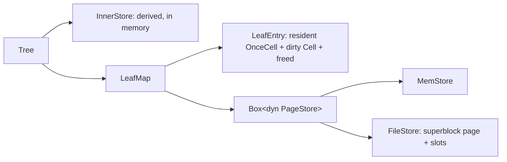
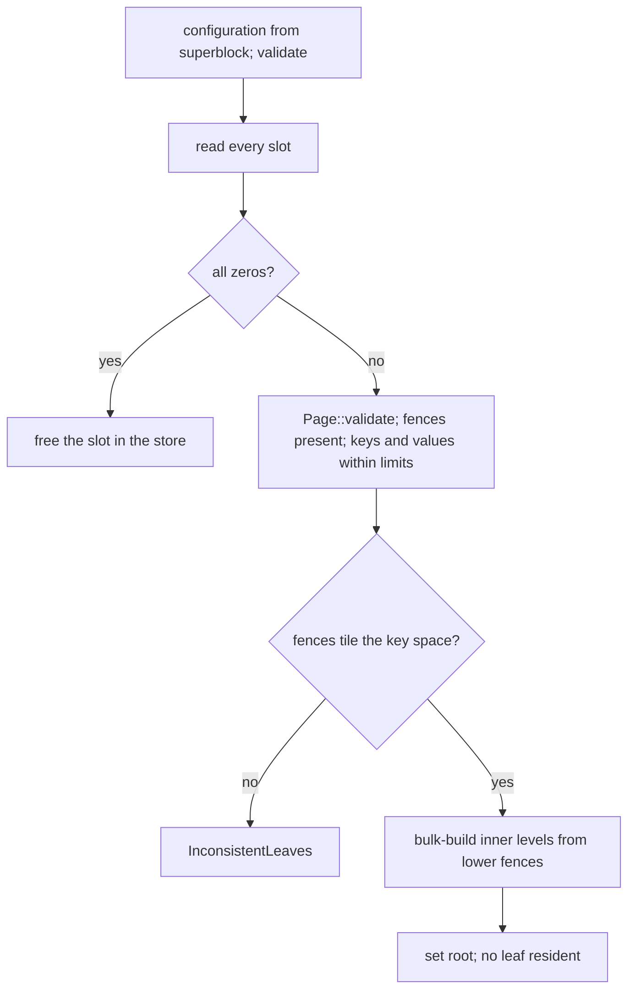

# BF-Tree leaf storage

Leaves of the [tree](bf-tree-structure.md) live in a `PageStore` behind a
leaf mapping table, the `LeafMap`. This document records the store boundary,
the file layout, how the tree loads, dirties, flushes, and reopens leaves,
and what the design does and does not guarantee about durability. It is the
paper's §3.3 base-leaf and mapping-table layer without mini-pages, eviction,
or locks.

## Shape



Inner nodes stay in memory and are rebuilt on open. Only leaves cross the
store boundary.

## `PageStore`

```rust
pub trait PageStore {
    fn page_size(&self) -> usize;
    fn slots(&self) -> u64;
    fn alloc(&mut self) -> Result<LeafId, StoreError>;
    fn free(&mut self, id: LeafId) -> Result<(), StoreError>;
    fn read(&self, id: LeafId, buf: &mut [u8]) -> Result<(), StoreError>;
    fn write(&mut self, id: LeafId, buf: &[u8]) -> Result<(), StoreError>;
    fn sync(&mut self) -> Result<(), StoreError>;
    fn superblock(&self) -> &Superblock;
}
```

- A store is a sequence of fixed-size slots. `LeafId` is the slot index.
  Reads and writes transfer exactly one page; a buffer of any other length is
  a `BufferLength` error.
- `alloc` hands out a zeroed slot: a freed one if any, else a new slot at the
  end. `free` zeroes a slot and returns it for reuse. A write to a freed slot
  is an error; a read of one returns zeros. The tree's operations never call
  `free`, because leaves are never merged; it is in the trait so the boundary
  does not change when merging arrives, and `Tree::open` uses it to reclaim
  slots that were allocated but never flushed.
- Writes are durable only after `sync` returns.
- The tree holds a `Box<dyn PageStore>`, so one `Tree` type serves every
  backend. The virtual call sits next to a page read and costs nothing
  measurable.
- `StoreError` is `Copy` so that `TreeError` stays `Copy`. An I/O failure
  keeps the operation name, the `std::io::ErrorKind`, and the raw OS code
  rather than the boxed `io::Error`.

### Placement and the superblock

Slot `id` lives at byte offset `(id + 1) * page_size`, after a one-page
superblock. There is no catalogue: the file length determines the slot count,
and the slot index determines the offset. Fixed placement costs the ability to
resize a leaf in place, which fixed-capacity leaves never need.

A freed slot is all zeros. No valid page is all zeros, because its header
carries a nonzero capacity, so free slots are recoverable by scanning.
`FileStore::open` does not scan: on a 96 GiB file one probe per slot cost
three minutes. A reopened store treats every slot as live, and `Tree::open`,
which reads every slot anyway, returns the all-zero ones with `free`.

The superblock (version 1, magic `PEPPYBF\0`) records the page size and the
tree configuration: `inner_capacity`, `max_key_len`, and `max_value_len`,
all little-endian `u32`, zero-padded to one page. The configuration fixes the
admission rule for the file. `Tree::create` refuses a store whose superblock
disagrees with the requested configuration, and `Tree::open` takes its
configuration from the superblock, so a reopened tree never admits a key or
value that the stored pages could not split.

### Backends

`MemStore` is a `Vec<Box<[u8]>>` plus a free list: the fast test backend and
the store behind `Tree::in_memory`. `FileStore` wraps one `std::fs::File` with
positioned reads and writes and `sync_data`. `FileStore::create` fails if
the path exists; `FileStore::open` rejects a file whose length is not a whole
number of pages. `alloc` extends the file with a zeroed page before returning
the slot, so the file length stays authoritative. Both backends are
synchronous and portable; direct and asynchronous I/O are later tuning. A
shared contract test runs the same scenarios against both.

## `LeafMap`

The mapping table resolves a `LeafId` to the leaf's current bytes. Entries
are dense, indexed by the ID, and each holds:

| field | meaning |
| --- | --- |
| `resident: OnceCell<Box<[u8]>>` | the full-page copy, loaded on first access |
| `dirty: Cell<bool>` | the resident copy is newer than the store |
| `freed: bool` | the slot holds no page |

| state | meaning |
| --- | --- |
| not resident, clean | only in the store; untouched since open |
| resident, clean | loaded for reading; equal to the store |
| resident, dirty | mutated; `flush` must write it |

`page(&self, id)` loads the slot on first touch through a shared borrow:
`OnceCell` lets a `&self` method initialize the entry and hand out a borrow
tied to the map. Loaded bytes pass `Page::validate` before they become a
`Page`, so every load is a trust boundary, not only `open`: validation is
cheap next to a read, and the map does not assume the file is unchanged
underneath the process. `page_mut`,
`bytes_mut`, and `pair_mut` make the leaves resident, then mark them dirty.
`alloc` creates an entry that is resident, zeroed, and dirty; the caller
initializes the page before the next flush.

Nothing is ever evicted here, so a cell is never cleared and borrows from
`Tree::get` and `Scan` stay valid for the life of the tree. This is correct
only because this layer never evicts; eviction needs `&mut` access or a
latch. This is upstream's `PageTable` row with the lock,
the `Mini` variant, and the circular-buffer pointer removed.

## Tree lifecycle

```rust
impl Tree {
    pub fn in_memory(config: TreeConfig) -> Result<Self, TreeError>;   // MemStore; not durable
    pub fn create(config: TreeConfig, store: Box<dyn PageStore>) -> Result<Self, TreeError>;
    pub fn open(store: Box<dyn PageStore>) -> Result<Self, TreeError>;
    pub fn flush(&mut self) -> Result<(), TreeError>;
    pub fn into_store(self) -> Box<dyn PageStore>;              // close; unflushed changes are lost
    pub fn leaf_count(&self) -> usize;                          // slots, live or freed
    pub fn resident_leaves(&self) -> usize;
    pub fn dirty_leaves(&self) -> usize;
    pub fn store(&self) -> &dyn PageStore;
}
```

`create` requires an empty store whose superblock matches the configuration
and allocates the first unbounded leaf. `flush` writes every dirty resident
leaf in ID order, then syncs. `Drop` does not flush.

### Open



1. The configuration comes from the superblock and must pass
   `TreeConfig::validate`.
2. Every slot is read once. An all-zero slot is free: a slot allocated for a
   split but never flushed. `open` returns it to the store's free list, so
   the next allocation reuses it. Every other slot must pass
   `Page::validate`, carry fences, and keep every fence, key, and value within
   the configured limits. Failures are `CorruptLeaf { id, reason }` or
   `InconsistentLeaves(reason)`.
3. Leaves are sorted by lower fence. There must be exactly one unbounded lower
   fence, exactly one unbounded upper fence, and `upper(i) == lower(i + 1)` for
   every adjacent pair. Any gap, overlap, or duplicate is
   `InconsistentLeaves`.
4. Inner levels are bulk-built from the sorted list. The separators are the
   lower fences of leaves `1..n`. Each level is filled left to right by entry
   size, exactly as `InnerNode::try_insert` would accept separators until
   `NodeFull`; the first child of every later node has its separator promoted
   to the level above. A trailing node that would get one child and no
   separator borrows the last entry of its left neighbour instead; under the
   admission rule a full node holds at least two separators, so the neighbour
   keeps at least one. A single leaf is its own root.
5. No leaf is resident and none is dirty.

Open is `O(leaves)` in I/O and memory and is the complete recovery path:
inner nodes are derived and nothing else is persisted. Bulk-built levels are
packed, so a reopened tree can be shorter than the incrementally built tree
that wrote it; the next inserts into full nodes simply split them. Upstream
instead checkpoints inner-node images; checkpointing can add that for fast
open on very large trees, keeping this rebuild as the repair path.

## Consistency without a log

Data is durable only after `flush` returns, and there is no per-operation
atomicity. A leaf split dirties two leaves and updates the parent in memory:

- If the process stops between flushes, both leaves are lost together. The
  store still holds the pre-split leaf and the slot allocated for the right
  leaf is zero, so the store is consistent and `open` reclaims the slot.
- If the process stops during `flush`, one leaf of a pair may be written and
  the other not. `open` detects the gap or overlap and refuses with
  `InconsistentLeaves`.
- A torn page write leaves bytes that `Page::validate` rejects on the next
  load or open.

The write-ahead log and crash atomicity are separate components. The page header's
`lsn` and `snapshot_version` fields stay inactive.

## Baselines

Informational and single-threaded, on an Apple laptop with 48 GiB of RAM and
an internal SSD. Both live in the tree tests as ignored benchmarks.

### Page cache (`baseline_file_store`)

`cargo test --release -p peppydb-bftree -- --ignored --nocapture baseline_file`:
one million random 8-byte keys with 16-byte values, default configuration,
8692 leaves, 34 MiB file, written and reopened immediately, so every read is
a page-cache hit.

| step | result |
| --- | --- |
| put (in memory) | ~2.1 M ops/s |
| flush of every leaf | ~35 ms |
| open (read, validate, tile, rebuild) | ~35 ms |
| get, cold (loads each leaf once from cache) | ~2.3 M ops/s |
| get, warm | ~2.5 M ops/s |
| scan, warm | ~120 M records/s |

The in-memory `Tree::in_memory` baseline is unchanged by the mapping table: about
2.1 M put/s and 2.0 M get/s.

### Larger than memory (`disk_baseline`)

`PEPPYDB_DISK_GIB=96 cargo test --release -p peppydb-bftree -- --ignored
--nocapture disk_baseline`. Nothing evicts yet, so a tree cannot be
built through `put` beyond RAM; the benchmark writes the file directly in
the on-disk format (sorted keys, three 1000-byte records per 4 KiB leaf),
opens it, and measures 200,000 random gets, 5,000 scans of 100 records,
100,000 random replacements, and one flush. 96 GiB is twice RAM, so most
first touches miss the page cache; the percentiles show it.

| step | result |
| --- | --- |
| bulk write 96 GiB (25.2 M leaves, 75.5 M records) | ~19 s, ~5 GiB/s |
| `FileStore::open` | ~0.4 ms |
| `Tree::open` (read, validate, tile, rebuild; height 5, 123 k inner nodes) | ~21 s, ~4.6 GiB/s |
| get, first touch | ~14 k ops/s; p50 85 µs, p99 123 µs, max 1.6 ms |
| get, same keys warm | ~780 k ops/s; p50 1.2 µs |
| scan 100 records (~34 adjacent leaves, first touch) | ~2.6 k scans/s; p50 415 µs, about 12 µs per leaf with readahead |
| put, random replacement (one leaf load each) | ~14 k ops/s; p50 85 µs |
| flush of 99,816 dirty leaves | ~3.2 s; ~31 k leaves/s, ~120 MiB/s of random 4 KiB writes plus one `sync_data` |

A random 4 KiB read costs about 85 µs on this device, and a first-touch get
or put is exactly one such read. Sequential leaves are much cheaper per leaf
than random ones, which favours scans and `open`. `Tree::open` is bounded by
sequential read bandwidth and grows linearly with the file; checkpointed
inner nodes would remove the full read from the common path. Memory grows by
one page per touched leaf until eviction exists (1.8 GiB resident after this
run).

## References

- [BF-Tree paper](../references.md#bf-tree-paper), §3.3: base leaves, page
  I/O, and the mapping table.
- [Microsoft implementation](../references.md#microsoft-bf-tree-implementation),
  revision `f442e6172bf7e5483ff320d8e3ac16a70e31bbd6`: `src/storage.rs`
  (`PageTable`, `PageLocation`), `src/utils/mapping_table.rs`, `src/fs/mod.rs`
  (`VfsImpl`, which allocates offsets where peppydb uses fixed placement), and
  `src/snapshot.rs` (checkpointed inner images, which peppydb defers).
