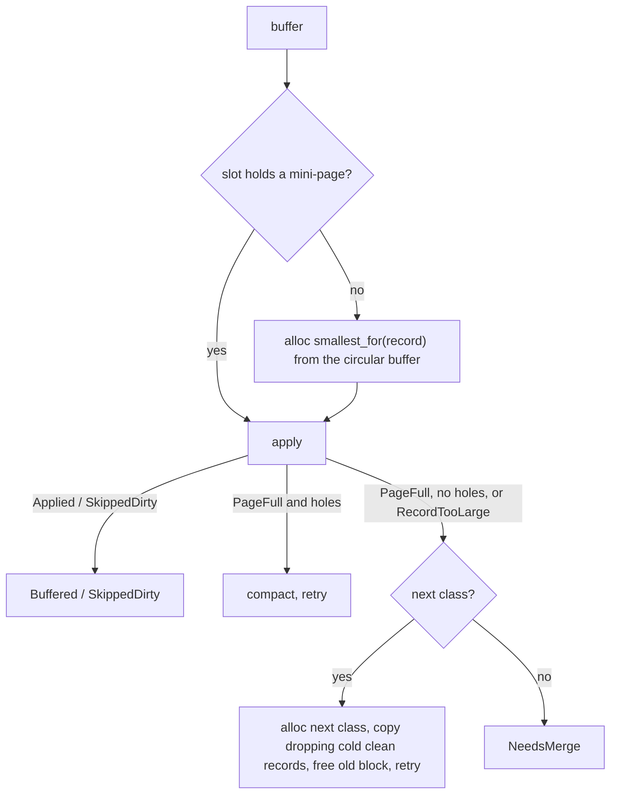
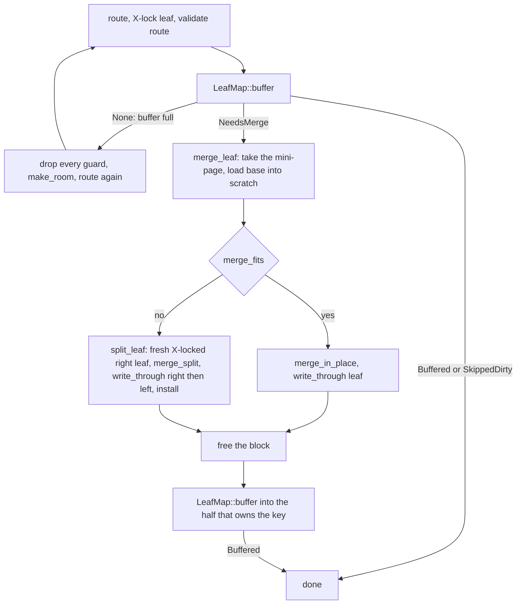

# Mini-pages

A BF-Tree leaf is a durable **base page** plus at most one in-memory
**mini-page** (BF-Tree paper, §§3.1, 5). The mini-page buffers writes and
caches records for that leaf. The crate `bf-tree-mini-page` implements one
leaf's overlay without the tree: size classes, the `MiniPage` view,
reference bits, the write loop, and the leaf views that read and merge base
plus mini-page. [Plan 0011](../plans/0011-bf-tree-mini-page.md) built it;
[plan 0013](../plans/0013-bf-tree-mini-tree.md) puts it into the tree.

```text
inner nodes  -->  LeafId  -->  logical leaf = base page + (0 or 1) mini-page
```

## Roles and records

Both roles use the [shared page format](bf-tree-pages.md).

| Role | Fences | `backing_leaf` | Record kinds | Capacity |
| --- | --- | --- | --- | --- |
| Base page | Required | Unset | `Insert` only | `L` |
| Mini-page | None | The leaf it overlays | Any | One size class, `64..=M` |

| Kind | Dirty | Key exists |
| --- | --- | --- |
| `Insert` | Yes | Yes |
| `Delete` | Yes | No |
| `Cache` | No | Yes |
| `Phantom` | No | No |

- **Clean records repeat the base page.** A mini-page is discarded at every
  merge, so a `Cache` or `Phantom` record always agrees with the base page.
  A merge therefore applies only dirty records.
- **A base page never stores a tombstone.** A merge applies a `Delete` by
  removing the base key; a `Delete` for a key the base lacks is a no-op.
- **Reads go mini-page first.** `lookup_marking` answers `Found` (`Insert`
  or `Cache`), `Absent` (`Delete` or `Phantom`), or `Miss`; on `Miss` the
  base page decides, because a mini-page may hold only part of the leaf.
  Scans always read the base page too.

## Writes

`MiniPage::apply` inserts or replaces one record:

| Incoming | Nothing buffered | Dirty buffered | Clean buffered |
| --- | --- | --- | --- |
| `Insert(v)` | Insert | Replace | Replace |
| `Delete` | Key-only tombstone | Replace | Replace |
| `Cache(v)`, `Phantom` | Insert | Skip (`SkippedDirty`) | Replace |

A `Delete` of an unbuffered key leaves a tombstone, because the base page may
hold the key. A clean record never replaces a dirty one, which is newer than
the base page. `apply` never compacts or grows; errors leave the page
unchanged.

`buffer` is the write loop around it:



- **Growth is where the cache forgets.** Copying into the next class drops
  `Cache` and `Phantom` records whose reference bit is clear (upstream
  `copy_initialize_to`). Dirty records are always kept.
- **Nothing changes on failure.** A full circular buffer returns
  `BufferError::Full`: the first allocation leaves the slot empty, and a
  failed growth keeps the old mini-page. `NeedsMerge` is returned only at
  the largest class and changes nothing. Invalid records fail before any
  allocation.
- **Blocks come from the circular buffer.** A mini-page lives in a
  [circular buffer](bf-tree-circular-buffer.md) block, owned by its leaf. The
  crate depends on `bf-tree-circular-buffer` directly; the buffer treats
  blocks as bytes, and `MiniPage` views them in place through `zerocopy`, so
  this crate has no `unsafe` code.

## Size classes and the admission rule

The ladder is powers of two from 64 below the largest class `M`, then `M`:

```text
M = floor64(L - 5K - V - 24),  requiring M >= 64 and 32 + 8 + K + V <= M
```

At the defaults (`L = 4096`, `K = 64`, `V = 1024`) the ladder is 64, 128,
256, 512, 1024, 2048, 2688.

**Why this `M`.** Let `R = 8 + K + V` be the largest record and
`F = 16 + 2K` the largest finite fence pair. A base page holds at most
`L - 48` record bytes and a mini-page at most `M - 32`, so a merge has
`T <= (L - 48) + (M - 32)` bytes of records. Around the midpoint, the two
candidate split points differ by one record, so the better one has a larger
side of at most `T/2 + R/2`. That side fits when
`32 + F + T/2 + R/2 <= L`, which gives `M <= L - 5K - V - 24`. One two-way
split therefore always absorbs a merge, and a merge never returns
`CannotSplit`. The check `32 + R <= M` means a fresh mini-page at the
smallest fitting class takes any record, so a write after a merge always
succeeds.

## Reference bits

Readers hold a leaf's shared lock (plan 0012). Safe Rust cannot set a
bit inside bytes that other readers are reading, so reference bits live
beside the mini-page in `RefBits`: one `AtomicU64` bit per slot index, 512 in
all (a page holds at most 508 slots). `mark` loads first and writes only if
the bit is clear. `Relaxed` ordering suffices: the leaf lock orders a
reader's marks before a later writer's reads, and concurrent marks commute.
`apply` shifts the bits when it inserts a slot, so bit `i` stays with slot
`i`; compaction moves payloads only; a copy starts with clear bits.

## Leaf views

- `LeafRef { base, mini }::range` merges both in key order; the mini-page
  wins an equal key, and `Delete` or `Phantom` hide their keys.
- `LeafMut { base, mini }` merges the mini-page's dirty records into the
  base page with `Page::merge_batch_*`: in place when they fit, otherwise
  with one split into a right page. Merging is two-phase (`merge_fits`,
  then in place or split), so the caller allocates a right leaf only when a
  split is certain. The merge borrows the mini-page and never frees it.

## In the tree

[Plan 0013](../plans/0013-bf-tree-mini-tree.md) puts mini-pages into the
shared [tree](bf-tree-structure.md). Each leaf's mapping-table entry holds
the leaf's mini-page, if any, under the leaf's reader-writer lock
([concurrency](bf-tree-concurrency.md)).

### Entry and residency

```rust
pub(super) struct LeafEntry {
    freed: bool,
    /// A circular-buffer block holding this leaf's mini-page.
    block: Option<Block>,
    /// Reference bits for the mini-page's slots; `Some` exactly when `block` is.
    refs: Option<Box<RefBits>>,
    /// Changes (wrapping) on every block change. A read's hint applies
    /// only if it is unchanged (plan 0014).
    version: u32,
}

pub(super) enum Residency<'e> {
    Base,
    Mini { page: &'e MiniPage, refs: &'e RefBits },
}
```

- `block` and `refs` are two `Option` fields, not one enum. Each has a
  niche, so the entry needs no discriminant, and a test keeps
  `RwLock<LeafEntry>` within 64 bytes. Plan 0015 adds `Full` pages, which
  hold a block without reference bits.
- `residency()` gives a view of the entry under S or X. `Mini` views the
  block bytes in place as a `MiniPage`.
- `LeafWrite::take_mini` moves the two handles out of the entry into a
  `Mini`, and `put_mini` moves them back. No block bytes are copied.
  `take_mini` also bumps `version`. Growth, merges, and relocation all go
  through it, so one bump covers every block change. A bump without a
  change only makes a read's hint skip.

### Allocation sites

`LeafMap::buffer` creates and grows mini-pages. It runs under the leaf's X
lock. It takes the leaf's `Mini` out of the entry, calls this crate's
`buffer` with the map's circular buffer, the leaf's ID (the block's owner
and the mini-page's backing leaf), and the map's `SizeClasses`, and puts
the result back. It never reads the base page. On `BufferError::Full` it
returns `Ok(None)`, and nothing changed. `BufferError::Page` becomes
`TreeError::Page`.

Since [plan 0014](../plans/0014-bf-tree-eviction.md), `Tree::relocate` is
the second allocation site. Under the leaf's X lock, it copies a mini-page
whose block has aged into the second-chance region into a fresh block of
the same size with `Mini::copy_into(fresh, true)`, then frees the old
block. If the allocation fails, it keeps the old block; it never evicts.
See [the second chance](bf-tree-circular-buffer.md#the-second-chance).

### Writes

`put` and `remove` are blind: they buffer `Insert(value)` or `Delete`
without reading the base page. A `Delete` of a key that the base page does
not hold becomes a tombstone, and the merge drops it.



- **Merge.** `Tree::merge_leaf` runs under X on the reachable leaf. It
  takes the mini-page out of the entry, loads the base page, and merges with
  `LeafMut`: in place when `merge_fits`, otherwise through the tree's
  `split_leaf`. It writes the result through, installs the separator after a
  split, and only then frees the block. On any error it puts the mini-page
  back into the entry, so no buffered record is lost. It returns the
  separator and the right half, still X-locked, after a split.
- **Placement under the held locks.** After the merge, both halves are
  still X-locked. The pending record goes to the right half if
  `key >= separator`, otherwise to the original leaf. There is no second
  route and no retry. Neither half has a mini-page now, so `buffer`
  allocates a fresh one at the smallest fitting class. The ladder check
  `32 + 8 + K + V <= M` guarantees that it takes the record; any other
  outcome is a bug (`unreachable!`).
- **Why the record is not folded into the merge.** Folding it in adds one
  record to the merge content, and the admission derivation then requires
  `M <= L - 6K - 2V - 32`: 1600 at the defaults instead of 2688. The
  mini-page would merge almost twice as often.
- **A full circular buffer.** When `buffer` returns `None`, the write
  attempt returns `Attempt::NeedRoom` and drops every guard. `write` then
  calls `make_room`, which evicts the oldest blocks with no leaf lock
  held, and routes the key again. The first `buffer` call changes nothing.
  A failure in the placement after a merge leaves the merge done; the
  retry buffers into whichever half now owns the key. No circular-buffer
  error reaches the caller. See
  [the circular buffer design](bf-tree-circular-buffer.md#a-full-buffer).
- **Relocation after the write.** After a record is buffered, the write
  calls `Tree::relocate` on the routed leaf under the same X lock. After a
  merge, that leaf has no block or a fresh one at the tail, so the call
  does nothing. A write that grew the mini-page has already moved it to the tail,
  so relocating after buffering avoids a second copy.

### Reads and scans

`get_with` consults the mini-page first with `lookup_marking`, which marks
the slot's reference bit through `&RefBits` under S. `Found` and `Absent`
answer without the store. Only `Miss` loads the base page. Both scan forms
load the base page under S and iterate `LeafRef { base, mini }.range` for
each leaf.

### Flush and close

`Tree::flush` walks leaf IDs `0..len`, with `len` read when it starts. It
X-locks each live leaf by ID, calls `merge_leaf` if the leaf has a
mini-page, releases the leaf, and then syncs the store. Every write that
returned before `flush` began is in the store when `flush` returns. A
record buffered into a leaf that `flush` already visited, or into a leaf
created after it started, may stay buffered.

Buffered records exist only in memory. Dropping a tree, or `into_store`,
discards them and returns their blocks to the circular buffer, so the buffer
never sees outstanding blocks at its own drop. Call `flush` first to keep
the records.

### Diagnostics and checks

`Tree::buffered_leaves()` counts leaves with a block; it takes each S lock
in turn. `Tree::circular_buffer_used()` returns the circular buffer's used
bytes, which include dead blocks that the head has not passed.
`check_invariants` requires each mini-page to be a valid, unfenced page
whose backing leaf is this leaf, whose capacity is a ladder class, and
whose keys lie within the leaf's fences. A violation is
`InvariantError::BadMiniPage`.

## Tests

The leaf-set model drives a set of leaves (fenced base pages plus
mini-pages in one shared circular buffer) with random writes, deletes, cache
fills, marking lookups, range scans, and forced merges against a `BTreeMap`,
in three configurations including empty and maximum values. It checks that
base pages are valid, fenced, without a backing leaf, hold only `Insert`
records, and tile the key space; that mini-pages are valid, unfenced, name
their leaf, and have a class capacity; that buffered keys lie inside their
leaf; that a buffered write never changes base bytes; and that clean records
repeat the oracle. A boundary test fills a base page and a largest-class
mini-page with maximum records in every configuration and confirms the
merge splits without `CannotSplit`.

## Sources

- [BF-Tree paper](../references.md#bf-tree-paper): §3.1 (mini-pages), §3.2
  (shared layout), §5 (operations), §5.6 Table 1 (record states).
- Upstream at `f442e6172bf7e5483ff320d8e3ac16a70e31bbd6`:
  `src/mini_page_op.rs` (insert, merge), `src/storage.rs`
  (`copy_initialize_to`), `src/tree.rs` (`create_mem_page_size_classes`).
  peppydb derives `M` from the admission proof instead of a configured
  record size, keeps reference bits outside the page, never stores
  tombstones in base pages, and places the pending record after a merge
  under the held locks instead of restarting the write.
