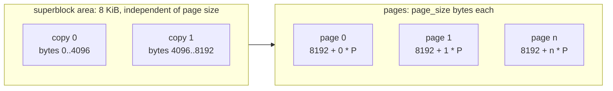
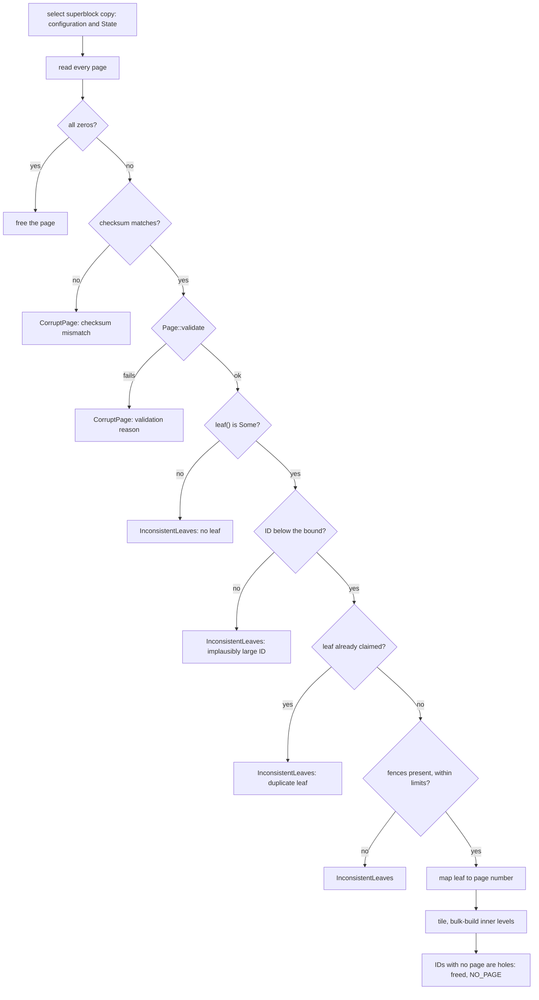

# BF-Tree persistence: the durable store format

This document records how a tree's leaves are laid out in a page store:
the file layout, the checksummed superblock and its committed state, page
numbers and how they differ from leaf IDs, the identity stamp and checksum
in every stored page, and how `Tree::open` rebuilds the leaf-to-page table
from the stamps. It also records what the format guarantees today and what
it does not guarantee yet.

[Plan 0017](../plans/0017-bf-tree-store-format.md) built this format.
Writes are still in place: durability and crash behaviour are those of
[plan 0008](../plans/0008-bf-tree-leaf-store.md). Shadow paging,
checkpoints, and recovery
([plan 0018](../plans/0018-bf-tree-checkpoint.md)) build on this format
without changing it. Related documents:
[leaf storage](bf-tree-leaf-store.md) (the `LeafMap`, `load_base`,
`write_through`, open, and durability without a log),
[shared pages](bf-tree-pages.md) (the page header and validation), and
[concurrency](bf-tree-concurrency.md) (the lock order and the shareable
store contract).

The code is in `crates/bf-tree-store/src/` (`lib.rs`: `PageNumber`,
`PageStore`, `StoreError`; `superblock.rs`: the codec; `file.rs` and
`mem.rs`: the backends), `crates/bf-tree-page/src/` (`layout.rs`: the
header; `lib.rs`: stamp and checksum accessors), and `crates/bf-tree/src/`
(`leaf_map.rs`: the page table, `load_base`, `write_through`; `open.rs`:
the page scan).

## Terms

- **Page number:** the position of one page-sized region in the store
  (`PageNumber`). It says where a page is.
- **Leaf ID:** the identity of a leaf in the tree (`LeafId`). It says which
  leaf a page belongs to.
- **Stored page:** a base page as it is in the store.
- **Leaf stamp:** the 32-bit `leaf` header field of a stored page. It names
  the leaf that the page belongs to.
- **Seal:** compute the page's CRC32C and store it in the `crc` header
  field.
- **CRC32C:** the 32-bit cyclic redundancy check with the Castagnoli
  polynomial (RFC 3720 §B.4).
- **Superblock copy:** one 4096-byte block that holds the configuration and
  a committed `State`. A store has two copies.
- **Commit:** a durable, atomic replacement of the committed `State`.
- **Hole:** a leaf ID that names no leaf: it was allocated, but no stored
  page carries its stamp.

## On-disk layout



- Superblock copy `c` is at byte `c * COPY_BYTES` (`COPY_BYTES = 4096`),
  whatever the page size. Each copy therefore has a known offset, and
  `FileStore::open` never infers the page size from a damaged copy.
- Page number `i` is at byte `PAGES_OFFSET + i * page_size`
  (`PAGES_OFFSET = 8192`). For 4096-byte pages, every page offset is
  4096-aligned, which direct I/O (plan 0023) requires. For smaller test page
  sizes the area costs up to 8 KiB of padding.
- A valid file length is `8192 + n * page_size` for some `n >= 0`.
  `FileStore::open` returns `TruncatedFile` for a shorter file or a ragged
  tail.
- There is no catalogue. The file length gives the page count, and the page
  number gives the offset.
- A new page is all zeros. A freed page keeps its old bytes (see
  [The `PageStore` contract](#the-pagestore-contract)).

`MemStore` has the same logical model (configuration, state, pages
addressed by page number) without byte offsets or superblock copies.

## Superblock version 2

### Fields

Each copy encodes 56 bytes, little-endian, then zero padding to 4096 bytes:

| Bytes | Field | Meaning |
| --- | --- | --- |
| `0..8` | `magic` | `PEPPYBF\0` |
| `8..12` | `version` | `2` |
| `12..16` | `page_size` | Page length and leaf page capacity |
| `16..20` | `inner_capacity` | Inner-node capacity |
| `20..24` | `max_key_len` | Admission limit for keys |
| `24..28` | `max_value_len` | Admission limit for values |
| `28..36` | `checkpoint_id` | Committed checkpoint number; `0` for a new store |
| `36..44` | `applied_seq` | Reserved for plan 0018; `0` today |
| `44..52` | `write_seq` | Reserved for plan 0018; `0` today |
| `52..56` | `crc` | CRC32C of bytes `0..52` |

In memory the copy is two values. `Superblock` holds only the
configuration (`page_size`, `inner_capacity`, `max_key_len`,
`max_value_len`), as in plan 0008, and `State` holds `checkpoint_id`,
`applied_seq`, and `write_seq`. The store keeps them side by side. The
[leaf storage design](bf-tree-leaf-store.md#the-superblock) records how the
configuration fixes the admission rule and which tree settings it omits.

### Codec

- `Superblock::encode(&self, state, block)` validates the configuration,
  zero-fills `block`, and writes the 56 encoded bytes with their CRC. The
  block must hold at least 56 bytes. The stores always pass a full
  4096-byte copy, so direct I/O needs no special case.
- `Superblock::decode(block)` checks, in this order: the block holds 56
  bytes ("too short"), the magic ("bad magic"), the version ("unsupported
  version"), the CRC ("checksum mismatch"), and the configuration
  (`Superblock::validate`: the page size is a legal page capacity). Each
  failure is `StoreError::InvalidSuperblock(reason)`. A version-1 copy is
  rejected; no version-1 data was deployed.
- The CRC covers bytes `0..52`, every encoded field. The padding after
  byte 56 is not covered and is not checked on decode.

### Dual copies and selection

`Superblock::select(copy0, copy1)` decodes both copies and skips a copy
that fails, because a commit can tear it:

| Copy 0 | Copy 1 | Result |
| --- | --- | --- |
| intact | intact, same configuration | the copy with the higher `checkpoint_id`; copy 0 on a tie |
| intact | intact, different configuration | `InvalidSuperblock("superblock copies disagree on the configuration")` |
| intact | fails to decode | copy 0 |
| fails to decode | intact | copy 1 |
| fails to decode | fails to decode | `NoSuperblock` |

A configuration mismatch is never a torn write, because a commit never
changes the configuration, so it is rejected and not resolved by id. Only a
new store has two copies with equal ids.

### Commit

`commit(&State)` must receive `state.checkpoint_id ==
state().checkpoint_id + 1`. Otherwise it returns `StoreError::CommitOrder {
current, got }` and changes nothing. The check makes two concurrent
committers an error instead of two writes to the same copy.

`FileStore::commit` holds a commit mutex for the whole operation. It
encodes the state, writes the full copy `state.checkpoint_id % 2`, calls
`sync_data`, and only then replaces the in-memory state, which a separate,
short-held mutex protects. `state()` therefore never waits for a commit's
sync. Successive commits alternate copies, so the previous commit is always
in the other copy, and a torn commit leaves it intact. `MemStore::commit`
checks the order and replaces its state under one mutex.

The caller must sync its page writes before it commits. The tree does not
commit yet: plan 0018's checkpoint is the first caller.

### Create

`FileStore::create` validates the configuration, creates the file (it fails
if the path exists), writes both copies with `State::default()`, and calls
`sync_all`. It writes no page. `MemStore::new` starts with
`State::default()`.

`Tree::create` requires an empty store with the default state:
`page_count() == 0` and `state() == State::default()`. Otherwise it returns
`InvalidStore("store already holds pages")`.

## Page numbers and leaf IDs

A page number is a position, as SQLite's `Pgno` is. A leaf ID is an
identity. Plan 0008 used the leaf ID as the store position. Plan 0017
separates them, because shadow paging (plan 0018) writes each new version
of a leaf to a different page number while the leaf keeps its ID.

```rust
/// The position of a page in the store.
pub struct PageNumber(u64);

impl PageNumber {
    /// `None` for `u64::MAX`, which callers use as "no page".
    pub const fn new(raw: u64) -> Option<Self>;
    pub const fn raw(self) -> u64;
}
```

- The name "page number" replaces "slot", because "slot" already names an
  entry of a page's slot directory. Using it for store positions would make
  it ambiguous in every layer.
- The store knows only page numbers. It does not depend on
  `bf-tree-node-id` and never sees a leaf ID.
- The tree maps each leaf ID to a page number in the
  [leaf-to-page table](#the-leaf-to-page-table). Each stored page names its
  leaf in its header, so `open` can rebuild the table from the pages alone.
- Today a leaf keeps its page number from its first write until it is
  discarded. Leaf IDs and page numbers are allocated independently and need
  not be equal, and leaf IDs can exceed the page count (see
  [Open](#open)).

## The `PageStore` contract

```rust
pub trait PageStore: Send + Sync + std::fmt::Debug {
    fn page_size(&self) -> usize;
    /// Page numbers ever allocated, live or freed: `0..page_count()`.
    fn page_count(&self) -> u64;
    /// A freed page if any (its old bytes kept), else a new zero page.
    fn alloc(&self) -> Result<PageNumber, StoreError>;
    /// Return a page for reuse. Its bytes are not changed.
    fn free(&self, page_number: PageNumber) -> Result<(), StoreError>;
    fn read(&self, page_number: PageNumber, buf: &mut [u8]) -> Result<(), StoreError>;
    fn write(&self, page_number: PageNumber, buf: &[u8]) -> Result<(), StoreError>;
    fn sync(&self) -> Result<(), StoreError>;
    fn superblock(&self) -> &Superblock;
    /// The last committed state.
    fn state(&self) -> State;
    /// Durably and atomically replace the committed state.
    fn commit(&self, state: &State) -> Result<(), StoreError>;
}
```

- `alloc` reuses a freed page if one exists (last freed, first reused),
  else appends a new zero page. `FileStore::alloc` extends the file with a
  zero page before it returns, so the file length stays authoritative.
- `free` marks a page for reuse and does not change its bytes. A read of a
  freed page returns its old bytes. A write to a freed page and a second
  `free` are `FreedPage(page_number)`. Plan 0008's rule that a freed page
  is all zeros ended with plan 0017: plan 0018 selects pages by their
  header, not by allocation state, so zeroing would cost one write per
  freed page and save nothing.
- `page_count` counts every page number ever allocated, live or freed.
  Freeing does not shrink it.
- A page number at or beyond `page_count` is `UnknownPage(page_number)`. A
  buffer whose length is not the page size is `BufferLength`.
- `FileStore` does not persist its free list. A reopened `FileStore` treats
  every page as live. `Tree::open`, which reads every page, frees the
  all-zero ones; a `FreedPage` reply from a backend that already knows is
  accepted.
- `state` and `commit` are described in [Commit](#commit).
- The [concurrency design](bf-tree-concurrency.md#the-shareable-store-contract)
  records the threading rules: every method takes `&self`, and the caller
  serializes accesses to one page.

The tree calls `alloc` only in `write_through`, and `free` only in
`LeafMap::discard` and `Tree::open`.

## Base-page identity and the page checksum

A page number no longer identifies a leaf, so a stored page must name its
leaf. A stored page also carries a checksum, so that `load_base` and `open`
detect damaged bytes instead of trusting them.

### Header fields

The header stays 32 bytes. Bytes `8..32`:

| Bytes | Field | Meaning |
| --- | --- | --- |
| `8..16` | `backing_leaf: U64` | The leaf that a mini-page overlays. `u64::MAX` (none) for base pages and full pages |
| `16..24` | `lsn: U64` | Inactive. Plan 0018 renames it to `write_seq` |
| `24..28` | `leaf: U32` | The leaf that a stored base page belongs to. `NO_LEAF = u32::MAX` means none |
| `28..32` | `crc: U32` | CRC32C of the whole page with bytes `28..32` (`CRC_RANGE`) taken as zero |

- `backing_leaf` keeps its literal meaning: the leaf that an overlay
  covers. A separate `leaf` field names a stored base page's own leaf.
- `Page::leaf()` returns `Option<LeafId>`. `Page::set_leaf(Some(id))`
  returns `PageError::LeafIdTooLarge` if `id.raw() >= u32::MAX`.
- An all-zero header reads as `leaf() == Some(LeafId(0))`, not `None`,
  because the sentinel is `u32::MAX`. `open` therefore tests for an all-zero
  page before it reads any header field.
- The checksum covers every byte of the page: the header, the slot
  directory, the payloads, and the free gap. `Page::checksum`,
  `stored_checksum`, `seal`, and `verify_checksum` work on a valid `Page`.
  The free function `bf_tree_page::verify_stored_checksum(&[u8])` works on
  raw bytes that may not be a valid page: it reads only the `crc` field and
  computes the CRC over the slice length, never over a `capacity` read
  from a possibly damaged header.

### Who stamps and seals

`LeafMap::write_through` is the only place that stamps and seals a page
for the store. For each page, it calls `set_leaf(Some(id))`, then `seal()`
as the last header change, then writes the page. Plan 0018 stamps
`write_seq` before `seal()`.

The checksum is valid only for bytes as stored:

- `Page::init` and `Page::init_with_fences` set `leaf` to none and `crc`
  to zero.
- Split and merge outputs copy `backing_leaf`, `lsn`, `leaf`, and `crc`
  from the source page. In-place changes (inserts, removals, compaction)
  leave them as they are. Either way the `crc` is stale after a change. No
  page operation seals.
- Mini-pages are never written to the store. Nothing stamps or seals them.
- A full page loaded from the store keeps the stored `leaf` and `crc`.
  Direct writes make the `crc` stale. Its next write-through stamps and
  seals it again.

Stamping and sealing in `write_through` means that a page built in
scratch, such as a split's right half that inherited the left half's
header, never reaches the store with the wrong leaf or a stale checksum.
The checksum costs one pass over each page written to the store, and
nothing on the in-memory write path.

### `load_base` checks

`load_base(leaf, buf)` checks a stored page in this order:

1. The leaf has a page number. Otherwise
   `CorruptLeaf { id, reason: "no stored page" }`.
2. The store reads the page.
3. `verify_stored_checksum` on the raw bytes, before any structural check.
   A mismatch is `CorruptLeaf { id, reason: "checksum mismatch" }`.
4. In debug builds, the full `Page::validate`. In every build, the O(1)
   `Page::check_header`. A failure is `CorruptLeaf { id, reason }`.
5. `leaf() == Some(id)`. A mismatch is
   `CorruptLeaf { id, reason: "names another leaf" }`. It catches a
   page-table bug or a misdirected write on the first load.

### Why `snapshot_version` was free

Bytes `24..32` held `snapshot_version` until plan 0017. Upstream uses that
field for Concurrent Prefix Recovery (CPR) checkpoints. Each page carries a
checkpoint version, and a write to a page with an older version copies the
page first: per-page copy-on-write (`src/nodes/leaf_node.rs`,
`src/mini_page_op.rs` at about lines 505 to 545, and `src/snapshot.rs`).
peppydb does not use CPR. Shadow paging and the `write_seq` stamp
(plan 0018) replace it, and peppydb snapshots (plans 0019 and 0022) copy
the committed pages that `write_seq` selects. No per-page snapshot version
is needed, so the field became the 32-bit `leaf` and the 32-bit `crc`.

The split keeps the 32-byte header. No page capacity, mini-page size class,
or admission calculation changed, and the header size still matches
upstream. The cost is a limit of 2^32 - 1 leaf IDs per tree (see
[Leaf ID allocation](#leaf-id-allocation)). No inactive header field
remains: later per-page metadata needs a larger header or a page trailer.

## The leaf-to-page table

```rust
pub(super) struct LeafMap {
    store: Box<dyn PageStore>,
    entries: Table<RwLock<LeafEntry>>,
    /// Page number of each leaf's stored page, or `NO_PAGE` (`u64::MAX`).
    pages: Table<AtomicU64>,
    /// The next leaf ID.
    next: AtomicUsize,
    // circular_buffer and classes
}
```

- `pages[id]` holds the raw page number of leaf `id`'s stored page, or
  `NO_PAGE`. `NO_PAGE` is `u64::MAX`, which `PageNumber::new` maps to
  `None`. `page_of(id)` returns `Option<PageNumber>`.
- The table lives beside `entries`, not inside `LeafEntry`. The entry
  lock must stay within 64 bytes (the plan 0012 size test,
  `entry_lock_is_at_most_64_bytes`), and only base-page I/O and open read
  the page number.
- A thread writes `pages[id]` only under leaf `id`'s exclusive (X) lock:
  `alloc` sets `NO_PAGE`, `write_through` records the page it allocates on
  the leaf's first write, and `discard` resets it to `NO_PAGE`. Readers
  load it under the shared (S) or X lock.
- `open` builds the table from the stamps and passes it to `LeafMap::new`
  as one `Option<PageNumber>` per leaf ID.

## Leaf ID allocation

- `LeafMap::alloc` takes the next index from the atomic counter `next`,
  grows `entries` and `pages` to it, resets the entry, sets `NO_PAGE`, and
  returns the fresh leaf under X. The store is not involved: the leaf's
  first `write_through` allocates its page.
- Leaf IDs are append-only within a process. `alloc` never reuses a hole.
  Plan 0018's checkpoint argument depends on this rule. After `open`, the
  counter starts at the largest stamped leaf plus one, so IDs of trailing
  holes, which no stored page names, can be allocated again after a reopen.
- The counter's `fetch_update` refuses to pass `MAX_LEAVES = u32::MAX`. The
  largest leaf ID is therefore `u32::MAX - 1`, which fits the stamp next to
  the `NO_LEAF` sentinel, and a tree has at most 2^32 - 1 leaf IDs,
  including holes (16 TiB of 4 KiB leaves). At the limit `alloc` returns
  `TreeError::TooManyLeaves` before any table grows. `LeafId` stays a `u64`
  in memory; no ID is truncated.
- A hole arises in three ways: a split fails after `alloc` but before its
  right half is written; a split fails after the right half is written, so
  `discard` zeroes and frees that page; or `open` finds no page for an ID
  below the largest stamped leaf. A hole's entry is `freed` and its page is
  `NO_PAGE`. `read` and `write` return `UnknownLeaf` for it, and no
  separator names it.

## Open



`FileStore::open` selects the superblock copy. `Tree::open` takes the
configuration from it (`Tree::open_with` requires a matching one) and
reads pages `0..page_count()` once, in page-number order:

1. An all-zero page was allocated and never written. `open` frees it, so
   the next allocation reuses it. This test comes first: an all-zero page
   fails the checksum, and its header reads as leaf 0.
2. A page that fails `verify_stored_checksum` is
   `TreeError::CorruptPage { page_number, reason: "checksum mismatch" }`.
   A checksum failure cannot name a leaf, because the stamp is not trusted
   yet. Writes are in place, so no older copy of the leaf exists to fall
   back to.
3. A page that fails `Page::validate` is `CorruptPage` with the
   validation reason.
4. A page whose `leaf()` is `None` is
   `InconsistentLeaves("a stored page names no leaf")`.
5. A leaf ID at or above `max(4 * page_count, 65536)` is
   `InconsistentLeaves("a stored page names an implausibly large leaf ID")`.
   The check runs before any table grows, so a damaged stamp cannot make
   `open` allocate a table of billions of entries.
6. A second page that names the same leaf is
   `InconsistentLeaves("two stored pages name the same leaf")`. Plan 0018
   replaces this rule with selection by write sequence.
7. The page must carry fences and keep every fence, key, and value within
   the configured limits, as in plan 0008. Otherwise the result is
   `InconsistentLeaves`.

Then the tiling check and the bulk build of plan 0008 run unchanged
([leaf storage](bf-tree-leaf-store.md#open)). An empty store is
`InconsistentLeaves("store holds no leaves")`. The leaf tables are sized to
the largest stamped leaf plus one, and every ID without a page is a hole.
`open` does not read the committed `State` yet.

Why the bound is not `page_count`: a discarded split half takes a leaf ID,
its page is freed, and the next leaf reuses that page, so leaf IDs can run
ahead of page numbers. The diff 7 hole fixture found this. The exact
multiple has no correctness role; plan 0018 rechecks it with fresh-page
writes.

Open costs one read and one CRC pass per page, and memory proportional to
the page count.

## Guarantees and their tests

| Guarantee | Tests |
| --- | --- |
| The CRC32C matches the RFC 3720 check values (`"123456789"` gives `0xE3069283`; 32 zero bytes give `0x8A9136AA`) | `bf-tree-store` `tests/crc.rs`: `crc32c_matches_the_rfc_3720_check_value` |
| The leaf stamp round trips, including `None`, and IDs from `u32::MAX` are `LeafIdTooLarge` | `bf-tree-page` `tests/layout.rs`: `the_leaf_stamp_round_trips_and_rejects_ids_beyond_32_bits` |
| A sealed page verifies, and any single flipped byte fails verification | `tests/layout.rs`: `a_sealed_checksum_detects_any_flipped_byte` (every byte of a 256-byte page) |
| Split outputs inherit the stamp and a stale checksum; only the tree seals | `tests/layout.rs`: `split_outputs_inherit_the_leaf_stamp_and_the_stale_checksum` |
| Every encoded superblock byte is checked, and decode names the failure, including version 1 | `bf-tree-store` `tests/superblock.rs`: `copies_round_trip_with_their_state`, `every_encoded_byte_is_checked`, `decode_names_what_failed`, `encode_needs_room_and_a_valid_configuration` |
| Selection takes the newer intact copy, falls back from a flipped, zeroed, or half-written copy, rejects a configuration mismatch, and reports `NoSuperblock` | `tests/superblock.rs`: `select_takes_the_newer_intact_copy`, `select_falls_back_when_either_copy_is_torn`, `copies_that_disagree_on_the_configuration_are_rejected` |
| `FileStore` writes both copies on create, alternates copies on commit, and reopens at the committed state | `tests/file.rs`: `create_writes_both_superblock_copies_and_refuses_to_clobber`, `commits_alternate_copies_and_survive_reopen` |
| A torn newer copy (garbage, zeros, or half written) reopens at the previous state; a zeroed copy 0 opens from copy 1 | `tests/file.rs`: `a_torn_commit_reopens_at_the_previous_state`, `a_zeroed_first_copy_opens_from_the_second_without_probing` |
| Short, ragged, and foreign files are rejected; pages start after the 8 KiB area | `tests/file.rs`: `short_and_ragged_files_are_rejected`, `foreign_superblocks_are_rejected`, `alloc_extends_the_file_after_the_superblock_area` |
| Both backends share the contract: dense zero pages, freed pages keep their bytes and are reused first, freed and unknown pages are rejected, commits follow the current checkpoint | `tests/contract.rs`: `alloc_hands_out_dense_zeroed_pages`, `freed_pages_keep_their_bytes_and_are_reused_before_growth`, `freed_pages_reject_writes_and_double_frees`, `unknown_pages_are_rejected`, `commits_must_follow_the_current_checkpoint`, and the threaded scenarios |
| `Tree::create` requires an empty store with the default state | `bf-tree` `tests/store.rs`: `create_checks_the_store_against_the_configuration`, `create_rejects_a_store_with_a_committed_state` |
| A reopened `FileStore` tree rebuilds the same page table; every stored page is stamped with its leaf, sealed, and overlays nothing; the tree equals its oracle and passes `check_invariants` | `tests/store.rs`: `reopen_rebuilds_the_page_table_from_the_stamps` (600 keys) |
| Leaf IDs stop at the 32-bit limit with `TooManyLeaves`, and nothing grows | `tests/store.rs`: `leaf_ids_stop_at_the_32_bit_stamp_limit` |
| A flipped byte fails the load with `CorruptLeaf` ("checksum mismatch") and the open with `CorruptPage`; a page naming another leaf fails the load; a page with no leaf or a huge ID fails the open; holes stay unused; zero pages are reused after open | `tests/damage.rs` on both backends: `a_flipped_byte_fails_the_load_and_the_open`, `a_page_naming_another_leaf_fails_the_load`, `a_stored_page_without_a_leaf_or_with_a_huge_leaf_id_fails_the_open`, `holes_stay_unused_and_zero_pages_are_reused_after_open`, `a_hole_below_the_largest_leaf_stays_freed_after_open` |
| Torn, resealed-but-invalid, duplicated, unfenced, and gapped pages are rejected with errors, not panics | `tests/open.rs`: `open_rejects_damaged_leaf_sets_with_errors_not_panics` |

The existing model, concurrent, and contention suites run on the new
format unchanged; the plan records their outcomes.

## Not yet guaranteed

- **Writes are in place.** A leaf's new version overwrites its page, and a
  split's two page writes are not atomic. Crash behaviour is that of
  [plan 0008](bf-tree-leaf-store.md#durability-and-consistency-without-a-log):
  a stop between the two writes of a split leaves overlapping fences that
  `open` rejects.
- **A torn page makes open fail.** A page torn by an in-place write fails
  its checksum, and `open` returns `CorruptPage`. No older copy exists to
  fall back to. Plan 0018 classifies such pages as torn or corrupt and
  selects an older version.
- **`discard` writes a zero page.** Because `free` keeps bytes, a split
  that fails after writing its right half would leave a stamped page that
  the next `open` reads as an extra leaf. `LeafMap::discard` therefore
  writes a zero page and then frees it. This is a second `store.write`
  call besides `write_through`, on an error path only. Plan 0018's
  selection by write sequence removes it. In this stack every page the
  tree frees is therefore all zeros, although the store contract does not
  require it.
- **The committed state is unused.** The tree never calls `commit`, and
  `open` ignores `State`. `applied_seq` and `write_seq` have no meaning
  until plan 0018.
- **A failed commit is indeterminate on disk.** If the copy write or its
  sync fails, `state()` keeps the previous state, but the target copy can
  hold the new state, the old bytes, or a torn copy. The other copy still
  holds the previous commit.

## The CRC32C source

Superblocks and pages use the `crc32c` crate (`crc32c = "0.6"` in
`third-party/rust/Cargo.toml`). `bf-tree-store` and `bf-tree-page` depend on
`//third-party/rust:crc32c`. The crate uses hardware CRC instructions
(SSE 4.2 and ARMv8 CRC). Its build script generates the CRC tables in
`OUT_DIR` and sets the `armsimd` cfg on aarch64, so
`third-party/rust/fixups/crc32c/fixups.toml` sets `buildscript.run = true`
([build system](build-system.md)). The write-ahead log
([plan 0020](../plans/0020-engine-wal.md), `engine-wal`) depends on the
same crate directly, so no cross-component export is needed. A
hand-written table function and the software-only `crc` crate were
rejected (plan 0017, resolved question 2).

## Extension points

- **Plan 0018 (shadow paging, checkpoint, recovery)** gives
  `State::applied_seq` and `State::write_seq` their meaning. It changes
  `write_through` to write fresh pages, renames the `lsn` header field to
  `write_seq` and stamps it before `seal()`, replaces open's duplicate-leaf
  rule with selection by write sequence, and classifies pages that fail
  their checksum as torn or corrupt. It must not need to change the trait,
  the superblock layout, the page header layout, or `PageNumber`.
- **Plan 0019 (apply, log hook, snapshots)** writes snapshot files with
  `Superblock::encode` and dense page numbers. Pages are copied verbatim,
  so their stamps and checksums stay valid, and a snapshot is a valid store
  file by construction.
- **Plan 0023 (direct I/O)** adds an I/O mode to `FileStore`. The
  4096-byte copies, full-copy writes, and the 8192-byte page origin are
  already aligned.
- **Persisted fences or inner nodes (deferred)** could live in extra pages
  that the superblock names. That needs a new superblock version, but no
  change to page-number addressing.

## References

- [Plan 0017](../plans/0017-bf-tree-store-format.md): the stack, its
  decisions, and its discoveries.
- [BF-Tree paper](../references.md#bf-tree-paper), §3.3 (base pages and the
  mapping table) and §5.7 (logging, snapshots, and recovery).
- [Microsoft implementation](../references.md#microsoft-bf-tree-implementation),
  revision `f442e6172bf7e5483ff320d8e3ac16a70e31bbd6`:
  [`src/fs/mod.rs`](https://github.com/microsoft/bf-tree/blob/f442e6172bf7e5483ff320d8e3ac16a70e31bbd6/src/fs/mod.rs)
  (`VfsImpl` allocates offsets; peppydb uses fixed page numbers),
  [`src/storage.rs`](https://github.com/microsoft/bf-tree/blob/f442e6172bf7e5483ff320d8e3ac16a70e31bbd6/src/storage.rs)
  (`PageTable`, `PageLocation`), and the CPR checkpoint code that used
  `snapshot_version`:
  [`src/nodes/leaf_node.rs`](https://github.com/microsoft/bf-tree/blob/f442e6172bf7e5483ff320d8e3ac16a70e31bbd6/src/nodes/leaf_node.rs),
  [`src/mini_page_op.rs`](https://github.com/microsoft/bf-tree/blob/f442e6172bf7e5483ff320d8e3ac16a70e31bbd6/src/mini_page_op.rs)
  (about lines 505 to 545), and
  [`src/snapshot.rs`](https://github.com/microsoft/bf-tree/blob/f442e6172bf7e5483ff320d8e3ac16a70e31bbd6/src/snapshot.rs).
- RFC 3720 §B.4: CRC32C (Castagnoli) check values.
- SQLite's database file format names store positions page numbers
  (`Pgno`); peppydb borrows the term.
