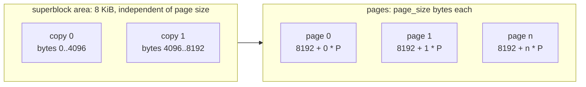
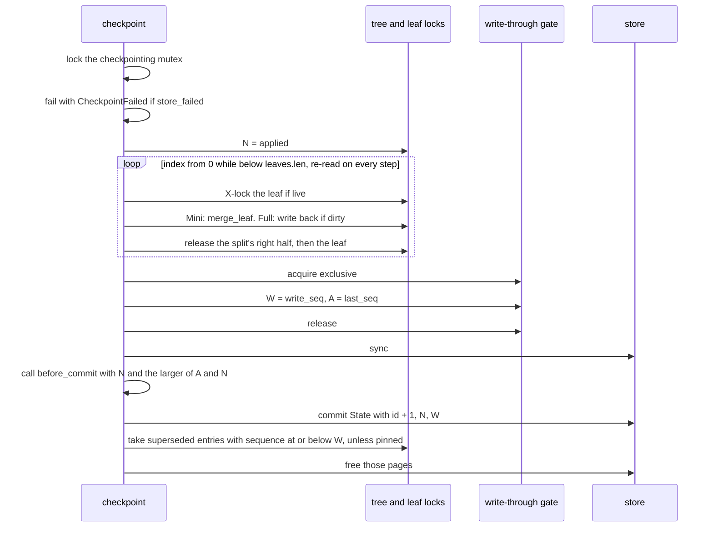
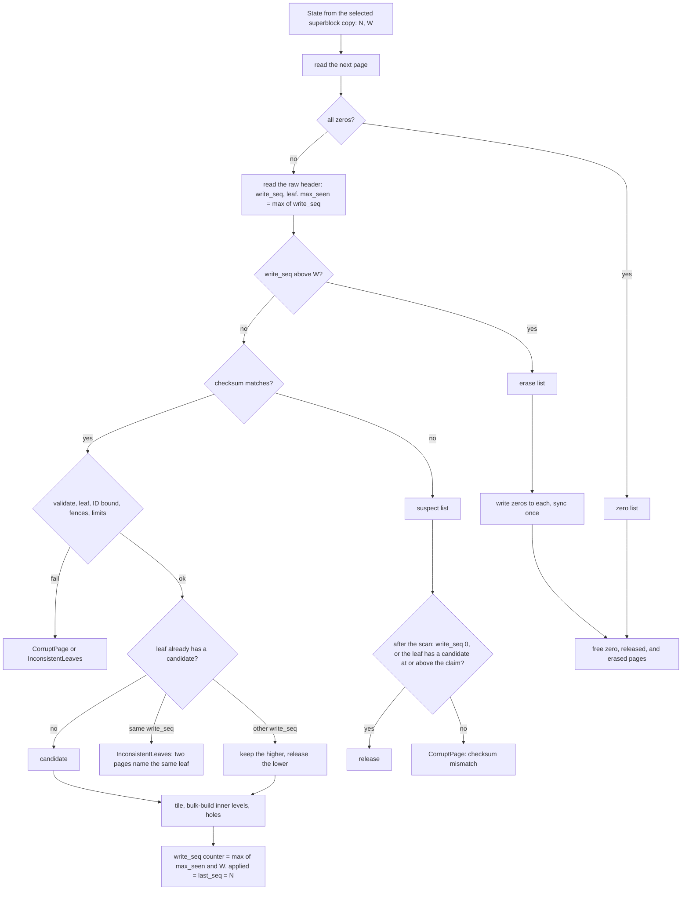
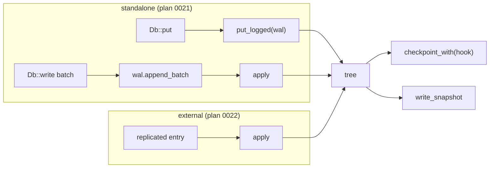
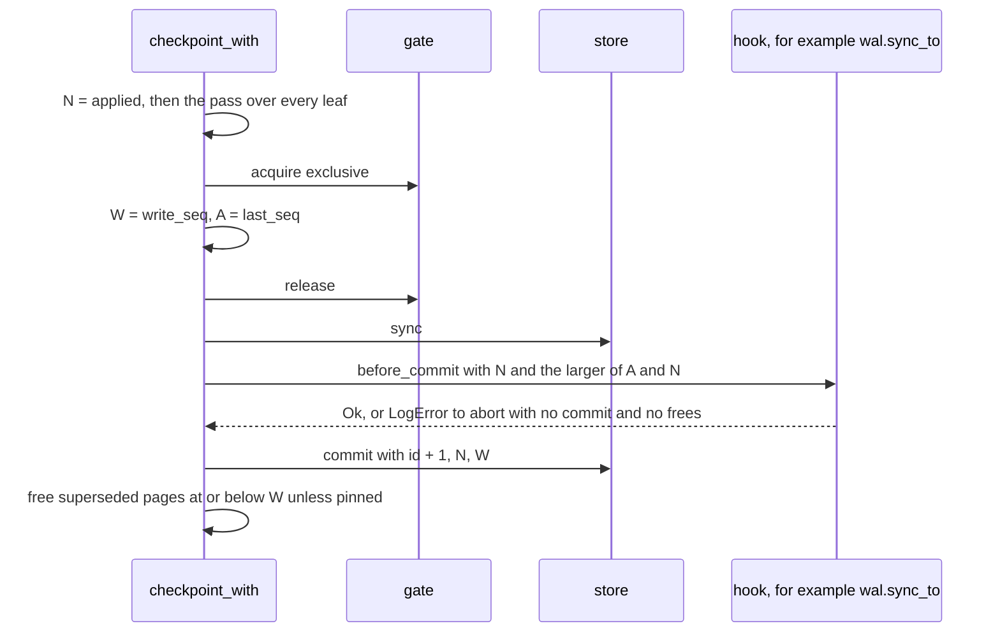

# BF-Tree persistence: store format, checkpoints, and recovery

This document records how a tree's leaves are kept durable in a page store.
It covers the file layout, the checksummed superblock and its committed
state, page numbers and how they differ from leaf IDs, the identity stamp,
write sequence, and checksum in every stored page, shadow paging, the
checkpoint protocol, and how `Tree::open` selects the committed image after
a crash. It then covers how a log sequences writes: the `Log` contract,
`Tree::apply` and the logged writes, the one sequence space, the
checkpoint's pre-commit hook, and snapshots of the committed image. It
covers the file store's I/O modes (direct I/O) and batched reads at open,
with their measurements. It also
records what is guaranteed today, with the test that backs each guarantee,
and what is not guaranteed yet.

[Plan 0017](../plans/0017-bf-tree-store-format.md) built the store format.
[Plan 0018](../plans/0018-bf-tree-checkpoint.md) built shadow paging,
checkpoints, and recovery on that format without changing its layout.
[Plan 0019](../plans/0019-bf-tree-apply.md) added sequenced writes, the
pre-commit hook, and snapshots, again without changing the layout.
[Plan 0023](../plans/0023-bf-tree-io-perf.md) added direct I/O and batched
reads at open, also without changing the layout. The tree
stays log-agnostic: it persists no log, and it defines the contract that any
log meets.
Related documents:
[leaf storage](bf-tree-leaf-store.md) (the `LeafMap`, `load_base`,
`write_through`, and the tree lifecycle),
[shared pages](bf-tree-pages.md) (the page header and validation), and
[concurrency](bf-tree-concurrency.md) (the lock order, including the
write-through gate, and the shareable store contract).

The code is in `lib/bf-tree-store/src/` (`lib.rs`: `PageNumber`,
`PageStore`, `StoreError`; `superblock.rs`: the codec; `file.rs` and
`mem.rs`: the backends), `lib/bf-tree-page/src/` (`layout.rs`: the
header; `lib.rs`: stamp, sequence, and checksum accessors), and
`lib/bf-tree/src/` (`leaf_map.rs`: the page table, `load_base`,
`write_through`, the superseded list, the free pin, and the gate; `lib.rs`:
`Tree::checkpoint`, `checkpoint_with`, the commit step, and `TreeError`;
`write.rs`: the sequence closure; `apply.rs`: `Op`, `Entry`, `Log`,
`LogError`, `CommitPoint`, `apply`, the logged writes, and the sequencing
latch; `snapshot.rs`: `write_snapshot`; `open.rs`: selection and erasure).

## Terms

- **Page number:** the position of one page-sized region in the store
  (`PageNumber`). It says where a page is.
- **Leaf ID:** the identity of a leaf in the tree (`LeafId`). It says which
  leaf a page belongs to.
- **Stored page:** a base page as it is in the store.
- **Leaf stamp:** the 32-bit `leaf` header field of a stored page. It names
  the leaf that the page belongs to.
- **Write sequence (`write_seq`):** the number that one `write_through`
  call draws and stamps into every page it writes. A later write-through
  draws a higher number.
- **Operation sequence:** the number that a write to a record carries:
  drawn by `put` or `remove`, assigned by a `Log`, or given by an `Entry`.
  It orders writes to records. It is separate from the write sequence,
  which orders page versions.
- **Entry:** one sequenced unit from a log (a WAL record or a replicated
  log entry): a sequence and zero or more operations.
- **Sequence source:** where a tree's operation sequences come from.
  *Internal*: the tree's own counter (`put`, `remove`). *External*: a log
  (`apply`, `put_logged`, `remove_logged`).
- **Captured sequence `A`:** `last_seq` read under the exclusive gate in a
  checkpoint. It is at least the sequence of every effect that the
  checkpoint's image holds.
- **Snapshot:** a store file that holds a copy of one committed image,
  written by `Tree::write_snapshot`.
- **Free pin:** a count, under the `superseded` mutex, that stops the
  checkpoint's free step while a snapshot copies committed pages.
- **Seal:** compute the page's CRC32C and store it in the `crc` header
  field.
- **CRC32C:** the 32-bit cyclic redundancy check with the Castagnoli
  polynomial (RFC 3720 §B.4).
- **Superblock copy:** one 4096-byte block that holds the configuration and
  a committed `State`. A store has two copies.
- **Commit:** a durable, atomic replacement of the committed `State`.
- **Applied watermark `N`:** `State::applied_seq`. Every operation with a
  sequence at or below `N` is in the committed image.
- **Write watermark `W`:** `State::write_seq`. Every write-through with a
  sequence at or below `W` finished, and was synced, before the commit.
- **Committed image:** for each leaf, its stored page with the highest
  write sequence at or below `W`.
- **Superseded page:** a stored page that a later write-through of the
  same leaf replaced.
- **Erase:** write a zero page over a page number, so that no later scan
  reads its old contents as a page.
- **Suspect page:** a page that fails its checksum and whose header claims
  a write sequence at or below `W`.
- **Hole:** a leaf ID that names no leaf: it was allocated, but no selected
  page carries its stamp.

## On-disk layout



- Superblock copy `c` is at byte `c * COPY_BYTES` (`COPY_BYTES = 4096`),
  whatever the page size. Each copy therefore has a known offset, and
  `FileStore::open` never infers the page size from a damaged copy.
- Page number `i` is at byte `PAGES_OFFSET + i * page_size`
  (`PAGES_OFFSET = 8192`). For 4096-byte pages, every page offset is
  4096-aligned, which direct I/O (plan 0023) requires. For smaller test page
  sizes the area costs up to 8 KiB of padding.
- A valid file length is `8192 + n * page_size` for some `n >= 0`.
  `FileStore::open` returns `TruncatedFile` for a shorter file or a ragged
  tail.
- There is no catalogue. The file length gives the page count, and the page
  number gives the offset.
- A new page is all zeros. A freed page keeps its old bytes (see
  [The `PageStore` contract](#the-pagestore-contract)).

`MemStore` has the same logical model (configuration, state, pages
addressed by page number) without byte offsets or superblock copies.

## Superblock version 2

### Fields

Each copy encodes 56 bytes, little-endian, then zero padding to 4096 bytes:

| Bytes | Field | Meaning |
| --- | --- | --- |
| `0..8` | `magic` | `PEPPYBF\0` |
| `8..12` | `version` | `2` |
| `12..16` | `page_size` | Page length and leaf page capacity |
| `16..20` | `inner_capacity` | Inner-node capacity |
| `20..24` | `max_key_len` | Admission limit for keys |
| `24..28` | `max_value_len` | Admission limit for values |
| `28..36` | `checkpoint_id` | Committed checkpoint number; `0` for a new store, `1` after `Tree::create` |
| `36..44` | `applied_seq` | The applied watermark `N` |
| `44..52` | `write_seq` | The write watermark `W` |
| `52..56` | `crc` | CRC32C of bytes `0..52` |

In memory the copy is two values. `Superblock` holds only the
configuration (`page_size`, `inner_capacity`, `max_key_len`,
`max_value_len`), as in plan 0008, and `State` holds `checkpoint_id`,
`applied_seq`, and `write_seq`. The store keeps them side by side. The
[leaf storage design](bf-tree-leaf-store.md#the-superblock) records how the
configuration fixes the admission rule and which tree settings it omits.

### Codec

- `Superblock::encode(&self, state, block)` validates the configuration,
  zero-fills `block`, and writes the 56 encoded bytes with their CRC. The
  block must hold at least 56 bytes. The stores always pass a full
  4096-byte copy, so direct I/O needs no special case.
- `Superblock::decode(block)` checks, in this order: the block holds 56
  bytes ("too short"), the magic ("bad magic"), the version ("unsupported
  version"), the CRC ("checksum mismatch"), and the configuration
  (`Superblock::validate`: the page size is a legal page capacity). Each
  failure is `StoreError::InvalidSuperblock(reason)`. A version-1 copy is
  rejected; no version-1 data was deployed.
- The CRC covers bytes `0..52`, every encoded field. The padding after
  byte 56 is not covered and is not checked on decode.

### Dual copies and selection

`Superblock::select(copy0, copy1)` decodes both copies and skips a copy
that fails, because a commit can tear it:

| Copy 0 | Copy 1 | Result |
| --- | --- | --- |
| intact | intact, same configuration | the copy with the higher `checkpoint_id`; copy 0 on a tie |
| intact | intact, different configuration | `InvalidSuperblock("superblock copies disagree on the configuration")` |
| intact | fails to decode | copy 0 |
| fails to decode | intact | copy 1 |
| fails to decode | fails to decode | `NoSuperblock` |

A configuration mismatch is never a torn write, because a commit never
changes the configuration, so it is rejected and not resolved by id. Only a
new store has two copies with equal ids.

### Commit

`commit(&State)` must receive `state.checkpoint_id ==
state().checkpoint_id + 1`. Otherwise it returns `StoreError::CommitOrder {
current, got }` and changes nothing. The check makes two concurrent
committers an error instead of two writes to the same copy.

`FileStore::commit` holds a commit mutex for the whole operation. It
encodes the state, writes the full copy `state.checkpoint_id % 2`, calls
`sync_data`, and only then replaces the in-memory state, which a separate,
short-held mutex protects. `state()` therefore never waits for a commit's
sync. Successive commits alternate copies, so the previous commit is always
in the other copy, and a torn commit leaves it intact. `MemStore::commit`
checks the order and replaces its state under one mutex.

The caller must sync its page writes before it commits. The tree commits in
two places only, both through `Tree::commit_written`:
`Tree::checkpoint_with` (which `Tree::checkpoint` calls) and the end of
tree creation (see [Create](#create)).

### Store creation

`FileStore::create` validates the configuration, creates the file (it fails
if the path exists), writes both copies with `State::default()`, and calls
`sync_all`. It writes no page. `MemStore::new` starts with
`State::default()`.

`Tree::create` requires an empty store with the default state:
`page_count() == 0` and `state() == State::default()`. Otherwise it returns
`InvalidStore("store already holds pages")`. It then writes the first leaf
and commits checkpoint 1 ([Create](#create)).

## Page numbers and leaf IDs

A page number is a position, as SQLite's `Pgno` is. A leaf ID is an
identity. Plan 0008 used the leaf ID as the store position. Plan 0017
separated them, because shadow paging writes each new version of a leaf to
a different page number while the leaf keeps its ID.

```rust
/// The position of a page in the store.
pub struct PageNumber(u64);

impl PageNumber {
    /// `None` for `u64::MAX`, which callers use as "no page".
    pub const fn new(raw: u64) -> Option<Self>;
    pub const fn raw(self) -> u64;
}
```

- The name "page number" replaces "slot", because "slot" already names an
  entry of a page's slot directory. Using it for store positions would make
  it ambiguous in every layer.
- The store knows only page numbers. It does not depend on
  `bf-tree-node-id` and never sees a leaf ID.
- The tree maps each leaf ID to a page number in the
  [leaf-to-page table](#the-leaf-to-page-table). Each stored page names its
  leaf in its header, so `open` can rebuild the table from the pages alone.
- Every write-through moves the leaf to a fresh page number
  ([Shadow paging](#shadow-paging)). Between checkpoints, a leaf can
  therefore have several stored pages; the table names the newest one.
  Leaf IDs and page numbers are allocated independently, and leaf IDs can
  exceed the page count (see [Open](#open-select-the-committed-image)).

## The `PageStore` contract

```rust
pub trait PageStore: Send + Sync + std::fmt::Debug {
    fn page_size(&self) -> usize;
    /// Page numbers ever allocated, live or freed: `0..page_count()`.
    fn page_count(&self) -> u64;
    /// A freed page if any (its old bytes kept), else a new zero page.
    fn alloc(&self) -> Result<PageNumber, StoreError>;
    /// Return a page for reuse. Its bytes are not changed.
    fn free(&self, page_number: PageNumber) -> Result<(), StoreError>;
    fn read(&self, page_number: PageNumber, buf: &mut [u8]) -> Result<(), StoreError>;
    fn write(&self, page_number: PageNumber, buf: &[u8]) -> Result<(), StoreError>;
    /// Read consecutive pages, live or freed, from `first` (plan 0023).
    /// The default reads one page at a time.
    fn read_run(&self, first: PageNumber, buf: &mut [u8]) -> Result<(), StoreError>;
    fn sync(&self) -> Result<(), StoreError>;
    fn superblock(&self) -> &Superblock;
    /// The last committed state.
    fn state(&self) -> State;
    /// Durably and atomically replace the committed state.
    fn commit(&self, state: &State) -> Result<(), StoreError>;
}
```

- `alloc` reuses a freed page if one exists (last freed, first reused),
  else appends a new zero page. `FileStore::alloc` extends the file with a
  zero page before it returns, so the file length stays authoritative.
- `free` marks a page for reuse and does not change its bytes. A read of a
  freed page returns its old bytes. A write to a freed page and a second
  `free` are `FreedPage(page_number)`. Plan 0008's rule that a freed page
  is all zeros ended with plan 0017: open selects pages by their header,
  not by allocation state, so zeroing would cost one write per freed page.
  A consequence is that a freed page can hold an older copy of a leaf; the
  selection rule and the erase rule account for it.
- `page_count` counts every page number ever allocated, live or freed.
  Freeing does not shrink it, and the file never shrinks.
- A page number at or beyond `page_count` is `UnknownPage(page_number)`. A
  buffer whose length is not the page size is `BufferLength`.
- `FileStore` does not persist its free list. A reopened `FileStore` treats
  every page as live. `Tree::open`, which reads every page, frees the
  all-zero, superseded, and erased ones; a `FreedPage` reply from a backend
  that already knows is accepted.
- `state` and `commit` are described in [Commit](#commit).
- `read_run(first, buf)` reads `buf.len() / page_size` consecutive pages.
  `buf.len()` must be a multiple of the page size (`BufferLength`
  otherwise), and every page in the run must be below `page_count`
  (`UnknownPage` otherwise). The trait's default method calls `read` once
  per page, so `MemStore` needs no change. `FileStore` overrides it with one
  positioned read of the whole run ([Direct I/O](#direct-io)).
- The [concurrency design](bf-tree-concurrency.md#the-shareable-store-contract)
  records the threading rules: every method takes `&self`, and the caller
  serializes accesses to one page.

The tree calls `alloc` only in `write_through`. It calls `free` in four
places: `write_through` (a fresh page whose write failed), the checkpoint's
free step (superseded pages that a commit covers), `LeafMap::discard` (a
failed split's right half), and `Tree::open` (zero, superseded, suspect,
and erased pages).

## Direct I/O

[Plan 0023](../plans/0023-bf-tree-io-perf.md) added an I/O mode to
`FileStore` (`lib/bf-tree-store/src/file.rs`). Through the page cache,
the kernel caches every store page a second time, outside the circular
buffer's budget. Direct I/O (`O_DIRECT`) bypasses the page cache, so the
budget bounds the memory that the data occupies, and a circular-buffer miss
reaches the device.

```rust
/// How a FileStore reaches its file. Re-exported by bf-tree and engine.
#[derive(Clone, Copy, Debug, Default, PartialEq, Eq)]
pub enum Io {
    /// Through the page cache. Portable.
    #[default]
    Cached,
    /// Bypassing the page cache (O_DIRECT). Linux only; 4096-byte pages.
    Direct,
}

impl FileStore {
    pub fn create(path: impl AsRef<Path>, superblock: Superblock) -> Result<Self, StoreError>; // Cached
    pub fn create_with(path: impl AsRef<Path>, superblock: Superblock, io: Io) -> Result<Self, StoreError>;
    pub fn open(path: impl AsRef<Path>) -> Result<Self, StoreError>;                          // Cached
    pub fn open_with(path: impl AsRef<Path>, io: Io) -> Result<Self, StoreError>;
    pub fn io(&self) -> Io;
}
```

### Rules

- **Linux and 4096-byte pages only.** `create_with` and `open_with` with
  `Io::Direct` return `StoreError::DirectIo("direct I/O requires Linux")`
  on other systems. A page size other than 4096 returns
  `StoreError::DirectIo("direct I/O requires 4096-byte pages")`;
  `open_with` checks this again after it reads the superblock.
- **Alignment.** `O_DIRECT` requires the buffer address, the file offset,
  and the length to be multiples of the device's logical block size. The
  store uses 4096, which covers devices with 512-byte and 4096-byte logical
  blocks. Offsets and lengths are aligned by construction: superblock copies
  are 4096 bytes at offsets 0 and 4096, and pages start at 8192
  ([On-disk layout](#on-disk-layout)).
- **The flag.** `open_file` sets `libc::O_DIRECT` through the safe
  `OpenOptionsExt::custom_flags`, only under `cfg(target_os = "linux")`.
  `libc` is an unconditional dependency, because the value of `O_DIRECT`
  differs between Linux architectures (`0o40000` on x86_64, `0o200000` on
  aarch64).
- **A bounce buffer, no `unsafe` code.** The tree's buffers are not
  4096-aligned: scratch pages are ordinary heap slices, and circular-buffer
  blocks follow a 16-byte header in a packed slab. With `Io::Direct`, a
  read or write whose buffer address or length is not a multiple of 4096
  goes through a thread-local buffer of `AlignedPage` values
  (`#[repr(C, align(4096))]`), viewed as bytes through `zerocopy`. The
  buffer grows to the largest transfer that a thread makes. An aligned
  caller buffer skips the copy. Alignment is a type property, so
  `bf-tree-store` stays free of `unsafe` code.
- **No durability change.** `O_DIRECT` bypasses the page cache. It does
  not bypass the device's volatile cache, and it does not persist
  file-size changes. `sync` and `commit` still call `sync_data`, and the
  checkpoint protocol is unchanged.
- **The format does not depend on the mode.** A file written in one mode
  opens in the other (`open_with`). The mode is a runtime setting and is
  not stored in the superblock.
- **`tmpfs` refuses `O_DIRECT`** at open with `EINVAL`. Tests and
  benchmarks that use `Io::Direct` take their directory from
  `PEPPYDB_BENCH_DIR` and report a skip, not a pass, when the platform or
  the file system refuses direct I/O.

### Batched reads at open

`Tree::open` and `Tree::write_snapshot` read every page through `select`
([Open](#open-select-the-committed-image)). With `Io::Direct`, each read is
a synchronous device round trip. `select` therefore reads runs of
`OPEN_RUN_PAGES` (64) pages with `PageStore::read_run`: 256 KiB per call
with 4096-byte pages (`lib/bf-tree/src/open.rs`). `FileStore::read_run`
makes one positioned read per run; with `Io::Direct` the run goes through
the bounce buffer. The scan's results do not depend on the run length:
the tests compare runs of 1, 7, and 64 pages, including a page count that
is not a multiple of the run.

### Measurements

The numbers below are informational. Environment: *Docker on macOS
(aarch64), indicative*. Docker Desktop 29.2.1 on macOS 27.0.1, Apple M4
Pro host; a Linux VM with 12 CPUs, 8 GB of RAM, and kernel
6.12.72-linuxkit. Data is on the `/bench` named volume: ext4
(`rw,relatime,discard`) on the VM's virtual disk `/dev/vda1`, which a file
on the Mac's SSD backs. Release builds (`@build/mode/release`). The I/O
numbers come from a virtual disk, so they are indicative only. The
reference runs on WSL2 and on GCP with a Local SSD (plan 0023, environments
2 and 3) were not done.

`bench_persistence` (`lib/bf-tree/src/tests/bench_io.rs`): 1,000,000
keys of 8 bytes, 16-byte values, a 32 MiB circular buffer, 1 s per `get`
point:

| Measurement | `Cached` | `Direct` |
| --- | --- | --- |
| Load (M puts/s) | 1.39 | 0.40 |
| Full checkpoint, 8258 leaves (ms) | 118 | 818 |
| Checkpoint after 10% of leaves are dirtied, 100,768 keys (ms) | 7 | 31 |
| File after both checkpoints (MiB) | 112.3 | 112.3 |
| Open (ms, pages/s) | 91 (316,287) | 111 (259,797) |
| Random `get`, 1 thread (M ops/s) | 0.74 | 0.03 |
| Random `get`, 12 threads (M ops/s) | 5.23 | 0.11 |

The second checkpoint did not grow the file. The likely reason is that its
write-throughs reused pages that the first checkpoint freed; this was not
checked separately. Open reads 64-page runs.

`bench_eviction_io`: the same keys with a 4 MiB circular buffer, so most
puts evict; replacing puts for 1 s; store file 284.4 MiB in both modes:

| Mode, threads | M puts/s | p50 (µs) | p99 (µs) | Max (µs) | Evictions per 1000 puts |
| --- | --- | --- | --- | --- | --- |
| `Cached`, 1 | 0.67 | 0.3 | 1.4 | 14,032 | 74.1 |
| `Cached`, 12 | 1.68 | 0.8 | 49.5 | 73,108 | 82.2 |
| `Direct`, 1 | 0.20 | 0.3 | 1.3 | 56,609 | 55.1 |
| `Direct`, 12 | 0.54 | 0.6 | 48.1 | 108,269 | 82.4 |

Interpretation:

- In these runs the whole store file fits in the VM's page cache. `Cached`
  therefore serves base pages from RAM, and `Direct` reads the virtual disk
  on every circular-buffer miss and writes it on every write-through. Every
  store-bound measurement is slower with `Direct`: from 1.2 times (open)
  to about 48 times (random `get` on 12 threads).
- The runs do not test data larger than memory, which is the case that
  `Direct` exists for. There, `Cached` would also reach the device, and its
  second copy of each page would compete with the circular buffer for RAM.

**Recommendation.** `Io::Cached` stays the default. `Io::Direct` is for
data larger than memory on Linux. Measurements on the reference device
must confirm this before the documents recommend it. The engine
measurements do not support `Direct` as a way to protect WAL fsync latency
([engine](engine.md#fsync-interference)).

## Base-page identity and the page checksum

A page number does not identify a leaf, so a stored page must name its
leaf. A stored page also carries a checksum, so that `load_base` and `open`
detect damaged bytes instead of trusting them, and a write sequence, so
that `open` can tell which copy of a leaf is committed.

### Header fields

The header is 32 bytes. Bytes `8..32`:

| Bytes | Field | Meaning |
| --- | --- | --- |
| `8..16` | `backing_leaf: U64` | The leaf that a mini-page overlays. `u64::MAX` (none) for base pages and full pages |
| `16..24` | `write_seq: U64` | The write sequence of the write-through that stored the page. Both halves of a split share one value. Zero in pages never stored, including mini-pages |
| `24..28` | `leaf: U32` | The leaf that a stored base page belongs to. `NO_LEAF = u32::MAX` means none |
| `28..32` | `crc: U32` | CRC32C of the whole page with bytes `28..32` (`CRC_RANGE`) taken as zero |

- `backing_leaf` keeps its literal meaning: the leaf that an overlay
  covers. A separate `leaf` field names a stored base page's own leaf.
- `Page::leaf()` returns `Option<LeafId>`. `Page::set_leaf(Some(id))`
  returns `PageError::LeafIdTooLarge` if `id.raw() >= u32::MAX`.
- `Page::write_seq()` and `Page::set_write_seq(seq)` read and write the
  sequence. Plan 0018 renamed the field from the inactive `lsn`.
- An all-zero header reads as `leaf() == Some(LeafId(0))`, not `None`,
  because the sentinel is `u32::MAX`. `open` therefore tests for an all-zero
  page before it reads any header field, and it detects "header did not
  land" by `write_seq == 0`, not by the leaf stamp.
- The checksum covers every byte of the page: the header, including
  `write_seq` and `leaf`, the slot directory, the payloads, and the free
  gap. `Page::checksum`, `stored_checksum`, `seal`, and `verify_checksum`
  work on a valid `Page`. The free function
  `bf_tree_page::verify_stored_checksum(&[u8])` works on raw bytes that may
  not be a valid page: it reads only the `crc` field and computes the CRC
  over the slice length, never over a `capacity` read from a possibly
  damaged header.
- `bf_tree_page::raw_header_stamps(&[u8])` returns `(write_seq, leaf)` from
  the raw header of bytes that may be damaged, without any check. `open`
  uses it before the checksum check.

### Who stamps and seals

`LeafMap::write_through` is the only place that stamps and seals a page
for the store. For each page, it calls `set_write_seq(seq)`, then
`set_leaf(Some(id))`, then `seal()` as the last change, and then writes the
page. The checksum therefore covers both stamps.

The checksum is valid only for bytes as stored:

- `Page::init` and `Page::init_with_fences` set `write_seq` to zero, `leaf`
  to none, and `crc` to zero.
- Split and merge outputs copy `backing_leaf`, `write_seq`, `leaf`, and
  `crc` from the source page. In-place changes (inserts, removals,
  compaction) leave them as they are. Either way the `crc` is stale after a
  change. No page operation seals.
- Mini-pages are never written to the store. Nothing stamps or seals them.
- A full page loaded from the store keeps the stored stamps and `crc`.
  Direct writes make the `crc` stale. Its next write-through stamps and
  seals it again.

Stamping and sealing in `write_through` means that a page built in
scratch, such as a split's right half that inherited the left half's
header, never reaches the store with the wrong leaf, an old sequence, or a
stale checksum. The checksum costs one pass over each page written to the
store, and nothing on the in-memory write path.

### `load_base` checks

`load_base(leaf, buf)` checks a stored page in this order:

1. The leaf has a page number. Otherwise
   `CorruptLeaf { id, reason: "no stored page" }`.
2. The store reads the page.
3. `verify_stored_checksum` on the raw bytes, before any structural check.
   A mismatch is `CorruptLeaf { id, reason: "checksum mismatch" }`.
4. In debug builds, the full `Page::validate`. In every build, the O(1)
   `Page::check_header`. A failure is `CorruptLeaf { id, reason }`.
5. `leaf() == Some(id)`. A mismatch is
   `CorruptLeaf { id, reason: "names another leaf" }`. It catches a
   page-table bug or a misdirected write on the first load.

### Why `snapshot_version` was free

Bytes `24..32` held `snapshot_version` until plan 0017. Upstream uses that
field for Concurrent Prefix Recovery (CPR) checkpoints. Each page carries a
checkpoint version, and a write to a page with an older version copies the
page first: per-page copy-on-write (`src/nodes/leaf_node.rs`,
`src/mini_page_op.rs` at about lines 505 to 545, and `src/snapshot.rs`).
peppydb does not use CPR. Shadow paging and the `write_seq` stamp replace
it, and peppydb snapshots (plans 0019 and 0022) copy the committed pages
that `write_seq` selects. No per-page snapshot version is needed, so the
field became the 32-bit `leaf` and the 32-bit `crc`.

The split keeps the 32-byte header. No page capacity, mini-page size class,
or admission calculation changed, and the header size still matches
upstream. The cost is a limit of 2^32 - 1 leaf IDs per tree (see
[Leaf ID allocation](#leaf-id-allocation)). No inactive header field
remains: later per-page metadata needs a larger header or a page trailer.
For this reason recovery has no open generation in the page header; see
[The erase rule](#the-erase-rule).

## The leaf-to-page table

```rust
pub(super) struct LeafMap {
    store: Box<dyn PageStore>,
    entries: Table<RwLock<LeafEntry>>,
    /// Page number of each leaf's stored page, or `NO_PAGE` (`u64::MAX`).
    pages: Table<AtomicU64>,
    /// The next leaf ID.
    next: AtomicUsize,
    /// Last write sequence drawn.
    write_seq: AtomicU64,
    /// Shared by every write-through; exclusive for the watermark read.
    gate: RwLock<()>,
    /// Pages that a later write replaced, with the replacing sequence, and
    /// the count of snapshot pins (plan 0019).
    superseded: Mutex<Superseded>, // { pages: Vec<(PageNumber, u64)>, pins: usize }
    // circular_buffer and classes
}
```

- `pages[id]` holds the raw page number of leaf `id`'s newest stored page,
  or `NO_PAGE`. `NO_PAGE` is `u64::MAX`, which `PageNumber::new` maps to
  `None`. `page_of(id)` returns `Option<PageNumber>`.
- The table lives beside `entries`, not inside `LeafEntry`. The entry
  lock must stay within 64 bytes (the plan 0012 size test,
  `entry_lock_is_at_most_64_bytes`), and only base-page I/O and open read
  the page number.
- A thread writes `pages[id]` only under leaf `id`'s exclusive (X) lock:
  `alloc` sets `NO_PAGE`, `write_through` swaps in the fresh page number on
  every write, and `discard` resets it to `NO_PAGE`. Readers load it under
  the shared (S) or X lock.
- `open` builds the table from the selected pages and passes it to
  `LeafMap::new` as one `Option<PageNumber>` per leaf ID.

## Leaf ID allocation

- `LeafMap::alloc` takes the next index from the atomic counter `next`,
  grows `entries` and `pages` to it, resets the entry, sets `NO_PAGE`, and
  returns the fresh leaf under X. The store is not involved: the leaf's
  first `write_through` allocates its page.
- Leaf IDs are append-only within a process. `alloc` never reuses a hole.
  The checkpoint pass depends on this rule
  ([Why `N` is complete](#why-n-is-complete)). After `open`, the counter
  starts at the largest selected leaf plus one, so IDs of trailing holes,
  which no selected page names, can be allocated again after a reopen.
- The counter's `fetch_update` refuses to pass `MAX_LEAVES = u32::MAX`. The
  largest leaf ID is therefore `u32::MAX - 1`, which fits the stamp next to
  the `NO_LEAF` sentinel, and a tree has at most 2^32 - 1 leaf IDs,
  including holes (16 TiB of 4 KiB leaves). At the limit `alloc` returns
  `TreeError::TooManyLeaves` before any table grows. `LeafId` stays a `u64`
  in memory; no ID is truncated.
- A hole arises in three ways: a split fails after `alloc` but before its
  right half is written; a split fails after the right half is written, so
  `discard` zeroes and frees that page; or `open` selects no page for an ID
  below the largest selected leaf. A hole's entry is `freed` and its page
  is `NO_PAGE`. `read` and `write` return `UnknownLeaf` for it, and no
  separator names it.

## Shadow paging

A committed page is never overwritten. Every write-through writes each of
its pages to a fresh page number, so the committed image stays intact on
disk until a later commit replaces it.

```rust
/// The caller holds the X lock of every leaf in `pages` and passes the
/// reachable leaf first.
pub(super) fn write_through(&self, pages: &mut [(LeafId, &mut [u8])]) -> Result<u64, TreeError> {
    let _in_flight = self.gate.read();
    let seq = self.write_seq.fetch_add(1, Ordering::AcqRel) + 1;
    let (first, rest) = pages.split_first_mut().expect("at least one page");
    for (id, bytes) in rest.iter_mut().chain([first]) {
        let page: &mut Page = zerocopy::FromBytes::mut_from_bytes(bytes)?;
        page.set_write_seq(seq);
        page.set_leaf(Some(*id))?;
        page.seal(); // last: the checksum covers the stamps
        let page_number = self.store.alloc()?;
        if let Err(error) = self.store.write(page_number, bytes) {
            let _ = self.store.free(page_number); // the page names no state
            return Err(error.into());
        }
        let old = self.pages[id].swap(page_number.raw(), Ordering::AcqRel);
        if let Some(old) = PageNumber::new(old) {
            self.superseded.lock().push((old, seq));
        }
    }
    Ok(seq)
}
```

- **One sequence per call.** Every page that one call writes carries the
  same `write_seq`. A split passes both halves in one call, so a commit
  covers both halves or neither, and the committed leaves still tile the
  key space.
- **Order.** The pages after the first are written first, and the reachable
  leaf last. An error before the last write leaves the reachable leaf's
  page table entry unchanged. A split that fails then discards its fresh
  right leaf.
- **Fresh page.** `alloc` returns a freed page or a new zero page. Neither
  is in the committed image: the checkpoint frees a page only after a
  commit no longer references it.
- **A failed write frees its page.** If `store.write` fails, the fresh page
  names no state, so `write_through` returns it to the store before the
  error propagates.
- **The superseded list.** The page that a write replaces is recorded with
  the replacing write's sequence, and it is not freed at once, even if no
  commit ever selected it. A checkpoint that has read its `W` but has not
  yet committed may select that page. The first commit whose `W` covers the
  replacing sequence frees it
  ([Why freeing is safe](#why-freeing-is-safe)). The list costs 16 bytes
  per replaced page until that commit.
- **The gate.** `write_through` holds the write-through gate shared from
  before it draws its sequence until it has written every page, swapped the
  page table, and recorded the superseded pages. The checkpoint takes the
  gate exclusively to read `W`
  ([Why `W` is complete](#why-w-is-complete)).
- **File growth.** Between checkpoints, a leaf written through `n` times
  holds `n + 1` pages: its committed page and `n` later pages. Checkpoint
  frequency bounds file growth. Freed pages are reused before the file
  grows, and the file never shrinks.

`LeafMap::discard` gives up a fresh, never-reachable split half. If the
half was written, `discard` writes a zero page over it and then frees it.
The zeroing is still needed with shadow paging: the discarded page carries
a sequence that the next commit covers, and without the zero write the
next `open` would select it as an extra leaf that overlaps its neighbour.

## Sequences and watermarks

The tree keeps three counters:

| Counter | Where | Drawn or advanced by | Committed as |
| --- | --- | --- | --- |
| `write_seq` | `LeafMap` | each `write_through` call, under the gate | `W` (`State::write_seq`) |
| `last_seq` | `Tree` | each `put` or `remove` (`fetch_add`), and each external sequence (`fetch_max`), before the effect; see [One sequence space](#one-sequence-space) | not committed; given to the pre-commit hook as `captured_seq` |
| `applied` | `Tree` | `fetch_max` with the write's sequence after the leaf lock is released | `N` (`State::applied_seq`) |

The common write path takes a sequence closure:

```rust
/// `seq` runs under the owning leaf's exclusive lock, after the route is
/// validated and before the record is applied. A retry runs it again.
pub(super) fn write(
    &self,
    key: &[u8],
    state: RecordState<'_>,
    seq: &mut dyn FnMut() -> Result<u64, TreeError>,
) -> Result<u64, TreeError>;

fn write_internal(&self, key: &[u8], state: RecordState<'_>) -> Result<(), TreeError> {
    let seq = self.write(key, state, &mut || {
        Ok(self.last_seq.fetch_add(1, Ordering::AcqRel) + 1)
    })?;
    self.applied.fetch_max(seq, Ordering::Release);
    Ok(())
}
```

- **The closure rule.** `write` calls `seq` inside the attempt that holds
  the owning leaf's X lock, after route validation and before the record is
  placed. The record is applied before the lock is released. For each key,
  sequence order therefore equals apply order.
- **Retries.** An attempt that ends with `NeedRoom` or a changed route
  calls `seq` again in the next attempt. The abandoned sequence names no
  applied record. Gaps in the sequence space are harmless.
- **`applied`.** A writer advances `applied` with `fetch_max` after
  `write` returns, so after its leaf lock is released. A write that
  returned to its caller has a sequence at or below `applied`. The
  converse does not hold while writes run: a write on another leaf with a
  lower sequence can still hold its leaf lock. The checkpoint argument
  needs only the first property and the leaf lock
  ([Why `N` is complete](#why-n-is-complete)).
- **Accessors.** `Tree::applied_seq()` returns `applied`.
  `Tree::committed()` returns `store.state()`, the state that a reopen
  selects.
- **After open.** `applied` and `last_seq` start at the committed `N`. New
  writes draw `N + 1` and later. A write that was above `N` and lost in a
  crash therefore has its sequence reused by a later write under internal
  sequencing. With a log, replay through `apply` keeps each entry's own
  sequence ([Logs and sequenced writes](#logs-and-sequenced-writes)).
- **Two sequence spaces.** Write sequences order page versions, and
  operation sequences order record writes. They are independent: one
  write-through can carry many records, and a record can be written through
  several times.

## The checkpoint protocol

```rust
/// Make every write applied before this call durable as one atomic commit,
/// and return the committed `State`. Writers keep running. Must not be
/// called with a leaf lock held, for example from a scan visitor.
pub fn checkpoint(&self) -> Result<State, TreeError> {
    self.checkpoint_with(|_| Ok(()))
}

/// `checkpoint` with a hook that runs after the store sync and before the
/// commit (plan 0019; see "The pre-commit hook").
pub fn checkpoint_with(
    &self,
    before_commit: impl FnOnce(CommitPoint) -> Result<(), LogError>,
) -> Result<State, TreeError>;
```

`Tree::checkpoint` replaces plan 0013's `flush`. The name changed because
the guarantee changed: the call is an atomic commit point and returns the
committed `State`.



The code is `Tree::checkpoint_with` and `Tree::commit_written` in
`lib/bf-tree/src/lib.rs`:

1. Lock the `checkpointing` mutex for the whole call. Two checkpoints would
   otherwise race on the next checkpoint id and on the free step.
2. If the store-failed flag is set, return `TreeError::CheckpointFailed`.
3. Read `N` from `applied`.
4. **The pass.** Visit every leaf ID from 0. The loop bound is
   `leaves.len()`, read again on every step. Take each live leaf's X lock
   with `write_if_live`. A leaf with a mini-page merges it through
   `merge_leaf`, which may split the leaf; the split's right guard drops
   before the leaf's guard. A leaf with a full page writes it back if it
   is dirty. Other leaves need nothing. The pass holds one leaf lock at a
   time, plus a split's fresh right half.
5. **`commit_written(N, hook)`.** Read `W` and the captured sequence `A`
   (`last_seq`) with the gate held exclusively
   (`LeafMap::write_watermark_with`). Sync the store. Call the hook with
   `CommitPoint { applied_seq: N, captured_seq: max(A, N) }`; a hook error
   returns `TreeError::Log` here
   ([The pre-commit hook](#the-pre-commit-hook)). Commit
   `State { checkpoint_id: current + 1, applied_seq: N, write_seq: W }`.
6. Drain the superseded entries whose sequence is at or below `W`
   (`take_superseded_through`) under the `superseded` mutex, release the
   mutex, and free those pages. While a snapshot holds a free pin, the
   drain takes nothing, and a later commit frees the entries
   ([Snapshots](#snapshots)).
7. Return the committed `State`.

A checkpoint always commits, even when nothing changed. Each call therefore
yields a distinct `checkpoint_id`, and the caller's policy decides when to
call.

### Why `N` is complete

Claim: when the commit lands, every operation with a sequence `s <= N` has
its record in a page with `write_seq <= W`, or in a later page of the same
leaf, or of the split half that took the key, that is also at or below `W`.

`applied` reached `N` only after some operation drew `N`, and sequences
are drawn in increasing order. So `s` was drawn before the checkpoint read
`N`, or `s` is an abandoned retry that names no record. The writer drew
`s` while it held the X lock of some leaf `X`, applied the record, and only
then released the lock. Consider where the record is when the pass reaches
it:

- **Still in `X`, buffered or in a dirty full page.** The pass locks `X`
  after it read `N`, so it waits for the writer to release `X`, and then
  it sees the record. The merge or write-back that the pass runs draws its
  sequence before the gate is taken, so that sequence is at most `W`.
- **Already written through** by an eviction, a merge, a split, a
  promotion, or a write-back. That write-through either finished before
  the gate was taken, or was in flight and the gate waited for it. Its
  sequence is at most `W`.
- **Buffered in a new right leaf `Y`.** A split places its pending record
  into the half that owns the key while both halves are locked. `Y` is
  allocated while the writer still holds `X`, and leaf IDs are append-only,
  so `Y > X`. The pass has not yet locked `X`, so its position is at most
  `X`. Because the loop re-reads the length, the pass reaches `Y` later. A
  pass that took a list of leaf IDs at its start would miss `Y`.

A write that returned before `checkpoint` was called advanced `applied`
before it returned, so its sequence is at most `N`, and the claim covers
it. The committed image can also contain operations above `N`. The
checkpoint is fuzzy: writers never pause. This departs deliberately from
the paper's online snapshot, which pauses writers (§5.7).

### Why `W` is complete

Every write-through holds the gate shared from before it draws its sequence
until it has written every page, swapped the page table, and recorded its
superseded pages. The exclusive acquisition waits for every write-through
in flight. Therefore every write-through with a sequence at or below `W`
has finished its writes before the `sync`, and its superseded entries are
in the list before the free step. Write-throughs that start after the gate
is released draw sequences above `W`, and `open` ignores and erases their
pages. The gate blocks only write-throughs, and only for one counter load.
Buffered writes never take it.

### Why freeing is safe

An entry `(old, s)` with `s <= W` means that a page of the same leaf with
sequence `s` was written and synced before the commit. That page, or a
later page of the leaf at or below `W`, outranks `old`, so the committed
image does not reference `old`. The free step runs after `commit` returns.
A crash before it only leaves extra pages, which `open` releases as
superseded.

An entry with `s > W` stays in the list. Its `old` page may be the page
that this commit selects for its leaf, even if no earlier commit selected
it.

If a free fails after the commit, `checkpoint` returns the store error,
although the commit is durable. The drained entries that were not freed
are not retried in this process; the next `open` releases those pages as
superseded. A free error does not set the store-failed flag.

### Concurrency

- The pass locks one leaf at a time by ID, as `check_invariants` and
  eviction do, so the caller must hold no leaf lock. A checkpoint called
  from a scan visitor would wait for the leaf that its own caller holds.
- The checkpoint takes the gate exclusively while it holds only the
  checkpointing mutex: no leaf lock and no frame lock. The exclusive hold
  covers two atomic loads (`W` and `A`).
- The pre-commit hook runs under the checkpointing mutex alone. Writers
  keep running while it waits for the log.
- The [concurrency design](bf-tree-concurrency.md#lock-order) gives the
  ranks of the checkpointing mutex, the gate, and the `superseded` mutex.

## Store failures

A failed page write counts as a store failure too. The device may report
the error and still land the bytes, under a sequence that the next commit
would cover; a later `open` could then select a page that no committed
state intended, such as an unreachable split half. So `write_through`
records the failure, `Tree::store_failed` reports it, and no later commit
happens in the process. On reopen the page is above the committed
watermark and is erased (`a_failed_page_write_fails_later_checkpoints`).

After a failed `sync` or `commit`, the operating system may have dropped
dirty pages, and a later sync can report success without them. So a later
commit could name pages that never reached the disk. `Tree::durable` wraps
the `sync` and the `commit` in `commit_written` and sets the store-failed
flag when either fails:

- The failing checkpoint returns the store error and has committed and
  freed nothing. `store().state()` is still the previous state.
- Every later `checkpoint` returns `TreeError::CheckpointFailed`, whatever
  the policy. `Tree::store_failed()` reports the flag.
- Reads always continue.
- Writes follow `TreeConfig::on_store_failure`, checked by `check_store` at
  the start of `Tree::write`:

```rust
/// What writes do after a failed sync or commit. Checkpoints always fail.
#[derive(Clone, Copy, Debug, Default, PartialEq, Eq)]
pub enum StoreFailurePolicy {
    /// Writes return `TreeError::StoreFailed`. Fail-stop.
    #[default]
    RejectWrites,
    /// Writes continue, for deployments whose durability comes from a log.
    AcceptWrites,
}
```

- Reopening clears the flag, because the flag is process state and `open`
  reads only what the last good commit covers.

The default rejects writes. With checkpoints as the only durability, no
later write could become durable in this process, and with a write-ahead
log the log could never be truncated. `AcceptWrites` keeps a tree that is
backed by a log serving until it is restarted. Like the caching settings,
the policy is a runtime setting and is not stored in the superblock.

Store errors in the pass (for example, a merge's write) return the error
without committing and do not set the flag: no sync has failed. Eviction
write-throughs can fail on the same device; their errors reach the writer
that evicted, as before.

## Create

`Tree::create` and `Tree::in_memory` call `with_store`. It allocates the
first leaf, initializes an unbounded page, and writes it through, which
draws write sequence 1. It then calls `commit_written(0)`, which syncs and
commits `State { checkpoint_id: 1, applied_seq: 0, write_seq: 1 }`. The
tree is not yet shared, so the call does not take the checkpointing mutex.

A store that is created and never checkpointed therefore reopens as an
empty tree, not as a store with no committed page.

## Open: select the committed image

`FileStore::open` selects the superblock copy. `Tree::open` takes the
configuration from it (`Tree::open_with` requires a matching one) and reads
the committed `State`: `N` and `W`. `select(store, config, W)` in
`lib/bf-tree/src/open.rs` then reads pages `0..page_count()` once, in
page-number order. `select` has no side effects: it returns the chosen
page of each leaf and lists the zero, released, and erased pages, and
`open` acts on the lists after the scan. `write_snapshot` shares `select`
without changing the store ([Snapshots](#snapshots)). Plan 0018's `select`
freed zero pages during the scan; plan 0019 moved those frees into `open`.



### Per-page steps

For each page, in this order:

1. **All zeros.** The page was allocated and never written, or it was
   erased or discarded. It goes on the zero list, and `open` frees it after
   the scan, so the next allocation reuses it. This test comes first: an
   all-zero page fails the checksum, and its header reads as leaf 0.
2. **Raw header.** `open` reads `write_seq` and `leaf` from the raw header
   with `raw_header_stamps`, before any check, and raises `max_seen` to
   `write_seq`. A page that fails its checksum still contributes to
   `max_seen` and to the erase decision.
3. **Above `W`.** A page whose header claims `write_seq > W` was written
   after the committed checkpoint. A crash can tear such a page, so its
   checksum is not checked. It goes on the erase list.
4. **Checksum.** A page that fails `verify_stored_checksum` goes on the
   suspect list with its claimed `write_seq` and `leaf`. It is classified
   after the scan ([Suspect pages](#suspect-pages)).
5. **Structure** (`check_page`). The checksum passed, so a failure here
   means that a bug wrote the page, not that a crash tore it:
   - `Page::validate` fails: `CorruptPage { page_number, reason }` with the
     validation reason.
   - `leaf()` is `None`: `InconsistentLeaves("a stored page names no leaf")`.
   - The leaf ID is at or above `max(4 * page_count, 65536)`:
     `InconsistentLeaves("a stored page names an implausibly large leaf ID")`.
     The check runs before any table grows, so a damaged stamp cannot make
     `open` allocate a table of billions of entries.
   - No fences, or a fence, key, or value beyond the configured limits:
     `InconsistentLeaves`, as in plan 0008.
6. **Newest per leaf.** The first page of a leaf becomes its candidate. A
   later page of the same leaf with a higher `write_seq` replaces it, and
   the older page goes on the release list; a page with a lower
   `write_seq` goes on the release list directly. Two pages of one leaf
   with the same `write_seq` are
   `InconsistentLeaves("two stored pages name the same leaf")`: one
   write-through writes one page per leaf, and the counter restart keeps
   sequences unique, so a tie means damage or a bug.

The scan returns early with the first error that steps 5 and 6 find.

### After the scan

1. **Suspects** are classified ([Suspect pages](#suspect-pages)). Each is
   released or makes `open` fail with `CorruptPage`.
2. **Erase.** If the erase list is not empty, `open` writes a zero page
   into each listed page number and then syncs once.
3. **Release.** `open` frees every zero, released, and erased page. A
   `FreedPage` reply is accepted, because a `MemStore` that was reopened in
   the same process still knows its free list.
4. **Rebuild.** The candidates form the page table. The tiling check and
   the bulk build of plan 0008 run unchanged
   ([leaf storage](bf-tree-leaf-store.md#open)). An empty store is
   `InconsistentLeaves("store holds no leaves")`. The leaf tables are sized
   to the largest selected leaf plus one, and every ID without a page is a
   hole.
5. **Counters.** The write-sequence counter restarts at
   `max(max_seen, W)`, so the next write-through draws a sequence above
   every sequence in the file. `applied` and `last_seq` restart at `N`.

| What a page number holds after a crash | `open` |
| --- | --- |
| all zeros | free: allocated and never written, or erased |
| header `write_seq > W`, intact or failing its checksum | erase and release: written after the checkpoint |
| intact page, `write_seq <= W`, newest for its leaf | **committed page** |
| intact page, `write_seq <= W`, older than another page of its leaf | release: superseded |
| intact page, `write_seq <= W`, same `write_seq` as another page of its leaf | `InconsistentLeaves` |
| page failing its checksum whose header did not land (`write_seq` 0) | release |
| page failing its checksum in a reused page number with an older page's header (its leaf has a candidate at or above the claim) | release: that leaf has a newer committed page |
| page failing its checksum, header `write_seq <= W`, with no candidate of its leaf at or above the claim | `CorruptPage { page_number, reason: "checksum mismatch" }` |
| intact page, `write_seq <= W`, that fails `Page::validate` | `CorruptPage` with the validation reason: a bug wrote it |
| intact page, `write_seq <= W`, with no leaf, an implausible leaf ID, no fences, or out-of-limit records | `InconsistentLeaves` |

Why the leaf-ID bound is not `page_count`: a discarded split half takes a
leaf ID, its page is freed, and the next leaf reuses that page, so leaf IDs
can run ahead of page numbers. Plan 0017's diff 7 hole fixture found this.
The exact multiple has no correctness role.

Open costs one CRC pass per page and one store read per run of 64 pages
([Batched reads at open](#batched-reads-at-open)), plus one zero write per
erased page and one sync if any page was erased. Memory is proportional to
the page count. The erase cost is bounded by the write-throughs since the
last checkpoint.

### The erase rule

`open` must erase every page above `W`, not only release it. Suppose that
`open` only released such a page `P` (leaf `L`, sequence `s > W`). If no
later write reuses `P`'s page number, the next commit has `W' >= s`. A
second crash and open would then find `P` at or below `W'`. If `L` was not
written since the first open, `P` would outrank `L`'s committed page and
bring back state that the first recovery discarded. That state can include
writes that a log never made durable, or one half of a split whose sibling
was lost. `an_uncommitted_page_does_not_return_after_a_later_commit` tests
this case.

The erase is durable before the page is released, for a second reason. The
suspect rule below assumes that a reused page number holds zeros or an
older, superseded page of some leaf. A page above `W` that was released
without a durable erase, then reused and torn by a later write, would leave
a header that claims `s` for a leaf with no page at or above `s`. `open`
would then report `CorruptPage` for a torn write.

The write-sequence counter restarts above `max_seen`, not only above `W`.
Every sequence in the file then stays unique, and the argument does not
depend on every erase having landed: a crash during open before the sync
leaves pages that still claim more than `W`, and the next open erases them
again. An open generation, stored in the superblock and in each page, would
also fence these pages. It needs a header field, and none is free.

### Suspect pages

A page that fails its checksum is torn or damaged. Whether its leaf has a
newer page is known only after every page is read, so `open` collects such
pages during the scan and classifies them at the end. The classification
uses the raw header, because the header lands atomically (see
[Header atomicity](#header-atomicity)):

- A page whose header claims `write_seq > W` never becomes a suspect: it
  is erased in step 3.
- Otherwise the header claims a page that was synced before the commit,
  and a crash cannot tear such a page. A crash can still leave this header
  above a newer, torn body in two cases:
  - A write into a new page number whose header sector did not land. The
    header is zero, and no real page has `write_seq` 0. `open` releases the
    page.
  - A write into a reused page number whose header sector still holds an
    older, superseded page of some leaf. That leaf has a candidate with a
    `write_seq` at or above the claim, because the checkpoint frees a
    superseded page only after a commit covers its replacement, and the
    erase rule zeroes pages above `W` before `open` releases them for
    reuse. `open` releases the page.
- Any other suspect is damage to a committed page, and `open` fails with
  `CorruptPage { page_number, reason: "checksum mismatch" }`.

### Header atomicity

The design assumes that the 32-byte header lies in the first device sector
of a page and lands atomically: whole or not at all. The crash model tears
at 64-byte sectors, so its header always lands whole or not at all. The
code does not check the assumption. On a device that can tear inside the
first 32 bytes, `open` can misclassify a torn page: for example, it can see
a new `write_seq` with an old leaf stamp.

### Known limit: the header of a failed page is trusted

Classification reads `write_seq` and `leaf` from a page whose checksum
failed, and step 3 reads `write_seq` before any check. If corruption
changes a committed page's header to claim `write_seq > W`, `open` erases
that page. Open then fails the tiling check, unless an older superseded
copy of the leaf survives in a freed page. In that case the leaf silently
rolls back to that copy. The same happens if corruption changes the
claimed `write_seq` or `leaf` so that a surviving page outranks the
damaged one. Detecting this needs a second, independent record of each
committed page, such as a persisted page map or fence list.

## Logs and sequenced writes

The tree persists no log. A checkpoint makes the image durable, and a log
that the caller owns makes the writes after it durable. The engine
(plans [0020](../plans/0020-engine-wal.md) to
[0022](../plans/0022-engine-external.md)) supplies the log: its own
write-ahead log (WAL) in standalone mode, or a replicated log in external
mode. The tree defines the contract, in `lib/bf-tree/src/apply.rs`:

```rust
/// One write. Payloads borrow from the caller.
pub enum Op<'a> {
    Put { key: &'a [u8], value: &'a [u8] },
    Delete { key: &'a [u8] },
}

/// One sequenced unit: a WAL record or a replicated log entry. `ops` may be
/// empty (for example, a replicated no-op entry); it still advances the
/// applied watermark.
pub struct Entry<'a> {
    pub seq: u64,
    pub ops: &'a [Op<'a>],
}

/// Assigns sequences to writes as the tree applies them.
pub trait Log: Send + Sync {
    fn append(&self, op: Op<'_>) -> Result<u64, LogError>;
}

/// A log failure, distinct from store failures. `Copy`, like `TreeError`.
pub enum LogError {
    Closed,
    Io { op: &'static str, kind: std::io::ErrorKind, code: Option<i32> },
    Other(&'static str),
}

impl Tree {
    pub fn check_op(&self, op: &Op<'_>) -> Result<(), TreeError>;
    pub fn apply(&self, entry: Entry<'_>) -> Result<(), TreeError>;
    pub fn put_logged(&self, log: &dyn Log, key: &[u8], value: &[u8]) -> Result<u64, TreeError>;
    pub fn remove_logged(&self, log: &dyn Log, key: &[u8]) -> Result<u64, TreeError>;
}
```



### The `Log` contract

- `append` runs inside the write's sequence closure: with the owning
  leaf's X lock held and the route validated, before the record is
  applied. The sequence it returns is therefore fixed under the leaf lock,
  and for each key, log order equals apply order.
- `append` must return strictly increasing sequences in real time across
  all callers. The [`N` argument](#why-n-is-complete) needs every sequence
  at or below `N` to have been assigned before `N` was read; with this
  rule, a lower sequence was assigned earlier, while its writer held its
  leaf lock, so the checkpoint pass waits for that writer.
- `append` must not wait for durability, and must not call into the tree.
  It runs under a leaf lock; durability is the pre-commit hook's job.
- If the tree retries a write, for example after making room in the
  circular buffer, it calls `append` again for the same operation. The log
  then holds an earlier record that no applied write used. Replaying both
  records in order is harmless: the later record writes the same value.
- An `append` error aborts the write under the lock, before anything is
  applied, and returns `TreeError::Log`.

`LogError` is kept apart from `StoreError`. A WAL disk failure reported as
a store I/O error would look like damage to the tree file, and the engine
could not tell which file to blame. `TreeError::Log` carries errors from
`Log::append` and from the pre-commit hook. Plans 0020 and 0021 map
`WalError` into `LogError`.

### `apply`

```rust
pub fn apply(&self, entry: Entry<'_>) -> Result<(), TreeError> {
    entry.ops.iter().try_for_each(|op| self.check_op(op))?;
    self.accept_external(entry.seq)?; // latch and order; raises last_seq
    for op in entry.ops {
        self.write(op.key(), op.state(), &mut || Ok(entry.seq))?;
    }
    self.applied.fetch_max(entry.seq, Ordering::Release); // once per entry
    Ok(())
}
```

- **Check everything first.** `check_op` applies the key and value rules
  of `put` and `remove`. `apply` checks every operation before it writes
  one, so an invalid operation rejects the whole entry unchanged. `check_op`
  is public, so a log owner can reject an operation before it logs it.
- **Entry-granular watermark.** Every operation of an entry carries the
  entry's sequence, and `applied` advances once, after the last operation
  returns. A checkpoint therefore never records an `N` in the middle of an
  entry, and a replicated applied index never falls inside one. An empty
  entry still advances `applied`.
- **One caller at a time.** Entries must come from one thread, in
  increasing sequence order. With two concurrent appliers, entry 11 could
  advance `applied` to 11 while entry 10 has not yet locked its leaf, and
  a checkpoint could then record `N = 11` without entry 10. Parallel apply
  would need caller-provided per-key order and a contiguous-prefix
  watermark; it is deferred.
- **Partial apply on a store error.** A store error after the first
  operation can leave the entry partly applied. Its sequence is not marked
  applied, so the same entry is accepted again. If the error was a failed
  page write, the store-failed flag is set
  ([Store failures](#store-failures)), so under the default
  `StoreFailurePolicy::RejectWrites` the retry returns `StoreFailed`, and
  only `AcceptWrites` lets it proceed in the same process. Otherwise the
  caller reopens and replays. Replay rewrites the whole entry in order, so the partial effects
  do no harm.

### Logged writes

```rust
fn write_logged(&self, log: &dyn Log, op: Op<'_>) -> Result<u64, TreeError> {
    self.check_op(&op)?;
    self.claim_external()?;
    let seq = self.write(op.key(), op.state(), &mut || {
        let seq = log.append(op).map_err(TreeError::Log)?;
        self.last_seq.fetch_max(seq, Ordering::AcqRel); // before the effect
        Ok(seq)
    })?;
    self.applied.fetch_max(seq, Ordering::Release); // after the leaf lock
    Ok(seq)
}
```

`put_logged` and `remove_logged` call `write_logged` and return the log's
sequence. In every path, a sequence enters `last_seq` before its effect is
applied: `apply` raises it in `accept_external` before the first
operation, and a logged write raises it inside the closure before the
record is placed. The [captured sequence](#why-captured_seq-covers-the-image)
depends on this order.

### Logical logging

Entries carry operations, and replay routes them through the tree like new
writes. The paper describes physiological logging: each record names a
page and an operation (§5.7). Upstream's replay re-executes inserts and
ignores the page offset (`src/snapshot.rs`, `new_from_snapshot`). Leaves
split and move between a write and its replay, and logical replay does not
have to reconcile that. Shadow paging makes logical replay safe: the base
that replay starts from is always a consistent committed tree.

## One sequence space

`last_seq` is the only operation-sequence counter. Internal and external
sequences share it:

| Path | Sequence source | Latch claim | Effect on `last_seq` |
| --- | --- | --- | --- |
| `put`, `remove` | internal: `last_seq.fetch_add(1) + 1` | `Internal` | advances by one |
| `put_logged`, `remove_logged` | `Log::append` | `External` | `fetch_max(seq)`, under the leaf lock |
| `apply` | `entry.seq` | `External` | `fetch_max(seq)`, before the first operation |
| `open` | the committed `N` | resets to `Unset` | `applied = last_seq = N` |

### The sequencing latch

Mixing the two sources in one process is unsafe. Suppose an external log
has applied up to 10, and then `put` takes 11. If the log's own entry 11
arrives later, a checkpoint may already have recorded `N >= 11`, and
replay from `N + 1` would skip entry 11. The tree therefore latches its
source on first use:

```rust
enum Sequencing { Unset, Internal, External } // an AtomicU8 in the tree

fn claim(&self, wanted: Sequencing) -> Result<(), TreeError> {
    match self.sequencing.compare_exchange(Unset, wanted, AcqRel, Acquire) {
        Ok(_) => Ok(()),
        Err(current) if current == wanted => Ok(()),
        Err(_) => Err(TreeError::MixedSequencing),
    }
}
```

- `put` and `remove` claim `Internal` (`write_internal` in `write.rs`).
  `apply`, `put_logged`, and `remove_logged` claim `External`. A
  conflicting call returns `TreeError::MixedSequencing` before it changes
  anything.
- Every engine mode uses one source. Standalone recovery replays through
  `apply` and then writes through `put_logged`; both are external.
- The latch costs one compare-and-swap per write and turns a silent replay
  gap into an error. Documenting mixing as a caller error, with
  `fetch_max` alone, would be simpler but would fail silently.
- The latch resets on open. A store written with internal sequences can
  continue under a log that starts at `N + 1`, and a store applied from a
  log can continue with `put`. This is a deliberate choice by the caller,
  not an accident within one process.

### Stale entries

`apply` rejects `seq <= applied_seq()` with
`TreeError::SequenceOrder { seq, applied }`, and changes nothing.
Re-applying an old entry after newer ones would overwrite newer values.
Replay is idempotent only when it continues through every later entry in
order, and that is the only replay that recovery performs: from `N + 1`.
A caller that re-delivers entries (plan 0022) can skip them explicitly
before it calls `apply`.

## The pre-commit hook

```rust
/// What a checkpoint is about to commit, given to its pre-commit hook.
pub struct CommitPoint {
    /// `N`: every entry at or below this is in the image.
    pub applied_seq: u64,
    /// At least the sequence of every effect in the image, and at least
    /// `applied_seq`. Effects above `N` may be present: the checkpoint is
    /// fuzzy.
    pub captured_seq: u64,
}
```



### Why the hook is needed

The checkpoint is fuzzy ([Why `N` is complete](#why-n-is-complete)). Pages
written before the gate can hold effects with sequences above `N`, and in
standalone mode their WAL records may not be durable yet. Without the
hook, a crash after the commit can leave a committed effect with no durable
record:

- If the effect is one operation of a batch, the batch is partial. Replay
  cannot restore the rest, because the record is gone.
- A single write becomes visible without its record, and a replica fed
  from the log diverges.

The hook applies the write-ahead rule (a log record is durable before the
data it describes) at checkpoint granularity. A WAL's hook syncs the log
through `captured_seq`, and only then does the commit make the image
durable. Plan 0021's hook is `|point| wal.sync_to(point.captured_seq)`. In
external mode the replicated log is already durable, so the hook does
nothing.

### Why `captured_seq` covers the image

`N` is too small: the image can hold effects above it. The checkpoint
passes `A`, `last_seq` read under the exclusive gate:

1. Every effect in a page with `write_seq <= W` was applied before that
   page's write-through drew its sequence.
2. The effect's sequence entered `last_seq` (by `fetch_add` or
   `fetch_max`) before the effect was applied
   ([Logged writes](#logged-writes)).
3. The gate waits for every write-through at or below `W`
   ([Why `W` is complete](#why-w-is-complete)), and `A` is read under the
   same exclusive hold as `W`.

So `A` is at least the sequence of every effect in the image. `A` may also
include sequences that were assigned but not yet applied. Syncing the log
through them costs a little and is harmless. The code passes
`max(A, N)`, so `captured_seq >= applied_seq` holds by construction.
Passing both values lets the engine sync exactly what is needed and log
both.

### Placement and errors

- The hook runs after the store `sync` and before the `commit`. This is the
  simplest order that keeps the write-ahead rule. Running the hook
  concurrently with the store sync would overlap two fsyncs. Plan 0023 did
  not measure that; it remains a candidate optimisation.
- The hook holds the checkpointing mutex and no tree lock. Writers keep
  running. It must not call `checkpoint`, which would wait for the mutex.
- A hook error returns `TreeError::Log` and aborts the checkpoint before
  the commit. Nothing is committed and nothing is freed: the superseded
  entries stay in the list for a later commit. `committed()` keeps the
  previous state. The store-failed flag is not set, because the store did
  not fail, so a later checkpoint retries. The synced pages above the old
  `W` stay uncommitted; the next checkpoint's `W` covers them.

## Snapshots

```rust
pub fn write_snapshot(&self, out: &mut dyn Write) -> Result<State, TreeError> {
    let _pin = self.leaves.pin_frees(); // under the `superseded` mutex
    let store = self.leaves.store();
    let state = store.state(); // read once
    let selection = select(store, &self.config, state.write_seq)?; // no side effects
    let chosen: BTreeMap<_, _> = /* chosen pages by leaf index */;
    tile(/* the chosen bounds */)?; // the output must open
    store.superblock().encode(&state, &mut block)?;
    out.write_all(&block)?; // copy 0
    out.write_all(&block)?; // copy 1
    for chosen in chosen.values() {
        store.read(chosen.page_number, &mut page)?;
        out.write_all(&page)?; // dense: snapshot page i
    }
    out.flush()?;
    Ok(state)
}
```

`Tree::write_snapshot` writes a consistent copy of the committed image to
any `std::io::Write`, while writers and checkpoints keep running, and
returns the committed `State` that the copy holds. A follower installs it
by opening it (plan 0022).

### Format

The output is a store file:

- The 8 KiB superblock area: the same 4096-byte copy twice, encoded by
  `Superblock::encode` from the tree's configuration and `state`. Both
  copies carry `state.checkpoint_id`, so selection takes copy 0 on the
  tie, as for a new store.
- Then the committed page of each leaf, in leaf-ID order, at dense page
  numbers `0..k`. Holes take no page.

`FileStore::open` and `Tree::open` read the file. The opened tree's
`committed()` is the returned state, and its `applied_seq` says where a log
resumes: at `N + 1`. Pages are copied verbatim, so their leaf stamps,
write sequences, and CRCs ([plan 0017](../plans/0017-bf-tree-store-format.md))
stay valid, and open verifies them as it verifies any store. Every page's
`write_seq` is at or below the copied `W`, so open keeps every page. Only
page numbers change, and open rebuilds the leaf-to-page table from the
stamps.

### The state is read once

Selection and the output superblock must use the same `State`. If they
read it separately, a commit in between could pair them wrongly:

- A superblock with `W_old` and pages selected under `W_new > W_old`:
  opening the snapshot would treat those pages as written after the
  checkpoint and erase them, so leaves would go missing.
- A superblock with the newer `N` and pages selected under the older `W`:
  the superblock would claim an `N` that the pages do not reflect, and
  replay from `N + 1` would skip entries.

### The free pin

`pin_frees` increments the pin count under the `superseded` mutex, and the
returned `FreePin` decrements it when it drops. While any pin is held,
`take_superseded_through` drains nothing, so the free step keeps every
covered entry for a later commit. The pin is taken before `state()` is
read:

- A free step that drained before the pin was taken ran after its commit,
  so `state()` already reflects that commit, and that commit references
  none of the pages it frees.
- A free step that drains after the pin sees it and frees nothing.

The committed pages of `state` are therefore never freed, and so never
reused by a writer, during the copy. Without the pin, a commit can free a
committed page during the scan and a writer can reuse it; the snapshot
then fails to tile. A pin defers frees and therefore grows the file while
it is held, by the pages that writers replace.

### Concurrent writers and checkpoints

Writers write only fresh pages: new pages, or pages freed before the pin.
None of them is in the committed image of `state`. A read that races a
write into such a page sees a page whose `write_seq` is above `W`, which
selection ignores, or a page whose header still names an older,
superseded page of some leaf, which the suspect rule releases
([Suspect pages](#suspect-pages)). `select` reads `page_count()` once, so
pages allocated during the scan are not read. A checkpoint that commits
during the copy changes neither `state` nor the chosen pages.

### Selection without side effects

`select` reports the pages to free and erase and changes nothing, so
`write_snapshot` can run it on a live store. Erasing and releasing pages
remain `open`'s job. A snapshot of a damaged store fails with the same
`CorruptPage` or `InconsistentLeaves` error that `open` would return.

### Errors and cost

- An error from `out` is `TreeError::SnapshotOutput { kind, code }`,
  distinct from store errors for the same reason as `LogError`. Store
  errors during the scan or the copy remain `TreeError::Store`.
- `write_snapshot` calls `out.flush()`, not a sync. Making a snapshot file
  durable is the caller's job.
- The cost is one read of every store page (selection), then one more read
  of each chosen page. Memory is proportional to the leaf count.

## Guarantees and their tests

Test paths are relative to each crate's `src/`. Tree tests are in
`lib/bf-tree/src/tests/`.

### Store format (plan 0017)

| Guarantee | Tests |
| --- | --- |
| The CRC32C matches the RFC 3720 check values (`"123456789"` gives `0xE3069283`; 32 zero bytes give `0x8A9136AA`) | `bf-tree-store` `tests/crc.rs`: `crc32c_matches_the_rfc_3720_check_value` |
| The leaf stamp round trips, including `None`, and IDs from `u32::MAX` are `LeafIdTooLarge` | `bf-tree-page` `tests/layout.rs`: `the_leaf_stamp_round_trips_and_rejects_ids_beyond_32_bits` |
| The write sequence round trips and survives compaction and splits | `tests/layout.rs`: `the_write_sequence_round_trips_and_survives_rebuilds` |
| A sealed page verifies, and any single flipped byte fails verification | `tests/layout.rs`: `a_sealed_checksum_detects_any_flipped_byte` (every byte of a 256-byte page) |
| Split outputs inherit the stamp and a stale checksum; only the tree seals | `tests/layout.rs`: `split_outputs_inherit_the_leaf_stamp_and_the_stale_checksum` |
| Every encoded superblock byte is checked, and decode names the failure, including version 1 | `bf-tree-store` `tests/superblock.rs`: `copies_round_trip_with_their_state`, `every_encoded_byte_is_checked`, `decode_names_what_failed`, `encode_needs_room_and_a_valid_configuration` |
| Selection takes the newer intact copy, falls back from a flipped, zeroed, or half-written copy, rejects a configuration mismatch, and reports `NoSuperblock` | `tests/superblock.rs`: `select_takes_the_newer_intact_copy`, `select_falls_back_when_either_copy_is_torn`, `copies_that_disagree_on_the_configuration_are_rejected` |
| `FileStore` writes both copies on create, alternates copies on commit, and reopens at the committed state | `tests/file.rs`: `create_writes_both_superblock_copies_and_refuses_to_clobber`, `commits_alternate_copies_and_survive_reopen` |
| A torn newer copy (garbage, zeros, or half written) reopens at the previous state; a zeroed copy 0 opens from copy 1 | `tests/file.rs`: `a_torn_commit_reopens_at_the_previous_state`, `a_zeroed_first_copy_opens_from_the_second_without_probing` |
| Short, ragged, and foreign files are rejected; pages start after the 8 KiB area | `tests/file.rs`: `short_and_ragged_files_are_rejected`, `foreign_superblocks_are_rejected`, `alloc_extends_the_file_after_the_superblock_area` |
| Both backends share the contract: dense zero pages, freed pages keep their bytes and are reused first, freed and unknown pages are rejected, commits follow the current checkpoint | `tests/contract.rs`: `alloc_hands_out_dense_zeroed_pages`, `freed_pages_keep_their_bytes_and_are_reused_before_growth`, `freed_pages_reject_writes_and_double_frees`, `unknown_pages_are_rejected`, `commits_must_follow_the_current_checkpoint`, and the threaded scenarios |
| `Tree::create` requires an empty store with the default state | `bf-tree` `tests/store.rs`: `create_checks_the_store_against_the_configuration`, `create_rejects_a_store_with_a_committed_state` |
| A reopened `FileStore` tree rebuilds the same page table; every stored page is stamped with its leaf, sealed, and overlays nothing; the tree equals its oracle and passes `check_invariants` | `tests/store.rs`: `reopen_rebuilds_the_page_table_from_the_stamps` (600 keys) |
| Leaf IDs stop at the 32-bit limit with `TooManyLeaves`, and nothing grows | `tests/store.rs`: `leaf_ids_stop_at_the_32_bit_stamp_limit` |
| A flipped byte fails the load with `CorruptLeaf` ("checksum mismatch") and the open with `CorruptPage`; a page naming another leaf fails the load; a page with no leaf or a huge ID fails the open; holes stay unused; zero pages are reused after open | `tests/damage.rs` on both backends: `a_flipped_byte_fails_the_load_and_the_open`, `a_page_naming_another_leaf_fails_the_load`, `a_stored_page_without_a_leaf_or_with_a_huge_leaf_id_fails_the_open`, `holes_stay_unused_and_zero_pages_are_reused_after_open`, `a_hole_below_the_largest_leaf_stays_freed_after_open` |
| Gapped (every copy of a leaf zeroed), duplicated, torn committed, resealed-but-invalid, and unfenced pages are rejected with errors, not panics | `tests/open.rs`: `open_rejects_damaged_leaf_sets_with_errors_not_panics` |

### Shadow paging, checkpoints, and recovery (plan 0018)

| Guarantee | Tests |
| --- | --- |
| A write-through moves the leaf to a fresh page; the checkpoint frees the old page for reuse | `tests/shadow.rs`: `a_write_through_moves_the_leaf_and_supersedes_its_old_page` |
| A replaced page waits for a commit; nothing is overwritten | `tests/shadow.rs`: `supersessions_wait_for_a_flush` |
| Both halves of a split share one write sequence | `tests/shadow.rs`: `split_halves_share_one_write_sequence` |
| After checkpoints and a reopen, each leaf has one page and the counter continues above every page | `tests/shadow.rs`: `after_flush_and_reopen_each_leaf_has_one_page_and_sequences_continue` (`FileStore`) |
| Open keeps the newest copy of a leaf and releases older ones | `tests/shadow.rs`: `open_keeps_the_newest_copy_of_a_leaf_and_releases_older_ones` |
| File growth: `n` write-throughs of a leaf hold `n + 1` pages until a checkpoint, and then the `n` replaced pages are reused | `tests/shadow.rs`: `a_leaf_written_through_n_times_holds_n_plus_one_pages_until_a_checkpoint` |
| Create commits an empty tree (checkpoint 1, `write_seq` 1) that reopens empty | `tests/checkpoint.rs`: `create_commits_an_empty_tree` |
| A checkpoint commits `W` | `tests/checkpoint.rs`: `flush_commits_the_write_watermark` |
| A page written after the commit is ignored and zeroed on open | `tests/checkpoint.rs`: `a_page_written_after_the_commit_is_erased_on_open` |
| A crash between the commit and the free step reopens cleanly, and the superseded pages are reused | `tests/checkpoint.rs`: `a_crash_between_commit_and_free_reopens_cleanly` |
| A write-through in flight holds back the commit | `tests/checkpoint.rs`: `a_write_through_in_flight_holds_back_the_commit` |
| A failed commit keeps the previous state; later checkpoints return `CheckpointFailed`, writes return `StoreFailed`, reads continue, and a reopen clears the flag | `tests/checkpoint.rs`: `a_failed_commit_keeps_the_previous_state_and_fails_later_checkpoints` |
| `AcceptWrites` keeps writes after a failure; checkpoints still fail | `tests/checkpoint.rs`: `accept_writes_keeps_writes_after_a_failure` |
| A page that was never committed does not return after a later commit covers its sequence | `tests/checkpoint.rs`: `an_uncommitted_page_does_not_return_after_a_later_commit` |
| A checkpoint records every write that returned before it, and sequences continue from `N` after a reopen | `tests/checkpoint.rs`: `a_checkpoint_records_every_write_that_returned_before_it` |
| Concurrent checkpoints beside writers commit consecutive ids, and each returned `N` covers the writes before its call | `tests/checkpoint.rs`: `concurrent_checkpoints_commit_consecutive_ids_beside_writers` (3 checkpoint threads, 2 writers, 60 checkpoints, 1600 writes) |
| Every tear of a late write, over a fresh page and over a reused page, reopens at the commit | `tests/torn.rs`: `every_tear_of_a_late_write_reopens_at_the_commit` (all 16 subsets of four 64-byte sectors) |
| Damage to a committed page is `CorruptPage`; a sealed page that fails validation is `CorruptPage` | `tests/torn.rs`: `damage_to_a_committed_page_is_reported`, `a_sealed_page_that_fails_validation_is_reported` |
| After any crash that the fault store injects, including deaths during operations and during open, and commit faults before and after the superblock copy lands, `open` succeeds at the last durable commit, `applied_seq` equals its `N`, the tree equals the oracle at `N`, and replay of all, some, or none of the lost operations matches the oracle, across many generations on the same disk | `tests/crash.rs`: `crashes_recover_the_committed_state_with_a_tiny_buffer`, `crashes_recover_the_committed_state_with_a_large_buffer` |
| With checkpoints beside writers, after a crash each key holds the oracle's value at some sequence in `[N, last]`, and replay above `N` in sequence order gives the full oracle | `tests/crash.rs`: `crashes_with_checkpoints_beside_writers_recover_after_replay` |

The fault store (`FaultStore` in `tests/crash.rs`) keeps a durable image
and the writes since the last sync. A crash loses, lands, or tears each
later write at 64-byte sectors. The store can fail a commit before or after
its superblock copy lands, and it can fail every call after the `k`-th,
which covers deaths in a pass, in a split, and in the erase on open. Two
mutations of the code made the model fail on its first seeds: keeping pages
above `W` on open, and committing an applied watermark three above the one
the checkpoint covered. Plan 0018 records the seeds, rounds, and repeated
runs.

The model, concurrent, contention, and buffered suites run every write
through shadow paging and every `flush` call site as `checkpoint`.

### Logs, the hook, and snapshots (plan 0019)

| Guarantee | Tests |
| --- | --- |
| Entries applied through `apply`, with gaps between sequences, equal an oracle, and `applied_seq` follows each entry | `tests/apply.rs`: `applied_entries_match_the_oracle` |
| An invalid operation rejects the whole entry unchanged, and `applied_seq` does not move | `tests/apply.rs`: `an_invalid_op_rejects_the_whole_entry_unchanged` |
| An empty entry and a multi-op entry each advance the watermark once; later operations in an entry win | `tests/apply.rs`: `empty_and_multi_op_entries_advance_the_watermark_once` |
| Logged writes take the log's sequence and advance `applied_seq` to it | `tests/apply.rs`: `logged_writes_take_the_log_sequence` |
| A failing `append` applies nothing and returns `TreeError::Log` | `tests/apply.rs`: `a_failing_append_applies_nothing` |
| The log sequence is fixed under the leaf lock: concurrent logged writes to one key end at the value of the highest sequence | `tests/apply.rs`: `concurrent_logged_writes_to_one_key_end_at_the_highest_sequence` (4 threads) |
| Internal and external sequences cannot be mixed in one process, in either order, and a rejected write changes nothing | `tests/apply.rs`: `internal_and_external_sequences_cannot_be_mixed` |
| An entry at or below `applied_seq` returns `SequenceOrder` and changes nothing | `tests/apply.rs`: `stale_entries_are_rejected` |
| `last_seq` follows the highest external sequence; the latch resets on open, and internal sequences continue from the committed `N` | `tests/apply.rs`: `the_latch_resets_on_open_and_sequences_continue_from_the_commit` |
| An entry that fails on a store error is not marked applied and is accepted again | `tests/apply.rs`: `a_failed_entry_can_be_retried` (`AcceptWrites`) |
| The hook runs before the commit and sees `N` and a `captured_seq` at or above it | `tests/apply.rs`: `the_hook_sees_the_captured_sequence_before_the_commit` |
| A hook error returns `TreeError::Log`, commits and frees nothing, does not set the store-failed flag, and a later checkpoint succeeds | `tests/apply.rs`: `a_hook_error_commits_and_frees_nothing` |
| With writers running, every committed value has a sequence at or below the `captured_seq` that the hook saw | `tests/apply.rs`: `captured_seq_covers_every_committed_effect` (3 writers) |
| A quiet snapshot is dense, excludes uncommitted writes, and opens at the committed state | `tests/snapshot.rs`: `a_quiet_snapshot_equals_the_committed_tree` |
| A snapshot taken during a write storm with a checkpoint thread opens at the returned state, passes `check_invariants`, and equals the leader after replay above its `N` | `tests/snapshot.rs`: `a_snapshot_during_a_write_storm_is_a_consistent_replica` (3 writers, 5 snapshots) |
| A pin defers frees until a commit after the pin ends | `tests/snapshot.rs`: `a_pin_defers_frees_until_a_commit_after_it_ends` |
| A failing output returns `SnapshotOutput` | `tests/snapshot.rs`: `a_failing_output_reports_snapshot_output` |
| With a log that loses unsynced records, after any injected crash, open plus replay of the durable log equals the state of the durable log: no batch is partial, no committed effect lacks a durable record, and `N` never passes the durable log | `tests/logged.rs`: `recovery_with_a_lossy_log_replays_to_the_durable_state` (1 KiB buffer), `recovery_with_a_lossy_log_and_a_large_buffer` (64 KiB buffer, full pages) |
| A follower that opens a snapshot file through `FileStore` and applies the log above its `N` equals the leader | `tests/logged.rs`: `a_follower_catches_up_from_a_snapshot_and_the_log` |

The lossy log (`LossyLog` in `tests/logged.rs`) keeps a durable prefix and
a volatile tail of records. The hook's `sync_to` moves the prefix forward,
and a crash keeps the prefix plus a random prefix of the tail. The model
mixes batches (`apply` of up to four operations after logging them),
`put_logged`, `remove_logged`, and `checkpoint_with`, on plan 0018's fault
store, with store deaths, commit faults after the superblock copy lands,
and log sync failures. Three mutations made the tests fail: giving the
hook only `N` (`captured_seq_covers_every_committed_effect`), removing the
free pin (the storm snapshot test), and checkpointing without the hook (the
lossy-log model, at once). Plan 0019 records the seeds, rounds, and
repeated runs.

### Direct I/O and batched reads (plan 0023)

The Linux parts run only where the file system takes `O_DIRECT`; elsewhere
they report a skip.

| Guarantee | Tests |
| --- | --- |
| `Io::Direct` is refused off Linux with `DirectIo` | `bf-tree-store` `tests/direct.rs`: `direct_io_is_refused_off_linux` |
| `Io::Direct` needs 4096-byte pages, at create and at open | `tests/direct.rs`: `direct_stores_need_4096_byte_pages` (Linux) |
| `O_DIRECT` is in effect: a misaligned read through the store's handle fails with `EINVAL` | `tests/direct.rs`: `o_direct_is_in_effect` (Linux) |
| A direct store allocates, frees, writes, commits, and reopens in both modes with the same bytes | `tests/direct.rs`: `a_direct_store_behaves_like_a_cached_one` (Linux) |
| A run reads the same bytes as single pages; runs past the page count and ragged buffers are rejected | `tests/contract.rs`: `a_run_reads_the_same_bytes_as_single_pages` |
| A tree over a direct store (20,000 writes with checkpoints and an uncommitted tail) reopens at its commit in both modes | `bf-tree` `tests/open.rs`: `a_tree_over_a_direct_store_reopens_at_its_commit` (Linux) |
| The open scan selects the same pages with runs of 1, 7, and 64 pages | `tests/open.rs`: `the_open_scan_selects_the_same_pages_with_any_run_length` |

The crash model uses an in-memory fault store, so it cannot run over a
file store in either mode. The direct-store reopen test above replaces it
for `Io::Direct`.

## Not yet guaranteed

- **Writes after the last commit are lost on a crash or a close.** `open`
  selects the committed image and erases every later page, so merged and
  evicted writes after the last checkpoint are lost too, not only buffered
  ones. The tree persists no log; a caller's log, replayed through `apply`
  from `N + 1`, restores them. The engine's write-ahead log is
  [plan 0020](../plans/0020-engine-wal.md).
- **The committed image is fuzzy.** It contains every operation at or
  below `N` and possibly some above `N`, per key. Only replay above `N`
  from a log gives an exact state. Without a log, a reopened tree holds,
  for each key, the value after some operation in `[N, last]`.
- **The tree trusts the log's contract.** It does not check that `append`
  returns strictly increasing sequences in real time, that `apply` has one
  caller at a time, or that the hook made the log durable through
  `captured_seq`. A log that breaks these rules can make a checkpoint
  record an `N` that replay cannot complete.
- **A failed entry can stay partly applied.** A store error inside `apply`
  leaves earlier operations of the entry in place until a retry or a
  reopen and replay. Readers can see them meanwhile.
- **Entries are not isolated from readers.** A reader can see some
  operations of an entry before `apply` returns. Transactions are out of
  scope.
- **A snapshot pin defers frees.** While `write_snapshot` runs, no
  superseded page is freed, so the file grows by the pages that writers
  replace during the copy.
- **A snapshot is not synced.** `write_snapshot` flushes its output but
  does not sync it.
- **Header corruption can roll a leaf back silently.** See
  [Known limit](#known-limit-the-header-of-a-failed-page-is-trusted).
- **Header atomicity is assumed, not checked.** See
  [Header atomicity](#header-atomicity).
- **A failed commit is indeterminate on disk.** If the copy write or its
  sync fails, `state()` keeps the previous state, but the target copy can
  hold the new state, the old bytes, or a torn copy. The other copy still
  holds the previous commit. The tree then sets the store-failed flag, so
  this process never commits again.
- **A failed free after a commit is not retried.** The checkpoint returns
  the error, and the pages stay allocated until the next `open` releases
  them.
- **The file never shrinks.** Between checkpoints, a leaf written through
  `n` times holds `n + 1` pages. Only checkpoint frequency bounds growth.
- **Open reads every page.** Open is `O(pages)`, in runs of 64 pages. A
  persisted fence list for faster open is deferred.
- **Direct I/O is Linux only.** `Io::Direct` needs Linux and 4096-byte
  pages. Its benefit for data larger than memory is not yet measured
  ([Direct I/O](#direct-io)).
- **Leaves are never reclaimed.** An empty leaf keeps its fences and its
  page.

## The CRC32C source

Superblocks and pages use the `crc32c` crate (`crc32c = "0.6"` in
`third-party/rust/Cargo.toml`). `bf-tree-store` and `bf-tree-page` depend on
`//third-party/rust:crc32c`. The crate uses hardware CRC instructions
(SSE 4.2 and ARMv8 CRC). Its build script generates the CRC tables in
`OUT_DIR` and sets the `armsimd` cfg on aarch64, so
`third-party/rust/fixups/crc32c/fixups.toml` sets `buildscript.run = true`
([build system](build-system.md)). The write-ahead log
([plan 0020](../plans/0020-engine-wal.md), `engine-wal`) depends on the
same crate directly, so no cross-component export is needed. A
hand-written table function and the software-only `crc` crate were
rejected (plan 0017, resolved question 2).

## Extension points

- **Plan 0020 (WAL)** adds nothing tree-side. Its `append` must return
  sequences that are strictly increasing in real time, and its
  `sync_to(seq)` serves the pre-commit hook.
- **Plan 0021 (`Db`)** wraps the WAL in a `Log` adapter and uses
  `put_logged`, `remove_logged`, `apply` for batches and replay,
  `checkpoint_with(|p| wal.sync_to(p.captured_seq))` from a policy thread,
  `wal.truncate_below(state.applied_seq)`, and `write_snapshot`. The
  checkpointing mutex makes concurrent calls safe without stalling
  writers. It must not need new tree hooks.
- **Plan 0022 (external mode)** calls `apply` from the replicated log and
  installs `write_snapshot` output by opening it.
- **Parallel apply (deferred)** would need caller-provided per-key order
  and a contiguous-prefix applied watermark instead of `fetch_max`. The
  `Entry` and `Log` types would not change.
- **Plan 0023 (direct I/O and measurements)** added `Io` to `FileStore`
  and `PageStore::read_run`, without a change to the format or to the
  existing trait methods, and measured checkpoint and open costs
  ([Direct I/O](#direct-io)). `Io` gains variants only if a new safe
  mechanism appears, for example a safe `io_uring` wrapper.
  `read_run` can also serve a future persisted leaf selection.
- **Leaf reclamation (deferred)** must erase, or otherwise fence, every
  stored page of a reclaimed leaf before it commits. Freed pages keep old
  copies, and selection would otherwise bring the leaf back.
- **A persisted fence list (deferred)** would make open proportional to
  leaves rather than pages. It could live in extra pages that the
  superblock names, which needs a new superblock version. Selection by
  header stays as the repair path.

## References

- [Plan 0017](../plans/0017-bf-tree-store-format.md): the store format,
  its decisions, and its discoveries.
- [Plan 0018](../plans/0018-bf-tree-checkpoint.md): shadow paging, the
  checkpoint protocol, recovery, its verification outcomes, and its
  discoveries.
- [Plan 0019](../plans/0019-bf-tree-apply.md): the log contract, the
  sequence rules, the pre-commit hook, snapshots, its verification
  outcomes, and its discoveries.
- [Plan 0023](../plans/0023-bf-tree-io-perf.md): direct I/O, batched open
  reads, and the measurements.
- Linux `open(2)`, section "O_DIRECT": the alignment rules, and the absence
  of a durability guarantee without `fsync`.
- [BF-Tree paper](../references.md#bf-tree-paper), §3.3 (base pages and the
  mapping table) and §5.7 (logging, snapshots, and recovery). peppydb's
  checkpoint is fuzzy and does not pause writers, unlike the paper's online
  snapshot. peppydb logs logically, unlike the paper's physiological
  records ([Logical logging](#logical-logging)).
- Upstream's WAL and replay:
  [`src/wal/`](https://github.com/microsoft/bf-tree/tree/f442e6172bf7e5483ff320d8e3ac16a70e31bbd6/src/wal)
  (`mod.rs`, `append_and_wait`; `operations.rs`, the record shape) and
  `src/snapshot.rs` (`new_from_snapshot` replays logically).
- [Microsoft implementation](../references.md#microsoft-bf-tree-implementation),
  revision `f442e6172bf7e5483ff320d8e3ac16a70e31bbd6`:
  [`src/fs/mod.rs`](https://github.com/microsoft/bf-tree/blob/f442e6172bf7e5483ff320d8e3ac16a70e31bbd6/src/fs/mod.rs)
  (`VfsImpl` allocates offsets; peppydb uses fixed page numbers),
  [`src/storage.rs`](https://github.com/microsoft/bf-tree/blob/f442e6172bf7e5483ff320d8e3ac16a70e31bbd6/src/storage.rs)
  (`PageTable`, `PageLocation`), and the CPR checkpoint code that used
  `snapshot_version`:
  [`src/nodes/leaf_node.rs`](https://github.com/microsoft/bf-tree/blob/f442e6172bf7e5483ff320d8e3ac16a70e31bbd6/src/nodes/leaf_node.rs),
  [`src/mini_page_op.rs`](https://github.com/microsoft/bf-tree/blob/f442e6172bf7e5483ff320d8e3ac16a70e31bbd6/src/mini_page_op.rs)
  (about lines 505 to 545), and
  [`src/snapshot.rs`](https://github.com/microsoft/bf-tree/blob/f442e6172bf7e5483ff320d8e3ac16a70e31bbd6/src/snapshot.rs)
  with `doc/snapshot-recovery.md`, an in-place, pause-based snapshot that
  this design avoids.
- RFC 3720 §B.4: CRC32C (Castagnoli) check values.
- SQLite's database file format names store positions page numbers
  (`Pgno`); peppydb borrows the term.
