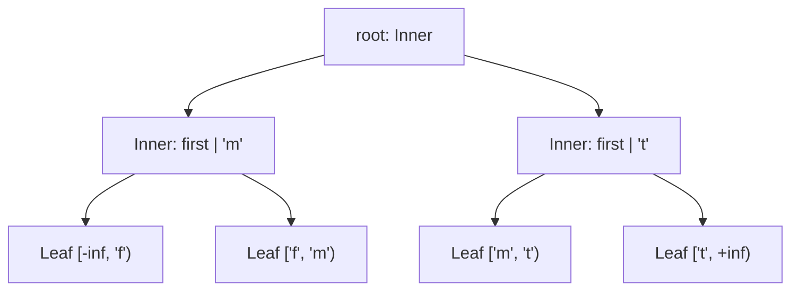
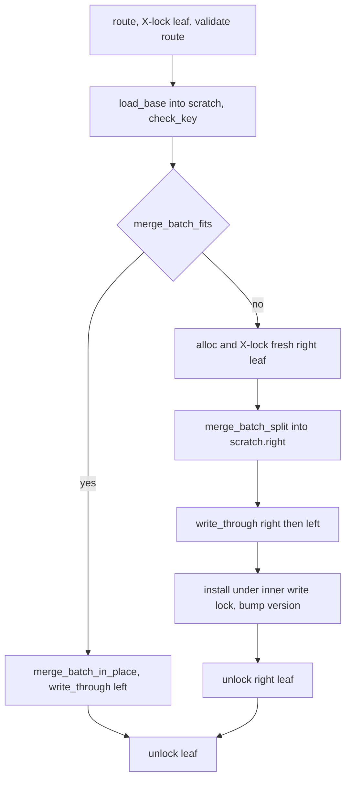

# BF-Tree structure

`Tree` composes [inner nodes](bf-tree-inner-nodes.md) and fenced
[leaf pages](bf-tree-pages.md) into an ordered map from nonempty byte keys to
byte values. This document records the tree-level guarantees: how routing and
fences agree, when nodes split, which keys and values the tree admits, and how
scans move between leaves.

The tree is shared between threads: it is `Send + Sync`, and every
operation takes `&self`. Each leaf has its own reader-writer lock, and the
inner layer sits behind one interim lock; the
[concurrency design](bf-tree-concurrency.md) records the locks and the
protocol. Leaves live behind a [page store](bf-tree-leaf-store.md). The tree
has base leaves only: mini-pages, the circular buffer in the tree, and
logging are separate components that do not exist in the tree yet.

## Shape



- The root is a `ChildRef`. A new tree is one leaf with unbounded fences, as
  upstream's root-is-leaf flag allows. The first leaf split creates the first
  inner node.
- Every leaf is a fenced `Page`. Every leaf is at the same depth.
- Inner nodes store no interval. Leaf fences are the only place the key-space
  partition is stored a second time, so they make the structure self-checking.
- Inner nodes and the root live in an `InnerStore`: fixed-capacity, zeroed
  `Box<[u8]>` buffers addressed by dense IDs that are never reused. They are
  derived, in-memory data: nothing persists them, and `Tree::open` rebuilds
  them from leaf fences. The tree keeps the `InnerStore` behind one
  `RwLock` with a global `inner_version`.
  [Plan 0016](../plans/0016-bf-tree-concurrency.md) replaces both with
  per-node frames suited to optimistic latching.
- Leaves live in a `PageStore` behind the `LeafMap`, described in
  [leaf storage](bf-tree-leaf-store.md). A `LeafId` is a stable slot in the
  store. Every access loads the leaf's base page under its lock into a
  thread-local scratch buffer, and every write goes to the store at once.
  `Tree::flush` only syncs the store.

## Routing and fences

`InnerNode::route` is right-on-equality, and leaf fences are lower-inclusive.
A descent with any byte slice therefore reaches the one leaf whose fences
contain it. Under concurrency a route becomes stale if the routed leaf
splits between the descent and the leaf lock. The
[route, lock, validate, retry protocol](bf-tree-concurrency.md#route-lock-validate-retry)
detects this and routes again. Point operations still call `Page::check_key` on the loaded
leaf, and a failure surfaces as the internal `TreeError::Page` error rather
than as wrong data.

Both split primitives, `Page::merge_batch_split` for leaves and
`InnerNode::split_with_insert` for inner nodes, write the right output into
a separate buffer, return the separator, and leave `self` as the left
output. A leaf split's separator is the full key of the right output's first
record: the right leaf's lower fence, the left leaf's upper fence, and the
parent's new separator are the same bytes. An inner split promotes an existing
separator. In both cases the parent routes `key >= separator` to the right
node, which matches the new fences.

## Writes

```rust
impl Tree {
    pub fn put(&self, key: &[u8], value: &[u8]) -> Result<(), TreeError>;
    pub fn remove(&self, key: &[u8]) -> Result<(), TreeError>;
}
```

A write merges a one-record batch into the leaf's base page. `put` passes
`RecordState::Insert(value)` and `remove` passes `RecordState::Delete`.
This is the batch-merge path of the [page design](bf-tree-pages.md) with a
batch of one, so every write and every later merge (mini-pages, eviction,
flush) shares one merge and one split path. Both operations return `()`: a
blind write in plan 0013 cannot know whether the key existed, so the API
takes its final shape now.

Under the leaf's X lock (taken by `with_leaf_write`), the write:

1. Loads the base page into scratch with `LeafMap::load_base` and checks
   that the leaf's fences contain the key.
2. Asks `Page::merge_batch_fits` whether the merged contents fit one page.
3. If they fit, rebuilds the page with `Page::merge_batch_in_place` and
   writes it with `LeafMap::write_through`.
4. Otherwise splits the leaf through `Tree::split_leaf`.



A tombstone in the batch removes the base key and never appears in the
output, so a `Delete` only shrinks the page and never splits.

### Split and install

`split_leaf` runs while the caller holds X on the reachable left leaf:

1. `LeafMap::alloc` allocates a store slot and returns the fresh right leaf
   under X. No separator names it yet.
2. The merge closure splits the merged contents: the left half stays in
   `scratch.page` and the right half goes to `scratch.right`.
3. One `write_through([left, right])` call writes the right page first and
   then the left page.
4. `install` takes the inner write lock, descends with the separator to
   find the parent path, inserts `separator -> right`, propagates splits
   upward, and bumps `inner_version`.
5. The right leaf's guard drops, and then the left leaf's guard drops.

If the merge, a write, or the install fails after step 1,
`LeafMap::discard` frees the fresh slot. A written but unreachable right
page would overlap its left neighbour at the next `open`.

`install` re-descends instead of using a recorded path, so a write records
no path. The separator is a key of the right half, so it lies in the left
leaf's old range, which cannot change while the caller holds the left
leaf's X lock. Propagation (`InnerStore::propagate`) is the same at every
level. When the path is exhausted, a new inner node with `first = old root`
receives the separator and becomes the root, so every leaf moves down one
level together. Only `ChildRef` values and owned separators move between
levels.

Splitting is *reactive*: a node splits only after a write into it does not
fit. This is exact here. The leaf split runs under the leaf's X lock, and
the whole upward propagation runs under the inner write lock, so nothing
changes between the failed fit and the parent update. Plan 0016 replaces
the inner lock with optimistic latching, where that gap is real; it decides
whether to add upstream's split-on-descent variant. Whether a node is
"full" is derived from its free space and the admission limits; node images
carry no needs-split bit.

`remove(key)` physically removes the record from the base page. Leaves are
never merged and inner nodes never underflow: an empty leaf keeps its
fences and stays reachable. Base pages hold no tombstones; mini-pages will.

All key and value limit checks precede any node access. Internal errors from
nodes (`TreeError::Page` and `TreeError::Inner`) indicate tree bugs. The
merge works on a scratch copy, so an error before `write_through` leaves the
store unchanged. Under the admission rule a split error is unreachable.

## Admission rule

Splits must never fail. `TreeConfig::validate` derives the limits from the
capacities. With leaf capacity `L`, inner capacity `I`, key limit `K`, value
limit `V`, largest record `R = 8 + K + V`, and largest finite fence pair
`F = 16 + 2K`:

- **Leaf.** A split happens because the merged contents of a one-record
  batch do not fit. Those contents are the base records, minus a replaced
  version of the key, plus the record: exactly the content of a full page
  plus one pending record, for which the rule was first derived. The
  virtual content is therefore at most `T <= (L - 48) + R`. The
  candidate with the last left sum at most `T / 2` bounds the larger side
  below `T / 2 + R`, and new prefixes are never shorter than the old one. The
  larger output fits when `32 + F + T/2 + R <= L`, which simplifies to
  `7K + 3V <= L - 72`. The same bound lets one record fit an empty fenced
  page, so a split always has at least two virtual records.
- **Inner.** From the inner-node design, `entry_size(K) = 16 + max(K - 4, 0)
  <= (I - 16) / 2`. Every separator is a leaf key or a promoted separator, so
  its length is at most `K`.

Defaults are `L = I = 4096`, `K = 64`, and `V = 1024`
(`448 + 3072 = 3520 <= 4024`). The leaf rule dominates at these capacities.
It is conservative: it assumes maximum-size records on the heavier side. At
`K = 16` it admits records of about 1.3 KiB, where upstream's size-class
condition C3 admits about 1.95 KiB. A `Delete` batch only shrinks the page,
so it needs no bound. [Plan 0013](../plans/0013-bf-tree-mini-tree.md)
revisits the rule against the mini-page size-class ladder.

Byte-aware leaf split selection chooses the candidate that minimizes the
larger output, so if any candidate fits under the bound, the split finds one.

## Scans

## Reads

```rust
impl Tree {
    pub fn get(&self, key: &[u8]) -> Result<Option<Vec<u8>>, TreeError>;
    pub fn get_with<R>(&self, key: &[u8], f: impl FnOnce(Option<&[u8]>) -> R) -> Result<R, TreeError>;
}
```

`get_with` routes, takes the leaf's S lock, validates the route, loads the
base page, checks the key against the fences, and calls `f` exactly once
under the lock with the value or `None`. A retry happens only before `f`
runs. `get` is `get_with(key, |v| v.map(<[u8]>::to_vec))` and returns an
owned copy: a borrow cannot outlive the leaf lock. `f` must not call back
into the tree (see [concurrency](bf-tree-concurrency.md#deadlock-freedom)).

## Scans

```rust
impl Tree {
    pub fn range(&self, start: Option<&[u8]>, end: Option<&[u8]>) -> Result<Scan<'_>, TreeError>;
    pub fn iter(&self) -> Scan<'_>;
    pub fn scan_with(&self, start: Option<&[u8]>, end: Option<&[u8]>,
        visit: impl FnMut(&[u8], &[u8]) -> ControlFlow<()>) -> Result<(), TreeError>;
}

pub struct Scan<'t> { /* tree, current leaf's copied records, its upper fence, end */ }
impl Iterator for Scan<'_> { type Item = Result<(Vec<u8>, Vec<u8>), TreeError>; }
```

`range(start, end)` returns a `Scan` over `[start, end)`; `iter()` is the
unbounded case. Bounds are half-open `Option` pairs: they match fence
semantics, and an inclusive end is the key with a `0x00` byte appended.
Equal bounds yield nothing; reversed bounds are `InvalidRange`.

Both scan forms visit one leaf at a time under its S lock:

- The scan keeps a cursor, initially the start bound. It routes the cursor
  to a leaf, takes S, validates the route, loads the base page, and reads
  `page.range(Some(cursor), end)`. It applies the lower bound to every leaf,
  not only the first, so a leaf that split after an earlier step can never
  contribute keys below the cursor.
- The leaf's upper fence, read under the same lock, becomes the next
  cursor. It is exactly the next leaf's lower bound, so no record is
  skipped or repeated, and no sibling pointers exist to maintain. The scan
  stops when the upper fence is unbounded or at or beyond `end`. Empty
  leaves cost one descent each.
- `Scan` copies the leaf's live records in range, releases the lock, and
  then yields them. It holds no lock between `next` calls. Items are owned
  `Result` values: moving to the next leaf may load it from the store, and
  a load failure ends the scan with that error rather than panicking inside
  an iterator or silently truncating the result.
- `scan_with` is the zero-copy form. It materializes each key into one
  reused buffer and calls the visitor under the leaf's S lock, until the
  visitor returns `Break`. The visitor must not call back into the tree.

A scan yields each key at most once, in increasing order, and each leaf's
records reflect one consistent state of that leaf. A scan is not a snapshot
across leaves; the [concurrency design](bf-tree-concurrency.md#guarantees)
states the exact guarantee.

## Invariants

`check_invariants` verifies, and the tests assert after every operation, the
following invariants. The checker is compiled only for tests: it walks every
node and record, so it is too slow for normal operations. It copies the
routing layer under the inner read lock, releases that lock, and then locks
leaves one at a time, so it cannot deadlock with concurrent operations. Its
result is meaningful only at quiescence.

1. Every leaf is at the same depth.
2. Every leaf's fences equal the routing interval its path implies.
3. Every record lies within its leaf's fences, and the leaf's search finds it.
4. Every inner node has at least one separator, in strictly increasing order.
5. Every allocated node is reachable exactly once, and every reference
   resolves to an allocated node. Freed leaf slots, which a reopened store
   can hold, are neither reachable nor referenced.

## References

- [BF-Tree paper](../references.md#bf-tree-paper), §3.1–3.4 for the tree
  structure and §5 for operations and scans.
- [Microsoft implementation](../references.md#microsoft-bf-tree-implementation),
  revision `f442e6172bf7e5483ff320d8e3ac16a70e31bbd6`, `src/tree.rs`:
  root-is-leaf flag, parent-stack split propagation, high-fence scans, and the
  `create_mem_page_size_classes` conditions. peppydb differs by sizing leaf
  splits exactly including the pending record, splitting reactively, and
  storing no `should_split` bit in node images.
- Plans [0007](../plans/0007-bf-tree-in-memory-tree.md) (the tree, splits,
  and the admission rule) and [0012](../plans/0012-bf-tree-shared-tree.md)
  (shared tree, one-record batch writes, owned reads, and per-leaf scans).
