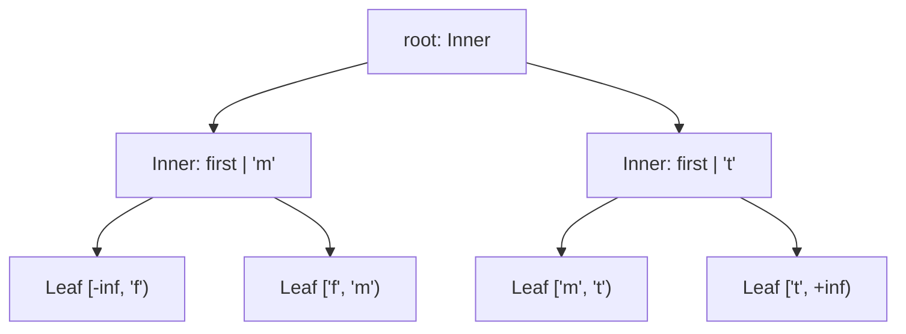
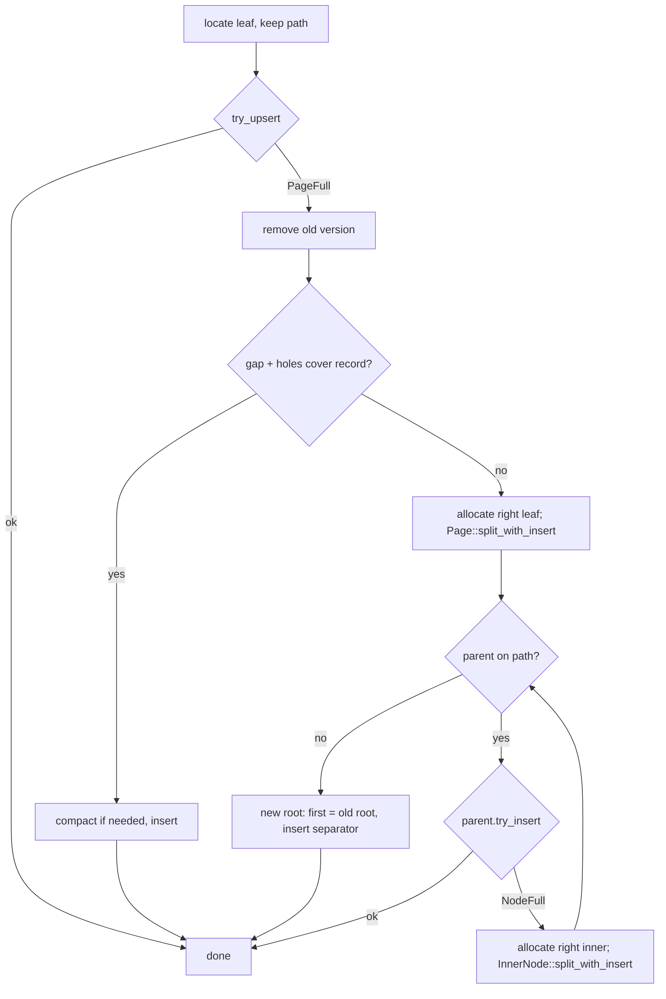

# BF-Tree structure

`Tree` composes [inner nodes](bf-tree-inner-nodes.md) and fenced
[leaf pages](bf-tree-pages.md) into an ordered map from nonempty byte keys to
byte values. This document records the tree-level guarantees: how routing and
fences agree, when nodes split, which keys and values the tree admits, and how
scans move between leaves.

The tree is single-threaded, with leaves behind a
[page store](bf-tree-leaf-store.md). It has base leaves only: mini-pages, the
buffer pool, concurrency, and logging are separate components that do not
exist yet.

## Shape

- The root is a `ChildRef`. A new tree is one leaf with unbounded fences, as
  upstream's root-is-leaf flag allows. The first leaf split creates the first
  inner node.
- Every leaf is a fenced `Page`. Every leaf is at the same depth.
- Inner nodes store no interval. Leaf fences are the only place the key-space
  partition is stored a second time, so they make the structure self-checking.
- Inner nodes live in a `Store<InnerId>`: fixed-capacity, zeroed `Box<[u8]>`
  buffers addressed by dense IDs that are never reused. They are derived,
  in-memory data: nothing persists them, and `Tree::open` rebuilds them from
  leaf fences. Concurrency will replace the store with frames suited to
  optimistic latching.
- Leaves live in a `PageStore` behind the `LeafMap`, described in
  [leaf storage](bf-tree-leaf-store.md). A `LeafId` is a stable slot in the
  store. The tree loads a leaf on first access and keeps it resident; writes
  mark it dirty, and `Tree::flush` writes dirty leaves back.

## Routing and fences

`InnerNode::route` is right-on-equality, and leaf fences are lower-inclusive.
A descent with any byte slice therefore reaches the one leaf whose fences
contain it. A leaf reached by descent never reports `KeyOutOfRange`; if it
did, the tree would surface the internal `TreeError::Page` error.

Both split primitives return `(separator, right)` and leave `self` as the left
output. A leaf split's separator is the full key of the right output's first
record: the right leaf's lower fence, the left leaf's upper fence, and the
parent's new separator are the same bytes. An inner split promotes an existing
separator. In both cases the parent routes `key >= separator` to the right
node, which matches the new fences.

## Writes

`put(key, value)` locates the leaf and records the path of `(InnerId, child
index)` pairs. It then:

1. Calls `Page::try_upsert`. Any result other than `PageFull` is final.
2. Removes any old version of the key, which frees its slot and turns its
   payload into a hole.
3. Compacts and inserts if the contiguous gap plus the holes cover the record.
4. Otherwise splits the leaf with the record pending and propagates upward.

Propagation is the same at every level. When the path is exhausted, a new
inner node with `first = old root` receives the separator and becomes the
root, so every leaf moves down one level together. Only `ChildRef` values and
owned separators move between levels.

Splitting is *reactive*: a node splits only after a write into it fails. This
is exact on one thread, because nothing changes between the failed write and
the parent update. Under optimistic latching that gap is real, so
concurrency is expected to add upstream's split-on-descent variant:
a retry that splits every node that cannot accept a maximum-size entry while
holding parent and child, so the final insert is local. Whether a node is
"full" is derived from its free space and the admission limits; node images
carry no needs-split bit.

`remove(key)` physically removes the record. Leaves are never merged and inner
nodes never underflow: an empty leaf keeps its fences and stays reachable. A
tree of base leaves needs no tombstones; mini-pages will.

All key and value limit checks precede any node access. Internal errors from
nodes (`TreeError::Page` and `TreeError::Inner`) indicate tree bugs. A split
error after the slow path removed an old version would leave that version
removed; under the admission rule such errors are unreachable.

## Admission rule

Splits must never fail. `TreeConfig::validate` derives the limits from the
capacities. With leaf capacity `L`, inner capacity `I`, key limit `K`, value
limit `V`, largest record `R = 8 + K + V`, and largest finite fence pair
`F = 16 + 2K`:

- **Leaf.** A split happens because a pending record did not fit after
  compaction, so the virtual content is at most `T <= (L - 48) + R`. The
  candidate with the last left sum at most `T / 2` bounds the larger side
  below `T / 2 + R`, and new prefixes are never shorter than the old one. The
  larger output fits when `32 + F + T/2 + R <= L`, which simplifies to
  `7K + 3V <= L - 72`. The same bound lets one record fit an empty fenced
  page, so a split always has at least two virtual records.
- **Inner.** From the inner-node design, `entry_size(K) = 16 + max(K - 4, 0)
  <= (I - 16) / 2`. Every separator is a leaf key or a promoted separator, so
  its length is at most `K`.

Defaults are `L = I = 4096`, `K = 64`, and `V = 1024`
(`448 + 3072 = 3520 <= 4024`). The leaf rule dominates at these capacities.
It is conservative: it assumes maximum-size records on the heavier side. At
`K = 16` it admits records of about 1.3 KiB, where upstream's size-class
condition C3 admits about 1.95 KiB. Mini-pages re-derive the rule together
with their size classes.

Byte-aware leaf split selection chooses the candidate that minimizes the
larger output, so if any candidate fits under the bound, the split finds one.

## Scans

`range(start, end)` returns a `Scan` over `[start, end)`; `iter()` is the
unbounded case. A scan holds the tree, the current leaf's `Page::range`
iterator, and the leaf's upper fence. When the leaf is exhausted, the scan
re-descends with that fence, which is exactly the next leaf's lower bound. No
record is skipped or repeated, and no sibling pointers exist to maintain. The
scan stops when the upper fence is unbounded or at or beyond `end`. Empty
leaves cost one descent each. Items are `Result<RecordRef, TreeError>` values
borrowing the tree: moving to the next leaf may load it from the store, and
a load failure ends the scan with that error.

## Invariants

`check_invariants` verifies, and the tests assert after every operation, the
following invariants. The checker is compiled only for tests: it walks every
node and record, so it is too slow for normal operations.

1. Every leaf is at the same depth.
2. Every leaf's fences equal the routing interval its path implies.
3. Every record lies within its leaf's fences, and the leaf's search finds it.
4. Every inner node has at least one separator, in strictly increasing order.
5. Every allocated node is reachable exactly once, and every reference
   resolves to an allocated node. Freed leaf slots, which a reopened store
   can hold, are neither reachable nor referenced.

## References

- [BF-Tree paper](../references.md#bf-tree-paper), §3.1–3.4 for the tree
  structure and §5 for operations and scans.
- [Microsoft implementation](../references.md#microsoft-bf-tree-implementation),
  revision `f442e6172bf7e5483ff320d8e3ac16a70e31bbd6`, `src/tree.rs`:
  root-is-leaf flag, parent-stack split propagation, high-fence scans, and the
  `create_mem_page_size_classes` conditions. peppydb differs by sizing leaf
  splits exactly including the pending record, splitting reactively, and
  storing no `should_split` bit in node images.
