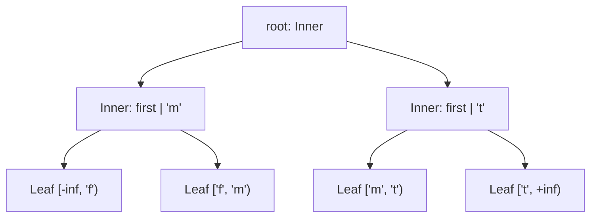
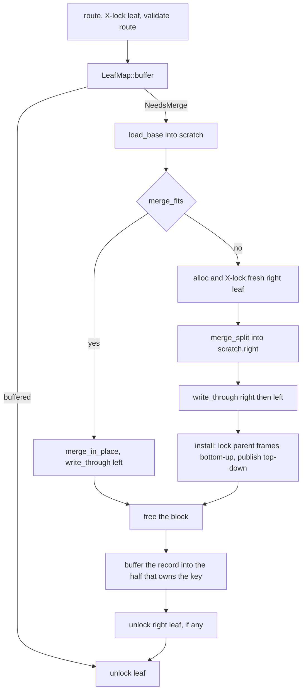

# BF-Tree structure

`Tree` composes [inner nodes](bf-tree-inner-nodes.md) and fenced
[leaf pages](bf-tree-pages.md) into an ordered map from nonempty byte keys to
byte values. This document records the tree-level guarantees: how routing and
fences agree, when nodes split, which keys and values the tree admits, and how
scans move between leaves.

The tree is shared between threads: it is `Send + Sync`, and every
operation takes `&self`. Each leaf has its own reader-writer lock, and
inner nodes live in version-locked frames that readers never lock; the
[concurrency design](bf-tree-concurrency.md) records the locks and the
protocol. Leaves live behind a [page store](bf-tree-leaf-store.md). Each
leaf is a base page in the store plus at most one in-memory
[mini-page](bf-tree-mini-page.md) in the
[circular buffer](bf-tree-circular-buffer.md). Writes buffer into the
mini-page, and a full mini-page merges into the base page. When the
circular buffer is full, a writer evicts the oldest mini-pages by merging
them into their base pages
([plan 0014](../plans/0014-bf-tree-eviction.md)). Logging does not exist in
the tree yet.

## Shape



- The root is a `ChildRef`, packed into one `AtomicU64` root word (bit 63
  marks a leaf root). A new tree is one leaf with unbounded fences, as
  upstream's root-is-leaf flag allows. The first leaf split creates the first
  inner node. The root word changes only by root growth, to a new frame.
- Every leaf is a fenced `Page`. Every leaf is at the same depth.
- Inner nodes store no interval. Leaf fences are the only place the key-space
  partition is stored a second time, so they make the structure self-checking.
- Inner nodes live in frames (`lib/bf-tree/src/frames.rs`), addressed
  by dense `InnerId`s. Each frame holds a version word and an immutable
  4 KiB image of the node; a writer publishes a new image instead of
  changing the old one. Frames are never freed, so an ID is never reused.
  `Inner` (`lib/bf-tree/src/inner.rs`) holds the frames, the root word,
  and the `root_grow` mutex. Inner nodes are derived, in-memory data:
  nothing persists them, and `Tree::open` rebuilds them from leaf fences,
  allocating complete frames. The
  [concurrency design](bf-tree-concurrency.md#frames) records the frame
  protocol ([plan 0016](../plans/0016-bf-tree-concurrency.md)).
- Leaves live in a `PageStore` behind the `LeafMap`, described in
  [leaf storage](bf-tree-leaf-store.md). A `LeafId` is a stable leaf
  identity. The `LeafMap` maps it to the page number of the leaf's stored
  page, and the page names its leaf in its header
  ([persistence](bf-tree-persistence.md)). A leaf's mini-page, if any, is
  reached through its entry. An access that needs the base page loads it
  under the leaf's lock into a thread-local scratch buffer. A merge writes the result to the store at
  once, to a fresh page number. `Tree::checkpoint` merges every mini-page,
  syncs the store, and commits
  ([persistence](bf-tree-persistence.md#the-checkpoint-protocol)).

## Routing and fences

`InnerNode::route` is right-on-equality, and leaf fences are lower-inclusive.
A descent with any byte slice therefore reaches the one leaf whose fences
contain it. A descent takes no lock: it reads each frame optimistically and
validates the node above it. Under concurrency a route becomes stale if the
routed leaf splits between the descent and the leaf lock. The
[route, lock, validate, retry protocol](bf-tree-concurrency.md#route-lock-validate-retry)
detects this and routes again. A point read looks the key up in the base
page or a full page with `Page::get_routed`, which checks the fences only
in debug builds: a validated route puts the key inside them by
construction (plan 0023; see
[shared pages](bf-tree-pages.md#routed-lookups)). A misrouted read
therefore panics in debug builds. Before plan 0023 the read called
`Page::check_key` in every build. Blind writes load no
base page, so they make no such check; `check_invariants` instead checks
that every buffered key lies within its leaf's fences.

Both split primitives, `Page::merge_batch_split` for leaves (called through
the mini-page crate's `LeafMut::merge_split`) and
`InnerNode::split_with_insert` for inner nodes, write the right output into
a separate buffer, return the separator, and leave `self` as the left
output. A leaf split's separator is the full key of the right output's first
record: the right leaf's lower fence, the left leaf's upper fence, and the
parent's new separator are the same bytes. An inner split promotes an existing
separator. In both cases the parent routes `key >= separator` to the right
node, which matches the new fences.

## Writes

```rust
impl Tree {
    pub fn put(&self, key: &[u8], value: &[u8]) -> Result<(), TreeError>;
    pub fn remove(&self, key: &[u8]) -> Result<(), TreeError>;
}
```

A write buffers one record blindly in the leaf's mini-page. `put` passes
`RecordState::Insert(value)` and `remove` passes `RecordState::Delete`.
Both operations return `()`: a blind write cannot know whether the key
existed. [Plan 0013](../plans/0013-bf-tree-mini-tree.md) introduced this
path; the [mini-page design](bf-tree-mini-page.md#in-the-tree) records it
in detail.

Under the leaf's X lock (taken by `with_leaf_write`), the write:

1. Calls `LeafMap::buffer`, which creates, grows, or applies into the
   leaf's mini-page without reading the base page. If that buffers the
   record, the write is done.
2. On `NeedsMerge` (the mini-page is full at the largest class), calls
   `Tree::merge_leaf`. It loads the base page into scratch and merges the
   mini-page's dirty records into it with the mini-page crate's `LeafMut`:
   in place when `merge_fits`, otherwise by a split through
   `Tree::split_leaf`. It writes the result through and then frees the
   mini-page's block.
3. Buffers the record into a fresh mini-page in the half that owns the key:
   the right half if `key >= separator`, otherwise the original leaf. Both
   halves are still X-locked, so the write needs no second route.



Every split is therefore a merge split: a leaf splits only when its base
page plus its full mini-page do not fit one page. A merge applies a
tombstone by removing the base key, so tombstones never reach a base page.
When the circular buffer is full, `LeafMap::buffer` returns `None`. The
write drops every guard, evicts with `make_room`, and routes again; no
circular-buffer error reaches the caller. Eviction merges a victim's
mini-page through the same `merge_leaf`, so an eviction can also split a
leaf. After buffering, the write calls `Tree::relocate`, which copies the
mini-page to the tail if it has aged into the second-chance region (see
[the circular buffer design](bf-tree-circular-buffer.md#use-in-the-tree)).

### Split and install

`split_leaf` runs while the caller holds X on the reachable left leaf:

1. `LeafMap::alloc` takes a fresh leaf ID from its atomic counter and
   returns the right leaf under X. No separator names it yet, and it has no
   stored page until step 3.
2. The merge closure (`LeafMut::merge_split` over the base page and the
   mini-page) splits the merged contents: the left half stays in
   `scratch.page` and the right half goes to `scratch.right`.
3. One `write_through([left, right])` call writes the right page first and
   then the left page. It stamps and seals each page, and it allocates the
   right leaf's page from the store.
4. `install` finds the parent frame by a lock-free descent with the
   separator, write-locks it, and confirms that it still routes the
   separator to the left leaf. It inserts `separator -> right` into a draft
   image, splits full frames and continues upward, and then publishes the
   changed frames from the top down.
5. `merge_leaf` frees the mini-page's block, and the caller places its
   pending record, if any.
6. The right leaf's guard drops, and then the left leaf's guard drops.

If the merge, a write, or the install fails after step 1,
`LeafMap::discard` gives up the fresh leaf ID and, if the right page was
written, zeroes and frees it. A written but unreachable right page would
overlap its left neighbour at the next `open`. `merge_leaf` then
puts the mini-page back into the left leaf's entry, so no buffered record
is lost.

`install` re-descends instead of using a recorded path, so a write records
no path. The separator is a key of the right half, so it lies in the left
leaf's old range, which cannot change while the caller holds the left
leaf's X lock. Propagation (`Inner::install`) is the same at every level:
a split frame stays write-locked, and its parent is found the same way with
the promoted separator. When the split node is the root, `install` takes
`root_grow`, allocates a new inner node with `first = old root` that holds
the separator, and stores it in the root word, so every leaf moves down one
level together. Only `ChildRef` values and owned separators move between
levels. New frames (right halves and new roots) are allocated with their
final image and are never locked.

Splitting is *reactive*: a leaf splits only after a merge into it does not
fit, and an inner node splits only after a separator does not fit. This is
exact. The leaf split runs under the leaf's X lock, and propagation locks
each parent frame bottom-up and keeps it locked until the top-down
publication, so nothing changes a node between its failed fit and its
update. Frame locks wait rather than fail, and they are taken in level
order, so the tree needs no split-on-descent: plan 0016 chose blocking
bottom-up propagation over upstream's split-on-descent variant (see
[concurrency](bf-tree-concurrency.md#splits-and-propagation)). Whether a
node is "full" is derived from its free space and the admission limits;
node images carry no needs-split bit.

`remove(key)` buffers a tombstone; the next merge physically removes the
record from the base page. Leaves are never merged and inner nodes never
underflow: an empty leaf keeps its fences and stays reachable. Base pages
hold no tombstones; mini-pages do.

All key and value limit checks precede any node access. Internal errors from
nodes (`TreeError::Page` and `TreeError::Inner`) indicate tree bugs. The
merge works on a scratch copy, so an error before `write_through` leaves the
store unchanged, and the mini-page stays in the entry. Under the admission
rule a split error is unreachable.

### Checkpoint

`Tree::checkpoint` (plan 0018, formerly `flush`) walks leaf IDs from 0 and
reads the leaf count again on every step, so it also reaches leaves that a
split creates during the walk. It X-locks one live leaf at a time by ID,
calls `merge_leaf` if the leaf has a mini-page or writes back a dirty full
page, and releases the leaf (the right guard of a split first). It then
syncs the store and commits. A split during the checkpoint needs no route,
because `install` finds the parent by the separator. Writers may run
meanwhile. Every write that returned before `checkpoint` was called is in
the commit ([persistence](bf-tree-persistence.md#why-n-is-complete)).

## Admission rule

Splits must never fail. `TreeConfig::validate` derives the limits from the
capacities. With leaf capacity `L`, inner capacity `I`, key limit `K`, and
value limit `V`:

- **Leaf: the mini-page ladder.** Every leaf split is a merge split: the
  base page plus a full mini-page at the largest class `M`.
  `SizeClasses::derive(L, K, V)` computes
  `M = floor64(L - 5K - V - 24)` and requires `M >= 64` and a maximum record
  `32 + 8 + K + V <= M`. The
  [mini-page design](bf-tree-mini-page.md#size-classes-and-the-admission-rule)
  derives this `M`: one two-way split always absorbs a merge, so a merge
  never returns `CannotSplit`. The record check lets a fresh mini-page at the
  smallest fitting class take any record, so the write after a merge always
  succeeds.
- **Inner.** From the inner-node design, `entry_size(K) = 16 + max(K - 4, 0)
  <= (I - 16) / 2`. Every separator is a leaf key or a promoted separator, so
  its length is at most `K`.

`validate` checks, in order: the leaf and inner capacities are valid page
capacities, `K >= 1`, the ladder (with checked arithmetic), the inner-node
rule, and the circular-buffer budget (`CircularBuffer::new` with the
ladder classes plus `L`). The ladder runs before the inner-node rule
because it bounds `K` and `V` by `L` without overflow; the inner-node sum
would overflow first for limits such as `usize::MAX`.

Defaults are `L = I = 4096`, `K = 64`, and `V = 1024`, which give
`M = 2688` and the ladder 64, 128, 256, 512, 1024, 2048, 2688. At `L = 4096`
the ladder admits `V` up to 1816 bytes at `K = 64` and 1944 bytes at
`K = 16`, close to upstream's size-class condition C3 (about 1.95 KiB at
`K = 16`).

The ladder rule replaced the rule `7K + 3V <= L - 72` of plans 0007 and
0012, which protected a split of a full base page plus one record. That
path no longer exists. Neither rule implies the other, because `M` rounds
down to a multiple of 64. A sweep test over `L = 128..=4096` in steps of
64, `K` in {1, 8, 9, 16, 64, 255}, and `V` in {0, 16, 64, 256, 1024, 1800}
(2268 configurations) finds: both rules accept 1337, neither accepts 766,
only the old rule accepts 1, and only the ladder accepts 164. The one
configuration that only the old rule accepts is `L = 192, K = 9, V = 16`:
it gives `M = 64`, which cannot hold a 65-byte record. The ladder accepts
larger values at normal page sizes. A store created with a configuration
that the ladder rejects no longer opens.

Byte-aware leaf split selection chooses the candidate that minimizes the
larger output, so if any candidate fits under the bound, the split finds one.

## Reads

```rust
impl Tree {
    pub fn get(&self, key: &[u8]) -> Result<Option<Vec<u8>>, TreeError>;
    pub fn get_with<R>(&self, key: &[u8], f: impl FnOnce(Option<&[u8]>) -> R) -> Result<R, TreeError>;
}
```

`get_with` routes, takes the leaf's S lock, and validates the route. If the
leaf has a mini-page, `lookup_marking` answers first: `Found` and `Absent`
need no store read. Only on `Miss`, or without a mini-page, does `get_with`
load the base page and check the key against the fences. It calls `f`
exactly once under the lock with the value or `None`. A retry happens only before `f`
runs. `get` is `get_with(key, |v| v.map(<[u8]>::to_vec))` and returns an
owned copy: a borrow cannot outlive the leaf lock. `f` must not call back
into the tree (see [concurrency](bf-tree-concurrency.md#deadlock-freedom)).

## Scans

```rust
impl Tree {
    pub fn range(&self, start: Option<&[u8]>, end: Option<&[u8]>) -> Result<Scan<'_>, TreeError>;
    pub fn iter(&self) -> Scan<'_>;
    pub fn scan_with(&self, start: Option<&[u8]>, end: Option<&[u8]>,
        visit: impl FnMut(&[u8], &[u8]) -> ControlFlow<()>) -> Result<(), TreeError>;
}

pub struct Scan<'t> { /* tree, current leaf's copied records, its upper fence, end */ }
impl Iterator for Scan<'_> { type Item = Result<(Vec<u8>, Vec<u8>), TreeError>; }
```

`range(start, end)` returns a `Scan` over `[start, end)`; `iter()` is the
unbounded case. Bounds are half-open `Option` pairs: they match fence
semantics, and an inclusive end is the key with a `0x00` byte appended.
Equal bounds yield nothing; reversed bounds are `InvalidRange`.

Both scan forms visit one leaf at a time under its S lock:

- The scan keeps a cursor, initially the start bound. It routes the cursor
  to a leaf, takes S, validates the route, loads the base page, and reads
  `LeafRef { base, mini }.range(Some(cursor), end)`, which merges base and
  mini-page records, lets the mini-page win an equal key, and hides
  tombstones and phantoms. It applies the lower bound to every leaf,
  not only the first, so a leaf that split after an earlier step can never
  contribute keys below the cursor.
- The leaf's upper fence, read under the same lock, becomes the next
  cursor. It is exactly the next leaf's lower bound, so no record is
  skipped or repeated, and no sibling pointers exist to maintain. The scan
  stops when the upper fence is unbounded or at or beyond `end`. Empty
  leaves cost one descent each.
- `Scan` copies the leaf's live records in range, releases the lock, and
  then yields them. It holds no lock between `next` calls. Items are owned
  `Result` values: moving to the next leaf may load it from the store, and
  a load failure ends the scan with that error rather than panicking inside
  an iterator or silently truncating the result.
- `scan_with` is the zero-copy form. It materializes each key into one
  reused buffer and calls the visitor under the leaf's S lock, until the
  visitor returns `Break`. The visitor must not call back into the tree.

A scan yields each key at most once, in increasing order, and each leaf's
records reflect one consistent state of that leaf. A scan is not a snapshot
across leaves; the [concurrency design](bf-tree-concurrency.md#guarantees)
states the exact guarantee.

## Invariants

`check_invariants` verifies, and the tests assert after every operation, the
following invariants. The checker is compiled only for tests: it walks every
node and record, so it is too slow for normal operations. It copies the
routing layer from frame snapshots without a lock, and then locks leaves
one at a time, so it cannot deadlock with concurrent operations. Its
result is meaningful only at quiescence.

1. Every leaf is at the same depth.
2. Every leaf's fences equal the routing interval its path implies.
3. Every record lies within its leaf's fences, and the leaf's search finds it.
4. Every inner node has at least one separator, in strictly increasing order.
5. Every allocated node is reachable exactly once, and every reference
   resolves to an allocated node. Holes (leaf IDs that name no leaf),
   which a failed split or a reopened store can leave, are neither
   reachable nor referenced.
6. Every mini-page is a valid, unfenced page whose backing leaf is its
   leaf, whose capacity is a ladder class, and whose keys lie within the
   leaf's fences (`InvariantError::BadMiniPage`).

The model tests also assert `circular_buffer_used() <= circular_buffer_bytes`
after every step.

## References

- [BF-Tree paper](../references.md#bf-tree-paper), §3.1–3.4 for the tree
  structure and §5 for operations and scans.
- [Microsoft implementation](../references.md#microsoft-bf-tree-implementation),
  revision `f442e6172bf7e5483ff320d8e3ac16a70e31bbd6`, `src/tree.rs`:
  root-is-leaf flag, parent-stack split propagation, high-fence scans, and the
  `create_mem_page_size_classes` conditions. peppydb differs by deriving
  the largest class from a merge-split proof, placing the pending record
  after a merge under the held locks instead of restarting, splitting
  reactively with blocking bottom-up propagation instead of
  split-on-descent, and storing no `should_split` bit in node images.
- Plans [0007](../plans/0007-bf-tree-in-memory-tree.md) (the tree, splits,
  and the first admission rule), [0012](../plans/0012-bf-tree-shared-tree.md)
  (shared tree, owned reads, and per-leaf scans), and
  [0013](../plans/0013-bf-tree-mini-tree.md) (blind writes, merge splits,
  the ladder admission rule, and flush merges),
  [0018](../plans/0018-bf-tree-checkpoint.md) (`flush` renamed to
  `checkpoint`), and
  [0016](../plans/0016-bf-tree-concurrency.md) (frames, the root word, and
  concurrent propagation).
