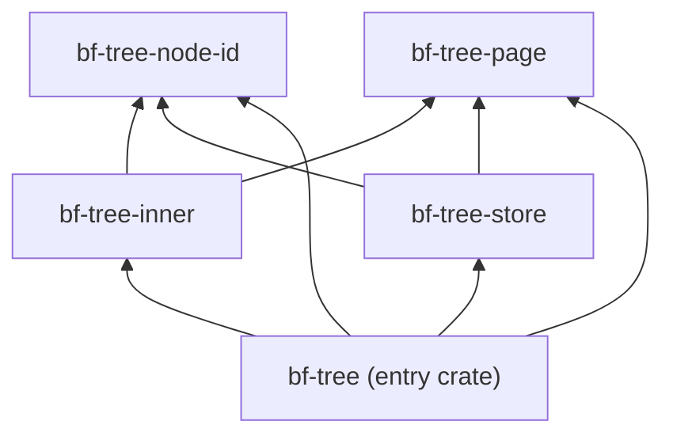

# Build system

peppydb is one repository with Rust and Go code. Go services (the gateway
and the placement driver) talk to the Rust storage engine over gRPC.
[Buck2](https://buck2.build/) builds and tests all of it. This document
records why the build is shaped the way it is. `AGENTS.md` lists the
commands.

## One build graph, with Buck2 as the source of truth

`BUCK` files define every target and dependency. `cargo` and `go` still work
in the repository, but they are secondary interfaces derived from the Buck2
graph.

- **Why one graph.** Rust, Go, and the code generated from shared `.proto`
  files depend on each other. A single graph rebuilds exactly what a change
  affects, across languages, and gives one test command. The tests affected
  by a change can be computed with a query, without guessing.
- **Why Buck2.** Buck2 makes fine-grained targets cheap, and its
  `visibility` rules control who may depend on a target. The crate design
  below depends on both.

## Small crates with enforced boundaries

Rust code is split into small crates. Each component has one entry crate,
named after the component (`bf-tree`), and internal crates named
`<component>-<part>` (`bf-tree-page`).

- **Why small crates.** A crate is Buck2's unit of compilation, caching, and
  test selection. A change to `bf-tree` rebuilds and retests one crate. A
  change to `bf-tree-page` touches only the crates above it. Low-level
  crates should therefore stay small and stable.
- **Invariant: only entry crates cross component boundaries.** `visibility`
  lists name exactly the targets allowed to depend on each crate, and the
  build fails otherwise. Another component may depend on `bf-tree`, never on
  `bf-tree-page`. This lets the internal crates change freely.
- **Consequence: `pub` is not the boundary.** Items used across internal
  crates must be `pub`. Buck2 visibility, not Rust privacy, keeps them away
  from other components.

## Generated Cargo manifests, hand-written Go module

The `Cargo.toml` files are generated from the Buck2 graph by
`tools/autocargo`. `go/go.mod` is written by hand. The difference follows
from how each language records dependencies.

- **Cargo** needs a manifest for each crate that lists that crate's
  dependencies. That duplicates the `BUCK` files, and duplicates drift
  apart, so the manifests are generated. CI rejects stale ones. The root
  `Cargo.lock` is derived from the third-party lock, so Cargo and Buck2
  build the same versions.
- **Go** records only third-party versions, in one `go.mod` for the whole
  module. Which package depends on which comes from `import` lines, which
  Buck2 and `go` both read. There is nothing to generate. The module sits at
  `go/`, and not in `third-party/go/`, because a Go module covers only its
  own directory tree. First-party code must be inside it for `go` and gopls
  to work.
- **Third-party rules** are generated in the other direction: reindeer
  generates them from `third-party/rust/Cargo.toml`, and
  `tools/gobuckify-remote` from `go/go.mod`. Both write one `BUCK` file of
  sha256-pinned archives that are downloaded at build time. Nothing is
  vendored, so repository size and dependency-upgrade diffs stay small.
- **Limit.** Cargo and `go` do not see Buck2-only behavior: visibility,
  release mode, and denied warnings. They also cannot see code that Buck2
  generates into `buck-out`. When protobuf code generation arrives, the
  generated sources must be copied into the tree for them.

## Every tool is pinned

Each tool that affects build output has exactly one recorded version: buck2,
rustc, reindeer, Go, and DotSlash in CI.

- **Why.** A tool that changes without a commit makes failures hard to
  explain, and it makes old commits hard to rebuild. Pinning buck2 matters
  most, because its rule library (the prelude) ships inside the binary, so a
  new buck2 can change how every target builds.
- **Freshness without drift.** A weekly job moves the buck2 pin to the
  newest release, but only after every check passes on it. A breaking
  release shows up as a failing update, not as a broken main branch.
- **Go is hermetic, Rust is not.** Buck2 downloads the pinned Go release,
  because the prelude needs to know the Go version and nothing else would
  enforce it at build time. Rust comes from `PATH`, but rustup selects the
  version from `rust-toolchain.toml` on every call, so it is pinned without
  extra machinery. The C linker comes from `PATH` too. `tools/check-tools`
  compares `rustc` and the Go pin with their recorded versions.

## Build modes are platforms

Release builds use a separate target platform (`@build/mode/release`). They
do not use a configuration flag.

- **Why.** A target platform is part of each output's configuration, so
  debug and release outputs are cached side by side, and switching between
  them rebuilds nothing.
- **Applies to future switches.** A build-wide mode, such as running
  concurrency tests under the shuttle scheduler, should be a constraint on a
  platform too. It must also be a real feature, not `cfg(test)`, because
  `cfg(test)` applies only to the crate under test, so code in its
  dependencies would silently keep the normal behavior.

## Strict by default

Warnings fail every Buck2 build, not only clippy runs, and the toolchain
denies unsafe code in every crate. Putting the policy on the toolchain means
no crate can opt out by omission, and normal builds and clippy builds cannot
disagree.

- **Unsafe code only where no safe design works.** The toolchain passes
  `-Dunsafe_code`, not `-Funsafe_code`, so that one crate can opt in with
  `#![allow(unsafe_code)]`. `tools/check-unsafe`, which `tools/clippy.sh`
  runs, fails if any first-party crate outside its allowlist lowers the lint,
  through an attribute or a rustc flag in a `BUCK` file. A crate joins the
  allowlist only through an approved plan that shows no safe design meets a
  specific need.
- **Third-party crates are exempt.** The prelude builds them with
  `--cap-lints=allow`, so the toolchain's lint levels never reach them.
- **Current allowlist:** none.
