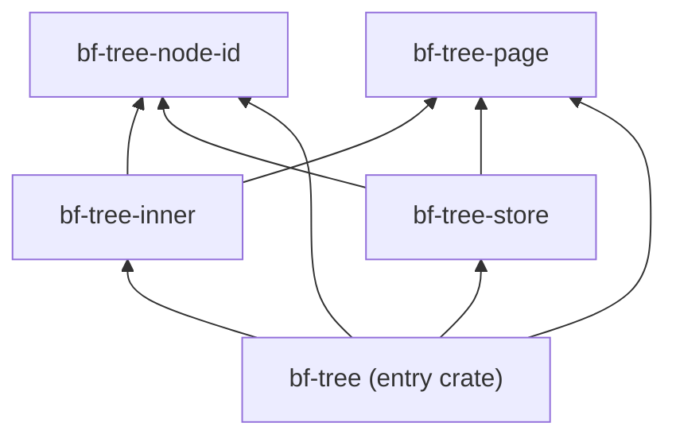

# Build system

peppydb is one repository with Rust and Go code. Go services (the gateway
and the placement driver) talk to the Rust storage engine over gRPC.
[Buck2](https://buck2.build/) builds and tests all of it. This document
records why the build is shaped the way it is. `AGENTS.md` lists the
commands.

## One build graph, with Buck2 as the source of truth

`BUCK` files define every target and dependency. `cargo` and `go` still work
in the repository, but they are secondary interfaces derived from the Buck2
graph.

- **Why one graph.** Rust, Go, and the code generated from shared `.proto`
  files depend on each other. A single graph rebuilds exactly what a change
  affects, across languages, and gives one test command. The tests affected
  by a change can be computed with a query, without guessing.
- **Why Buck2.** Buck2 makes fine-grained targets cheap, and its
  `visibility` rules control who may depend on a target. The crate design
  below depends on both.

## Layout by role, not by language

Directories are organized by what code is for, not by its language
([plan 0027](../plans/0027-workspace-language-agnostic-layout.md)):

```text
bin/<name>/                  one executable each: peppydb (Rust), peppydb-load (Go)
lib/<name>/                  one library each: bf-tree, engine, server (Rust), load (Go)
proto/<api>/<version>/       one API each: <api>.proto, rust/ (crate <api>-proto), go/ (package <api><version>)
```

- **Why.** Buck2 builds both languages, Cargo manifests are generated,
  and visibility enforces boundaries, so splitting directories by language
  only answered "which compiler builds this?", which each `BUCK` file
  already answers. One directory now lists every executable, one every
  library, and one API's protocol and generated code sit together.
- **Executables** are named `peppydb` or `peppydb-<role>`. Libraries keep
  the component naming below.
- **The API directory drops the `peppydb` level.** Protobuf packages are
  `peppydb.<api>.<version>`, so the wire names stay namespaced; files sit
  at `proto/<api>/<version>/`, and `buf.yaml` disables the
  `PACKAGE_DIRECTORY_MATCH` lint rule for that reason.
- **The Go package in `go/`** is named `<api><version>` (`kvv1`), because
  `go` is a keyword; importers use an alias.
- **Trade-off.** The layout departs from Go's `cmd/` and `internal/` and
  from Rust's `crates/`, so it must be learned. Plans before 0027 use the
  old paths: `crates/<x>` is now `lib/<x>`, `go/cmd/peppy-load` is
  `bin/peppydb-load`, `go/internal/load` is `lib/load`, `go/kvpb` and
  `crates/server-proto` are `proto/kv/v1/go` and `proto/kv/v1/rust`.

## Small crates with enforced boundaries

Rust code is split into small crates. Each component has one entry crate,
named after the component (`bf-tree`), and internal crates named
`<component>-<part>` (`bf-tree-page`).



- **Why small crates.** A crate is Buck2's unit of compilation, caching, and
  test selection. A change to `bf-tree` rebuilds and retests one crate. A
  change to `bf-tree-page` touches only the crates above it. Low-level
  crates should therefore stay small and stable.
- **Invariant: only entry crates cross component boundaries.** `visibility`
  lists name exactly the targets allowed to depend on each crate, and the
  build fails otherwise. Another component may depend on `bf-tree`, never on
  `bf-tree-page`. This lets the internal crates change freely.
- **Consequence: `pub` is not the boundary.** Items used across internal
  crates must be `pub`. Buck2 visibility, not Rust privacy, keeps them away
  from other components.

## Generated Cargo manifests, hand-written Go module

The `Cargo.toml` files are generated from the Buck2 graph by
`tools/autocargo`. `go.mod` is written by hand. The difference follows
from how each language records dependencies.

- **Cargo** needs a manifest for each crate that lists that crate's
  dependencies. That duplicates the `BUCK` files, and duplicates drift
  apart, so the manifests are generated. CI rejects stale ones. The root
  `Cargo.lock` is derived from the third-party lock, so Cargo and Buck2
  build the same versions.
- **Go** records only third-party versions, in one `go.mod` for the whole
  module. Which package depends on which comes from `import` lines, which
  Buck2 and `go` both read. There is nothing to generate. The module
  (`peppydb`) sits at the repository root, because a Go module covers only
  its own directory tree and Go packages live in `bin/`, `lib/`, and
  `proto/`. Its `ignore` directive keeps the `go` command out of
  `buck-out/` (which holds unpacked third-party Go sources), `target/`, and
  `third-party/`. Buck2 `visibility`, not Go's `internal/`, limits who may
  import a package.
- **Third-party rules** are generated in the other direction: reindeer
  generates them from `third-party/rust/Cargo.toml`, and
  `tools/gobuckify-remote` from `go.mod`. Both write one `BUCK` file of
  sha256-pinned archives that are downloaded at build time. Nothing is
  vendored, so repository size and dependency-upgrade diffs stay small.
- **Limit.** Cargo and `go` do not see Buck2-only behavior: visibility,
  release mode, and denied warnings. They also cannot see code that Buck2
  generates into `buck-out`. Generated protobuf code is therefore checked
  into the tree ([Protobuf code generation](#protobuf-code-generation)).
- **Feature variants.** A test-only switch that a dependent crate's tests
  need (such as the engine's `fault-injection`, plan 0026) cannot be
  `cfg(test)`, which applies only to the crate under test.
  `peppy_rust_library`'s `feature_variants` defines `:<name>-<feature>`,
  the same crate built with that Cargo feature, visible only to the tests
  that use it. A `test_deps` entry naming a variant replaces the plain
  dependency in the unit tests. `tools/autocargo` turns each variant into
  a `[features]` entry and a feature-enabled dev-dependency.

## Protobuf code generation

The API lives in `proto/`. `tools/gen-proto` lints it, checks it for
breaking changes, and writes Rust (`proto/kv/v1/rust/src/generated/`)
and Go (`proto/kv/v1/go/`) code, which is checked in
([plan 0026](../plans/0026-server-grpc-kv.md)).

- **buf for every language.** buf parses once for Rust and Go, and runs
  `buf lint` and `buf breaking`. The Go plugins (`protoc-gen-go`,
  `protoc-gen-go-grpc`) write Go. Rust comes from `tonic-prost-build`
  (`//tools/protogen`), fed buf's descriptor set, so the generated code and
  the tonic runtime are pinned together in `Cargo.lock`. buf's own Rust
  plugins lag tonic's releases and are not used.
- **Pinned by `go.mod`.** buf and the Go plugins are `tool` directives.
  `tools/gen-proto` builds them with the Go distribution that Buck2
  downloads. Buck2 cannot build buf itself: buf refuses to run without the
  module build information that only the `go` command embeds. Normal
  builds never run code generation.
- **No network services.** No Buf Schema Registry dependency and no remote
  plugin. A third-party `.proto` file is vendored under
  `proto/third_party/` with its source recorded.
- **The breaking-change baseline** is `proto/` at the parent revision,
  read with `sl cat`, because the working copy is a Sapling checkout, not
  a git one. `buf breaking` uses the `PACKAGE` rules, which compare by
  package and type, so moving a file within its package is not breaking.

## Every tool is pinned and hermetic

Each tool that affects build output has exactly one recorded version: buck2,
stable Rust, Miri nightly (and its stdlib crates), Go, Python, TLA+ (TLC and
Temurin JRE), reindeer, Zig on Linux, and DotSlash in CI
([plan 0035](../plans/0035-workspace-hermetic-build.md),
[plan 0037](../plans/0037-workspace-tla-toolchain.md)).

- **Why.** A tool that changes without a commit makes failures hard to
  explain, and it makes old commits hard to rebuild. Pinning buck2 matters
  most, because its rule library (the prelude) ships inside the binary, so a
  new buck2 can change how every target builds.
- **Freshness without drift.** A weekly job moves the buck2 pin to the
  newest release, but only after every check passes on it. A breaking
  release shows up as a failing update, not as a broken main branch.
- **Hermetic on Linux, everything-except-Apple-SDK on macOS.** Buck2
  downloads every compiler and runtime itself by sha256 into `buck-out/`.
  The Rust, Go, and Zig distributions use `toolchain_distribution`
  (`build/toolchains/distribution.bzl`): Buck2 downloads the archive from its
  origin and extracts it with `allow_cache_upload = False`, so a toolchain is
  never stored in or served from a remote cache. Toolchain trees are the
  largest outputs in the build and hold thousands of small files; serving
  them from BuildBuddy made every CI job download gigabytes (plan 0036).
  - **Stable Rust** (`rustc`, `rust-std`, `cargo`, `clippy-driver`, `rustfmt`,
    `rust-src`): pinned in `build/toolchains/rust_stable.bzl` by
    `tools/update-rust`. `tools/fmt.sh` and `tools/autocargo` invoke `rustfmt`
    and `cargo` from `toolchains//:rust-root`.
  - **Go**: pinned in `build/toolchains/go.bzl` by `tools/update-go`.
    `tools/fmt.sh` and `tools/gen-proto` invoke `gofmt` and `go` from
    `toolchains//:go-root`.
  - **Python**: `remote_python_toolchain(bootstrap = True)` downloads
    Astral's sha256-pinned `python-build-standalone` for all prelude helper
    scripts.
  - **TLA+ (TLC and Temurin JRE)**: pinned in `build/toolchains/tla.bzl` by
    `tools/update-tla`. `toolchains//:jre` uses `toolchain_distribution`
    (Temurin 21 LTS JRE per host), and `toolchains//:tla2tools` pins the
    immutable `tla2tools.jar` release via `http_file` (see "TLA+" below).
  - **C compiler and linker on Linux: Zig.** `rustc` targeting
    `*-unknown-linux-gnu` needs a C compiler driver to link: it finds the C
    runtime start files (`crt1.o`, ...) and glibc, then runs the linker.
    `build/toolchains/zig.bzl` pins the official Zig release (about 55 MB per
    host), and `zig cc` is that driver. Zig ships clang and lld, and builds
    glibc stubs for a chosen glibc version, the start files, compiler-rt, and
    libunwind from source, so no sysroot is needed. `build/toolchains/cxx.bzl`
    wraps `zig cc`, `zig c++`, and `zig ar` into the C++ toolchain, which the
    prelude's Rust and Go rules use for every link and cgo compile. The design
    follows the rue project ([references](../references.md)).
    - **glibc floor 2.17.** Every compile and link names the Zig target
      `x86_64-linux-gnu.2.17` (or `aarch64-...`), the oldest glibc that Rust
      supports. Binaries run on any Linux that runs Rust programs.
    - **Writable cache, primed once.** Zig needs writable cache directories.
      `build/toolchains/zig_cc.sh` puts them in each action's scratch
      directory, so actions stay hermetic. Building the runtime support costs
      about 15 s, so `toolchains//:zig-runtime-cache-*` builds it once and
      archives it, and every link unpacks that archive first.
    - **Reproducible links.** Zig's runtime objects carry debug information
      with the checkout path. The linker script
      `zig_runtime_debug_discard.ld` discards the debug sections of those
      objects only, so a link does not depend on where the repository is
      checked out.
    - **Flat response files.** The prelude's C compiles nest response files
      (`@file` inside `@file`); `zig cc` rejects that, so `zig_cc.sh`
      flattens them first.
    - glibc before 2.34 keeps pthread functions in `libpthread` and the DNS
      resolver in `libresolv`. Links must name them explicitly; the Go
      toolchain passes `-lpthread -lresolv` to cgo links.
  - **C/C++ linker on macOS**: uses host Xcode CLT (`path_clang_tools`),
    because Apple's Xcode license forbids redistributing `MacOSX.sdk`.
  - `tools/check-tools` verifies that `rust-toolchain.toml` and `go.mod` stay
    in sync with `rust_stable.bzl` and `go.bzl` so the secondary `cargo`
    and `go` commands build with the same versions.
- **The Miri nightly and its sysroot are hermetic.** Buck2 downloads both
  the nightly components and the crates.io dependencies from `rust-src`'s
  `library/Cargo.lock`, all pinned by `tools/update-miri` (see "Miri" below).

## Build modes are platforms

Release builds use a separate target platform (`@build/mode/release`). They
do not use a configuration flag.

- **Why.** A target platform is part of each output's configuration, so
  debug and release outputs are cached side by side, and switching between
  them rebuilds nothing.
- **Miri is a mode too.** `@build/mode/miri` sets a `mode-miri` constraint
  on the build mode (see "Miri").
- **Profiling is a mode too.** `@build/mode/profile` uses the release flags
  plus `-Cdebuginfo=line-tables-only` and `-Cforce-frame-pointers=yes`, so
  that `perf` profiles have symbols, inlined frames, and cheap stack walks.
  Frame pointers change the code slightly, so reference measurements come
  only from `@build/mode/release`. `tools/gcp-bench --profile` selects this
  mode ([remote benchmarks](remote-benchmarks.md)).
- **Applies to future switches.** A build-wide mode, such as running
  concurrency tests under the shuttle scheduler, should be a constraint on a
  platform too. It must also be a real feature, not `cfg(test)`, because
  `cfg(test)` applies only to the crate under test, so code in its
  dependencies would silently keep the normal behavior.

## Linux runs natively on Linux (WSL2 and CI)

Development happens natively on macOS and on Linux (WSL2, Ubuntu 24.04).
Because Linux Buck2 builds are fully hermetic — needing only DotSlash and
basic POSIX utilities — the earlier Docker-on-macOS wrapper
(`tools/linux-run`, `tools/linux/Dockerfile`) was removed in
[plan 0035](../plans/0035-workspace-hermetic-build.md). Linux-only checks
(`O_DIRECT`, contended `RwLock` benchmarks, `iptables` partition chaos tests,
and `tools/gcp-bench`) run directly on Linux/WSL2 and in CI.

## Strict by default

Warnings fail every Buck2 build, not only clippy runs, and the toolchain
denies unsafe code in every crate. Putting the policy on the toolchain means
no crate can opt out by omission, and normal builds and clippy builds cannot
disagree.

- **Unsafe code only where no safe design works.** The toolchain passes
  `-Dunsafe_code`, not `-Funsafe_code`, so that one crate can opt in with
  `#![allow(unsafe_code)]`. `tools/check-unsafe`, which `tools/clippy.sh`
  runs, fails if any first-party crate outside its allowlist lowers the lint,
  through an attribute or a rustc flag in a `BUCK` file. A crate joins the
  allowlist only through an approved plan that shows no safe design meets a
  specific need.
- **Third-party crates are exempt.** The prelude builds them with
  `--cap-lints=allow`, so the toolchain's lint levels never reach them.
- **Current allowlist:** `lib/bf-tree-circular-buffer`, whose slab hands
  out disjoint byte ranges of one allocation
  ([plan 0010](../plans/0010-bf-tree-circular-buffer.md),
  [plan 0038](../plans/0038-bf-tree-circular-buffer-v2.md)). Within it,
  `slab.rs`, `block.rs`, and `state.rs` lower the lint.

## Miri

[Miri](https://github.com/rust-lang/miri) interprets Rust programs and
reports undefined behaviour. Every crate that may contain unsafe code runs
its tests under it, through Buck2 like every other check:

```sh
tools/buck2 test @build/mode/miri '//lib/<crate>:<crate>-unittest[miri]'
```

- **The prelude does the interpreting.** If the Rust toolchain provides a
  Miri driver, every `rust_test` gets a `[miri]` sub-target, and the
  dependencies are compiled for Miri separately from native builds, only
  when such a target is requested.
- **Why a whole nightly toolchain.** Miri exists only on nightly, and the
  driver is a nightly `rustc`. A procedural macro, such as `thiserror`'s
  derive, must be built by the compiler that loads it. So in Miri mode the
  whole Rust toolchain switches to the same nightly: `rustc`, `rustdoc`, and
  the driver. Every dependency, including procedural macros, works
  unchanged.
- **Why a second execution platform.** Buck2 builds procedural macros and
  build scripts for the execution platform, which a target platform's
  constraints do not reach. The repository therefore registers two:
  the host, and the host with `mode-miri` (`build/platforms.bzl`). In Miri
  mode the Rust toolchain requires the second, so its tools also get the
  nightly. Other modes take the first, which matches the prelude's default.
- **Pinned and downloaded by Buck2.** `build/toolchains/miri_nightly.bzl`,
  written by `tools/update-miri`, records the nightly date and the sha256 of
  each component archive (`rustc`, `rust-std`, `cargo`, `miri`, `rust-src`)
  for every supported host. A genrule merges them into one toolchain
  directory. Other modes never download them.
- **The Miri sysroot builds completely offline.** Miri needs a standard library
  built with MIR for every function. `tools/update-miri` extracts every
  crates.io dependency from `rust-src`'s `library/Cargo.lock` into
  `MIRI_STD_CRATES` in `build/toolchains/miri_nightly.bzl`. Buck2 downloads
  those crates as sha256-checked `http_archive`s, and the cached `:miri-sysroot`
  genrule runs `cargo miri setup` with `CARGO_NET_OFFLINE=true` against a
  vendored copy (linking build scripts with the pinned Zig on Linux).
  The genrule builds in a scratch directory outside the repository, so Cargo
  does not mistake it for part of the workspace.
- **Cargo does not run Miri.** `cargo miri` is not part of the workflow.

## TLA+

Concurrent state machines and recovery protocols can be model-checked with
TLC through Buck2 ([plan 0037](../plans/0037-workspace-tla-toolchain.md)).
A crate declares a `peppy_tla_test` target from `//build:defs.bzl` beside its
`spec/` files:

```python
load("//build:defs.bzl", "peppy_tla_test")

peppy_tla_test(
    name = "my-model-tla",
    spec = "spec/MyModel.tla",
    cfg = "spec/MyModel.cfg",
)
```

- **Hermetic and lazy.** Buck2 downloads the pinned Temurin 21 JRE
  (`toolchains//:jre`) and `tla2tools.jar` (`toolchains//:tla2tools`) only
  when a `peppy_tla_test` target is built or tested. No host Java or TLA+
  installation is used.
- **Immutable release pins.** `tools/update-tla` pins `tla2tools.jar` to an
  immutable `tlaplus/tlaplus` release tag (`v1.7.4`) rather than the mutable
  `v1.8.0` pre-release tag, whose asset is rebuilt on pushes to `master`.
- **Buck2 owns parallelism.** `peppy_tla_test` defaults to `-workers 1` and
  `-XX:+UseParallelGC -XX:ParallelGCThreads=1` so parallel Buck2 test targets
  do not oversubscribe cores, and passes `-Djava.rmi.server.hostname=127.0.0.1`
  to avoid a 5-second macOS mDNS lookup on startup. Each run uses a fresh
  temporary `-metadir` removed on exit so parallel runs never collide on
  `states/`.
- **Included in `//lib/...` and CI.** `tools/buck2 test //lib/...` runs
  crate-local `peppy_tla_test` targets alongside Rust and Go tests, and
  `.github/workflows/ci.yaml` includes `peppy_tla_test` in its affected-package
  query. `tools/autocargo` ignores them; Cargo does not run TLA+.

## Affected-package CI

Pull-request CI (`.github/workflows/ci.yaml`) tests only the packages that a
change affects ([plan 0036](../plans/0036-workspace-ci-fanout.md)):

- **Affected packages from the query graph.** The `plan` job runs
  `tools/buck2 uquery` over `git diff`
  (`rdeps(//bin/... + //lib/... + //proto/..., owner(...))`) without
  downloading any toolchains, and emits `packages`, `run_lint`, and
  `run_miri`.
  - `buck2-test` tests every affected package on one runner, so toolchains
    are downloaded and shared dependencies are built once.
    `tools/ci/test-summary` then writes a per-package table to the job
    summary and an error annotation for each failing package. A job per
    package would repeat the downloads and builds for each package, and
    check runs created from the job are attached by GitHub to an arbitrary
    workflow run, so neither is used.
  - `buck2-miri` runs only when `//lib/bf-tree-circular-buffer` or global
    build or toolchain files change.
  - Documentation-only PRs (`docs/` and `*.md`) skip `buck2-lint`,
    `buck2-test`, and `buck2-miri`.
  - Global build, toolchain, or dependency changes (`build/`, `third-party/`,
    `tools/`, `go.mod`, `rust-toolchain.toml`, `.buckconfig`, `ci.yaml`) run
    all testable packages and Miri.
- **No shared remote cache.** CI and local machines do not share build
  results. A BuildBuddy remote cache was built and measured, then removed:
  one CI run moved about 600–700 MB, mostly debug test binaries, so the free
  tier (100 GB) would last only days. Remote execution was tried before that
  and moved terabytes of toolchain inputs. Plan 0036 records the measurements
  and the Buck2 behaviors that a future attempt must handle (the cache client
  needs `engine_address`; uploads depend on
  `[buck2] default_allow_cache_upload`; limited hybrid execution is
  remote-first).
- **Hermetic toolchains keep a cache possible.** The toolchains of plan 0035
  make action digests identical on WSL2 and GitHub's Ubuntu runners, which a
  shared cache requires. `toolchain_distribution` already keeps toolchain
  trees out of any cache.
