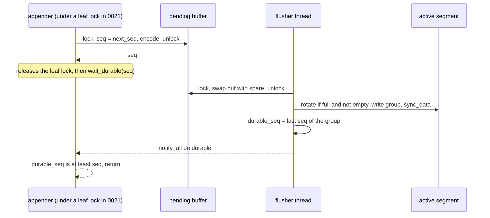
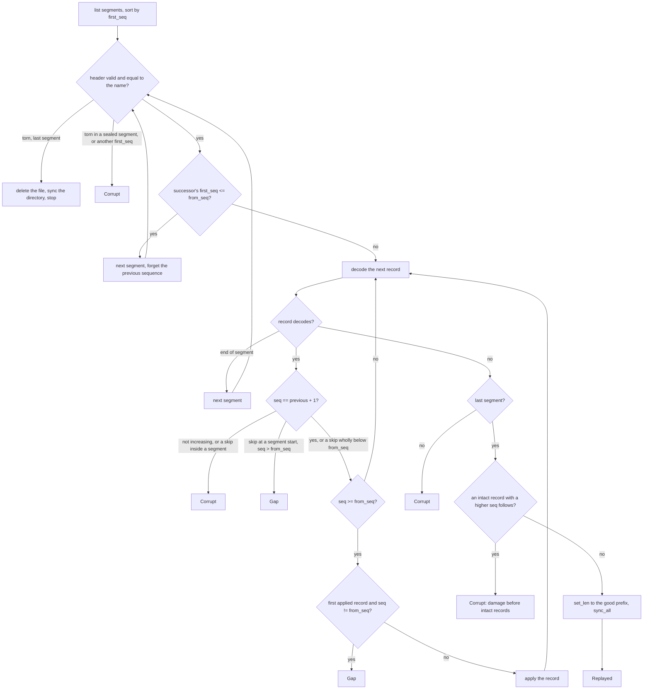
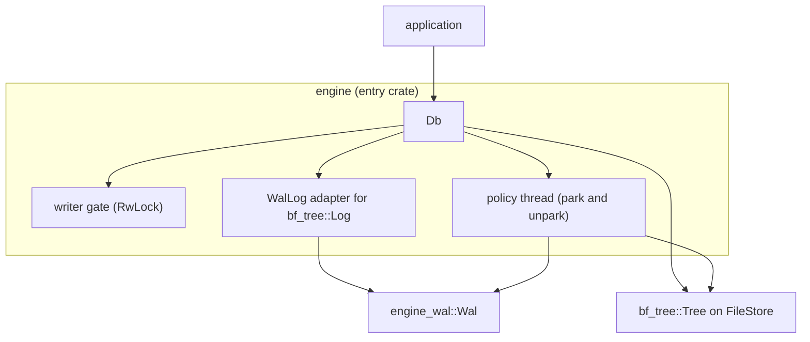
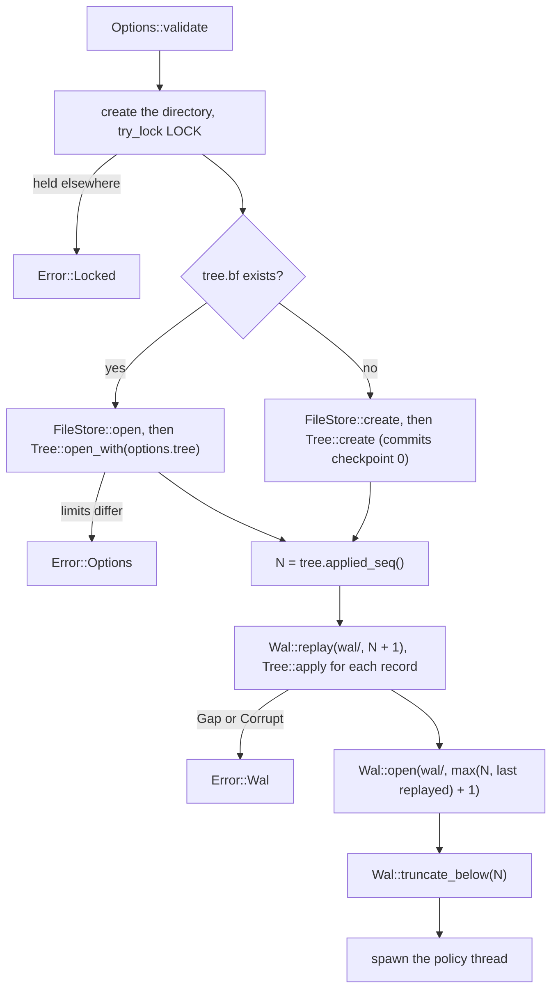
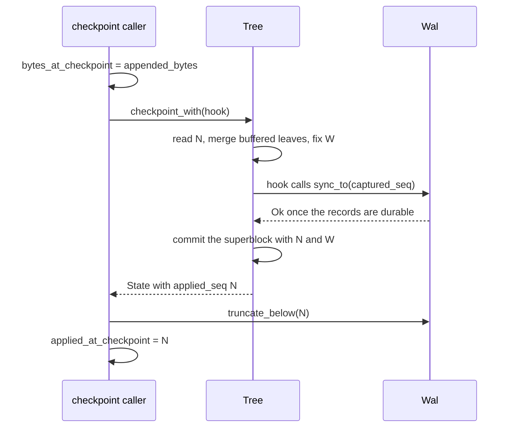
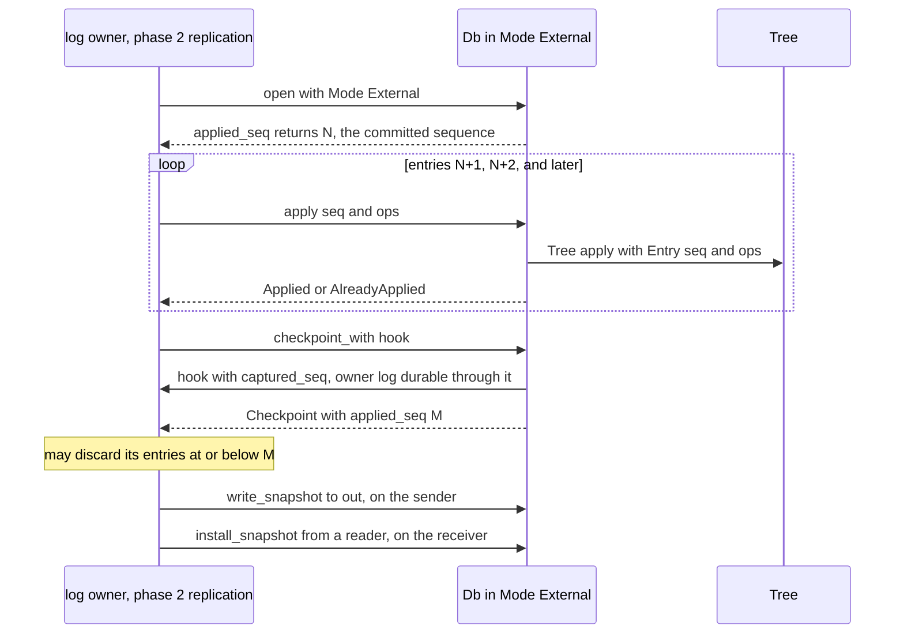
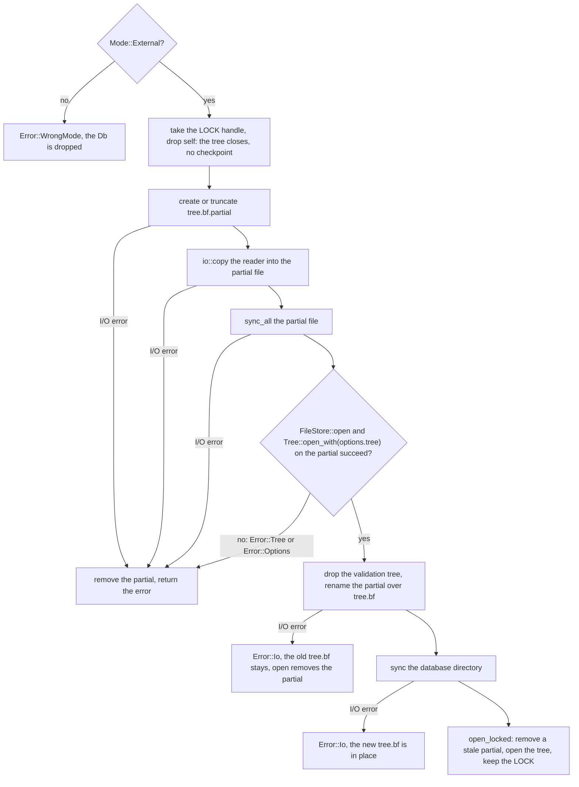

# Engine

This document records the design of the embedded engine component. It
covers two crates:

- **`engine-wal`** (internal): the write-ahead log (WAL). The first part of
  this document describes its place in the component, the on-disk format,
  sequences, the write path and group commit, replay, truncation, shutdown,
  errors, and its guarantees, with the test that backs each guarantee.
- **`engine`** (the entry crate): `Db`, the application-facing embedded
  database, which composes the BF-Tree and the WAL. The second part, from
  [The `Db`](#the-db), describes its boundaries, on-disk layout, options,
  errors, recovery, writes, batches, checkpoints, the checkpoint policy,
  close, crash testing, and its guarantees. The third part,
  [External-log mode](#external-log-mode), describes `Mode::External`: the
  `Db` driven by another log, the replication contract, `Db::apply`,
  owner-driven checkpoints, and snapshot installation.

[Plan 0020](../plans/0020-engine-wal.md) built the WAL,
[plan 0021](../plans/0021-engine-db.md) built the `Db`, and
[plan 0022](../plans/0022-engine-external.md) added the external-log mode.
Related documents:
[architecture](architecture.md) (components and phases),
[persistence](bf-tree-persistence.md#logs-and-sequenced-writes) (the tree's
`Log` contract, which the WAL serves through the `Db`'s adapter, and the
[pre-commit hook](bf-tree-persistence.md#the-pre-commit-hook)),
[concurrency](bf-tree-concurrency.md) (leaf locks), and
[build system](build-system.md) (Buck2 visibility).

The WAL code is in `crates/engine-wal/src/`: `lib.rs` (`Wal`, `Op`, `Record`,
`WalError`), `record.rs` (record and segment-header encoding), `segment.rs`
(naming, listing, directory sync), `replay.rs` (`Wal::replay`, `Replayed`),
and `flusher.rs` (`WalOptions`, `open`, appends, the flusher thread,
durability waits, truncation, `close`, `abandon`). The tests are in
`crates/engine-wal/src/tests/` (`record.rs`, `replay.rs`, `writer.rs`,
`lifecycle.rs`).

## Terms

- **Sequence:** a `u64` that the WAL assigns to each record. The first
  sequence is 1. Sequences are contiguous: each record's sequence is one
  more than the previous record's.
- **Segment:** one WAL file. It holds a header and then records.
- **Active segment:** the last segment. Only the flusher appends to it.
- **Sealed segment:** any segment except the last. It does not change.
- **Group:** the records that the flusher writes and syncs with one
  `sync_data` call.
- **Durable:** a record is durable when the flusher has synced its group.
  `durable_seq` is the highest durable sequence.
- **Torn tail:** bytes at the end of the active segment that a crash left
  as an incomplete or damaged record.

## Place in the engine component

The engine component has one entry crate, `engine` (plan 0021), and
internal crates. `engine-wal` is the first internal crate:

```python
# crates/engine-wal/BUCK
peppy_rust_library(
    name = "engine-wal",
    deps = [
        "//third-party/rust:crc32c",
        "//third-party/rust:thiserror",
    ],
    test_deps = ["//third-party/rust:tempfile"],
    visibility = ["//crates/engine:"],
)
```

- **Visibility.** Only the `//crates/engine` package may depend on
  `engine-wal`. Buck2 accepts the pattern before the package exists.
- **No `bf-tree` dependency.** The WAL knows sequences, operations, and
  bytes, not trees. It is testable without a tree and cannot reach into tree
  internals. The CRC32C comes from the third-party `crc32c` crate, the same
  source that plan 0017 chose for the store, not from a `bf-tree` crate.
- **Its own `Op` type.** `engine_wal::Op` mirrors `bf_tree::Op`. Plan 0021
  converts between them by copying two slice references. Code in `engine`
  names the crate (`engine_wal::Op`); neither type is re-exported under the
  other's name.

```rust
/// One logged change. Keys and values borrow the caller's bytes.
#[derive(Clone, Copy, Debug, PartialEq, Eq)]
pub enum Op<'a> {
    Put { key: &'a [u8], value: &'a [u8] },
    Delete { key: &'a [u8] },
}

/// A decoded record: one sequence and the operations it carries.
/// A single write has one operation; a batch has zero or more.
#[derive(Debug, PartialEq, Eq)]
pub struct Record<'a> {
    pub seq: u64,
    pub ops: Vec<Op<'a>>,
}
```

The WAL is the sequence source in standalone mode. The tree accepts the
WAL's sequences through its `Log` contract and `Tree::apply`, so the WAL
and the tree share one sequence space
([persistence](bf-tree-persistence.md#logs-and-sequenced-writes)).

## On-disk format

```text
<dir>/
  00000000000000000001.wal    segments named {first_seq:020}.wal
  00000000000000012034.wal    the last segment is the active one

segment header, 32 bytes:
  magic "PEPPYWAL" (8) | version u32 = 1 | reserved u32 = 0
  | first_seq u64 | header_crc u32 (crc32c of bytes 0..24) | zero (4)

record:
  len u32 | crc u32 | seq u64 | kind u8 | payload
  len = byte count of seq + kind + payload, at least 9
  crc = crc32c(len bytes ‖ seq ‖ kind ‖ payload)

payload by kind:
  0 Put     key_len u32 | value_len u32 | key | value
  1 Delete  key_len u32 | key
  2 Batch   count u32 | count × (kind u8 (0 or 1) | Put or Delete payload)
```

All integers are little-endian.

### Segment files

A segment's name is the sequence of its first record, as 20 decimal digits
with the suffix `.wal`. The directory listing is the index; there is no
manifest. The listing ignores every other file name, including names with a
different digit count. A sorted listing gives segments in log order.

The header carries `first_seq` again. `decode_header` checks, in this order,
the length (32 bytes), the magic, the header CRC32C over bytes 0..24, and
the version. Replay also checks that the header's `first_seq` equals the
name.

### Records

Each record starts with an 8-byte prefix, `len` and `crc`, followed by a
body of `len` bytes: `seq`, `kind`, and the payload. Key and value lengths
are `u32`, so the format does not depend on the tree's limits; the engine
validates those limits before it appends (plan 0021).

The decoder returns a record only if all of these hold:

- `len` is at least 9 (`seq` and `kind`) and at most `MAX_RECORD_BYTES`.
- The whole body is present.
- The CRC32C over the four `len` bytes and the body matches `crc`.
- `kind` is 0, 1, or 2. A batch entry's kind is 0 or 1: a batch must not
  nest a batch.
- The payload consumes exactly `len - 9` bytes: no trailing bytes.

A batch's `count` is checked against the remaining bytes (each operation
takes at least 5 bytes) before the decoder allocates, so a damaged count
cannot cause a large allocation.

**Why `len` is inside the checksum and has a lower bound.** Some file
systems leave zero-filled bytes at the end of a file after a crash. A run of
zeros has `len = 0` and `crc = 0`, and the CRC32C of an empty input is 0.
Without the lower bound and without `len` inside the checksum, such a run
would decode as a record. Either defence alone rejects it. Both are cheap,
so both are kept.

### Size limit

`MAX_RECORD_BYTES` is 16 MiB (`16 << 20`). It bounds `len`, the body of
**one record**: a put, a delete, or a whole batch. It does not bound a
segment file. The limit has two purposes:

- The decoder rejects garbage lengths in a torn tail.
- It bounds the memory that the pending buffer and replay hold for one
  record.

`append` and `append_batch` compute the encoded size before they take a
sequence. A record whose body exceeds the limit returns
`WalError::RecordTooLarge { bytes }`, where `bytes` is the encoded size
including the 8-byte prefix. With the tree's default limits, 16 MiB is about
15,000 maximum-size operations in one batch; larger bulk loads use several
batches.

## Sequences

`append` assigns the next sequence under the `pending` mutex and encodes the
record in the same critical section. Therefore the order of records in the
pending buffer equals sequence order, and sequences are contiguous. A batch
is one record and takes one sequence. A rejected record (too large, or the
WAL closed or failed) takes no sequence.

`Wal::open(dir, options, next_seq)` starts the sequence at `next_seq`
(sequences start at 1, so 0 means 1; `replay` treats a `from_seq` of 0
the same way).
Plan 0021 passes `max(applied, last replayed) + 1`. `last_seq()` returns the
highest assigned sequence and `durable_seq()` the highest durable one; both
start at `next_seq - 1`.

## Write path and group commit

```rust
pub struct WalOptions {
    /// Wait this long after the first pending append before writing.
    /// Zero (the default) writes as soon as the previous sync ends.
    pub flush_interval: Duration,
    /// Seal the active segment once it holds at least this many bytes.
    /// A segment may exceed it by one group. Default 64 MiB.
    pub segment_bytes: u64,
}

impl Wal {
    pub fn open(dir: &Path, options: WalOptions, next_seq: u64) -> Result<Wal, WalError>;
    pub fn append(&self, op: Op<'_>) -> Result<u64, WalError>;
    pub fn append_batch(&self, ops: &[Op<'_>]) -> Result<u64, WalError>;
    pub fn wait_durable(&self, seq: u64) -> Result<(), WalError>;
    pub fn sync_to(&self, seq: u64) -> Result<(), WalError>;
    pub fn durable_seq(&self) -> u64;
    pub fn last_seq(&self) -> u64;
    pub fn appended_bytes(&self) -> u64;
    pub fn truncate_below(&self, applied: u64) -> Result<usize, WalError>;
    pub fn close(&self) -> Result<(), WalError>;
    pub fn abandon(&self, written: usize);
}
```

An append does no I/O. It copies the encoded record into the pending buffer,
so it is safe to call under a tree leaf lock. The caller then waits for
durability outside the lock. One flusher thread, named `wal-flusher`, writes
and syncs the buffer.



### The flusher loop

1. Lock `pending`. If the state is `Abandoned`, or the buffer is empty and
   the state is `Closing`, exit. If the buffer is empty, wait on `wake`.
2. If `flush_interval` is positive, the state is `Open`, and `force_to` is
   below the buffer's last sequence, wait on `wake` until
   `first_pending_at + flush_interval`. Then repeat step 1's checks.
3. Swap the buffer with a reusable spare `Vec`. Note the group's first and
   last sequences, clear `first_pending_at`, and unlock. Appenders continue
   into the empty buffer.
4. If the active segment holds at least one group and holds at least
   `segment_bytes` bytes, create the next segment, named by the group's
   first sequence. The old segment is already synced, so it is sealed with
   no torn tail. A group never spans two segments.
5. `write_all` the group, then `sync_data`. On an error, record the failure
   (see [Errors](#errors)), wake every waiter, and exit.
6. Store `durable_seq`, take and release `durable_lock`, and `notify_all`
   on `durable`.
7. Clear the spare buffer. If its capacity exceeds 4 MiB (`SPARE_LIMIT`),
   replace it with a new empty `Vec`, so that a burst does not pin memory.

**An empty segment is never sealed.** Step 4 requires the active segment to
hold at least one group. Without that condition, a `segment_bytes` below the
header size made the first group after `open` rotate out of the fresh,
header-only segment. The new segment had the same name (the group's first
sequence), and `create_new` failed.

Every waiter whose record is in the group shares one fsync. Appends that
arrive during the fsync form the next group. This is group commit without a
timer.

**Why the default interval is zero.** A positive interval adds its whole
length to the latency of every write. Under concurrency the groups form
anyway, during the previous fsync. An interval helps only when fsync is so
cheap that groups stay small. The option stays for such devices. Plan 0023
measures both settings.

### Waiting and lock rules

`wait_durable(seq)` reads `durable_seq` first, with no lock on the fast
path. Otherwise it locks `durable_lock` and loops: it returns `Ok` if
`durable_seq >= seq`, `WalError::Failed` if the flusher failed, and
`WalError::Closed` if the flusher stopped. Otherwise it waits on `durable`
with no timeout. The flusher stores `durable_seq` (or the failure and the
stop flag) before it takes `durable_lock`, so no wakeup is lost.

The lock rules:

- Appenders and the flusher share `pending`. The flusher waits on `wake`,
  paired with `pending`.
- Durability waiters use only `durable_lock` and `durable`. They never
  touch `pending`, which keeps the appenders' critical section short.
- Nothing holds `pending` while it waits on `durable`, and nothing holds
  `durable_lock` while it takes `pending`.

### `sync_to`

`sync_to(seq)` makes every record up to `seq` durable now. It clamps `seq`
to `last_seq()`, raises `force_to` with `fetch_max`, takes and releases
`pending` (so the flusher cannot miss the wakeup between its check and its
wait), wakes the flusher, and then waits like `wait_durable`. The flusher
skips the interval wait when `force_to` covers the buffer's last sequence.
Plan 0021 calls `sync_to` from the checkpoint's pre-commit hook.

### Segment creation

`create` opens the file with `create_new`, writes the header, calls
`sync_all`, and syncs the directory. Therefore a segment that later holds
durable records also has a durable directory entry. Both `open` and
rotation use `create`.

### Opening

`Wal::open(dir, options, next_seq)`:

1. Creates `dir` if it is absent.
2. If the last segment holds no more than a header, deletes it and syncs
   the directory. Such a segment holds nothing, for example after a crash
   right after `open` or a rotation. `open` replaces it whatever its name.
3. Creates a new segment named `next_seq` and starts the flusher.

The caller must run `Wal::replay` first, so that a torn tail is repaired
before the new segment seals the old last segment.

### `appended_bytes`

`appended_bytes()` counts the encoded bytes of every record appended since
`open`, prefixes included, segment headers excluded. Plan 0021's checkpoint
policy compares it with its value at the last checkpoint.

## Replay

```rust
pub struct Replayed {
    /// Highest sequence in the log after repair, replayed or not.
    pub last_seq: Option<u64>,
    /// Records passed to `apply`.
    pub records: u64,
    /// Bytes removed from the end of the last segment.
    pub truncated_bytes: u64,
}

impl Wal {
    /// Pass every record with `seq >= from_seq` to `apply`, in order.
    /// Repairs a torn tail in the last segment. Must run before `open`.
    pub fn replay<E: From<WalError>>(
        dir: &Path,
        from_seq: u64,
        apply: impl FnMut(Record<'_>) -> Result<(), E>,
    ) -> Result<Replayed, E>;
}
```

An absent or empty directory replays nothing. Replay reads each segment
file whole and decodes it in memory.



The rules and their reasons:

- **Torn tails only in the last segment.** The flusher rotates only after
  the previous group synced, so a sealed segment cannot end in a partial
  write. Any undecodable record in a sealed segment is damage:
  `WalError::Corrupt`.
- **A tail is a tail only if nothing intact follows.** After the first bad
  record in the last segment, replay scans every later byte offset for an
  intact record with a sequence above the last good one. If it finds one,
  the damage is in the middle of acknowledged data, and a truncation would
  silently drop that data. Replay returns `Corrupt` instead. Garbage and
  zero runs after the good records are a tail.
- **Repairs are synced before anything follows them.** `set_len` is
  followed by `sync_all` before `replay` returns. `open` then creates a new
  segment, which seals the repaired one. Without the sync, a crash could
  leave the torn bytes in what is now a sealed segment, and the next replay
  would fail with `Corrupt`.
- **A torn header in the last segment is deleted.** A header that does not
  decode in the last segment means a crash during segment creation, so the
  segment holds nothing durable. Replay deletes the file, syncs the
  directory, and stops. In a sealed segment, an undecodable header is
  `Corrupt`. A header whose `first_seq` differs from the file name is
  `Corrupt` in any segment.
- **Contiguity.** The first record that replay reads after a skipped
  segment, or at the start of the log, must have a sequence at or above its
  segment's name. Every other record must be exactly one more than the
  previous record. A repeated or decreasing sequence is `Corrupt`, in a
  segment or across a boundary. A skip inside a segment is `Corrupt`. A skip
  at a segment boundary means a missing segment: it is
  `WalError::Gap { expected, found }` if `found > from_seq`, and accepted
  if the missing records are all below `from_seq`. Also, the first record
  passed to `apply` must be exactly `from_seq`; otherwise replay returns
  `Gap { expected: from_seq, found }`. The WAL assigns sequences with no
  gaps, so a gap can only mean lost data; strictness turns silent loss into
  an error. If `from_seq` is above every record, replay applies nothing and
  succeeds.
- **Skipping old segments.** A segment whose successor's `first_seq` is at
  or below `from_seq` holds only records that the checkpoint covers. Replay
  checks its header and does not decode its records, so damage in them does
  not matter. Such segments normally exist only when a deletion by
  `truncate_below` did not reach the disk before a crash. The last segment
  is never skipped.

`Replayed::last_seq` includes records below `from_seq` that replay decoded,
so plan 0021 can compute `next_seq` from it.

## Truncation

```rust
/// Delete every sealed segment whose successor's first_seq <= applied + 1.
/// Such a segment holds only records at or below `applied`.
/// The last (active) segment is never deleted. Returns the count deleted.
pub fn truncate_below(&self, applied: u64) -> Result<usize, WalError>;
```

`truncate_below` lists the directory and walks adjacent pairs from the
oldest. It deletes a segment if its successor starts at or below
`applied + 1`, and stops at the first segment that does not qualify. The
last segment in the listing has no successor, so it is never deleted. A
`NotFound` error is ignored, so concurrent calls (for example, a manual and
a background checkpoint) are safe. The caller must pass a sequence that a
committed checkpoint covers.

`truncate_below` does not sync the directory. A deletion that does not
survive a crash leaves a redundant segment, which replay skips and the next
truncation deletes.

## Close, `Drop`, and `abandon`

- **`close(&self)`** changes the state from `Open` to `Closing`, wakes the
  flusher, and joins it. With the state `Closing`, the flusher skips the
  interval wait and drains the buffer before it exits, so every appended
  record becomes durable. An append checks the state again under the
  `pending` mutex, so `close` drains every append that it does not reject.
  Later appends return `WalError::Closed`. `close` returns the flusher's
  original error once; a later `close` returns `Ok`.
- **`Drop`** calls `close` and ignores its result.
- **`abandon(&self, written)`** simulates a crash. It sets the state to
  `Abandoned` and joins the flusher, which exits after any group already in
  flight. It then writes the first `written` bytes of the pending buffer to
  the active segment, **without** a sync, and drops the rest. Waiters for
  records that were never reported durable receive `WalError::Closed`. If
  the flusher had failed, it returned no segment, and `abandon` writes
  nothing. After `abandon`, appends return `Closed`, and dropping the `Wal`
  writes nothing more. `abandon` takes `&self` because the `Db` holds its
  `Wal` in state shared with the policy thread.

**Why `abandon` exists.** Dropping a `Wal` drains it. A test that only drops
a database therefore never loses unsynced log bytes, and never exercises the
case that the WAL exists for. `abandon` loses the pending records, and
`written` produces a torn record at any byte offset. It covers a process
crash exactly. A power loss can also lose bytes that were written but not
synced. Such bytes belong to a group whose waiters were never woken, so
`abandon` with a partial `written` covers that case too.

**Why `abandon` is public.** The engine's crash tests are in another crate
(`engine`), and `cfg(test)` does not cross crates. Buck2 visibility limits
the crate, and so `abandon`, to `//crates/engine:`. Its documentation states
that production code calls `close`. The other test hooks (a sync counter
and a sync-fault injector) stay crate-private.

## Errors

```rust
#[derive(Debug, thiserror::Error)]
pub enum WalError {
    #[error("WAL I/O error during {op}: {source}")]
    Io { op: &'static str, #[source] source: std::io::Error },
    #[error("WAL segment {segment} is corrupt at offset {offset}: {reason}")]
    Corrupt { segment: u64, offset: u64, reason: &'static str },
    #[error("WAL is missing records: expected sequence {expected}, found {found}")]
    Gap { expected: u64, found: u64 },
    #[error("WAL record of {bytes} bytes exceeds the limit")]
    RecordTooLarge { bytes: usize },
    #[error("the WAL flusher stopped after an error during {op}: {kind}")]
    Failed { op: &'static str, kind: std::io::ErrorKind },
    #[error("the WAL is closed")]
    Closed,
}
```

- `Corrupt::segment` is the segment's first sequence (its name), and
  `offset` is a byte offset in that file.
- **`Failed` carries only `Copy` data:** an operation name and an
  `io::ErrorKind`. `io::Error` is not `Clone`, so the WAL stores the pair
  once and builds a `Failed` for every caller. The original `Io` error is
  stored separately, and `close` returns it once.
- **Failure is sticky.** After a write, sync, or segment-creation error,
  the flusher exits. No later record can become durable, so every later
  `append`, `append_batch`, `sync_to`, and `wait_durable` for a record that
  was not already durable returns `Failed`. The WAL must be closed and
  reopened, with a replay, to continue.
- `WalError` is the WAL's own type. Plan 0021 wraps it in the tree's
  `LogError` at the `Log` boundary and unwraps it again in
  `engine::Error::Wal`.

## Guarantees

Test paths are relative to `crates/engine-wal/src/tests/`.

| Guarantee | Tests |
| --- | --- |
| The CRC32C matches the RFC 3720 §B.4 check value. | `record.rs`: `crc32c_matches_the_rfc_3720_check_value` |
| Every record kind round-trips, including empty keys and values, an empty batch, and a 5000-byte value. Records decode one after another. | `record.rs`: `every_kind_round_trips` |
| Every cut and every single-bit flip of a record fails to decode. | `record.rs`: `every_cut_and_every_bit_flip_fails_to_decode` |
| `len` of 0, 8, `u32::MAX`, and `MAX_RECORD_BYTES + 1` fails, as do 64 zero bytes, a nested batch, trailing payload bytes, and an unknown kind, even with a correct checksum. | `record.rs`: `bad_lengths_zeros_nesting_and_trailing_bytes_fail` |
| A segment header round-trips; bad magic, a bad checksum, an unknown version, and a short header are rejected. | `record.rs`: `segment_headers_round_trip_and_reject_damage` |
| Replay passes records in order from the start or from the middle, and nothing past the end. | `replay.rs`: `replays_from_the_start_and_from_the_middle` |
| A torn tail at every byte offset of the last record is cut from the file, and a second replay sees a clean log. Zero and garbage tails are tails. | `replay.rs`: `a_torn_tail_at_every_offset_is_cut_and_synced`, `garbage_and_zeros_after_good_records_are_a_tail` |
| Damage in the last segment that an intact record follows is `Corrupt`. | `replay.rs`: `damage_before_intact_records_of_the_last_segment_is_corrupt` |
| Any damage in a sealed segment, including a partial last record, is `Corrupt`. | `replay.rs`: `any_damage_in_a_sealed_segment_is_corrupt` |
| A duplicated, decreasing, or skipping sequence is `Corrupt`, in a segment and across a boundary. | `replay.rs`: `duplicated_or_decreasing_sequences_are_corrupt` |
| A missing segment is `Gap` unless it is wholly below `from_seq`; a log that starts above `from_seq` is `Gap`. | `replay.rs`: `a_missing_segment_is_a_gap_unless_wholly_below_from_seq` |
| Old segments are skipped after a header check; a header that names another sequence is `Corrupt`. | `replay.rs`: `old_segments_are_skipped_and_header_mismatches_are_corrupt` |
| A torn header deletes the last segment, and only the last one. | `replay.rs`: `a_torn_header_deletes_the_last_segment_only` |
| Empty and absent directories replay nothing; other files are ignored. | `replay.rs`: `empty_and_absent_directories_replay_nothing` |
| Appends round-trip through `close` and replay with an interval of 0 and of 10 ms. | `writer.rs`: `appends_round_trip_through_close_and_replay` |
| `sync_to` returns well before a 1 s flush interval elapses. | `writer.rs`: `sync_to_skips_a_long_flush_interval` |
| Segments rotate and are named by their first sequence. | `writer.rs`: `segments_rotate_and_are_named_by_their_first_sequence` |
| Appends after `close` return `Closed`. | `writer.rs`: `appends_after_close_are_rejected` |
| An oversized batch takes no sequence; the largest record that fits is accepted. | `writer.rs`: `an_oversized_batch_takes_no_sequence` |
| Reopening continues the log, and a header-only last segment is replaced. | `writer.rs`: `reopening_continues_the_log` |
| Truncation deletes exactly the redundant sealed segments, never the last one. With `segment_bytes = 1`, each segment holds one record, which also exercises "an empty segment is never sealed". | `lifecycle.rs`: `truncation_deletes_exactly_the_redundant_sealed_segments` |
| Concurrent truncations succeed and leave exactly the needed segments. | `lifecycle.rs`: `concurrent_truncations_succeed` |
| Eight appenders of 400 records each get 3200 distinct, contiguous sequences, share syncs (fewer syncs than records), and replay in sequence order. | `lifecycle.rs`: `eight_appenders_get_contiguous_sequences_and_share_syncs` |
| `abandon(0)` loses exactly the records never reported durable. | `lifecycle.rs`: `abandon_loses_only_records_never_reported_durable` |
| `abandon` at every byte of a record leaves a tail that replay repairs. | `lifecycle.rs`: `abandon_at_every_byte_of_a_record_leaves_a_repairable_tail` |
| A flusher failure is sticky: waiters, appends, and `sync_to` return `Failed`, and `close` returns the original `Io` error once. | `lifecycle.rs`: `a_flusher_failure_is_sticky` |
| `appended_bytes` counts every record. | `lifecycle.rs`: `appended_bytes_count_every_record` |

Some properties are not observable in these tests and rest on the code
alone: that `replay` syncs its repair (the test checks the file length, not
the sync), and that segment creation syncs the file and the directory.

## Not yet guaranteed, and limits

- **A segment may exceed `segment_bytes` by one group.** Rotation happens
  before a group, never inside one.
- **Truncation deletions are not synced.** A crash can bring a deleted
  segment back. Replay skips it, and the next truncation deletes it again.
- **Concurrent truncation counts may overlap.** Two `unlink` calls on one
  path both succeeded on macOS (APFS), so the counts that concurrent calls
  return can add up to more than the number of segments removed. Only the
  surviving set of segments is exact.
- **A CRC32C collision could hide damage.** The forward scan after a bad
  record in the last segment treats bytes as an intact record only if their
  checksum matches. A collision could make damage look like a tail, or a
  tail look like damage. A false match needs a CRC32C collision.
- **The forward scan's cost has no tight bound.** It tries to decode at
  every byte offset after the tear. Usually the tail is one partial group.
  A long tail of random bytes could make each attempt checksum up to
  `MAX_RECORD_BYTES`.
- **A `Failed` record may still be in the log.** When `sync_data` fails
  after `write_all` succeeded, the group's bytes can reach the disk. A
  record whose wait returned `Failed` was never acknowledged, but replay can
  still find it.
- **`open` does not validate `next_seq`.** The caller must pass one more
  than both the highest replayed sequence and the tree's applied sequence,
  and must replay first. Sequences start at 1.
- **Replay holds one segment in memory.** It reads each segment file whole,
  including the segments it skips after the header check.
- **No backpressure.** The pending buffer grows without a limit if
  appenders outpace the device.

## Extension points

- **Plan 0021** wraps `Wal` in a local adapter that implements
  `bf_tree::Log`. `Db::open` calls `replay` and then `open`. Writes call
  `wait_durable`; the checkpoint hook calls `sync_to`; checkpoints call
  `truncate_below`; the checkpoint policy reads `appended_bytes`; crash
  tests call `abandon`, which takes `&self`. None of these changed the
  record format, the naming scheme, or the replay rules. See
  [The `Db`](#the-db).
- **Plan 0022** (external-log mode) does not use the WAL.
- **Plan 0023** measures append cost, group sizes, interval settings, and
  replay rate. Possible additions, each additive: segment preallocation
  (the decoder already treats zeros as a torn tail; preallocation would make
  zeros after the last record the normal end of a segment), a group-size
  metric, and a backpressure limit on the pending buffer.
- **Phase 2** may ship WAL records to followers. `Record` and `replay`
  already expose decoded entries with sequences; a streaming reader over
  sealed segments would be a new function, not a format change.
- Later plans must not need to change the record format, the naming
  scheme, or the replay rules.

## The `Db`

`Db` is the application-facing embedded database. It composes the BF-Tree
(`bf_tree::Tree` on a `FileStore`) and the WAL. It opens with recovery,
makes every acknowledged write durable, applies atomic batches, serves
reads, checkpoints on a background policy that bounds the WAL, and closes
in order.

The code is in `crates/engine/src/lib.rs`. The tests are in
`crates/engine/src/tests/`: `open.rs` (open, recovery, and reads),
`write.rs` (single writes), `batch.rs` (batches), `checkpoint.rs`
(checkpoints, policy, and snapshots), and `crash.rs` (simulated crashes).



```rust
impl Db {
    pub fn open(path: impl AsRef<Path>, options: Options) -> Result<Db, Error>;
    pub fn put(&self, key: &[u8], value: &[u8]) -> Result<(), Error>;
    pub fn delete(&self, key: &[u8]) -> Result<(), Error>;
    pub fn write(&self, batch: WriteBatch) -> Result<(), Error>;
    pub fn get(&self, key: &[u8]) -> Result<Option<Vec<u8>>, Error>;
    pub fn get_with<R>(&self, key: &[u8], f: impl FnOnce(Option<&[u8]>) -> R)
        -> Result<R, Error>;
    pub fn range(&self, start: Option<&[u8]>, end: Option<&[u8]>)
        -> Result<Scan<'_>, Error>;
    pub fn scan_with(&self, start: Option<&[u8]>, end: Option<&[u8]>,
        visit: impl FnMut(&[u8], &[u8]) -> ControlFlow<()>) -> Result<(), Error>;
    pub fn checkpoint(&self) -> Result<Checkpoint, Error>;
    pub fn write_snapshot(&self, out: &mut dyn std::io::Write)
        -> Result<Checkpoint, Error>;
    pub fn applied_seq(&self) -> u64;
    pub fn path(&self) -> &Path;
    pub fn close(self) -> Result<(), Error>;
}
```

Internally, a `Db` holds its path, its `Options`, an `Arc<Shared>`, the
policy thread's `JoinHandle` (`None` in external mode), and the open `LOCK`
file. `Shared` holds what the `Db` and the policy thread share: the `Tree`,
the `Wal` (`Option<Wal>`, `None` in external mode), the writer gate, the
`Policy` atomics, and the stored background error. `Db` is `Send + Sync`;
a compile-time assertion in `lib.rs` checks it.

### Crate and boundaries

```python
# crates/engine/BUCK
# The engine component's entry crate. Other components depend on this
# crate only; engine-* crates are internal.
peppy_rust_library(
    name = "engine",
    deps = [
        "//crates/bf-tree:bf-tree",
        "//crates/engine-wal:engine-wal",
        "//third-party/rust:thiserror",
    ],
    test_deps = ["//third-party/rust:tempfile"],
    visibility = ["PUBLIC"],
)
```

- **`engine` is the component's only public crate.** Other components and
  `bin/` must depend on `engine`, never on `engine-wal`.
- **`engine` depends on `bf-tree` only** from the BF-Tree component, never
  on a `bf-tree-*` crate. The `bf-tree-*` crates' visibility lists do not
  include `//crates/engine`, so Buck2 rejects such a dependency. `engine-wal`
  is visible only to `//crates/engine:`. Plan 0021 checked both rules with
  local experiments; each failed with "is not visible".
- **Re-exports.** `engine` re-exports, under their own names, the types
  that appear in its public signatures: `LogError`, `Op` (for
  `Db::apply`), `Scan`, `TreeConfig`, and `TreeError` from `bf-tree`, and
  `WalError` from `engine-wal`.
  `Checkpoint` is the engine's own type, converted from `bf_tree::State`:

```rust
pub struct Checkpoint {
    /// Every write at or below this sequence is in the committed tree.
    pub applied_seq: u64,
    /// Increases by one per committed checkpoint.
    pub checkpoint_id: u64,
}
```

The engine relies on these parts of the tree's contract
([persistence](bf-tree-persistence.md#logs-and-sequenced-writes)):

1. `put_logged` and `remove_logged` check the operation, then call
   `Log::append` with the leaf locked and the route validated, before they
   modify the leaf. If `append` fails, the leaf is unchanged. If the tree
   must retry the write (for example, after it made room in the circular
   buffer), it calls `append` again for the same operation; the earlier
   record is unused, and replaying both is harmless.
2. `Tree::apply(entry)` checks every operation before it writes any, writes
   each with `entry.seq`, and advances the applied sequence once, after the
   last operation. It requires one caller at a time, in increasing
   sequence order, and rejects a sequence at or below the applied sequence
   (`TreeError::SequenceOrder`).
3. `checkpoint_with(hook)` calls `hook` with a `CommitPoint` after the write
   sequence `W` is fixed and before the superblock commit. A hook error
   aborts the commit.
4. Checkpoints are serialized inside the tree and must not run with a leaf
   lock held.

### On-disk layout

```text
<path>/
  LOCK          held with File::try_lock for the Db's lifetime
  tree.bf       the tree's store file (plans 0017 to 0019)
  wal/          WAL segments (plan 0020)
```

`Db::open` creates `<path>` if it is absent. `LOCK` is opened (created if
absent, never truncated) and locked with `std::fs::File::try_lock`. A lock
conflict (`TryLockError::WouldBlock`) returns `Error::Locked`. The lock is
held by the open file in the `Db` and is released when the `Db` drops,
after `close` or without it. A second `open` of the same path in the same
process is also `Locked` (`open.rs`: `a_second_open_is_locked`).

### Options and validation

```rust
pub struct Options {
    pub tree: TreeConfig,               // TreeConfig::default()
    pub mode: Mode,                     // Mode::Standalone
    pub flush_interval: Duration,       // 0
    pub segment_bytes: u64,             // 64 MiB
    pub checkpoint_wal_bytes: u64,      // 256 MiB
    pub checkpoint_interval: Duration,  // 60 s
}
```

- `flush_interval` and `segment_bytes` become the `WalOptions`.
- `checkpoint_wal_bytes` is the policy's byte threshold, and
  `checkpoint_interval` its interval (see
  [The checkpoint policy](#the-checkpoint-policy)).
- `Mode::Standalone` means that the engine keeps a WAL and that writes
  return once durable. `Mode::External` means that another log sequences
  and stores the writes (see [External-log mode](#external-log-mode)).

`Options::validate` runs first in `open`. It returns `Error::Options` if
`segment_bytes < 4096`, if `checkpoint_wal_bytes == 0`, or if
`checkpoint_interval` is zero. It then calls `TreeConfig::validate`, whose
error is `Error::Tree` (for example, `TreeError::InvalidConfig`).

The tree limits are fixed when the database is created: creation writes
`Superblock::from(&options.tree)`. A reopen must pass the same limits.
`Tree::open_with` compares them with the superblock and fails on a
mismatch; the engine reports that failure as `Error::Options` (see
[Errors](#db-errors)). The WAL and policy options may differ between
opens.

### Db errors

```rust
pub enum Error {
    Tree(TreeError),
    Wal(WalError),
    Io { op: &'static str, source: std::io::Error },
    Options(&'static str),
    Locked,
    WrongMode,                                         // plan 0022
    Hook(Box<dyn std::error::Error + Send + Sync>),   // plan 0022
}
```

`WrongMode` and `Hook` belong to the external-log mode; see
[Modes and methods](#modes-and-methods) and
[Checkpoints in external mode](#checkpoints-in-external-mode).

| Origin | Becomes |
| --- | --- |
| `TreeError::Log(LogError::Closed)` from a tree call | `Error::Wal(WalError::Closed)` |
| `TreeError::Log(LogError::Io { op, kind, .. })` from a tree call | `Error::Wal(WalError::Failed { op, kind })` |
| `TreeError::InvalidStore("store superblock differs from the configuration")` | `Error::Options("tree limits differ from the store")` |
| Any other `TreeError` (including `StoreError` from `FileStore`) | `Error::Tree` |
| A `WalError` from a direct WAL call (`replay`, `open`, `append_batch`, `wait_durable`, `truncate_below`, `close`) | `Error::Wal` |
| An `io::Error` while creating the directory, opening or locking `LOCK`, or spawning the policy thread | `Error::Io { op, .. }` |
| `TryLockError::WouldBlock` on `LOCK` | `Error::Locked` |

The WAL's errors cross the tree as `LogError`, which is `Copy` like
`TreeError`. The adapter maps them with `to_log_error`:
`WalError::Closed` becomes `LogError::Closed`, `WalError::Failed { op,
kind }` becomes `LogError::Io { op, kind, code: None }`, and every other
variant becomes `LogError::Other("wal")`. `From<TreeError> for Error`
reverses the first two, so a log failure inside a tree call is reported as
the WAL's error, not the tree's. The round trip is lossless for `Closed`
and `Failed`, the errors that an append or a sync of a valid record
returns.

**Why `InvalidStore` becomes `Options`.** `Tree::open_with` reports a
limit mismatch as `TreeError::InvalidStore` with a fixed message. For the
engine's caller, the cause is the options that it passed, so the engine
maps that one message to `Error::Options`. Other `InvalidStore` errors stay
`Error::Tree`. The match depends on the exact message text in `bf-tree`.

### Open and recovery

```rust
pub fn open(path: impl AsRef<Path>, options: Options) -> Result<Db, Error> {
    options.validate()?;
    let path = path.as_ref().to_path_buf();
    std::fs::create_dir_all(&path).map_err(io("create database directory"))?;
    let lock = lock_file(&path)?;                      // Error::Locked
    let tree = open_or_create_tree(&path, &options)?;  // Error::Options on limits
    let applied = tree.applied_seq();
    let wal_dir = path.join("wal");
    let replayed = Wal::replay(&wal_dir, applied + 1, |record| {
        let ops: Vec<_> = record.ops.iter().map(to_tree_op).collect();
        tree.apply(Entry { seq: record.seq, ops: &ops }).map_err(Error::from)
    })?;
    let next = applied.max(replayed.last_seq.unwrap_or(0)) + 1;
    let wal = Wal::open(&wal_dir, options.wal(), next)?;
    wal.truncate_below(applied)?;
    // Build Shared, spawn the policy thread "engine-checkpoint".
}
```



- **Replay goes through `Tree::apply`.** Each WAL record above `N` becomes
  one entry with the record's sequence, so a batch is applied as one entry
  again. The tree opens at its last checkpoint, which committed `N`; the
  checkpoint can also hold effects above `N` (it is fuzzy). Replay applies
  those records again, in order, and the final state equals the log's.
- **Sequences continue.** The WAL opens at `max(N, last replayed) + 1`, so
  the next write takes the next sequence after both the tree and the log
  (`write.rs`: `writes_round_trip_and_survive_a_reopen` checks "sequences
  continue").
- **Truncation after open.** `truncate_below(N)` deletes segments that the
  checkpoint already covered, for example after a crash between a
  checkpoint's commit and its truncation.
- **A missing `wal/` replays nothing.** A `tree.bf` without its WAL
  directory is a valid database at its checkpoint. A snapshot file opens
  this way (see [Checkpoints](#checkpoints-and-wal-before-data)).
- **Replay errors refuse the open.** A WAL whose first record is above
  `N + 1` returns `Error::Wal(WalError::Gap { .. })` (`open.rs`:
  `a_stale_wal_with_a_gap_is_refused`). `Corrupt` is reported the same way.
- **Creation order.** `create` writes the tree and its initial checkpoint
  before the WAL exists. A crash between `FileStore::create` and the
  initial commit leaves a `tree.bf` that `open` rejects with an error; the
  engine does not recreate over it.
- **The policy starts from the recovered state.** `bytes_at_checkpoint`
  starts at `wal.appended_bytes()` (0) and `applied_at_checkpoint` at `N`.
  If replay applied records above `N`, the interval trigger therefore
  checkpoints them after the first interval.

### Writes

```rust
/// The WAL as the tree's log. A local newtype: neither the trait nor `Wal`
/// belongs to this crate.
struct WalLog<'a>(&'a Wal);

impl bf_tree::Log for WalLog<'_> {
    /// Runs under the tree's leaf lock: the WAL's append does no I/O.
    fn append(&self, op: bf_tree::Op<'_>) -> Result<u64, LogError> {
        self.0.append(to_wal_op(&op)).map_err(|error| to_log_error(&error))
    }
}

pub fn put(&self, key: &[u8], value: &[u8]) -> Result<(), Error> {
    let seq = {
        let _single = self.shared.gate.read().unwrap_or_else(PoisonError::into_inner);
        self.shared.tree.put_logged(&WalLog(&self.shared.wal), key, value)?
    };
    // After the leaf lock is released: a slow sync holds no lock.
    self.shared.policy.note_append(&self.shared.wal);
    self.shared.wal.wait_durable(seq)?;
    Ok(())
}
```

`delete` is the same with `remove_logged`. `to_wal_op` and `to_tree_op`
convert between `bf_tree::Op` and `engine_wal::Op` by copying two slice
references.

- **The WAL is appended under the leaf lock.** The tree calls
  `WalLog::append` inside its leaf lock (contract 1), so for each key the
  order of sequences equals the order of application. `Wal::append` does no
  I/O and does not wait, so it is safe under the lock.
- **The wait happens after every lock.** `put_logged` returns after it
  releases the leaf lock, and the gate guard drops at the end of its block.
  Only then does the writer call `note_append` and `wait_durable`. A slow
  fsync holds no lock, and many writers share one fsync (group commit).
- **Lock order:** writer gate, then leaf lock, then the WAL's `pending`
  mutex (inside `Wal::append`).
- **Limits are checked before logging.** `put_logged` calls
  `Tree::check_op` before it appends, so a key or value over the limits
  returns `Error::Tree` (`KeyTooLarge`, `ValueTooLarge`, `EmptyKey`) and
  takes no sequence (`write.rs`:
  `writes_past_the_limits_are_rejected_before_logging`).

**Guarantee boundary: reads can see writes that are not yet durable.** A
writer applies its write before it waits for the fsync. A concurrent `get`
can return the new value. If the process crashes before the fsync, that
value is lost, and a later reader sees the old one. The writer never
received `Ok`, so no acknowledged write is lost. Callers that need
read-after-durable must wait for their own write.
`crash.rs`: `acknowledged_writes_survive_and_unsynced_ones_are_lost` reads
an unsynced value and then shows that a crash loses it.

**After a WAL failure** every write returns `Error::Wal` (`Failed` after a
flusher error, `Closed` after the WAL closed). An append that fails leaves
the leaf unchanged (`write.rs`: `a_closed_wal_surfaces_as_a_wal_error`).
Writes that were applied but never synced before the failure stay visible
until the database is reopened. The caller must reopen the database; the
reopen replays exactly what is durable.

### Write batches

```rust
pub struct WriteBatch { ops: Vec<(Vec<u8>, Option<Vec<u8>>)> }
// new, put, delete, len (duplicates included), is_empty

pub fn write(&self, batch: WriteBatch) -> Result<(), Error> {
    let ops = batch.normalize();               // sorted by key, last op per key
    if ops.is_empty() {
        return Ok(());
    }
    let tree_ops = tree_ops(&ops);
    tree_ops.iter().try_for_each(|op| self.shared.tree.check_op(op))?;
    let wal_ops: Vec<_> = tree_ops.iter().map(to_wal_op).collect();
    let seq = {
        let _exclusive = self.shared.gate.write().unwrap_or_else(PoisonError::into_inner);
        let seq = self.shared.wal.append_batch(&wal_ops)?;
        self.shared.tree.apply(Entry { seq, ops: &tree_ops })?;
        seq
    };
    self.shared.policy.note_append(&self.shared.wal);
    self.shared.wal.wait_durable(seq)?;
    Ok(())
}
```

- **Normalize.** `normalize` collects the operations into a `BTreeMap`, so
  the result is sorted by key and keeps the last operation for each key
  (`batch.rs`: `the_last_operation_per_key_wins`). The batch's effect then
  does not depend on the order in which `apply` writes its operations. A
  replay of a batch whose effects a checkpoint partly captured converges to
  the same state.
- **An empty batch** (after normalization) writes nothing and takes no
  sequence (`batch.rs`: `an_empty_batch_appends_nothing`).
- **Check before logging.** A logged batch that the tree rejects would fail
  every later replay, and the database could not open without manual
  repair. `write` calls `Tree::check_op` on every operation before
  `append_batch`. An invalid operation rejects the whole batch with no WAL
  record (`batch.rs`:
  `an_invalid_operation_rejects_the_batch_before_logging`).
- **One record, one sequence.** `append_batch` writes the batch as one WAL
  record, and `apply` writes every operation with that sequence
  (`batch.rs`: `a_batch_round_trips_with_one_sequence`).

**The writer gate.** `Shared::gate` is an `RwLock<()>`. Single writes hold
it shared; a batch holds it exclusively from `append_batch` until `apply`
returns. Readers and checkpoints never take it. A batch takes one
sequence but touches several leaves, so it cannot hold all their leaf
locks across its append. Without the gate, two things break:

- *Per-key order.* A single write to one of the batch's keys could take
  sequence `S + 1` and apply before the batch writes that key with `S`.
  The live tree would keep the batch's value, and replay would keep the
  single write's.
- *`apply`'s preconditions.* A single write raises the tree's applied
  sequence when it finishes. A single write with sequence `S + 1` could
  finish before the batch with `S` calls `apply`, and `apply` would reject
  the batch with `SequenceOrder` after its record was logged. Also, `apply`
  requires one caller at a time; the exclusive gate serializes batches.

With the gate, no single write is in flight while a batch appends and
applies, so the batch's sequence is above the applied sequence, and no
later sequence for one of its keys can apply first.
`batch.rs`: `batches_and_single_writes_keep_the_wal_order` runs three
threads of batches over four keys and three threads of single writes to the
same keys, then checks that the live state, a replay of the whole WAL into
a map, and the reopened state are equal. As a mutation check during plan
0021, with the exclusive gate removed, this test failed in 8 of 10 release
runs; with the gate it failed in 0 of 10.

**Cost.** A batch serializes against all writers while it appends and
applies. The wait for durability happens after the gate is released.

**Atomic for durability, not isolated.** After any crash a batch is wholly
present or wholly absent. A concurrent reader can observe some of its
operations before others.

### Checkpoints and WAL-before-data

```rust
fn checkpoint(&self) -> Result<Checkpoint, Error> {
    // Writes during this checkpoint do not re-kick it for bytes it covers.
    self.policy.bytes_at_checkpoint.store(self.wal.appended_bytes(), Ordering::Relaxed);
    let state = self.tree.checkpoint_with(|point| {
        // WAL-before-data: sync the WAL through every committed effect.
        self.wal.sync_to(point.captured_seq).map_err(|error| to_log_error(&error))
    })?;
    self.wal.truncate_below(state.applied_seq)?;
    self.policy.applied_at_checkpoint.store(state.applied_seq, Ordering::Relaxed);
    Ok(state.into())
}
```

`Db::checkpoint`, the policy thread, and `close` all call this function.
The tree serializes checkpoints, and `truncate_below` tolerates concurrent
calls, so a manual and a background checkpoint can race
(`checkpoint.rs`: `manual_and_background_checkpoints_race_safely`).



**Why the hook is required.** A checkpoint commits pages that can hold
effects with sequences above `N`, from writes that ran while it merged
leaves. Those writes may not be durable in the WAL yet. Without the hook, a
crash after the commit leaves the tree holding effects that the WAL lacks.
Two guarantees then break:

- *Batch atomicity.* A batch whose operations were partly merged survives
  partly, and the WAL holds no record to complete it.
- *State is a prefix of the log.* The recovered state would contain writes
  that its WAL never recorded. Anything that treats the WAL as the history,
  such as log shipping to a follower, would diverge.

**Why `captured_seq` is enough.** The hook receives the tree's
`CommitPoint`. Its `captured_seq` is at least the sequence of every effect
in the pages that the commit includes
([persistence](bf-tree-persistence.md#why-captured_seq-covers-the-image)).
Each of those effects had its record appended before the effect was
applied (contract 1, and `append_batch` before `apply`). So `sync_to`
through `captured_seq` makes every committed effect durable in the WAL
before the commit. `sync_to` ignores `flush_interval`.

**The hook takes no engine lock.** It must not take the writer gate or a
leaf lock: the tree can call it while it holds its write-through gate
exclusively, and a writer that holds the engine gate can be waiting for
that write-through gate. `sync_to` takes only the WAL's durability lock and
briefly its `pending` mutex.

**Truncation.** After the commit, `truncate_below(applied_seq)` deletes
every sealed segment that the checkpoint covers
(`checkpoint.rs`: `a_manual_checkpoint_commits_and_truncates_the_wal`).

**Snapshots.** `write_snapshot(out)` streams the last committed checkpoint
to `out` as a tree store file while writes continue, and returns that
checkpoint. A directory that holds the snapshot as `tree.bf` and no `wal/`
opens as a database at the snapshot's `applied_seq`
(`checkpoint.rs`: `a_snapshot_opens_as_a_database_at_its_checkpoint`).

### The checkpoint policy

A writer must never wait for a checkpoint. If the policy thread held a
mutex for a whole checkpoint, and every writer took the same mutex to
report its bytes, every writer would stall for the checkpoint's duration.
Instead, writers touch only atomics, and the policy thread sleeps with
`park_timeout`.

```rust
struct Policy {
    threshold: u64,                   // checkpoint_wal_bytes
    interval: Duration,               // checkpoint_interval
    bytes_at_checkpoint: AtomicU64,   // wal.appended_bytes() when the last one began
    applied_at_checkpoint: AtomicU64, // committed applied_seq of the last one
    kicked: AtomicBool,
    stop: AtomicBool,
    thread: OnceLock<Thread>,         // the policy thread, for unpark
}

/// After a write: one relaxed load and a subtraction in the common case;
/// at most one writer per threshold crossing unparks the thread.
fn note_append(&self, wal: &Wal) {
    let grown = wal.appended_bytes()
        .saturating_sub(self.bytes_at_checkpoint.load(Ordering::Relaxed));
    if grown >= self.threshold
        && !self.kicked.load(Ordering::Relaxed)
        && !self.kicked.swap(true, Ordering::AcqRel)
        && let Some(thread) = self.thread.get()
    {
        thread.unpark();
    }
}
```

The policy thread, named `engine-checkpoint`, runs this loop:

```text
deadline = now + interval
loop:
    park_timeout(deadline - now)           # spurious wakeups are harmless
    if stop: return
    grown = kicked.swap(false)
            or appended_bytes - bytes_at_checkpoint >= threshold
    due   = now >= deadline and tree.applied_seq() > applied_at_checkpoint
    if grown or due: checkpoint(), and keep the first error for close()
    if now >= deadline: deadline = now + interval
```

- **The byte trigger.** `checkpoint` stores `bytes_at_checkpoint` when it
  begins, so writes during a long checkpoint do not kick it again for bytes
  that it already covers. Writes that cross the threshold again during the
  checkpoint set `kicked`, and the next iteration runs another checkpoint
  (`checkpoint.rs`: `the_byte_trigger_checkpoints_in_the_background`).
- **The interval trigger** fires only if something was applied since the
  last checkpoint, so an idle database does not checkpoint
  (`checkpoint.rs`:
  `the_interval_trigger_fires_only_when_something_new_arrived`).
- **The background error.** A failed background checkpoint stores its
  error in `Mutex<Option<Error>>`, keeping the first one. Only the policy
  thread and `close` take that mutex; writers never do. `close` reports
  the error.
- **Writers are not stalled.** `checkpoint.rs`:
  `writers_are_not_stalled_by_a_checkpoint` buffers 40,000 records of
  64 bytes, runs a manual checkpoint, and runs `put` in a loop until the
  checkpoint ends. It asserts that the slowest `put` times 20 is below the
  checkpoint's duration. In one debug-build run on macOS, the slowest of
  about 480 puts took about 8 ms, and the checkpoint took about 2 s.

### Reads

`get`, `get_with`, `range`, and `scan_with` forward to the tree with the
same signatures. They take no engine lock. `get_with` and `scan_with` run
their closure under a leaf lock, so the closure must not call back into
the database. Scans are consistent per leaf, not across leaves.
`applied_seq` returns the tree's applied sequence: every write at or below
it is applied.

### Close and `Drop`

- **`close(self)`** stops the policy thread (it sets `stop`, unparks the
  thread, and joins it), runs one checkpoint, calls `wal.close()`, and takes
  the stored background error. It returns the first error in this order:
  the checkpoint, the WAL, the background error. The lock is released when
  the `Db` drops at the end of `close`. Because the checkpoint commits
  every applied write, a reopen after a successful `close` replays nothing.
- **`Drop`** (without `close`) stops the policy thread. It does not
  checkpoint. The `Db` then drops the last reference to `Shared`, so the
  `Wal` drops, and `Wal::drop` closes it and drains every appended record.
  A reopen replays the WAL (`write.rs`:
  `writes_round_trip_and_survive_a_reopen`).
- No writer can be in flight during `close` or `Drop`, because writers
  borrow the `Db`.

### Crash testing

Dropping a `Db` drains the WAL, so a test that only drops a database never
loses unsynced bytes. The tests use a crate-private, `cfg(test)` method:

```rust
#[cfg(test)]
pub(crate) fn crash(mut self, written: usize) {
    self.stop_policy();
    self.shared.wal.abandon(written);
    // The Db drops: no checkpoint, and the abandoned WAL writes nothing more.
}
```

To create records that are applied but not durable, `crash.rs` opens with
`flush_interval = 1 h` and calls `shared.tree.put_logged(&WalLog(..))`
directly, without waiting (`unsynced_put`). An acknowledged write is
simulated with `unsynced_put` followed by `sync_to` (`synced_put`),
because `Db::put` would wait an hour. `sync_to` ignores the interval, so a
checkpoint still syncs.

**The durable-WAL check.** `assert_wal_covers_the_commit` runs after a
crash and before the reopen. It reads the committed `applied_seq` from
`tree.bf` (`FileStore::open` and `PageStore::state`), replays the WAL from
its first remaining segment, and asserts that every record the test logged
between that segment's first sequence and the committed sequence is in the
durable WAL. A commit whose hook did not sync the WAL fails this check.

The check is needed because the state comparison alone cannot see a
missing sync. The test's oracle log records every appended record, durable
or not. With a no-op hook, the committed tree holds unsynced records; the
reopen recovers at that tree's `N`, and its state still equals the oracle
log at `N`. Only the durable WAL shows that those records are missing.

**Negative control.** In plan 0021, a local patch replaced the hook with a
no-op. `a_checkpoint_makes_its_unsynced_effects_durable_first` then failed
deterministically at the durable-WAL check. Without that check, the random
crash model did not catch the patch.

| Scenario | Test in `crash.rs` | Expected after reopen |
| --- | --- | --- |
| 20 acknowledged writes, then 20 unsynced overwrites, a read of an unsynced value, then `crash(0)` | `acknowledged_writes_survive_and_unsynced_ones_are_lost` | Every acknowledged value present, `applied_seq` 20 |
| One acknowledged and one unsynced put, `crash(k)` for every `k` from 0 to 26, each a cut inside the 27-byte unsynced record | `a_torn_record_at_every_byte_is_repaired_away` | The acknowledged put present; the torn record is repaired away |
| An unsynced put whose whole 27-byte record was written, then a process crash | `a_torn_record_at_every_byte_is_repaired_away` | The put present: written bytes survive a process crash |
| 300 unsynced puts and an unsynced batch of 4, then a checkpoint, then `crash(0)`, with large segments | `a_checkpoint_makes_its_unsynced_effects_durable_first` | The durable-WAL check passes; `applied_seq` is the batch's sequence; the state equals the log at that sequence |
| 100 puts, a checkpoint, one more put, `crash(0)`, then 256 bytes of `0x5a` appended to `tree.bf` | `a_garbage_tree_page_after_a_crash_is_released` | Open succeeds; the state equals the state before the crash |
| Four writer threads (puts and batches of four keys) with 20 racing checkpoints, then 10 unsynced puts per thread, `crash(17)`; 6 seeds | `concurrent_writers_with_racing_checkpoints_recover_a_prefix` | Each thread's keys equal a prefix of its history at least as long as its acknowledged part |
| 120 crash generations (below) | `many_crash_generations_keep_acknowledged_writes_and_whole_batches` | As below |

**The crash model.** Three seeds run 40 generations each: 120 crashes in
total. Each generation reopens the database left by the previous crash
(`flush_interval` 0, `checkpoint_wal_bytes` 4 KiB, `segment_bytes` 4096) and
runs 1 to 40 random steps: a checkpoint (1 in 10), a batch of 1 to 4
operations (2 in 10), an unsynced put (1 in 10), a delete (1 in 10), or a
put (5 in 10). It then crashes with a random `written` below 60 bytes.
Before each reopen it runs the durable-WAL check. After each reopen it
asserts that the recovered `applied_seq` is at least the highest
acknowledged sequence, and that the state equals the oracle log at that
sequence; it then drops the log's records above that sequence. Two
crashes in a row without a full replay in between are therefore covered.
The model takes about 20 s, bound by real fsyncs.

### Db guarantees

Test paths are relative to `crates/engine/src/tests/`.

| Guarantee | Tests |
| --- | --- |
| 1. A write or batch that returned `Ok` survives any crash of the process. | `crash.rs`: `acknowledged_writes_survive_and_unsynced_ones_are_lost`, `concurrent_writers_with_racing_checkpoints_recover_a_prefix`, `many_crash_generations_keep_acknowledged_writes_and_whole_batches`; `write.rs`: `writes_round_trip_and_survive_a_reopen`, `concurrent_writers_match_the_oracle_live_and_after_reopen` |
| 2. A batch is wholly present or wholly absent after any crash. | `crash.rs`: `a_checkpoint_makes_its_unsynced_effects_durable_first`, `concurrent_writers_with_racing_checkpoints_recover_a_prefix`, `many_crash_generations_keep_acknowledged_writes_and_whole_batches` |
| 3. After recovery, the state equals the replay of the durable WAL history: it contains no write that the WAL lacks. | `crash.rs`: `a_checkpoint_makes_its_unsynced_effects_durable_first` and `many_crash_generations_keep_acknowledged_writes_and_whole_batches` (the durable-WAL check and the state check); `batch.rs`: `batches_and_single_writes_keep_the_wal_order` (without a crash) |
| 4. For each key, the recovered value is the value of the highest sequence for that key in the durable WAL, which is also the order that live readers saw. | `batch.rs`: `batches_and_single_writes_keep_the_wal_order`; `write.rs`: `concurrent_writers_match_the_oracle_live_and_after_reopen` |
| 5. A torn WAL tail loses only records that were never acknowledged. | `crash.rs`: `a_torn_record_at_every_byte_is_repaired_away`, `many_crash_generations_keep_acknowledged_writes_and_whole_batches` (random `written`) |
| 6. A reopen with limits different from the store's is refused. | `open.rs`: `a_reopen_with_other_limits_is_refused` |

Other behaviour with tests:

| Behaviour | Tests |
| --- | --- |
| Create, close, and reopen; a WAL written beside the tree is replayed, including a batch | `open.rs`: `create_close_and_reopen`, `a_wal_written_beside_the_tree_is_replayed` |
| A second open is `Locked`; a WAL with a gap is `Error::Wal(Gap)` | `open.rs`: `a_second_open_is_locked`, `a_stale_wal_with_a_gap_is_refused` |
| Writes over the limits take no sequence; a closed WAL surfaces as `Error::Wal(Closed)` | `write.rs`: `writes_past_the_limits_are_rejected_before_logging`, `a_closed_wal_surfaces_as_a_wal_error` |
| Batch semantics | `batch.rs`: `a_batch_round_trips_with_one_sequence`, `an_empty_batch_appends_nothing`, `an_invalid_operation_rejects_the_batch_before_logging`, `the_last_operation_per_key_wins` |
| Checkpoints, truncation, policy, snapshots, writer latency | `checkpoint.rs`: all six tests |
| A garbage page in `tree.bf` after a crash is released | `crash.rs`: `a_garbage_tree_page_after_a_crash_is_released` |

### Read consistency

What a concurrent reader can observe. The crate documentation
(`crates/engine/src/lib.rs`, "Consistency") states the same contract for
callers.

**Guaranteed.**

- **Single keys are linearizable.** A `get` returns the latest applied
  write to its key. A write's sequence is assigned and applied under the
  key's leaf lock, and the writer gate keeps a batch and a single write to
  the same key in sequence order, so the per-key order of application is
  the WAL order.
- **Each leaf is read consistently.** A scan holds a leaf's read lock while
  it reads the leaf's page and mini-page, so it never sees a torn or
  half-merged leaf, and keys come out in order.
- **Recovery is a prefix of the durable WAL**, so after a crash every batch
  is whole ([Db guarantees](#db-guarantees)).

**Not guaranteed.**

- **Batch visibility.** `Db::write` applies a batch's operations one leaf
  at a time under the exclusive writer gate, which excludes only other
  writers. Readers take no gate. With `a` and `b` both 1, a reader of a
  batch that sets both to 2 can see `a = 2` and `b = 1`, a state no history
  contains. The window is the batch's apply time, so the anomaly is rare
  and nondeterministic.
- **Scans across leaves.** A scan reads one leaf, releases it, and then
  reads the next, so writes run between leaves. If a writer sets `x = 1`
  and then `y = 1` while a scan is between `x`'s leaf and `y`'s leaf, the
  scan returns `x = 0` and `y = 1`: it sees the later write and misses the
  earlier one. A scan can also see part of a batch. The window is the whole
  scan, so over a large range skew is likely, not rare.

**Why.** Readers take no global lock and never wait for writers, batches,
or long scans; this is the tree's design (plans 0012 and 0016). The
behaviour is per-key read committed.

**Compared with RocksDB and LevelDB.** RocksDB publishes a write batch's
sequence only after the whole batch is in the memtable, so plain reads see
all of a batch or none of it, and each iterator reads from an implicit
snapshot taken when it is created; LevelDB iterators do the same. peppydb is
weaker on both, so code written against those expectations is silently
wrong: an index entry visible before its record, a moved key seen twice or
not at all, an aggregate that never existed. `Db::write_snapshot` is the
consistent point-in-time copy today.

**Options considered.**

| Option | What it gives | Cost |
| --- | --- | --- |
| Readers take the writer gate shared | Batches look atomic to readers | Every read touches a shared lock line; a long scan blocks batches, or batches block scans. Undoes "readers never block". Not recommended |
| A visibility watermark | Readers see only effects at or below a published "fully applied" sequence | Needs records tagged by sequence and newer versions hidden: in effect the next row |
| Multi-version reads (MVCC) | Isolated batches and snapshot-consistent scans: a reader picks a sequence and sees exactly that state, as RocksDB does | Sequence-tagged versions in mini-pages and pages, a format change, garbage collection of old versions, and space |

Snapshot reads are expected before phase 2 replication, which serves reads
from replicas and follows ZippyDB's RocksDB-based model. They would be
their own stack after plan 0023; the recommended design is MVCC.

### Db: not guaranteed, and limits

- **Batch isolation and snapshot-consistent scans.** See
  [Read consistency](#read-consistency).
- **Durability of what a reader saw.** A value that a reader saw before
  its writer returned can be lost in a crash.
- **Every device corruption of a committed page.** Plan 0017's page
  CRC32C detects a damaged body, but a corrupted header that makes a
  committed page look uncommitted or superseded is released on open
  ([persistence](bf-tree-persistence.md#known-limit-the-header-of-a-failed-page-is-trusted)).
- **A batch after a store error.** If `Tree::apply` fails with a store error
  after it started writing, the batch can be partly applied in the live
  tree. `write` returns the error without waiting. If its record becomes
  durable, a reopen applies it whole. The caller should reopen.
- **After a WAL failure** writes fail until a reopen, and applied but
  unsynced writes stay visible until then.
- **Batches serialize writers** while they append and apply.
- **The limit-mismatch mapping matches a message.** `Error::Options` for
  different limits depends on the exact `InvalidStore` text in `bf-tree`.
  If that text changes, the error becomes `Error::Tree(InvalidStore)`, and
  `a_reopen_with_other_limits_is_refused` fails.
- **A failed background checkpoint is reported only by `close`.** Writers
  do not see it. The failed checkpoint already moved
  `bytes_at_checkpoint`, so the byte trigger waits for another threshold;
  the interval trigger retries if something new was applied.
- **Policy atomics are relaxed hints.** Concurrent checkpoints store
  `bytes_at_checkpoint` and `applied_at_checkpoint` without ordering
  between them, so a slower checkpoint can store an older value. The effect
  is an extra or a later policy checkpoint, never a correctness problem. A
  kick before the policy thread's handle is set does not unpark it; the
  thread sees the grown bytes at its next wakeup, at the latest one interval
  later.
- **Measurements are from debug builds on macOS.** Plan 0023 measures the
  engine on Linux.

### Db extension points

- **Plan 0022** added `Mode::External`, `Error::WrongMode`,
  `Error::Hook`, `Db::apply`, `Db::checkpoint_with`, and
  `Db::install_snapshot`. It made the WAL optional in `Shared` and skips
  the policy thread in external mode. It did not change the standalone
  write path, the policy, or the recovery order. See
  [External-log mode](#external-log-mode).
- **Plan 0023** adds an I/O option for `FileStore::create` and `open`, and
  engine benchmarks.
- **Phase 2** uses external mode. A `put` that returns its sequence,
  per-call durability options, or a read-after-durable option would be
  additive.
- `Options` gains fields, `Error` gains variants, and `Db` gains methods.
  None of these reshape what plan 0021 introduced.

## External-log mode

In phase 2 a replicated log (Raft or similar) orders and stores every write,
and each replica's engine applies the committed entries
([architecture](architecture.md)). Such an engine must not keep a second
log of its own: the replicated log is already the history, and a second log
would cost a second fsync per write and could disagree with the first.
`Mode::External` is a `Db` with no WAL and no policy thread. An **owner**
(in phase 2, the replication layer) drives it: the owner supplies sequenced
entries with `Db::apply`, decides when to checkpoint, and moves whole
states between replicas with snapshots.
[Plan 0022](../plans/0022-engine-external.md) built it.

The code is in `crates/engine/src/lib.rs`. The tests are in
`crates/engine/src/tests/`: `external.rs` (modes, `apply`, the hook,
reopen, and snapshot install) and `replica.rs` (a standalone leader and an
external follower, end to end).

```rust
impl Db {
    pub fn apply(&self, seq: u64, ops: &[Op<'_>]) -> Result<Applied, Error>;
    pub fn checkpoint_with(
        &self,
        hook: impl FnOnce(u64) -> Result<(), Box<dyn std::error::Error + Send + Sync>>,
    ) -> Result<Checkpoint, Error>;
    pub fn install_snapshot(self, snapshot: &mut dyn std::io::Read) -> Result<Db, Error>;
}

/// What `Db::apply` did with an entry.
pub enum Applied {
    Applied,
    /// At or below the applied sequence: a redelivery, ignored.
    AlreadyApplied,
}
```

`Op` is `bf_tree::Op`, re-exported by `engine`, so an owner needs no other
crate.

### The mode

```rust
pub enum Mode {
    /// The engine keeps a WAL; writes return once durable.
    #[default]
    Standalone,
    /// Another log sequences and stores writes and hands them over with
    /// `Db::apply`. The engine keeps no WAL and runs no background thread.
    External,
}
```

The mode is chosen per `open` with `Options::mode`. It cannot change on an
open `Db`. In external mode:

- **No WAL.** `Shared::wal` is `None`. `open` does not replay, create, or
  read `wal/` except for the check below, and creates no `wal/` directory
  (`external.rs`:
  `entries_apply_in_order_with_gaps_and_redeliveries_are_skipped` checks
  that `wal/` does not exist).
- **No policy thread.** `policy_thread` is `None`. Nothing checkpoints
  except the owner's calls and `close`.
- **Ignored options.** `flush_interval`, `segment_bytes`,
  `checkpoint_wal_bytes`, and `checkpoint_interval` have no effect.
  `Options::validate` still checks them, so they must hold valid values;
  the defaults do. The tree limits in `Options::tree` apply as in
  standalone mode.

**A standalone WAL refuses an external open.** If `wal/` holds at least one
file whose name ends in `.wal`, an external `open` returns
`Error::Options("a standalone WAL exists")`. Replaying that WAL would be
wrong: its sequences belong to the engine, not to the owner. Ignoring it
silently would lose acknowledged standalone writes that no checkpoint
holds. A database moves from standalone to external mode in one of two
explicit ways:

1. `close` the standalone database, which checkpoints every applied write,
   so the WAL replays nothing. Then delete `wal/` and open in external mode
   (`external.rs`: `an_external_open_over_a_standalone_wal_is_refused`).
2. Open an external database and `install_snapshot` into it.

The check runs after `open` removes a stale `tree.bf.partial` and before
the tree opens.

### Modes and methods

| Method | `Standalone` | `External` |
| --- | --- | --- |
| `put`, `delete`, `write` | yes | `WrongMode` |
| `apply`, `checkpoint_with`, `install_snapshot` | `WrongMode` | yes |
| `get`, `get_with`, `range`, `scan_with` | yes | yes |
| `checkpoint`, `write_snapshot`, `applied_seq`, `path`, `close` | yes | yes |

- In standalone mode the engine's own WAL is the history. An `apply` would
  take sequences that the WAL does not know, and a reopen would not replay
  them.
- In external mode `write` returns `WrongMode` even for an empty batch: the
  mode check comes first.
- `install_snapshot` consumes the `Db`. In standalone mode it returns
  `WrongMode` and the `Db` is dropped (without a checkpoint; the WAL
  drains, so a reopen replays it).
- `Error::WrongMode` is reported before the call has any effect.

### The replication contract



The owner must:

1. **Order.** Call `apply` with strictly increasing sequences. Gaps are
   allowed, for example for log entries that carry no data operation.
2. **Redeliver.** After an `open`, start at `applied_seq() + 1`. An entry at
   or below the current applied sequence is acknowledged with
   `Applied::AlreadyApplied` and has no effect, so redelivering more than
   necessary is safe.
3. **Retain.** Keep every entry above the `applied_seq` of the last
   *committed* checkpoint. Only the `Checkpoint` that `checkpoint` and
   `checkpoint_with` return reports that sequence. After a crash, the
   engine reopens at that sequence and needs every later entry again.
4. **Make entries redeliverable before data.** Apply only entries that the
   owner can redeliver after a crash, or commit with a `checkpoint_with`
   hook that makes them redeliverable before the commit. A checkpoint can
   capture effects of an entry above the committed sequence, including an
   entry still being applied. If the owner then loses that entry, the
   replica holds part of it and nothing can complete it. `checkpoint` and
   `close` commit with no hook, so before either call every applied entry
   must already be redeliverable.

The engine guarantees:

1. **`apply` is all or nothing** after any crash, once the owner
   redelivers: the reopen is at a committed sequence, and redelivery
   applies every entry above it whole.
2. **After `open`, `applied_seq()` is the committed sequence**, and the
   state equals the result of applying every entry up to it.
3. **Determinism.** Two replicas that apply the same entries from the same
   snapshot hold the same contents. This rests on the tree's apply rules
   ([persistence](bf-tree-persistence.md#apply)) and on normalization.

### `Db::apply`

```rust
pub fn apply(&self, seq: u64, ops: &[Op<'_>]) -> Result<Applied, Error> {
    self.external()?;                                     // WrongMode
    let tree = &self.shared.tree;
    let _serial = self.shared.gate.write().unwrap_or_else(PoisonError::into_inner);
    if seq <= tree.applied_seq() {
        return Ok(Applied::AlreadyApplied);
    }
    let last: BTreeMap<&[u8], Op<'_>> = ops.iter().map(|op| (op.key(), *op)).collect();
    let ops: Vec<Op<'_>> = last.into_values().collect();
    ops.iter().try_for_each(|op| tree.check_op(op))?;
    tree.apply(Entry { seq, ops: &ops })?;
    Ok(Applied::Applied)
}
```

- **Serialized under the writer gate.** `apply` holds the writer gate
  exclusively, so the redelivery check and the application are one step,
  and concurrent callers cannot reorder entries or violate
  `Tree::apply`'s one-caller rule. Readers and checkpoints do not take the
  gate. A phase-2 applier is sequential anyway: the gate makes misuse
  safe, not fast.
- **Redelivery is skipped, not re-applied.** Re-applying an old entry over
  newer state is not harmless: an old `Put` would overwrite a newer value.
  The check runs before the operations are examined, so a redelivered
  entry returns `AlreadyApplied` even if its operations would now be
  invalid.
- **Normalization.** As for a `WriteBatch`, the operations are collected
  into a `BTreeMap` by key: the result is sorted, and the last operation
  for each key wins. The effect of an entry then does not depend on the
  order of its operations, and a reopen that re-applies an entry whose
  effects a checkpoint partly captured converges to the same state.
- **Limits before any write.** `Tree::check_op` checks every operation
  before `Tree::apply` writes any. An invalid operation rejects the whole
  entry with `Error::Tree` (for example `KeyTooLarge`), and the entry takes
  no sequence: the same sequence can then be applied with valid operations
  (`external.rs`: `an_entry_past_the_limits_is_rejected_before_any_write`).
- **Empty entries.** An entry with no operations applies and advances the
  applied sequence.
- **Gaps.** Any `seq` above the applied sequence is accepted. Gaps in the
  owner's sequence do not stall the applied sequence.
- **Watermark.** `apply` is serialized, and the tree advances the applied
  sequence once per entry, after its last operation. The applied sequence
  is therefore always the last completed entry.
- **Applied, not durable.** `apply` returns once the entry is applied. The
  owner's log provides durability; the entry becomes part of the engine's
  durable state at the next committed checkpoint.

### Checkpoints in external mode

```rust
pub fn checkpoint_with(
    &self,
    hook: impl FnOnce(u64) -> Result<(), Box<dyn std::error::Error + Send + Sync>>,
) -> Result<Checkpoint, Error> {
    self.external()?;
    let mut failure = None;
    let result = self.shared.tree.checkpoint_with(|point| {
        hook(point.captured_seq).map_err(|error| {
            failure = Some(error);
            LogError::Other("external hook")
        })
    });
    match (result, failure) {
        (Ok(state), _) => Ok(state.into()),
        (Err(_), Some(error)) => Err(Error::Hook(error)),
        (Err(error), None) => Err(error.into()),
    }
}
```

**On demand only. The owner is fully responsible for checkpoints.** There
is no policy thread and no interval checkpoint. The committed
`applied_seq` is where the owner may truncate its log and where a replica
resumes after a crash, so the owner must decide when it advances. An
engine-driven checkpoint would also have no owner hook. Consequences:

- The owner must checkpoint periodically. Between checkpoints the store
  file grows, because shadow paging writes every page to a fresh location
  and frees old pages only at a commit
  ([persistence](bf-tree-persistence.md#shadow-paging)).
- After a crash, everything applied since the last committed checkpoint is
  lost from the engine and must be redelivered (owner obligation 3).
- `close` still commits one checkpoint, with no hook (owner obligation 4).

**The hook.** The engine passes the hook to `Tree::checkpoint_with`. The
tree calls it after it fixes the write sequence `W` and before the
superblock commit, with `CommitPoint::captured_seq`: at least the sequence
of every effect in the image being committed, including an entry that
`apply` is still writing
([persistence](bf-tree-persistence.md#the-pre-commit-hook)). The owner
makes its log durable, or otherwise redeliverable, through that sequence.

- **A hook error aborts the commit.** The engine keeps the owner's boxed
  error and returns it as `Error::Hook`; the tree sees
  `LogError::Other("external hook")` and commits nothing. A reopen is at
  the previous commit (`external.rs`:
  `a_failing_hook_aborts_the_checkpoint_and_returns_the_owners_error`).
- **The hook must not call back into the `Db`.** The tree calls it under
  its checkpointing mutex. The hook may wait on the owner's log, but a
  call to `checkpoint` or `checkpoint_with` from the hook would wait for
  that mutex. Writers keep running while the hook waits.
- **`checkpoint` in external mode** commits with no hook: `Shared::checkpoint`
  calls `Tree::checkpoint` when there is no WAL. It is correct only if
  every applied entry is already redeliverable.
- `checkpoint_with` and `apply` can run at the same time: the checkpoint
  does not take the writer gate. This is why `captured_seq` can be above
  the committed `applied_seq`.

### Snapshots

**Sender.** `write_snapshot(out)` works in both modes
([Checkpoints](#checkpoints-and-wal-before-data)). It streams the last
committed checkpoint to `out` as a complete store file, with the
checkpoint's `applied_seq` in its superblock, while writes continue, and
returns that `Checkpoint`. The snapshot format is the store format
([persistence](bf-tree-persistence.md#snapshots)).

**Receiver.** `install_snapshot(self, snapshot)` replaces this database's
state with a snapshot and reopens. It consumes `self`, because the tree
must be closed before its file is replaced; ownership makes that
impossible to get wrong. A fresh follower opens an empty external database
and installs into it.



- **Validate before replacing.** A truncated, corrupt, or foreign snapshot
  must not destroy a good state. Opening the partial file as a tree runs
  the tree's open checks: the superblocks, page validation, and the
  limits. A snapshot whose limits differ from `options.tree` is
  `Error::Options("tree limits differ from the store")`; other failures are
  `Error::Tree`. On any error before the rename, the partial file is
  removed and `tree.bf` is untouched
  (`external.rs`: `a_bad_snapshot_is_rejected_and_the_old_state_reopens`).
- **Atomic replacement.** `rename` replaces `tree.bf` in one step on POSIX
  file systems. The partial file is synced before the rename, and the
  directory after it, so a crash never exposes a half-written store, and a
  completed install is durable.
- **The lock is kept.** The `LOCK` handle moves out of the old `Db` and
  into the reopened one, so no other process or handle opens the database
  during the install (`external.rs`:
  `installing_a_snapshot_replaces_the_state` checks that a second open is
  `Locked` after the install).
- **The old state is discarded without a checkpoint.** Entries applied
  since the last commit are not saved; the snapshot replaces them.
- **The reopen** goes through the same `open_locked` path as `open`, so the
  new state opens at the snapshot's `applied_seq`. The owner continues
  with `apply` from `applied_seq() + 1`.

**Crash during install.** Before the rename, `tree.bf` holds the old state,
and a partial file may remain; the next `open` removes `tree.bf.partial`
(`external.rs`: `a_leftover_partial_snapshot_is_removed_by_open`). After
the rename, the new state is in place. If the crash comes after the rename
but before the directory sync, either the old or the new `tree.bf` is
found; both are valid stores.

**On error the database is closed.** `install_snapshot` returns only the
error; the caller reopens with `Db::open`. The old state is intact unless
the rename completed.

**The reader is `&mut dyn Read`.** `install_snapshot` copies it with
`io::copy`, so the engine does not hold the whole snapshot in memory. A
chunked, resumable transfer (offset-based, across reconnects) is deferred.
The snapshot is a store file with fixed offsets, so such a transfer can be
added later as a second method without changing the format.

### Replica tests

`replica.rs` exercises the contract the way replication will. The leader
is a standalone `Db` with one 1 GiB segment (`segment_bytes = 1 << 30`),
so its WAL holds every entry from sequence 1. The test helper `stream`
reads the leader's WAL with `engine_wal::Wal::replay`, as a log shipper
would, and `ship` passes each record to the follower's `apply`. The leader
stays open: reopening it would seal its segment and truncate it below the
committed sequence. Every leader write is acknowledged before `stream`
runs, so the WAL has no torn tail for replay to repair. `state_at(entries,
seq)` replays the stream into a map up to `seq` and is the oracle.

- `a_follower_installs_a_snapshot_and_catches_up`: the leader writes 400
  random operations, checkpoints, and writes 200 more. The follower installs
  the leader's snapshot, applies every later entry (each returns
  `Applied`), and then equals the leader in contents and `applied_seq`.
- `a_follower_that_crashes_resumes_and_converges`: the follower applies the
  stream, checkpoints, applies 300 more operations' entries, and is dropped
  (a crash in external mode). It reopens at the committed sequence. The
  whole stream is redelivered: exactly the entries at or below the
  committed sequence return `AlreadyApplied`, and the follower converges.
- `a_randomized_follower_tracks_the_leader`: 4 seeds of 60 steps. Each step
  writes 1 to 15 random operations on the leader, then may reinstall a
  fresh leader snapshot (1 in 10), checkpoint the follower (1 in 10), or
  drop and reopen it (1 in 10). It ships a random number of entries,
  starting up to 4 entries below the follower's applied sequence so some
  are redelivered, and asserts each `Applied` result. After every step,
  the follower equals `state_at` the follower's applied sequence.

### External mode guarantees

Test paths are relative to `crates/engine/src/tests/`.

| Guarantee | Tests |
| --- | --- |
| 1. Each mode refuses the other mode's methods with `WrongMode`; reads, `checkpoint`, `write_snapshot`, and `close` work in external mode. | `external.rs`: `each_mode_refuses_the_other_modes_writes`, `standalone_install_is_wrong_mode` |
| 2. Entries apply in sequence order with gaps and empty entries; the last operation per key wins; redeliveries return `AlreadyApplied` and change nothing. | `external.rs`: `entries_apply_in_order_with_gaps_and_redeliveries_are_skipped`; `replica.rs`: `a_follower_that_crashes_resumes_and_converges`, `a_randomized_follower_tracks_the_leader` |
| 3. An entry over the limits is rejected before any write and takes no sequence. | `external.rs`: `an_entry_past_the_limits_is_rejected_before_any_write` |
| 4. A hook error returns the owner's error as `Error::Hook` and commits nothing. | `external.rs`: `a_failing_hook_aborts_the_checkpoint_and_returns_the_owners_error` |
| 5. After `open`, `applied_seq()` is the committed sequence and the state equals every entry up to it; `close` checkpoints. | `external.rs`: `a_reopen_resumes_at_the_committed_sequence`; `replica.rs`: `a_follower_that_crashes_resumes_and_converges`, `a_randomized_follower_tracks_the_leader` |
| 6. An external open over a standalone WAL is refused; deleting `wal/` after `close` converts the database. | `external.rs`: `an_external_open_over_a_standalone_wal_is_refused` |
| 7. An install replaces the state, keeps the lock, and the replica continues from the snapshot's sequence. | `external.rs`: `installing_a_snapshot_replaces_the_state`; `replica.rs`: `a_follower_installs_a_snapshot_and_catches_up` |
| 8. A truncated snapshot, a snapshot with both superblock copies damaged, and a snapshot with other limits are rejected, the partial file is removed, and the old state reopens. | `external.rs`: `a_bad_snapshot_is_rejected_and_the_old_state_reopens` |
| 9. `open` removes a leftover `tree.bf.partial`. | `external.rs`: `a_leftover_partial_snapshot_is_removed_by_open` |
| 10. A follower that installs a snapshot and applies every later entry, with redeliveries, checkpoints, crashes, and reinstalls, equals the leader at its applied sequence. | `replica.rs`: `a_follower_installs_a_snapshot_and_catches_up`, `a_randomized_follower_tracks_the_leader` |

Some properties rest on the code alone: that the partial file and the
directory are synced (the tests cannot observe a sync), that the
`rename` is atomic, and a crash at each step of an install (the tests
simulate only a leftover partial file). The owner's obligations cannot be
tested by the engine; `replica.rs` follows them.

### External mode: not guaranteed, and limits

- **Durability before a checkpoint.** An applied entry is in the engine's
  durable state only after a committed checkpoint. A crash loses every
  entry since then; the owner must redeliver them.
- **`checkpoint` and `close` have no hook.** They are correct only if
  every applied entry is already redeliverable (owner obligation 4).
- **Store growth.** Without periodic checkpoints, the store file grows
  without a bound.
- **An `apply` after a store error.** If `Tree::apply` fails with a store
  error after it started writing, the entry can be partly applied in the
  live tree, and the applied sequence does not advance. The owner should
  reopen and redeliver.
- **Follower reads.** Reads see applied entries that no checkpoint holds
  yet, which a crash can take back until they are redelivered. There is no
  read barrier ("wait until applied is at least n").
- **Snapshot metadata.** A snapshot carries only the store file and its
  `applied_seq`; replication metadata such as a term or a configuration is
  the owner's.
- **Limits must match.** A follower must open with the leader's tree
  limits; a snapshot with other limits is rejected.
- **One damaged superblock copy is not a rejection.** The store keeps two
  superblock copies and selects a valid one
  ([persistence](bf-tree-persistence.md#dual-copies-and-selection)), so a
  snapshot with one damaged copy opens from the other copy and is not
  rejected. The test damages both copies.
- **Rename atomicity** relies on POSIX `rename` semantics.
- **Switching back.** Opening an external database in standalone mode is
  not tested.

### External mode extension points

This is the interface that phase 2 drives. Replication adds callers, not
changes:

- **Raft apply loop:** `apply(index, ops)` for each committed entry;
  `Applied::AlreadyApplied` on replays after a restart.
- **Log compaction:** `checkpoint_with(|seq| raft_log.sync_to(seq))`, then
  discard entries at or below the returned `applied_seq`.
- **Follower catch-up:** `write_snapshot` on the leader, `install_snapshot`
  on the follower, then `apply` from `applied_seq() + 1`.
- **Restart:** `open`, then resume at `applied_seq() + 1`.

Expected later additions, all additive: a chunked or streaming snapshot
transfer (a second install method, resumable by offset), snapshot metadata
(term, configuration) carried beside the store file, a read barrier for
follower reads, and metrics. Later plans must not need to change `apply`'s
ordering rules, the snapshot format (the store format), or the standalone
path.

## Relationship to sources

- The [BF-Tree paper](../references.md#bf-tree-paper), §5.7, covers logging
  and recovery. The paper's evaluation disables logging (§6.1), so it gives
  no WAL design to follow in detail.
- The [Microsoft implementation](../references.md#microsoft-bf-tree-implementation)
  at `f442e6172bf7e5483ff320d8e3ac16a70e31bbd6`,
  [`src/wal/mod.rs`](https://github.com/microsoft/bf-tree/blob/f442e6172bf7e5483ff320d8e3ac16a70e31bbd6/src/wal/mod.rs)
  (`append_and_wait`, the group-commit shape) and `src/wal/operations.rs`,
  informed the write path. The peppydb-specific choices are recorded above:
  one dedicated flusher thread, records encoded under the pending mutex
  with their sequence, a separate condition variable for durability
  waiters, and no timer by default.
- The [RocksDB overview](../references.md#rocksdb-overview) describes the
  write-ahead log's role in an embedded engine, and the database API, write
  batches, and WAL recovery that the `Db` follows in shape. The writer
  gate, the atomic checkpoint policy, and WAL-before-data through the
  tree's pre-commit hook are peppydb-specific.
- The Microsoft implementation's
  [`src/snapshot.rs`](https://github.com/microsoft/bf-tree/blob/f442e6172bf7e5483ff320d8e3ac16a70e31bbd6/src/snapshot.rs)
  recovers by logical replay, as `Db::open` does through `Tree::apply`.
- The [ZippyDB engineering overview](../references.md#zippydb-engineering-overview)
  describes a replicated log that drives a storage engine on each replica,
  the shape that the external-log mode serves. The owner contract, the
  redelivery rule, owner-driven checkpoints with a hook, and the snapshot
  install steps are peppydb-specific.
- RFC 3720 (iSCSI), §B.4, gives the CRC32C check value
  `crc32c(b"123456789") == 0xE306_9283`.
