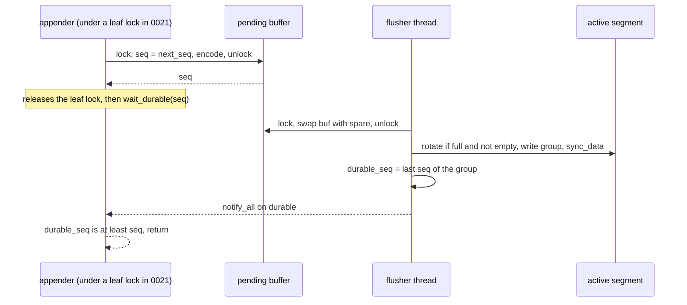
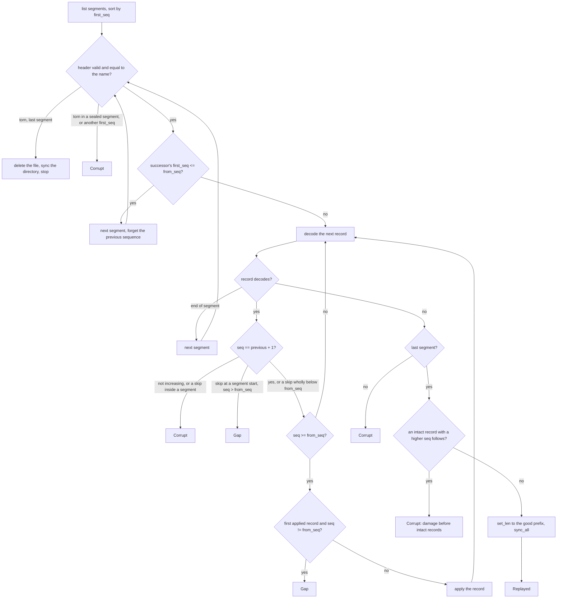

# Engine: write-ahead log

This document records the design of the embedded engine component. This
first version covers only the write-ahead log (WAL): its place in the
component, the on-disk format, sequences, the write path and group commit,
replay, truncation, shutdown, errors, and what is guaranteed today, with the
test that backs each guarantee. [Plan 0021](../plans/0021-engine-db.md)
adds the `Db` and its sections.

[Plan 0020](../plans/0020-engine-wal.md) built the WAL. Related documents:
[architecture](architecture.md) (components and phases),
[persistence](bf-tree-persistence.md#logs-and-sequenced-writes) (the tree's
`Log` contract, which the WAL serves through an adapter in plan 0021), and
[build system](build-system.md) (Buck2 visibility).

The code is in `crates/engine-wal/src/`: `lib.rs` (`Wal`, `Op`, `Record`,
`WalError`), `record.rs` (record and segment-header encoding), `segment.rs`
(naming, listing, directory sync), `replay.rs` (`Wal::replay`, `Replayed`),
and `flusher.rs` (`WalOptions`, `open`, appends, the flusher thread,
durability waits, truncation, `close`, `abandon`). The tests are in
`crates/engine-wal/src/tests/` (`record.rs`, `replay.rs`, `writer.rs`,
`lifecycle.rs`).

## Terms

- **Sequence:** a `u64` that the WAL assigns to each record. The first
  sequence is 1. Sequences are contiguous: each record's sequence is one
  more than the previous record's.
- **Segment:** one WAL file. It holds a header and then records.
- **Active segment:** the last segment. Only the flusher appends to it.
- **Sealed segment:** any segment except the last. It does not change.
- **Group:** the records that the flusher writes and syncs with one
  `sync_data` call.
- **Durable:** a record is durable when the flusher has synced its group.
  `durable_seq` is the highest durable sequence.
- **Torn tail:** bytes at the end of the active segment that a crash left
  as an incomplete or damaged record.

## Place in the engine component

The engine component will have one entry crate, `engine` (plan 0021), and
internal crates. `engine-wal` is the first internal crate:

```python
# crates/engine-wal/BUCK
peppy_rust_library(
    name = "engine-wal",
    deps = [
        "//third-party/rust:crc32c",
        "//third-party/rust:thiserror",
    ],
    test_deps = ["//third-party/rust:tempfile"],
    visibility = ["//crates/engine:"],
)
```

- **Visibility.** Only the `//crates/engine` package may depend on
  `engine-wal`. Buck2 accepts the pattern before the package exists.
- **No `bf-tree` dependency.** The WAL knows sequences, operations, and
  bytes, not trees. It is testable without a tree and cannot reach into tree
  internals. The CRC32C comes from the third-party `crc32c` crate, the same
  source that plan 0017 chose for the store, not from a `bf-tree` crate.
- **Its own `Op` type.** `engine_wal::Op` mirrors `bf_tree::Op`. Plan 0021
  converts between them by copying two slice references. Code in `engine`
  names the crate (`engine_wal::Op`); neither type is re-exported under the
  other's name.

```rust
/// One logged change. Keys and values borrow the caller's bytes.
#[derive(Clone, Copy, Debug, PartialEq, Eq)]
pub enum Op<'a> {
    Put { key: &'a [u8], value: &'a [u8] },
    Delete { key: &'a [u8] },
}

/// A decoded record: one sequence and the operations it carries.
/// A single write has one operation; a batch has zero or more.
#[derive(Debug, PartialEq, Eq)]
pub struct Record<'a> {
    pub seq: u64,
    pub ops: Vec<Op<'a>>,
}
```

The WAL is the sequence source in standalone mode. The tree accepts the
WAL's sequences through its `Log` contract and `Tree::apply`, so the WAL
and the tree share one sequence space
([persistence](bf-tree-persistence.md#logs-and-sequenced-writes)).

## On-disk format

```text
<dir>/
  00000000000000000001.wal    segments named {first_seq:020}.wal
  00000000000000012034.wal    the last segment is the active one

segment header, 32 bytes:
  magic "PEPPYWAL" (8) | version u32 = 1 | reserved u32 = 0
  | first_seq u64 | header_crc u32 (crc32c of bytes 0..24) | zero (4)

record:
  len u32 | crc u32 | seq u64 | kind u8 | payload
  len = byte count of seq + kind + payload, at least 9
  crc = crc32c(len bytes ‖ seq ‖ kind ‖ payload)

payload by kind:
  0 Put     key_len u32 | value_len u32 | key | value
  1 Delete  key_len u32 | key
  2 Batch   count u32 | count × (kind u8 (0 or 1) | Put or Delete payload)
```

All integers are little-endian.

### Segment files

A segment's name is the sequence of its first record, as 20 decimal digits
with the suffix `.wal`. The directory listing is the index; there is no
manifest. The listing ignores every other file name, including names with a
different digit count. A sorted listing gives segments in log order.

The header carries `first_seq` again. `decode_header` checks, in this order,
the length (32 bytes), the magic, the header CRC32C over bytes 0..24, and
the version. Replay also checks that the header's `first_seq` equals the
name.

### Records

Each record starts with an 8-byte prefix, `len` and `crc`, followed by a
body of `len` bytes: `seq`, `kind`, and the payload. Key and value lengths
are `u32`, so the format does not depend on the tree's limits; the engine
validates those limits before it appends (plan 0021).

The decoder returns a record only if all of these hold:

- `len` is at least 9 (`seq` and `kind`) and at most `MAX_RECORD_BYTES`.
- The whole body is present.
- The CRC32C over the four `len` bytes and the body matches `crc`.
- `kind` is 0, 1, or 2. A batch entry's kind is 0 or 1: a batch must not
  nest a batch.
- The payload consumes exactly `len - 9` bytes: no trailing bytes.

A batch's `count` is checked against the remaining bytes (each operation
takes at least 5 bytes) before the decoder allocates, so a damaged count
cannot cause a large allocation.

**Why `len` is inside the checksum and has a lower bound.** Some file
systems leave zero-filled bytes at the end of a file after a crash. A run of
zeros has `len = 0` and `crc = 0`, and the CRC32C of an empty input is 0.
Without the lower bound and without `len` inside the checksum, such a run
would decode as a record. Either defence alone rejects it. Both are cheap,
so both are kept.

### Size limit

`MAX_RECORD_BYTES` is 16 MiB (`16 << 20`). It bounds `len`, the body of
**one record**: a put, a delete, or a whole batch. It does not bound a
segment file. The limit has two purposes:

- The decoder rejects garbage lengths in a torn tail.
- It bounds the memory that the pending buffer and replay hold for one
  record.

`append` and `append_batch` compute the encoded size before they take a
sequence. A record whose body exceeds the limit returns
`WalError::RecordTooLarge { bytes }`, where `bytes` is the encoded size
including the 8-byte prefix. With the tree's default limits, 16 MiB is about
15,000 maximum-size operations in one batch; larger bulk loads use several
batches.

## Sequences

`append` assigns the next sequence under the `pending` mutex and encodes the
record in the same critical section. Therefore the order of records in the
pending buffer equals sequence order, and sequences are contiguous. A batch
is one record and takes one sequence. A rejected record (too large, or the
WAL closed or failed) takes no sequence.

`Wal::open(dir, options, next_seq)` starts the sequence at `next_seq`
(sequences start at 1, so 0 means 1; `replay` treats a `from_seq` of 0
the same way).
Plan 0021 passes `max(applied, last replayed) + 1`. `last_seq()` returns the
highest assigned sequence and `durable_seq()` the highest durable one; both
start at `next_seq - 1`.

## Write path and group commit

```rust
pub struct WalOptions {
    /// Wait this long after the first pending append before writing.
    /// Zero (the default) writes as soon as the previous sync ends.
    pub flush_interval: Duration,
    /// Seal the active segment once it holds at least this many bytes.
    /// A segment may exceed it by one group. Default 64 MiB.
    pub segment_bytes: u64,
}

impl Wal {
    pub fn open(dir: &Path, options: WalOptions, next_seq: u64) -> Result<Wal, WalError>;
    pub fn append(&self, op: Op<'_>) -> Result<u64, WalError>;
    pub fn append_batch(&self, ops: &[Op<'_>]) -> Result<u64, WalError>;
    pub fn wait_durable(&self, seq: u64) -> Result<(), WalError>;
    pub fn sync_to(&self, seq: u64) -> Result<(), WalError>;
    pub fn durable_seq(&self) -> u64;
    pub fn last_seq(&self) -> u64;
    pub fn appended_bytes(&self) -> u64;
    pub fn truncate_below(&self, applied: u64) -> Result<usize, WalError>;
    pub fn close(&self) -> Result<(), WalError>;
    pub fn abandon(self, written: usize);
}
```

An append does no I/O. It copies the encoded record into the pending buffer,
so it is safe to call under a tree leaf lock. The caller then waits for
durability outside the lock. One flusher thread, named `wal-flusher`, writes
and syncs the buffer.



### The flusher loop

1. Lock `pending`. If the state is `Abandoned`, or the buffer is empty and
   the state is `Closing`, exit. If the buffer is empty, wait on `wake`.
2. If `flush_interval` is positive, the state is `Open`, and `force_to` is
   below the buffer's last sequence, wait on `wake` until
   `first_pending_at + flush_interval`. Then repeat step 1's checks.
3. Swap the buffer with a reusable spare `Vec`. Note the group's first and
   last sequences, clear `first_pending_at`, and unlock. Appenders continue
   into the empty buffer.
4. If the active segment holds at least one group and holds at least
   `segment_bytes` bytes, create the next segment, named by the group's
   first sequence. The old segment is already synced, so it is sealed with
   no torn tail. A group never spans two segments.
5. `write_all` the group, then `sync_data`. On an error, record the failure
   (see [Errors](#errors)), wake every waiter, and exit.
6. Store `durable_seq`, take and release `durable_lock`, and `notify_all`
   on `durable`.
7. Clear the spare buffer. If its capacity exceeds 4 MiB (`SPARE_LIMIT`),
   replace it with a new empty `Vec`, so that a burst does not pin memory.

**An empty segment is never sealed.** Step 4 requires the active segment to
hold at least one group. Without that condition, a `segment_bytes` below the
header size made the first group after `open` rotate out of the fresh,
header-only segment. The new segment had the same name (the group's first
sequence), and `create_new` failed.

Every waiter whose record is in the group shares one fsync. Appends that
arrive during the fsync form the next group. This is group commit without a
timer.

**Why the default interval is zero.** A positive interval adds its whole
length to the latency of every write. Under concurrency the groups form
anyway, during the previous fsync. An interval helps only when fsync is so
cheap that groups stay small. The option stays for such devices. Plan 0023
measures both settings.

### Waiting and lock rules

`wait_durable(seq)` reads `durable_seq` first, with no lock on the fast
path. Otherwise it locks `durable_lock` and loops: it returns `Ok` if
`durable_seq >= seq`, `WalError::Failed` if the flusher failed, and
`WalError::Closed` if the flusher stopped. Otherwise it waits on `durable`
with no timeout. The flusher stores `durable_seq` (or the failure and the
stop flag) before it takes `durable_lock`, so no wakeup is lost.

The lock rules:

- Appenders and the flusher share `pending`. The flusher waits on `wake`,
  paired with `pending`.
- Durability waiters use only `durable_lock` and `durable`. They never
  touch `pending`, which keeps the appenders' critical section short.
- Nothing holds `pending` while it waits on `durable`, and nothing holds
  `durable_lock` while it takes `pending`.

### `sync_to`

`sync_to(seq)` makes every record up to `seq` durable now. It clamps `seq`
to `last_seq()`, raises `force_to` with `fetch_max`, takes and releases
`pending` (so the flusher cannot miss the wakeup between its check and its
wait), wakes the flusher, and then waits like `wait_durable`. The flusher
skips the interval wait when `force_to` covers the buffer's last sequence.
Plan 0021 calls `sync_to` from the checkpoint's pre-commit hook.

### Segment creation

`create` opens the file with `create_new`, writes the header, calls
`sync_all`, and syncs the directory. Therefore a segment that later holds
durable records also has a durable directory entry. Both `open` and
rotation use `create`.

### Opening

`Wal::open(dir, options, next_seq)`:

1. Creates `dir` if it is absent.
2. If the last segment holds no more than a header, deletes it and syncs
   the directory. Such a segment holds nothing, for example after a crash
   right after `open` or a rotation. `open` replaces it whatever its name.
3. Creates a new segment named `next_seq` and starts the flusher.

The caller must run `Wal::replay` first, so that a torn tail is repaired
before the new segment seals the old last segment.

### `appended_bytes`

`appended_bytes()` counts the encoded bytes of every record appended since
`open`, prefixes included, segment headers excluded. Plan 0021's checkpoint
policy compares it with its value at the last checkpoint.

## Replay

```rust
pub struct Replayed {
    /// Highest sequence in the log after repair, replayed or not.
    pub last_seq: Option<u64>,
    /// Records passed to `apply`.
    pub records: u64,
    /// Bytes removed from the end of the last segment.
    pub truncated_bytes: u64,
}

impl Wal {
    /// Pass every record with `seq >= from_seq` to `apply`, in order.
    /// Repairs a torn tail in the last segment. Must run before `open`.
    pub fn replay<E: From<WalError>>(
        dir: &Path,
        from_seq: u64,
        apply: impl FnMut(Record<'_>) -> Result<(), E>,
    ) -> Result<Replayed, E>;
}
```

An absent or empty directory replays nothing. Replay reads each segment
file whole and decodes it in memory.



The rules and their reasons:

- **Torn tails only in the last segment.** The flusher rotates only after
  the previous group synced, so a sealed segment cannot end in a partial
  write. Any undecodable record in a sealed segment is damage:
  `WalError::Corrupt`.
- **A tail is a tail only if nothing intact follows.** After the first bad
  record in the last segment, replay scans every later byte offset for an
  intact record with a sequence above the last good one. If it finds one,
  the damage is in the middle of acknowledged data, and a truncation would
  silently drop that data. Replay returns `Corrupt` instead. Garbage and
  zero runs after the good records are a tail.
- **Repairs are synced before anything follows them.** `set_len` is
  followed by `sync_all` before `replay` returns. `open` then creates a new
  segment, which seals the repaired one. Without the sync, a crash could
  leave the torn bytes in what is now a sealed segment, and the next replay
  would fail with `Corrupt`.
- **A torn header in the last segment is deleted.** A header that does not
  decode in the last segment means a crash during segment creation, so the
  segment holds nothing durable. Replay deletes the file, syncs the
  directory, and stops. In a sealed segment, an undecodable header is
  `Corrupt`. A header whose `first_seq` differs from the file name is
  `Corrupt` in any segment.
- **Contiguity.** The first record that replay reads after a skipped
  segment, or at the start of the log, must have a sequence at or above its
  segment's name. Every other record must be exactly one more than the
  previous record. A repeated or decreasing sequence is `Corrupt`, in a
  segment or across a boundary. A skip inside a segment is `Corrupt`. A skip
  at a segment boundary means a missing segment: it is
  `WalError::Gap { expected, found }` if `found > from_seq`, and accepted
  if the missing records are all below `from_seq`. Also, the first record
  passed to `apply` must be exactly `from_seq`; otherwise replay returns
  `Gap { expected: from_seq, found }`. The WAL assigns sequences with no
  gaps, so a gap can only mean lost data; strictness turns silent loss into
  an error. If `from_seq` is above every record, replay applies nothing and
  succeeds.
- **Skipping old segments.** A segment whose successor's `first_seq` is at
  or below `from_seq` holds only records that the checkpoint covers. Replay
  checks its header and does not decode its records, so damage in them does
  not matter. Such segments normally exist only when a deletion by
  `truncate_below` did not reach the disk before a crash. The last segment
  is never skipped.

`Replayed::last_seq` includes records below `from_seq` that replay decoded,
so plan 0021 can compute `next_seq` from it.

## Truncation

```rust
/// Delete every sealed segment whose successor's first_seq <= applied + 1.
/// Such a segment holds only records at or below `applied`.
/// The last (active) segment is never deleted. Returns the count deleted.
pub fn truncate_below(&self, applied: u64) -> Result<usize, WalError>;
```

`truncate_below` lists the directory and walks adjacent pairs from the
oldest. It deletes a segment if its successor starts at or below
`applied + 1`, and stops at the first segment that does not qualify. The
last segment in the listing has no successor, so it is never deleted. A
`NotFound` error is ignored, so concurrent calls (for example, a manual and
a background checkpoint) are safe. The caller must pass a sequence that a
committed checkpoint covers.

`truncate_below` does not sync the directory. A deletion that does not
survive a crash leaves a redundant segment, which replay skips and the next
truncation deletes.

## Close, `Drop`, and `abandon`

- **`close(&self)`** changes the state from `Open` to `Closing`, wakes the
  flusher, and joins it. With the state `Closing`, the flusher skips the
  interval wait and drains the buffer before it exits, so every appended
  record becomes durable. An append checks the state again under the
  `pending` mutex, so `close` drains every append that it does not reject.
  Later appends return `WalError::Closed`. `close` returns the flusher's
  original error once; a later `close` returns `Ok`.
- **`Drop`** calls `close` and ignores its result.
- **`abandon(self, written)`** simulates a crash. It sets the state to
  `Abandoned` and joins the flusher, which exits after any group already in
  flight. It then writes the first `written` bytes of the pending buffer to
  the active segment, **without** a sync, and drops the rest. Waiters for
  records that were never reported durable receive `WalError::Closed`. If
  the flusher had failed, it returned no segment, and `abandon` writes
  nothing.

**Why `abandon` exists.** Dropping a `Wal` drains it. A test that only drops
a database therefore never loses unsynced log bytes, and never exercises the
case that the WAL exists for. `abandon` loses the pending records, and
`written` produces a torn record at any byte offset. It covers a process
crash exactly. A power loss can also lose bytes that were written but not
synced. Such bytes belong to a group whose waiters were never woken, so
`abandon` with a partial `written` covers that case too.

**Why `abandon` is public.** The engine's crash tests are in another crate
(`engine`), and `cfg(test)` does not cross crates. Buck2 visibility limits
the crate, and so `abandon`, to `//crates/engine:`. Its documentation states
that production code calls `close`. The other test hooks (a sync counter
and a sync-fault injector) stay crate-private.

## Errors

```rust
#[derive(Debug, thiserror::Error)]
pub enum WalError {
    #[error("WAL I/O error during {op}: {source}")]
    Io { op: &'static str, #[source] source: std::io::Error },
    #[error("WAL segment {segment} is corrupt at offset {offset}: {reason}")]
    Corrupt { segment: u64, offset: u64, reason: &'static str },
    #[error("WAL is missing records: expected sequence {expected}, found {found}")]
    Gap { expected: u64, found: u64 },
    #[error("WAL record of {bytes} bytes exceeds the limit")]
    RecordTooLarge { bytes: usize },
    #[error("the WAL flusher stopped after an error during {op}: {kind}")]
    Failed { op: &'static str, kind: std::io::ErrorKind },
    #[error("the WAL is closed")]
    Closed,
}
```

- `Corrupt::segment` is the segment's first sequence (its name), and
  `offset` is a byte offset in that file.
- **`Failed` carries only `Copy` data:** an operation name and an
  `io::ErrorKind`. `io::Error` is not `Clone`, so the WAL stores the pair
  once and builds a `Failed` for every caller. The original `Io` error is
  stored separately, and `close` returns it once.
- **Failure is sticky.** After a write, sync, or segment-creation error,
  the flusher exits. No later record can become durable, so every later
  `append`, `append_batch`, `sync_to`, and `wait_durable` for a record that
  was not already durable returns `Failed`. The WAL must be closed and
  reopened, with a replay, to continue.
- `WalError` is the WAL's own type. Plan 0021 wraps it in the tree's
  `LogError` at the `Log` boundary and unwraps it again in
  `engine::Error::Wal`.

## Guarantees

Test paths are relative to `crates/engine-wal/src/tests/`.

| Guarantee | Tests |
| --- | --- |
| The CRC32C matches the RFC 3720 §B.4 check value. | `record.rs`: `crc32c_matches_the_rfc_3720_check_value` |
| Every record kind round-trips, including empty keys and values, an empty batch, and a 5000-byte value. Records decode one after another. | `record.rs`: `every_kind_round_trips` |
| Every cut and every single-bit flip of a record fails to decode. | `record.rs`: `every_cut_and_every_bit_flip_fails_to_decode` |
| `len` of 0, 8, `u32::MAX`, and `MAX_RECORD_BYTES + 1` fails, as do 64 zero bytes, a nested batch, trailing payload bytes, and an unknown kind, even with a correct checksum. | `record.rs`: `bad_lengths_zeros_nesting_and_trailing_bytes_fail` |
| A segment header round-trips; bad magic, a bad checksum, an unknown version, and a short header are rejected. | `record.rs`: `segment_headers_round_trip_and_reject_damage` |
| Replay passes records in order from the start or from the middle, and nothing past the end. | `replay.rs`: `replays_from_the_start_and_from_the_middle` |
| A torn tail at every byte offset of the last record is cut from the file, and a second replay sees a clean log. Zero and garbage tails are tails. | `replay.rs`: `a_torn_tail_at_every_offset_is_cut_and_synced`, `garbage_and_zeros_after_good_records_are_a_tail` |
| Damage in the last segment that an intact record follows is `Corrupt`. | `replay.rs`: `damage_before_intact_records_of_the_last_segment_is_corrupt` |
| Any damage in a sealed segment, including a partial last record, is `Corrupt`. | `replay.rs`: `any_damage_in_a_sealed_segment_is_corrupt` |
| A duplicated, decreasing, or skipping sequence is `Corrupt`, in a segment and across a boundary. | `replay.rs`: `duplicated_or_decreasing_sequences_are_corrupt` |
| A missing segment is `Gap` unless it is wholly below `from_seq`; a log that starts above `from_seq` is `Gap`. | `replay.rs`: `a_missing_segment_is_a_gap_unless_wholly_below_from_seq` |
| Old segments are skipped after a header check; a header that names another sequence is `Corrupt`. | `replay.rs`: `old_segments_are_skipped_and_header_mismatches_are_corrupt` |
| A torn header deletes the last segment, and only the last one. | `replay.rs`: `a_torn_header_deletes_the_last_segment_only` |
| Empty and absent directories replay nothing; other files are ignored. | `replay.rs`: `empty_and_absent_directories_replay_nothing` |
| Appends round-trip through `close` and replay with an interval of 0 and of 10 ms. | `writer.rs`: `appends_round_trip_through_close_and_replay` |
| `sync_to` returns well before a 1 s flush interval elapses. | `writer.rs`: `sync_to_skips_a_long_flush_interval` |
| Segments rotate and are named by their first sequence. | `writer.rs`: `segments_rotate_and_are_named_by_their_first_sequence` |
| Appends after `close` return `Closed`. | `writer.rs`: `appends_after_close_are_rejected` |
| An oversized batch takes no sequence; the largest record that fits is accepted. | `writer.rs`: `an_oversized_batch_takes_no_sequence` |
| Reopening continues the log, and a header-only last segment is replaced. | `writer.rs`: `reopening_continues_the_log` |
| Truncation deletes exactly the redundant sealed segments, never the last one. With `segment_bytes = 1`, each segment holds one record, which also exercises "an empty segment is never sealed". | `lifecycle.rs`: `truncation_deletes_exactly_the_redundant_sealed_segments` |
| Concurrent truncations succeed and leave exactly the needed segments. | `lifecycle.rs`: `concurrent_truncations_succeed` |
| Eight appenders of 400 records each get 3200 distinct, contiguous sequences, share syncs (fewer syncs than records), and replay in sequence order. | `lifecycle.rs`: `eight_appenders_get_contiguous_sequences_and_share_syncs` |
| `abandon(0)` loses exactly the records never reported durable. | `lifecycle.rs`: `abandon_loses_only_records_never_reported_durable` |
| `abandon` at every byte of a record leaves a tail that replay repairs. | `lifecycle.rs`: `abandon_at_every_byte_of_a_record_leaves_a_repairable_tail` |
| A flusher failure is sticky: waiters, appends, and `sync_to` return `Failed`, and `close` returns the original `Io` error once. | `lifecycle.rs`: `a_flusher_failure_is_sticky` |
| `appended_bytes` counts every record. | `lifecycle.rs`: `appended_bytes_count_every_record` |

Some properties are not observable in these tests and rest on the code
alone: that `replay` syncs its repair (the test checks the file length, not
the sync), and that segment creation syncs the file and the directory.

## Not yet guaranteed, and limits

- **A segment may exceed `segment_bytes` by one group.** Rotation happens
  before a group, never inside one.
- **Truncation deletions are not synced.** A crash can bring a deleted
  segment back. Replay skips it, and the next truncation deletes it again.
- **Concurrent truncation counts may overlap.** Two `unlink` calls on one
  path both succeeded on macOS (APFS), so the counts that concurrent calls
  return can add up to more than the number of segments removed. Only the
  surviving set of segments is exact.
- **A CRC32C collision could hide damage.** The forward scan after a bad
  record in the last segment treats bytes as an intact record only if their
  checksum matches. A collision could make damage look like a tail, or a
  tail look like damage. A false match needs a CRC32C collision.
- **The forward scan's cost has no tight bound.** It tries to decode at
  every byte offset after the tear. Usually the tail is one partial group.
  A long tail of random bytes could make each attempt checksum up to
  `MAX_RECORD_BYTES`.
- **A `Failed` record may still be in the log.** When `sync_data` fails
  after `write_all` succeeded, the group's bytes can reach the disk. A
  record whose wait returned `Failed` was never acknowledged, but replay can
  still find it.
- **`open` does not validate `next_seq`.** The caller must pass one more
  than both the highest replayed sequence and the tree's applied sequence,
  and must replay first. Sequences start at 1.
- **Replay holds one segment in memory.** It reads each segment file whole,
  including the segments it skips after the header check.
- **No backpressure.** The pending buffer grows without a limit if
  appenders outpace the device.

## Extension points

- **Plan 0021** wraps `Wal` in a local adapter that implements
  `bf_tree::Log`. `Db::open` calls `replay` and then `open`. Writes call
  `wait_durable`; the checkpoint hook calls `sync_to`; checkpoints call
  `truncate_below`; the checkpoint policy reads `appended_bytes` and
  `last_seq`; crash tests call `abandon`. None of these need a change to
  the WAL.
- **Plan 0022** (external-log mode) does not use the WAL.
- **Plan 0023** measures append cost, group sizes, interval settings, and
  replay rate. Possible additions, each additive: segment preallocation
  (the decoder already treats zeros as a torn tail; preallocation would make
  zeros after the last record the normal end of a segment), a group-size
  metric, and a backpressure limit on the pending buffer.
- **Phase 2** may ship WAL records to followers. `Record` and `replay`
  already expose decoded entries with sequences; a streaming reader over
  sealed segments would be a new function, not a format change.
- Later plans must not need to change the record format, the naming
  scheme, or the replay rules.

## Relationship to sources

- The [BF-Tree paper](../references.md#bf-tree-paper), §5.7, covers logging
  and recovery. The paper's evaluation disables logging (§6.1), so it gives
  no WAL design to follow in detail.
- The [Microsoft implementation](../references.md#microsoft-bf-tree-implementation)
  at `f442e6172bf7e5483ff320d8e3ac16a70e31bbd6`,
  [`src/wal/mod.rs`](https://github.com/microsoft/bf-tree/blob/f442e6172bf7e5483ff320d8e3ac16a70e31bbd6/src/wal/mod.rs)
  (`append_and_wait`, the group-commit shape) and `src/wal/operations.rs`,
  informed the write path. The peppydb-specific choices are recorded above:
  one dedicated flusher thread, records encoded under the pending mutex
  with their sequence, a separate condition variable for durability
  waiters, and no timer by default.
- The [RocksDB overview](../references.md#rocksdb-overview) describes the
  write-ahead log's role in an embedded engine.
- RFC 3720 (iSCSI), §B.4, gives the CRC32C check value
  `crc32c(b"123456789") == 0xE306_9283`.
