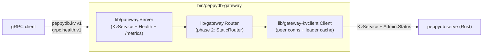

# Gateway and linearizability harness

This document records the design of the Go gateway component (`lib/gateway`,
`lib/gateway-kvclient`, `bin/peppydb-gateway`) and the Porcupine-based
linearizability harness (`lib/lincheck`). [Plan 0033](../plans/0033-server-gateway.md)
built them as milestone S3 of the [server roadmap](../plans/0025-server-roadmap.md).

Related documents: [architecture](architecture.md) (phases and code layout),
[server](server.md) (`peppydb.kv.v1`, `LeaderHint`, `AdminService.Status`),
[server Raft](server-raft.md) (`ProposeError::NotLeader` vs `OutcomeUnknown`),
[build system](build-system.md) (Go packages, visibility, `gobuckify-remote`).

## Components and boundaries

| Path | Role | Visible to |
| --- | --- | --- |
| `lib/gateway-kvclient` (`package kvclient`) | Internal Raft-group client: persistent peer connections, `LeaderDiscovery`, `SetLeader`, `LeaderHint` decoding, and linearizability-safe retry rules | `//lib/gateway:` |
| `lib/gateway` (`package gateway`) | Entry package: `Router`, `StaticRouter`, `Server` (`KvService` + `grpc.health.v1.Health`), and Prometheus `/metrics` | `//bin/peppydb-gateway:` |
| `bin/peppydb-gateway` | Thin CLI wrapper (`--listen`, `--backends`, `--metrics-listen`, timeouts, graceful shutdown) | `//lib/lincheck:` (for Buck2 tests) |
| `lib/lincheck` (`package lincheck`) | Reusable Porcupine single-key KV model, unknown-outcome recorder, concurrent workload runner, and multi-process Rust/Go cluster harness | `PUBLIC` |

The gateway is purely data-plane: it serves `peppydb.kv.v1.KvService` and
`grpc.health.v1.Health`. Node-local `AdminService` RPCs (`Status`,
`Checkpoint`, `Snapshot`) remain direct-to-node and move to the phase 3
placement/control plane.

## Leader discovery and `LeaderHint` wire format

`kvclient.Client` tracks one Raft group's leader through two mechanisms:

1. **Pluggable `LeaderDiscovery` + `SetLeader`:** When the cached leader
   address is empty or invalidated, `Client` runs a coalesced `Discover(ctx)`
   call (concurrent callers share one in-flight probe). In phase 2, the default
   discovery queries `AdminService.Status` across known peers. In phase 3, a
   placement-driver watcher can supply the discovery source and push updates
   via `Client.SetLeader(addr)`.
2. **Immediate `LeaderHint` self-correction:** Even with an etcd-backed
   placement cache in phase 3, leader leases lag Raft elections slightly.
   Non-leader `peppydb` nodes attach `peppydb.kv.v1.LeaderHint` inside a
   standard `google.rpc.Status` envelope (`google.protobuf.Any` with type URL
   `type.googleapis.com/peppydb.kv.v1.LeaderHint`) in `grpc-status-details-bin`.
   `kvclient.ExtractLeaderHint` decodes `*kvv1.LeaderHint` through standard
   `status.FromError(err).Details()`.

## Retry and linearizability guarantees

`peppydb` separates safe non-leader rejections (`ProposeError::NotLeader(hint)`,
where openraft never appended an entry) from unknown outcomes
(`ProposeError::OutcomeUnknown`, transport resets, or `SIGKILL`).
`kvclient.Client` enforces asymmetric retry rules:

| RPC kind | `UNAVAILABLE` with `LeaderHint` | `UNAVAILABLE` without `LeaderHint` | Other status |
| --- | --- | --- | --- |
| Read (`Get`, `Scan`) | Update cached leader and retry (up to `MaxRedirects`) | Invalidate cache, back off, probe, and retry (up to `MaxReadRetries`) | Return immediately |
| Write (`Put`, `Delete`) | Update cached leader and retry (up to `MaxRedirects`) | Invalidate cache, trigger background probe, and return `UNAVAILABLE` | Return immediately |

**Invariant:** The gateway must never retry a write that failed without a
`LeaderHint`. Without client session deduplication (Raft dissertation §6.3),
retrying an unknown-outcome write can apply it a second time after an
intervening concurrent write to the same key, violating linearizability.

## Metrics

When `--metrics-listen <ADDR>` is set, `peppydb-gateway` exposes Prometheus
metrics on `GET /metrics` (404 on other paths) via `prometheus/client_golang`
on an isolated registry:

- Go runtime (`go_*`) and process (`process_*`) collectors;
- `peppydb_gateway_rpc_requests_total{method,code}`;
- `peppydb_gateway_rpc_duration_seconds{method}` (16 buckets from 100 µs to 10 s, matching `peppydb serve`);
- `peppydb_gateway_inflight_requests`;
- `peppydb_gateway_leader_redirects_total`, `peppydb_gateway_read_retries_total`, `peppydb_gateway_leader_probes_total`;
- `peppydb_gateway_process_uptime_seconds`.

Buck2 Go targets that link `prometheus/client_golang` set `cgo_enabled = False`
so Buck2 builds match `tools/gobuckify-remote`'s `CGO_ENABLED=0` dependency
graph on macOS (avoiding `prometheus`'s Darwin cgo memory collector `.c` file).

## Linearizability harness (`lib/lincheck`)

`lib/lincheck` checks client-visible linearizability with
[Porcupine](https://github.com/anishathalye/porcupine):

- **Model:** Single-key `Get`, `Put`, and `Delete` partitioned by key.
  Empty values (`Value != nil && len == 0`) are distinguished from absent keys
  (`Value == nil`). Range scans are tested separately because `kv.proto` does
  not guarantee linearizability across storage leaves or scan pages.
- **Unknown-outcome writes:** Failed `Get` RPCs and `INVALID_ARGUMENT` writes
  are omitted. Writes ending in `UNAVAILABLE`, `DEADLINE_EXCEEDED`, `CANCELLED`,
  or `INTERNAL` retain their `Call` timestamp and are normalized to
  `Return = maxCompletedReturn + 1` before calling Porcupine. Porcupine can
  linearize an applied unknown write at any point after `Call`, or place an
  unapplied unknown write after every observation in the history.
- **Cross-language Buck2 execution:** `//lib/lincheck:lincheck-test` injects
  `PEPPYDB_BIN` and `PEPPYDB_GATEWAY_BIN` via Buck2 `$(location ...)`, so
  `tools/buck2 test //lib/lincheck/...` compiles and spawns real Rust `peppydb`
  clusters alongside Go `peppydb-gateway` processes. Under plain `go test ./...`,
  process-spawning tests skip when `PEPPYDB_BIN` is unset while unit and
  negative oracle tests always run.

## GCP benchmarking (`gateway-perf`)

`tools/gcp-bench run --suite gateway-perf` runs a 5-VM topology in one
`us-east1` zone (`# mode: cluster`, `# nodes: 3`, `# gateway: true`): three
`c4d-standard-8-lssd` `peppydb` server VMs (`server-1..3`), one `n4-standard-8`
`peppydb-gateway` VM (`gateway`), and one `n4-standard-8` `peppydb-load` client
VM (`client`). The client drives `$GATEWAY_ADDR` and scrapes `/metrics` from
`gateway` and all three servers after every step, isolating gateway proxy
overhead and Go runtime behavior against direct `cluster-perf` runs
([remote benchmarks](remote-benchmarks.md)).

### Measurements

Informational, not gates. Run `20261124-202338-0f632d90` (2026-11-24,
revision `0f632d90`: the top of the `server-membership` stack before it was rebased onto `main`, with the same tree as after the rebase, `@build/mode/release`) against a direct `cluster-perf` run
of the same revision a few minutes earlier (`20261124-201721-0f632d90`).
Same workload as the [server measurements](server.md#measurements):
8-byte keys, 16-byte values, 100,000 keys, 2 s warmup, 10 s per step,
4 client connections.

| Workload | Concurrency | Direct ops/s | Via gateway ops/s | p50 direct / via gateway | p99 direct / via gateway |
| --- | --- | --- | --- | --- | --- |
| put | 1 | 2,746 | 1,593 (0.58x) | 360 / 623 µs | 557 / 885 µs |
| put | 16 | 24,821 | 17,221 (0.69x) | 557 / 819 µs | 1.0 / 1.8 ms |
| put | 64 | 50,471 | 32,644 (0.65x) | 786 µs / 1.5 ms | 33.6 / 33.6 ms |
| put | 256 | 76,711 | 46,587 (0.61x) | 1.4 / 3.8 ms | 37.7 / 37.7 ms |
| get (uniform) | 64 | 114,728 | 45,575 (0.40x) | 459 µs / 1.4 ms | 1.5 / 3.1 ms |
| mixed 90% get, zipf 1.1: put | 64 | 10,601 | 4,519 (0.43x) | 655 µs / 1.6 ms | 1.6 / 3.3 ms |
| mixed 90% get, zipf 1.1: get | 64 | 95,347 | 40,663 (0.43x) | 475 µs / 1.4 ms | 1.5 / 3.0 ms |

Every step passed with no errors, no `LeaderHint` redirects, and no read
retries; the gateway probed for the leader once. The 32 ms put tails at
concurrency 64 and 256 come from the cluster's snapshots
([server Raft measurements](server-raft.md#three-server-vms-cluster-perf)).

- **The gateway adds about 260 µs with one writer:** the extra hop
  (client to gateway to leader) and the gateway's work on the request and
  the reply.
- **The gateway's CPU is the limit.** Throughput levels off at about
  45,000 to 47,000 requests a second whatever the operation, so reads lose
  the most (0.40x). From `process_cpu_seconds_total` between scrapes, the
  gateway spends about 90 to 130 µs of CPU per request, against about
  32 µs per RPC in the whole Rust server
  ([server CPU](server.md#linux-reference-separate-server-and-client-vms)).
  During `get` at concurrency 64 it used about 6.3 of its 8 vCPUs
  (4 cores with SMT).
- **The servers are not the limit.** The leader's handler times are the
  same or lower through the gateway (put at concurrency 64: 832 µs direct,
  752 µs via the gateway; get: 172 and 168 µs).
- **Each request allocates about 150 times, about 10 KB** (97.7 million
  allocations for 647,000 requests in the `get` step). With the default
  `GOGC=100` and a live heap of about 2 MB, the runtime runs about 230 GC
  cycles a second, so a background mark is nearly always running. GC
  pauses are short (median 0.14 ms).

**Where the cost comes from** (from the code; no profile yet). Each request
is a full `grpc-go` server receive plus a full `grpc-go` client call, each
with its own protobuf decode and encode; `grpc-go` allocates heavily on
both sides. The gateway's own code adds:

- a write lock on the client-wide `kvclient` mutex for every successful
  request: `doRead` and `doWrite` call `SetLeader(target)` on success,
  which takes `mu.Lock()` even when the leader has not changed, while
  `Leader()` and `connFor()` take the same mutex for reading;
- a new `KvServiceClient` stub per request (`kvClient`);
- `context.WithTimeout` per request and two Prometheus `WithLabelValues`
  lookups per request;
- one HTTP/2 connection per backend, so every request to the leader shares
  one connection.

The fixes belong to the post-phase-2 cleanup: a lock-free fast path (the
leader and its stub in an `atomic.Pointer`, updated only on change), cached
stubs and metric observers, a `GOGC`/`GOMEMLIMIT` setting, a small pool of
backend connections, an opt-in `pprof` endpoint to confirm the profile,
and, if still needed, forwarding payloads without re-encoding them.

## Extension points

- **S8 (done, plan 0034):** `lib/gateway-kvclient` learns dynamic voter
  addresses from `StatusResponse.voters`; `lib/lincheck` drives seeded
  multi-fault schedules (`SIGKILL`, restarts, snapshot catch-up, dynamic
  membership rotations, and Linux `iptables` partitions via `LINCHECK_IPTABLES=1`
  on Linux with `CAP_NET_ADMIN`) through `peppydb-gateway` and verifies strict
  linearizability with Porcupine.
- **Phase 3 (sharding):** Replaces `StaticRouter` with a placement-backed
  `Router` (e.g. `lib/gateway-placement`) that maps keys via μshard to p-shard
  and wires each p-shard's `kvclient.Client` to an etcd/placement-driver
  `LeaderDiscovery` + `SetLeader` watcher. `lib/gateway.Server` and
  `lib/gateway-kvclient` do not change shape.
