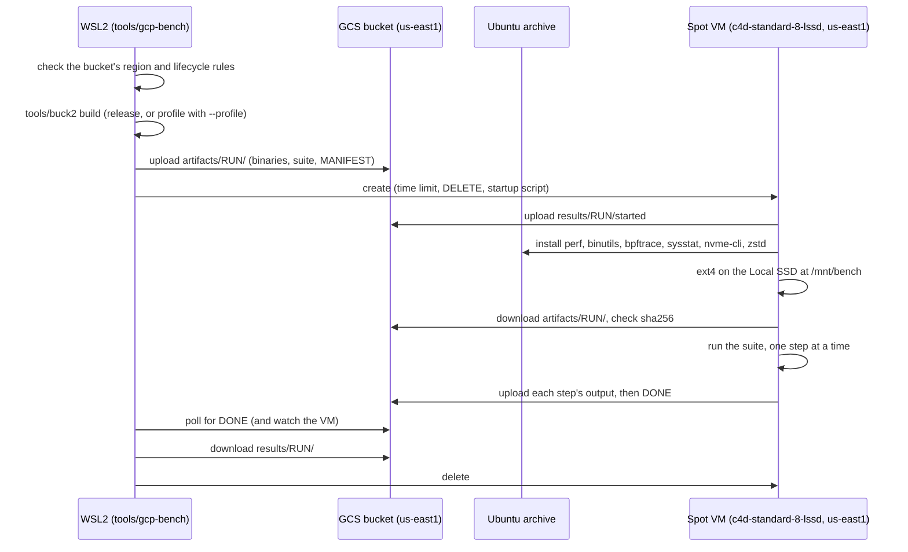

# Remote benchmarks and profiling

This document describes how peppydb runs benchmarks and profiles on
short-lived GCP virtual machines (VMs), and the guarantees of that process.
It was established by [plan 0024](../plans/0024-gcp-remote-bench.md). The
measurements it serves are defined in
[plan 0023](../plans/0023-bf-tree-io-perf.md#benchmarks).

## Purpose

Reference numbers must come from x86_64 Linux on real NVMe, not from a
virtual disk on a laptop. One command, `tools/gcp-bench run`, builds the
benchmarks locally, runs them on a Spot VM with a Local SSD, optionally
under profilers, downloads the results, and deletes the VM.

## Components

| Component | Runs on | Role |
| --- | --- | --- |
| `tools/gcp-bench` | The WSL2 development machine (x86_64 Ubuntu 24.04) | Builds with Buck2, stages and uploads artifacts, creates the VM, waits, downloads results, deletes the VM |
| `tools/gcp/remote-bench.sh` | The VM, as its startup script | Installs tools, prepares the Local SSD, downloads and checks artifacts, runs the suite, uploads results |
| `tools/gcp/suites/*.txt` | Data | The steps of a run: name, binary, arguments |
| `tools/gcp/targets.txt` | Data | Maps binary names to Buck2 targets |
| `tools/gcp/lifecycle.json` | The bucket | Retention rules |
| `tools/gcp/check-bucket.py` | Local | Checks the bucket's region and lifecycle rules |
| `tools/gcp/offcpu.bt`, `tools/gcp/fold-stacks.py` | The VM | Off-CPU profiling |
| `@build/mode/profile` | Local | Release flags plus debug line tables and frame pointers ([build system](build-system.md#build-modes-are-platforms)) |



## Guarantees

### What runs is what was built locally

- Every measured or profiled binary comes from the local Buck2 build. The
  VM refuses to run if any artifact's sha256 differs from `MANIFEST`.
- Only tools come from the internet: `linux-tools-$(uname -r)`, `binutils`,
  `bpftrace`, `sysstat`, `nvme-cli`, and `zstd`, from the Ubuntu archive. `perf`
  matches the running kernel because the package name uses `uname -r`.
  `env.txt` records the installed versions.
- `MANIFEST` records the source revision, whether the working copy had
  uncommitted changes, the `rustc` version, the build mode, the build host,
  the suite, and the profilers.
- The build host must be x86_64 Ubuntu 24.04, the same architecture and
  release (and therefore glibc) as the VM image. The driver refuses other
  hosts.

### No VM outlives its run

| Layer | Mechanism | Covers |
| --- | --- | --- |
| 1 | The driver deletes the VM after `DONE`, and in an `EXIT`/`INT`/`TERM` trap | Normal completion, Ctrl-C, driver errors |
| 2 | `--max-run-duration` with `--instance-termination-action=DELETE` on every create request (default 3 hours, `--max-run`) | The local machine sleeps, loses the network, or crashes |
| 3 | `tools/gcp-bench cleanup` deletes every instance labelled `peppydb-bench=1`, in any state, and every disk named `peppydb-bench-*` | Anything else; every run also lists leftovers |

- After creation, the driver reads the instance back and deletes it at
  once if the time limit or the `DELETE` action is missing.
- If a create call fails, the driver checks whether the instance exists
  anyway and deletes it.
- The boot disk is auto-deleted and the Local SSD belongs to the instance,
  so deleting the instance removes all compute and disk charges. GCS objects
  remain, under the retention rules.
- A stopped instance still bills for its boot disk, so the driver and
  `cleanup` delete instances in every state.
- Recommended: a billing budget with an alert on the project. A budget
  does not stop resources; it makes a leak visible.

### The wait always ends

On each poll (every 30 seconds) the driver checks GCS and the instance, and
stops at the first of:

| Condition | Driver action | Exit |
| --- | --- | --- |
| `results/RUN/DONE` exists | Download, delete, report `DONE` | 0, or 1 if a step failed |
| The instance is gone, without `DONE` | Download partial results; report a Spot preemption if the zone's operations show one | 3 |
| The instance is stopped, without `DONE` | Download partial results, delete | 3 |
| No `started` 15 minutes after creation | Save the serial port output, delete | 3 |
| `--max-run` plus 10 minutes have passed | Download partial results, delete | 3 |

The VM uploads each step's output when the step ends, so an early end
leaves partial results. After a reboot in the middle of a run, the startup
script writes a failed `DONE` instead of starting again.

### Comparable runs

- VMs run only in `us-east1` (zones `b`, `c`, `d`, tried in order on
  capacity errors), the bucket's region. `env.txt` records the zone and the
  CPU model; comparisons between runs must check both.
- The Local SSD gets a fresh ext4 file system, as in plan 0023's Docker
  runs. The startup script stops `unattended-upgrades`, the apt timers, and
  snap refreshes before anything else, so that they cannot run during a
  benchmark.
- Steps run one at a time with `--test-threads=1`.
- Benchmark thread counts follow `available_parallelism()`: at most 8 on
  `c4d-standard-8-lssd`, which is 8 SMT threads on 4 cores.
- Preflight steps run the direct-I/O tests on the Local SSD first. A
  preflight step fails if a test prints `skipped:`, because a direct-I/O
  test that finds no `O_DIRECT` support passes with that message. Every
  step fails if its filter matches no test.

## Results

### Labels

- Runs without `--profile` use `@build/mode/release`. Label their numbers
  "GCP c4d-standard-8-lssd, reference", with the zone, the CPU model, the
  kernel, and the image from `env.txt`.
- Runs with `--profile` use `@build/mode/profile`. Their numbers, including
  unprofiled steps in the same run, are not reference numbers.

### GCS layout and retention

```text
gs://BUCKET/peppydb-bench/artifacts/RUN_ID/   MANIFEST, suite.txt, bench.env, bin/, (offcpu.bt, fold-stacks.py)
gs://BUCKET/peppydb-bench/results/RUN_ID/     started, env.txt, <step>[.<profiler>].*, status, files.txt, startup-script.log, DONE
```

The bucket's lifecycle rules (`tools/gcp/lifecycle.json`) delete artifacts
after 7 days and results after 14 days. Before every run, the driver checks
that the bucket is in `us-east1` and that its rules contain both rules,
compared as rules rather than text. A rule that deletes bench objects
earlier fails the check. Downloaded results in
`.peppydb-bench/RUN_ID/results/` are not affected.

`status` has one line per step and profiler: name, profiler, exit code,
seconds, note. `files.txt` lists the VM's result files with their sizes,
so a missing result shows whether it was never written or failed to
upload (failed copies are logged in `startup-script.log`). If `zstd` fails,
the uncompressed file is uploaded instead.

## Profilers

`--profile` takes a comma-separated list. Each non-preflight step runs once
per profiler, and once without a profiler only if `none` is listed.

| Profiler | Tool | Outputs | Answers |
| --- | --- | --- | --- |
| `none` | | `<step>.log` | Throughput and latency |
| `stat` | `perf stat` with software events | `<step>.stat.csv` | CPU time, context switches, migrations, page faults |
| `record` | `perf record -e cpu-clock --call-graph fp` | `.report.txt`, `.perf-script.txt.zst`, `.perf.data.zst`, `.perf.log` | Where CPU time goes |
| `record-dwarf` | As `record`, with DWARF unwinding | As `record` | Stacks through code without frame pointers |
| `offcpu` | `bpftrace` with `tools/gcp/offcpu.bt` | `<step>.offcpu.folded`, `.offcpu.bpftrace.txt.zst`, `.offcpu.maps` | Where threads block: locks, I/O, `fsync` |
| `sched` | `perf sched record` | `<step>.sched.txt`, `.sched.perf.data.zst` | Run-queue delays, wakeups |

Reading the outputs:

- `.perf-script.txt` (after `zstd -d`) and `.offcpu.folded` open directly in
  [speedscope](https://www.speedscope.app/), or in `inferno-flamegraph`.
- `perf report -i <step>.record.perf.data` works locally with the staged
  binaries in `.peppydb-bench/RUN_ID/artifacts/bin/`.
- `.report.txt` and `.sched.txt` are plain text. `.perf.log` holds the
  errors of `perf report` and `perf script`.
- `perf report` and `perf script` resolve inlined frames with `addr2line`
  (from `binutils`). Without it, perf 7.0 printed only
  `addr2line configuration failed` for large binaries (first profiled run,
  2026-11-09). If that message or an error appears, the runner repeats the
  command with `--no-inline`, which keeps the samples but loses inlined
  frames, and records the retry in `.perf.log`.

Limitations:

- **No hardware counters.** GCP rejects `--performance-monitoring-unit` for
  `c4d-standard-8-lssd` on the v1 and beta APIs (tested 2026-11-08), so
  instructions per cycle, cache misses, and branch misses are unavailable.
  `record` samples with the `cpu-clock` timer: user-space profiles are
  accurate, but kernel code that runs with interrupts disabled is not
  sampled. `env.txt` reports `pmu=unavailable`, so a change would be
  visible.
- **Off-CPU symbols.** `bpftrace` symbolizes user stacks when it prints
  them, which needs the process alive. `offcpu.bt` prints every second, so
  stacks recorded in the last second show raw addresses. These include the
  longest waits, which end when the test ends. While the step runs, the
  runner copies the process's `/proc/PID/maps` to `.offcpu.maps`, and
  `fold-stacks.py` resolves raw addresses with `addr2line` against the
  mapped files. bpftrace 0.20 also leaves Rust v0 names mangled;
  `fold-stacks.py` demangles them with `c++filt` and drops the crate
  hashes.
- **Command splitting.** Suite arguments are split on whitespace and cannot
  contain spaces; `bpftrace -c` splits the same way.

## GCP resources

The user creates these by hand. The tool creates only VMs and their disks.

- A project with the Compute Engine API enabled, and quota in `us-east1` for
  at least 8 C4D vCPUs (Spot) and one Local SSD.
- A bucket in `us-east1`, with `tools/gcp/lifecycle.json` applied:
  `gcloud storage buckets update gs://BUCKET --lifecycle-file=tools/gcp/lifecycle.json`.
- A service account `peppydb-bench@PROJECT.iam.gserviceaccount.com` with
  `roles/storage.objectUser` on that bucket only. VMs never run as the
  default Compute Engine service account, which has the Editor role in a
  new project.
- For the user running the tool: `roles/compute.instanceAdmin.v1` on the
  project, `roles/iam.serviceAccountUser` on the service account, and object
  access to the bucket.
- The VM gets an ephemeral external IP for the tool installation. The tool
  adds no firewall rules and never connects to the VM.

## Usage

```sh
export PEPPYDB_GCP_PROJECT=my-project PEPPYDB_GCS_BUCKET=my-bench-bucket
tools/gcp-bench run --dry-run                       # show every gcloud command
tools/gcp-bench run                                 # the 0023 suite, reference numbers
tools/gcp-bench run --step engine-bench --profile record,offcpu
PEPPYDB_BENCH_MILLIS=5000 tools/gcp-bench run --step bf-tree-bench
tools/gcp-bench cleanup                             # delete leftovers
```

`PEPPYDB_BENCH_*` settings in the environment, except `PEPPYDB_BENCH_DIR`,
reach the benchmarks through `bench.env`.

## Testing

The tool is tested offline, without GCP, in the Linux container:

```sh
tools/linux-run sh tools/gcp/testing/test-remote.sh
tools/linux-run sh tools/gcp/testing/test-driver.sh
```

Stand-ins in `tools/gcp/testing/bin/` replace `gcloud`, `apt-get`,
`systemctl`, `snap`, `perf`, and `bpftrace`. The stand-in `gcloud`
simulates GCS and Compute Engine; its "VM" runs the real startup script in
the background, so the driver tests are end to end. They cover the wait
loop's exit conditions, zone fallback, leaked creates, the time-limit
read-back, signals, `cleanup`, the bucket checks, and the profilers' command
lines. Real `perf` and `bpftrace` cannot run in the container; the first
live run checks them.

## Extension points

- **New workloads** (gateways, servers, load generators) are new suites and
  new lines in `targets.txt`. A step's binary can be any staged executable.
- **Multi-VM runs.** Roles in the suite format (for example, `server` and
  `client`), one VM per role in one zone, connected by internal IPs, with
  results under `results/RUN_ID/<role>/` and the same teardown guarantees.
- **Hardware counters** need other hardware: a GCP machine series that
  supports `--performance-monitoring-unit` (a different CPU from the
  reference), or bare-metal Linux on the development machine.
- **More profilers** are new cases in the runner's `run_profiled`, a name
  in `PROFILERS` (runner and driver), and any new package in the install
  list.
