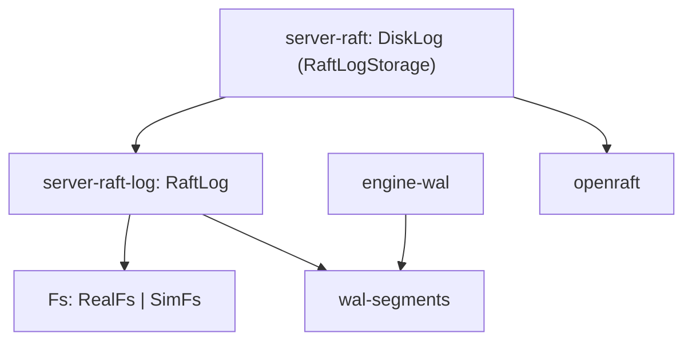

# Server Raft log

`server-raft-log` keeps a server's Raft log on disk: the entries, the
vote, the purge point, and the committed log id. It survives process
crashes and power loss, and keeps the contract that the `MemLog` model
of [server Raft](server-raft.md#memlog-stands-in-for-server-raft-log)
tested first. `server-raft` adapts it to openraft as `DiskLog`. Plan
[0029](../plans/0029-server-raft-log.md) built it.

## Components

| Crate | Directory | Visible to | Role |
| --- | --- | --- | --- |
| `wal-segments` | `lib/wal-segments` | `engine-wal`, `server-raft-log` | Checksummed frames in numbered segment files; shared by both write-ahead logs |
| `server-raft-log` | `lib/server-raft-log` | `server-raft` | `RaftLog`: the format, recovery, the write queue, the entry cache; the `Fs` trait, `RealFs`, and `SimFs` (feature `sim`) |
| `server-raft` | `lib/server-raft` | `server` | `DiskLog<RT, F>`: `RaftLogStorage` over `RaftLog`, with its flusher |



- **`server-raft-log` does not depend on openraft.** Entries are an index,
  a term, a kind (`Blank`, `Normal`, `Membership`), and payload bytes.
  `server-raft` converts openraft's entries (normal entries in the
  [command codec](server-raft.md#the-command-codec), membership in the
  shared `encoding` module) and votes.
- **`wal-segments` frames opaque bodies.** It never interprets a body; each
  log encodes its own. It is its own component, so neither log owns the
  other's format.

## `wal-segments`

```text
segment header, 32 bytes:
  magic (8) | version u32 | reserved u32 | first u64 | header_crc u32 | zero (4)
frame:
  len u32 | crc u32 | body | zero padding to a multiple of `align`
  crc = crc32c(len bytes ‖ body)
```

A `Format` names each log's magic, version, file extension, body bounds,
and alignment. It provides the header and frame codecs, segment names
(`{first:020}.{extension}`) and listing, `sync_dir`, and
`intact_frame_after`, the check that tells a torn tail from corruption.

- **`len` is inside the checksum and has a lower bound,** so a torn length
  fails the check and a zero-filled tail never decodes.
- **Padding is a parameter.** The Raft log pads frames to 8 bytes; the
  engine WAL does not, so its format is byte for byte what plan 0020
  wrote. A golden test (`engine-wal`'s
  `segments_from_before_wal_segments_are_unchanged`) holds it there.

## On-disk layout

```text
raft-log/
  00000000000000000001.log    segments, named by their first entry's index
  state                       vote and purge point, replaced atomically

segment: wal-segments header (magic "PEPPYRLG"), frames padded to 8 bytes
  entry:  kind u8 (0..2) | index u64 | term u64 | payload
  commit: kind u8 = 3 | term u64 | index u64

state, 64 bytes: magic "PEPPYRST" | version | flags | vote term, node
  | purge term, index | reserved | crc32c
```

- **8-byte alignment.** With the 32-byte header, every frame starts at an
  8-aligned offset, so its 8-byte prefix never crosses a sector boundary.
  If one sector write is atomic, a crash cannot persist half a length.
  etcd's WAL and hashicorp/raft-wal pad for the same reason. The cost is
  up to 7 bytes per record.
- **Segments.** Entries in a segment are contiguous and start at its name.
  A new segment starts at a group boundary once the active one holds at
  least `segment_bytes` (64 MiB) and an entry, so only the last segment
  can hold no entry.
- **The committed log id is a record** that joins the next group commit.
  It is a lower bound: losing the newest one is allowed. With no segment
  yet, there is nowhere to write it, and it is dropped.
- **The `state` file** is written as `state.tmp`, synced, renamed over
  `state`, and the directory synced. A leftover `state.tmp` is removed on
  open.

## The write queue

`RaftLog` applies every write (append, `truncate_after`, purge, vote,
committed log id) to its readable view at once and queues it with a
`WriteId`. `flush`, called by a driver, makes the queue durable in order.
`RaftLog` starts no thread.

- **Group commit.** Consecutive appends and commit points share one write
  and one `sync_data`. A truncation, a purge, or a vote ends the group:
  the group is synced first, then the operation runs with its own syncs.
- **No write is durable while an earlier one is lost.** In particular, no
  write after a truncation is durable before the truncation is.
- **A flush covers every write submitted before it,** even when several
  threads flush at once. A flush records what it made durable before it
  releases the disk, so a flush that finds the queue already taken still
  reports the other flush's writes as durable.
- **Truncation works from the end backward:** it deletes the segments
  that start above the cut, syncing the directory after each, then
  shortens the segment that holds the first removed entry and syncs it. A
  crash in between leaves a longer log, never a hole; Raft truncates it
  again.
- **Purge records the purge point in `state` first,** then deletes the
  segments wholly at or below it. A crash in between leaves extra
  segments, which `open` deletes. A purge past the last entry deletes
  every segment, and the log continues after the purge point.
- **A failure is sticky.** After a failed write or sync, every later
  write and flush fails, and nothing after the last successful sync is
  reported durable.

**The entry cache** keeps the newest entries, contiguous up to the last
one, within `cache_bytes` (64 MiB by default) plus every entry not yet
written. Reads below it go to the segments; those entries are on disk
and no queued write changes them. The budget is revisited with
measurements, and in S6, when snapshots exist.

## Recovery

`open` reads `state`, lists the segments, and scans every segment except
those wholly at or below the purge point:

1. Validate the header: magic, version, checksum, and a first index
   that matches the name. A last segment with a torn header is removed.
2. Decode frames in order. Entry indexes start at the segment's name and
   increase by one; commit records may appear anywhere.
3. **Torn tail.** In the last segment only, an undecodable frame with no
   intact entry frame after it is a torn tail: the file is cut there and
   synced. Damage followed by intact entries, or damage in an earlier
   segment, is corruption, and `open` fails.
4. Entries at or below the purge point are dropped; the rest must be
   contiguous and follow the purge point.
5. The committed log id is the last commit record, or the purge point if
   that is higher; it is never below the purge point.
6. Segments wholly at or below the purge point are deleted, finishing an
   interrupted purge.

**The guarantee:** recovery returns the effect of a prefix of the queued
writes that contains every write reported durable. An append counts per
entry (a torn group may keep some entries of one append), and a crash
inside a truncation may leave a longer log, as above.

## The file-system trait

`Fs` and `FsFile` hold what the log needs: create, open, read, list,
rename, remove, `sync_dir`; append, `read_at`, `set_len`, `sync_data`.
`RealFs` calls `std::fs`.

`SimFs` (feature `sim`) keeps files in memory with a **power-loss model**,
stricter than the engine's process-crash tests:

- Bytes written but not synced are lost on a crash, or a prefix of them
  survives (a torn tail), chosen from a seed.
- A created, renamed, or removed name is durable only after `sync_dir`;
  an unsynced shortening is lost whole.
- Every mutating operation can be made to fail: one chosen operation, or
  every operation from a power-cut point on.

The model treats one write as a unit that can be cut anywhere. It does
not model sectors persisting out of order inside one group; recovery
would report that as corruption, as the engine WAL does.

## `DiskLog` and its drivers

- **`append`** queues the entries and records the `IOFlushed` callback
  under the write's number; the driver fires it once a flush reports the
  write durable.
- **`save_vote`** queues the vote and waits on a callback of its own, so no
  async worker blocks on a sync.
- **`Flusher::Thread`** (production) is a thread named `raft-log-flusher`:
  it waits for work, flushes, and fires callbacks; groups form while a
  sync runs. It wakes on every write. The last `DiskLog` handle stops it
  after a final flush.
- **`Flusher::Task`** (simulator) flushes on the runtime after a seeded
  delay, as `MemLog` did, on appends and votes.
- **Reads** come from the cache; a miss reads the segments on the
  blocking pool with the thread driver.
- **A failed write or sync** fails every waiting callback and every later
  write, so openraft stops the node (fail-stop).
- **`sync`** flushes inline: the state machine's checkpoint hook. It
  waits for the writes queued before the call, not for writes that
  arrive while it runs, and it fails only if the log failed. A false
  failure here is fatal: openraft stops a node whose snapshot build
  fails.

## Guarantees and tests

| Guarantee | Tests |
| --- | --- |
| 1. Frames and headers round-trip, padded or not; damaged, cut, out-of-bounds, or non-zero-padded frames do not decode; segments written before the extraction are unchanged. | `lib/wal-segments/src/tests.rs`; `lib/engine-wal/src/tests/record.rs`: `segments_from_before_wal_segments_are_unchanged` |
| 2. `SimFs` loses unsynced bytes and names, tears tails to a prefix, and fails chosen operations; `RealFs` behaves the same without crashes. | `lib/server-raft-log/src/tests/fs.rs` |
| 3. Recovery repairs a torn tail at every byte, rejects corruption, removes a torn last header, finishes an interrupted purge, and never returns a committed log id below the purge point; a `state` write cut anywhere leaves the old or new state. | `lib/server-raft-log/src/tests/disk.rs` |
| 4. Writes are readable at once and durable after a flush, in order; appends and commit points share one sync; a failure is sticky and reports nothing durable after it; a flush that races another reports every write submitted before it as durable. | `lib/server-raft-log/src/tests/log.rs` |
| 5. After a crash at every operation of scripted workloads (including a truncation followed by appends), and at random points of 2,000 random workloads, recovery returns a valid prefix; a log that reports durability early fails the oracle; on real files a write cut at every byte is repaired away. | `lib/server-raft-log/src/tests/crash.rs` |
| 6. `DiskLog` passes openraft's storage suite over `SimFs` and over real files; a failed sync fails the waiting callback and every later write, and stops a node; `sync` succeeds beside appends and the flusher thread. | `lib/server-raft/src/tests/disk_log.rs` |
| 7. The simulator's safety checks hold with the real log over `SimFs`, with torn tails on crashes, and with injected file-system failures that stop only the failing node. | `lib/server-raft/src/tests/simulator.rs`, `tests/sweep.rs` |

## Measurements

macOS (aarch64), 12 cores, APFS, 2026-11-15; `sync_data` is
`F_FULLFSYNC` here, about 5 ms. Informational, not gates.

The log alone (`tests::bench::bench_log_appends`, release), 100-byte
entries, one appender, one flusher thread:

| Entries in flight | Entries/s | p50 | p99 | Entries per sync |
| --- | --- | --- | --- | --- |
| 1 | 108 | 5.1 ms | 19.1 ms | 1.0 |
| 16 | 1,383 | 6.7 ms | 19.9 ms | 16.0 |
| 256 | 23,494 | 7.8 ms | 21.1 ms | 189.4 |

Three nodes in one process on Tokio over real files
(`server-raft`'s `tests::bench::bench_three_nodes_on_disk`, release),
100-byte writes to the leader:

| Writers | Writes/s | p50 | p99 | Writes per sync per node | Elections |
| --- | --- | --- | --- | --- | --- |
| 1 | 58 | 16.1 ms | 24.0 ms | 0.7 | 0 |
| 16 | 723 | 20.1 ms | 32.0 ms | 8.5 | 0 |
| 256 | 10,410 | 20.9 ms | 48.0 ms | 127.8 | 0 |

The thread driver also flushes for committed-log-id writes, so with one
writer there are more syncs than writes. Linux numbers on
`c4d-standard-8-lssd` (one fsync about 64 to 74 µs, plan 0024) wait for
roadmap S2's remote runs.

## Not guaranteed, and limits

- **Out-of-order sector persistence inside one group** is reported as
  corruption, not repaired; the engine WAL has the same rule.
- **No preallocation.** Zero-filled preallocated segments would keep
  `fdatasync` from changing the file size; the format already tolerates
  a zero tail. Decide with a Linux measurement.
- **No `O_DIRECT` or `O_DSYNC`.**
- **The committed log id can be lost** when no segment exists, or with the
  newest group; it is a lower bound.

## Relationship to sources

- Per-record framing with a length and a CRC follows LevelDB's log
  format, Postgres's WAL (`xlogrecord.h`), and etcd's WAL; 8-byte
  alignment follows etcd (`server/storage/wal/encoder.go`) and
  hashicorp/raft-wal (`segment/format.go`). hashicorp/raft-wal and TiKV's
  raft-engine check one CRC per batch instead.
- The durability contract is openraft's `RaftLogStorage`: writes
  serialized, `IOFlushed` after durability, votes durable before
  `save_vote` returns.
