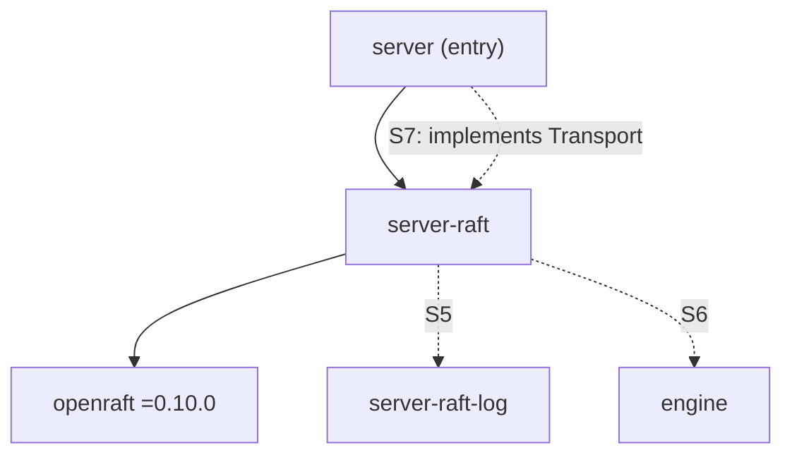

# Server Raft

This document records the design of `server-raft`, the server
component's Raft crate: openraft behind peppydb's own types, the storage
models that stand in for the Raft log and the engine, and the
deterministic simulator that checks Raft's safety properties.
[Plan 0028](../plans/0028-server-raft-core.md) built it, as milestone S4
of the [server roadmap](../plans/0025-server-roadmap.md).

Related documents: [server](server.md) (the component that uses it),
[engine external-log mode](engine.md#external-log-mode) (the contract
that the S6 state machine drives), [build system](build-system.md)
(feature variants). For Raft itself, see the
[Raft paper and dissertation](../references.md#raft); for openraft, see
[Raft implementations](../references.md#raft-implementations).

## Place in the server component

Raft exists for one purpose: replicating one server's `Db` within its
group. Each server belongs to exactly one Raft group (phase 3), every
server runs Raft (roadmap decision 10), and the Raft applied state lives
in the server's system keyspace. Raft is therefore part of the server
component, and its crates follow the internal naming rule
`server-<part>`.

| Crate | Directory | Visible to | Status |
| --- | --- | --- | --- |
| `server` (entry) | `lib/server` | `//bin/peppydb:` | Plan 0026; peer transport in S7 |
| `server-raft` | `lib/server-raft` | `server`; the `:server-raft-sim` variant to `server`'s unit tests | This document |
| `server-raft-log` | `lib/server-raft-log` | `server-raft` | S5: the on-disk Raft log |
| `server-keys` | `lib/server-keys` | `server`, `server-raft` | S6: the key layout, moved out of `server` |
| `raft-proto` | `proto/raft/v1/rust` | `server` | S7: `peppydb.raft.v1` |



**Dependency rules.** Later stacks must keep these:

- **openraft stays inside `server-raft`.** `server` sees only
  `server-raft`'s types, so an openraft upgrade (roadmap decision 9)
  changes one crate. `node.rs`, `error.rs`, `network.rs`, and
  `transport.rs` are the only modules that name openraft's API types.
- **`server-raft-log` does not depend on openraft.** `server-raft` adapts
  its API to `RaftLogStorage`, so the on-disk format and its crash tests
  do not change on an openraft upgrade.
- **`server-raft` does not depend on tonic or any proto crate.** The S7
  transport lives in `server` and implements `server_raft::Transport`.
  Visibility cannot enforce this; review must.

## openraft's role

openraft owns Raft's control flow: elections, replication, commit
tracking, apply scheduling, snapshot policy and transfer, log purging,
read index, leader transfer, and membership. It calls three traits that
peppydb implements, and peppydb calls a few entry points.

| peppydb implements | openraft trait | Built in |
| --- | --- | --- |
| The Raft log | `RaftLogStorage` | `MemLog` (model, S4); `server-raft-log` adapter (S5) |
| The state machine | `RaftStateMachine` | `ModelSm` (model, S4); `DbStateMachine` over `engine::Db` (S6) |
| The network | `RaftNetworkFactory` | The network adapter over `Transport` (S4); gRPC in `server` (S7) |

## Type configuration

openraft is generic over one marker type that names every type it uses.
`Types<RT>` is generic over the async runtime, so one set of trait
implementations runs on Tokio in production and on `openraft-rt-sim`
under test. `declare_raft_types!` fixes one runtime per configuration,
so `Types<RT>` implements `RaftTypeConfig` by hand.

| Item | Choice | Reason |
| --- | --- | --- |
| `D` | `Command` | Our payload, with our own codec |
| `R` | `()` | A write's response is its log id |
| `NodeId`, `Term` | `u64` | |
| `Node` | `PeerInfo { addr }` | The address S7 dials; not named `NodeInfo`, which openraft already uses |
| `LeaderId` | `leader_id_std::LeaderId` | **At most one leader per term**, as in the paper (§5.2, Figure 3). openraft's default, `leader_id_adv`, allows several leaders per term. `types.rs`: `leader_ids_are_standard` pins it |
| Entry, payload, vote, membership | openraft's defaults | |
| `AsyncRuntime` | `RT` | |

## The command codec

A `Command` is one replicated write: the entry at Raft index `i` becomes
`Db::apply(i, ops)` in S6 (roadmap decision 1). Blank and membership
entries leave gaps in the applied sequence, which `Db::apply` allows.

```text
version u8 = 1 | count u32 | op*
op = put:    kind u8 = 1 | klen u32 | key | vlen u32 | value
   | delete: kind u8 = 2 | klen u32 | key
```

Integers are little-endian. Keys are stored keys, with the namespace
byte. The encoding is ours, not serde: the Raft log stores these bytes
(S5), and the peer API carries them opaquely (S7), so they must not
change on an openraft or serde upgrade. Decoding rejects truncations, an
unknown version or kind, and trailing bytes, and a huge count cannot
cause a huge allocation.

## The facade

```rust
pub struct RaftNode<SM, RT = TokioRuntime> { /* openraft::Raft<Types<RT>, SM> */ }

impl<SM, RT> RaftNode<SM, RT> {
    pub async fn start<LS, T>(id, &RaftConfig, log: LS, sm: SM, transport: Arc<T>) -> Result<Self, StartError>;
    pub async fn initialize(&self, voters: BTreeMap<NodeId, PeerInfo>) -> Result<(), StartError>;
    pub async fn propose(&self, Command) -> Result<Proposed, ProposeError>;
    pub async fn read_barrier(&self) -> Result<ReadPoint, ReadError>;
    pub async fn transfer_leader(&self, to: NodeId) -> Result<(), StopError>;
    pub async fn snapshot(&self) -> Result<(), StopError>;
    pub fn status(&self) -> Status;
    // Incoming peer messages, called by the transport on the receiver:
    pub async fn handle_append_entries(&self, AppendEntries) -> Result<AppendReply, HandleError>;
    // handle_vote, handle_pre_vote, handle_snapshot, handle_transfer_leader
}
```

- **`propose`** returns once the entry is committed and applied on this
  node. Its errors follow the rules of plan 0026:

  | `ProposeError` | openraft cause | Meaning |
  | --- | --- | --- |
  | `NotLeader(hint)` | `ForwardToLeader` | Nothing was proposed; retrying on the leader is safe |
  | `OutcomeUnknown` | `LogEntryDiscarded` | The entry was appended and then truncated on a leader change; it may still commit through another leader |
  | `Stopped` | `Fatal` | The node stopped (storage error or shutdown); fail-stop |
  | `Internal` | membership or precondition errors | A server bug |

- **`read_barrier`** is read index (dissertation §6.4):
  `ensure_linearizable(ReadPolicy::ReadIndex)` confirms leadership with a
  quorum and waits until this node has applied through the read point. A
  local read after it returns is linearizable. Leader leases are a later
  optimization (roadmap decision 5).
- **`RaftConfig`** maps to openraft's `Config`: election timeout range
  (default 150 to 300 ms), heartbeat (50 ms), snapshot policy (every 5000
  entries), entries kept below a snapshot (1000), and pre-vote (on).

## Pre-vote

Pre-vote (dissertation §9.6) is **enabled**. openraft 0.10.0 implements it
behind `Config::enable_pre_vote`, off by default, with its own `pre_vote`
RPC; `RaftConfig::pre_vote` defaults to `true`. Before a node raises its
term, it asks whether a quorum would grant it a vote; peers that still
hear from a leader refuse.

openraft also rejects votes while a follower's leader lease is valid (the
check of dissertation §4.2.3). The lease stops a disruptive node from
*winning*; pre-vote stops it from raising its term at all, which matters
because a leader steps down when it sees a higher term while replicating.
The scenarios in `tests/scenarios.rs` show both sides: with pre-vote, a
follower isolated for 5 s keeps its term and the leader is undisturbed;
without it, the isolated node raises its term and the cluster moves to a
higher term when it rejoins.

## The transport

`server` must carry Raft messages without depending on openraft, so
`transport.rs` defines plain message types that mirror openraft's, and
the `Transport` trait over them:

```rust
pub struct LogId { pub term: u64, pub index: u64 }
pub struct Vote { pub term: u64, pub node: NodeId, pub committed: bool }
pub enum EntryPayload { Blank, Command(Vec<u8>), Membership(MembershipConfig) }

pub trait Transport: Send + Sync + 'static {
    type SnapshotData: Send + 'static;
    fn append_entries(&self, from, to, AppendEntries) -> impl Future<Output = Result<AppendReply, Unreachable>> + Send;
    fn vote(..) / fn pre_vote(..) -> ..VoteReply..;
    fn snapshot(&self, from, to, Vote, SnapshotMeta, Self::SnapshotData) -> ..Vote..;
    fn transfer_leader(..) -> ..TransferReply..;
}
```

- With standard leader ids, a committed leader is identified by its term
  alone, so a `LogId` is `(term, index)`.
- The conversions to and from openraft's types are `From` and
  `TryFrom` impls in `transport.rs`.
- The network adapter (`network.rs`) implements openraft's
  `RaftNetworkV2` over `Transport`. It is the only code that converts
  peer messages, and it bounds each call by openraft's RPC deadline, so a
  transport that loses a message may simply never answer.
- **The S7 wire format is a hybrid.** `peppydb.raft.v1` mirrors the
  envelope field by field, so `buf breaking` guards rolling-upgrade
  compatibility; a `Command` travels as its codec bytes, opaque to the
  proto. `transport.rs`: `every_message_round_trips` checks that every
  conversion round-trips exactly.

## Storage models

The simulator runs openraft over models that keep the contracts of the
components that S5 and S6 build. The contracts are therefore tested
before those components exist.

### `MemLog` (stands in for `server-raft-log`)

- **Writes are serialized.** Appends, truncations, purges, saved commit
  points, and votes join one ordered queue. After a crash the durable log
  is the result of a prefix of that queue: no write is durable while an
  earlier one is lost, as `RaftLogStorage` requires.
- **Appends are readable at once and durable later.** A flush after a
  seeded delay makes them durable and then fires their `IOFlushed`
  callbacks: the group commit of the S5 flusher.
- **`save_vote` is durable before it returns,** with every write queued
  before it.
- **A crash** drops every write that is not durable and freezes the log;
  the durable image restarts the node.
- openraft's storage conformance suite (`openraft::testing::log::Suite`)
  runs against `MemLog` and `ModelSm` together.

### `ModelSm` (stands in for `engine::Db` in `Mode::External`)

- **Data and Raft state share one keyspace.** The applied log id
  (`0x00 ‖ "raft/applied"`) and the membership (`0x00 ‖
  "raft/membership"`) are system keys in the same map as the user data,
  written with each entry (roadmap, "The system keyspace").
- **Applied is not durable.** A snapshot is a checkpoint: it first calls
  the log's sync hook, as `checkpoint_with(|seq| raft_log.sync_to(seq))`
  will (roadmap decision 2), then becomes durable.
- **A crash rolls back to the last snapshot;** openraft re-applies from
  the log after the applied log id that the system keys report, and
  redelivered entries are skipped, as `Db::apply` skips them.
- **An installed snapshot is durable at once,** and its metadata must
  match its system keys.

This is openraft's "transient state machine" pattern with
`save_committed` implemented, which matches External mode.

## The simulator

One seed fixes a whole run: the cluster size (3 or 5), fault rates,
every message's fate and delay, flush delays, the fault schedule, the
client workload, and openraft's election timeouts, through
`SimRuntime::with_seed`. `SimRuntime` is single-threaded with FIFO
scheduling and a virtual clock, so a run is reproducible and fast.

| Fault | Source |
| --- | --- |
| Dropped request, lost reply, duplicate, delay, reordering | `SimNetwork`, per message, from seeded rates |
| Partitions: isolated leader, minority/majority split, one-way link, all isolated | Scheduler |
| Crash and restart (storage loses everything not durable) | Scheduler, at most a minority down |
| Snapshots, log purges, snapshot installs | Scheduler and openraft's policy (small thresholds) |
| Leader transfer | Scheduler |

A run has a chaos phase (4 s of virtual time with clients writing unique
values and reading through read barriers), then heals every fault,
restarts every node, and requires a final write to commit and apply
everywhere within 60 s. A cluster that does not recover fails the run.

The trace hash covers every network decision, fault, and client
operation; `tests/simulator.rs` checks that two runs of a seed record
identical traces and that every fault type occurs.

## Safety checks

`sim/checker.rs` observes the models and the network during a run, and
the client history and replicas after it (roadmap decision 15).

| Property | Check |
| --- | --- |
| Election safety (§5.2) | Every committed vote saved for a term names the same leader |
| Leader completeness (§5.4.1) | A node that becomes leader holds every entry applied anywhere, above its purge point |
| State machine safety (§5.4.3) | One index never applies two different entries |
| Log matching (§5.3) | Two logs that share a log id hold the same entries up to it; checked after every scheduler step |
| Persist before send (decision 7) | A sender's vote is durable when it sends; a granted vote and an accepted append are durable on the receiver when it replies |
| Acknowledged writes survive | Each acknowledged write is the entry applied at its index |
| Replicas | Replaying every applied entry in index order gives each replica's contents |
| Read-index reads | A read returns a committed value, not one written after it ended, and not one older than a write acknowledged before it started |

The read check is per key and real-time; it is not full
linearizability, which S3 adds with Porcupine.

**An append is durable in the log or in a snapshot.** A follower that
installs a snapshot holds its entries durably in the state machine
before its log purge is durable, and openraft acknowledges appends at or
below the snapshot on that basis. The persist-before-send check accepts
either. The first version of the check accepted only the log and
reported 9 of 30 seeds; see plan 0028's discoveries.

**The checks detect what they claim.** `sim/checker.rs` feeds each check
a synthetic violation. With the `lazy_votes` bug injected (a `MemLog`
whose `save_vote` returns before the vote is durable), the
persist-before-send check fails every seed (100 of 100 in the
measurement; `tests/simulator.rs`: `a_log_that_loses_votes_is_caught`
runs 10). Election safety alone did not trigger in 100 seeds: the bug needs a
crash in the window between a vote and its flush.

## Seed tiers

| Tier | Where | Seeds |
| --- | --- | --- |
| Default | `tests/sweep.rs`, 8 parallel chunks | `1..=400`, and every seed in `sim/regressions.rs` |
| One seed | `PEPPY_SIM_SEED=<n>` (and `PEPPY_SIM_TRACE=1` to print the trace) | One |
| Long | ignored `long_tier`; `PEPPY_SIM_SEEDS`, `PEPPY_SIM_BASE` | 100,000 by default, from a printed base |

A failing run prints its violations and the command that reproduces it.
A seed that ever fails is fixed and added to `sim/regressions.rs`.

## Guarantees and tests

Test paths are relative to `lib/server-raft/src/`.

| Guarantee | Tests |
| --- | --- |
| 1. The codec round-trips, has a fixed layout, and rejects every truncation and bad encoding. | `command.rs` tests |
| 2. Leader ids are standard: one leader per term. | `types.rs`: `leader_ids_are_standard` |
| 3. `MemLog` and `ModelSm` meet openraft's storage contract and the crash model above. | `sim/model_sm.rs`: `the_models_pass_openraft_s_storage_suite`; `sim/mem_log.rs` and `sim/model_sm.rs` tests |
| 4. Every peer message converts to openraft's type and back unchanged; commands travel as codec bytes. | `transport.rs` tests |
| 5. A cluster elects a leader, replicates, and applies writes; followers answer with a leader hint; read barriers cover acknowledged writes; leadership moves on request. | `tests/facade.rs` |
| 6. The network's faults occur and a cluster still converges; a partitioned node catches up. A seed fixes a run, and every fault type occurs. | `sim/network.rs` tests; `tests/simulator.rs` |
| 7. Every safety check holds across 400 seeds of 3 and 5 nodes under every fault, and the cluster recovers after healing. | `tests/sweep.rs`: `default_tier_*` |
| 8. Each check detects its violation; a log that loses votes is caught. | `sim/checker.rs` tests; `tests/simulator.rs`: `a_log_that_loses_votes_is_caught` |
| 9. An isolated leader is replaced and rejoins as a follower; with pre-vote a rejoining node does not disrupt the leader; a write discarded on a leader change reports `OutcomeUnknown` and applies nowhere. | `tests/scenarios.rs` |

## Not guaranteed, and limits

- **The models are models.** `MemLog` and `ModelSm` keep the contracts of
  the S5 log and the S6 state machine; the real components must still
  pass their own crash tests and run in the simulator.
- **Membership changes are not exercised.** Clusters are formed once with
  static voters; S8 adds changes.
- **Reads are checked per key, in real time,** not for full
  linearizability (S3).
- **Snapshots are whole.** `Transport::snapshot` carries the state
  machine's whole snapshot; chunked, resumable transfer is S8.
- **One process.** The simulator runs nodes in one process on one
  thread; real threads, sockets, and disks arrive in S5 to S7.
- **The persist-before-send probe runs when the reply reaches the
  network,** not at the instant the receiver produces it.

## Measurements

macOS (aarch64), 12 cores, 2026-11-11.

| Run | Result |
| --- | --- |
| Default tier, debug, `tools/buck2 run //lib/server-raft:server-raft-unittest -- tests::sweep` | 400 seeds in 20 s wall (136 s CPU, about 0.34 s per seed) |
| Long tier, release, 12 threads | 100,000 seeds (base 594594002000) in 148 s, no violations |
| One seed, release | about 9 to 18 ms |

## Extension points

- **S5:** `server-raft-log` and an adapter to `RaftLogStorage` replace
  `MemLog`; its crash model must match `MemLog`'s, and the simulator then
  runs over it with a simulated disk.
- **S6:** `DbStateMachine` over `engine::Db` in `Mode::External` replaces
  `ModelSm`, with the applier thread (roadmap decision 14) and the system
  keys moved to `server-keys`.
- **S7:** `server` implements `Transport` over gRPC with `raft.v1`, and
  `serve` builds a `RaftNode`.
- **Later:** leader leases for reads, membership changes, chunked
  snapshots, metrics. None of these changes `RaftNode`'s signature.

## Relationship to sources

- The safety properties and their names follow the Raft paper, §5.2 to
  §5.4 and Figure 3; pre-vote follows dissertation §9.6, and the lease
  check §4.2.3; read index follows dissertation §6.4.
- openraft implements the protocol; this crate adds no protocol logic.
  Deviations from the paper are openraft's extensions that the paper
  does not describe: pre-vote and the lease check (from the
  dissertation), and openraft's leader restore on restart
  (`Config::enable_leader_restore`, on by default), which makes a
  restarted former leader campaign at once in a higher term.
