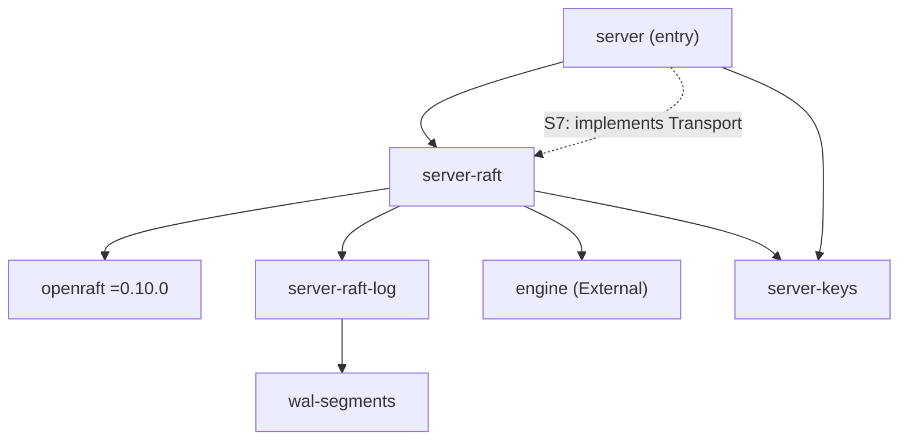

# Server Raft

This document records the design of `server-raft`, the server
component's Raft crate: openraft behind peppydb's own types, the storage
models that stand in for the Raft log and the engine, the adapter over
the on-disk Raft log, and the deterministic simulator that checks Raft's
safety properties. [Plan 0028](../plans/0028-server-raft-core.md) built
it, as milestone S4 of the [server roadmap](../plans/0025-server-roadmap.md);
[plan 0029](../plans/0029-server-raft-log.md) added the on-disk log (S5),
described in [server Raft log](server-raft-log.md), and
[plan 0030](../plans/0030-server-raft-state-machine.md) the state machine
over the engine (S6).

Related documents: [server](server.md) (the component that uses it),
[engine external-log mode](engine.md#external-log-mode) (the contract
that the S6 state machine drives), [build system](build-system.md)
(feature variants). For Raft itself, see the
[Raft paper and dissertation](../references.md#raft); for openraft, see
[Raft implementations](../references.md#raft-implementations).

## Place in the server component

Raft exists for one purpose: replicating one server's `Db` within its
group. Each server belongs to exactly one Raft group (phase 3), every
server runs Raft (roadmap decision 10), and the Raft applied state lives
in the server's system keyspace. Raft is therefore part of the server
component, and its crates follow the internal naming rule
`server-<part>`.

| Crate | Directory | Visible to | Status |
| --- | --- | --- | --- |
| `server` (entry) | `lib/server` | `//bin/peppydb:` | Plan 0026; peer transport in S7 |
| `server-raft` | `lib/server-raft` | `server`; the `:server-raft-sim` variant to `server`'s unit tests | This document |
| `server-raft-log` | `lib/server-raft-log` | `server-raft`; the `:server-raft-log-sim` variant (`SimFs`) to `server-raft`'s unit tests | S5, plan 0029: the [on-disk Raft log](server-raft-log.md) |
| `server-keys` | `lib/server-keys` | `server`, `server-raft` | S6, plan 0030: the key layout and the Raft system keys |
| `raft-proto` | `proto/raft/v1/rust` | `server` | S7: `peppydb.raft.v1` |



**Dependency rules.** Later stacks must keep these:

- **openraft stays inside `server-raft`.** `server` sees only
  `server-raft`'s types, so an openraft upgrade (roadmap decision 9)
  changes one crate. `node.rs`, `error.rs`, `network.rs`,
  `transport.rs`, and the storage adapters (`disk_log.rs`, `db_sm.rs`,
  `db_snapshot.rs`) are the only production modules that name openraft's
  API types.
- **`server-keys` depends on neither tonic nor openraft.** It holds the
  key names and the applied log id's value layout; the membership value's
  encoding stays in `server-raft`, which owns openraft's membership type.
- **`server-raft-log` does not depend on openraft.** `server-raft` adapts
  its API to `RaftLogStorage`, so the on-disk format and its crash tests
  do not change on an openraft upgrade.
- **`server-raft` does not depend on tonic or any proto crate.** The S7
  transport lives in `server` and implements `server_raft::Transport`.
  Visibility cannot enforce this; review must.

## openraft's role

openraft owns Raft's control flow: elections, replication, commit
tracking, apply scheduling, snapshot policy and transfer, log purging,
read index, leader transfer, and membership. It calls three traits that
peppydb implements, and peppydb calls a few entry points.

| peppydb implements | openraft trait | Built in |
| --- | --- | --- |
| The Raft log | `RaftLogStorage` | `MemLog` (model, S4); `DiskLog` over `server-raft-log` (S5) |
| The state machine | `RaftStateMachine` | `ModelSm` (model, S4); `DbStateMachine` over `engine::Db` (S6, plan 0030) |
| The network | `RaftNetworkFactory` | The network adapter over `Transport` (S4); gRPC in `server` (S7) |

## Type configuration

openraft is generic over one marker type that names every type it uses.
`Types<RT>` is generic over the async runtime, so one set of trait
implementations runs on Tokio in production and on `openraft-rt-sim`
under test. `declare_raft_types!` fixes one runtime per configuration,
so `Types<RT>` implements `RaftTypeConfig` by hand.

| Item | Choice | Reason |
| --- | --- | --- |
| `D` | `Command` | Our payload, with our own codec |
| `R` | `()` | A write's response is its log id |
| `NodeId`, `Term` | `u64` | |
| `Node` | `PeerInfo { addr }` | The address S7 dials; not named `NodeInfo`, which openraft already uses |
| `LeaderId` | `leader_id_std::LeaderId` | **At most one leader per term**, as in the paper (§5.2, Figure 3). openraft's default, `leader_id_adv`, allows several leaders per term. `types.rs`: `leader_ids_are_standard` pins it |
| Entry, payload, vote, membership | openraft's defaults | |
| `AsyncRuntime` | `RT` | |

## The command codec

A `Command` is one replicated write: the entry at Raft index `i` becomes
`Db::apply(i, ops)` in S6 (roadmap decision 1). Blank and membership
entries leave gaps in the applied sequence, which `Db::apply` allows.

```text
version u8 = 1 | count u32 | op*
op = put:    kind u8 = 1 | klen u32 | key | vlen u32 | value
   | delete: kind u8 = 2 | klen u32 | key
```

Integers are little-endian. Keys are stored keys, with the namespace
byte. The encoding is ours, not serde: the Raft log stores these bytes
(S5), and the peer API carries them opaquely (S7), so they must not
change on an openraft or serde upgrade. Decoding rejects truncations, an
unknown version or kind, and trailing bytes, and a huge count cannot
cause a huge allocation.

## The facade

```rust
pub struct RaftNode<SM, RT = TokioRuntime> { /* openraft::Raft<Types<RT>, SM> */ }

impl<SM, RT> RaftNode<SM, RT> {
    pub async fn start<LS, T>(id, &RaftConfig, log: LS, sm: SM, transport: Arc<T>) -> Result<Self, StartError>;
    pub async fn initialize(&self, voters: BTreeMap<NodeId, PeerInfo>) -> Result<(), StartError>;
    pub async fn propose(&self, Command) -> Result<Proposed, ProposeError>;
    pub async fn read_barrier(&self) -> Result<ReadPoint, ReadError>;
    pub async fn transfer_leader(&self, to: NodeId) -> Result<(), StopError>;
    pub async fn snapshot(&self) -> Result<(), StopError>;
    pub fn status(&self) -> Status;
    // Incoming peer messages, called by the transport on the receiver:
    pub async fn handle_append_entries(&self, AppendEntries) -> Result<AppendReply, HandleError>;
    // handle_vote, handle_pre_vote, handle_snapshot, handle_transfer_leader
}
```

- **`propose`** returns once the entry is committed and applied on this
  node. Its errors follow the rules of plan 0026:

  | `ProposeError` | openraft cause | Meaning |
  | --- | --- | --- |
  | `NotLeader(hint)` | `ForwardToLeader` | Nothing was proposed; retrying on the leader is safe |
  | `OutcomeUnknown` | `LogEntryDiscarded` | The entry was appended and then truncated on a leader change; it may still commit through another leader |
  | `Stopped` | `Fatal` | The node stopped (storage error or shutdown); fail-stop |
  | `Internal` | membership or precondition errors | A server bug |

- **`read_barrier`** is read index (dissertation §6.4):
  `ensure_linearizable(ReadPolicy::ReadIndex)` confirms leadership with a
  quorum and waits until this node has applied through the read point. A
  local read after it returns is linearizable. Leader leases are a later
  optimization (roadmap decision 5).
- **`RaftConfig`** maps to openraft's `Config`: election timeout range
  (default 150 to 300 ms), heartbeat (50 ms), snapshot policy (every 5000
  entries), entries kept below a snapshot (1000), and pre-vote (on).

## Pre-vote

Pre-vote (dissertation §9.6) is **enabled**. openraft 0.10.0 implements it
behind `Config::enable_pre_vote`, off by default, with its own `pre_vote`
RPC; `RaftConfig::pre_vote` defaults to `true`. Before a node raises its
term, it asks whether a quorum would grant it a vote; peers that still
hear from a leader refuse.

openraft also rejects votes while a follower's leader lease is valid (the
check of dissertation §4.2.3). The lease stops a disruptive node from
*winning*; pre-vote stops it from raising its term at all, which matters
because a leader steps down when it sees a higher term while replicating.
The scenarios in `tests/scenarios.rs` show both sides: with pre-vote, a
follower isolated for 5 s keeps its term and the leader is undisturbed;
without it, the isolated node raises its term and the cluster moves to a
higher term when it rejoins.

## The transport

`server` must carry Raft messages without depending on openraft, so
`transport.rs` defines plain message types that mirror openraft's, and
the `Transport` trait over them:

```rust
pub struct LogId { pub term: u64, pub index: u64 }
pub struct Vote { pub term: u64, pub node: NodeId, pub committed: bool }
pub enum EntryPayload { Blank, Command(Vec<u8>), Membership(MembershipConfig) }

pub trait Transport: Send + Sync + 'static {
    type SnapshotData: Send + 'static;
    fn append_entries(&self, from, to, AppendEntries) -> impl Future<Output = Result<AppendReply, Unreachable>> + Send;
    fn vote(..) / fn pre_vote(..) -> ..VoteReply..;
    fn snapshot(&self, from, to, Vote, SnapshotMeta, Self::SnapshotData) -> ..Vote..;
    fn transfer_leader(..) -> ..TransferReply..;
}
```

- With standard leader ids, a committed leader is identified by its term
  alone, so a `LogId` is `(term, index)`.
- The conversions to and from openraft's types are `From` and
  `TryFrom` impls in `transport.rs`.
- The network adapter (`network.rs`) implements openraft's
  `RaftNetworkV2` over `Transport`. It is the only code that converts
  peer messages, and it bounds each call by openraft's RPC deadline, so a
  transport that loses a message may simply never answer.
- **The S7 wire format is a hybrid.** `peppydb.raft.v1` mirrors the
  envelope field by field, so `buf breaking` guards rolling-upgrade
  compatibility; a `Command` travels as its codec bytes, opaque to the
  proto. `transport.rs`: `every_message_round_trips` checks that every
  conversion round-trips exactly.

## Storage models

The simulator runs openraft over models that keep the contracts of the
components that S5 and S6 build. The contracts are therefore tested
before those components exist.

### `MemLog` (stands in for `server-raft-log`)

`server-raft-log` now exists, and the simulator runs it by default
(below). `MemLog` stays as the reference model: the deliberate lazy-vote
bug runs on it, and `LogKind::Mem` runs the simulator over it.

- **Writes are serialized.** Appends, truncations, purges, saved commit
  points, and votes join one ordered queue. After a crash the durable log
  is the result of a prefix of that queue: no write is durable while an
  earlier one is lost, as `RaftLogStorage` requires.
- **Appends are readable at once and durable later.** A flush after a
  seeded delay makes them durable and then fires their `IOFlushed`
  callbacks: the group commit of the S5 flusher.
- **`save_vote` is durable before it returns,** with every write queued
  before it.
- **A crash** drops every write that is not durable and freezes the log;
  the durable image restarts the node.
- openraft's storage conformance suite (`openraft::testing::log::Suite`)
  runs against `MemLog` and `ModelSm` together.

### `ModelSm` (stands in for `engine::Db` in `Mode::External`)

- **Data and Raft state share one keyspace.** The applied log id
  (`0x00 ‖ "raft/applied"`) and the membership (`0x00 ‖
  "raft/membership"`) are system keys in the same map as the user data,
  written with each entry (roadmap, "The system keyspace").
- **Applied is not durable.** A snapshot is a checkpoint: it first calls
  the log's sync hook, as `checkpoint_with(|seq| raft_log.sync_to(seq))`
  will (roadmap decision 2), then becomes durable.
- **A crash rolls back to the last snapshot;** openraft re-applies from
  the log after the applied log id that the system keys report, and
  redelivered entries are skipped, as `Db::apply` skips them.
- **An installed snapshot is durable at once,** after the log's sync hook,
  and its metadata must match its system keys. The hook is required:
  openraft queues the truncation of entries that conflict with the
  snapshot before it installs it, and a crash that kept the image but
  lost the truncation left a log that openraft refuses to start over
  ("inverted log order"). Plan 0029's long tier found this in 4 of
  100,000 seeds, with `MemLog` and with the real log alike.

This is openraft's "transient state machine" pattern with
`save_committed` implemented, which matches External mode.

`DbStateMachine` now exists, and the simulator runs it by default.
`ModelSm` stays as the reference model (`SmKind::Model`).

## `DbStateMachine`

`DbStateMachine<RT>` (`db_sm.rs`, `db_snapshot.rs`) is openraft's
`RaftStateMachine` over one `engine::Db` in `Mode::External`
([engine external-log mode](engine.md#external-log-mode)).

- **Raft index `i` is engine sequence `i + 1`.** openraft's log starts at
  index 0 (the initial membership); the engine's sequences start at 1,
  with 0 meaning nothing applied. Each committed entry is one
  `Db::apply(i + 1, ops)` (roadmap decision 1, shifted by one).
- **Every entry writes the applied log id** (`APPLIED_KEY`, as
  `server_keys::encode_log_id`); a membership entry writes
  `MEMBERSHIP_KEY` too; a blank entry writes only the applied log id.
  `Db::apply` is all or nothing after a crash, so the data and openraft's
  applied state roll back together. `applied_state` reads both keys.
- **Commands carry stored keys.** `server` maps user keys to `0x01 ‖ key`
  before it proposes; the state machine applies operations as they are.
  An entry the engine refuses (a key past the limits) stops the state
  machine, so `server` must check limits before it proposes (S7).
- **The applier.** `Applier::Thread` runs `Db::apply` on a thread named
  `raft-applier` (roadmap decision 14): openraft's state-machine worker
  hands it a batch and awaits a oneshot, and each entry's responder
  resolves as the entry applies. `Applier::Inline` applies on the caller,
  for the simulator's single-threaded runtime.
- **Compaction is openraft's snapshot policy.** `build_snapshot` pauses
  the applier at an entry boundary, commits a checkpoint with
  `checkpoint_with` and the log's sync hook (decision 2), reads the
  metadata from the system keys, and writes the committed image with
  `write_snapshot`. openraft then purges the log below the snapshot.
- **The committed checkpoint is the current snapshot.**
  `get_current_snapshot` writes it on demand with the metadata kept from
  the last build, install, or open (right after open, the database is at
  its committed checkpoint).
- **Install syncs the log first,** then `Db::install_snapshot`, then checks
  the installed system keys against the metadata. In-progress readers
  keep the old `Arc<Db>` until they finish.
- **Engine calls block,** so with the applier thread, snapshot work runs
  on the blocking pool; inline in the simulator.
- **A failed apply or install stops the state machine;** every later
  call fails, and openraft stops the node.
- **Snapshot data is a `Vec<u8>` of the whole store image.** It must move
  to a temporary file before databases grow past test sizes, and no later
  than S8.

**The sync hook and compaction.** With the applier paused while a
checkpoint commits, a checkpoint never holds part of an entry, and a
state machine that is ahead of its own log is allowed; the crash tests
pass for compaction even with a hook that does nothing. The hook stays,
as the engine's owner contract asks. A snapshot install does need it: the
negative control without it breaks the log order.

## The simulator

One seed fixes a whole run: the cluster size (3 or 5), fault rates,
every message's fate and delay, flush delays, the fault schedule, the
client workload, and openraft's election timeouts, through
`SimRuntime::with_seed`. `SimRuntime` is single-threaded with FIFO
scheduling and a virtual clock, so a run is reproducible and fast.

| Fault | Source |
| --- | --- |
| Dropped request, lost reply, duplicate, delay, reordering | `SimNetwork`, per message, from seeded rates |
| Partitions: isolated leader, minority/majority split, one-way link, all isolated | Scheduler |
| Crash and restart (storage loses everything not durable; the real log's unsynced tails are torn from a seed) | Scheduler, at most a minority down |
| File-system failure: a node's next operation fails, the node stops (fail-stop) and is restarted | Scheduler, with `SimConfig::sync_failures` |
| Snapshots, log purges, snapshot installs | Scheduler and openraft's policy (small thresholds) |
| Leader transfer | Scheduler |

**The state machine.** Nodes run `DbStateMachine` over an external `Db`
on a `SimStore` by default (`sim/sim_sm.rs`, `SmKind::Db`), with
`Applier::Inline` and a 256 KiB circular buffer so pages reach the store.
A crash keeps the store's durable image with torn writes and kills the
old store; a restart reopens the engine from it.

**The log.** Nodes run `DiskLog` over `SimFs` by default
(`sim/sim_log.rs`, `LogKind::Disk`), flushed by a seeded task. A crash
keeps the `SimFs` image with torn tails and cuts the old file system's
power; a restart recovers through the real recovery code. The checker
asks the log for its durable vote and entries.

A run has a chaos phase (4 s of virtual time with clients writing unique
values and reading through read barriers), then heals every fault,
restarts every node, and requires a final write to commit and apply
everywhere within 60 s. A cluster that does not recover fails the run.

The trace hash covers every network decision, fault, and client
operation; `tests/simulator.rs` checks that two runs of a seed record
identical traces and that every fault type occurs.

## Safety checks

`sim/checker.rs` observes the models and the network during a run, and
the client history and replicas after it (roadmap decision 15).

| Property | Check |
| --- | --- |
| Election safety (§5.2) | Every committed vote saved for a term names the same leader |
| Leader completeness (§5.4.1) | A node that becomes leader holds every entry applied anywhere, above its purge point |
| State machine safety (§5.4.3) | One index never applies two different entries |
| Log matching (§5.3) | Two logs that share a log id hold the same entries up to it; checked after every scheduler step |
| Persist before send (decision 7) | A sender's vote is durable when it sends; a granted vote and an accepted append are durable on the receiver when it replies |
| Acknowledged writes survive | Each acknowledged write is the entry applied at its index |
| Replicas | Replaying every applied entry in index order gives each replica's contents |
| Read-index reads | A read returns a committed value, not one written after it ended, and not one older than a write acknowledged before it started |

The read check is per key and real-time; it is not full
linearizability, which S3 adds with Porcupine.

**An append is durable in the log or in a snapshot.** A follower that
installs a snapshot holds its entries durably in the state machine
before its log purge is durable, and openraft acknowledges appends at or
below the snapshot on that basis. The persist-before-send check accepts
either. The first version of the check accepted only the log and
reported 9 of 30 seeds; see plan 0028's discoveries.

**The checks detect what they claim.** `sim/checker.rs` feeds each check
a synthetic violation. With the `lazy_votes` bug injected (a `MemLog`
whose `save_vote` returns before the vote is durable), the
persist-before-send check fails every seed (100 of 100 in the
measurement; `tests/simulator.rs`: `a_log_that_loses_votes_is_caught`
runs 10). Election safety alone did not trigger in 100 seeds: the bug needs a
crash in the window between a vote and its flush.

## Seed tiers

| Tier | Where | Seeds |
| --- | --- | --- |
| Default | `tests/sweep.rs`, 8 parallel chunks | `1..=400`, and every seed in `sim/regressions.rs` |
| One seed | `PEPPY_SIM_SEED=<n>` (and `PEPPY_SIM_TRACE=1` to print the trace) | One |
| Long | ignored `long_tier`; `PEPPY_SIM_SEEDS`, `PEPPY_SIM_BASE` | 100,000 by default, from a printed base |

A failing run prints its violations and the command that reproduces it.
A seed that ever fails is fixed and added to `sim/regressions.rs`.

## Guarantees and tests

Test paths are relative to `lib/server-raft/src/`.

| Guarantee | Tests |
| --- | --- |
| 1. The codec round-trips, has a fixed layout, and rejects every truncation and bad encoding. | `command.rs` tests |
| 2. Leader ids are standard: one leader per term. | `types.rs`: `leader_ids_are_standard` |
| 3. `MemLog` and `ModelSm` meet openraft's storage contract and the crash model above; so does `DiskLog`, over `SimFs` and real files. | `sim/model_sm.rs`: `the_models_pass_openraft_s_storage_suite`; `sim/mem_log.rs` and `sim/model_sm.rs` tests; `tests/disk_log.rs` |
| 4. Every peer message converts to openraft's type and back unchanged; commands travel as codec bytes. | `transport.rs` tests |
| 5. A cluster elects a leader, replicates, and applies writes; followers answer with a leader hint; read barriers cover acknowledged writes; leadership moves on request. | `tests/facade.rs` |
| 6. The network's faults occur and a cluster still converges; a partitioned node catches up. A seed fixes a run, and every fault type occurs. | `sim/network.rs` tests; `tests/simulator.rs` |
| 7. Every safety check holds across 400 seeds of 3 and 5 nodes under every fault, over the real log and the real engine with torn writes, and the cluster recovers after healing; both logs and both state machines run safely. | `tests/sweep.rs`: `default_tier_*`, `regression_seeds`; `tests/simulator.rs`: `both_logs_run_safely`, `both_state_machines_run_safely` |
| 8. Each check detects its violation; a log that loses votes is caught. | `sim/checker.rs` tests; `tests/simulator.rs`: `a_log_that_loses_votes_is_caught` |
| 9. An isolated leader is replaced and rejoins as a follower; with pre-vote a rejoining node does not disrupt the leader; a write discarded on a leader change reports `OutcomeUnknown` and applies nowhere. | `tests/scenarios.rs` |
| 10. A file-system failure stops only the failing node; the cluster stays safe and converges after it restarts. | `tests/disk_log.rs`: `a_failed_sync_stops_the_node`; `tests/simulator.rs`: `injected_sync_failures_stop_only_the_failing_node` |
| 11. `DbStateMachine` applies entries with the system keys, skips redeliveries, rolls back to its committed checkpoint on a crash, stops on an entry it cannot apply, and applies in order on its thread; with `DiskLog` it passes openraft's storage suite on simulated and real files; snapshots build, install, survive a crash, and are refused when the metadata does not match. | `tests/db_sm.rs` |
| 12. With the log and the state machine cut at every operation of a compaction and of a snapshot install, then crashed with torn writes, every durable entry survives, the state machine is at or beyond the purge point with matching contents, redelivery catches up, and openraft starts; without the sync hook, the install breaks the log order. | `tests/crash_storage.rs` |

## Not guaranteed, and limits

- **Simulated disks.** The log and the engine are the real code since S5
  and S6, over `SimFs` and `SimStore`, whose limits
  [server Raft log](server-raft-log.md#the-file-system-trait) and
  [BF-Tree persistence](bf-tree-persistence.md) record.
- **Snapshots in memory.** Snapshot data is a `Vec<u8>` holding the whole
  store image (above).
- **Membership changes are not exercised.** Clusters are formed once with
  static voters; S8 adds changes.
- **Reads are checked per key, in real time,** not for full
  linearizability (S3).
- **Snapshots are whole.** `Transport::snapshot` carries the state
  machine's whole snapshot; chunked, resumable transfer is S8.
- **One process.** The simulator runs nodes in one process on one
  thread over `SimFs`; the flusher thread and real disks run only in
  `tests/disk_log.rs` and the benchmark; sockets arrive in S7.
- **The persist-before-send probe runs when the reply reaches the
  network,** not at the instant the receiver produces it.

## Measurements

macOS (aarch64), 12 cores, 2026-11-11 (`MemLog`, plan 0028).

| Run | Result |
| --- | --- |
| Default tier, debug, `tools/buck2 run //lib/server-raft:server-raft-unittest -- tests::sweep` | 400 seeds in 20 s wall (136 s CPU, about 0.34 s per seed) |
| Long tier, release, 12 threads | 100,000 seeds (base 594594002000) in 148 s, no violations |
| One seed, release | about 9 to 18 ms |

Over the real log (`DiskLog` over `SimFs`, plan 0029), 2026-11-15, same
machine:

| Run | Result |
| --- | --- |
| Default tier, debug | 400 seeds and the regression seed in 18 s wall (124 s CPU) |
| Long tier, release, 12 threads | Base 976989910000: 4 seeds panicked (the install-snapshot bug above, also with `MemLog`); after the fix, 100,000 seeds in 121 s, none failing. Base 995530922000: 100,000 seeds in 125 s, none failing |

Over the real log and the real engine (`DbStateMachine` over `SimStore`,
plan 0030), 2026-11-21, same machine:

| Run | Result |
| --- | --- |
| Default tier, debug | 400 seeds and the regression seed in 19 s wall (130 s CPU) |
| Long tier, release, 12 threads | Base 87708801000: 100,000 seeds in 160 s, none failing. Base 264633921000: 100,000 seeds in 165 s, none failing |

**Three nodes on real files** (`tests::bench::bench_three_nodes_on_disk`,
release, 2 s per run, 100-byte writes, 4 worker threads per node
runtime, one machine and one APFS disk whose full flush takes about
5 ms):

| Configuration | Writers | Writes/s | p50 | p99 | Timer late, p99 / max | Elections |
| --- | --- | --- | --- | --- | --- | --- |
| Shared runtime, `ModelSm` | 1 | 90 | 12.0 ms | 17.6 ms | 2.1 / 2.2 ms | 0 |
| Runtime per node, `ModelSm` | 1 | 92 | 11.9 ms | 18.0 ms | 3.0 / 7.6 ms | 0 |
| Runtime per node, engine | 1 | 92 | 11.9 ms | 18.1 ms | 3.0 / 7.1 ms | 0 |
| Shared runtime, `ModelSm` | 64 | 3,221 | 20.0 ms | 31.8 ms | 3.0 / 5.5 ms | 0 |
| Runtime per node, `ModelSm` | 64 | 3,254 | 20.0 ms | 32.1 ms | 3.6 / 5.6 ms | 0 |
| Runtime per node, engine | 64 | 2,076 | 24.1 ms | 94.0 ms | 3.1 / 11.6 ms | 0 |
| Shared runtime, `ModelSm` | 256 | 12,189 | 20.0 ms | 48.8 ms | 2.6 / 14.8 ms | 0 |
| Runtime per node, `ModelSm` | 256 | 12,069 | 20.1 ms | 63.4 ms | 3.5 / 9.3 ms | 0 |
| Runtime per node, engine | 256 | 5,127 | 31.9 ms | 174.2 ms | 3.5 / 13.1 ms | 0 |

- **Heartbeats are not delayed enough to matter.** Timer lateness on each
  node's runtime stays within a few milliseconds at the 99th percentile
  and under 16 ms at worst, against a 50 ms heartbeat and a 150 to 300 ms
  election timeout; no run had an election. Inside one process openraft
  does not need a runtime separate from gRPC yet (roadmap decision 14).
- **The engine limits throughput at high load on this machine.**
  `tests::bench::bench_engine_apply_beside_a_syncing_file` shows why:
  `Db::apply` takes 2 µs when the tree grows, but 69 µs beside another
  file that syncs on the same disk; with a fixed set of keys it stays at
  0.2 µs either way. On macOS, writes that grow the store file wait
  behind other files' full flushes, so the applier falls behind the log.
  The likely cause is `FileStore::alloc`, which extends the file one page
  at a time; extending it in larger steps is a candidate fix. Linux
  numbers come from the `raft-perf` suite on GCP
  ([remote benchmarks](remote-benchmarks.md#usage)).

The log's own benchmarks are in
[server Raft log](server-raft-log.md#measurements).

## Extension points

- **S5 (done, plan 0029):** `DiskLog` over `server-raft-log` replaces
  `MemLog`, and the simulator runs it over `SimFs`.
- **S6 (done, plan 0030):** `DbStateMachine` over `engine::Db` in
  `Mode::External` replaces `ModelSm`, with the applier thread and the
  system keys in `server-keys`; the simulator runs it over `SimStore`.
- **Soon:** snapshot data in a temporary file instead of a `Vec<u8>`.
- **S7:** `server` implements `Transport` over gRPC with `raft.v1`, and
  `serve` builds a `RaftNode` over `DiskLog` and `DbStateMachine`; the
  format marker moves under Raft; `server` checks key and value limits
  before it proposes.
- **Later:** leader leases for reads, membership changes, chunked
  snapshots, metrics. None of these changes `RaftNode`'s signature.

## Relationship to sources

- The safety properties and their names follow the Raft paper, §5.2 to
  §5.4 and Figure 3; pre-vote follows dissertation §9.6, and the lease
  check §4.2.3; read index follows dissertation §6.4.
- openraft implements the protocol; this crate adds no protocol logic.
  Deviations from the paper are openraft's extensions that the paper
  does not describe: pre-vote and the lease check (from the
  dissertation), and openraft's leader restore on restart
  (`Config::enable_leader_restore`, on by default), which makes a
  restarted former leader campaign at once in a higher term.
