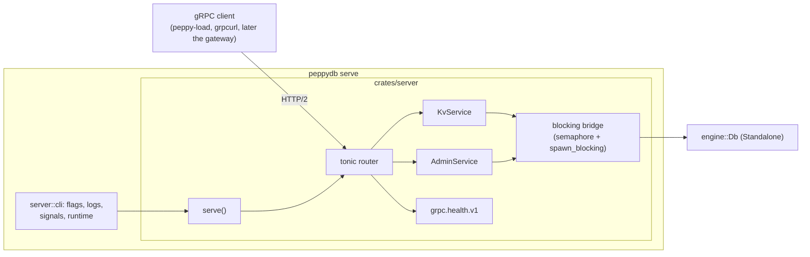
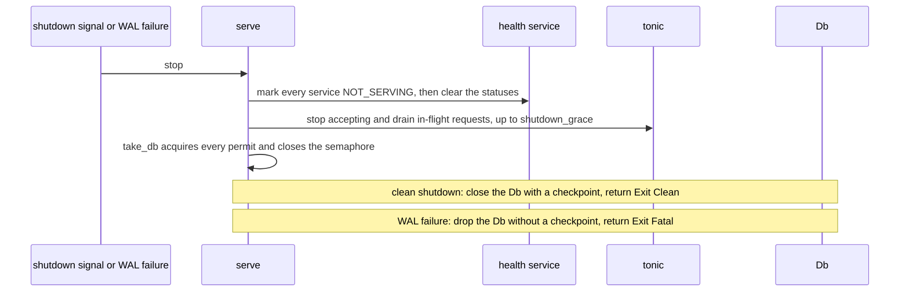

# Server

This document records the design of the server component: the
`peppydb.kv.v1` gRPC API, the `server` crate that serves it over one
`engine::Db`, the `peppydb serve` command, the proto toolchain, and the
`peppy-load` load generator.
[Plan 0026](../plans/0026-server-grpc-kv.md) built it, as milestone S1 of
the [server roadmap](../plans/0025-server-roadmap.md).

Related documents: [architecture](architecture.md) (phases and code
layout), [engine](engine.md) (the `Db` and its guarantees, which the
server inherits), [build system](build-system.md) (Buck2, feature
variants, and protobuf code generation).

## Components



| Path | Role |
| --- | --- |
| `proto/peppydb/kv/v1/kv.proto` | The API, with its semantics in comments |
| `crates/server-proto` | Generated prost messages and tonic clients and servers; internal |
| `crates/server/src/lib.rs` | `serve`, `Config`, `Exit`, `ServeError` |
| `crates/server/src/bridge.rs` | The blocking bridge, fail-stop state, `take_db` |
| `crates/server/src/kv.rs`, `admin.rs` | The two services |
| `crates/server/src/keys.rs` | The stored key layout and the format marker |
| `crates/server/src/status.rs` | `engine::Error` to gRPC status |
| `crates/server/src/cli.rs` | The `peppydb` command line; `bin/peppydb` only calls it |
| `crates/server/src/tests/` | In-process tests and the process tests |
| `go/kvpb` | Generated Go client |
| `go/cmd/peppy-load`, `go/internal/load` | The load generator |
| `tools/gen-proto`, `tools/protogen` | Code generation |

The component is named `server`, not `kv-server`, because in phase 2 the
same process also hosts the Raft peer service.

## The API

```proto
service KvService {
  rpc Get(GetRequest) returns (GetResponse);
  rpc Put(PutRequest) returns (PutResponse);
  rpc Delete(DeleteRequest) returns (DeleteResponse);
  rpc Scan(ScanRequest) returns (ScanResponse);   // one page
}

service AdminService {
  rpc Status(StatusRequest) returns (StatusResponse);
  rpc Checkpoint(CheckpointRequest) returns (CheckpointResponse);
}
```

buf's `STANDARD` lint rules require the `Service` suffix, so the services
are `KvService` and `AdminService`.

- **Semantics are the engine's.** Each RPC calls one `Db` method. A `Put`
  or `Delete` returns `OK` only after its WAL record is durable. Single
  keys are linearizable; scans are consistent per leaf, not across leaves
  or pages ([read consistency](engine.md#read-consistency)).
- **Errors are gRPC statuses,** not response fields. A missing key is not
  an error: `Get` returns `OK` with `value` unset; an empty value is a
  value.
- **Empty response messages stay,** so fields can be added without
  changing an RPC's signature.
- **No multi-key write.** The engine's `WriteBatch` (durable together, not
  isolated) is not exposed. Multi-key atomicity is expected to arrive as
  transactions with read sets, as in ZippyDB.
- **Scans return pages.** A page holds at most `page_size` records
  (`Config::scan_max_records`, default 1000, if `page_size` is 0 or
  larger) and stops once its keys and values reach
  `Config::scan_max_bytes` (default 1 MiB). `next_start` is the first key
  not returned, or unset when the range is exhausted. The client repeats
  the request with `start = next_start`. The server keeps no cursor.
- **Outcome unknown.** A write whose call ends with `CANCELLED`,
  `DEADLINE_EXCEEDED`, `UNAVAILABLE`, or `INTERNAL` may have taken effect.
  `Put` and `Delete` are idempotent, so a retry is safe.
- **Versioned.** Incompatible changes go to `peppydb.kv.v2`; `buf breaking`
  enforces it.

## Key layout

Every stored key starts with a namespace byte. Clients never see it.

```text
0x00 ‖ name       system keyspace: server-owned state
0x01 ‖ user key   user keyspace
0x02 .. 0xFF      reserved
```

- `Get`, `Put`, and `Delete` use `0x01 ‖ key`; scan results strip the byte.
  Any non-empty user key is allowed, including keys that start with `0x00`
  or `0xFF`.
- A user range `[start, end)` becomes `[0x01 ‖ start, 0x01 ‖ end)`; an
  unset `start` is `[0x01]` and an unset `end` is `[0x02]`, so a user scan
  never reads a system key.
- The largest user key is one byte shorter than `TreeConfig::max_key_len`.
- **Format marker.** On first open of an empty database, `serve` writes
  `0x00 ‖ "format" = [1]`. It refuses a database with data and no marker
  (`FormatError::Missing`), such as one written directly through
  `engine::Db`, and a marker with another version
  (`FormatError::Unsupported`).

**What belongs in the system keyspace.** Every key in the tree is
replicated and rolls back with the tree to its last checkpoint after a
crash. The system keyspace therefore holds state that is replicated and
must change atomically with the user data. Node-local state (the Raft term
and vote, the commit index, the node's identity) must stay out. Today it
holds only the format marker; the
[roadmap](../plans/0025-server-roadmap.md#the-system-keyspace) lists what
comes next.

## The blocking bridge

`Db` methods block, and tonic runs handlers on tokio's async worker
threads. `Inner::blocking` runs each engine call on tokio's blocking pool,
holding one permit of a semaphore of `Config::max_inflight` (default 1024)
permits:

1. **Backpressure.** A request over the limit waits for a permit, which
   stops tonic reading that connection; HTTP/2 flow control pushes back on
   the client.
2. **A bound on blocking threads.** `server::cli` sets tokio's
   `max_blocking_threads` to `max_inflight + 64`.
3. **Shutdown.** `take_db` acquires every permit (the semaphore is fair,
   so later requests queue behind it), closes the semaphore, and then holds
   the only reference to the database.

- **The permit belongs to the blocking task,** not the handler. If a client
  goes away, the task still runs to the end and keeps its permit.
- **The database reference is dropped before the permit** (declaration
  order in the task), so once shutdown holds every permit no task holds the
  database. The database lives in an `ArcSwapOption`; each call takes a
  reference after it has a permit.
- **Group commit.** Many concurrent writers share each WAL sync, which the
  measurements below show.
- tonic 0.14 still generates its traits with `async-trait`, so the service
  impls use `#[tonic::async_trait]`.

## Errors

| `engine::Error` | gRPC status |
| --- | --- |
| `Tree(EmptyKey \| KeyTooLarge \| ValueTooLarge \| InvalidRange)` | `INVALID_ARGUMENT`; nothing was written |
| `Wal(_)` | `UNAVAILABLE`, and the server stops (fail-stop) |
| every other error | `INTERNAL`, logged |

An empty key is rejected before the engine. tonic rejects a request over
`Config::max_request_bytes` (default 4 MiB) with `RESOURCE_EXHAUSTED`.

**Fail-stop.** After a WAL failure the `Db` refuses every write until it is
reopened, and applied but unsynced writes stay visible. The first
`Error::Wal` is recorded and wakes `serve`, which shuts down as below and
returns `Exit::Fatal(error)` without a checkpoint (a checkpoint's hook
would sync the failed WAL). `peppydb serve` exits with status 1, so a
supervisor restarts it, and the restart replays the durable WAL.

## Serving and shutdown

```rust
pub async fn serve(
    db: Db,
    listener: tokio::net::TcpListener,
    config: Config,
    shutdown: impl Future<Output = ()> + Send,
) -> Result<Exit, ServeError>;
```

`serve` takes an opened database and a bound listener, so tests bind
`127.0.0.1:0` and call it in-process.



- **Health.** The overall status (`""`), `peppydb.kv.v1.KvService`, and
  `peppydb.kv.v1.AdminService` are `SERVING` while the server runs.
  Clearing the statuses after setting `NOT_SERVING` ends open `Watch`
  streams, so health watchers do not hold up the drain.
- **The grace period bounds only the network drain**
  (`Config::shutdown_grace`, default 10 s). Engine calls are short, so the
  permit wait has no timeout.
- **Signals.** `SIGINT` or `SIGTERM` starts the clean shutdown; a second
  signal exits at once with status 1, which is safe because acknowledged
  writes are durable. The handlers are installed before the `listening on`
  line is logged.

## The command line

```text
peppydb serve --data-dir <DIR> [--listen 127.0.0.1:7420]
              [--flush-interval-us 0] [--io cached|direct]
              [--max-inflight 1024]
```

- The default address is loopback: there is no TLS or authentication.
- Logs go to stderr through `tracing`, filtered by `RUST_LOG` (default
  `info`). `listening on <addr>` reports the bound address.
- Exit status: 0 after a clean shutdown; 1 after a WAL failure or a startup
  error such as a locked database.
- The code is in `server::cli` so that the process tests run exactly what
  the binary runs.

## Proto toolchain

See [build system](build-system.md#protobuf-code-generation).
`tools/gen-proto` runs `buf lint`, `buf breaking` against the parent
revision, `buf build`, `//tools/protogen` (Rust through
`tonic-prost-build`), and `buf generate` (Go). `tools/gen-proto --check`
fails if the checked-in code differs.

## The load generator

`peppy-load` drives a running server over the generated Go client.

```text
peppy-load --addr 127.0.0.1:7420 --workload put|get|mixed[:read-percent]
           --concurrency 64 --conns 4 --duration 10s --warmup 2s
           --keys 100000 --key-size 16 --value-size 100
           --distribution uniform|zipf[:s] [--preload] [--seed 1] [--json]
```

- Workers issue requests back to back (closed loop) over `--conns` shared
  connections. `--preload` writes every key once first.
- Keys are fixed-size big-endian encodings of an index from the chosen
  distribution, so they sort by index; a seed makes runs repeatable.
- Latencies go into a log-linear histogram (16 buckets per power of two,
  relative error below 6.25%); quantiles report the top of their bucket,
  and the maximum is exact.
- Errors are counted by status code and do not stop the run. Throughput
  counts successful operations only. `--json` prints machine-readable
  results.

## Guarantees and tests

Test paths are relative to `crates/server/src/tests/` unless noted.

| Guarantee | Tests |
| --- | --- |
| 1. Point operations round-trip; an absent key returns no value; an empty value is a value; deleting an absent key succeeds. | `kv.rs`: `point_operations_round_trip` |
| 2. An invalid request (empty key, key or value over the limits) is `INVALID_ARGUMENT` and writes nothing; the largest user key is `max_key_len - 1`. | `kv.rs`: `invalid_requests_write_nothing` |
| 3. User keys are stored as `0x01 ‖ key`, keys that look like system keys are ordinary user keys, and the format marker is written. | `kv.rs`: `user_keys_are_stored_under_the_user_prefix`; `keys.rs` unit tests |
| 4. A database with data but no format marker is refused. | `kv.rs`: `a_database_without_the_format_marker_is_refused` |
| 5. Concurrent clients match an oracle, live and after a restart. | `kv.rs`: `concurrent_clients_match_the_oracle`, `writes_survive_a_restart` |
| 6. Paging covers a range exactly once for random bounds and page sizes; pages respect both limits; `next_start` is unset exactly when the range is exhausted. | `scan.rs`: `paging_returns_each_record_exactly_once`, `pages_respect_the_record_and_byte_limits` |
| 7. An unbounded scan returns every user key and no system key; a reversed range is `INVALID_ARGUMENT`. | `scan.rs`: `an_unbounded_scan_returns_user_keys_only`, `a_reversed_range_is_invalid` |
| 8. Engine errors map to the documented codes. | `status.rs`: `engine_errors_map_to_documented_codes` |
| 9. `Status` and `Checkpoint` report the engine's progress. | `admin.rs`: `status_and_checkpoints_report_engine_progress` |
| 10. Shutdown with writes in flight returns `Clean`, releases the lock, and keeps every acknowledged write. | `admin.rs`: `shutdown_with_writes_in_flight_is_clean_and_keeps_every_acknowledged_write` |
| 11. Health is `SERVING`, then `NOT_SERVING` on shutdown, and an open `Watch` does not delay the shutdown. | `admin.rs`: `health_turns_not_serving_and_watchers_do_not_delay_shutdown` |
| 12. A WAL failure returns `UNAVAILABLE`, stops the server with `Exit::Fatal`, and a reopen recovers every acknowledged write. | `admin.rs`: `a_wal_failure_stops_the_server_and_a_reopen_recovers` |
| 13. A write acknowledged by `peppydb serve` survives `SIGKILL`; `SIGTERM` exits 0. | `process.rs`: `acknowledged_writes_survive_sigkill_and_sigterm_stops_cleanly` |
| 14. A second server on a locked database exits 1. | `process.rs`: `a_second_server_on_a_locked_database_exits_with_an_error` |
| 15. The generated code matches `proto/`, which passes lint and the breaking-change check. | `tools/gen-proto --check` |
| 16. The load generator's keys, distributions, histogram, and reports behave as documented. | `go/internal/load/load_test.go` |

The fault-injection hook (`Db::fail_next_wal_sync`) is tested in
`crates/engine/src/tests/fault.rs` with `cargo test -p engine --features
fault-injection`, and through guarantee 12 under Buck2.

**Process tests and lock files.** The process tests fork children from
the test process. Until a child execs, it holds copies of the parent's open
files, including another test's `LOCK` file, so for that moment a lock
outlives the database that took it. The in-process tests therefore open
databases through `open_db`, which retries `Locked` for up to 5 s. A real
double open still fails. Production servers do not fork.

## Not guaranteed, and limits

- **Everything the engine does not guarantee:** batch isolation (not
  exposed), consistent scans across leaves or pages, and durability of a
  value a reader saw before its writer returned
  ([engine](engine.md#db-not-guaranteed-and-limits)).
- **No TLS, no authentication, no metrics.**
- **The outcome of a failed write is unknown** to the client.
- **One blocking thread per in-flight engine call.** A write holds a
  blocking-pool thread while it waits for its fsync, so the threads equal
  the writes in flight, bounded by `max_inflight` (default 1024). Nothing
  caps `--max-inflight`: a run with 8,192 permits and 8,192 writers reached
  7,067 threads and panicked the macOS kernel
  ([plan 0026](../plans/0026-server-grpc-kv.md#discoveries-and-plan-changes)).
  Keep `max_inflight` near the default. RocksDB's callers use the same
  model; in roadmap S7, writes await openraft's async `client_write`
  instead, and no request holds a thread while it waits.
- **The grace period can cut off requests.** If in-flight requests outlast
  `shutdown_grace`, their connections are dropped; their engine calls
  still finish before the database closes.
- **Version reporting.** `Status.version` and `--version` come from
  Cargo's `CARGO_PKG_VERSION`; Buck2 builds report `unknown`.

## Extension points

- **Phase 2 (roadmap S7):** `serve` keeps its signature; it builds an
  openraft node instead of a standalone `Db`. Writes call `client_write`,
  reads call `ensure_linearizable` and then the bridge, and a non-leader
  answers `UNAVAILABLE` with a leader hint in the status details.
- **API:** new RPCs and fields are compatible changes to `kv.v1`: a
  streaming scan, transactions, conditional writes, or a write's index in
  `PutResponse`.
- **System keyspace:** the Raft applied `LogId` and membership, migration
  fences, and a deduplication table.

## Measurements

Informational, not gates. **Environment:** native macOS 27.0.1, Apple M4
Pro (12 cores), APFS on the internal SSD, where one fsync takes about
4 ms; release builds (`@build/mode/release`); `peppy-load` and
`peppydb serve` on the same machine over loopback. Docker was not
available, so these are not the Linux numbers of the
[engine measurements](engine.md#measurements) and are not comparable to
them. 8-byte keys, 16-byte values, 100,000 keys, 1 s warmup, 3 s per
point, 4 connections, default server settings.

| Workload | Concurrency | Ops/s | p50 (µs) | p99 (µs) | p99.9 (µs) | Max (µs) |
| --- | --- | --- | --- | --- | --- | --- |
| put | 1 | 223 | 4,194 | 7,078 | 8,126 | 8,215 |
| put | 4 | 449 | 8,389 | 14,156 | 21,892 | 21,892 |
| put | 16 | 1,805 | 8,126 | 14,680 | 15,729 | 16,057 |
| put | 64 | 7,310 | 8,126 | 12,583 | 13,107 | 16,059 |
| put | 256 | 28,901 | 8,389 | 12,583 | 14,680 | 18,771 |
| get (preloaded, uniform) | 64 | 77,402 | 754 | 2,359 | 4,981 | 25,070 |
| mixed 90% get, zipf 1.1: put | 64 | 6,662 | 6,816 | 11,534 | 12,583 | 14,334 |
| mixed 90% get, zipf 1.1: get | 64 | 60,233 | 279 | 983 | 1,704 | 4,793 |

- **Puts scale with concurrency at a constant latency.** From 4 to 256
  writers, throughput grows about 64 times while p50 stays near 8 ms, about
  two fsyncs: a put that arrives during a sync waits for that sync and the
  next. Group commit, not the semaphore, sets the rate; 1024 permits did
  not bind.
- **Reads** are bound by gRPC and loopback costs on one machine, not by the
  engine.
- **Context from the reference machine.** Plan 0024's live run on GCP
  (`c4d-standard-8-lssd`, Local SSD) measured the engine alone:
  15,239 durable puts/s on 1 thread (p50 64 µs) and 63,958 on 8 threads,
  and 8.11 M in-memory gets/s on 8 threads in the tree. One fsync there
  takes tens of microseconds, against about 4 ms for `F_FULLFSYNC` here, so
  the single-client put rate above reflects this machine's fsync, not the
  server. The read gap (77,000/s against millions in-process) is mostly RPC
  cost on a shared machine and has not been broken down yet.
- Reference runs of the server on Linux, on separate client and server
  machines through `tools/gcp-bench`, belong to roadmap S2.

## Relationship to sources

- The [ZippyDB engineering overview](../references.md#zippydb-engineering-overview)
  describes a key-value API with get, put, delete, and prefix iteration
  over an embedded engine, the shape of `kv.v1`, and transactions with
  read and write sets, which this API deliberately does not offer yet.
- TiKV stores user data under an internal `z` prefix and CockroachDB keeps
  range-local state under a reserved `\x01` prefix; the namespace byte
  follows the same idea.
- The gRPC health checking protocol (`grpc.health.v1`) is implemented by
  `tonic-health`.
