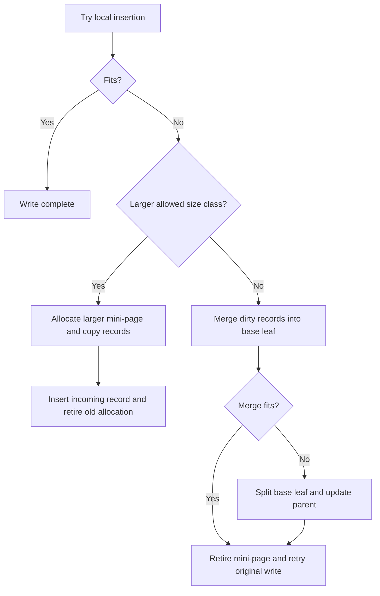

# Page operations in Microsoft's BF-Tree

This walkthrough describes the Microsoft implementation at revision
[`f442e6172bf7e5483ff320d8e3ac16a70e31bbd6`][upstream]. It explains record state,
payload reuse, consolidation, and handling of local insertion failures.
Implementation details are specific to that revision and distinct from the
published paper's design.

Read [the BF-Tree overview](bf-tree.md) for the relationship between mini-pages,
base leaves, and the buffer pool. peppydb's implemented guarantees belong in
[the shared-page design](../design/bf-tree-pages.md).
[Plan 0004](../plans/0004-bf-tree-page-mutation.md) records how these mechanisms
inform peppydb's page-mutation stack.

## Shared packed format

`LeafNode` represents base leaves, mini-pages, and full-page caches. Its layout
has a 32-byte header, a sorted directory of 8-byte slots, and variable-length
key/value payloads growing backward from the end:

```text
| header | sorted slots --> | contiguous free gap | <-- payloads |
```

- The header contains node metadata, prefix length, a backing-leaf reference,
  log sequence number, and snapshot version. Figure 3 of the paper instead
  illustrates a 12-byte header.
- Slots encode a payload offset, a two-bit record kind and 14-bit key length,
  a reference bit and 15-bit value length, and a two-byte key preview.
- Integers use native fields. Payload offsets are relative to the data area
  after the header. The reference/value-length field is an `AtomicU16`.
- The default base-leaf size is 4 KiB; the implementation supports pages up to
  32 KiB. Public record keys are nonempty. Live-value insertion asserts that
  values are nonempty.

See [`LeafNode` and `LeafKVMeta`][leaf], [`NodeMeta`][node-meta], and the paper's
§3.2. The current slot packing differs from the paper's separate fence bit.

## Record state and lookup results

Mini-page records distinguish existence from whether an operation still needs
to reach the base leaf:

| Kind | Dirty mutation | Key exists |
| --- | --- | --- |
| `Insert` | Yes | Yes |
| `Delete` | Yes | No |
| `Cache` | No | Yes |
| `Phantom` | No | No |

These dirty-state meanings apply to mini-pages. An `Insert` in a base leaf means
a live record, not necessarily a pending write.

A partial mini-page lookup needs three semantic outcomes:

| Result | Action |
| --- | --- |
| No matching entry | Check the base leaf. |
| Live value | Return the value. |
| Known absence | Return not found without checking the base leaf. |

For example, the base leaf can contain `a = old` while its mini-page contains
`Delete(a)`. Treating the deletion as a cache miss would incorrectly return
`old`. A phantom also stops the search, but records a clean negative-cache
result rather than an unapplied deletion. See the paper's §§5.4 and 5.6.

Upstream's point-read result exposes those distinctions:

```rust
pub enum LeafReadResult {
    Deleted,
    NotFound,
    Found(u32), // Length of the value copied into the caller's buffer.
    InvalidKey,
}
```

[`read_by_key_inner`][leaf-read] maps both absence kinds to `Deleted`. The
partial-mini-page caller in [`LeafOperations::read`][mini-ops] falls back to
the base only on `NotFound`. A complete base or full-page cache can answer an
in-range miss directly.

The metadata iterator and `LeafKVMeta::op_type()` expose the exact four-way kind
separately. Merge and eviction need that information: dirty records must be
applied before they are discarded, while eligible clean cache records can be
dropped without propagating them as mutations.

The leaf scan helper, `get_record_by_pos_with_bound`, copies selected key/value
fields and reports absent records separately as `Deleted`. Its optional upper
bound is inclusive: a key greater than the bound ends the scan.

### Copying values and memory ownership

Copying into the caller's buffer is safe slice code:

```rust
let val_ref = self.get_value(kv_meta);
out_buffer[..val_len as usize].copy_from_slice(val_ref);
```

Unsafe operations construct views into manually managed page memory. `LeafNode`
has a zero-length trailing data array; `get_value` uses pointer arithmetic and
`slice::from_raw_parts` to obtain the payload slice. Other helpers cast
buffer-pool pointers into references whose validity depends on surrounding
allocation and locking conventions.

Copying lets the caller retain returned bytes after page protection is released.
A borrowed result instead requires the page allocation and protection to remain
valid throughout the borrow. Either API can distinguish values, misses, and
known absence.

## Insertion, replacement, and payload holes

[`LeafNode::insert`][leaf-insert] performs upsert. It searches the slot directory
and then takes one of these paths:

| Case | Physical action |
| --- | --- |
| Existing key, incoming `Delete` | Change the kind; retain the payload and value length. |
| Existing key, equal-size or smaller incoming value | Overwrite the value and update its length and kind. A shorter value leaves a payload hole. |
| Existing key, larger incoming value | Allocate a complete new stored key-suffix/value payload from the contiguous gap and redirect the existing slot. The old payload becomes a hole. |
| New key | Allocate a payload and a slot, shifting later slots to maintain key order. |
| Missing key, incoming `Delete` on a base page | Succeed without adding a tombstone. A mini-page must retain a deletion because the base may still contain the key. |

The header's `remaining_size` counts the contiguous gap, not holes elsewhere in
the payload area. A growing replacement can fail locally even when a repacked
page containing only final versions would fit. The method returns `false`
before changing bytes when its capacity checks fail.

New entries start with a clear reference bit. Replacement preserves the existing
bit: `set_value_len` changes only the length bits, and `set_op_type` changes
only the kind bits.

## Deletion and reuse of the old allocation

Deleting an existing entry changes only its kind. Reads report absence while
its previous value bytes and encoded length remain:

| Operation on the retained entry | Kind | Encoded value length | Logical read |
| --- | --- | --- | --- |
| Insert `a = hello` | `Insert` | 5 | `hello` |
| Delete `a` | `Delete` | 5 | Absent |
| Insert/upsert `a = world` | `Insert` | 5 | `world`; overwrite the same region |

A replacement of at most five bytes can reuse that region while the retained
length is five. A shorter replacement updates the encoded length, so subsequent
growth is judged against that shorter length. There is no separate
allocation-capacity field.

Reuse depends on the entry still retaining its payload. A delete missing from
a mini-page creates a key-only tombstone; it does not fetch the old base value
merely to preserve that value's allocation.

An application replacing a present value can directly upsert. The public
`BfTree::insert` already has upsert semantics and uses the same reuse path.
Delete followed by insertion matters when the key must be absent between the
operations, such as membership removal and later re-addition.

Metadata-only deletion is a direct benefit; later reuse is an additional
consequence. The inspected sources do not establish that frequent delete/reinsert
cycles motivated this choice. Retaining the allocation also has a cost: deleted
entries continue to occupy space.

## Consolidation combines packing and policy

[`consolidate_inner`][leaf-consolidate] is a shared helper inside `LeafNode`.
The name does not refer to an inner tree node. Named wrappers configure its
parameters to select records, change kinds, replace a high fence, and initialize
snapshot metadata. Its broad sequence is:

1. Collect retained keys, values, and kinds into owned records.
2. Select the fences for the rebuilt page.
3. Reinitialize the page, including its prefix and snapshot metadata.
4. Reinsert retained records, applying the selected kind conversion.

Reinsertion removes holes and starts entries with clear reference bits. The
operation can also change logical contents, depending on the wrapper:

- `consolidate` skips tombstones in its applicable page roles.
- `consolidate_after_split` also installs a new high fence.
- `consolidate_skip_key` omits a specified key before a cache-only insertion
  retry, so the replacement does not need space for both versions.

These operations have role-specific preconditions. A partial mini-page cannot
discard an unapplied deletion merely because its logical value is absent.

Growth uses another helper, `copy_initialize_to`. It builds records in a new
allocation, preserves their kinds, and can discard unreferenced clean cache
records. Dirty records remain, including their tombstones. Fresh slots reset
reference bits. Copying is therefore also an opportunity for cache policy.

## What happens when a local insertion runs out of space?

`LeafNode::insert` returning `false` is an internal capacity signal. The
leaf-operation layer grows, merges, or splits storage, and the public tree API
retries. Public input validation can reject an invalid record before that loop;
ordinary page-full handling does not return a page-full rejection to the
application.

For an ordinary mini-page, the main path is:



[`LeafEntryXLocked::insert` and `try_merge_mini_page`][mini-ops] handle these cases:

| Page or mode | Action after local insertion fails |
| --- | --- |
| Ordinary mini-page with a larger allowed size class | Allocate a larger mini-page, rebuild records into it, update the mapping, insert the incoming record, and retire the old allocation. Copying removes holes and can discard cold clean cache records. |
| Ordinary mini-page with no larger allowed size class | Merge dirty records into the base leaf and retire the mini-page. Split the base leaf and update the parent when the merge does not fit. Optionally create a full-page cache, then retry the original write. |
| Full-page cache | Flush/merge it to its base leaf, retire the cache allocation, and restart the write. |
| Root base leaf | Set its split flag and restart; subsequent traversal handles the split. |
| Cache-only tree | Selected paths consolidate before splitting. At maximum mini-page size, `consolidate_skip_key` excludes the incoming key's old version before retrying. |

[`BfTree::insert`][tree-insert] loops on `NeedRestart`. On `CircularBufferFull`,
it attempts eviction and retries. Growth replaces an in-memory allocation while
preserving logical leaf identity; splitting creates another logical leaf.

Growth combines reclamation with creating additional headroom. A compact-first
policy can leave little free space before another write forces another rebuild.
Conversely, reclaiming first can avoid consuming more of the bounded buffer
pool or reaching a merge earlier. These are possible consequences of the
mechanisms, not a measured claim that one policy is always faster or a statement
of the authors' intent. Both policies can use the same in-place path for ordinary
writes; their difference is how they handle capacity pressure.

## Fences, prefixes, and previews

Fenced pages reserve their first two slots for the low and high fence. Ordinary
records follow in sorted order. The low fence is inclusive and the high fence
exclusive; splitting sends keys below the split key left and the rest right.

- Initialization treats an empty fence slice as infinity. Encoded infinite
  fences use reserved offsets: `u16::MAX - 1` for the low fence and `u16::MAX`
  for the high fence. The header has a fence flag, and its count includes both
  structural slots.
- Fenced pages derive a common prefix from their bounds. The low fence stores
  its full key; other keys store suffixes. Ordinary mini-pages are initialized
  without fences and use zero prefix length.
- Key lengths include the compressed prefix; previews contain up to two bytes
  of the stored suffix. Search compares meaningful preview bytes first and
  loads the suffix when previews compare equal.
- Page search/insertion relies on correctly routed keys and prefix preconditions,
  rather than checking both fences for every point operation.
- `max_fence_len` and `full_with_fences` support capacity budgeting for fences
  that may be installed during later restructuring.

See `initialize`, `install_fence_key`, `key_cmp`, `lower_bound`,
`full_with_fences`, and `split_with_key` in [`leaf_node.rs`][leaf], and the
paper's §3.5.

## Sources

- [BF-Tree paper](../references.md#bf-tree-paper): §3.2 for the shared format;
  §3.5 for fences, prefixes, and previews; §§5.4–5.6 for mutation, mini-page
  handling, and negative caching.
- Microsoft revision `f442e6172bf7e5483ff320d8e3ac16a70e31bbd6`:
  - [`src/nodes/leaf_node.rs`][leaf]: layout, reads, writes, consolidation, and
    copy initialization.
  - [`src/nodes/node_meta.rs`][node-meta]: header flags and slot counts.
  - [`src/mini_page_op.rs`][mini-ops]: page-role handling, growth, merge, and split.
  - [`src/tree.rs`][tree]: public operation validation and retry loops.

[upstream]: https://github.com/microsoft/bf-tree/tree/f442e6172bf7e5483ff320d8e3ac16a70e31bbd6
[leaf]: https://github.com/microsoft/bf-tree/blob/f442e6172bf7e5483ff320d8e3ac16a70e31bbd6/src/nodes/leaf_node.rs
[leaf-read]: https://github.com/microsoft/bf-tree/blob/f442e6172bf7e5483ff320d8e3ac16a70e31bbd6/src/nodes/leaf_node.rs#L1658-L1705
[leaf-insert]: https://github.com/microsoft/bf-tree/blob/f442e6172bf7e5483ff320d8e3ac16a70e31bbd6/src/nodes/leaf_node.rs#L1077-L1213
[leaf-consolidate]: https://github.com/microsoft/bf-tree/blob/f442e6172bf7e5483ff320d8e3ac16a70e31bbd6/src/nodes/leaf_node.rs#L1399-L1610
[node-meta]: https://github.com/microsoft/bf-tree/blob/f442e6172bf7e5483ff320d8e3ac16a70e31bbd6/src/nodes/node_meta.rs
[mini-ops]: https://github.com/microsoft/bf-tree/blob/f442e6172bf7e5483ff320d8e3ac16a70e31bbd6/src/mini_page_op.rs
[tree]: https://github.com/microsoft/bf-tree/blob/f442e6172bf7e5483ff320d8e3ac16a70e31bbd6/src/tree.rs
[tree-insert]: https://github.com/microsoft/bf-tree/blob/f442e6172bf7e5483ff320d8e3ac16a70e31bbd6/src/tree.rs#L1118-L1181
