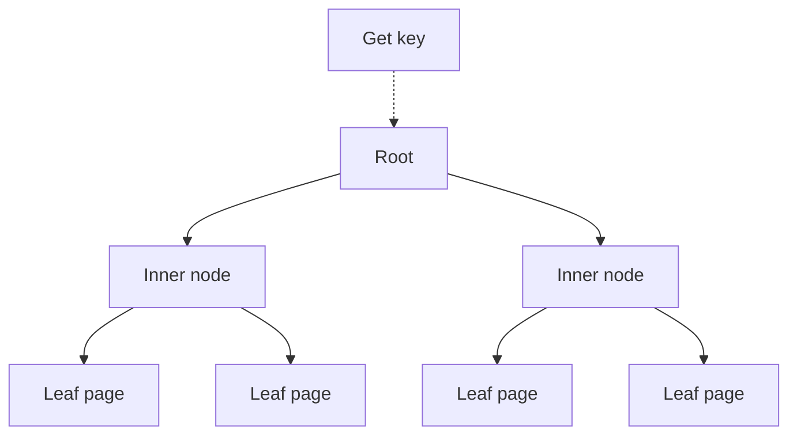
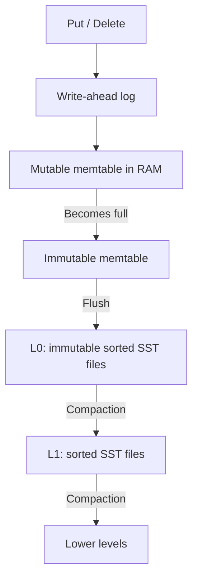
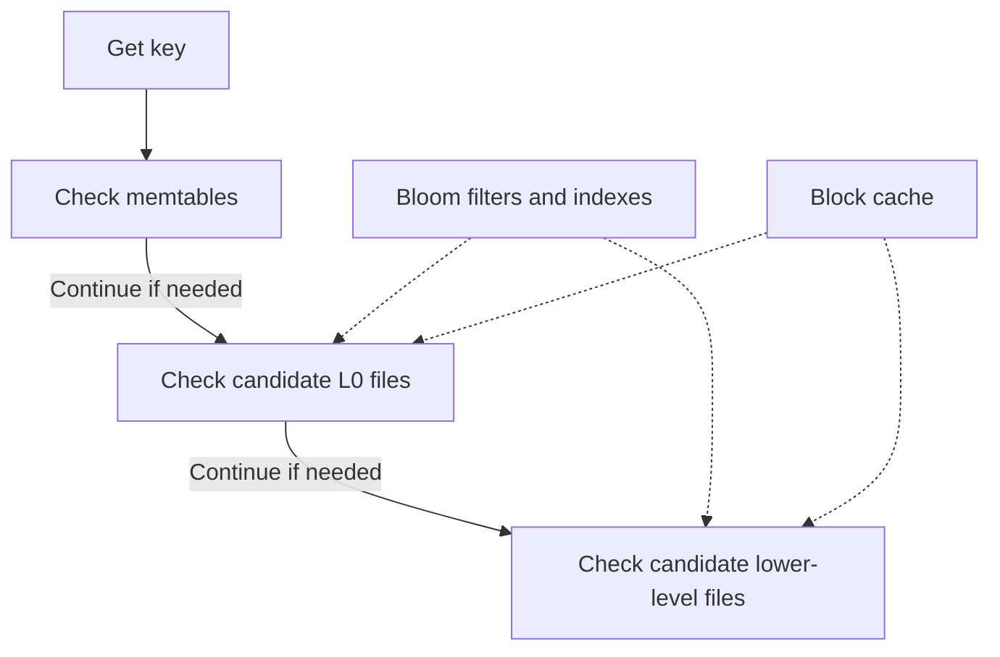
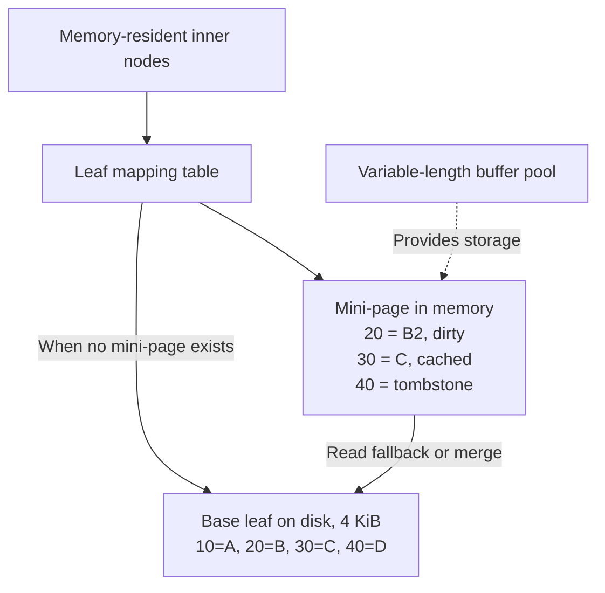

# B-trees, LSM trees, and BF-Tree

All three support an ordered key-value map. Their storage and caching strategies
differ. The useful questions are: where do new writes go, what is cached in
memory, and how does that become the on-disk data?

This walkthrough describes BF-Tree as presented in the paper. In the comparison,
"B-tree" means the common B+tree-style arrangement: records live in leaf pages,
and inner nodes route searches. RocksDB provides the concrete example of a
log-structured merge tree (LSM tree).

## Conventional B-tree: cache and update whole pages

The tree divides the keyspace into leaf pages. A lookup follows inner-node
separators to the relevant leaf.



For a larger-than-memory tree, pages move through a buffer pool:


Suppose a leaf contains:

```text
Disk page: [10=A | 20=B | 30=C | 40=D]
                          ^
                   We want this record
```

A page-cache miss generally brings the entire page into memory. Updating key
`30` modifies its cached page, which is eventually written back. Multiple
updates can accumulate before that flush; each update does not necessarily
cause an immediate page write.

BF-Tree targets two costs of this arrangement:

- **Cache granularity:** One hot record can keep a whole page of mostly cold
  records in memory.
- **Write granularity:** A small modification eventually requires a page-sized
  write. Scattered updates across many pages amplify this cost.

B-trees also have a useful advantage for scans: nearby keys are grouped together
in leaf pages. See the paper's §2.1 for this background.

## LSM tree: accumulate writes, then create and merge sorted files

An LSM tree organizes persisted data into sorted runs. For RocksDB, the simplified
write path with write-ahead logging enabled is:



A memtable holds recent writes in memory. Flushing creates an immutable sorted
table (SST) file. Compaction merges sorted files and removes obsolete versions
when they are no longer needed.

An update can leave an older value in one file and a newer value elsewhere:

```text
Memtable: 30 = NEW
L0 files: ...
L1 files: 30 = OLD
```

The engine resolves versions when reading, including deletions and any versions
needed by active snapshots.

### Reads and scans



Bloom filters, indexes, and caches reduce the work. A lookup does not blindly
read every file. A range scan generally combines overlapping sorted sources:

```text
Memtable: 10=A2        30=C2
SST run:  10=A   20=B  30=C   40=D
             \         /
              merge versions

Result:   10=A2  20=B  30=C2  40=D
```

Buffering and sorted-file creation make ingestion efficient. Reads and background
compaction must manage multiple runs. See the RocksDB overview's High Level
Architecture and Features sections, and the BF-Tree paper's §2.2.

## BF-Tree: keep the tree, make the cache variable-sized

BF-Tree retains the tree-shaped organization and fixed-size base leaf pages.
Its central idea is that the in-memory representation of a leaf need not be a
complete copy of its disk page.

A leaf can have one **mini-page**, containing selected cached records and
buffered mutations:



The mapping table lets the tree refer to a stable leaf ID even when its mini-page
moves, grows, or is evicted. See the paper's §§3.1–3.4.

### Reads consult the mini-page first

Using the example above:

| Request | Result |
| --- | --- |
| `get(20)` | Return the newer `B2` from the mini-page. |
| `get(30)` | Return cached `C` from the mini-page. |
| `get(40)` | Return absent: the tombstone overrides the old disk value. |
| `get(10)` | Read the base leaf because the partial mini-page has no answer. |

**Not in a partial mini-page does not mean not in the database.**

BF-Tree can also cache a failed lookup with a **phantom record**. A phantom means
the key is known to be absent, allowing a later lookup to avoid the disk read.
The four record states distinguish dirty data from clean cached information
(paper §5.6, Table 1):

| Record kind | Dirty | Key exists |
| --- | --- | --- |
| Insert | Yes | Yes |
| Tombstone | Yes | No |
| Cache | No | Yes |
| Phantom | No | No |

### Writes accumulate inside the mini-page

Repeated updates can modify the record already buffered there:

```text
Base leaf: 20 = B

Mini-page:
  put(20, B2) -> [20=B2]
  put(20, B3) -> [20=B3]
  put(20, B4) -> [20=B4]
```

Eventually, dirty records merge into the base leaf:

```text
Base:      [10=A | 20=B  | 30=C | 40=D]
Mini-page:        20=B4          40=deleted
                    \             /
                         merge

New base:  [10=A | 20=B4 | 30=C]
```

Clean cached records can be discarded without writing them back. Dirty updates
and tombstones must be incorporated into the base before they are discarded.
If the merged records cannot fit, the leaf splits and inner-node routing is
updated. See the paper's §§5.2, 5.4, and 5.5.

## Mini-pages adapt between record caching and page caching

Mini-pages use the same basic packed layout as leaf pages (paper §3.2):

```text
| header | sorted record metadata -> | free space | <- key/value bytes |
```

The paper's default 4 KiB base-page configuration supports growth like this:

```text
64 B -> 128 B -> 256 B -> 512 B -> 1 KiB -> 2 KiB
                                              |
                                  merge with base contents
                                              v
                                      full 4 KiB cache
```

A full-page cache contains the complete logical leaf contents, including any
buffered changes. It is more than a larger collection of selected records. If
the merged contents overflow the leaf, splitting must also be handled.

```text
Point-lookup-heavy workload       Scan-heavy workload

Cache selected hot records       Cache complete leaf ranges
in small mini-pages              in full-sized pages
```

A scan over a partial mini-page must merge it with the base leaf. A scan over a
complete cached page can avoid that disk read. Both use the same mini-page
memory budget (paper §§5.3–5.5).

## The circular buffer manages the mini-page memory budget

The paper uses a bounded circular buffer. Its default second-chance region is
10% of that buffer, with the rest used for in-place updates (§§4.1, 6.10):

```text
oldest / head                                      newest / tail
      |                                                  |
      v                                                  v
[ second-chance region ][      in-place-update region      ]
[64 B][512 B][128 B]      [1 KiB][64 B][256 B] ...

      accessed here --------------------------------> copy to tail
      not accessed --> evict; merge dirty records first
```

Mini-pages have different sizes. Growing one allocates a larger region and
copies its contents; freed regions can be reused through size-class free lists.

The second-chance region prevents frequently accessed mini-pages from simply
aging out in first-in, first-out order. Record reference bits also help remove
cold cached records during relocation. If a cold dirty record must be evicted,
BF-Tree merges the mini-page into its base while retaining hot records (§5.5).

This budget covers mini-pages; inner nodes and the mapping table also consume memory.

## Comparison

| | Conventional B-tree | LSM tree / RocksDB | BF-Tree |
| --- | --- | --- | --- |
| Main persisted organization | Tree leaf pages | Immutable sorted runs/files | Tree leaf pages |
| Where updates accumulate | Dirty cached pages | Memtables | Mini-pages |
| Main caching approach | Whole pages | Blocks, optionally records | Selected records or complete pages |
| Background data work | Dirty-page flushing | Flushing and compaction | Mini-page merging and eviction |
| Range reads | Traverse ordered leaves | Merge sorted sources | Traverse leaves, combining overlays where needed |

A write-ahead log (WAL) provides a recovery history. All three designs can use
logging; buffering an update in memory alone does not establish durability.
See the BF-Tree paper's §5.7 and the RocksDB overview's Persistence section.

In short:

- **B-tree:** Cache and update whole pages.
- **LSM tree:** Accumulate updates into sorted runs, then merge those runs.
- **BF-Tree:** Retain tree pages on disk while adaptable mini-pages cache records
  and absorb writes.

## Sources and related documents

- [BF-Tree paper](../references.md#bf-tree-paper): §2 for the comparison,
  §3 for the architecture/layout, §4 for the buffer pool, and §5 for operations.
- [RocksDB overview](../references.md#rocksdb-overview): High Level Architecture
  and Features, especially Persistence and Multi-Threaded Compactions.
- [BF-Tree implementation roadmap](../plans/0002-bf-tree-roadmap.md): how we plan
  to build these components in peppydb.
