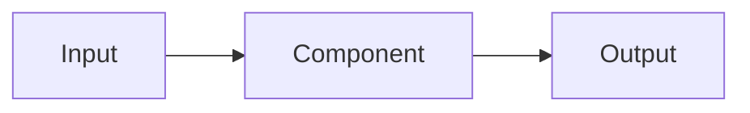

# NNNN: Stack title

> Copy this template to `NNNN-<topic>.md`, using the next available number
> starting at `0001`. Replace the prompts with the actual plan. Keep the
> detail proportional to the work and remove optional sections when unneeded.

**Status:** Draft

Use Draft while discussing the proposal, Agreed after the user's go-ahead,
In progress during implementation, and Complete after verification.

**Design references:** Link to relevant documents in `docs/design/`, or state none.

## Goal and scope

Describe the problem, why it matters, and the intended outcome.

- **In scope:** What this stack will deliver.
- **Out of scope:** Related work deliberately excluded from this stack.
- **Done when:** Observable criteria for completing the work.

## Approach

Explain how the change works and how it fits the existing system. State
important assumptions, invariants, and guarantees. Include representative
Rust snippets and diagrams where they help the reader evaluate the design.

```rust
// Sketch the proposed core interface or algorithm.
```



Replace these examples with the proposed design, or omit them when unhelpful.

## Decisions and trade-offs

- **Decision:** What we chose and why.
- **Alternatives:** Other approaches considered and their trade-offs.

Update this section as the discussion resolves open questions.

## Proposed commit stack

Repeat the subsection below for each diff. Keep the numbering and total
accurate. Each diff builds on the previous one and includes its relevant tests.
If the stack starts with a plan commit, list it as diff 1 and include it in `N`.

### `[1/N][plan][section] <Imperative commit title>`

- **Purpose:** Why this diff is needed and how it contributes to the stack.
- **Core changes:** The main changes, with a small Rust snippet where useful.
- **Verification:** The checks that establish this diff is ready.

## Open questions

- What still needs a decision before implementation can begin?

Record resolved decisions above. State "None" when no questions remain.

## Verification strategy

Describe how we will check the completion criteria and relevant guarantees.
Include failure cases, boundary conditions, or performance measurements when
they matter. Complement the per-diff checks with any necessary stack-wide checks.

| Check | Command or procedure | Expected result |
| --- | --- | --- |
| What is being verified | How to verify it | Evidence of success |

## Progress

- [ ] Agree on the design and commit stack with the user.
- [ ] Implement and verify each code diff. Add a checkbox per diff using the stack numbering.
- [ ] Complete stack-wide verification and any required design-document updates.

## Discoveries and plan changes

Record significant findings, decisions, and their effects on the approach or
stack. Summarize outcomes rather than recording a running transcript.

## Agent notes

Optional task-specific execution details. Keep decisions and rationale in
the main sections, and keep these notes readable by humans too.

- **Entry points:** Relevant files, modules, and existing examples.
- **Execution details:** Setup requirements or implementation gotchas specific
  to this stack.
