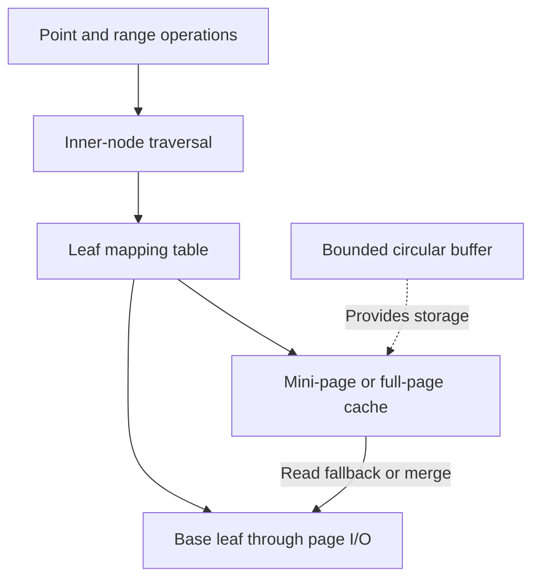

# 0002: BF-Tree implementation roadmap

**Status:** Agreed

**Design references:** [Project direction](../design/architecture.md).

**Background:** [How BF-Tree works, compared with B-trees and LSM trees](../explanations/bf-tree.md).

## Goal

Build our own BF-Tree, faithful to the paper's mechanisms, through small,
reviewable stacks. The result will underpin the embedded key-value engine.
Microsoft's implementation provides concrete examples and edge cases; our Rust
organization, ownership model, and APIs can differ.

This roadmap describes the components, how they compose, and the agreed build
order. Each implementation stack gets its own numbered plan with concrete
interfaces, commits, and verification. A milestone may require several stacks.
Use the normal draft/discuss/implement workflow for each stack and keep links
and milestone progress here current.

## Fundamental components

| Component | Responsibility | Paper |
| --- | --- | --- |
| Shared page format | Packed, sorted metadata and variable-length key/value payloads, used by leaf pages and mini-pages. | §3.2 |
| Inner nodes | Route keys to leaves; normally remain in memory and use optimistic latch coupling for concurrency. | §3.4 |
| Base leaf pages and page I/O | Hold the base records in fixed-size disk pages, normally 4 KiB. | §3.3 |
| Leaf mapping table | Resolve stable leaf IDs to their current locations; associate a lock with each logical leaf and its mini-page. | §3.3 |
| Mini-page overlay | Buffer mutations and cache records for one base leaf; grow and merge as needed. Each leaf has at most one mini-page. | §§3.1, 5 |
| Variable-length buffer pool | Bound mini-page memory; allocate, reclaim, resize, and evict through a circular buffer and size-class free lists. | §4 |
| Point and range operations | Combine traversal, mapping, mini-pages, and base pages into get/insert/update/delete/scan behavior. | §5 |
| Logging, checkpoints, and recovery | Preserve recoverable state across crashes, coordinated with the embedded engine. | §5.7 |

Fence keys delimit page ranges. Prefix compression and two-byte key previews
optimize searches and space use (§3.5). These features build on the page format.

## How the components compose

The diagram shows lookup routing and the buffer pool's allocation role.

- **Get:** Traverse to a leaf ID and inspect its mini-page first. A partial-cache
  miss falls back to the base leaf. A tombstone or phantom establishes absence
  without that read; a full-page cache can also answer absence within its range.
- **Write:** Insert or replace a record in the mini-page, growing it when needed.
  Merge dirty records into the base leaf when required. If the merged records do
  not fit, split the leaf and update the routing structure.
- **Scan:** Traverse leaf ranges and merge base records with mini-page records.
  Full-page caching lets the scan answer a covered range from memory.
- **Reclaim memory:** Evict near the circular buffer's head. Accessed pages in
  its second-chance region move toward the tail. Record reference bits help
  discard cold cached records; dirty records must be merged before they are lost.

Mini-page records distinguish two independent properties:

| Record kind | Dirty | Key exists |
| --- | --- | --- |
| Insert | Yes | Yes |
| Tombstone | Yes | No |
| Cache | No | Yes |
| Phantom | No | No |

These distinctions are part of correctness, including the difference between a
cache miss and known absence. Allocation and caching policies must preserve them.

## Build order

Start with the smallest testable piece, then compose it with the next component.
The milestones below are not individual commits or reserved plan numbers.

| Milestone | Builds on | Reviewable outcome |
| --- | --- | --- |
| 1. Shared packed page | Existing crate | Bounded record storage, distinct-key insertion, lookup, and ordered iteration. [Plan 0003](0003-bf-tree-page.md). |
| 2. Page mutation and ranges | 1 | Replacement/reclamation, record kinds, fences, and incremental layout optimizations. [Completed plan 0004](0004-bf-tree-page-mutation.md) delivers mutation, ranges, and preview search. [Completed plan 0005](0005-bf-tree-page-prefix.md) delivers fence-derived prefix compression and borrowed logical keys. Milestone complete. |
| 3. In-memory tree structure | 2 | Inner-node routing, root growth, and byte-aware splits. [Draft plan 0006](0006-bf-tree-inner-node.md) defines the local routing-node primitive; tree composition and split propagation follow in 0007. |
| 4. Leaf storage and mapping | Page format; tree for integration | Stable leaf IDs and a page-store boundary, first with a test backend and then file I/O. |
| 5. Mini-page composition | 2, 4 | Test one leaf plus its overlay, then integrate growth, merge, and split behavior into the tree. |
| 6. Bounded buffer pool | Mapping and mini-page merge | Circular allocation, free lists, eviction, and copy-on-access with a fixed memory budget. |
| 7. Integrated caching and scans | 3–6 | Record and negative caching, complete ordered scans, and full-page promotion. |
| 8. Concurrency | Integrated operations and pool | Optimistic inner-node traversal, leaf locks, and safe concurrent allocation/reclamation. |
| 9. Persistence and engine integration | Tree/storage operations; coordinate with 8 | WAL, checkpoints, recovery, and the application-facing embedded database contract. |

Some work can be developed independently: a single-leaf overlay does not need a
complete tree, and the allocator can be tested before integrating eviction.
The table gives a default sequence; dependencies determine the actual stack boundaries.

Plan concurrency and persistence invariants before introducing the mechanisms
they constrain. Preserve three separate responsibilities from the outset:
applying mutations, recording durable history, and creating/restoring checkpoints.
The current unsafe-code prohibition is sufficient for the first page stack;
revisit representation and synchronization choices when planning concurrency.

## Fidelity and staged implementation

- Preserve the paper's core design: sorted mini-pages, a shared page layout,
  bounded variable-length buffering, record-state semantics, and page-aware scans.
- Record deliberate departures from the paper and their rationale. Track features
  omitted from early milestones as later work, rather than silently redefining BF-Tree.
- Use upstream code to investigate behavior and edge cases. Prefer clear ownership
  and explicit invariants in our implementation over reproducing its organization.
- Tune policies and platform-specific I/O after a correct baseline. The initial
  page work is portable to macOS; the paper's I/O evaluation targets Linux/NVMe.

### Paper and implementation notes

The paper and current upstream code are distinct references:

- Figure 3 describes a 12-byte page header. The inspected upstream code uses
  32 bytes, including log and snapshot fields.
- §§3.1 and 5.1 use 1% record promotion, while §6.11 selects 20%. Resolve policy
  defaults in the caching plan rather than treating all example values as requirements.
- The evaluation (§6.1) disables logging/snapshotting/checkpointing. Its headline
  results require comparable workloads and hardware, and do not establish
  durability-enabled engine performance.

## Verification as the system grows

Each child plan defines focused checks alongside the required workspace checks.
Use independent models for page/tree operations, deterministic cache and I/O
tests, and later controlled concurrency schedules and crash/recovery tests.
Verify intermediate states, failure paths, and capacity boundaries as well as results.

Track correctness and performance separately. Benchmark the assembled mechanisms
under stated conditions once they exist, without treating an early subset as
the completed concurrent, larger-than-memory engine.

## Progress and next decision

- [x] Read the paper and inspect relevant Microsoft implementation code.
- [x] Agree on the component map and incremental build direction.
- [x] Review and implement [the shared-page stack](0003-bf-tree-page.md).
- [x] Draft [page mutation and ranges](0004-bf-tree-page-mutation.md).
- [x] Agree that prefix compression follows the mutation stack within milestone 2.
- [x] Agree on plan 0004's page contracts, module organization, and ten-diff stack.
- [x] Implement and verify the page-mutation stack.
- [x] Draft [fence-derived prefix compression](0005-bf-tree-page-prefix.md).
- [x] Agree on plan 0005's logical-key/fence interfaces and seven-diff stack.
- [x] Implement and verify the prefix-compression stack, completing milestone 2.
- [x] Draft [inner-node storage and routing](0006-bf-tree-inner-node.md), the first milestone 3 stack.
- [ ] Agree on and implement the inner-node primitive.
- [ ] Plan in-memory tree composition, leaf splitting, and root growth (0007).

Add links to later stack plans as they are drafted. Mark a milestone complete
only when its behavior and verification are delivered. The
[shared-page design](../design/bf-tree-pages.md) records the implemented contract.
Plan 0004 is complete, including independent mixed-operation models and workspace
verification. [Plan 0005](0005-bf-tree-page-prefix.md) is complete: pages store a
fence-derived prefix once and expose borrowed logical keys. Milestone 2 is
complete. Next, review [plan 0006](0006-bf-tree-inner-node.md): its structural
header, typed child references, and local split contract prepare the routing
primitive for tree composition in 0007.

## Sources

- [BF-Tree paper](../references.md#bf-tree-paper): §§3–5 describe the components
  and operations; §6 describes the evaluation and policy trade-offs.
- [Microsoft implementation](../references.md#microsoft-bf-tree-implementation),
  revision `f442e6172bf7e5483ff320d8e3ac16a70e31bbd6`: inspected
  `src/nodes/leaf_node.rs`, `src/nodes/node_meta.rs`, `src/tests/leaf_node.rs`,
  `src/mini_page_op.rs`, and `src/config.rs`.
