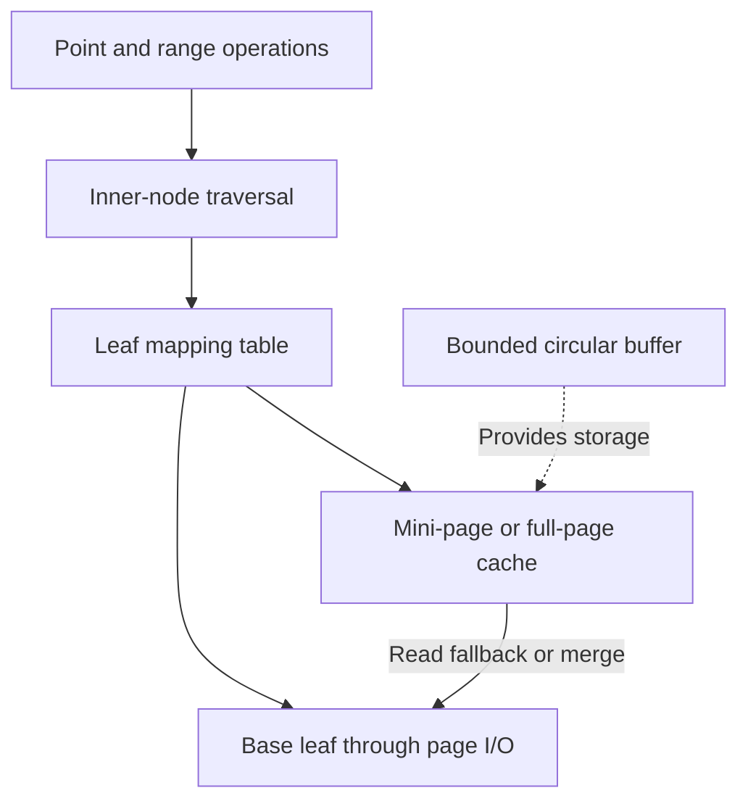

# 0002: BF-Tree implementation roadmap

**Status:** Agreed

**Design references:** [Project direction](../design/architecture.md).

**Background:** [How BF-Tree works, compared with B-trees and LSM trees](../explanations/bf-tree.md).

## Goal

Build our own BF-Tree, faithful to the paper's mechanisms, through small,
reviewable stacks. The result will underpin the embedded key-value engine.
Microsoft's implementation provides concrete examples and edge cases; our Rust
organization, ownership model, and APIs can differ.

This roadmap describes the components, how they compose, and the agreed build
order. Each implementation stack gets its own numbered plan with concrete
interfaces, commits, and verification. A milestone may require several stacks.
Use the normal draft/discuss/implement workflow for each stack and keep links
and milestone progress here current.

## Fundamental components

| Component | Responsibility | Paper |
| --- | --- | --- |
| Shared page format | Packed, sorted metadata and variable-length key/value payloads, used by leaf pages and mini-pages. | §3.2 |
| Inner nodes | Route keys to leaves; normally remain in memory and use optimistic latch coupling for concurrency. | §3.4 |
| Base leaf pages and page I/O | Hold the base records in fixed-size disk pages, normally 4 KiB. | §3.3 |
| Leaf mapping table | Resolve stable leaf IDs to their current locations; associate a lock with each logical leaf and its mini-page. | §3.3 |
| Mini-page overlay | Buffer mutations and cache records for one base leaf; grow and merge as needed. Each leaf has at most one mini-page. | §§3.1, 5 |
| Bounded circular buffer | Bound mini-page memory; allocate, reclaim, resize, and evict through a circular buffer and size-class free lists. | §4 |
| Point and range operations | Combine traversal, mapping, mini-pages, and base pages into get/insert/update/delete/scan behavior. | §5 |
| Logging, checkpoints, and recovery | Preserve recoverable state across crashes, coordinated with the embedded engine. | §5.7 |

Fence keys delimit page ranges. Prefix compression and two-byte key previews
optimize searches and space use (§3.5). These features build on the page format.

## How the components compose

The diagram shows lookup routing and the circular buffer's allocation role.

- **Get:** Traverse to a leaf ID and inspect its mini-page first. A partial-cache
  miss falls back to the base leaf. A tombstone or phantom establishes absence
  without that read; a full-page cache can also answer absence within its range.
- **Write:** Insert or replace a record in the mini-page, growing it when needed.
  Merge dirty records into the base leaf when required. If the merged records do
  not fit, split the leaf and update the routing structure.
- **Scan:** Traverse leaf ranges and merge base records with mini-page records.
  Full-page caching lets the scan answer a covered range from memory.
- **Reclaim memory:** Evict near the circular buffer's head. Accessed pages in
  its second-chance region move toward the tail. Record reference bits help
  discard cold cached records; dirty records must be merged before they are lost.

Mini-page records distinguish two independent properties:

| Record kind | Dirty | Key exists |
| --- | --- | --- |
| Insert | Yes | Yes |
| Tombstone | Yes | No |
| Cache | No | Yes |
| Phantom | No | No |

These distinctions are part of correctness, including the difference between a
cache miss and known absence. Allocation and caching policies must preserve them.

## Build order

Start with the smallest testable piece, then compose it with the next component.
The milestones below are not individual commits or reserved plan numbers.

| Milestone | Builds on | Reviewable outcome |
| --- | --- | --- |
| 1. Shared packed page | Existing crate | Bounded record storage, distinct-key insertion, lookup, and ordered iteration. [Plan 0003](0003-bf-tree-page.md). |
| 2. Page mutation and ranges | 1 | Replacement/reclamation, record kinds, fences, and incremental layout optimizations. [Completed plan 0004](0004-bf-tree-page-mutation.md) delivers mutation, ranges, and preview search. [Completed plan 0005](0005-bf-tree-page-prefix.md) delivers fence-derived prefix compression and borrowed logical keys. Milestone complete. |
| 3. In-memory tree structure | 2 | Inner-node routing, root growth, and byte-aware splits. [Completed plan 0006](0006-bf-tree-inner-node.md) delivers the local routing-node primitive; [completed plan 0007](0007-bf-tree-in-memory-tree.md) composes a single-threaded tree with leaf splits, propagation, and scans. Milestone complete. |
| 4. Leaf storage and mapping | Page format; tree for integration | Stable leaf IDs and a page-store boundary, first with a test backend and then file I/O. [Completed plan 0008](0008-bf-tree-leaf-store.md) delivers the page-store boundary with memory and file backends, stored-page validation, the leaf mapping table, flush, and reopen from leaf fences. Milestone complete. |
| 5. Mini-page composition | 2, 4 | Test one leaf plus its overlay, then integrate growth, merge, and split behavior into the tree. [Completed plan 0011](0011-bf-tree-mini-page.md) delivers the single-leaf overlay, recorded in the [mini-page design](../design/bf-tree-mini-page.md); its write loop allocates from the circular buffer of plan 0010. [Completed plan 0012](0012-bf-tree-shared-tree.md) delivers the shared tree foundation: `&self` operations, leaf locks, and one write-through path, recorded in the [concurrency design](../design/bf-tree-concurrency.md). [Completed plan 0013](0013-bf-tree-mini-tree.md) delivers the tree integration: blind writes into mini-pages backed by the circular buffer, merges and merge splits, reads and scans through the overlay, and flush merges, recorded in the [mini-page design](../design/bf-tree-mini-page.md#in-the-tree). Milestone complete. |
| 6. Bounded circular buffer | Mapping and mini-page merge | Circular allocation, free lists, eviction, and copy-on-access with a fixed memory budget. [Completed plan 0010](0010-bf-tree-circular-buffer.md) delivers the circular buffer component, recorded in the [circular buffer design](../design/bf-tree-circular-buffer.md); it landed before plan 0011, ahead of the rest of milestone 5. [Completed plan 0014](0014-bf-tree-eviction.md) delivers eviction under the fixed budget (a writer releases its leaf lock, evicts the oldest blocks by merging them into their base pages, and retries) and the second chance (relocation of accessed aging blocks on writes, and through hints on reads and scans), recorded in the [circular buffer design](../design/bf-tree-circular-buffer.md#use-in-the-tree). Milestone complete. |
| 7. Integrated caching and scans | 3–6 | Record and negative caching, complete ordered scans, and full-page promotion. [Completed plan 0015](0015-bf-tree-caching.md) delivers the caching policy: reads served by the base page cache records and absences or promote the page, scans promote untouched leaves, write-driven merges keep the merged page, full pages take writes directly and are written back only when dirty, and hints evict only full pages and clean mini-pages, recorded in the [caching design](../design/bf-tree-caching.md). Milestone complete. |
| 8. Concurrency | Integrated operations and circular buffer | Optimistic inner-node traversal, leaf locks, and safe concurrent allocation/reclamation. Leaf locks and circular-buffer concurrency arrive earlier, in plans 0010 to 0014. [Completed plan 0016](0016-bf-tree-concurrency.md) delivers optimistic inner-node traversal: inner nodes in version-locked frames with immutable images, an atomic root word, lock-free validated descents, bottom-up frame locking with top-down publication, and the final lock order, recorded in the [concurrency design](../design/bf-tree-concurrency.md). Milestone complete except the Linux measurements and the container check (see plan 0016). |
| 9. Persistence and engine integration | Tree/storage operations; coordinate with 8 | WAL, checkpoints, recovery, and the application-facing embedded database contract. [Completed plan 0017](0017-bf-tree-store-format.md) delivers the durable store format: page numbers separate from leaf IDs, dual checksummed superblock copies with a committed state, a leaf stamp and a CRC32C in every stored page, and open that rebuilds the leaf-to-page table from the stamps, recorded in the [persistence design](../design/bf-tree-persistence.md). [Completed plan 0018](0018-bf-tree-checkpoint.md) delivers shadow paging, checkpoints, and recovery: every page write goes to a fresh page stamped with a write sequence, `Tree::checkpoint` commits the applied watermark `N` and the write watermark `W` atomically while writers run, and open selects the committed image, erases pages written after `W`, and classifies torn pages, verified by a crash model against an oracle. [Completed plan 0019](0019-bf-tree-apply.md) delivers apply, the log hook, and snapshots: `Tree::apply`, `put_logged`, and `remove_logged` take sequences from a log through the log-agnostic `Log` contract in one latched sequence space, `checkpoint_with` gives a pre-commit hook the captured sequence so that no committed effect outruns its durable log record, and `write_snapshot` streams the committed image as an openable store file while writers and checkpoints run, verified by a lossy-log crash model and a replica test. [Completed plan 0020](0020-engine-wal.md) delivers the engine write-ahead log in the internal crate `engine-wal`: checksummed records in segment files named by their first sequence, contiguous sequences assigned under one mutex, one flusher thread with group commit, replay that repairs a torn tail only in the last segment and reports other damage as `Corrupt` and missing records as `Gap`, truncation below a checkpoint, and `abandon` for crash tests, recorded in the [engine design](../design/engine.md). [Completed plan 0021](0021-engine-db.md) delivers the engine `Db` in the entry crate `engine`: open with recovery that replays the WAL above the tree's checkpoint through `Tree::apply`, durable single writes that append to the WAL under the leaf lock and wait for the fsync after every lock, atomic write batches checked before logging and serialized against single writes by a writer gate, checkpoints whose pre-commit hook syncs the WAL first and then truncate it, a background checkpoint policy that writers touch only through atomics, a lock file, and crash tests that lose unsynced WAL bytes, recorded in the [engine design](../design/engine.md#the-db). Draft plans: [0022](0022-engine-external.md) (external-log mode) and [0023](0023-bf-tree-io-perf.md) (direct I/O and measurements). |

Some work can be developed independently: a single-leaf overlay does not need a
complete tree, and the allocator can be tested before integrating eviction.
The table gives a default sequence; dependencies determine the actual stack boundaries.

Plan concurrency and persistence invariants before introducing the mechanisms
they constrain. Preserve three separate responsibilities from the outset:
applying mutations, recording durable history, and creating/restoring checkpoints.
The current unsafe-code prohibition is sufficient for the first page stack;
revisit representation and synchronization choices when planning concurrency.

From milestone 5 on, each plan chooses the final shape of the interfaces it
introduces, so that later milestones add mechanisms rather than reshape
earlier code:

- Interim behavior must be a special case of the final behavior, not a
  separate path that a later plan deletes. For example, before caching
  exists the tree behaves like the final tree with caching rates of zero.
- The tree is `Send + Sync` with `&self` operations and one lock per leaf
  from its first integration with mini-pages (plan 0012). Milestone 8 then
  replaces only the interim inner-node lock.
- Every page write goes through one write-through function and every
  base-page load through one load function, so persistence changes only
  their internals.
- Components that do not need the tree (the mini-page overlay, the circular buffer) are
  built and tested on their own first, in their final concurrent form.
- Each plan states its extension points: what later plans add to its types,
  and what they must not need to change. Each test oracle is written once
  and extended.
- Planned replacements are named in the plan that makes them.

## Fidelity and staged implementation

- Preserve the paper's core design: sorted mini-pages, a shared page layout,
  bounded variable-length buffering, record-state semantics, and page-aware scans.
- Record deliberate departures from the paper and their rationale. Track features
  omitted from early milestones as later work, rather than silently redefining BF-Tree.
- Use upstream code to investigate behavior and edge cases. Prefer clear ownership
  and explicit invariants in our implementation over reproducing its organization.
- Tune policies and platform-specific I/O after a correct baseline. The initial
  page work is portable to macOS; the paper's I/O evaluation targets Linux/NVMe,
  and so does this engine. Measure contended paths on Linux: the macOS standard
  reader-writer lock parks readers under reader contention and misrepresents
  them.

### Paper and implementation notes

The paper and current upstream code are distinct references:

- Figure 3 describes a 12-byte page header. The inspected upstream code uses
  32 bytes, including log and snapshot fields.
- §§3.1 and 5.1 use 1% record promotion, while §6.11 selects 20%. Resolve policy
  defaults in the caching plan rather than treating all example values as requirements.
- The evaluation (§6.1) disables logging/snapshotting/checkpointing. Its headline
  results require comparable workloads and hardware, and do not establish
  durability-enabled engine performance.

## Verification as the system grows

Each child plan defines focused checks alongside the required workspace checks.
Use independent models for page/tree operations, deterministic cache and I/O
tests, and later controlled concurrency schedules and crash/recovery tests.
Verify intermediate states, failure paths, and capacity boundaries as well as results.

Track correctness and performance separately. Benchmark the assembled mechanisms
under stated conditions once they exist, without treating an early subset as
the completed concurrent, larger-than-memory engine.

## Progress and next decision

- [x] Read the paper and inspect relevant Microsoft implementation code.
- [x] Agree on the component map and incremental build direction.
- [x] Review and implement [the shared-page stack](0003-bf-tree-page.md).
- [x] Draft [page mutation and ranges](0004-bf-tree-page-mutation.md).
- [x] Agree that prefix compression follows the mutation stack within milestone 2.
- [x] Agree on plan 0004's page contracts, module organization, and ten-diff stack.
- [x] Implement and verify the page-mutation stack.
- [x] Draft [fence-derived prefix compression](0005-bf-tree-page-prefix.md).
- [x] Agree on plan 0005's logical-key/fence interfaces and seven-diff stack.
- [x] Implement and verify the prefix-compression stack, completing milestone 2.
- [x] Draft [inner-node storage and routing](0006-bf-tree-inner-node.md), the first milestone 3 stack.
- [x] Agree on plan 0006's header, typed child references, and split contract.
- [x] Implement and verify the inner-node primitive.
- [x] Draft [single-threaded tree composition](0007-bf-tree-in-memory-tree.md):
  leaf splitting, split propagation, root growth, and range scans.
- [x] Agree on plan 0007's leaf split, admission rule, and operations.
- [x] Implement and verify the tree stack, completing milestone 3.
- [x] Draft [leaf mapping table and page store](0008-bf-tree-leaf-store.md).
- [x] Agree on plan 0008's store boundary, validation, and open path.
- [x] Implement and verify the leaf-store stack, completing milestone 4.
- [x] Draft the stack plans for milestones 5 to 9 together, so that each
  chooses final interface shapes: [0010](0010-bf-tree-circular-buffer.md) through
  [0023](0023-bf-tree-io-perf.md).
- [x] Agree on plan 0010's circular buffer, unsafe-code policy, and stack.
- [x] Implement and verify the circular buffer stack (plan 0010).
- [x] Agree on plan 0011's page changes, mini-page interfaces, and stack.
- [x] Implement and verify the mini-page stack (plan 0011).
- [x] Implement and verify the shared tree stack (plan 0012).
- [x] Implement and verify the mini-page integration stack (plan 0013).
- [x] Implement and verify the eviction stack (plan 0014).
- [x] Implement and verify the caching stack (plan 0015).
- [x] Implement and verify the frame stack (plan 0016).
- [x] Implement and verify the store-format stack (plan 0017).
- [x] Implement and verify the checkpoint stack (plan 0018).
- [x] Implement and verify the apply stack (plan 0019).
- [x] Implement and verify the engine WAL stack (plan 0020).
- [x] Implement and verify the engine Db stack (plan 0021).

Add links to later stack plans as they are drafted. Mark a milestone complete
only when its behavior and verification are delivered. The
[shared-page design](../design/bf-tree-pages.md) records the implemented contract.
Plan 0004 is complete, including independent mixed-operation models and workspace
verification. [Plan 0005](0005-bf-tree-page-prefix.md) is complete: pages store a
fence-derived prefix once and expose borrowed logical keys. Milestone 2 is
complete. [Plan 0006](0006-bf-tree-inner-node.md) is complete: packed inner nodes with
typed child references, total reads, and byte-aware splits are ready for tree
composition. [Plan 0007](0007-bf-tree-in-memory-tree.md) is complete: a
single-threaded tree with exact leaf splits, a derived admission rule,
bottom-up propagation, and fence-hopping scans, recorded in the
[tree structure design](../design/bf-tree-structure.md). Milestone 3 is
complete. [Plan 0008](0008-bf-tree-leaf-store.md) delivered the page-store
boundary with memory and file backends, a leaf mapping table with
load-on-access, and reopen by rebuilding inner nodes from leaf fences,
recorded in the [leaf storage design](../design/bf-tree-leaf-store.md).
Milestone 4 is complete. [Plan 0010](0010-bf-tree-circular-buffer.md) is
complete: a bounded circular buffer over one slab, the repository's only
crate with `unsafe` code, checked under Miri through Buck2. [Plan 0011](0011-bf-tree-mini-page.md) is complete: the single-leaf
mini-page overlay, its batch merges into base pages, and the leaf-set model.
[Plan 0012](0012-bf-tree-shared-tree.md) is complete: the tree is
`Send + Sync` with `&self` operations, one lock per leaf, an interim inner
lock with a global routing version, and one write-through path, recorded in
the [concurrency design](../design/bf-tree-concurrency.md).
[Plan 0013](0013-bf-tree-mini-tree.md) is complete: writes buffer blindly
into mini-pages in the circular buffer, full mini-pages merge into base
pages in place or by a split, reads and scans go through the overlay, and
`flush` merges every mini-page. Milestone 5 is complete.
[Plan 0014](0014-bf-tree-eviction.md) is complete: a full circular buffer
makes a writer evict the oldest blocks with no leaf lock held and retry, so
no circular-buffer error reaches callers, and accessed blocks near the
head get a second chance at the tail. Milestone 6 is complete.
[Plan 0015](0015-bf-tree-caching.md) is complete: reads and scans leave
cached records, cached absences, or whole pages in the circular buffer by
configurable rates, full pages take writes directly, and every policy
agrees with the oracle under tiny buffers, reopen, and concurrency,
recorded in the [caching design](../design/bf-tree-caching.md). Milestone 7
is complete. [Plan 0016](0016-bf-tree-concurrency.md) is implemented:
inner nodes live in version-locked frames with immutable images, readers
take no inner-node lock, and structural changes lock parent frames
bottom-up and publish top-down, recorded in the
[concurrency design](../design/bf-tree-concurrency.md). Its Linux
measurements, Linux soak, and container check are pending a working Docker
engine, so milestone 8 is complete except for them.
[Plan 0017](0017-bf-tree-store-format.md) is complete: stored pages are
addressed by page number, name their leaf, and carry a checksum, and the
store keeps a committed state in two checksummed superblock copies,
recorded in the [persistence design](../design/bf-tree-persistence.md).
[Plan 0018](0018-bf-tree-checkpoint.md) is complete: every page write goes
to a fresh page, `Tree::checkpoint` (formerly `flush`) commits the applied
and write watermarks as one atomic step beside running writers, and `open`
reopens at the last commit after any crash that the crash model injects,
recorded in the same design.
[Plan 0019](0019-bf-tree-apply.md) is complete: entries and logged writes
take sequences from a log, a checkpoint's pre-commit hook makes the log
durable through every committed effect, and snapshots copy the committed
image while the tree runs, recorded in the same design. The tree-side
stacks of milestone 9 (plans 0017 to 0019) are complete.
[Plan 0020](0020-engine-wal.md) is complete: the engine write-ahead log
appends from many threads, shares fsyncs through one flusher, replays and
repairs a torn tail on open, and truncates below a checkpoint, recorded in
the [engine design](../design/engine.md).
[Plan 0021](0021-engine-db.md) is complete: the engine `Db` recovers from
its checkpoint and WAL, acknowledges writes only once durable, keeps
batches whole across crashes, and checkpoints in the background without
stalling writers, recorded in the
[engine design](../design/engine.md#the-db). Next is
[plan 0022](0022-engine-external.md) (external-log mode). Plans 0022 and
0023 are in build order and are agreed one at a time.

## Sources

- [BF-Tree paper](../references.md#bf-tree-paper): §§3–5 describe the components
  and operations; §6 describes the evaluation and policy trade-offs.
- [Microsoft implementation](../references.md#microsoft-bf-tree-implementation),
  revision `f442e6172bf7e5483ff320d8e3ac16a70e31bbd6`: inspected
  `src/nodes/leaf_node.rs`, `src/nodes/node_meta.rs`, `src/tests/leaf_node.rs`,
  `src/mini_page_op.rs`, and `src/config.rs`.
