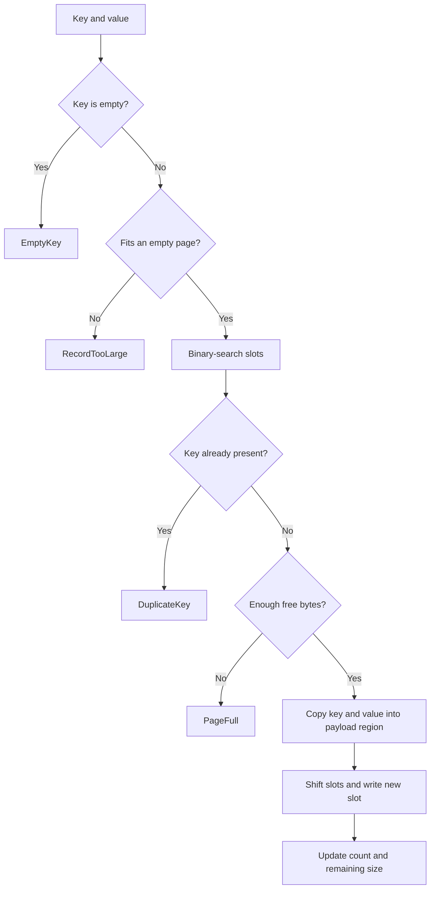

# 0003: Shared BF-Tree page primitive

**Status:** In progress; approved for end-to-end implementation.

**Design references:** [Project direction](../design/architecture.md),
[shared BF-Tree pages](../design/bf-tree-pages.md).

**Parent roadmap:** [BF-Tree implementation](0002-bf-tree-roadmap.md).

## Goal and scope

Build one packed page that supports insertion of distinct, nonempty keys,
point lookup, and sorted iteration. Its layout is the foundation for the paper's
leaf pages and mini-pages (§3.2, Figure 3). Records live entirely inside a
caller-provided byte buffer.

Define the shared record-kind encoding now; this stack creates only live
`Insert` records. Later stacks add replacement/reclamation, deletion and caching
behavior, fences, compression, tree structure, buffer management, concurrency,
and persistence.

## Byte layout

**Agreed direction:** use one fixed 32-byte header for base leaves and
mini-pages, as upstream does. Represent the page as a `zerocopy` slice type over
the caller's buffer: the header followed by the record area. Represent each slot
as a `zerocopy` struct.

### Current Microsoft implementation

The [upstream `LeafNode`](https://github.com/microsoft/bf-tree/blob/f442e6172bf7e5483ff320d8e3ac16a70e31bbd6/src/nodes/leaf_node.rs#L212-L222)
has a fixed 32-byte header on its 64-bit layout:

```rust
#[repr(C)]
struct LeafNode {
    meta: NodeMeta,                 // 6 B: flags/count, size, remaining space
    prefix_len: u16,               // 2 B
    next_level: MiniPageNextLevel, // 8 B: wrapper around usize
    lsn: u64,                     // 8 B
    snapshot_version: u64,         // 8 B
    data: [u8; 0],                // record area follows the header
}
```

```text
0                                  16                         32
| NodeMeta + prefix + next_level    | LSN + snapshot version    |
|<------- structural: 16 B -------->|<--- recovery: 16 B ------>|
```

Upstream uses this header for both base leaves and mini-pages. It also writes
the log sequence number (LSN) and snapshot state on mini-pages; those fields are
not merely copied from disk and ignored.

### Our target structure

Keep upstream's header fields and their order. `zerocopy` structs describe the
header, each slot, and the page. Their fields use little-endian integer types
with alignment 1, so the views work on any byte buffer without `unsafe` code in
this crate.

```rust
use zerocopy::little_endian::{U16, U64};
use zerocopy::{FromBytes, Immutable, IntoBytes, KnownLayout, Unaligned};

const HEADER_BYTES: usize = 32;

#[derive(FromBytes, IntoBytes, KnownLayout, Immutable, Unaligned)]
#[repr(C)]
struct Header {
    count_and_flags: U16,  // low 12 bits: slot count; high 4 bits: flags
    capacity: U16,
    remaining_size: U16,
    prefix_len: U16,
    backing_leaf: U64,     // u64::MAX: no backing leaf
    lsn: U64,              // inactive
    snapshot_version: U64, // inactive
}

const _: () = assert!(size_of::<Header>() == HEADER_BYTES);
```

```text
0              16                 32
| structural   | recovery         | sorted slots --> | free | <-- payloads |
```

This stack initializes the recovery fields but implements no logging or
snapshot protocol. All integers are little-endian. Record offsets are measured
from the page start.

| Bytes | Field | Initial value |
| --- | --- | --- |
| `0..2` | Low 12 bits: slot count; high 4 bits: flags | `0`; flags remain zero in this stack |
| `2..4` | Capacity, `u16` | Buffer length |
| `4..6` | Remaining contiguous free space, `u16` | `capacity - 32` |
| `6..8` | Prefix length, `u16` | `0`; compression is later work |
| `8..16` | Backing-leaf reference, `u64` | `u64::MAX`; no backing leaf yet |
| `16..24` | LSN, `u64` | `0`; inactive |
| `24..32` | Snapshot version, `u64` | `0`; inactive |

Store `remaining_size`, as upstream does, and derive the payload boundary.
It counts the free region between slots and payloads, excluding future holes
left by replacement/deletion until those holes are reclaimed.

### Record slot

**Agreed:** retain Microsoft's shared 8-byte slot encoding, including the two-bit
operation type. The same field represents live/deleted records in base leaves
and the four record kinds needed by mini-pages.

| Byte range within slot | Field |
| --- | --- |
| `0..2` | Payload offset, `u16`; page-relative in our format |
| `2..4` | High 2 bits: operation type; low 14 bits: key length |
| `4..6` | High bit: reference flag; low 15 bits: value length |
| `6..8` | Two-byte key preview, zero-padded for short keys |

```text
slot:       [ offset: 16 ][ kind: 2 | key length: 14 ]
                        [ ref: 1  | value length: 15 ][ preview: 16 ]
total:      16 + 16 + 16 + 16 = 64 bits = 8 bytes
```

The `Slot` struct encodes the same fields:

```rust
#[derive(Clone, Copy, FromBytes, IntoBytes, KnownLayout, Immutable, Unaligned)]
#[repr(C)]
struct Slot {
    offset: U16,            // page-relative payload offset
    kind_and_key_len: U16,  // high 2 bits: kind; low 14 bits: key length
    ref_and_value_len: U16, // high bit: referenced; low 15 bits: value length
    preview: [u8; 2],
}
```

```rust
#[repr(u8)]
enum RecordKind {
    Insert = 0b00,
    Delete = 0b01, // tombstone
    Cache = 0b10,
    Phantom = 0b11,
}

const KEY_LEN_MASK: u16 = 0x3fff;
const VALUE_LEN_MASK: u16 = 0x7fff;

// After validating the lengths fit their bit fields:
let key_word = ((kind as u16) << 14) | key_len;
let value_word = ((referenced as u16) << 15) | value_len;

// Decode lengths without including the state bits:
let key_len = key_word & KEY_LEN_MASK;
let value_len = value_word & VALUE_LEN_MASK;
```

| Kind | Meaning in a mini-page | Ordinary base-leaf meaning |
| --- | --- | --- |
| `Insert` | Buffered live value | Live record |
| `Delete` | Buffered deletion | Logically deleted record awaiting reclamation |
| `Cache` | Clean cached value | Converted to `Insert` when flushing a full-page cache |
| `Phantom` | Clean cached absence | Converted to `Delete` when flushing a full-page cache |

Keeping both bits enables shared record handling and lazy deletion without
enlarging the slot. `Insert` on a base leaf means live, not necessarily dirty.

In this stack, insertion writes `Insert`, clears the reference bit, and populates
the preview from the first two key bytes. Lookup and iteration compare full keys;
they do not update the reference bit. Deletion/cache behavior and using previews
as a search fast path arrive in later stacks.

The key length includes any compressed prefix; the preview describes the stored
suffix. This stack keeps `prefix_len = 0`, so both use the full key. Our payload
offsets remain page-relative; upstream's are relative to the area after its header.
Figure 3 of the paper uses a 14-bit value length and a separate fence bit; this
plan follows the current Microsoft bit packing. Fence handling remains later work.

```text
slot.offset ------> [ key bytes ][ value bytes ]
                     key_len       value_len

HEADER_BYTES  = 32
slots_end     = HEADER_BYTES + record_count * 8
payload_start = slots_end + remaining_size
free_bytes    = remaining_size
```

`Page::init` casts the buffer to `&mut Page` once, after it validates the
capacity. Header fields are then ordinary field accesses, and the slot directory
is a view of the start of the record area:

```rust
fn len(&self) -> usize {
    usize::from(self.header.count_and_flags.get() & COUNT_MASK)
}

fn slots(&self) -> &[Slot] {
    let (slots, _): (&[Slot], _) = FromBytes::ref_from_prefix_with_elems(&self.data, self.len())
        .expect("slot directory fits the page");
    slots
}
```

Page methods assume that the bytes came from `Page::init` and changed only
through `Page` methods. Under that assumption, these views cannot fail.
Reopening stored bytes must validate the header and slot directory before it
exposes them as a `Page`.

Slots are sorted by full key bytes. A slot's position can change when another
key is inserted. Preview collisions, including `b"\0"` and `b"\0\0"`, must not change
the result of a full-key comparison.

## Page view and API

The page is the buffer, as upstream's `LeafNode` is. `Page` is a dynamically
sized type that `Page::init` creates over the caller's bytes. Reads take
`&Page`, so many readers can share a page; insertion takes `&mut Page`. Results
borrow from the page. This crate uses safe Rust throughout.

```rust
#[derive(Debug, FromBytes, IntoBytes, KnownLayout, Immutable, Unaligned)]
#[repr(C)]
pub struct Page {
    header: Header,
    data: [u8], // slot directory, free space, payloads
}

#[derive(Clone, Copy, Debug, PartialEq, Eq, thiserror::Error)]
pub enum PageError {
    #[error("page capacity must be a multiple of 64 from 64 through 4096 bytes")]
    InvalidCapacity,
    #[error("key must not be empty")]
    EmptyKey,
    #[error("record does not fit in an empty page")]
    RecordTooLarge,
    #[error("key already exists in the page")]
    DuplicateKey,
    #[error("page has insufficient free space for the record")]
    PageFull,
}
```

| Item | Behavior |
| --- | --- |
| `Page::init(&mut [u8]) -> Result<&mut Page, PageError>` | Validate capacity, zero the buffer, and initialize the header, including the no-backing-leaf sentinel. |
| `try_insert(&mut self, key: &[u8], value: &[u8]) -> Result<(), PageError>` | Reject an empty key; insert a new nonempty key. Every error leaves all page bytes unchanged. |
| `get(&self, key: &[u8]) -> Result<Option<&[u8]>, PageError>` | Reject an empty key; otherwise borrow the matching value or return `Ok(None)`. |
| `iter(&self) -> Iter<'_>`; `impl IntoIterator for &Page` | Borrow records in key order. A `for` loop over a `&Page` uses the same iterator. |
| `len()`, `is_empty()`, `capacity()`, `free_bytes()` | Report record count and page-space accounting through `&self`. |
| `zerocopy::IntoBytes::as_bytes(&self)` | Borrow the whole encoded page, header included. |

Supported capacities are multiples of 64 from 64 through 4096 bytes. Upstream
rounds in-memory page sizes to multiples of the 64-byte cache line. Its default
configuration creates mini-pages of 448, 832, and 1600 bytes, which are not
powers of two. The 4096-byte maximum is upstream's default leaf page size, and it
bounds every slot field. The buffer can have any alignment. Keys must be
nonempty and use lexicographic byte ordering. Empty values are valid.
There is no allocation per record. Initialization creates a new page; reopening
stored bytes is later work.

### Empty keys

**Agreed:** reject `b""` with `PageError::EmptyKey` in insertion and lookup.
Validate the key before size checks or searching. A one-byte key such as `b"\0"`
is valid.

```rust
assert_eq!(page.try_insert(b"", b"value"), Err(PageError::EmptyKey));
assert_eq!(page.get(b""), Err(PageError::EmptyKey));
```

This matches the nonempty-key requirement in the
[upstream public API](https://github.com/microsoft/bf-tree/blob/f442e6172bf7e5483ff320d8e3ac16a70e31bbd6/src/tree.rs#L1118-L1130).

### Empty values

**Agreed:** allow `b""` as a value for a nonempty key. This supports presence-only records,
such as members of a set or markers for previously seen event IDs:

```rust
page.try_insert(b"seen:event-42", b"")?;
assert_eq!(page.get(b"seen:event-42")?, Some(b"".as_slice()));
assert_eq!(page.get(b"seen:event-43")?, None);
```

An empty value is a live `Insert` record with value length zero. Absence is
represented by a missing key, or by the `Delete`/`Phantom` kinds in later stacks.
Value length alone never means deletion.

## Worked insertion

Use a 128-byte buffer and insert keys in the order `30`, `10`, `20`:

```rust
let mut storage = [0u8; 128];
let page = Page::init(&mut storage)?;
page.try_insert(b"30", b"cat")?;
page.try_insert(b"10", b"dog")?;
page.try_insert(b"20", b"owl")?;
assert_eq!(page.get(b"20")?, Some(b"owl".as_slice()));
assert_eq!(page.free_bytes(), 57);
```

Each payload is five bytes. Inserting `20` moves the slot for `30`, while existing
payloads stay at their original addresses:

```text
Before inserting 20:
0          32       40       48                         118     123     128
| header   | slot10 | slot30 | free space (70 B)         | 10dog | 30cat |

After inserting 20:
0          32       40       48       56          113     118     123     128
| header   | slot10 | slot20 | slot30 | free (57 B)| 20owl | 10dog | 30cat |
```

| Slot index | Key addressed | Payload offset | Key/value lengths |
| --- | --- | --- | --- |
| 0 | `10` | 118 | 2 / 3 |
| 1 | `20` | 113 | 2 / 3 |
| 2 | `30` | 123 | 2 / 3 |

The slot for `20` encodes as:

```text
offset 113     Insert + key length 2    ref=0 + value length 3    preview "20"
71 00          02 00                   03 00                     32 30
```

The full keys live in the payloads, not in the slots. The header's count changes
from 2 to 3 and `remaining_size` from 70 to 57. The derived payload boundary
changes from `32 + 2 * 8 + 70 = 118` to `32 + 3 * 8 + 57 = 113`.

### Insert algorithm



First reject an empty key. Preflight then uses checked arithmetic for
`key.len() + value.len() + 8`. Report `RecordTooLarge` if it exceeds
`capacity - HEADER_BYTES`; otherwise check duplicates and current free space.
All errors occur before modifying the page.

After preflight, insertion copies the payload, then updates the slot directory
through a view with one extra slot:

```rust
let (slots, _): (&mut [Slot], _) =
    FromBytes::mut_from_prefix_with_elems(&mut self.data, count + 1)
        .expect("preflight reserved space for the new slot");
slots.copy_within(index..count, index + 1);
slots[index] = Slot::insert(offset as u16, key, value.len() as u16);
```

In the example, this moves the slot for `30` from bytes `40..48` to `48..56`.
The payload is written at `113..118`, the new slot at `40..48`, and the existing
payloads are untouched. Subtract `8 + key.len() + value.len()` from
`remaining_size` and increment the count through the header view.

## Lookup and iteration

Binary search operates on slots, following their offsets to compare full keys.
It views the slot directory once per search:

```rust
fn lower_bound(&self, key: &[u8]) -> usize {
    let (bytes, slots) = (self.as_bytes(), self.slots());
    let (mut lo, mut hi) = (0, slots.len());
    while lo < hi {
        let mid = lo + (hi - lo) / 2;
        if &bytes[slots[mid].key_range()] < key {
            lo = mid + 1;
        } else {
            hi = mid;
        }
    }
    lo
}
```

`get` rejects an empty key before searching. For nonempty keys, it returns
`Ok(Some(value))` only when the position is in bounds and its key matches.
For key `20`, the slot yields key bytes `113..115` and value bytes `115..118`.
For missing key `25`, binary search stops at key `30`; the equality check returns `Ok(None)`.

Iteration walks slots `0..len()`, borrowing each key/value pair:

```rust
let records: Vec<_> = page.iter().collect();
assert_eq!(records, vec![
    (b"10".as_slice(), b"dog".as_slice()),
    (b"20".as_slice(), b"owl".as_slice()),
    (b"30".as_slice(), b"cat".as_slice()),
]);
```

## Proposed commit stack

This stack has six diffs: the existing plan commit is diff 1, followed by five
implementation diffs. Include the plan commit in the total used by every title.

```text
1. plan
    -> 2. header and initialization
    -> 3. slot decoding and lookup
    -> 4. slot encoding and insertion
    -> 5. ordered iteration
    -> 6. cross-operation model checks
```

Size estimates for implementation diffs include tests and small design-document
updates. Adjust the boundaries if the implementation warrants it. Each code diff
must compile and pass its focused tests without placeholder implementations.

### `[1/6][bf-page][plan] draft shared page primitive`

- **Changes:** Record the agreed header, slot encoding, API, examples,
  verification strategy, and commit stack in this plan.
- **Verification:** Review byte accounting, API consistency, and document links.
- **Existing commit:** Revise the plan commit as the design is finalized.

### `[2/6][bf-page][layout] define the page header and initialize page views`

- **Changes:** Replace the generated stub with the page module. Add `Page`, a
  `zerocopy` slice type over the `Header` and the record area, plus `PageError`,
  `init`, and space accounting. Derive the `Display` and
  `std::error::Error` implementations for `PageError` with `thiserror`. Add the
  page design note, `docs/design/bf-tree-pages.md`: the page layout, the header,
  and `Page` as the base type for planned role types.
- **Tests:** Every supported capacity, including sizes that are not powers of
  two, on an unaligned buffer; initial field values at raw byte offsets; invalid
  initialization leaving the supplied buffer unchanged; and error messages.
- **Estimated size:** 200–300 lines.

### `[3/6][bf-page][read] decode record slots and implement point lookup`

- **Changes:** Add the `zerocopy` `Slot` struct with masked length decoding, the
  slot directory view, borrowed key/value access, `lower_bound`, and `get`. Keep
  comparisons on full key bytes. Add the slot layout and record rules to the
  design note.
- **Tests:** Build explicit byte fixtures inside the test module to exercise
  nonempty pages before insertion exists. Check tag/reference-bit decoding,
  expected offsets, hits/misses, key prefixes, preview collisions, empty-key
  rejection, and present-but-empty values.
- **Estimated size:** 200–300 lines.

### `[4/6][bf-page][insert] implement checked sorted insertion`

- **Changes:** Add `Slot::insert` and `try_insert`: validate first, copy payloads,
  shift slots through the directory view, and update count/free space through the
  header view. New records are `Insert`, unreferenced, with a populated preview.
  Reuse the lookup/search helpers from diff 3.
- **Tests:** The worked insertion, new keys at each slot position, duplicates,
  empty keys/values, exact fits, oversized records, full pages, and byte-for-byte
  preservation on every failure. Verify encoded slots against golden bytes.
- **Estimated size:** 220–300 lines.

### `[5/6][bf-page][scan] add borrowed ordered page iteration`

- **Changes:** Add `iter` and the named `page::Iter` type, walking slots in
  order and borrowing their records. Implement `IntoIterator` for `&Page`, so a
  `for` loop over a `&Page` works. `Iter` reports its exact remaining length
  and keeps returning `None` after exhaustion. Add a usage example to the
  module documentation.
- **Tests:** Empty and populated pages, different insertion orders, prefix keys,
  empty values, `for` loops over a `&Page`, exact remaining lengths, and iterator
  exhaustion.
- **Estimated size:** 80–160 lines.

### `[6/6][bf-page][tests] verify pages against an ordered-map model`

- **Changes:** Add bounded deterministic operation sequences and an independent
  `BTreeMap` model across key orders, value sizes, and capacities. The
  capacities include every power of two, upstream's default mini-page sizes that
  are not powers of two, and 4032 bytes, the largest such supported capacity.
- **Checks:** Compare expected errors as well as successful operations. Update
  the model only after successful insertion; after each operation compare
  lookups, iteration, count, and expected free space. Check payload/slot bounds,
  non-overlap, and unchanged inactive metadata. Preserve bytes across failures.
- **Handoff:** Run the required workspace checks and record outcomes in this plan.
- **Estimated size:** 150–250 lines.

The final diff checks combinations of behaviors. Focused tests for each new
behavior land with its implementation in the earlier diffs.

## Decisions and trade-offs

- **Header:** use upstream's 32-byte header for base leaves and mini-pages.
  Initialize the recovery fields (LSN and snapshot version) but leave them
  inactive.
  - **Alternative:** a 16-byte header without recovery fields for small
    mini-pages. It does not change upstream's default size classes, because
    sizes round up to multiples of 64; it only adds room inside a page (50% at
    64 bytes, 17% at 128 bytes, under 4% from 448 bytes). Upstream keeps the
    snapshot version on mini-pages for concurrent prefix recovery (CPR)
    checkpoints, so that state would need another location. Mini-pages exist
    only in memory: small mini-pages reach disk only through record-by-record
    merges, and full-page caches use the full header. A compact header can
    therefore come later without an on-disk format change. The recovery design
    should decide whether mini-pages need inline recovery fields.
- **Page type:** make `Page` a `zerocopy` slice type over the caller's bytes:
  the header followed by `data: [u8]`. Reads take `&Page` and insertion takes
  `&mut Page`, so readers can share a page. The buffer is cast once, in
  `Page::init`; header fields are then ordinary field accesses.
  - **Consequence:** `Page` derives public `zerocopy` traits. Code that imports
    `zerocopy` can view arbitrary bytes as a `Page` or write a page's raw bytes;
    page methods may then panic, but they stay memory-safe. Stored-page
    validation must check bytes before it exposes them as a `Page`.
  - **Alternative:** a wrapper that holds `&mut [u8]`. It keeps the bytes
    private, but every read needs exclusive access, every header access repeats
    a checked cast, and the type carries a lifetime parameter.
  - **Alternative:** a wrapper generic over its storage, `Page<B: AsRef<[u8]>>`.
    It allows shared reads and owned buffers, but adds a type parameter to every
    signature and still repeats the header cast.
  - **Alternative:** upstream's zero-length `data` array with raw-pointer
    arithmetic. It requires `unsafe` code, which this crate forbids.
- **Page roles:** `Page` is the base type for leaf-level storage. Base leaf
  pages, full-page caches, and mini-pages share its format. Later stacks add
  role types, such as `BasePage` and `MiniPage`, that wrap `Page` and enforce
  role-specific rules. Inner nodes use a separate format.
- **Representation:** describe the header and each slot with `zerocopy` structs.
  Tests decode raw byte offsets, so they check the structs independently.
  - **Alternative:** read and write fields at named byte offsets. This needs no
    dependency, but every access repeats a field's offset and width, and the
    structs exist only in documentation. Upstream casts `#[repr(C)]` structs
    through raw pointers; this crate forbids `unsafe` code, and the buffer has no
    alignment guarantee.
- **Capacity:** accept multiples of 64 from 64 through 4096 bytes.
  - **Alternative:** a power-of-two rule would reject upstream's default
    mini-page sizes, such as 448 bytes. The format itself accepts any length in
    range; the 64-byte step matches upstream's allocation sizes.
- **Operations:** support distinct-key insertion, borrowed lookup, and borrowed
  iteration.
- **Keys:** reject empty keys in insertion and lookup.
- **Values:** accept empty values as live records, distinct from missing or
  deleted records.

## Open questions

None.

## Verification strategy

Use `cargo test -p peppydb-bftree` during iteration. Concrete boundary cases for
the proposed layout:

| Case | Expected result |
| --- | --- |
| Initialize 63, 96, or 4160 bytes | `InvalidCapacity`; buffer unchanged. |
| Initialize 448 or 4032 bytes | Valid; both are multiples of 64 but not powers of two. |
| Initialize a buffer that starts at an odd address | Valid; header fields read and write correctly. |
| Empty 128-byte page | Count 0, payload boundary 128, free space 96. |
| Insert `b""` with any value, on an empty or full page | `EmptyKey`; buffer unchanged. |
| Look up `b""` | `Err(PageError::EmptyKey)`; distinct from a missing nonempty key. |
| Insert a nonempty key with `b""` as its value | Lookup returns `Ok(Some(b"".as_slice()))`, distinct from `Ok(None)` for an absent key. |
| Insert `b"\0"` and `b"\0\0"` as keys | Both valid and distinct despite identical zero-padded previews. |
| Insert `30/cat`, `10/dog`, `20/owl` into 128 bytes | Sorted iteration, payload boundary 113, free space 57. |
| Exact fit in a 64-byte page with a 1-byte key | `32 + 8 + 1 + 23 = 64`. |
| Increase the exact-fit value by one byte on an empty page | `RecordTooLarge`; buffer unchanged. |
| Insert a different 1-byte key with an empty value into the exact-fit page | `PageFull`; buffer unchanged. |
| Reinsert an existing key with a record that fits an empty page | `DuplicateKey`; buffer unchanged. |

Also cover empty-key rejection, empty values, zero bytes, keys that prefix other keys, and
sorted/reverse/mixed insertion orders. Use `BTreeMap` as the independent oracle.
Check the worked slot against its exact encoded bytes. Test length decoding with
each operation tag and both reference-bit values, plus zero-padded one-byte previews
and equal previews for different keys. No tag or reference bit may leak into a length.
Verify count updates preserve flags and ordinary record operations leave the
inactive prefix, backing-leaf, and recovery fields unchanged. Golden bytes,
fixtures, and the model's decoder must use raw byte offsets, not `Header` or
`Slot`.

Before handoff, run from the repository root:

```sh
cargo fmt --all -- --check
cargo clippy --workspace --all-targets -- -D warnings
cargo test --workspace
```

## Progress

- [x] Read the paper and inspect relevant upstream code.
- [x] Agree on the page contract, header layout, and key/value policy.
- [x] Agree on the six-diff stack: one plan commit and five implementation commits.
- [x] Implement and verify diff 2: header and initialization.
- [ ] Implement and verify diff 3: slot decoding and lookup.
- [ ] Implement and verify diff 4: slot encoding and insertion.
- [ ] Implement and verify diff 5: ordered iteration.
- [ ] Implement and verify diff 6: model checks and workspace verification.
- [ ] Record verification outcomes and finalize the page design note.

## Verification outcomes

Each commit passed `cargo fmt --all -- --check`,
`cargo clippy --workspace --all-targets -- -D warnings`, and
`cargo test --workspace` on its own.

- Diff 2 (3 unit tests): all 64 supported capacities initialize correctly on an
  unaligned buffer; invalid capacities preserve the supplied bytes. Every error
  variant implements `std::error::Error` with its message.

## Sources

- [BF-Tree paper](../references.md#bf-tree-paper), §3.2/Figure 3 for the shared
  page format and §3.5 for later layout optimizations.
- [Microsoft implementation](../references.md#microsoft-bf-tree-implementation),
  revision `f442e6172bf7e5483ff320d8e3ac16a70e31bbd6`: page layout and operations
  in `src/nodes/leaf_node.rs` and `src/nodes/node_meta.rs`, with page-level tests
  in `src/tests/leaf_node.rs`.
- Upstream mini-page handling, same revision: `src/mini_page_op.rs` keeps the
  snapshot version on mini-pages, and `LeafNode::merge_mini_page` copies it into
  the base leaf. `update_lsn` writes the LSN, but nothing reads it at this
  revision. Mini-pages grow by rebuilding records (`copy_initialize_to`), and
  full-page caches are copied whole (`upgrade_to_full_page`, `merge_full_page`).
  `BfTree::create_mem_page_size_classes` in `src/tree.rs` computes the mini-page
  size classes.
- [Upstream record metadata](https://github.com/microsoft/bf-tree/blob/f442e6172bf7e5483ff320d8e3ac16a70e31bbd6/src/nodes/leaf_node.rs#L14-L103):
  record kinds and bit packing. `insert`, `consolidate_inner`, and
  `convert_cache_records_to_insert` show lazy deletion and base/cache state handling.
