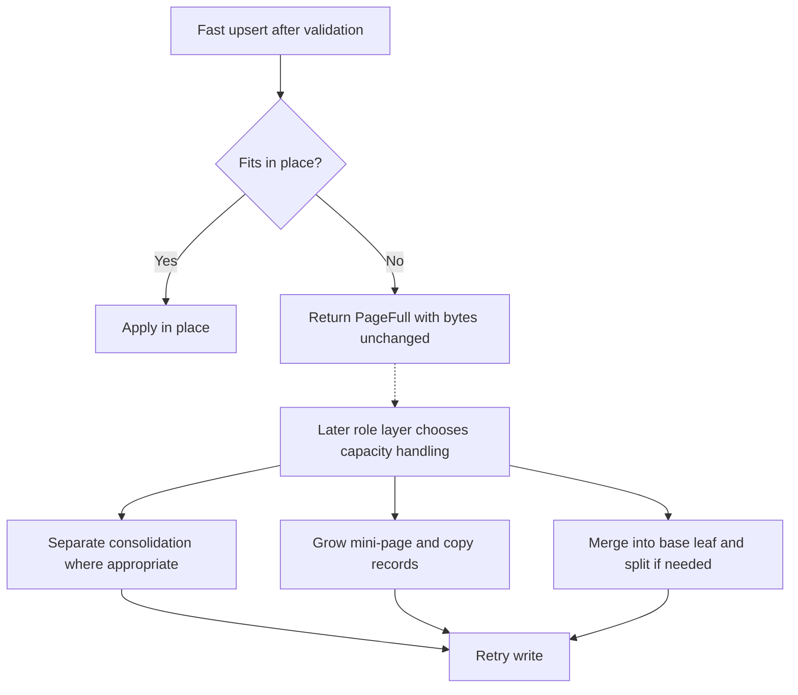

# 0004: BF-Tree page mutation and ranges

**Status:** Agreed

**Design references:** [Shared BF-Tree pages](../design/bf-tree-pages.md),
[project direction](../design/architecture.md).

**Parent roadmap:** [BF-Tree implementation](0002-bf-tree-roadmap.md), milestone 2.

**Builds on:** [Shared page primitive](0003-bf-tree-page.md).

**Implementation background:** [Page operations in Microsoft's BF-Tree](../explanations/bf-tree-upstream-pages.md).

## Goal and scope

Extend the shared page into a mutable, range-aware record container. Future
base leaves and mini-pages need to replace records, retain deletion information,
reuse obsolete payload space, and distinguish a missing entry from known absence.
Future tree routing also needs explicit page bounds.

Agreed scope:

- **In scope:** All four record kinds; state-aware borrowed reads; distinct-key
  insertion and fast upsert; separate compaction; reference-bit updates;
  physical removal; fence initialization and range enforcement; bounded
  ordered iteration; and two-byte previews as a search fast path.
- **Follow-on page work:** Fence-derived prefix compression. It changes both
  payload accounting and the representation of borrowed keys. Agreed: implement
  it in the next page stack (0005), within milestone 2 and before the in-memory tree.
- **Later components:** Base/mini-page role wrappers, overlay merge and eviction
  policy, page resizing and splitting, inner nodes, mapping and I/O, stored-page
  validation, concurrency, logging, and checkpoints.
- **Done when:** Mixed mutation sequences agree with an independent model;
  failed operations preserve every byte; compaction retains every stored record
  and its state; fenced pages enforce their bounds; bounded iteration and preview
  search agree with full-key ordering; and workspace checks pass.

This stack retains the 32-byte header, 8-byte slots, little-endian integers,
unaligned borrowed page views, and capacities from 64 through 4096 in 64-byte
steps. Keys remain nonempty; live values may be empty.

## Approach

### 1. Make record state part of the read contract

The existing `RecordKind` encoding already reserves all four states. This stack
makes them observable through the normal API. The table describes a record's
meaning in a mini-page; `Insert` on a base page means live, not necessarily dirty.

| Kind | Buffered mutation | Key exists | Logical value |
| --- | --- | --- | --- |
| `Insert` | Yes | Yes | Borrowed bytes, possibly empty |
| `Delete` | Yes | No | None |
| `Cache` | No | Yes | Borrowed bytes, possibly empty |
| `Phantom` | No | No | None |

Use a typed input/output state so callers cannot attach a value to a tombstone
or phantom:

```rust
#[derive(Clone, Copy, Debug, PartialEq, Eq)]
pub enum RecordState<'a> {
    Insert(&'a [u8]),
    Delete,
    Cache(&'a [u8]),
    Phantom,
}

#[derive(Clone, Copy, Debug, PartialEq, Eq)]
pub struct RecordRef<'a> {
    pub key: &'a [u8],
    pub state: RecordState<'a>,
    pub referenced: bool,
}

#[derive(Clone, Copy, Debug, PartialEq, Eq)]
pub enum UpsertOutcome {
    Inserted,
    Replaced,
}
```

`RecordState::kind()` returns the existing `RecordKind`;
`RecordState::value()` returns `Some(value)` for `Insert`/`Cache` and `None`
for `Delete`/`Phantom`. Logical absence does not require a zero encoded value
length. Match upstream's metadata-only deletion of an existing entry:

- A newly inserted `Delete` or `Phantom` has zero value length.
- Upserting `Delete` over an existing entry changes its kind and retains its
  payload, value length, and reference bit. Reads still expose no logical value.
- Upserting `Phantom` uses a zero-length value, following the ordinary smaller
  replacement path. The prior value bytes, if any, become a hole.
- Upserting `Insert` or `Cache` can reuse the currently encoded value region,
  including a region retained by a `Delete`, when the incoming value fits.

There is no separate allocation-capacity field. A smaller live replacement
reduces the encoded value length; subsequent reuse is bounded by that new length.

Agreed API changes and additions:

| API | Contract |
| --- | --- |
| `get(&self, key: &[u8]) -> Result<Option<RecordRef<'_>>, PageError>` | `None` means no stored entry. A tombstone or phantom returns `Some` with its explicit state. |
| `iter(&self) -> Iter<'_>`; `IntoIterator for &Page` | Yield `RecordRef` for every ordinary slot, including tombstones and phantoms, in key order. |
| `try_insert(&mut self, key: &[u8], value: &[u8]) -> Result<(), PageError>` | Existing distinct-key API; a convenience for inserting `RecordState::Insert(value)`. |
| `try_insert_record(&mut self, key: &[u8], state: RecordState<'_>) -> Result<(), PageError>` | Insert any state; any existing slot for this key is a duplicate. |
| `try_upsert(&mut self, key: &[u8], state: RecordState<'_>) -> Result<UpsertOutcome, PageError>` | Insert or replace using the existing allocation or contiguous gap. Return `PageFull` when additional contiguous space is needed but unavailable; do not rebuild implicitly. |
| `remove(&mut self, key: &[u8]) -> Result<bool, PageError>` | Physically forget the entry. Return whether a slot was removed. |
| `set_referenced(&mut self, key: &[u8], referenced: bool) -> Result<bool, PageError>` | Set or clear the bit on an existing entry; return whether the entry exists. |
| `reclaimable_bytes(&self) -> usize` | Count unreachable payload bytes, excluding the contiguous free gap. |
| `compact(&mut self) -> usize` | Pack reachable payloads, including value allocations retained by tombstones; return the number of bytes recovered into the free gap. |

This deliberately evolves `get` and iteration from value-only results to
state-aware results. Update the crate's examples and callers in the same diff.
The crate currently has no tree or application-facing database API. Giving its
storage primitive one explicit read contract avoids treating a mini-page miss
as a tombstone, or treating an empty live value as absence.

`Option<RecordRef>` preserves the three lookup outcomes a partial mini-page
needs: a miss permits base-leaf fallback, a live value answers the read, and
known absence stops the search. Exact kinds also distinguish dirty mutations
from clean cache entries during record processing. The
[upstream lookup walkthrough](../explanations/bf-tree-upstream-pages.md#record-state-and-lookup-results)
explains the same semantics with a concrete deletion example. This page API
does not prescribe the later database-facing read API.

`len()` counts stored ordinary records, including absence records. `Iter` remains
an `ExactSizeIterator` and a `FusedIterator`. Reads do not change reference bits.
New entries start with a clear reference bit. Replacement preserves the existing
entry's reference bit, matching upstream; physical compaction also preserves
every surviving reference bit. Reference updates take `&mut Page`, as every
other mutation does. Later cache operations will mark accesses and reset bits
when giving retained records another chance.

All state transitions are mechanically supported by `try_upsert`. The future
overlay layer decides when a transition is valid: for example, a cache fill must
not replace a newer buffered mutation. Likewise, `remove` is a physical storage
operation, not the database's delete operation. Buffering a deletion uses
`try_upsert(key, RecordState::Delete)`, including when the page has no such key.
Compaction never infers that a dirty mutation has reached its base leaf.

### 2. Separate physical garbage from logical absence

Use lazy reclamation, following the shape of upstream's replacement path:

- Deleting an existing entry changes only its kind. Its retained value region
  remains reachable storage and can be reused by a later replacement.
- Other equal-size or smaller replacements overwrite the existing value and
  update the slot. A shorter value leaves a hole at the end of the old payload.
- A larger replacement uses the contiguous free gap if it can hold the complete
  new key/value payload. The slot then points to the new payload; the old one
  becomes a hole. Replacing a record does not allocate another slot.
- Physical removal shifts the following slots left and releases eight directory
  bytes immediately. Its old payload becomes a hole.
- When an insertion or fast upsert lacks contiguous space, return `PageFull`
  without mutation. Separate compaction is available; later role operations
  choose consolidation, growth, or merge as part of their own capacity handling.

This keeps the reclamation policy with the caller, which will know the page's
role, available size classes, and buffer-pool pressure. This stack provides
ordinary mutation and standalone `compact`. Growth, merge, and selected
replacement-aware rebuild paths belong to their later role/integration stacks.

`remaining_size` continues to mean the contiguous free gap. Holes are outside
that gap, so a page can have more space available after compaction than
`free_bytes()` reports.

```text
Before compaction:
| header | slots --> | free gap | reachable payloads and holes |

After compaction:
| header | slots --> | larger free gap | packed reachable payloads |
```

Let `slot_count` include fence slots when present. Let `reachable_payload_bytes`
sum the current encoded key/value payload lengths, including finite fences and
retained tombstone values. Those retained values do not count as reclaimable
holes. Infinite fences have no payload. With compression still inactive:

```text
slots_end       = 32 + 8 * slot_count
payload_start   = slots_end + free_bytes()
packed_size     = slots_end + reachable_payload_bytes
reclaimable     = capacity - packed_size - free_bytes()
free_after_pack = capacity - packed_size
```

All reachable payloads must be disjoint and contained in
`payload_start..capacity`. Holes may exist anywhere within that region, including
at its start. The payload boundary is derived from the header; it need not equal
the minimum reachable offset after a removal or replacement.

For a new record, insertion needs its payload and one slot from the gap. A
growing replacement needs a complete new key/value payload but no additional
slot. The old payload is not credited to contiguous free space. Compute sizes
with checked arithmetic before narrowing them to encoded integer widths.

`PageFull` therefore describes the current physical allocation. It can occur
even when a rebuilt page containing only the final versions would fit. Later
growth and selected consolidation paths can account for the replaced version
when constructing their destination, as upstream's cache-only path does.

### 3. Preserve byte-for-byte failure atomicity

Ordinary mutation completes every fallible check before modifying the page.
An unsuccessful insertion or upsert does not compact the page as a side effect.

For standalone compaction, use one bounded scratch image:

1. Calculate current reachable storage. It is already bounded by page capacity.
2. Copy the header into a local zero-initialized `[u8; 4096]`, using only the
   page's capacity.
3. Rebuild the existing slots and reachable payloads into that scratch image.
4. Copy the completed image back to the original page.

Compaction of a valid page always fits and returns reclaimed bytes, not an error.

The private rebuild helper must preserve flags, backing-leaf metadata, LSN,
snapshot version, fences, and all record state, including stored value
bytes retained by tombstones. Rebuild from physical slots/payloads; the logical
record iterator intentionally hides those retained values. Compaction changes
payload offsets and free-space accounting, while preserving record count and
contents. Unused bytes after successful mutation are unspecified. There is no
per-record heap allocation, and compaction uses at most one 4096-byte scratch
image. It packs the current contents; it does not apply a pending write.



Worked capacity boundary, before adding fences:

- A 64-byte page holds key `k` and a 23-byte value exactly:
  `32 + 8 + 1 + 23 = 64`.
- Replace the value with 3 bytes. `free_bytes()` stays zero and
  `reclaimable_bytes()` becomes 20.
- Try to replace it with 22 bytes using fast upsert. Return `PageFull` without
  mutation: neither in-place replacement nor allocation from the free gap works.
- Explicitly compact. The free gap becomes 20 bytes. Retrying the 22-byte value
  still returns `PageFull`, because the new key/value payload needs 23 bytes.
  Although the final versions alone need only 63 bytes, this page operation
  does not replace the old version while packing. A later caller can grow or
  use its role-specific rebuilding path.
- A 19-byte value needs a 20-byte payload and does fit that compacted gap.
- A 24-byte value cannot fit even alone; return `RecordTooLarge` with the entire
  page unchanged.

If the original 23-byte value is instead deleted, its encoded length remains 23.
Free and reclaimable bytes both remain zero. A later value of at most 23 bytes
can reuse that region directly. Physical removal makes the whole payload a hole;
ordinary compaction alone preserves the tombstone and its retained value region.

### 4. Store page fences in the shared format

Adopt upstream's positional fence representation. Set `HAS_FENCES = 0x8000` in
`count_and_flags` and reserve the first two slots for the low and high fences.
Ordinary slots follow those two and remain sorted by key.

```text
| header | low fence | high fence | sorted ordinary slots --> | free | payloads |
              8 B         8 B
```

The header's low 12 bits count all slots. Public `len()` and iteration exclude
the two fence slots. Fences are structural metadata, not ordinary records; a
record can have the same key as the low fence without being a duplicate fence.

```rust
#[derive(Clone, Copy, Debug, PartialEq, Eq)]
pub enum Fence<'a> {
    Unbounded,
    Key(&'a [u8]),
}

#[derive(Clone, Copy, Debug, PartialEq, Eq)]
pub struct Fences<'a> {
    pub lower: Fence<'a>, // Unbounded means negative infinity.
    pub upper: Fence<'a>, // Unbounded means positive infinity.
}
```

Fence kind is independent of key contents. `Fence::Key(b"")` is a finite bound
at the empty byte string; it is distinct from `Fence::Unbounded`. This works
whether ordinary record keys permit empty byte strings or reject them. The
current nonempty-record-key rule does not justify using an empty slice as an
infinity sentinel. The enum is the borrowed API view, not an additional field
in the encoded slot.

| API | Contract |
| --- | --- |
| `Page::init_with_fences<'b>(bytes: &'b mut [u8], fences: Fences<'_>) -> Result<&'b mut Page, PageError>` | Initialize an empty fenced page. Copy finite fence keys into the supplied buffer. Validate everything before changing it. The returned lifetime is tied to `bytes`, not the input fences. |
| `fences(&self) -> Option<Fences<'_>>` | Borrow the fence keys; `None` means this page has no fence slots. |

`Page::init` continues to initialize an unfenced page. A fenced page with both
ends unbounded differs from an unfenced page: it carries two fence slots, even
though both cover the same key domain. Fences can be initialized at every
supported capacity for page-level testing; a future base-page role can require
4096 bytes.

Encoding:

- Finite fences use ordinary slot fields, `Insert` kind, zero value length,
  clear reference bit, and a full uncompressed key payload.
- A finite empty fence has zero key length and preview, with an ordinary
  page-relative offset (the page end is valid for its empty payload). Initialize
  it as a fence, bypassing the ordinary record-key nonempty check.
- The infinite low fence uses offset `u16::MAX - 1`; the infinite high fence
  uses offset `u16::MAX`. Both have zero lengths, preview, and state bits.
  These offsets cannot alias a payload in a supported page. Decode infinity
  from these explicit offset tags, never from a zero key length or empty bytes.
- Fence slots are decoded separately. Ordinary searches, state transitions,
  removal, and reference updates must never treat them as records.
- `prefix_len` remains zero. Future compression can store the full low fence,
  derive the common prefix from the two bounds, and store other key suffixes,
  as upstream does.

Range convention is **lower inclusive, upper exclusive**: `lower <= key < upper`.
Finite fence keys may be empty. If both are finite, require `lower < upper` using
lexicographic byte ordering. The page owns copies of its bounds; ordinary
operations preserve them. A future split constructs pages with their new bounds
rather than changing fences as a side effect of record mutation.

Every point operation checks membership on a fenced page. An out-of-range key
returns `KeyOutOfRange`, distinguishing incorrect routing from an in-range miss.
An unfenced page accepts every nonempty key. Fence presence alone does not claim
that a page is a complete cache of its range; that guarantee belongs to its role.

Fence payloads consume real capacity. For example, a 64-byte page with fences
`[a, z)` has `64 - 32 - 16 - 2 = 14` bytes left. An ordinary key of length one
with a five-byte value exactly fills it: `8 + 1 + 5 = 14`.

### 5. Add page-local bounded iteration

Use the same half-open range convention:

```rust
// Signature sketch; the returned iterator borrows only the page.
pub fn range(
    &self,
    start: Option<&[u8]>,
    end: Option<&[u8]>,
) -> Result<Iter<'_>, PageError>;
```

`None` means unbounded on that side; `Some(b"")` is a finite empty bound.
Query bounds, like fences, are independent of the record-key nonempty rule.
Equal bounds yield an empty iterator; reversed bounds return `InvalidRange`.
Bounds may extend beyond the page's fences: iteration returns their intersection
with the stored ordinary records. This allows a future cross-page scan to pass
its original query bounds to each page.

Compute the first slot with key `>= start` and the first slot with key `>= end`
using two lower-bound searches, then iterate that index interval. The iterator
stores indices, not borrowed query bounds. It includes all record states so a
later overlay merge can apply tombstones. Complexity is `O(log n + output)`
key comparisons, with no allocation. `range(None, None)` is equivalent to `iter()`.

### 6. Use previews without changing byte ordering

Compare the meaningful preview bytes first, falling back to the complete key
only when those bytes compare equal. Use slice comparison, not an integer view
of the preview. This preserves lexicographic byte order on every platform.

```rust
let stored_preview = &slot.preview[..stored_key_len.min(2)];
let query_preview = &key[..key.len().min(2)];
stored_preview.cmp(query_preview).then_with(|| {
    let stored_key = &self.as_bytes()[slot.key_range()];
    stored_key.cmp(key)
})
```

Obtain `stored_key` inside the fallback closure so an unequal preview avoids
accessing the payload. Short keys, embedded zero bytes, and preview collisions
must produce the same order as full-key comparison.
All point mutations, reads, and range bounds use the same comparator.

## Errors and invariants

Retain `InvalidCapacity`, `EmptyKey`, `RecordTooLarge`, `DuplicateKey`, and
`PageFull`. Add `InvalidFences`, `FencesTooLarge`, `KeyOutOfRange`, and
`InvalidRange`.

- Initialization checks capacity, then fence validity, then fence storage size.
  `InvalidFences` covers reversed/equal finite bounds. Empty finite fence keys
  are valid and distinct from unbounded fences.
- Record writes check empty key, range membership, size in an otherwise empty
  page with the same fences, duplicate status for distinct insertion, then the
  applicable space check. This preserves 0003's precedence on unfenced pages.
- `RecordTooLarge` means the record cannot fit alone with this page's fences.
  `PageFull` means the in-place path needs more contiguous space than is
  available. It does not establish that the final logical records cannot fit.
- `get`, `remove`, and reference updates check empty key, then range membership.
  An in-range missing key gives `None` or `false`, as appropriate.
- Range iteration checks finite bound ordering. Its bounds may be empty and
  need not fit in the page or belong to the page's fence interval.
- Every returned error preserves the complete supplied buffer or page image.
  Point reads and iteration preserve all bytes, including reference bits.
- Compaction retains `Delete` and `Phantom` slots, including any stored value
  region retained by a `Delete`. Only unreachable payload bytes are reclaimed.
  Explicit physical removal can forget a record of any kind, and its caller is
  responsible for that semantic choice.
- The existing trusted-page assumption still applies: bytes originate from
  initialization and valid page operations. Stored-byte validation remains a
  separate boundary.

## Module organization

Keep one public `page` module, organized as a directory of private submodules.
The completed stack uses this structure under `crates/peppydb-bftree/src/`:

```text
page/
├── mod.rs       # Page, PageError, initialization, accounting, public exports
├── layout.rs    # Header, Slot, constants, packed-field encoding
├── record.rs    # RecordKind, RecordState, RecordRef
├── read.rs      # Search, lookup, Iter, bounded iteration
├── write.rs     # Insert, upsert, removal, reference updates, UpsertOutcome
├── compact.rs   # Lossless payload repacking
├── fence.rs     # Fence types, encoding, validation, membership
└── tests/
    ├── mod.rs   # Shared test helpers and independent byte decoding
    ├── layout.rs
    ├── read.rs
    ├── write.rs
    ├── compact.rs
    ├── fence.rs
    └── model.rs # Cross-operation ordered-map model
```

Multiple `impl Page` blocks keep the operations on the same type. Introduce no
wrapper objects merely to separate files. Keep encoded types and helpers private
to `page`; use `pub(super)` where access between its submodules requires it.

The final facade re-exports public types while keeping implementation modules
private:

```rust
mod compact;
mod fence;
mod layout;
mod read;
mod record;
mod write;

pub use fence::{Fence, Fences};
pub use read::Iter;
pub use record::{RecordKind, RecordRef, RecordState};
pub use write::UpsertOutcome;

#[cfg(test)]
mod tests;
```

Diff 2 moves only existing responsibilities: `mod.rs`, `layout.rs`, `record.rs`,
`read.rs`, `write.rs`, and their existing tests. It preserves behavior and current
public paths, including `peppydb_bftree::Page` and
`peppydb_bftree::page::Iter`. Add `compact.rs` and `fence.rs`, their declarations,
and their tests with the corresponding feature diffs. Add new exports when their
types are implemented.

Keep tests as private unit-test submodules so raw fixtures can inspect page
internals. Their byte decoder remains independent of production layout helpers.
Later role-specific growth, merge, split, and cleanup policies belong in their
respective leaf/overlay/tree components and can reuse private packing machinery.

## Decisions and trade-offs

The design, scope, module organization, and ten-diff stack are agreed. The
following decisions define the implementation baseline.

1. **State-aware reads:** Use `Option<RecordRef>` for `get` and `RecordRef` for
   iteration. This shared borrowed view preserves exact record kinds and the
   distinction between a miss and known absence.
2. **Caller-controlled reclamation — agreed:** Fast writes use existing
   allocations and the contiguous gap, then report `PageFull`. Compaction is a
   separate operation. Later role operations choose consolidation, growth, or
   merge, as upstream does. This stack adds no automatic compact-and-retry path
   and no combined packed-upsert API.
3. **Bounded scratch rebuild:** Spend at most 4 KiB of temporary stack space on
   compaction to make overlapping moves straightforward. The fixed capacity
   permits a bounded image without per-record allocations. The scratch strategy
   can change later while preserving the operation's contract.
4. **Lossless physical compaction:** Preserve records, kinds, reference bits,
   and metadata except for payload offsets and free-space accounting. Dedicated
   growth, merge, split, and cleanup operations own record selection and state
   changes. They reuse private packing code without adding role-specific policy
   switches to that machinery.
5. **Optional positional fences in `Page`:** Add the shared representation now.
   Base-page, mini-page, and full-cache wrappers will enforce role-specific
   rules when their storage/mapping responsibilities are implemented.
6. **Preview search in this stack; compression in a follow-on — agreed:**
   Previews use bytes already maintained by insertion. Compression requires a
   borrowed key representation such as `KeyRef { prefix, suffix }`, since a full key would no
   longer be one contiguous `&[u8]`. That deserves its own API and layout review.
7. **Keep synchronization and durability boundaries explicit:** All mutations
   require exclusive access. No operation logs, advances an LSN, or changes a
   checkpoint version. Future synchronization must protect payload relocation
   and borrowed results; reference-bit updates are not synchronization points.
8. **Metadata-only deletion — agreed:** Preserve the existing entry's value
   allocation when writing `Delete`, as upstream does. This reuses the normal
   replacement path and supports resurrection without a special capacity field. The cost is
   space retained by deleted entries. Revisit eager release or normalization in
   a role-aware rebuild if delete-heavy workloads show unnecessary growth or I/O.

The later split plan must account for the actual fence bytes required by both
output pages. A record fitting the current page does not by itself guarantee
that every proposed split layout fits. This stack's `RecordTooLarge` is a local
page result, not a final engine-wide record-size limit.

## Fidelity and staged work

The format and mutation baseline follow Microsoft revision
`f442e6172bf7e5483ff320d8e3ac16a70e31bbd6`. The
[upstream page walkthrough](../explanations/bf-tree-upstream-pages.md) records
its implementation details, caller paths, and trade-offs. Our enduring choices
are explicit little-endian encoding, page-relative offsets, empty live values,
borrowed state-aware reads, checked errors, half-open page iteration, explicit
fence kinds, and the compaction/policy boundary defined above. Structural
similarity does not imply byte compatibility with upstream.

Revisit mutation policy only with evidence from the integrated system, such as
rebuild work, allocation pressure, or merge/I/O frequency. Preserve logical
absence and retain unapplied tombstones. The remaining staged mechanisms are:

| Current stage | Follow-on work |
| --- | --- |
| `prefix_len = 0`, with complete keys borrowed as one slice. | Agreed next page stack, 0005 within milestone 2: fence-derived compression, suffix storage, and a borrowed `KeyRef` representation. |
| `Page` allows any record kind and does not enforce base/mini/cache roles. | Base-page integration and milestone 5's overlay: enforce role invariants, handle a missing-key base deletion as a no-op, and restrict cache fills from overwriting dirty entries. The generic storage primitive remains available underneath. |
| Pure page reads and explicit exclusive reference-bit updates; no access-driven aging. | The integrated caching work adds access marking and copy-on-access resets. The concurrency plan decides how shared readers can update hints safely. Pure raw reads remain useful independently of cache policy. |
| Capacity checks include current fences only. | Milestone 3's split design must budget both resulting pages' fence bytes and compressed payloads. |
| No concurrent page access protocol; the crate currently forbids unsafe code. | Milestone 8 revisits synchronization, alignment, reference-bit representation, and ownership. Safe byte views are the present implementation, not a promise that unaligned non-atomic fields will serve every concurrent use. |
| Backing-leaf and recovery fields remain inactive. | Mapping/overlay work defines backing-leaf identity; milestone 9 defines logging, checkpoint, and recovery behavior. These responsibilities remain separate from physical compaction. |

The **4096-byte maximum** is the current scope limit. Larger-page support has no
agreed stack; adding it requires revisiting scratch storage and size tests.

## Agreed commit stack

Ten diffs: one plan commit, one mechanical module-reorganization commit, and
eight behavior/model commits. Each code diff includes focused tests and relevant
updates to the shared-page design document. Aim for roughly 300 changed lines
per substantive implementation diff. The mechanical move can exceed that
guideline. The fence diff may also exceed it because every page operation must
understand its structural slots together; reassess boundaries when implementing.

### `[1/10][bf-page-mutation][plan] define mutable page and range contracts`

- **Purpose:** Record the agreed scope, APIs, reclamation, fences, and stack boundaries.
- **Core changes:** Finalize this plan and link it from the roadmap.
- **Verification:** Review layout arithmetic, state semantics, and document links.

### `[2/10][bf-page-mutation][module] organize page implementation and tests`

- **Purpose:** Establish reviewable component boundaries before changing behavior.
- **Core changes:** Move `src/page.rs` into the `src/page/` structure described
  above. Separate existing layout, record-kind, read, and write code; keep `Page`,
  `PageError`, initialization, and accounting in `mod.rs`. Move existing tests
  into focused unit-test files. Add only the internal visibility adjustments and
  public re-exports needed by the move. Preserve the public API and byte format.
- **Verification:** Existing unit and documentation tests pass with unchanged
  behavior. Run the required formatting, workspace Clippy, and workspace test
  checks before adding new behavior. Inspect the diff as a mechanical move;
  implementation changes belong in subsequent diffs.

### `[3/10][bf-page-mutation][read] expose record state in borrowed reads`

- **Purpose:** Make all four encoded kinds observable before creating them.
- **Core changes:** Add `RecordState` and `RecordRef` in `record.rs`; decode
  kind/reference fields; update `get` and iteration in `read.rs`, exports,
  existing tests, and examples.
- **Verification:** Raw fixtures for all four kinds and both reference-bit
  values; missing versus known absent versus empty live values; borrowed results;
  exact iterator length and exhaustion. Keep length-mask tests independent of
  the new logical absence semantics.

### `[4/10][bf-page-mutation][write] insert typed records and update reference bits`

- **Purpose:** Create every record state through checked page operations.
- **Core changes:** Add `try_insert_record` and `set_referenced` in `write.rs`; keep
  `try_insert` as the live-record convenience. Encode zero-length values for
  newly inserted absence records and clear the reference bit on new entries.
- **Verification:** All kinds at every insertion position; duplicates across
  kinds; live empty values; absent-key reference updates; untouched kind/length
  bits; exact fits and unchanged bytes on rejection.

### `[5/10][bf-page-mutation][reclaim] remove records and compact payload holes`

- **Purpose:** Establish a lossless space-reclamation primitive.
- **Core changes:** Add physical `remove` in `write.rs` and free-space accounting
  through `reclaimable_bytes`. Introduce `compact.rs` and its private bounded
  rebuild helper. Keep insertion's contiguous-space check; callers explicitly
  request compaction before retrying.
- **Verification:** Remove first/middle/last entries; remove a missing entry;
  reclaim holes created by removal; preserve all kinds and reference bits;
  preserve retained tombstone payloads in raw fixtures; restore an empty page's
  free capacity; reject an insertion on a fragmented page without changing it,
  then explicitly compact and retry successfully when sufficient space exists.

### `[6/10][bf-page-mutation][replace] add in-place record upserts`

- **Purpose:** Absorb updates using existing allocations and contiguous space.
- **Core changes:** Add `try_upsert` and `UpsertOutcome` in `write.rs`; implement
  metadata-only deletion and shrink/equal-size/append replacement. Return
  `PageFull` when the local allocation cannot support the operation, preserving all bytes.
- **Verification:** All 16 kind transitions; smaller/equal/larger values;
  empty values; retained length after deletion; resurrection from a retained
  tombstone on a full page; zero-length phantoms; target reference preservation;
  explicit compaction followed by retry; continued capacity rejection when only
  the net size fits; and byte preservation for every rejected operation.

### `[7/10][bf-page-mutation][fences] encode and enforce page fence ranges`

- **Purpose:** Make the shared format describe a leaf's key domain.
- **Core changes:** Introduce `fence.rs` with `Fences`, the explicit `Fence` enum,
  initialization, encoding, and membership checks. Add fence-aware directory
  accounting and errors. Adapt compaction and all record paths together.
  Preserve fence slots and skip them in ordinary reads/iteration.
- **Verification:** Unbounded, one-sided, and finite bounds; raw golden fence
  bytes; finite empty fences distinguished from infinite fences on decode;
  low-inclusive/high-exclusive membership; empty ordinary pages with fences;
  finite lower-bound record; exact fence/record capacity; failed
  initialization preserving input bytes; fence-preserving mutation/reclamation.

### `[8/10][bf-page-mutation][range] add bounded borrowed record iteration`

- **Purpose:** Supply page-local intervals for future scans and split builders.
- **Core changes:** Add half-open `range` in `read.rs` using two lower bounds and
  the existing iterator, with query-independent output lifetimes.
- **Verification:** Unbounded, one-sided, empty, reversed, and cross-fence
  intervals; finite empty bounds; absent endpoints; prefix and zero-byte keys;
  all record kinds; exact lengths; equality with filtering the independent
  ordered model.

### `[9/10][bf-page-mutation][search] compare key previews before payloads`

- **Purpose:** Use the existing slot preview to avoid unnecessary payload loads.
- **Core changes:** Centralize preview-first comparison in `read.rs` with a
  full-key fallback.
- **Verification:** Differential comparisons with plain byte ordering, including
  all one-byte keys, selected two/longer-byte keys, common prefixes, zero padding,
  and equal previews. Run point and range tests through the optimized path.

### `[10/10][bf-page-mutation][tests] verify mixed page mutation and range sequences`

- **Purpose:** Check interactions across state changes, fragmentation, and fences.
- **Core changes:** Extend `tests/model.rs` and the independent raw-byte
  validator. Finalize the design note, progress, and verification outcomes.
- **Verification:** Mixed operations across representative capacities and fence
  profiles; compare results, errors, record states, references, ranges, and byte
  accounting after every operation. Run all required workspace checks.

## Open questions

None. The agreed read API is the shared borrowed `RecordRef` contract above.

## Verification strategy

Use an independent `BTreeMap<Vec<u8>, ModelRecord>` with owned logical state,
stored value bytes, and reference bits. Deletion retains the model's stored value
while making logical lookup report absence. Keep a separate model of contiguous
free space, updated from operation history and the public space rules:

- New entries consume a slot and their payload from the gap. Growing replacements
  consume a complete new payload; shrinking replacements leave the gap unchanged.
- Metadata-only deletion leaves stored length and free space unchanged. Physical
  removal immediately returns one slot's bytes to the gap.
- Explicit compaction resets the gap to capacity minus all reachable storage.

Compute sizes independently, including fences and retained tombstone values,
without calling production helpers. Fast-write expectations use the modeled gap;
compaction expectations use current reachable storage. Update the model only after
success. Compare logical reads, stored lengths, and reference bits after each step.

Complement the model with fast-path fixtures and a raw-byte validator that
independently decodes slots, checks the payload boundary, and marks every reachable
byte. Check that slots/payloads do not overlap; keys are ordered and unique;
fences are excluded from ordinary ordering; state/reference bits do not leak into
lengths; phantoms have zero value length; retained tombstone bytes match the model
but are never returned as live values; previews match keys; and total space equals
metadata plus reachable payloads plus holes plus contiguous free space.

Important sequences include repeated shrink/grow cycles, physical removal then
reinsertion, `Insert -> Delete -> Insert`, `Cache -> Delete`,
`Phantom -> Insert`, reference changes followed by compaction, fast writes rejected
on fragmented pages followed by separate compaction and retry, and writes that
remain rejected after compaction despite their net result fitting. Include
multiple records to distinguish capacity pressure from the single-record size
limit. Verify that generic compaction preserves retained
tombstone allocations instead of silently treating them as holes.

Test all supported capacities for initialization and fence bounds. Use the
existing model capacities (including 448, 832, 1600, and 4032 bytes), mixed key
orders, unaligned buffers, and varied value lengths for operation sequences.
Keep count-above-255 coverage. Update old arbitrary-flag fixtures to use only
inactive flag bits: setting `0x8000` now asserts a real fence layout. Snapshot
the full bytes before every rejected mutation and before read-only checks.

| Check | Command or procedure | Expected result |
| --- | --- | --- |
| Each code diff | `cargo test -p peppydb-bftree` | Focused behavior and existing tests pass. |
| Formatting | `cargo fmt --all -- --check` | No changes required. |
| Lints | `cargo clippy --workspace --all-targets -- -D warnings` | No warnings. |
| Workspace | `cargo test --workspace` | All unit and documentation tests pass. |
| Public API docs | `RUSTDOCFLAGS="-D warnings" cargo doc -p peppydb-bftree --no-deps` | State/range contracts build without warnings. |
| Plan and design | Review links, byte examples, and guarantees against tests | Documentation describes the delivered behavior. |

Run commands from the repository root. Record verification outcomes per diff and
at final handoff. Preview search makes no throughput claim in this stack;
performance benchmarks belong with a specified workload and assembled mechanisms.

## Progress

- [x] Review the implemented page contract and relevant paper/upstream mechanisms.
- [x] Draft the mutation/range proposal and link it from the roadmap.
- [x] Agree that prefix compression follows in the next page stack.
- [x] Agree on upstream-style capacity handling and metadata-only deletion.
- [x] Agree on the read API, module organization, and ten-diff stack.
- [x] Finalize diff 1: approved plan for implementation handoff.
- [x] Implement and verify diff 2: mechanical module reorganization.
- [x] Implement and verify diff 3: state-aware borrowed reads.
- [x] Implement and verify diff 4: typed insertion and reference updates.
- [x] Implement and verify diff 5: physical removal and reclamation.
- [x] Implement and verify diff 6: replacement/upsert.
- [x] Implement and verify diff 7: fence ranges.
- [x] Implement and verify diff 8: bounded iteration.
- [ ] Implement and verify diff 9: preview-based search.
- [ ] Implement and verify diff 10: mixed-operation model.
- [ ] Complete workspace verification and update the design note and roadmap.

## Discoveries and plan changes

- The current `get` and iterator do not interpret record kinds; 0003's fixture
  tests check length masking independently of kind semantics. Adapt them with
  the read-contract change.
- Review settled on caller-controlled reclamation and metadata-only deletion,
  replacing automatic reclamation and zero-length tombstones. No combined
  packed-upsert API is included; replacement preserves reference bits.
- Compaction and its model track retained physical payloads that logical record
  views intentionally hide.
- Explicit fence kinds permit finite empty bounds independently of the ordinary
  record-key policy, using the existing offset tags without enlarging slots.
- A mechanical module move expands the stack from nine to ten diffs. Prefix
  compression remains the next stack within milestone 2.
- Detailed upstream research is maintained in the linked explanation; this plan
  records peppydb's agreed contracts and implementation work.
- Diff 7 keeps fence initialization, directory accounting, point operations,
  and compaction together. It exceeds the approximate 300-line guideline, as
  anticipated, so each intermediate revision retains one consistent layout.

## Verification outcomes

Diff 1 is a documentation-only planning handoff. The byte examples,
space-accounting formulas, API lifetimes, upstream comparison, module boundaries,
ten-diff numbering, and local document links were reviewed. Rust code remains at
the completed 0003 baseline; Rust checks were not run for this documentation-only
change.

- Diff 2: moved production code and all 14 existing tests into private page
  submodules. Workspace tests (including the documentation example), workspace
  Clippy with denied warnings, and formatting passed. Public paths, algorithms,
  and byte fixtures are unchanged.
- Diff 3: all 14 package tests and the updated documentation example pass.
  Raw fixtures cover all four states and both reference bits, independently
  check encoded length masks, and verify exact/fused iteration and pure reads.
- Diff 4: all 16 package tests and the documentation example pass. Typed writes
  cover all kinds, insertion positions, cross-kind duplicates, exact capacity,
  unchanged rejected writes, and byte-exact reference-bit updates.
- Diff 5: all 19 package tests and the documentation example pass. Removal
  exercises first/middle/last slots, missing keys, and every kind. Compaction
  recovers removal holes and preserves raw retained tombstone bytes, references,
  flags, and inactive metadata. Fragmented insertion fails atomically before an
  explicit compact-and-retry succeeds.
- Diff 6: all 22 package tests and the documentation example pass. Transition
  tests cover all 16 kind pairs, both reference bits, and empty/smaller/equal/
  larger values. Full-page deletion changes only kind bits and permits in-place
  resurrection. The worked 64-byte fragmentation boundary, compaction retry,
  retained lengths, phantom shrink, and atomic capacity failures pass.
- Diff 7: all 26 package tests and the documentation example pass; workspace
  Clippy passes with denied warnings after resolving a nested-if lint. Fence
  profiles cover every capacity on unaligned buffers, explicit infinity and
  finite empty encoding, copied-bound lifetimes, golden bytes, exact storage
  limits, error precedence, routing checks for every point operation, and
  fence/tombstone/reference preservation through reclamation.
- Diff 8: all 28 package tests and the documentation example pass. Range tests
  compare an ordered-map filter over a matrix of unbounded, empty, equal,
  reversed, absent, prefix, zero-byte, and cross-fence endpoints. They cover all
  states, exact lengths, fused exhaustion, byte preservation, empty pages, and
  iterators that outlive allocated query bounds.

## Agent notes

- **Stack:** Diff 2 mechanically reorganized
  `crates/peppydb-bftree/src/page.rs`. The plan commit is diff 1; preserve the
  `[n/10][bf-page-mutation][section]` numbering when implementing the stack.
- **Current state:** Diffs 2–8 are complete. Proceed with preview search in diff 9.
- **Public contract:** Implement the recorded `Option<RecordRef>` lookup and
  borrowed record iteration. Ordinary record keys remain nonempty; fence/query
  bounds may be empty and must remain distinct from unbounded bounds.
- **Capacity policy:** Page writes return `PageFull` without automatic compaction
  or retry. There is no combined packed-upsert API. Keep `compact` lossless and
  preserve tombstone allocations and reference bits.
- **Layout fixtures:** Once fences exist, `0x8000` is an active layout flag.
  Adapt old arbitrary-flag fixtures to use only inactive bits. Keep raw-byte
  decoding independent of production helpers when moving tests.
- **Documentation:** Update `docs/design/bf-tree-pages.md` as behavior lands and
  record verification outcomes here. Keep prefix compression for the next page
  stack; the module move and this stack leave `prefix_len` inactive.

## Sources and entry points

- [BF-Tree paper](../references.md#bf-tree-paper): §3.2/Figure 3 for the packed
  format; §3.5 for fences, prefix compression, and look-ahead bytes; §§5.4–5.6
  and Table 1 for updates, tombstones, reference bits, and negative caching.
- [Microsoft implementation](../references.md#microsoft-bf-tree-implementation),
  revision `f442e6172bf7e5483ff320d8e3ac16a70e31bbd6`: see the
  [upstream page explanation and source links](../explanations/bf-tree-upstream-pages.md#sources).
- Current implementation: `crates/peppydb-bftree/src/page.rs`; public exports in
  `crates/peppydb-bftree/src/lib.rs`. Diff 2 moves the page implementation and
  tests into `crates/peppydb-bftree/src/page/` using the module organization above.
