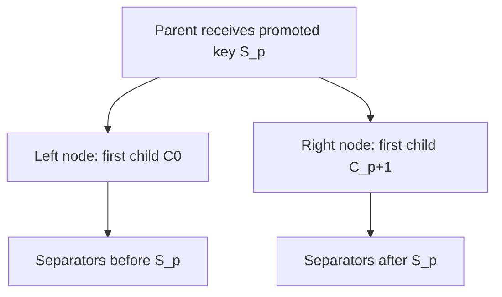

# 0006: Packed inner-node storage and routing

**Status:** Agreed; implementation in progress

**Design references:** [Project direction](../design/architecture.md),
[shared pages and logical keys](../design/bf-tree-pages.md).

**Parent roadmap:** [BF-Tree implementation](0002-bf-tree-roadmap.md), milestone 3.

**Builds on:** [Page prefix compression and `KeyRef`](0005-bf-tree-page-prefix.md).

**Implementation background:** [Microsoft's inner-node implementation](../explanations/bf-tree-upstream-inner-nodes.md).

## Goal and scope

Build a bounded routing node that stores variable-length separator keys and
fixed-size child references. Establish local routing, insertion, child replacement,
and splitting before composing nodes and leaves into a tree.

- **In scope:** Typed opaque child IDs; a separate packed inner-node format;
  borrowed separator iteration; right-on-equality routing; checked insertion and
  child replacement; byte-aware local splitting with an incoming separator;
  independent layout, routing, and split models.
- **Next stack:** 0007 owns nodes and leaves, traverses the hierarchy, splits
  leaves, propagates parent separators, grows the root, and exposes tree operations.
- **Later components:** Node ownership and ID allocation, mapping and I/O,
  deletion/rebalancing, concurrency, logging, and recovery. This primitive does
  not resolve child IDs or publish structural changes into a parent.
- **Done when:** Local operations agree with an independent separator/child model;
  every returned error preserves affected buffers; successful splits preserve
  routing through a promoted separator; and workspace checks pass.

Use safe, little-endian `zerocopy` views over caller-owned bytes, as for `Page`.
The primitive accepts capacities from 64 through 4096 in 64-byte steps. The
in-memory tree will normally use 4096-byte inner nodes; smaller capacities make
boundaries and split behavior inexpensive to test.

## Routing contract

For `n` strictly increasing separators `S[0..n]`, store `n + 1` children:

```text
first_child = C0
entries     = [(S0, C1), (S1, C2), ..., (S[n-1], Cn)]

Separators:        m                 t
Children:    C0          C1                  C2
Ranges:    key < m    m <= key < t         t <= key
```

Choose the child at the number of separators less than or equal to the query:

```rust
let index = self.slots().partition_point(|slot| self.compare_key(slot, key).is_le());
let child = self.child_at(index).expect("routing position has a child");
Route { index, child }
```

`index` is in `0..=len()`. Equality routes to the matching separator's right
child, matching the leaf pages' lower-inclusive fence convention. All byte-slice
queries are valid, including an empty query for range traversal. Separator keys
must be nonempty. A node with no separators still routes to its required first
child. No dummy key represents that child.

This guarantees the local partition. The owning tree must ensure that child
ranges, heights, identities, and parent separators agree. Inner nodes do not
store their own fence interval in this stack. A returned routing index can
change after mutation; it is not a stable handle.

## Child identity

Recommend opaque IDs rather than pointer-valued child references:

```rust
#[derive(Clone, Copy, Debug, PartialEq, Eq, Hash)]
#[repr(transparent)]
pub struct InnerId(u64);

#[derive(Clone, Copy, Debug, PartialEq, Eq, Hash)]
#[repr(transparent)]
pub struct LeafId(u64);

#[derive(Clone, Copy, Debug, PartialEq, Eq, Hash)]
pub enum ChildRef {
    Inner(InnerId),
    Leaf(LeafId),
}
```

Provide checked constructors, `new(u64) -> Option<Self>`, and a raw-value
accessor. Zero is valid; reserve `u64::MAX`, consistent with the existing
no-backing-leaf sentinel. IDs are neither addresses nor disk offsets. Allocation,
resolution, uniqueness, and reuse rules belong to later owners.

All children of a node have the same kind. Initialization derives that kind from
the first child, and insertion/replacement reject a different kind. Encode the
kind once in the node header and store each ID as an eight-byte integer. The
primitive cannot verify that the referenced node exists or has the right height.

Place the ID definitions in `crates/peppydb-bftree/src/node_id.rs` for reuse by
the later tree and mapping components. Expose the operations through `pub mod inner`.

## Packed layout

Follow upstream's eight-byte inner slot, which stores four actual key bytes
inline. It does not use the leaf format's record tags, value-length field,
reference bit, or fence-derived page prefix.

### Header: 16 bytes

Recommended structural-only header:

```rust
#[repr(C)]
struct Header {
    count: U16,          // Number of separators, excluding first_child.
    capacity: U16,
    remaining_size: U16,
    children_kind: U16,  // 0 = leaf IDs; 1 = inner IDs.
    first_child: U64,
}
```

The required first child has its own field instead of an empty-key slot. All
fields have alignment one. `InnerNode` is a dynamically sized header-plus-byte
view, with the same trusted-initialization boundary as `Page`.

Root identity, version/lock state, disk location, and recovery metadata belong
to a future owning wrapper. This is an in-memory structural format, not a final
durable-node contract. Concurrency must define a sound payload-access protocol;
a version counter alone does not make concurrent non-atomic byte access safe.

### Separator slot: 8 bytes

```rust
#[repr(C)]
struct Slot {
    offset: U16,       // Page-relative start of the key tail.
    key_len: U16,      // Full logical key length.
    inline_key: [u8; 4],
}
```

```text
| header incl. C0 | sorted slots --> | free gap | <-- [key tail][right child ID] |
      16 B              8 B each                     max(key_len - 4, 0) + 8 B
```

Store the first `min(key_len, 4)` bytes in the slot, zero-padding the remainder.
Only the tail appears in the payload. Short separators still have an eight-byte
child payload. Decode that child through an unaligned little-endian integer
view and return it by value.

Borrow a separator as `KeyRef::new(inline_bytes, tail_bytes)`. Borrow the inline
array from the node's slot directory, not a temporary copied `Slot`. Widen the
existing constructor's visibility from `pub(super)` to `pub(crate)` for this
use, and describe `KeyRef`'s prefix as a leading slice that need not be shared.
The public key methods and logical comparison semantics remain the same.

For capacity `C`, header size `H = 16`, and separator length `k`:

```text
tail_len(k)  = k.saturating_sub(4)
entry_size(k) = 8 + tail_len(k) + 8
used         = H + sum(entry_size(key.len()))
free         = C - used
payload_start = H + 8 * separator_count + free
```

The node stays densely packed: keys are immutable after insertion and child
replacement has fixed width. Splitting rebuilds its outputs. No inner-node
compaction or separator-removal API is needed in this stack.

## Proposed API

```rust
#[derive(Clone, Copy, Debug, PartialEq, Eq)]
pub struct Route {
    pub index: usize,
    pub child: ChildRef,
}

#[derive(Clone, Copy, Debug, PartialEq, Eq)]
pub struct SeparatorRef<'n> {
    pub key: KeyRef<'n>,
    pub right_child: ChildRef,
}

pub struct InnerSplit<'r> {
    pub separator: Vec<u8>,
    pub right: &'r mut InnerNode,
}
```

| Method | Contract |
| --- | --- |
| `InnerNode::init(bytes: &mut [u8], first: ChildRef) -> Result<&mut InnerNode, InnerError>` | Validate capacity, zero the buffer, and initialize a node with one child and no separators. |
| `len()`, `is_empty()`, `child_count()`, `capacity()`, `free_bytes()` | `len` counts separators; `child_count` is always `len + 1`. |
| `first_child() -> ChildRef`; `child_at(index: usize) -> Option<ChildRef>` | Borrowing the node suffices; returned IDs are copied values. |
| `route(key: &[u8]) -> Route` | Return the local child position and reference for any byte-slice query. |
| `iter() -> Iter<'_>` | Borrow all separator/right-child pairs in order; exact-sized and fused. It excludes the separate first child. |
| `try_insert(key: &[u8], right: ChildRef) -> Result<(), InnerError>` | Insert a distinct nonempty separator and its right child. Preserve the preceding child and all other entries. |
| `replace_child(index: usize, child: ChildRef) -> Result<ChildRef, InnerError>` | Replace one existing reference, including index zero, and return the old reference. It can succeed on a full node. |
| `split_with_insert<'r>(&mut self, right_storage: &'r mut [u8], key: &[u8], right_child: ChildRef) -> Result<InnerSplit<'r>, InnerError>` | Explicitly split the virtual contents including a new distinct separator. Replace `self` with the left result and initialize the supplied storage as the right result. |

Insertion and child replacement require `&mut self`. Reads borrow `&self` and do
not allocate. Each ordinary insertion shifts slots and copies one tail/child
payload. Search compares meaningful inline bytes first, then tails on a tie;
query lengths below four never require out-of-bounds slicing.

`InnerError` distinguishes `InvalidCapacity`, `CapacityMismatch`, `EmptyKey`,
`ChildKindMismatch`, `SeparatorTooLarge`, `DuplicateSeparator`, `NodeFull`,
`InvalidChildIndex`, and `CannotSplit`.

- Insertion checks empty key, child kind, standalone entry size, duplicate,
  then contiguous space. Use checked arithmetic before narrowing lengths/offsets.
- Child replacement checks the index, then kind. It changes only the selected
  eight-byte reference; separator bytes and free space are preserved.
- Splitting first validates the right buffer's capacity and requires it to
  equal the source capacity. Then apply insertion's key/kind/size/duplicate
  checks and validate the split candidates.
- Every returned error preserves all supplied or affected bytes. Initialization
  and successful splitting may overwrite their destination buffers completely.
- Mutating methods assume bytes came from valid constructors and operations.
  Arbitrary stored-byte validation remains a separate boundary.
- `&self` methods must be total over any byte content of the declared capacity:
  they must not panic or read outside the buffer, although they may return
  meaningless results. Clamp decoded counts, offsets, and lengths to the buffer.
  This differs from `Page`, whose reads may panic on invalid bytes. The reason
  is optimistic latch coupling; see the agent notes.

## Split with the incoming separator

`try_insert` returns `NodeFull` without rebuilding. The caller can then explicitly
choose `split_with_insert`; the local primitive does not allocate a sibling ID
or update the parent. Splitting is also permitted before the node becomes full.

Conceptually merge the pending entry into the sorted sequence without first
inserting it into the source buffer. For `m` resulting separators, consider
promotion indices `1..m-1` (excluding both endpoints). Each output must retain
at least one separator and therefore at least two children. Return `CannotSplit`
if there are fewer than three resulting separators or no capacity-valid candidate.

For candidate `p`:

```text
promote: S[p]
left:    first C0,       entries S[0..p]       with right children C[1..p+1]
right:   first C[p+1],   entries S[p+1..m]     with right children C[p+2..m+1]

left_used  = H + sum(entry_size(S[i])) for i < p
right_used = H + sum(entry_size(S[i])) for i > p
```

All ranges above are half-open. The promoted separator is absent from both
output directories. Its right-child reference becomes the right node's first
child. The parent's new right-child reference will instead be the ID of that
right node, supplied by the owner.



Calculate sizes with prefix sums in a linear pass. Discard candidates whose
outputs exceed capacity. Among the rest, minimize this deterministic score:

```rust
(left_used.max(right_used), left_used.abs_diff(right_used), promotion_index)
```

Minimizing the fuller output leaves the most room on the limiting side. A simple
count midpoint can leave one node nearly full when key lengths differ. The
second and third terms provide stable tie-breaking.

Example on a 128-byte node: existing sorted entry sizes are `[64, 16, 16, 16]`,
using all `16 + 112` bytes. Insert a final 16-byte entry. The virtual sizes are
`[64, 16, 16, 16, 16]`. Promoting index 1 leaves 80 and 64 used bytes; promoting
the count midpoint, index 2, leaves 96 and 48. Choose index 1.

After preflight, allocate one owned promoted key and build two packed scratch
images, each at most 4096 bytes. Copy the completed images to `self` and
`right_storage`, then expose the right view. This uses at most 8 KiB of scratch
space and avoids per-entry heap allocation. The packing helper consumes borrowed
key parts and copied child IDs; it does not flatten every key to call public
insertion. The promoted key must survive rewriting its source, so this API returns
one owned `Vec<u8>` for it. All fallible validation precedes publication of either
image. This is an exclusive-access, in-memory error guarantee, not a crash-atomic
tree update.

### Splittability and the later tree's admission rule

A separator may fit alone yet leave too few entries to form two useful inner
nodes. A 64-byte node can hold one 36-byte key: its entry costs 48 bytes. Adding
a second separator produces only two separators total, so promotion cannot leave
one on each side. Return `CannotSplit` and preserve both buffers.

This primitive accepts any separator that fits alone. It does not establish the
final database key-size limit. 0007 must choose a tree-level admission rule that
guarantees progress for both inner and leaf splits, including leaf fences.

A useful sufficient **inner-only** condition is:

```text
entry_size(key) <= floor((capacity - H) / 2)
```

Under that condition, insertion cannot fail on space with fewer than two existing
separators. Once there are at least two, a same-capacity split with one incoming
entry that fits alone always has a legal candidate: promote the incoming key if
it lies inside the sequence, or promote its adjacent old endpoint otherwise.
Both remaining groups fit and are nonempty. The byte planner can then choose a
better-balanced candidate. This bound is not sufficient to settle leaf splitting
or the database-wide key/value limits; those are explicit obligations for 0007.

## Decisions and trade-offs

- **Dedicated inner format:** Four actual inline key bytes and fixed child
  values follow the inspected implementation. Do not reuse leaf record kinds
  or add leaf-style fences/shared prefixes to this stack. Page-wide inner prefix
  compression would be a later optimization requiring its own range metadata.
- **Explicit first child and 16-byte header — agreed:** Avoid dummy keys and
  keep this structural view separate from owning-node state. The OLC lock word,
  location, checkpoint version, and root identity live in the owning frame, a
  side table, or the tree, never in the node image. Upstream combines a 32-byte
  header with a dummy leftmost entry. See the agent notes for the comparison.
- **Typed IDs — agreed:** Keep addresses and ownership outside the packed node.
  Resolution goes through an inner arena with stable frames. Compared with
  upstream's direct inner pointers this adds index arithmetic per level;
  evaluate that cost once a complete tree exists.
- **Distinct insertion and explicit child replacement:** A duplicate separator
  is an error, rather than an implicit update. Fixed-width replacement works
  independently of remaining payload space.
- **Explicit byte-aware split including the pending entry — agreed:** The node
  never splits on its own; the tree calls `split_with_insert` with the pending
  entry. Each output keeps at least one separator and therefore two children,
  and children are conserved across the split. Local `CannotSplit` preserves
  both buffers; 0007 must choose a separator admission limit at least as strict
  as the inner-only half-budget bound so that `CannotSplit` is unreachable in
  the composed tree. Upstream's local split uses existing-entry counts.
- **Total reads:** `&self` methods never panic or read out of bounds on any
  bytes, so that optimistic readers can later observe torn nodes safely.
- **Bounded rebuild on explicit structural operations:** Ordinary insertion
  remains local. Shared packing code implements bytes; node split policy chooses
  the entries and promotion. Future tree code owns parent/root publication.

## Module organization

Paths are relative to `crates/peppydb-bftree/`:

```text
src/node_id.rs       # InnerId, LeafId, ChildRef
src/inner/
    mod.rs          # InnerNode view, errors, initialization, accounting, exports
    layout.rs       # Header, Slot, integer encoding
    read.rs         # Route, SeparatorRef, comparison, borrowed Iter
    write.rs        # Distinct insertion and child replacement
    split.rs        # Candidate selection and two-image rebuilding
    tests/
        mod.rs
        layout.rs
        read.rs
        write.rs
        split.rs
        model.rs
```

Keep implementation submodules private. Reuse `KeyRef` with the small visibility
and terminology adjustment above. Update `docs/design/bf-tree-inner-nodes.md`
as code lands, and link it from the architecture document. The 0005 leaf-page
format and compression policy are separate from this node layout.

## Agreed commit stack

Seven diffs: one plan and six implementation/model diffs. Each behavior lands
with focused tests. Aim for about 300 changed lines per substantive diff; the
split diff may exceed that to keep its two-buffer guarantee and tests together.

### `[1/7][bf-inner][plan] define packed routing-node contracts`

- **Purpose:** Agree on format, IDs, routing, and the split/admission boundary.
- **Changes:** Finalize this plan and its roadmap link; retain upstream detail
  in the separate explanation.
- **Verification:** Review byte accounting, child partitioning, and stack order.

### `[2/7][bf-inner][ids] define typed opaque child references`

- **Purpose:** Establish references without pointer or storage ownership.
- **Changes:** Add `InnerId`, `LeafId`, checked construction/accessors, and
  `ChildRef`, with the crate exports needed by later node/tree code.
- **Verification:** Zero, large IDs, reserved maximum, round trips, and kind identity.

### `[3/7][bf-inner][layout] initialize packed inner-node views`

- **Purpose:** Establish the header, slot encoding, and required first child.
- **Changes:** Add the safe view, `InnerError`, initialization, counts/capacity,
  and the initial inner-node design note.
- **Verification:** All supported capacities, unaligned buffers, golden header
  bytes, first-child kinds, and unchanged buffers after rejected initialization.

### `[4/7][bf-inner][read] route queries and borrow separator entries`

- **Purpose:** Verify local partitions before implementing insertion.
- **Changes:** Add inline/tail decoding, child access, preview-first routing,
  and exact-sized fused separator iteration. Share `KeyRef` across the modules.
- **Verification:** Independent raw fixtures, equality routing, empty/short
  queries, four-byte collisions, borrowed key parts, and child index boundaries.
  Feed random and adversarial bytes to every `&self` method and assert no panic.

### `[5/7][bf-inner][write] insert separators and replace child references`

- **Purpose:** Support parent updates through checked local mutation.
- **Changes:** Add sorted distinct insertion and fixed-width child replacement.
- **Verification:** Every insertion position, duplicates, wrong kinds, full nodes,
  exact fits, short/long keys, and byte-preserving failures. Replacement changes
  only its selected ID, including the header's first child.

### `[6/7][bf-inner][split] split nodes with byte-aware separator promotion`

- **Purpose:** Produce two valid routing nodes from a pending parent insertion.
- **Changes:** Add virtual insertion, candidate scoring, owned promotion, and
  two-image rebuilding without parent or allocator side effects.
- **Verification:** Pending entry before/inside/after existing entries; promotion
  of pending and existing keys; right-first-child correctness; byte-skewed keys;
  minimum child counts; equal-capacity validation; and preservation of both
  buffers on every error.

### `[7/7][bf-inner][tests] verify routing and splits against a logical model`

- **Purpose:** Check cross-operation behavior and structural partitioning.
- **Changes:** Add deterministic model sequences and independent byte validation;
  finalize design documentation and verification outcomes.
- **Verification:** Compare insert/replace/route results and exact space use.
  Exhaustively score split candidates in the oracle. Compose a one-separator
  parent over split outputs and compare every sampled query with the unsplit
  virtual sequence. Run all required workspace checks.

## Open questions

None.

## Verification strategy

Use an independent model of one first child and sorted owned separator/right-child
pairs. Compute routing as the number of keys `<= query`. Track physical sizes
from the documented four-inline-byte rule, not production layout helpers.

Decode raw offsets independently to check order, full lengths, zero padding,
tail placement, child values, directory/payload non-overlap, and exact free
space. Test leaf and inner child kinds, all capacities for initialization, and
representative capacities for operation sequences. Include keys of length
1, 2, 3, 4, 5, long colliding prefixes, zero bytes, and 255 short separators in
a 4096-byte node. Snapshot source and destination bytes before rejected writes.

For splits, independently enumerate every allowed promotion position. Check
the chosen score, both output sizes, separator exclusion, child preservation,
and routing composition. Exercise the `CannotSplit` case above and the
inner-only half-budget admission condition separately.

Run from the repository root:

```sh
cargo test -p peppydb-bftree
cargo fmt --all -- --check
cargo clippy --workspace --all-targets -- -D warnings
cargo test --workspace
RUSTDOCFLAGS="-D warnings" cargo doc -p peppydb-bftree --no-deps
```

## Progress and review outcomes

- [x] Inspect the completed 0005 interfaces and pinned upstream inner-node code.
- [x] Draft the layout, routing, split contract, and seven-diff stack.
- [x] Agree on the open design decisions (header, IDs, split contract).
- [x] Finalize diff 1 as the plan commit.
- [x] Implement and verify diff 2: typed IDs.
- [x] Implement and verify diff 3: layout and initialization.
- [ ] Implement and verify diff 4: routing and borrowed reads.
- [ ] Implement and verify diff 5: insertion and child replacement.
- [ ] Implement and verify diff 6: split with insertion.
- [ ] Implement and verify diff 7: model checks and documentation.

Planning checked the split feasibility argument and the worked example with a
bounded combinatorial calculation: 37,164 cases across payload budgets 48, 112,
and 240, existing counts 2–5, representative entry sizes, and every incoming
position. All had a feasible promotion; the example selected 80/64-byte outputs.
This is evidence for the draft algorithm, not verification of a Rust implementation.

## Agent notes

- **Baseline inspected:** `d74d8da6882f`, completed 0005; implementation is under
  user review. This stack's code has not started.
- **Shared key view:** `page/key.rs::KeyRef::new` is currently `pub(super)`, so
  sibling `inner` code needs the planned crate-visible constructor. Borrow inline
  bytes from the node directory to preserve the returned view's lifetime.
- **Future tree obligation:** 0007 must establish compatible inner/leaf admission
  limits before promising that every valid write can split and complete. A
  `SeparatorTooLarge` check against an empty node alone does not establish that.
- **Documentation:** Keep upstream mechanics in the linked explanation. Record
  the implemented guarantees in the new inner-node design note as each diff lands.

### Design review: why this format differs from upstream

Recorded from the planning discussion so later stacks (0007 tree, mapping,
concurrency, checkpointing) can refer to it. Upstream means Microsoft revision
`f442e617`.

**Confirmed prior decision.** Inner nodes use a separate format and do not
wrap `Page` (plan 0003 "Page roles"; `design/bf-tree-pages.md`). `Page` records
carry a kind tag, value length, reference bit, two-byte preview, and a
fence-derived prefix; a separator needs none of those and needs `n + 1`
children for `n` keys. Only the `zerocopy`-over-caller-bytes technique and
`KeyRef` are shared.

**Element-by-element comparison.**

| Element | Upstream | 0006 | Reason for the difference |
| --- | --- | --- | --- |
| Header | 32 B: `NodeMeta`, `version_lock: AtomicU64`, `disk_offset`, `snapshot_version` with root flag | 16 B: count, capacity, remaining, child kind, first child | Lock, location, and checkpoint state belong to the owning frame (below). `AtomicU64` cannot live in an unaligned byte view, and `init`/split overwrite the whole buffer, which would clobber an in-image lock. |
| Leftmost child | Dummy slot 0 with empty key (8 B slot + 8 B payload); searches start at index 1 | `first_child` header field | 8 B cheaper; `len` means separators and `child_count = len + 1` with no off-by-one; keeps the nonempty-separator rule exception-free; mirrors the test model `(C0, [(S_i, C_i+1)])`. Cost: `first_child` is a special case in `replace_child(0)`, `iter`, and split. |
| Slot | 8 B: offset, key length, 4 inline key bytes | Same | Upstream's inner slot is good: most comparisons resolve inside the slot array. |
| Key access | `get_full_key` allocates a `Vec` per read | Borrowed `KeyRef(inline, tail)` | No allocation on the read path. `KeyRef`'s "prefix" here is a per-key leading slice, not a shared page prefix. |
| Child reference | `PageID` packed `u64`: heap address for inner children, tagged ID for leaves | `InnerId` / `LeafId` typed IDs; kind stored once per node | Images stay valid across restart (upstream's inner pointers are garbage on reload); kind mismatch is checkable at insertion; no `unsafe` in the node. Cost: one ID-to-frame resolution per level, index arithmetic in a slab (below). |
| Duplicate separator | Silent child update, but the space check runs first | `DuplicateSeparator` error; `replace_child` is separate and works on a full node | A duplicate separator indicates a tree bug; surface it. |
| Split | Count midpoint of existing entries; pending key inserted afterwards by the tree; `Vec` per entry | Byte-aware over the virtual sequence including the pending entry; two scratch images; one owned promoted key | Variable-length keys make count splits unbalanced; including the pending entry guarantees it fits or fails up front; no per-entry allocation; `CannotSplit` is a value, not a panic. |
| Node size | Constant 4096 | Stored capacity, 64..=4096 | Small nodes make split and boundary tests cheap; same rule as `Page`. |

Fixed per-node overhead: upstream 48 B (header plus dummy entry); 0006 16 B.

**Upstream's `disk_offset` and `snapshot_version`.** Upstream checkpoints inner
nodes by writing the whole 4096-byte struct (`as_slice`) and reloading it with
`build_from_slice`, which zeroes `version_lock`. So `version_lock` on disk is
garbage, `snapshot_version` is checkpoint metadata, and the root flag avoids a
separate catalogue entry. None of these describe routing content. peppydb puts
them in the frame or in a side table keyed by `InnerId`, and writes
`node.as_bytes()` as the image. Do not confuse the OLC lock version with the
checkpoint snapshot version; they are unrelated.

**Ownership model (for 0007 and later).** Upstream allocates each inner node
with `std::alloc` and stores the address in the parent; inner nodes sit outside
the §4 circular buffer and its size-class free lists, which serve mini-pages
only. peppydb resolves `InnerId` through an inner arena that is also outside
the mini-page pool:

```rust
#[repr(C)]
pub struct InnerFrame {
    version: AtomicU64,                            // OLC lock bit + counter
    bytes: UnsafeCell<[u8; INNER_NODE_CAPACITY]>,  // InnerNode view lives here
}
```

- Single-threaded 0007 may use the simplest stable storage, such as
  `Vec<Box<[u8; 4096]>>`. Do not build the slab before concurrency needs it.
- The concurrent arena must never move or free a frame while the arena lives:
  use fixed chunks (for example 256 frames) behind an append-only directory of
  chunk pointers, so `frame(id)` is two shifts plus one hot load. A plain
  `Vec<InnerFrame>` is wrong because reallocation moves frames under readers.
  Alternative: one large `mmap` reservation with lazy commit.
- Freed IDs go on a small free list and must not be reused while an optimistic
  reader may still hold them (epoch or equivalent; concurrency stack decides).
- Frame alignment to 4096 is not required: the disk image is the node bytes
  copied into an I/O buffer, not the frame. If 4 KiB frames are wanted later,
  shrink the node capacity (for example 4032) rather than carving the header.
- Precedent: LeanStore/Umbra keep the latch in the buffer frame header beside
  the page image; PostgreSQL keeps `BufferDesc` separate from page content; the
  BF-Tree paper itself keeps leaf locks in the mapping table (§3.3). Upstream's
  in-image lock is the outlier.

**Optimistic latch coupling (OLC) and why reads must be total.** Readers do not
lock: read `version`, work on the bytes, read `version` again, retry if it
changed or was locked. Writers lock (low bit), mutate, then release by bumping
the version. A reader may therefore observe a torn node (count ahead of slots,
offsets mid-shift, half-copied tails) and must survive it; the version re-check
discards the result. Consequences:

1. `route`, `child_at`, `iter`, and accounting reads must not panic or index
   out of bounds on any bytes. Clamp decoded counts, offsets, and lengths.
2. Readers cannot self-validate their key interval because inner nodes store no
   fences; the traversal re-validates the parent's version after reading the
   child reference. Record this as a tree invariant in 0007/0008.
3. Handing a reader `&InnerNode` while a writer may hold `&mut` is outside safe
   Rust's aliasing model. The arena frame owns that boundary in roughly twenty
   lines of `unsafe`, justified by the version protocol. `InnerNode` itself
   stays safe. `RefCell` cannot express this (it panics on overlap and is not
   `Sync`). Safe alternatives and their costs: `RwLock` per frame (contention
   on upper levels, acceptable first baseline), atomic byte arrays (loses the
   `zerocopy` view), copy-under-validation (4 KiB per level), copy-on-write
   nodes with epoch publication (different design). Decision deferred to the
   concurrency stack; if model checking with `loom` or `shuttle` is wanted, the
   `UnsafeCell` approach needs instrumented atomics in the frame only.

**Assessment.** The structural choices change none of the paper's algorithmic
content and match production buffer-manager practice. The identified risks are
over-planning ahead of a running tree, and leaving these requirements only in
chat. Next step after 0006: a single-threaded end-to-end tree in 0007, then
benchmark against upstream before adding ownership or concurrency structure.

## Sources

- [BF-Tree paper](../references.md#bf-tree-paper), §§3.4–3.5: inner-node routing,
  concurrency, and layout optimizations.
- [Upstream inner-node explanation](../explanations/bf-tree-upstream-inner-nodes.md),
  revision `f442e6172bf7e5483ff320d8e3ac16a70e31bbd6`: four inline key bytes,
  fixed child payloads, dummy leftmost entry, and count-based splitting.
- [Plan 0005](0005-bf-tree-page-prefix.md) and the crate's `src/page/key.rs` for
  borrowed logical-key semantics; `src/page/` for packed-view and test patterns.
