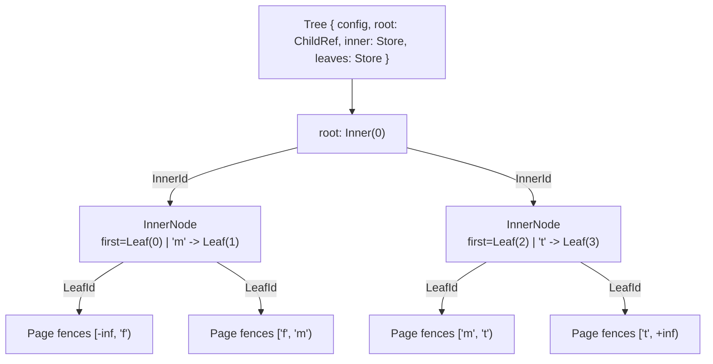
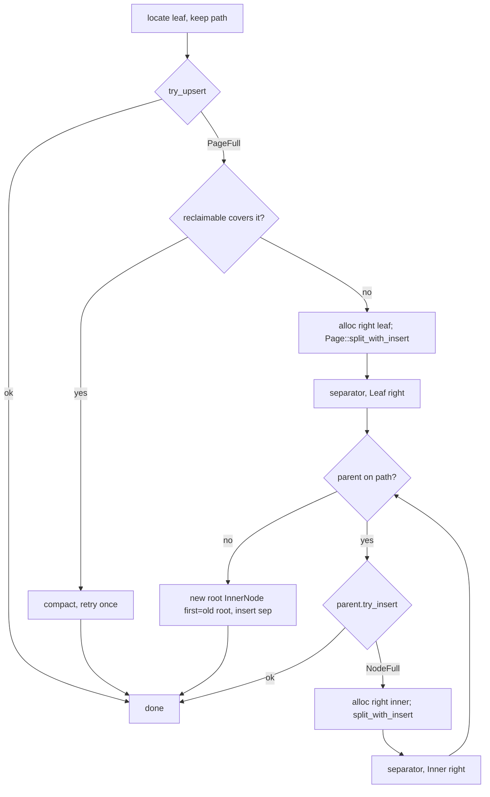

# 0007: Single-threaded in-memory tree composition

**Status:** Agreed

**Design references:** [Project direction](../design/architecture.md),
[shared pages and logical keys](../design/bf-tree-pages.md),
[inner nodes](../design/bf-tree-inner-nodes.md).

**Parent roadmap:** [BF-Tree implementation](0002-bf-tree-roadmap.md), milestone 3.

**Builds on:** [Packed inner nodes](0006-bf-tree-inner-node.md) and
[fence-derived page prefixes](0005-bf-tree-page-prefix.md).

## Goal and scope

Compose the existing `Page` and `InnerNode` primitives into a working ordered
map. This is the first end-to-end tree: it routes through inner nodes to fenced
leaf pages, splits leaves and inner nodes, propagates separators upward, grows
the root, and scans ranges across leaves. It runs on one thread, in memory,
with base leaves only. It is the point at which the structural decisions of
0003–0006 can be measured instead of argued.

- **In scope:** A leaf split primitive on `Page`; a tree configuration with a
  derived key/value admission rule that makes every split succeed; a minimal
  in-memory node store keyed by `InnerId`/`LeafId`; point get, upsert, and
  remove; bottom-up split propagation and root growth; range scans across
  leaves; structural invariant checks and a model-based test suite.
- **Out of scope:** Mini-pages, the mapping table and page store boundary
  (milestone 4), the circular buffer (6), caching semantics and record kinds
  other than `Insert` in leaves (7), concurrency and the arena/frame design
  (8), logging and recovery (9), leaf merging and inner-node underflow
  handling, and separator truncation (listed as a follow-up).
- **Done when:** A randomized operation sequence agrees with a `BTreeMap`
  oracle for get, upsert, remove, and range; a structural checker finds every
  leaf's fences equal to its routing interval after every operation; splits
  never return `CannotSplit` under the admission rule; and workspace checks pass.

## Approach

### Shape of the tree



A new tree is one unbounded leaf and `root = ChildRef::Leaf(id)`, as upstream
does with its root-is-leaf flag. The first leaf split creates the first inner
node. All inner nodes and leaves have the configured capacities; every leaf is
at the same depth.

### Node store

Single-threaded ownership is deliberately minimal, following the 0006 agent
notes: do not build the slab or frames before concurrency needs them.

```rust
/// Fixed-capacity byte buffers addressed by a typed ID. IDs are never reused.
struct Store<Id> {
    capacity: usize,
    nodes: Vec<Box<[u8]>>,
    _id: PhantomData<Id>,
}

impl<Id: NodeId> Store<Id> {
    fn alloc(&mut self) -> Id;                       // pushes a zeroed buffer
    fn get(&self, id: Id) -> &[u8];
    fn get_mut(&mut self, id: Id) -> &mut [u8];
    fn pair_mut(&mut self, a: Id, b: Id) -> (&mut [u8], &mut [u8]);  // a != b
}
```

`pair_mut` uses `Vec::get_disjoint_mut` so a split can hold the source node and
the freshly allocated sibling at once. No free list: this stack never frees a
node, because there is no merging. Milestone 4 introduces the page-store
boundary behind `LeafId`; the leaf store here is the test backend it will replace.

### Leaf split primitive

`Page` has `compact()` but no split. Add `Page::split_with_insert`, mirroring
the inner-node contract so the tree treats both levels the same way:

```rust
pub struct LeafSplit<'r> {
    pub separator: Vec<u8>,
    pub right: &'r mut Page,
}

impl Page {
    /// Split a fenced page together with one pending record. `self` becomes
    /// the left output with fences `[lower, separator)`; `right_storage` is
    /// initialized as the right output with `[separator, upper)`. The pending
    /// record lands in whichever side contains its key.
    pub fn split_with_insert<'r>(
        &mut self,
        right_storage: &'r mut [u8],
        key: &[u8],
        state: RecordState<'_>,
    ) -> Result<LeafSplit<'r>, PageError>;
}
```

```text
before:  [lower ........................................ upper)   records r0..r(m-1), incl. pending
split j: left  = [lower, key(r_j))   records r0..r(j-1)
         right = [key(r_j), upper)   records r_j..r(m-1)
         separator = key(r_j)        (also the right page's low fence)
```

The separator is the full key of the first record on the right, so it is both
the right page's lower fence and the parent's new separator. Routing agrees by
construction: the inner node routes `key >= separator` right, and the right
page's fence is lower-inclusive.

Selection is byte-aware over the virtual record sequence (existing records in
order with the pending record merged in), for candidates `j` in `1..m`:

```text
prefix_left  = lcp(lower, key_j)            prefix_right = lcp(key_j, upper)
left_used    = 32 + fence_bytes(lower, key_j, prefix_left)
             + sum(8 + key_len_i - prefix_left + value_len_i)  for i < j
right_used   = 32 + fence_bytes(key_j, upper, prefix_right)
             + sum(8 + key_len_i - prefix_right + value_len_i) for i >= j
score        = (max(left_used, right_used), |left_used - right_used|, j)
```

One prefix-sum pass over `(8 + key_len + value_len)` gives the raw sums; each
candidate subtracts `prefix * count` for its side and adds its own fence cost.
Candidates whose outputs exceed the capacity are discarded; the rest minimize
the score.

Cost: every key already shares the page's current prefix `p0` with both
fences, so each `lcp` starts at byte `p0` and inspects only stored suffix
bytes. The total over all candidates is bounded by the page's stored suffix
bytes, so selection is one pass over the page in addition to the O(m) sums.
Upstream's `get_split_key` is O(m) because it ignores the pending record, fence
bytes, and new prefixes, relying on its admission slack instead. We compute the
exact sizes for correctness; the difference is a few KiB of byte comparisons on
a rare path. For sorted keys, `lcp(lower, key_j)` is non-increasing in `j` and
`lcp(key_j, upper)` is non-decreasing, which the tests can use as a check.

Implement selection over a *virtual sequence* iterator that merges the stored
records with a sorted pending batch. 0007 passes a batch of one; milestone 5
needs the same selector for merging a mini-page's dirty records into a base
leaf with at most one split (upstream's condition C3), and must not have to
rewrite it. Fence bytes follow the existing rule
`16 + lower.len() + (upper.len() - prefix)`, with 8 bytes and no payload for an
unbounded fence. Both outputs are built in scratch images with
`init_with_fences` and `try_insert_record`, then copied, so every error
preserves both buffers. Add `PageError::CannotSplit` for fewer than two
virtual records or no fitting candidate, and reject unfenced pages with
`InvalidFences`. Every record kind is accepted at the page level; this tree
only writes `Insert`.

### Admission rule

0006 left the tree responsible for a key limit that makes `CannotSplit`
unreachable at both levels. Derive it from the capacities rather than guessing.

Let `L` be the leaf capacity, `I` the inner capacity, `K` the maximum key
length, `V` the maximum value length, `R = 8 + K + V` the largest record, and
`F = 16 + 2K` the largest finite fence pair.

**Leaf.** A split happens because a pending record did not fit. The virtual
content is at most the old payload area plus the pending record:
`T <= (L - 32 - 16) + R`, since the old page has at least two 8-byte fence
slots. Choosing the last candidate whose left sum is at most `T / 2` bounds
the larger side below `T / 2 + R`. The new prefixes are at least the old one,
so stored sizes do not grow. The larger output fits when:

```text
32 + F + T/2 + R <= L
=>  2K + 1.5R <= (L - 48) / 2
=>  7K + 3V <= L - 72           (after substituting R and clearing fractions)
```

**Inner.** From 0006: `entry_size(K) = 16 + max(K - 4, 0) <= (I - 16) / 2`.

`TreeConfig::new` validates both. For `L = I = 4096` the leaf condition is
`7K + 3V <= 4024` and it dominates the inner one (which allows `K <= 2028`).
Defaults: `K = 64`, `V = 1024` (`448 + 3072 = 3520`), a record of about
1.1 KiB. Sixty-four bytes covers fixed-width keys (integers, UUIDs, digests)
with room for a short prefix; upstream's default `max_key_len` is 16 with a
1952-byte record. The rule is conservative: it assumes maximum-size records on
the heavy side and does not yet model mini-page size classes, so at `K = 16`
it admits about 1.3 KiB records where upstream's C3 admits about 1.95 KiB.
Byte-aware selection and prefix compression only improve on it. A single
record always fits an empty fenced page under the same bound, so a page with
one record plus a pending record always splits. Milestone 5 re-derives the
rule together with size classes.

```rust
pub struct TreeConfig {
    pub leaf_capacity: usize,     // 64..=4096, multiple of 64
    pub inner_capacity: usize,    // same rule
    pub max_key_len: usize,       // >= 1
    pub max_value_len: usize,
}

impl TreeConfig {
    pub fn validate(&self) -> Result<(), TreeError>;   // InvalidConfig with reason
}
```

Keys that exceed the limit are rejected at the API with `KeyTooLarge` /
`ValueTooLarge` before any node is touched. This is the database-wide key
limit for now; milestone 5 revisits it together with mini-page size classes,
as upstream's `create_mem_page_size_classes` conditions do.

### Operations

```rust
pub struct Tree { config: TreeConfig, root: ChildRef, inner: Store<InnerId>, leaves: Store<LeafId> }

impl Tree {
    pub fn new(config: TreeConfig) -> Result<Self, TreeError>;
    pub fn get(&self, key: &[u8]) -> Result<Option<&[u8]>, TreeError>;
    pub fn put(&mut self, key: &[u8], value: &[u8]) -> Result<UpsertOutcome, TreeError>;
    pub fn remove(&mut self, key: &[u8]) -> Result<bool, TreeError>;
    pub fn range(&self, start: Option<&[u8]>, end: Option<&[u8]>) -> Result<Scan<'_>, TreeError>;
    pub fn height(&self) -> usize;
    pub fn check_invariants(&self) -> Result<(), InvariantError>;   // test and debug aid
}
```

**Descent.** `locate(key)` walks from the root, calling `InnerNode::route` at
each level, and returns the leaf ID plus the path `Vec<(InnerId, usize)>` of
node and child index. Reads discard the path; writes keep it for propagation.
Routing is right-on-equality and leaf fences are lower-inclusive, so a key is
always inside the fences of the leaf it reaches; the leaf's `KeyOutOfRange`
would indicate a tree bug and is mapped to an internal error.

**Upsert.** On the located leaf, call `try_upsert`. On `PageFull`: if
`reclaimable_bytes()` covers the shortfall, `compact()` and retry once;
otherwise, if the key already exists, `remove` it, then split with the pending
record. Replacing a record during a split is therefore remove-then-insert over
the virtual sequence, which keeps the split primitive single-purpose.



**Propagation.** The loop in the diagram is the same at every level because
both primitives return `(separator, right)` and leave `self` as the left
output. The right node's ID, not its first child, becomes the parent's new
right child. When the path is exhausted, allocate a new inner node with
`first = old root`, insert the separator, and set `root`. Only `ChildRef`
values move between levels; nothing is re-read after a split.

**Reactive now, proactive later.** This bottom-up path splits only after a
write fails, then walks the remembered path upward. Single-threaded, nothing
can change between the leaf failing and the parent being updated, so the path
is exact. Under optimistic latching that gap is real: the writer holds only the
leaf and must re-find and re-latch parents that may have split meanwhile.
Upstream avoids it with a `should_split` hint and an `aggressive_split`
descent on retry: after a failed attempt, the next descent holds parent and
child exclusively at each level and splits any node that cannot accept another
entry, so the eventual leaf insert is local. Structure the write path as two
layers so milestone 8 can add that variant without touching the primitives:

```rust
fn put(&mut self, key, value) -> Result<UpsertOutcome, TreeError> {
    let (leaf, path) = self.locate(key);
    match self.try_upsert_in_leaf(leaf, key, value) {
        Err(PageFull) => self.split_and_propagate(leaf, &path, key, value),
        result => result,
    }
}

// Reserved shape for the concurrency stack: split full nodes while descending,
// then perform a plain insert that the admission rule guarantees will fit.
// "Full" is computed, not stored: free_bytes() < config.max_entry_size.
fn put_splitting_on_descent(&mut self, key, value) -> Result<UpsertOutcome, TreeError>;
```

Upstream's `should_split` bit lives in `NodeMeta` and therefore reaches disk
with the rest of the header, but it is an in-memory signal from one attempt to
its retry; a stale bit after reload only causes a needless split. Our node
images carry no such bit. Whether a node must split is derived from occupancy
and the admission limits, and any explicit retry hint belongs in the future
frame beside the lock word.

**Remove.** Physical `Page::remove`. No merging or rebalancing: an empty leaf
keeps its fences and remains reachable. The 0004 decision to keep tombstones
for mini-pages does not apply to a tree of base leaves.

**Scan.** `Scan` holds `&Tree`, the current leaf page, and an in-page `Iter`
from `Page::range`. When the page is exhausted it reads the page's upper
fence: `Unbounded` ends the scan; `Key(k)` re-descends with `k` to find the
next leaf. There are no sibling pointers to maintain, and the fence is exactly
the next leaf's lower bound, so no record is skipped or repeated. The scan
stops once the leaf's lower fence is at or beyond `end`. Items are
`RecordRef<'_>` borrowing the tree.

### Invariants

Checked by `check_invariants` and asserted in tests after every operation:

1. Every leaf is at the same depth, and the child kind of each inner node
   matches that depth.
2. For every leaf, its fences equal the routing interval implied by the path:
   lower is the nearest separator whose right subtree contains the leaf
   (or unbounded), upper is the nearest separator to the right (or unbounded).
3. Every record key lies in `[lower, upper)` of its leaf, and the leaf's own
   `check_key` agrees.
4. Separators within an inner node are strictly increasing, and every inner
   node has at least one separator.
5. Every allocated node is reachable exactly once.

Invariant 2 is the one that makes the whole design self-checking: inner nodes
store no interval, so leaf fences are the only place the partition is recorded
twice, and they must agree.

### Module organization

Paths relative to `crates/peppydb-bftree/`:

```text
src/page/split.rs        # Page::split_with_insert, LeafSplit, candidate scoring
src/page/tests/split.rs
src/tree/
    mod.rs               # Tree, TreeConfig, TreeError, exports
    store.rs             # Store<Id>, NodeId trait for InnerId/LeafId
    locate.rs            # descent, Path
    write.rs             # put/remove, split propagation, root growth
    scan.rs              # Scan iterator
    invariants.rs        # check_invariants, InvariantError
    tests/
        mod.rs  config.rs  locate.rs  write.rs  scan.rs  model.rs
```

Export `Tree`, `TreeConfig`, `TreeError`, and `Scan` from `lib.rs`.

## Decisions and trade-offs

- **Bottom-up splits with a remembered path:** Split only when a write fails,
  then propagate upward. Proactive top-down splitting is ambiguous with
  variable-length keys ("full" depends on the incoming key) and would split
  more often. Upstream also propagates from a parent stack.
- **Separator is the right page's first key — agreed:** Simple, matches
  upstream's `get_split_key`, and makes the parent separator and the right
  fence the same bytes. Suffix truncation (the shortest string `s` with
  `left_max < s <= right_min`, after Bayer and Unterauer's prefix B-trees)
  would shrink inner nodes and fences. It changes nothing structural but makes
  separators synthetic and interacts with per-side prefix sizing, so it is a
  follow-up stack, paired with the baseline benchmark to measure its effect.
- **Default limits `K = 64`, `V = 1024` — agreed:** Covers fixed-width keys
  with headroom; larger keys or values are a configuration choice within the
  derived rule, and larger leaf pages are out of scope until 0004's cap moves.
- **Proactive split variant deferred — agreed:** The reactive path is enough
  to measure the tree; `put_splitting_on_descent` belongs to the concurrency
  stack, where its reason to exist (no parent re-latching) applies.
- **Leaf split lives in `page/`:** It needs fence budgeting and prefix sizing,
  which are page-format knowledge, and it keeps the two split primitives
  symmetric. The tree owns allocation and propagation only.
- **Derived admission rule over a fixed constant:** The configuration states
  the capacities; the rule follows from them, so smaller test capacities get
  proportionally smaller limits and the same guarantee.
- **No merging:** Empty leaves are tolerated. Merging interacts with mini-pages
  and the mapping table and is not needed to validate routing and splits.
- **Re-descend for scans:** Avoids sibling pointers, which would need updating
  on every split and would complicate later concurrency. One extra descent per
  leaf boundary is cheap relative to scanning a 4 KiB page.
- **Replace-during-split as remove-then-insert:** Keeps `split_with_insert`
  to one pending record. The removed record's bytes are reclaimed by the
  rebuild anyway.
- **Exact split sizing over a batch-capable virtual sequence:** Pay one pass of
  byte comparisons per split for exact per-side prefixes and fence bytes,
  instead of upstream's approximate O(m) midpoint. Select over an iterator that
  merges stored records with a sorted pending batch, so milestone 5's
  merge-and-split reuses the selector.
- **Reactive splitting, with the proactive shape reserved:** Bottom-up on
  failure is exact single-threaded. The two-layer write path leaves room for
  upstream-style split-on-descent in the concurrency stack. Nothing records
  "needs split" in a node image; it is derived from occupancy.
- **Review outcome:** The design was checked against upstream for performance,
  Rust safety, idiom, and conformance with the paper. No structural change was
  needed. See the agent notes for the comparison.

## Agreed commit stack

Seven diffs. The leaf split and the write path may exceed the 300-line
guideline to keep each guarantee with its tests.

### `[1/7][bf-tree][plan] define single-threaded tree composition`

- **Purpose:** Agree on the split primitive, admission rule, operations,
  invariants, and stack.
- **Core changes:** This plan; roadmap progress link.
- **Verification:** Review the admission derivation and the propagation loop.

### `[2/7][bf-tree][page-split] split fenced pages with a pending record`

- **Purpose:** Give leaves the same split contract inner nodes have.
- **Core changes:** `page/split.rs` with `LeafSplit`, byte-aware candidate
  scoring including per-side prefixes and fence bytes, two-image rebuild,
  `PageError::CannotSplit`; design-note update.
- **Verification:** Pending record before/inside/after; separator equals right
  lower fence; prefixes recomputed per side; unbounded and finite fences; all
  record kinds preserved; exact sizes against an independent calculator;
  errors preserve both buffers; unfenced page rejected.

### `[3/7][bf-tree][store] add tree configuration and node store`

- **Purpose:** Establish ownership and the admission rule before any routing.
- **Core changes:** `TreeConfig` with validation and the derived bounds,
  `TreeError`, `Store<Id>` with `pair_mut`, `Tree::new` with a leaf root.
- **Verification:** Boundary configurations on both sides of each inequality;
  defaults validate; store returns distinct IDs and disjoint buffers.

### `[4/7][bf-tree][read] locate leaves and serve point lookups`

- **Purpose:** Verify descent on hand-built trees before writes exist.
- **Core changes:** `locate` with path, `get`, `height`, and `check_invariants`.
- **Verification:** Hand-assembled two- and three-level trees; keys at and
  between separators; empty query; invariant checker catches deliberately
  broken fixtures (mismatched fence, wrong depth, unreachable node).

### `[5/7][bf-tree][write] upsert and remove with split propagation`

- **Purpose:** Complete the structural operations.
- **Core changes:** `put` with compact-then-split policy, `remove`, upward
  propagation, root growth, size checks against the configuration.
- **Verification:** Sequential, reverse, and interleaved inserts to multiple
  levels on small capacities; replacement that forces a split; removal to
  empty leaves; invariants after every operation; no `CannotSplit` or
  `NodeFull` escapes under the admission rule.

### `[6/7][bf-tree][scan] iterate ranges across leaves`

- **Purpose:** Provide ordered iteration over the whole tree.
- **Core changes:** `Scan` with leaf hopping through upper fences; `range`.
- **Verification:** Bounds inside, at, and across leaf boundaries; unbounded
  ends; empty leaves in the middle; comparison with a flat sorted vector.

### `[7/7][bf-tree][tests] verify the tree against a map oracle`

- **Purpose:** Catch cross-operation bugs and record the stack's outcomes.
- **Core changes:** Deterministic pseudo-random sequences of put/remove/get/
  range against `BTreeMap`, at several capacity and key-length settings,
  including adversarial shared-prefix keys; finalize design docs and this plan.
- **Verification:** Oracle agreement, invariants after each step, and all
  workspace checks.

## Open questions

None.

## Verification strategy

| Check | Command or procedure | Expected result |
| --- | --- | --- |
| Leaf split sizes | Independent calculator over the documented formulas in `page/tests/split.rs` | Exact `free_bytes` on both outputs; chosen score is minimal |
| Admission rule | Fill leaves and inner nodes with maximum-size keys/values at the configured limits | No `CannotSplit`, `RecordTooLarge`, or `SeparatorTooLarge` ever surfaces |
| Structure | `check_invariants` after every model step | Fences equal routing intervals; uniform depth; full reachability |
| Behavior | `BTreeMap` oracle, several seeds and configurations | Identical get/range results and replace/remove outcomes |
| Workspace | `cargo fmt --all -- --check`, `cargo clippy --workspace --all-targets -- -D warnings`, `cargo test --workspace`, `RUSTDOCFLAGS="-D warnings" cargo doc -p peppydb-bftree --no-deps` | Clean |

Record a simple single-threaded insert/get throughput number at the end as a
baseline for later comparison with upstream; it is informational, not a gate.

## Progress

- [x] Agree on the design and commit stack with the user.
- [x] Diff 2: page split.
- [x] Diff 3: configuration and store.
- [x] Diff 4: locate and get.
- [x] Diff 5: write path.
- [x] Diff 6: scan.
- [ ] Diff 7: model tests and documentation.
- [ ] Update `docs/design/bf-tree-pages.md`, `bf-tree-inner-nodes.md`, and add
  `docs/design/bf-tree-structure.md`; tick the roadmap.

## Discoveries and plan changes

- Review found that the real BF-Tree splits base leaves during mini-page merge,
  landing a batch of records. The leaf split selector is therefore specified
  over a batch-capable virtual sequence from the start.
- Upstream's `aggressive_split` exists to avoid re-latching parents under
  optimistic concurrency, not for speed. The write path is layered so that
  variant can be added later.
- `put` returns `UpsertOutcome` instead of `bool`.
- Implementation: the slow write path removes any old version of the key
  first, then compacts if the holes cover the record, and splits otherwise.
  This is equivalent to the planned order but reasons about one space check.
  `Page::record_size` became crate-visible so the tree uses the page's own
  physical sizing. `PageError::CapacityMismatch` was added to mirror the inner
  split's validation.
- `Tree::iter` was added as the unbounded `range(None, None)`.

## Agent notes

- **Entry points:** `inner::InnerNode` (`route`, `try_insert`,
  `split_with_insert`, `InnerSplit`), `page::Page` (`init_with_fences`,
  `fences`, `try_upsert`, `remove`, `compact`, `reclaimable_bytes`, `range`),
  `node_id::{InnerId, LeafId, ChildRef}`. Upstream `src/tree.rs` for the
  leaf-root pattern and the size-class conditions (C1–C3).
- **Borrowing:** Allocate the sibling before splitting, then take both buffers
  with `Vec::get_disjoint_mut`. The path holds IDs and indices, never node
  references, so propagation can borrow each parent mutably in turn.
- **`Page` internals:** `layout.rs` items are `pub(super)`; the split belongs
  inside `page/` to reach `record_capacity`, `Slot`, and the fence size helpers.
  Follow `compact.rs` for the scratch-image pattern. `backing_leaf` has no
  accessor and stays at its sentinel in this stack.
- **Routing/fence agreement:** `route` is right-on-equality; fences are
  `[lower, upper)`. A leaf reached by descent must never report
  `KeyOutOfRange`; treat it as an invariant violation.
- **Keep totality separate:** `Page` reads may still panic on invalid bytes;
  only `InnerNode` reads are total. The tree never hands out bytes it did not
  initialize, so this is fine single-threaded.
- **Do not add:** frames, arenas, atomics, sibling pointers, or `unsafe`. The
  workspace forbids `unsafe_code`; this stack needs none.

### Design review against upstream

Recorded before implementation so the reasoning survives the chat.

**Performance.** Per-level work matches upstream: the same inline-key probe,
the same fence-prefix leaf search, and the same high-fence re-traversal for
scans. Differences: the `InnerId` hop costs one hot directory load plus
arithmetic with a slab (two dependent loads with this stack's `Vec<Box<[u8]>>`
scaffolding); total-read clamps are predicted integer ops; inner nodes carry
16 B of fixed overhead against upstream's 48 B; the inner split allocates one
`Vec` against upstream's one per entry; the leaf split spends one extra pass
of byte comparisons for exact sizing. Upstream already pays a mapping-table
lookup, lock, and location decode at the leaf hop. Capability gap: upstream
leaf pages go to 32 KiB; ours stop at 4096 (0004 scope). The true determinant
is the leaf-side storage stack, which this plan's baseline measurement is for.

**Safety.** Both views are `FromBytes + IntoBytes + Unaligned + KnownLayout`
over all-bit-patterns-valid fields, so conversions are sound for any buffer.
`Page` reads may panic on invalid bytes; panics are not unsoundness, and the
tree only hands out buffers it initialized. `get_disjoint_mut` is safe. IDs
are never reused here. Milestone 8's frame needs about twenty lines of
`unsafe`, which requires changing the workspace `forbid` to a per-module
`allow(unsafe_code)` with `deny(unsafe_op_in_unsafe_fn)`; record that as a
deliberate policy change when it happens.

**Idiom.** `Result` with `thiserror`, borrowed views, exact-sized fused
iterators, newtype IDs, `Box<[u8]>` buffers, and a `PhantomData` typed-index
store are all standard. `range(Option, Option)` stays consistent with
`Page::range`; `impl RangeBounds<[u8]>` is a possible later polish.

**Conformance.** Matches upstream on: root may be a leaf; separator is the
right page's first full key and its low fence; no leaf merging; scans via the
high fence; fence-derived prefix; right-on-equality routing; a derived
admission rule (ours is the one-record case of upstream's C3). Deviations are
deliberate and local: byte-aware split including the pending entry, reactive
splitting with the proactive shape reserved, no `should_split` bit in the
image. The batch-capable split selector keeps milestone 5's mini-page merge on
the paper's path.

## Sources

- [BF-Tree paper](../references.md#bf-tree-paper), §3.1–3.4 for the tree
  structure and §5 for operations and scans.
- [Upstream `src/tree.rs`](https://github.com/microsoft/bf-tree/blob/f442e6172bf7e5483ff320d8e3ac16a70e31bbd6/src/tree.rs):
  root-is-leaf flag, parent-stack split propagation, and
  `create_mem_page_size_classes` sufficient conditions.
- [Plan 0006](0006-bf-tree-inner-node.md) for the inner split contract and the
  inner admission bound; [plan 0004](0004-bf-tree-page-mutation.md) for the
  fence convention and the deferred split budgeting obligation.
