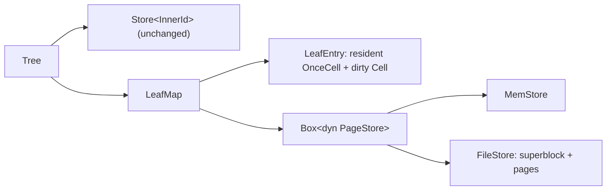
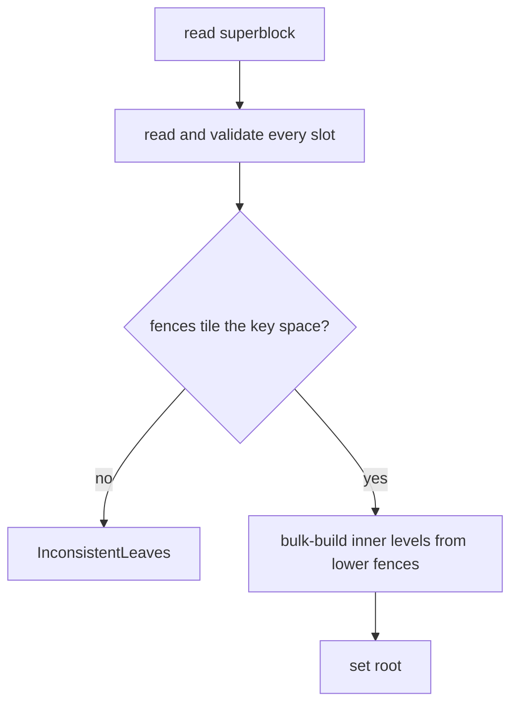

# 0008: Leaf mapping table and page store

**Status:** Completed

**Design references:** [Project direction](../design/architecture.md),
[shared pages](../design/bf-tree-pages.md),
[tree structure](../design/bf-tree-structure.md).

**Parent roadmap:** [BF-Tree implementation](0002-bf-tree-roadmap.md), milestone 4.

**Builds on:** [Single-threaded tree composition](0007-bf-tree-in-memory-tree.md).

## Goal and scope

Give leaves a home outside the process. Replace the tree's in-memory
`Store<LeafId>` scaffolding with a leaf mapping table that resolves a stable
`LeafId` to the leaf's current bytes, backed by a `PageStore` that owns the
durable copy. A tree can then be created on a store, mutated, flushed, closed,
and reopened from its leaf pages alone; the routing layer is rebuilt from leaf
fences on open. This is the paper's §3.3 base-leaf and mapping-table layer
without mini-pages, eviction, or locks.

- **In scope:** `PageStore` trait with an in-memory backend and a file backend;
  a superblock recording the page size and tree configuration; stored-page
  validation; `LeafMap` with load-on-access, per-leaf dirty tracking, and a
  persisted-by-construction free list; `Tree::create`, `Tree::open`, and
  `Tree::flush`; bulk-building inner nodes from leaf fences on open;
  model tests over both backends including close/reopen.
- **Out of scope:** Mini-pages and the `MiniPage`/`BasePage` role wrappers
  (milestone 5), eviction and any memory budget (6), record caching (7),
  concurrency and per-leaf latches (8), the write-ahead log, checkpointing of
  inner nodes, crash atomicity across pages, and leaf merging (9 and later).
  Direct or asynchronous I/O backends are later tuning.
- **Done when:** The 0007 model suite passes unchanged over `MemStore` and
  `FileStore`; a tree flushed, dropped, and reopened from its file compares
  equal to a `BTreeMap` oracle and passes `check_invariants`; `open` rejects a
  corrupted or inconsistent leaf set with an error rather than a panic; and
  workspace checks pass.

## Approach

### Shape



The inner store is untouched: inner nodes remain derived, in-memory data in
this stack. Only the leaf side changes, and only behind `pub(super)` items,
so `Tree`'s existing operations keep their signatures.

### `PageStore`

```rust
pub trait PageStore {
    fn page_size(&self) -> usize;
    /// Number of page slots ever allocated, including freed ones.
    fn slots(&self) -> u64;
    /// Hand out a zeroed slot: a freed slot if any, else a new one at the end.
    fn alloc(&mut self) -> Result<LeafId, StoreError>;
    /// Return a slot for reuse. Unused by this stack's tree; exists so the
    /// boundary is stable when merging arrives.
    fn free(&mut self, id: LeafId) -> Result<(), StoreError>;
    fn read(&self, id: LeafId, buf: &mut [u8]) -> Result<(), StoreError>;
    fn write(&mut self, id: LeafId, buf: &[u8]) -> Result<(), StoreError>;
    fn sync(&mut self) -> Result<(), StoreError>;
    fn superblock(&self) -> &Superblock;
}
```

Placement is fixed: slot `id` lives at byte offset `(id + 1) * page_size`,
after a one-page superblock. There is no catalogue to maintain. A freed slot
is zeroed; its header `capacity` field reads as 0, which no valid page has, so
free slots are recoverable by scanning. Upstream's `VfsImpl` allocates
offsets instead; fixed placement is simpler and sufficient while leaves are
never resized.

```rust
#[repr(C)]
pub struct Superblock {
    magic: [u8; 8],          // b"PEPPYBF\0"
    version: U32,
    page_size: U32,
    inner_capacity: U32,
    max_key_len: U32,
    max_value_len: U32,
    // zero-padded to page_size
}
```

The superblock fixes the admission rule for the file. `open` refuses a
configuration that disagrees with it, so a reopened tree never admits a key
the on-disk pages cannot split.

`MemStore` is a `Vec<Box<[u8]>>` plus a free list: the current `Store<LeafId>`
behind the trait, kept as the fast test backend. `FileStore` wraps a
`std::fs::File` with positioned reads and writes (`FileExt` on Unix) and
`sync_data`. Both are portable and synchronous.

### Stored-page validation

`open` reads bytes it did not write in this process, so they cross the
boundary that 0004 and the page design deferred. Add
`Page::validate(bytes: &[u8]) -> Result<&Page, PageError>`, which checks,
without panicking on any input: capacity equals the buffer length and is
legal; `HAS_FENCES` is set; the slot directory fits; every slot's payload
range lies inside the buffer and outside the directory; the prefix length is
consistent with the fences; fence ordering; and that record keys are sorted
and in range. It is O(page) and runs once per leaf at open. `Page`'s ordinary
methods keep their trusted-bytes contract; validation is the only way stored
bytes become a `Page`.

### `LeafMap`

```rust
pub(super) struct LeafMap {
    store: Box<dyn PageStore>,
    entries: Vec<LeafEntry>,          // index = LeafId; dense, append-only
}

struct LeafEntry {
    /// Full-page copy, loaded on first access. Never cleared in this stack.
    resident: OnceCell<Box<[u8]>>,
    /// The resident copy is newer than the store.
    dirty: Cell<bool>,
    /// Slot is on the store's free list; never true in this stack's tree.
    freed: bool,
}

impl LeafMap {
    fn page(&self, id: LeafId) -> Result<&Page, TreeError>;         // loads through &self
    fn page_mut(&mut self, id: LeafId) -> Result<&mut Page, TreeError>;  // marks dirty
    fn alloc(&mut self) -> Result<LeafId, TreeError>;               // resident zeroed, dirty
    fn pair_mut(&mut self, a: LeafId, b: LeafId) -> Result<(&mut [u8], &mut [u8]), TreeError>;
    fn flush(&mut self) -> Result<(), TreeError>;
    fn len(&self) -> usize;
}
```

`OnceCell` is the reason reads keep taking `&self`: `get_or_try_init` loads
the page on first touch and returns a borrow tied to the map, so
`Tree::get -> Option<&[u8]>` and `Scan<'t>` holding a `page::Iter<'t>` work
exactly as before. Nothing is ever evicted here, so the cell is never cleared;
eviction in milestone 6 will need `&mut` or a latch anyway. The dirty flag is
a `Cell` so `page_mut` can set it through the same borrow structure.

| state | meaning |
| --- | --- |
| `resident` empty, `dirty` false | only in the store; untouched since open |
| `resident` set, `dirty` false | loaded for reading; equal to the store |
| `resident` set, `dirty` true | mutated; `flush` must write it |

This is upstream's `PageTable` row (`RwLock<PageLocation>`) with the lock,
the `Mini` variant, and the pointer into the circular buffer removed: `Base`
is the empty cell, `Full` is the loaded cell.

### Tree lifecycle

```rust
impl Tree {
    pub fn in_memory(config: TreeConfig) -> Result<Self, TreeError>;     // MemStore; not durable
    pub fn create(config: TreeConfig, store: Box<dyn PageStore>) -> Result<Self, TreeError>;
    pub fn open(store: Box<dyn PageStore>) -> Result<Self, TreeError>;
    pub fn flush(&mut self) -> Result<(), TreeError>;
    pub fn dirty_leaves(&self) -> usize;
}
```

`create` writes the superblock from the configuration and allocates the first
unbounded leaf. `flush` writes every dirty resident page and syncs. `Drop`
does not flush; unflushed changes are lost, and the plan says so.

`open`:

1. Read the superblock; derive `TreeConfig` from it and validate it.
2. Read every slot. Zero slots are free. Validate the rest as pages.
3. Sort leaves by lower fence. Require exactly one `Unbounded` lower, exactly
   one `Unbounded` upper, and `upper(i) == lower(i + 1)` for every adjacent
   pair. Any gap, overlap, or duplicate returns `TreeError::InconsistentLeaves`.
4. Bulk-build the inner levels from the sorted leaf list: the separators are
   the lower fences of leaves `1..n`. Fill each inner node with `try_insert`
   until `NodeFull`, start the next node, and promote each new node's first
   separator to the level above; repeat until one node remains or a single
   leaf is the root.
5. Mark no leaf resident and none dirty.



Open is O(number of leaves) in both I/O and memory, and it is the complete
recovery path for this stack: inner nodes are derived data and nothing else is
persisted. Upstream instead checkpoints inner-node images and reloads them;
milestone 9 can add that for fast open on very large trees, keeping this
rebuild as the repair path.

### Consistency without a log

A leaf split dirties two leaf pages and updates the parent in memory. If the
process stops between `flush` calls, both pages are lost together and the
store still holds the pre-split leaf, which is consistent. If it stops during
`flush`, one page may be written and not the other, and `open` detects the
gap or overlap and refuses. Torn 4 KiB writes are likewise caught by
validation. What this stack does not provide is atomicity or durability of
individual operations; that is the write-ahead log's job in milestone 9. The
`lsn` and `snapshot_version` header fields stay inactive.

### Module organization

Paths relative to `crates/peppydb-bftree/`:

```text
src/store/
    mod.rs          # PageStore, StoreError, Superblock, exports
    mem.rs          # MemStore
    file.rs         # FileStore
    tests/
src/page/validate.rs
src/tree/leaf_map.rs
src/tree/open.rs    # superblock config, tiling check, bulk build
src/tree/tests/{store.rs, open.rs}
```

Export `PageStore`, `StoreError`, `MemStore`, `FileStore`, and `Superblock`
from `lib.rs`.

## Decisions and trade-offs

- **Fixed placement, no catalogue:** `offset = (id + 1) * page_size`. The
  file is self-describing and free slots are discoverable by scanning. Costs
  the ability to resize a leaf in place, which fixed 4 KiB leaves do not need.
- **`free` in the trait, unused by the tree:** Merging is a later stack, but
  the boundary should not change when it arrives. Both backends implement a
  free list; the tree never calls it, and the invariant checker still assumes
  dense live IDs.
- **`Box<dyn PageStore>`:** One `Tree` type for both backends. The virtual
  call sits next to a disk read; it is not a cost worth a generic parameter.
- **`OnceCell` resident copies:** Load-on-access through `&self` with no
  `RefCell` and no guards, preserving today's borrow structure for `get` and
  `Scan`. Correct only because this stack never evicts.
- **Rebuild inner nodes on open, no inner persistence:** Smallest correct
  recovery path, and it doubles as a whole-tree fence check. Open time grows
  with leaf count; checkpointed images are a milestone 9 optimization.
- **Validate stored pages, trust in-process pages:** `Page::validate` is the
  single entry for bytes of unknown provenance. In-process pages keep the
  cheaper trusted contract.
- **Configuration in the superblock:** The admission rule must match the pages
  on disk; the file, not the caller, is the authority on reopen.
- **No `BasePage` wrapper yet:** Its rules (fences required, `Insert`/`Delete`
  only, no backing leaf) are already what the tree enforces by construction.
  The role types become useful when a `MiniPage` exists to contrast with.
- **Eager validation on open, for now:** `open` must read every leaf to get
  its fences, so validating during that read costs nothing extra. When
  milestone 9 checkpoints inner nodes, `open` reads the checkpoint instead
  and this pass disappears with it. The lasting trust boundary is
  validate-on-load in `LeafMap`, which runs whether or not `open` validated.
- **No leaf count in the superblock:** A stored slot count could be compared
  with `file_length / page_size - 1` to detect a truncated or extended file,
  but it only catches damage that changes the length, and it would need a
  superblock write on every `alloc`. Without a log, a crash between extending
  the file and rewriting the superblock would make a good file look corrupt.
  `FileStore::open` already rejects a length that is not a whole number of
  pages, and tiling plus validation catch a missing or damaged leaf.
- **`MemStore` stays public; the convenience constructor is renamed:** An
  in-memory tree is a real mode, not only a test aid: SQLite's `:memory:`,
  RocksDB's memory `Env`, and upstream's `:memory:` and `:cache:` paths all
  ship it, and downstream crates cannot use a `#[cfg(test)]` item in their
  own tests. What must not happen is for the non-durable path to look like
  the default. `Tree::in_memory(config)` therefore becomes `Tree::in_memory(config)`
  and `Tree::create(config, store)` is the primary constructor; production
  trees take a `FileStore`.

## Proposed commit stack

Nine diffs. The mapping-table swap and the lifecycle methods are separate so
the swap can be verified as behavior-preserving on its own; the bulk-build
algorithm is separate from the open path so it can be tested as a pure
function over fence lists before I/O and corruption handling are involved.

### `[1/9][bf-leaf-store][plan] define the leaf mapping table and page store`

- **Purpose:** Agree on the store boundary, file layout, validation, and open path.
- **Core changes:** This plan; roadmap link.
- **Verification:** Review the open algorithm and the consistency statement.

### `[2/9][bf-leaf-store][store] add the page-store trait and memory backend`

- **Purpose:** Fix the boundary before any I/O.
- **Core changes:** `PageStore`, `StoreError`, `Superblock` encoding,
  `MemStore` with a free list.
- **Verification:** Alloc/free/realloc order, zeroing on reuse, out-of-range
  IDs, superblock round trip and rejection of a bad magic or version.

### `[3/9][bf-leaf-store][file] add the file backend`

- **Purpose:** Real durability path.
- **Core changes:** `FileStore::create`/`open` on a path, positioned I/O,
  `sync_data`, superblock at offset 0.
- **Verification:** Round trips through a temporary file; reopen sees written
  pages; short files and page-size mismatches are errors. Add `tempfile` as a
  dev-dependency.

### `[4/9][bf-leaf-store][validate] validate stored page bytes`

- **Purpose:** Make bytes of unknown origin safe to view as a `Page`.
- **Core changes:** `Page::validate` and `PageError::Corrupt(reason)`.
- **Verification:** Every valid model page validates; byte-flip and truncation
  fuzzing never panics; each check has a targeted failing fixture.

### `[5/9][bf-leaf-store][map] route leaf access through the mapping table`

- **Purpose:** Replace `Store<LeafId>` without changing tree behavior.
- **Core changes:** `LeafMap` with `OnceCell` residency, dirty tracking, and
  `pair_mut`; `Tree::in_memory` builds on `MemStore`; `tree/store.rs` keeps only
  the inner store.
- **Verification:** The 0007 model suite and baseline pass unchanged; dirty
  counts match mutations; every leaf the tree touches is resident afterwards.

### `[6/9][bf-leaf-store][lifecycle] create trees on a store and flush them`

- **Purpose:** First durable round trip of leaf bytes.
- **Core changes:** `Tree::create`, `Tree::flush`, `Tree::dirty_leaves`;
  superblock written from the configuration.
- **Verification:** After `flush`, the store's pages equal the resident
  copies and no entry is dirty; `flush` on a clean tree writes nothing;
  `MemStore` and `FileStore` observe identical bytes.

### `[7/9][bf-leaf-store][bulk] build inner levels from sorted leaf fences`

- **Purpose:** The routing-layer rebuild, independent of I/O.
- **Core changes:** A function from an ordered list of `(LeafId, lower fence)`
  to a root `ChildRef` and populated `Store<InnerId>`, filling nodes to
  `NodeFull` and promoting first separators; the tiling check over a fence list.
- **Verification:** Single leaf yields a leaf root; counts that need one, two,
  and three inner levels; routing from the built tree agrees with a linear
  search over the fence list for sampled keys; `check_invariants` passes;
  gaps, overlaps, and duplicate fences are reported.

### `[8/9][bf-leaf-store][open] reopen a tree from stored leaves`

- **Purpose:** Close and reopen.
- **Core changes:** `Tree::open`: superblock-derived configuration, slot scan,
  validation, free-slot detection, bulk build, `TreeError::InconsistentLeaves`.
- **Verification:** Reopened trees equal the oracle and pass invariants at
  heights 1 through 3; corrupted files (missing page, duplicated page, zeroed
  page, torn page, bad config) are rejected with the expected error.

### `[9/9][bf-leaf-store][tests] verify the store boundary end to end`

- **Purpose:** Cross-backend confidence and documentation.
- **Core changes:** Model sequences interleaving `flush` and reopen; a cold-
  versus-warm `get` baseline on `FileStore`; design-doc updates.
- **Verification:** Oracle agreement across flush/reopen points; all workspace
  checks.

## Open questions

None.

## Verification strategy

| Check | Command or procedure | Expected result |
| --- | --- | --- |
| Store contract | Shared test module run against both backends | Identical observable behavior |
| Validation | Fuzz valid pages with byte flips and truncation | No panic; corrupt bytes rejected; valid bytes accepted |
| Behavior | 0007 model suite over both backends, with `flush`/reopen interleaved | `BTreeMap` agreement, invariants hold |
| Recovery | Corrupted-file fixtures | `InconsistentLeaves` or `Corrupt`, never a panic |
| Baseline | `FileStore` cold `get` after reopen versus warm; a 96 GiB larger-than-memory run | Informational: measured ~85 µs per first-touch get on the internal SSD, in-memory speed warm |
| Workspace | `cargo fmt --all -- --check`, `cargo clippy --workspace --all-targets -- -D warnings`, `cargo test --workspace`, `RUSTDOCFLAGS="-D warnings" cargo doc -p peppydb-bftree --no-deps` | Clean |

### Outcomes

- Store contract: `store::tests::contract` runs seven scenarios against
  `MemStore` and `FileStore`; `store::tests::file` covers create, reopen
  with free-list recovery, extension, short and ragged files, and foreign
  superblocks.
- Validation: every model page validates and stays valid under mutation;
  about 14,000 corrupted images (bit flips, byte overwrites, header-focused
  overwrites, truncation) never panic, and every accepted image survives the
  trusted operations. Each check has a targeted fixture.
- Behavior: the 0007 model suite passes unchanged on `Tree::in_memory`, and
  `flush_and_reopen_on_{memory,file}_matches_the_oracle` interleave flush
  and reopen every ~117 steps across small, medium, and default
  configurations.
- Recovery: gap, duplicate, torn, flipped-header, unfenced, empty-store,
  bad-configuration, oversized-record, and oversized-fence fixtures return
  `InconsistentLeaves`, `CorruptLeaf`, or `InvalidConfig`.
- Baseline (release, 1 M keys, page cache warm): flush ~35 ms, open ~35 ms,
  cold get ~2.3 M ops/s, warm get ~2.5 M ops/s; in-memory `Tree::in_memory` put
  and get unchanged at ~2.1 M and ~2.0 M ops/s.
- Larger-than-memory baseline (96 GiB file, 48 GiB RAM): `Tree::open` 21 s
  at 4.6 GiB/s; first-touch get and put ~14 k ops/s at p50 85 µs (one random
  4 KiB read each); scans of 100 records 415 µs; flush of 100 k dirty leaves
  3.2 s. Both baselines are recorded in the
  [leaf storage design](../design/bf-tree-leaf-store.md#baselines).
- Workspace: fmt, clippy, tests (161 unit plus 2 ignored baselines, 6 doc),
  and rustdoc all clean.

## Progress

- [x] Agree on the design and commit stack with the user. The open questions
  were resolved into the decisions above: eager validation on open, no leaf
  count in the superblock, and `MemStore` public behind `Tree::in_memory`.
- [x] Diff 2: trait and memory backend.
- [x] Diff 3: file backend.
- [x] Diff 4: stored-page validation.
- [x] Diff 5: leaf map.
- [x] Diff 6: create and flush.
- [x] Diff 7: bulk build and tiling check.
- [x] Diff 8: open.
- [x] Diff 9: end-to-end tests and documentation.
- [x] Add `docs/design/bf-tree-leaf-store.md`; update `bf-tree-pages.md`
  (validation boundary) and `bf-tree-structure.md` (ownership); tick the roadmap.

## Discoveries and plan changes

- **Scans yield `Result`s.** `Scan::next` may load the next leaf from the
  store, which can fail after `open`. The item type became
  `Result<RecordRef, TreeError>` instead of panicking inside an iterator.
  Callers that only use `Tree::in_memory` can `unwrap`.
- **Validation runs on every load, not only on open.** `LeafMap::page` calls
  `Page::validate` when it loads a slot. It is cheap next to a read and keeps
  the trust boundary in one place. `open` still validates eagerly, because
  the tiling check needs every fence.
- **`Page::validate` accepts unfenced pages.** The plan said "`HAS_FENCES` is
  set"; validation is structural and page-level, so the tree checks for
  fences and for the configured key and value limits itself in `open`.
  A planned "prefix shared by both fences" check was dropped as tautological:
  the high fence decodes as the low fence's prefix plus its own suffix.
- **The bulk build needs a borrow rule.** Greedy filling can leave a trailing
  node with one child and no separator, which invariant 4 forbids (5 leaves
  with four children per node). `build_inner` plans the groups first and
  moves the last entry of the left neighbour into such a node; the admission
  rule guarantees the neighbour keeps a separator.
- **Freed slots exist in this stack after all.** Leaves allocated after the
  last `flush` are zero on reopen. `open` treats them as free, returns them
  to the store with `free` (tolerating `FreedSlot` from a backend that
  rescanned), and the invariant checker skips them. The plan's statement that
  `freed` is never true in this stack's tree was wrong.
- **A reopened tree can be shorter.** Bulk-built levels are packed, so
  heights after `open` are at most the heights before it. Tests compare the
  oracle and invariants rather than exact heights.
- **`Superblock::from_config`/`to_config`** live in the tree module, which
  owns `TreeConfig`; the store module knows nothing about trees.
- **`FileStore::open` must not probe every slot.** The first
  larger-than-memory run spent 184 s in 25 M four-byte reads rebuilding the
  free list. The scan was removed: a reopened store treats every slot as
  live, and `Tree::open`, which reads every slot anyway, frees the all-zero
  ones. `FileStore::open` now costs microseconds.
- **No eviction means no larger-than-memory build.** Every touched leaf
  stays resident, so the disk benchmark writes the file directly in the
  on-disk format and measures from `open` onward.
- Diffs 2 through 4 exceed the 300-line guideline because each carries its
  contract or fixture tests; the implementation portions are small.

## Agent notes

- **Entry points:** `tree/store.rs` (`Store<Id>`, to be kept for inner nodes),
  `tree/write.rs::split_and_propagate` (the only `pair_mut` caller),
  `tree/scan.rs` (`Scan<'t>` borrows `page::Iter<'t>` from leaf bytes, which
  the `OnceCell` design preserves), `tree/invariants.rs` (assumes dense IDs
  via `from_index`; still true here), `page/layout.rs` (`Header`,
  `NO_BACKING_LEAF`, `HAS_FENCES`; `pub(super)`, so validation lives in `page/`).
- **Upstream reference:** `src/storage.rs` (`PageTable`, `PageLocation`),
  `src/utils/mapping_table.rs` (chunked slab), `src/fs/mod.rs` (`VfsImpl`),
  `src/snapshot.rs` (checkpointed inner images; the path we defer).
- **`pair_mut` through `OnceCell`:** take both entries with
  `Vec::get_disjoint_mut`, then `OnceCell::get_mut` on each; the left is
  always resident because the caller just mutated it, and the right was just
  allocated resident.
- **Bulk build fill:** filling inner nodes to `NodeFull` is correct; the next
  insert into a full node simply splits it. Do not add a fill-factor knob.
- **Do not add:** latches, eviction, `BasePage`/`MiniPage`, a WAL, inner-node
  persistence, direct I/O, or `unsafe`.
- **Durability claim:** state plainly in docs that data is durable only after
  `flush` returns, and that no per-operation atomicity exists yet.

## Sources

- [BF-Tree paper](../references.md#bf-tree-paper), §3.3: base leaves, page
  I/O, and the mapping table.
- [Upstream `src/storage.rs`](https://github.com/microsoft/bf-tree/blob/f442e6172bf7e5483ff320d8e3ac16a70e31bbd6/src/storage.rs)
  and [`src/utils/mapping_table.rs`](https://github.com/microsoft/bf-tree/blob/f442e6172bf7e5483ff320d8e3ac16a70e31bbd6/src/utils/mapping_table.rs):
  `PageTable`, `PageLocation`, and the slab-backed mapping table.
- [Plan 0007](0007-bf-tree-in-memory-tree.md) for the `Store` scaffolding this
  stack replaces; [plan 0004](0004-bf-tree-page-mutation.md) for the deferred
  stored-page validation boundary.
