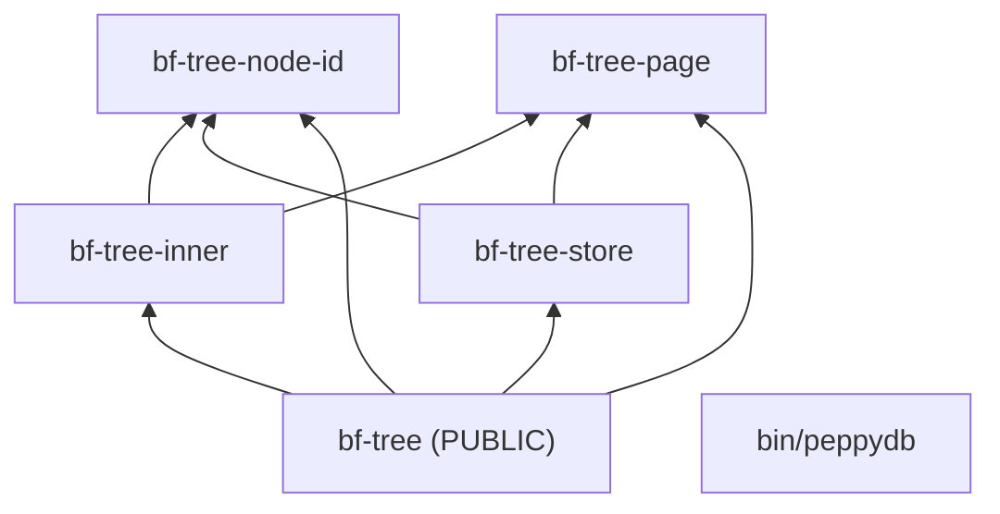

# 0009: Buck2 build, flat BF-Tree crates, and Go support

**Status:** Complete

**Design references:** [Project direction](../design/architecture.md),
[leaf storage](../design/bf-tree-leaf-store.md) (baseline commands change).
This stack adds `docs/design/build-system.md`.

**Supersedes:** The "prefer modules inside the BF-Tree crate" decision in
[0001: Phased crate layout](0001-crate-layout.md#decisions-and-trade-offs).

## Goal and scope

peppydb will grow a Go gateway and a Go placement driver next to the Rust
storage engine, connected by gRPC in one repository. This stack makes
[Buck2](https://buck2.build/) the repository's build system and source of
truth before any Go code exists. It also splits `peppydb-bftree` into small
crates with enforced dependency boundaries, which Buck2 makes cheap and Cargo
does not.

`cargo` must keep working in the repository for Cargo-based tools. A
generator in the repository, `tools/autocargo`, writes the `Cargo.toml` files
from the Buck2 graph.

The stack also adds Go build support with a hello-world program. The Go
toolchain and the generated third-party Go rules are then built and tested in
CI before the first real Go service needs them. The standard `go` command
keeps working through a real Go module at `go/`.

The approach was tested end to end in scratch repositories before this plan
was written. See [Discoveries and plan changes](#discoveries-and-plan-changes).

- **In scope:**
  - A Buck2 build for all Rust code: toolchains, third-party crates through
    [reindeer](https://github.com/facebookincubator/reindeer), and a shared library-and-test macro.
  - Every tool the build runs is pinned (see [Pinned tools](#pinned-tools)):
    `buck2` and `rust-project` through [DotSlash](https://dotslash-cli.com/)
    files, with a weekly workflow that proposes newer releases; `rustc` and
    its components through `rust-toolchain.toml`; reindeer at a fixed commit
    through `tools/reindeer`; Go through `go/go.mod`; and DotSlash itself in
    CI.
  - Equivalents for every check in `AGENTS.md`: tests, doctests, clippy with
    `-D warnings`, and rustfmt.
  - A release platform for the ignored baseline tests.
  - Splitting `peppydb-bftree` into flat crates under `crates/bf-tree-*`,
    with Buck2 `visibility` rules that enforce the dependency graph.
  - `tools/autocargo`, which generates every `Cargo.toml` outside
    `third-party/rust/` and the root `Cargo.lock` from the Buck2 graph.
  - Go build support:
    - the Go toolchains;
    - a Go module at `go/` (`go.mod` and `go.sum`), which is the only list
      of Go dependencies;
    - a hello-world binary, library, and test;
    - `tools/gobuckify-remote`, which generates `third-party/go/BUCK` from
      `go/go.mod`, exercised by one small real dependency
      (`golang.org/x/sync`);
    - `gofmt` and `go vet` checks, and a check that each `BUCK`
      `package_name` matches its directory.
  - GitHub Actions jobs on Linux x86_64 for the Buck2 checks, the
    generated-file checks, `cargo test`, and `go test`.
  - Updates to `AGENTS.md` and the design documents, and a new
    `docs/design/build-system.md`.
- **Out of scope:**
  - Real Go services, protobuf code generation, and cross-language tests.
    The tested approach is recorded in the design document. The gateway
    stack implements it.
  - `tools/autogo`, which would copy Buck2-generated Go sources (for example
    `.pb.go` files) into the tree for the `go` command. Nothing generates Go
    code until protobuf arrives.
  - Generating first-party Go `BUCK` files from imports, as Gazelle does
    for Bazel.
  - The unreviewed stacks above `[9/9][bf-leaf-store]`. Any rewrite of those
    starts from this layout.
  - A remote build cache or remote execution.
  - Hermetic compilers. `rustc` comes from rustup, pinned by
    `rust-toolchain.toml`.
  - Moving unit tests out of `src/`.
- **Done when:**
  - `tools/buck2 test //crates/... //bin/...` runs the same tests as today's
    `cargo test --workspace`: 161 passed and 3 ignored unit tests, plus 6
    doctests.
  - `tools/clippy.sh` and `tools/fmt.sh` pass, and fail on injected lint and
    format errors.
  - A dependency that breaks the graph fails the Buck2 build with a
    visibility error.
  - The ignored baselines run with `@build/mode/release`.
  - Every `Cargo.toml` outside `third-party/rust/` is generated:
    `tools/autocargo --check` passes, and `cargo test --workspace --locked`
    runs the same tests.
  - The Go hello-world builds, runs, and passes its test under both
    `tools/buck2` and `go test ./...` in `go/`, using the generated rule for
    `golang.org/x/sync`. `tools/gobuckify-remote --check` passes.
  - CI passes on GitHub's `ubuntu-latest` (x86_64).
  - Documentation matches the new commands.

## Approach

### Target layout

```text
peppydb/
├── .buckconfig  .buckroot
├── rust-toolchain.toml        # 1.98.1 + clippy, rustfmt, rust-src
├── rustfmt.toml               # edition = "2024"
├── Cargo.toml  Cargo.lock     # generated by tools/autocargo
├── build/                     # Buck2 configuration
│   ├── BUCK                   # build_mode constraint; release and linux-x86_64 platforms
│   ├── defs.bzl               # peppy_rust_library macro
│   ├── toolchains/BUCK        # rust, cxx, python, genrule, test (the toolchains// cell)
│   └── mode/release           # argument file: --target-platforms //build:release
├── crates/
│   ├── bf-tree-node-id/       # LeafId, InnerId, ChildRef
│   ├── bf-tree-page/          # packed page format
│   ├── bf-tree-inner/         # inner node format
│   ├── bf-tree-store/         # PageStore, MemStore, FileStore, Superblock
│   └── bf-tree/               # Tree, plus the public API of today's crate
│       ├── BUCK               # source of truth
│       ├── Cargo.toml         # generated by tools/autocargo
│       └── src/
├── bin/peppydb/
├── go/
│   ├── go.mod  go.sum         # module peppydb/go; hand-written; the only Go dependency list
│   ├── cmd/hello/             # BUCK (go_binary), main.go
│   └── internal/greet/        # BUCK (go_library, go_test), greet.go, greet_test.go
├── tools/
│   ├── buck2                  # DotSlash file, release 2026-11-01
│   ├── rust-project           # DotSlash file, release 2026-11-01
│   ├── update-buck2           # replaces both DotSlash files with a given release
│   ├── reindeer               # runs reindeer at the pinned commit (installs on first use)
│   ├── buckify                # tools/reindeer buckify, then tools/autocargo
│   ├── check-tools            # fails if go or rustc differ from their pins
│   ├── autocargo              # writes Cargo manifests from the Buck2 graph
│   ├── gobuckify-remote       # writes third-party/go/BUCK from go/go.mod
│   ├── gopackagesdriver       # optional gopls driver backed by Buck2
│   ├── clippy.sh              # fails if any [clippy.txt] is non-empty
│   ├── fmt.sh                 # rustfmt and gofmt checks (or --fix)
│   └── ci/install-dotslash    # CI only: DotSlash v0.5.9, sha256-checked
├── third-party/rust/
│   ├── Cargo.toml  Cargo.lock # direct crates.io dependencies only (hand-written)
│   ├── reindeer.toml
│   ├── fixups/<crate>/fixups.toml
│   └── BUCK                   # generated by `reindeer buckify`
├── third-party/go/
│   └── BUCK                   # generated by tools/gobuckify-remote
└── .github/workflows/
    ├── ci.yaml                # buck2, cargo, and go jobs
    └── buck2-update.yaml      # weekly: propose the newest buck2 release
```

Each crate keeps its current internal layout. `mod.rs` becomes `src/lib.rs`,
and unit tests stay in `src/tests/` as `#[cfg(test)] mod tests;`.

Scripts and documentation call `tools/buck2`, so they always run the pinned
release.

### Dependency graph



`visibility` lists name exactly the targets that may depend on each crate.
Only `bf-tree` is public. Code outside the BF-Tree crates can depend only on
`bf-tree`.

### Build macro and toolchain

Every library gets a matching unit-test target from one macro:

```python
# build/defs.bzl
def peppy_rust_library(name, deps = [], test_deps = [], visibility = [], **kwargs):
    """Defines :{name} (library) and :{name}-unittest (its #[cfg(test)] code)."""
    common = dict(
        crate = name.replace("-", "_"),
        crate_root = "src/lib.rs",
        srcs = native.glob(["src/**/*.rs"]),
        **kwargs
    )
    native.rust_library(name = name, deps = deps, visibility = visibility, **common)
    native.rust_test(name = name + "-unittest", deps = deps + test_deps, **common)
```

```python
# crates/bf-tree-inner/BUCK
load("//build:defs.bzl", "peppy_rust_library")

peppy_rust_library(
    name = "bf-tree-inner",
    deps = [
        "//crates/bf-tree-node-id:bf-tree-node-id",
        "//crates/bf-tree-page:bf-tree-page",
        "//third-party/rust:thiserror",
        "//third-party/rust:zerocopy",
    ],
    visibility = ["//crates/bf-tree:"],
)
```

The Rust toolchain holds the settings that today's workspace `Cargo.toml`
holds. The release flags are covered under
[Decisions and trade-offs](#decisions-and-trade-offs).

```python
# build/toolchains/BUCK (excerpt)
system_rust_toolchain(
    name = "rust",
    default_edition = "2024",
    rustc_flags = ["-Funsafe_code"] + select({   # was [workspace.lints.rust]
        "root//build:mode-release": RELEASE,
        "DEFAULT": [],
    }),
    deny_lints = ["warnings"],                   # clippy -D warnings; also fails normal builds
    doctests = True,
    visibility = ["PUBLIC"],
)
```

### Pinned tools

Every tool that affects build output has one recorded version, used both
locally and in CI. Tools that only fetch or unpack files (`curl`, `unzip`,
`zstd`, `python3`) come from the system.

| Tool | Pin | Mechanism | How it is upgraded |
| --- | --- | --- | --- |
| `buck2` (and its bundled prelude) | release `2026-11-01` | DotSlash file `tools/buck2` | weekly workflow, or `tools/update-buck2 <tag>` |
| `rust-project` | release `2026-11-01` | DotSlash file `tools/rust-project` | with `buck2` |
| `rustc`, `clippy`, `rustfmt`, `rustdoc`, `rust-src` | `1.98.1` | `rust-toolchain.toml`; rustup selects it | edit the file |
| reindeer | commit `150126ee2d4be8b1da63ed763cbb39f64c031cd5` | `tools/reindeer` installs that commit with `cargo install --locked` into `~/.cache/peppydb/reindeer-<commit>` on first use | edit the commit in `tools/reindeer` |
| Go | `1.27.0` | Buck2 downloads the official release (`http_archive`, sha256-pinned) named by `GO_VERSION` in `build/toolchains/BUCK`; `go/go.mod` states the same version, and `tools/check-tools` compares them | edit `GO_VERSION`, the three checksums, and `go/go.mod` |
| DotSlash | `v0.5.9` | CI downloads the release archive and checks its sha256; locally `brew install dotslash` | edit the version and checksums in `ci.yaml` |

`tools/check-tools` runs at the start of `tools/fmt.sh` and `tools/clippy.sh`.
It fails with a clear message when `rustc` on `PATH`, `GO_VERSION`, or a `go`
on `PATH` differ from their pins. Buck2 uses `rustc` from `PATH`, so a silent
mismatch would change build output.

`tools/buckify` is the one command for third-party Rust changes. It runs
`tools/reindeer --third-party-dir third-party/rust buckify`, then
`tools/autocargo`.

### Pinning buck2 with DotSlash

Each dated buck2 release publishes DotSlash files. `tools/buck2` and
`tools/rust-project` are copies of the `2026-11-01` files, trimmed to the
platforms peppydb supports. On first use, DotSlash downloads the binary for
the current platform, checks its blake3 digest, and caches it.

```json
#!/usr/bin/env dotslash

{
  "name": "buck2",
  "platforms": {
    "macos-aarch64": {
      "size": 34590462,
      "hash": "blake3",
      "digest": "f7fd535bcd15567d92e4384f767e6cfc0d96382b8fcaaf8f0cf8e1274a64dd02",
      "format": "zst",
      "path": "buck2-aarch64-apple-darwin",
      "providers": [{"url": "https://github.com/meta/buck2/releases/download/2026-11-01/buck2-aarch64-apple-darwin.zst"}]
    },
    "linux-x86_64": { "...": "x86_64-unknown-linux-musl build" },
    "linux-aarch64": { "...": "aarch64-unknown-linux-musl build" }
  }
}
```

- **Locally:** install DotSlash once (`brew install dotslash` or
  `cargo install dotslash`), then run `tools/buck2 ...`.
- **Upgrading:** replace both files with the files from the newer release.
  The prelude ships inside the `buck2` binary, so this one change also
  upgrades the rule definitions.
- **Automatic upgrades:** a scheduled workflow does the upgrade every week.
  The pin stays at most about a week behind the newest dated release.

```yaml
# .github/workflows/buck2-update.yaml (sketch)
on:
  schedule: [{cron: "0 6 * * 1"}]     # weekly, Monday 06:00 UTC
  workflow_dispatch: {}
permissions:
  contents: write
  pull-requests: write
jobs:
  update:
    runs-on: ubuntu-latest
    steps:
      - uses: actions/checkout@v7
      - name: Find the newest dated release
        run: echo "TAG=$(gh release list -R meta/buck2 --exclude-pre-releases --json tagName -q '[.[] | select(.tagName | test("^[0-9]{4}-[0-9]{2}-[0-9]{2}$"))][0].tagName')" >> "$GITHUB_ENV"
      - name: Replace the DotSlash files
        run: tools/update-buck2 "$TAG"     # fetches buck2 and rust-project, trims platforms
      - # same setup and checks as ci.yaml: fmt, clippy, buck2 test, cargo, go
      - name: Open a pull request if anything changed
        run: gh pr create --title "Update buck2 to $TAG" --body "Automated weekly update." ...
```

  - `tools/update-buck2 <tag>` downloads the release's `buck2` and
    `rust-project` DotSlash files and keeps only the platforms peppydb
    supports. Running it by hand is the manual upgrade path.
  - Each run builds and tests the whole repository on the new release
    before it proposes the change. A prelude change that breaks peppydb
    shows up as a failing update pull request, not as a red `main`.
  - Nothing is opened when the pin is already current.

### Generated Cargo manifests (`tools/autocargo`)

Meta generates `Cargo.toml` files from build files with an internal tool
called autocargo, which is not open source. `tools/autocargo` is peppydb's
own version, a Python script of about 200 lines.

1. Query the Rust targets with `tools/buck2 cquery` in the default (debug)
   configuration, with their `crate`, `deps`, `srcs`, and `crate_root`
   attributes. The `-unittest` targets supply the test-only dependencies.
2. Map each dependency:
   - `//crates/<name>:<name>` becomes `<name> = { path = "../<name>" }`.
   - `//third-party/rust:<name>` becomes `<name>.workspace = true`. The
     version and features come from `third-party/rust/Cargo.toml`.
   - A dependency found only on the `-unittest` target becomes a
     `[dev-dependencies]` entry.
3. Write each crate's `Cargo.toml` and the workspace `Cargo.toml`. Each file
   starts with a `@generated` header.
4. Derive the root `Cargo.lock` from `third-party/rust/Cargo.lock` with
   `cargo update --workspace`. That command changes only the workspace
   entries, so Cargo and Buck2 build the same third-party versions.

`tools/autocargo --check` regenerates the files in a temporary directory and
fails if any committed file differs.

```toml
# crates/bf-tree-inner/Cargo.toml
# @generated by tools/autocargo from crates/bf-tree-inner/BUCK. Do not edit.
[package]
name = "bf-tree-inner"
version.workspace = true
edition.workspace = true
rust-version.workspace = true
publish = false

[dependencies]
bf-tree-node-id = { path = "../bf-tree-node-id" }
bf-tree-page = { path = "../bf-tree-page" }
thiserror.workspace = true
zerocopy.workspace = true

[lints]
workspace = true
```

```toml
# Cargo.toml (workspace)
# @generated by tools/autocargo. Do not edit.
[workspace]
members = ["bin/peppydb", "crates/bf-tree", "crates/bf-tree-inner", "..."]
exclude = ["third-party/rust"]
resolver = "3"

[workspace.package]
version = "0.1.0"
edition = "2024"
rust-version = "1.98.1"

[workspace.dependencies]
thiserror = "2"
zerocopy = { version = "0.8", features = ["derive"] }

[workspace.lints.rust]
unsafe_code = "forbid"
```

Some Buck2 behavior has no Cargo equivalent. Cargo does not enforce
visibility, does not use the release platform, and does not deny warnings.
The Buck2 CI job covers those. `cargo` is a supported secondary interface
for `cargo test`, `cargo doc`, `cargo bench`, other Cargo-based tools, and
rust-analyzer. It is not the authority.

### Go build support

The Go side follows the same rule as the Rust side: Buck2 builds and tests
everything, and the language's own tool is a supported secondary interface.
Go needs less machinery than Rust to get there.

**One real module at `go/`.** Cargo needs a manifest for each crate, listing
that crate's dependencies, so those manifests must be generated from Buck2.
A Go module has one `go.mod` for the whole tree, and it records only
third-party versions. Package dependencies come from the `import` lines in
the source, which both Buck2 and the `go` command read. `go/go.mod` is
therefore hand-written. It is the only list of Go dependencies, and nothing
generates it:

```text
// go/go.mod
module peppydb/go

go 1.27.0

require golang.org/x/sync v0.x.y
```

**Generated third-party rules.** `tools/gobuckify-remote` is the generator
tested in the scratch repositories, changed to read `go/go.mod`.

1. It runs `go list -deps -json all` in `go/` once for each platform
   (linux/amd64, linux/arm64, and darwin/arm64). The third-party set is
   exactly what first-party code imports, and the root module's own packages
   are skipped.
2. It runs `go mod download -json` for each module and computes the sha256
   of the module zip. The `go` command checks those zips against `go.sum`
   and the checksum database when it downloads them.
3. It writes one `third-party/go/BUCK`: an `http_archive` for each module
   from `proxy.golang.org`, and a `go_library` for each package, which takes
   its sources through `sub_targets`. Platform-specific dependencies use
   `select()`, and `main` packages become `go_binary` targets.

`--check` regenerates the file in a temporary directory and fails on any
difference.

```python
# third-party/go/BUCK (excerpt, generated)
http_archive(
    name = "golang.org/x/sync__srcs",
    urls = ["https://proxy.golang.org/golang.org/x/sync/@v/v0.x.y.zip"],
    sha256 = "...",
    strip_prefix = "golang.org/x/sync@v0.x.y",
    sub_targets = {"errgroup": ["errgroup/errgroup.go"]},
)

go_library(
    name = "golang.org/x/sync/errgroup",
    package_name = "golang.org/x/sync/errgroup",
    srcs = [":golang.org/x/sync__srcs[errgroup]"],
    visibility = ["PUBLIC"],
)
```

**First-party packages.** Each package directory has its own `BUCK` file.
The `package_name` must equal `peppydb/go/<directory>`, so that Buck2 and the
`go` command agree on import paths. `tools/fmt.sh` checks this.

```python
# go/internal/greet/BUCK
go_library(
    name = "greet",
    package_name = "peppydb/go/internal/greet",
    srcs = glob(["*.go"], exclude = ["*_test.go"]),
    deps = ["//third-party/go:golang.org/x/sync/errgroup"],  # from diff 12
    visibility = ["//go/..."],
)

go_test(name = "greet-test", srcs = glob(["*_test.go"]), target_under_test = ":greet")
```

**Editors.** Because `go/` is a real module, gopls works without any setup.
`tools/gopackagesdriver` builds the prelude's packages driver for anyone who
wants gopls to follow the Buck2 graph instead. It needs
`GOPACKAGESDRIVER_BUCK_ALL_PACKAGES_TARGET_EXPRS=root//go/...`.

**Deferred: `tools/autogo`.** Once protobuf arrives, Buck2 generates `.pb.go`
files in `buck-out` at build time. The `go` command cannot see them there.
At that point, a small `tools/autogo` should build the generated Go sources
and copy them into a git-ignored `go/gen/`. `tools/autocargo` will need the
same step for generated prost code. Both belong in the gateway stack.

### Check equivalents

| Today | After this stack |
| --- | --- |
| `cargo test --workspace` | `tools/buck2 test //crates/... //bin/...` (`cargo test --workspace` still works) |
| `cargo test -p peppydb-bftree open::` | `tools/buck2 run //crates/bf-tree:bf-tree-unittest -- open::` |
| `cargo clippy --workspace --all-targets -- -D warnings` | `tools/clippy.sh` |
| `cargo fmt --all -- --check` | `tools/fmt.sh` |
| `cargo test --release -p peppydb-bftree -- --ignored ...` | `tools/buck2 run @build/mode/release //crates/bf-tree:bf-tree-unittest -- --ignored ...` |
| add a crates.io dependency | edit `third-party/rust/Cargo.toml`, then run `tools/buckify` |
| add or change a crate | edit its `BUCK` file, then run `tools/autocargo` |
| (new) Go tests | `tools/buck2 test //go/...` (`go test ./...` in `go/` still works) |
| (new) add a Go dependency | `go get` in `go/`, then run `tools/gobuckify-remote` |

Buck2 writes clippy output to a `[clippy.txt]` subtarget for each Rust
target and does not fail the build. `tools/clippy.sh` builds every
`[clippy.txt]` and exits non-zero if any file is non-empty:

```sh
targets=$(tools/buck2 uquery 'kind("rust_(library|binary|test)", //crates/... + //bin/...)' \
    | sed 's/$/[clippy.txt]/')
for f in $(tools/buck2 build $targets --show-full-output | awk '{print $2}'); do
    if [ -s "$f" ]; then cat "$f"; status=1; fi
done
```

`tools/fmt.sh` runs `rustfmt --check` on `crates/*/src/lib.rs` and
`bin/*/main.rs`, because `rustfmt` follows `mod` declarations from each crate
root. It does not depend on the generated manifests. From diff 11 it also
runs `gofmt -l` on `go/` and the Go `package_name` check.

### Splitting the crate

The crate is split bottom-up, one crate per diff. No crate or module is
re-exported under another name (`pub use bf_tree_page as page`). An alias
gives one item two paths and hides the crate boundary that the split
creates. Instead:

- Code imports each item from the crate that defines it. Each extraction diff
  rewrites the affected imports directly:

  ```rust
  // before, inside peppydb-bftree
  use crate::{ChildRef, Fence, KeyRef, LeafId, Page, PageError};
  // after
  use bf_tree_node_id::{ChildRef, LeafId};
  use bf_tree_page::{Fence, KeyRef, Page, PageError};
  ```

- `bf-tree` re-exports, under their own names, only the items that appear in
  its public signatures. Other components may depend only on `bf-tree`, so
  they need those items from it:

  ```rust
  // crates/bf-tree/src/lib.rs (illustrative; diff 10 fixes the exact set)
  pub use bf_tree_page::UpsertOutcome;
  pub use bf_tree_store::{FileStore, MemStore, PageStore, StoreError, Superblock};
  ```

  Internal types such as `Page`, `KeyRef`, `Fence`, and `InnerNode` are no
  longer reachable through `bf-tree`. The module paths of the old crate
  (`peppydb_bftree::page::...`) are removed. Diff 10 finds the exact set by
  compiling the doctests and `bin/peppydb` against `bf-tree` alone.

The split must make these changes to the code. The scratch test found every
one of them.

| Change | Reason |
| --- | --- |
| `LeafId`/`InnerId::from_index` and `index` become `pub` | used by `store` and the tree |
| `KeyRef::new` becomes `pub` | used by `inner` |
| `Page::record_size`, `Page::check_capacity` become `pub` | used by the tree |
| `inner::HEADER_BYTES`, `inner::entry_size`, `InnerNode::check_capacity` become `pub` | used by the tree |
| `impl Superblock { from_config, to_config }` becomes `From` in both directions | a crate cannot add inherent methods to another crate's type |
| Doctests import from their own crate | `use peppydb_bftree::KeyRef` becomes `use bf_tree_page::KeyRef` |

The scratch split also renamed the tree's private `store` module to
`inner_store`. The rename is not needed here: it only avoided a collision
with an aliased `store` re-export, and this plan has no aliases.

The `Superblock` change is visible to callers:

```rust
// before
let superblock = Superblock::from_config(&config);
let config = store.superblock().to_config();
// after
let superblock = Superblock::from(&config);
let config = TreeConfig::from(store.superblock());
```

### Continuous integration

```yaml
jobs:
  buck2:
    runs-on: ubuntu-latest
    steps:
      - uses: actions/checkout@v7
      - uses: dtolnay/rust-toolchain@1.98.1
        with:
          components: clippy, rustfmt, rust-src
      - run: tools/ci/install-dotslash            # DotSlash v0.5.9, sha256-checked
      - run: tools/fmt.sh
      - run: tools/clippy.sh
      - run: tools/buck2 test //crates/... //bin/...
  cargo:
    runs-on: ubuntu-latest
    steps:
      - uses: actions/checkout@v7
      - uses: dtolnay/rust-toolchain@1.98.1
      - run: tools/ci/install-dotslash
      - run: tools/autocargo --check            # from diff 5
      - run: cargo test --workspace --locked
  go:                                           # from diff 11
    runs-on: ubuntu-latest
    steps:
      - uses: actions/checkout@v7
      - uses: actions/setup-go@v6
        with:
          go-version-file: go/go.mod
      - run: tools/ci/install-dotslash
      - run: tools/gobuckify-remote --check     # from diff 12
      - run: cd go && go vet ./... && go test ./...
```

Only the `go` job needs `actions/setup-go`. Buck2 downloads its own Go.

The Rust components must be installed before Buck2 runs, in rustup's default
location. Buck2 runs tests with a minimal environment. If a component is
missing, or `RUSTUP_HOME` points somewhere else, rustup installs the
toolchain inside test actions, and parallel installs collide. `unzip` must
be on the runner for `http_archive` (`ubuntu-latest` has it).

## Decisions and trade-offs

- **Buck2 is the source of truth, and Cargo manifests are generated from it.**
  - Rust, Go, and generated protobuf code will share one dependency graph,
    one cache, and one test command.
  - Before any Go code exists, the migration only has to cover the Rust code.
  - `cargo` keeps working for Cargo-based tools and for rust-analyzer,
    through `tools/autocargo`.
  - Cost: the primary checks move to `tools/buck2` and two scripts. Go will
    need gopls configuration. The setup files and the generator are ours to
    maintain.
  - Alternative: Cargo plus Go modules plus `buf`, as TiKV does. That works
    well with gRPC-only boundaries, but it gives no shared graph, no
    visibility rules, and no single test command.
- **Bazel was rejected.** Bazel's Go support is stronger. Buck2's Rust
  support is at least as good, the project owner knows Buck2, and the scratch
  test showed that Buck2's Go support (`go_library`, `gopackagesdriver`,
  generated third-party rules) is enough.
- **Go support is added now, as build machinery only.**
  - The toolchains, the module, the generator, and the checks are built and
    run in CI from the start. They cannot break unnoticed before the gateway
    stack needs them. The design document then describes setup that has run
    in this repository, not only in scratch repositories.
  - One small real dependency (`golang.org/x/sync`) is included. A
    hello-world without third-party code would not exercise the generator,
    and the generator is the part peppydb owns.
  - Protobuf waits for the gateway stack. It brings tonic, prost, tokio,
    and `protoc` into both languages, and nothing would use them yet.
- **The Go module at `go/` is hand-written, and no Go manifest generator is
  needed now.** Cargo needs a dependency list for each crate, which would
  duplicate the `BUCK` files. A Go module needs only third-party versions,
  in one file. Package dependencies come from imports, which both Buck2 and
  `go` read. `go/go.mod` is the single source for Go versions, and
  `tools/gobuckify-remote` derives `third-party/go/BUCK` from it.
  - Two things must be checked instead. Each `BUCK` `package_name` must
    match its directory, which `tools/fmt.sh` checks. Each `BUCK` `deps`
    list must cover the imports, which the Buck2 build checks.
  - `tools/autogo` is deferred until Buck2 generates Go code (protobuf).
    Its job will be to make generated sources visible to the `go` command.
  - Generating the first-party Go `BUCK` files from `go list` imports, as
    Gazelle does, is possible because Go imports are explicit and complete.
    It is deferred until hand-written `deps` lists become tedious.
- **Generated manifests are checked in.** Fresh checkouts work with `cargo`
  directly, and editors find a workspace without any setup.
  `tools/autocargo --check` in CI keeps the manifests in sync with the
  `BUCK` files. Cost: every `BUCK` change needs a regeneration, and CI
  rejects a diff that forgets it.
- **Every tool is pinned.** A tool that changes build output without a
  change in the repository makes failures hard to explain and old commits
  hard to rebuild. Each pin has one location and one upgrade path (see
  [Pinned tools](#pinned-tools)). The `install-dotslash` GitHub action is
  not used, because it always installs the newest DotSlash. CI downloads a
  fixed DotSlash release instead.
- **buck2 is pinned with DotSlash and upgraded by a weekly job.**
  - Each buck2 release already ships DotSlash files, so the pin is copied,
    not written by hand. Local development and CI run the same release.
  - A scheduled workflow proposes the newest dated release every week,
    after running all checks on it. The repository stays close to the
    newest release, and every build stays reproducible.
  - Cost: contributors install DotSlash once. The update workflow and
    `tools/update-buck2` are peppydb's to maintain.
  - Alternative: always use the newest release (`releases/latest`). That
    needs no update job, but builds would not be reproducible. The bundled
    prelude can change rule behavior, so a commit that changed nothing
    could fail in CI. Local and CI versions would also drift apart.
  - Alternative: pin, and upgrade only by hand. This is reproducible, but
    the pin falls behind until someone remembers to upgrade it.
  - Alternative: a wrapper script that downloads the binary and checks its
    sha256. That needs the same behavior as DotSlash in roughly 20 lines
    that peppydb would own.
- **Small, flat crates named `<component>` and `<component>-<part>`.**
  - Each component has one entry crate, named after the component
    (`bf-tree`). Its internal pieces are named `<component>-<part>`
    (`bf-tree-page`). Later components follow the same rule, for example
    `engine` and `engine-wal`, or `server` and `server-kv`.
  - Only the entry crate is visible to other components. For example,
    `engine` may depend on `bf-tree`, but never on `bf-tree-page`.
  - The `peppydb-` prefix is dropped. The repository is a monorepo and does
    not publish crates, so a project prefix only adds length.
  - This follows the small-crate guidance in the
    [Google Rust style guide](https://google.github.io/styleguide/rustguide.html).
    That guidance is a Chromium rule, motivated by build parallelism and
    caching, which Buck2 provides.
  - Flat directories make the directory name, target name, and crate name the
    same.
  - Cost: eight internal items become `pub`. Buck2 `visibility` limits which
    crates can depend on them, but Rust's privacy does not.
  - This reverses 0001's decision to keep modules in one crate. That decision
    assumed Cargo's per-crate overhead and no way to restrict dependants.
- **No aliased re-exports. `bf-tree` exposes only its own API.**
  - Code imports items from the crate that defines them. No crate or module
    is re-exported under another name.
  - `bf-tree` re-exports, under their own names, only the items that appear
    in its public signatures. Internal crates can then change without
    changing what callers see.
  - Cost: the module paths of today's crate (`peppydb_bftree::page::...`)
    and the internal types reachable through them are removed. Nothing
    outside the BF-Tree crates uses them today.
  - Alternative: alias each extracted crate under its old module name
    (`pub use bf_tree_page as page`). That keeps every old path working, but
    it gives each item two paths and hides the crate boundaries.
- **Warnings fail every Buck2 build.** `deny_lints = ["warnings"]` applies to
  normal builds as well as clippy builds. This is stricter than Cargo, and
  it keeps clippy builds and normal builds consistent.
- **Release builds use a target platform, not a config value.**
  - A `build_mode` constraint with `mode-debug` and `mode-release` values,
    and a `//build:release` platform, select the release `rustc_flags` on the
    toolchain. The flags are `-Copt-level=3`, `-Cdebug-assertions=off`, and
    `-Coverflow-checks=off`, which match Cargo's default release profile.
    Because they are set on the toolchain, they apply to third-party crates
    too.
  - A `build/mode/release` argument file holds `--target-platforms
    //build:release`, so the command is `tools/buck2 run
    @build/mode/release ...`. This follows Meta's `@mode/opt` convention.
  - Reason: release outputs get their own configuration and their own
    location in `buck-out`. Debug and release builds are cached side by
    side, and switching between them does not rebuild anything.
  - Alternative: a `-c peppydb.mode=release` config value read by a
    `config_setting`. That is simpler, but it does not change the
    configuration, so debug and release outputs replace each other and every
    switch rebuilds everything.
  - When the shuttle switch returns, it should use the same constraint
    pattern, for the same caching reason.

```python
# build/BUCK
constraint_setting(name = "build_mode")
constraint_value(name = "mode-debug", constraint_setting = ":build_mode")
constraint_value(name = "mode-release", constraint_setting = ":build_mode")

platform(
    name = "release",
    deps = ["prelude//platforms:default"],
    constraint_values = [":mode-release"],
)

# build/toolchains/BUCK (excerpt)
RELEASE = ["-Copt-level=3", "-Cdebug-assertions=off", "-Coverflow-checks=off"]
```

- **Third-party crates are downloaded at build time, not vendored.**
  `reindeer` generates one `third-party/rust/BUCK` with `http_archive` rules
  pinned by sha256. Cost: the first build needs network access to crates.io.
- **Compilers are not hermetic.**
  - `rustc`, `clippy-driver`, and `rustdoc` come from rustup, pinned by
    `rust-toolchain.toml`.
  - Go is hermetic for Buck2: the prelude's `go_distr` and `go_toolchain`
    rules use the official release, downloaded and pinned by sha256. The `go`
    command outside Buck2 uses `go` from `PATH`, which `tools/check-tools`
    compares with `go/go.mod`.
  - `go/go.mod` has no `toolchain` line. With such a line, the `go` command
    could download a toolchain inside a Buck2 action.
  - `buck2` itself is pinned by DotSlash.
- **Unit tests stay in `src/tests/`.** They use private items through
  `super::*`. Moving public-API tests to an integration-test `tests/`
  directory is possible later as a separate change.
- **Cargo stays working through the whole stack.** Diffs 2 to 4 keep the
  hand-written manifests while Buck2 is added and shown to match Cargo.
  Diff 5 replaces them with generated manifests, and each split diff
  regenerates them. No diff leaves the repository without a working `cargo`.

## Proposed commit stack

Thirteen diffs. Diffs 2 to 4 add Buck2 next to the existing Cargo setup and
prove parity. Diff 5 makes the Cargo manifests generated. Diffs 6 to 10
split the crate, one crate per diff. Diffs 11 and 12 add Go build support.
Diff 13 finishes the documentation.

### `[1/13][buck2][plan] plan the Buck2 build, crate split, and Go support`

- **Purpose:** Agree on the build system, layout, and stack.
- **Core changes:** This plan. Tool documentation is linked directly;
  `docs/references.md` is reserved for the papers and systems peppydb is based
  on.
- **Verification:** Review. Check local links.

### `[2/13][buck2][build] build the workspace with Buck2 alongside Cargo`

- **Purpose:** One build graph for the existing code, without changing it.
- **Core changes:**
  - `tools/buck2` and `tools/rust-project` DotSlash files (release
    `2026-11-01`), `tools/reindeer` (pinned commit), `tools/buckify`, and
    `tools/check-tools`.
  - `.buckconfig` (with `toolchains = build/toolchains`), `.buckroot`,
    `build/toolchains/BUCK`, `build/defs.bzl`, and
    `rust-toolchain.toml`.
  - `third-party/rust/` with `thiserror`, `zerocopy`, and `tempfile` at the
    versions in `Cargo.lock`, the reindeer configuration (`cargo_env = true`,
    `vendor = false`), fixups for crates with build scripts, and the
    generated `BUCK`.
  - `BUCK` files for `crates/peppydb-bftree` and `bin/peppydb`.
  - `exclude = ["third-party/rust"]` in the root `Cargo.toml`, and
    `buck-out/` in `.gitignore` and `.slignore`.
  - The generated `BUCK` is large but mechanical.
- **Verification:**
  - `cargo test --workspace` and `tools/buck2 test //crates/... //bin/...`
    run the same tests: 161 passed, 3 ignored, and 6 doctests.
  - A deliberately broken doctest fails under Buck2.
  - The experiments ran on a `latest` build from just after `2026-11-01`.
    Every check is repeated on the pinned release.

### `[3/13][buck2][tools] add clippy, rustfmt, release mode, and CI`

- **Purpose:** Every `AGENTS.md` check runs under Buck2, and CI runs both
  build systems.
- **Core changes:**
  - `tools/clippy.sh`, `tools/fmt.sh`, and `rustfmt.toml`.
  - `build/BUCK` with the `build_mode` constraint and the `//build:release`
    platform, the release `rustc_flags` select on the toolchain, and
    `build/mode/release`.
  - The `buck2` CI job next to the existing Cargo job, with
    `tools/ci/install-dotslash`.
  - `tools/update-buck2` and the weekly `buck2-update` workflow.
- **Verification:**
  - An injected lint in library code and one in test code each make
    `tools/clippy.sh` exit non-zero. The clean tree passes.
  - A misformatted file in a nested `tests/` module makes `tools/fmt.sh`
    fail, and `--fix` repairs it.
  - Ignored baselines run with `@build/mode/release` and report figures comparable
    to `cargo test --release`.
  - Switching between debug and release builds does not rebuild cached
    outputs.
  - Both CI jobs pass on `ubuntu-latest`. This is the first x86_64 run, and
    the first run with the musl `buck2` build.

### `[4/13][buck2][tree] prepare the tree for crate boundaries`

- **Purpose:** Make the one non-mechanical code change before any file
  moves, so it can be reviewed on its own.
- **Core changes:** Replace `Superblock::from_config`/`to_config` with `From`
  conversions in both directions, and update callers and tests.
- **Verification:** Both build systems pass all checks with unchanged test
  counts.

### `[5/13][buck2][autocargo] generate the Cargo manifests from Buck2`

- **Purpose:** Make Buck2 the single source of truth while `cargo` keeps
  working.
- **Core changes:**
  - Add `tools/autocargo` with `--check`.
  - Replace the hand-written root and crate manifests and the root
    `Cargo.lock` with generated files.
  - Add `tools/autocargo --check` to the Cargo CI job, which keeps running
    `cargo test --workspace --locked`.
  - Rewrite the `AGENTS.md` Verification section around `tools/buck2`,
    `tools/clippy.sh`, and `tools/fmt.sh`, with `tools/autocargo` after any
    `BUCK` change. Replace the `cargo init --vcs none` guidance with
    guidance on adding a `BUCK` file.
- **Verification:**
  - The generated manifests build and test the same targets as Buck2.
  - The root `Cargo.lock` pins the same third-party versions as
    `third-party/rust/Cargo.lock`.
  - Editing a `BUCK` dependency without regenerating makes
    `tools/autocargo --check` fail.

### `[6/13][buck2][node-id] extract bf-tree-node-id`

- **Purpose:** First, and smallest, crate boundary.
- **Core changes:**
  - Move `node_id.rs` to `crates/bf-tree-node-id/src/lib.rs`.
  - Make `from_index`/`index` `pub`.
  - Rewrite imports of `LeafId`, `InnerId`, and `ChildRef` to
    `bf_tree_node_id`, and fix the doctest import.
  - Regenerate the manifests.
- **Verification:**
  - All checks pass, and the unit-test counts per crate add up to the
    previous total.
  - A dependency from `bin/peppydb` on the new crate fails the build with a
    visibility error.

### `[7/13][buck2][page] extract bf-tree-page`

- **Purpose:** Separate the page format.
- **Core changes:**
  - Move `page/` to `crates/bf-tree-page/src/`, rewrite `crate::page::` to
    `crate::`, and fix the doctests.
  - Make `KeyRef::new`, `Page::record_size`, and `Page::check_capacity`
    `pub`.
  - Regenerate the manifests.
- **Verification:** All checks pass, with the test counts preserved.

### `[8/13][buck2][inner] extract bf-tree-inner`

- **Purpose:** Separate the inner-node format.
- **Core changes:**
  - Move `inner/` to `crates/bf-tree-inner/src/`, and import `ChildRef` and
    the IDs from `bf_tree_node_id` and `KeyRef` from `bf_tree_page`.
  - Make `HEADER_BYTES`, `entry_size`, and `InnerNode::check_capacity`
    `pub`.
  - Regenerate the manifests.
- **Verification:** All checks pass, with the test counts preserved.

### `[9/13][buck2][store] extract bf-tree-store`

- **Purpose:** Separate the page-store boundary.
- **Core changes:**
  - Move `store/` to `crates/bf-tree-store/src/`, update its imports, and
    give its tests `tempfile`.
  - Regenerate the manifests.
- **Verification:** All checks pass, with the test counts preserved.

### `[10/13][buck2][tree] rename the remaining crate to bf-tree`

- **Purpose:** Finish the split. The tree code becomes the public crate.
- **Core changes:**
  - Move `crates/peppydb-bftree/src/tree/` to `crates/bf-tree/src/` and
    `tree/mod.rs` to `lib.rs`.
  - Remove the old `lib.rs` and its module declarations. The new `lib.rs`
    re-exports only the items in `bf-tree`'s public signatures.
  - Rename `peppydb_bftree` to `bf_tree` in the doctests.
  - Narrow every `visibility` list to its actual dependants.
  - Regenerate the manifests.
- **Verification:**
  - All checks pass: 161 passed, 3 ignored, and 6 doctests across five
    crates, under both Buck2 and Cargo.
  - The `rdeps` query selects the expected tests for a change in each crate.

### `[11/13][buck2][go] add the Go toolchain and a hello-world program`

- **Purpose:** Build and test first-party Go code under Buck2, with the `go`
  command as a secondary interface.
- **Core changes:**
  - The `go` and `go_bootstrap` toolchains in `build/toolchains/BUCK`.
  - `go/go.mod` (`module peppydb/go`, `go 1.27.0`).
  - `go/internal/greet` (a `go_library` and a `go_test`) and `go/cmd/hello`
    (a `go_binary`).
  - `gofmt -l` and the `package_name` check in `tools/fmt.sh`.
  - A `go vet` step.
  - `tools/gopackagesdriver`.
  - The new `go` CI job, with `actions/setup-go`.
- **Verification:**
  - `tools/buck2 run //go/cmd/hello:hello` prints its greeting, and
    `tools/buck2 test //go/...` passes.
  - `go test ./...` and `go vet ./...` pass in `go/`.
  - A `go.mod` above first-party packages does not disturb Buck2's Go
    rules. The scratch repositories did not cover this case. If it fails,
    the fallback is the scratch layout: a separate `third-party/go/go.mod`,
    with the `go` command unsupported.
  - A misformatted Go file, or a `package_name` that does not match its
    directory, makes `tools/fmt.sh` fail.
  - gopls resolves `go/` without a driver.

### `[12/13][buck2][go-deps] generate third-party Go rules from go.mod`

- **Purpose:** Run the Go dependency generator in CI from the start.
- **Core changes:**
  - Add `tools/gobuckify-remote` with `--check`, reading `go/go.mod`.
  - Add `golang.org/x/sync` with `go get` in `go/`. `greet` uses
    `errgroup`, so the generated rule is built and run.
  - Add the generated `third-party/go/BUCK`.
  - Add `tools/gobuckify-remote --check` to the `go` CI job.
- **Verification:**
  - Under Buck2, `golang.org/x/sync` is downloaded, checked by sha256, and
    built through `sub_targets`. Under `go test ./...`, it resolves from
    the module cache.
  - Adding an import without regenerating makes
    `tools/gobuckify-remote --check` fail.
  - The `linux/x86_64` configuration resolves through
    `--target-platforms //build:linux-x86_64`, a platform added to
    `build/BUCK` for this check. It picks the x86_64-only dependencies, such
    as `golang.org/x/sys/unix` where a package needs it.

### `[13/13][buck2][docs] document the build system`

- **Purpose:** Record the enduring decisions and finish the plan.
- **Core changes:**
  - Add `docs/design/build-system.md`. It covers:
    - the layout and the macro;
    - the check equivalents;
    - the third-party workflow and `tools/autocargo`;
    - the visibility policy and the naming rule;
    - test selection;
    - the CI requirements;
    - editor setup (rust-analyzer through Cargo, or
      `tools/rust-project develop` with `sysroot_src`; gopls through the
      `go/` module, or `tools/gopackagesdriver`);
    - the Go module, the generator, and the deferred `tools/autogo`;
    - the tested approach for protobuf and cross-language tests.
  - Update `architecture.md` with the crate map, and update the baseline
    commands in `bf-tree-leaf-store.md`.
  - Record outcomes in this plan.
- **Verification:** All checks pass. Check local links and commands in the
  documents.

## Open questions

None. These items are confirmed during implementation:

- that the repository settings allow the workflow's `GITHUB_TOKEN` to open
  pull requests (diff 3). If they do not, the workflow files an issue
  instead;
- that `cargo update --workspace` leaves the third-party pins unchanged
  (diff 5);
- that debug and release outputs are cached side by side (diff 3);
- that a `go.mod` at `go/` does not disturb Buck2's Go rules (diff 11). The
  fallback is described in that diff.

## Verification strategy

| Check | Command or procedure | Expected result |
| --- | --- | --- |
| Test parity | Per-crate `tools/buck2 run //crates/<c>:<c>-unittest` totals, compared with `cargo test --workspace` | 161 passed, 3 ignored, plus 6 doctests, under both |
| Doctests run | Break one doctest | `tools/buck2 test` fails |
| Clippy | `tools/clippy.sh` on the clean tree, then with injected lints in library and test code | Clean, then non-zero exit naming both sites |
| Formatting | `tools/fmt.sh`; misformat a nested test file; `tools/fmt.sh --fix` | Clean, then failure, then clean |
| Visibility | Add a dependency from `bin/peppydb` to an internal crate | Buck2 build fails with a visibility error |
| Generated manifests | `tools/autocargo --check`; change a `BUCK` dependency without regenerating | Passes, then fails |
| Lockfile pins | Compare third-party versions in `Cargo.lock` and `third-party/rust/Cargo.lock` | Identical |
| Test selection | `tools/buck2 uquery "kind('rust_test', rdeps(//..., owner('<file>')))"` for a file in each crate | Only the crate's tests and its dependants' tests |
| Release baselines | `tools/buck2 run @build/mode/release //crates/bf-tree:bf-tree-unittest -- --ignored --nocapture baseline_file` | Figures comparable to the Cargo release run |
| Mode caching | Build debug, build release, then build debug again | The last build reruns nothing |
| buck2 updates | Run `tools/update-buck2` with an older tag, then the current one; trigger the `buck2-update` workflow by hand | The files change as expected; the workflow opens a pull request only when a newer release exists |
| Go | `tools/buck2 test //go/...`; `go test ./...` and `go vet ./...` in `go/` | All pass |
| Go generator | `tools/gobuckify-remote --check`; add an import without regenerating | Passes, then fails |
| Go layout | Misformat a Go file; change a `package_name` | `tools/fmt.sh` fails for each |
| Linux | CI on `ubuntu-latest` (x86_64) | All three jobs pass |
| Documentation | Search for `cargo ` and `peppydb-bftree` in `AGENTS.md` and `docs/design/` | Only intentional references remain |

### Outcomes

Measured on macOS arm64 with the pinned tools (buck2 `2026-11-01`, rustc
1.98.1, Go 1.27.0, reindeer `150126ee`).

- **Test parity.** After every diff, Buck2 and Cargo ran 161 passed and 3
  ignored unit tests, plus 6 doctests. Final split: `bf-tree-node-id` 3,
  `bf-tree-page` 59, `bf-tree-inner` 30, `bf-tree-store` 18, and `bf-tree`
  51 (3 ignored). Doctests run: a broken doctest failed `buck2 test`.
- **Clippy and formatting.** Injected lints in library and test code made
  `tools/clippy.sh` exit 1 and name all sites. A misformatted nested test
  file, a misformatted Go file, and a wrong Go `package_name` each failed
  `tools/fmt.sh`, and `--fix` restored the files.
- **Visibility.** A dependency from `bin/peppydb` on `bf-tree-node-id`
  failed with "is not visible". A probe binary used the whole public API
  through `bf-tree` alone.
- **Generated files.** Changing a `BUCK` dependency without regenerating
  failed `tools/autocargo --check`. Adding a Go import without regenerating
  failed `tools/gobuckify-remote --check`. The derived root `Cargo.lock` was
  byte-identical to the hand-maintained one.
- **Test selection.** The `rdeps` query selected exactly the changed crate
  and its dependants for a file in each of the five crates.
- **Release mode.** Debug and release builds were each cached: alternating
  between them reran no actions. The same benchmark ran 0.11 M put/s in
  debug and 2.19 M put/s in release. The page-cache baseline under
  `@build/mode/release` (open ~34 ms, scan ~127 M records/s, warm get
  ~1.95 M ops/s) is comparable to the recorded Cargo figures.
- **Go.** `hello` built and ran under Buck2 with `golang.org/x/sync`
  downloaded from the proxy and checked by sha256. `go vet` and `go test`
  passed in `go/`. gopls resolved definitions and reported type errors both
  with and without `tools/gopackagesdriver`. A `go.mod` above first-party
  packages does not disturb Buck2's Go rules, so the fallback layout was not
  needed. The linux-x86_64 configuration resolved for every target.
- **Tool pins.** `tools/check-tools` rejected a different rustc.
  `tools/update-buck2` round-tripped to a byte-identical pin.
  `tools/ci/install-dotslash` verified and ran DotSlash 0.5.9. The update
  workflow's release query returned the current pin, so it would open no
  pull request.
- **Clean build.** 696 actions in about 41 seconds for all Rust and Go
  targets.
- **Not yet run:** GitHub Actions itself. The first CI run is the first
  x86_64 execution and the first use of the musl `buck2` build, and it will
  show whether the repository allows the update workflow to open pull
  requests. The scratch tests passed natively on linux/arm64.

## Progress

- [x] Agree on the design and commit stack.
- [x] Diff 2: Buck2 build alongside Cargo, pinned with DotSlash.
- [x] Diff 3: Clippy, rustfmt, release mode, and CI.
- [x] Diff 4: Tree preparation (`Superblock` `From` conversions).
- [x] Diff 5: Generated Cargo manifests (`tools/autocargo`).
- [x] Diff 6: `bf-tree-node-id`.
- [x] Diff 7: `bf-tree-page`.
- [x] Diff 8: `bf-tree-inner`.
- [x] Diff 9: `bf-tree-store`.
- [x] Diff 10: `bf-tree`.
- [x] Diff 11: Go toolchain and hello-world program.
- [x] Diff 12: Generated third-party Go rules.
- [x] Diff 13: Documentation and stack-wide verification.
- [ ] First CI run on GitHub (x86_64, musl `buck2`, the update workflow).
  Not possible from the development machine; see Outcomes.

## Discoveries and plan changes

The design was tested in scratch repositories before this plan was written.

- **Go under Buck2 works.** The bundled prelude provides `go_library`,
  `go_binary`, `go_test`, and a `gopackagesdriver` for gopls. Third-party Go
  modules can be generated like reindeer does for Rust: one `BUCK` file, with
  one `http_archive` per module from `proxy.golang.org` pinned by sha256, and
  one `go_library` per package. A 150-line generator did this for gRPC
  (7 modules and 126 packages). The repository footprint dropped from 15 MB
  of vendored source to 96 KB. The Go stack should adopt this generator.
- **Protobuf and cross-language tests work.** A pinned `protoc` and the
  plugins, built from source, generated Rust (prost and tonic) and Go code
  without `build.rs` or checked-in output. A Go `go_test` ran the Buck2-built
  Rust tonic server through `$(exe)`.
- **Real code splits cleanly.** The split of the current tree reproduced the
  exact test counts. The only non-mechanical changes were the eight
  visibility changes and the `Superblock` coherence issue listed above. The
  scratch split used aliased re-exports to keep old paths. This plan does
  not, so imports are rewritten instead.
- **The shuttle switch must be a feature, not `cfg(test)`.** This matters for
  the later concurrency work. `cfg(test)` applies only to the crate under
  test, so primitives in another crate stay on `std`. A control run showed
  that shuttle then misses a race without reporting any error. A
  `cfg(feature = "shuttle")` switch, set for the whole graph through a
  `select()`, worked across crates.
- **Linux.** All checks passed natively on linux/arm64. On linux/x86_64, the
  configured graph resolved for all 631 targets. Docker's x86 emulator could
  not run `rustc`, so diff 3's CI run is the first x86_64 execution. Linux
  testing found three setup requirements: `protoc` must select on OS and
  CPU, `unzip` must be installed, and the Rust components must be
  preinstalled in rustup's default location.
- **Incremental builds and test selection.** An edit to the top crate
  reruns 3 actions. An edit to the bottom crate reruns all 18 actions of its
  dependants. A comment-only change does not stop the rebuild early, because
  rustc output contains source positions. Rust incremental compilation is
  off in the prelude, so each edit recompiles the whole crate.
- **Found during implementation:**
  - The first CI run on linux/x86_64 failed to link the Go test:
    `sync/atomic: invalid reference to internal/runtime/atomic.Load`. The
    prelude passes `-std` to the assembler for standard-library packages
    only when the toolchain reports Go 1.27 or later, and
    `system_go_toolchain` reports no version. Go 1.27 requires the flag on
    amd64; arm64 has no affected assembly, so the Mac and linux/arm64 runs
    passed. Reproduced locally with `go build` on linux/amd64 and the flag
    removed. Fixed in diff 11 by replacing `system_go_toolchain` (Go from
    `PATH`, no version) with the prelude's `go_distr` and `go_toolchain`
    rules over the official Go release, downloaded per host and pinned by
    sha256. `go_distr` takes the version, so the prelude passes `-std`, and
    Buck2 builds no longer depend on a `go` on `PATH`; the Buck2 CI jobs
    dropped `setup-go`. Verified by building and testing with no `go` on
    `PATH`: all 35 standard-library assembler actions received `-std`. A
    first fix wrapped the system toolchain to add the version; it needed a
    copy of all 26 `GoToolchainInfo` fields and was replaced. Cross-compiling
    Go from macOS to Linux now reaches cgo in the standard library and stops
    there, because macOS has no Linux C headers. Native builds are
    unaffected.
  - `docs/design/build-system.md` was trimmed during review to design
    rationale only: why Buck2 is the source of truth, why the crate
    boundaries exist and how they are enforced, why Cargo manifests are
    generated but `go.mod` is not, why every tool is pinned, why build modes
    are platforms, and why warnings and unsafe code are banned on the
    toolchain. The layout, commands, CI requirements, and editor setup
    listed for diff 13 were dropped, because `AGENTS.md`, the scripts, and
    the workflow files already describe them.
  - The `install-dotslash` GitHub action always installs the newest
    DotSlash, so CI uses `tools/ci/install-dotslash` with a fixed version.
  - The prelude's packages driver runs `buck2` from `PATH`, so
    `tools/gopackagesdriver` puts the pinned `tools/buck2` first.
  - `crates/bf-tree` re-exports `InnerError` and `PageError`, because
    `TreeError` wraps them, and `LeafId`, `KeyRef`, `RecordRef`,
    `RecordState`, and `RecordKind`, which appear in `TreeError` and scan
    results. `bf-tree-node-id` and `bf-tree-page` are visible to the inner
    and store crates as well as to `bf-tree`.
  - Homebrew's `rustc` can shadow rustup's. `tools/check-tools` catches it,
    and `AGENTS.md` says to put `~/.cargo/bin` first.
- **Decisions made during planning:**
  - Crate names follow `<component>` and `<component>-<part>`.
  - No aliased re-exports. Imports name the defining crate, and `bf-tree`
    re-exports only its public signature types.
  - `cargo` keeps working through manifests generated by
    `tools/autocargo`. Autocargo itself is not open source.
  - Release builds use a target platform.
  - Every tool is pinned: `buck2` and `rust-project` with DotSlash (and a
    weekly update job), `rustc` with `rust-toolchain.toml`, reindeer with
    `tools/reindeer`, Go with `go/go.mod`, and DotSlash itself in CI.
  - Go build support is added now, as a hello-world program with one
    small dependency. Protobuf waits for the gateway stack.
  - `go/go.mod` is a hand-written, real module, and no Go manifest
    generator is needed. `tools/autogo` is deferred until Buck2 generates Go
    code.

## Agent notes

- **Scratch references:** The experiments are in
  `$TMPDIR/opencode/buckgo/`. `pep-buck/` is the split of this tree,
  `repo-gomod/` has Go, protobuf, and e2e, and `linux/` has the Dockerfile
  and scripts. They are temporary and may be gone. This plan records
  everything they established.
- **Gotchas:**
  - A `buck2 build` started immediately after an edit can run on old file
    contents until the file watcher catches up.
  - On macOS, run tools from the resolved path (`/private/var/...`), not the
    `/var` symlink. Otherwise gopls cannot match files to packages.
  - A trimmed `build/toolchains/BUCK` needs
    `alias(name = "cxx_no_default_deps", actual = ":cxx")`, or whole-repo
    `uquery` fails.
  - reindeer needs `cargo_env = true` (the `serde_core` build script reads
    `CARGO_PKG_VERSION_PATCH`), plus a one-line
    `fixups/<crate>/fixups.toml` for each crate with a build script.
  - `rust-project develop` writes `sysroot` but not `sysroot_src`. Add
    `sysroot_src` for rust-analyzer to resolve `std`.
  - Clippy diagnostics for library code appear twice, once from the library
    target and once from its unit-test target. Treat this as cosmetic.
  - Buck2's built-in test runner reports one result per target. Use
    `tools/buck2 run <test target>` to see libtest's per-test output.
  - Platform constraint values are under `config//os/constraints:` and
    `config//cpu/constraints:`. `config//os:linux` is a config setting, not
    a constraint value.
  - The buck2 DotSlash files point at `github.com/meta/buck2`. Older URLs
    under `facebook/buck2` still work.
- **Verification commands:** `tools/buck2 test //crates/... //bin/...`,
  `tools/clippy.sh`, `tools/fmt.sh`, and `cargo test --workspace --locked`.
  From diff 5, also run `tools/autocargo --check`. From diff 11, also run
  `tools/buck2 test //go/...`, and `go vet ./... && go test ./...` in `go/`.
  From diff 12, also run `tools/gobuckify-remote --check`.
