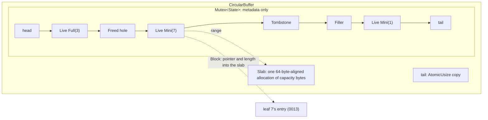
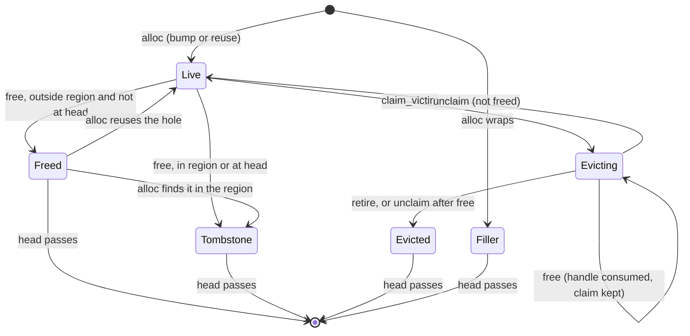

# 0010: Bounded circular buffer component

**Status:** In progress

**Design references:** [leaf store](../design/bf-tree-leaf-store.md),
[build system](../design/build-system.md) (crate boundaries, the unsafe-code
policy). This stack creates `docs/design/bf-tree-circular-buffer.md`.

**Parent roadmap:** [BF-Tree implementation](0002-bf-tree-roadmap.md), milestone 6
(component only; [plan 0014](0014-bf-tree-eviction.md) completes the
milestone with eviction). It lands before the
[single-leaf mini-page component](0011-bf-tree-mini-page.md), whose write
loop allocates from it.

**Builds on:** [Leaf mapping table and page store](0008-bf-tree-leaf-store.md)
(`LeafId`), [Buck2 build](0009-buck2-build.md) (crate rules). The size
classes it serves are defined by plan 0011; this crate takes them as a
plain list.

**Background:** [How BF-Tree works](../explanations/bf-tree.md).

## Goal and scope

Every mini-page, and from plan 0015 every cached full page, must live under
one fixed byte budget. The paper's §4 provides this with a circular buffer:
allocation at the tail, eviction from the head in FIFO order, size-class free
lists for holes, and a **second-chance region** near the head. A page that is
accessed while in that region is copied to the tail instead of being evicted.
This stack builds that buffer as a concurrent component, tested without the
tree.

The buffer follows the paper's physical layout: one fixed allocation (the
**slab**), with blocks carved out of it as byte ranges. Handing out disjoint
mutable ranges of one allocation to several threads needs `unsafe` code. This
stack makes `bf-tree-circular-buffer` the only crate in the workspace that
may contain `unsafe` code, and adds a check that enforces the allowlist.

- **In scope:** the unsafe-code policy change and its enforcement; a new
  crate `bf-tree-circular-buffer` with the slab, allocation, wrap fillers,
  freeing, size-class holes, the second-chance region, the
  claim/unclaim/retire eviction protocol, accounting, and metrics; the
  circular-buffer model test, a concurrent stress test, and Miri runs; the
  circular-buffer design document.
- **Out of scope:** the mini-page write loop that allocates from the
  buffer (plan 0011); tree integration (plan 0013); eviction orchestration, relocation on access, and
  `TreeConfig::second_chance_percent` (plan 0014); full-page blocks in use
  (plan 0015); the `bf-tree-sync` crate and its lock wrappers and
  `Table<T>` (plan 0012); a shuttle
  scheduler (plan 0016); `unsafe` code in any other crate.
- **Done when:** the circular buffer agrees with an independent model over
  random alloc/free/claim/unclaim/retire sequences; no two live or claimed
  blocks overlap in the slab; `used() <= capacity()` after every operation;
  the concurrent stress test ends with `used() == 0` and balanced metrics;
  `CircularBuffer` and `Block` are `Send + Sync`; the unit, model, and small
  stress tests pass under Miri; `unsafe` code outside the allowlist fails the
  checks; all workspace checks pass.

## Approach

### Unsafe-code policy

Today every crate is built with `-Funsafe_code` (forbid). A crate cannot
override `forbid`, so the policy changes as follows:

- The toolchain flag becomes `-Dunsafe_code` (deny), and the generated
  `[workspace.lints.rust]` entry becomes `unsafe_code = "deny"`. A crate
  without an explicit opt-in still fails to build if it uses `unsafe`.
- `bf-tree-circular-buffer` opts in at its crate root:

  ```rust
  #![allow(unsafe_code)]
  #![deny(unsafe_op_in_unsafe_fn)]
  #![deny(clippy::undocumented_unsafe_blocks, clippy::multiple_unsafe_ops_per_block)]
  ```

- A new `tools/check-unsafe` script holds the allowlist of crate
  directories that may contain `allow(unsafe_code)` or the `unsafe` keyword.
  It fails on any match outside the allowlist. `tools/clippy.sh` runs it,
  so the existing verification list covers it.
- `AGENTS.md` and `docs/design/build-system.md` state the rule: `unsafe`
  code is allowed only for a specific need that no safe design meets. Adding
  a crate to the allowlist requires a plan that shows this and the user's
  approval. Plan 0016 keeps `arc-swap` images for this reason; in-place
  optimistic reads were considered and rejected.

### Miri through Buck2

Miri runs through Buck2, like every other build and test. The bundled
prelude already supports it:

- If the Rust toolchain's `RustToolchainInfo` sets `miri_driver`, every
  `rust_test` gets a `[miri]` sub-target that interprets the test under
  Miri (`rust/rust_binary.bzl`, `rust/build.bzl` `miri_command`).
- Dependencies are compiled for Miri by the driver acting as rustc
  (`MIRI_BE_RUSTC=target`). These artifacts are separate from the native
  ones, and Buck2 builds them only when a Miri target is requested
  (`rust/rust_library.bzl`).
- `miri_flags` on the toolchain and on a target pass `-Zmiri-*` options;
  the toolchain needs `nightly_features = True`
  (`rust/rust_toolchain.bzl`).

peppydb adds three things:

1. **A Miri build mode.** `@build/mode/miri` selects a platform with a
   `mode-miri` constraint, in the same way `@build/mode/release` selects
   release flags. Under that constraint, `toolchains//:rust` is a nightly
   toolchain; the default stays the stable `rustc` from `PATH`. A whole
   toolchain is needed, not only a driver, because procedural macros (for
   example `thiserror`'s derive) must be compiled by the same compiler
   that loads them, and the Miri driver is a nightly `rustc`. In Miri mode
   the nightly `rustc` from the same date builds `thiserror-impl`, so
   `thiserror` and every other procedural macro work unchanged in both
   modes; no dependency is removed for Miri.
2. **A pinned nightly, downloaded by Buck2.** As with Go,
   `build/toolchains/BUCK` records `MIRI_NIGHTLY = "YYYY-MM-DD"` and, per
   host, sha256-pinned `http_archive`s of the `rustc`, `rust-std`, `miri`,
   `rust-src`, and `cargo` component archives from
   `https://static.rust-lang.org/dist/<date>/`. A small rule merges the
   components into one toolchain directory. One cached Buck2 action builds
   the Miri sysroot with the downloaded `cargo miri setup`, and a wrapper
   target runs the downloaded `miri` with `MIRI_SYSROOT` set; that wrapper
   is the toolchain's `miri_driver`. `tools/update-miri` refreshes the date
   and the hashes, and `tools/check-tools` checks that the pins are
   present for every host.
3. **A local toolchain rule.** `system_rust_toolchain` has no `miri_driver`
   attribute. `build/toolchains/rust.bzl` defines a thin rule that returns
   the same `RustToolchainInfo` fields from the downloaded nightly, plus
   `miri_driver` and `miri_flags`.

The command is:

```sh
tools/buck2 test @build/mode/miri '//crates/bf-tree-circular-buffer:bf-tree-circular-buffer-unittest[miri]'
```

It joins the verification list in `AGENTS.md` for crates on the unsafe
allowlist. Tests reduce their sizes under `cfg(miri)`. Cargo does not run
Miri; `cargo miri` is not part of the workflow.

### Shape



- **Addresses** are logical and increase forever. A block at `addr` with
  charged size `s` occupies the logical range `[addr, addr + 16 + s)`. Its
  physical offset is `addr & (capacity - 1)`. The capacity is a power of two.
- **Wrap filler.** A block never crosses the end of the slab. If the next
  block would cross it, `alloc` first appends a dead `Filler` block that
  covers the rest of the slab, and places the block at physical offset 0.
- **Budget.** `used = tail - head`, as in the paper's ring. Dead blocks
  (`Freed`, `Tombstone`, `Evicted`, `Filler`) occupy space until the head
  passes them. A block that dies behind the head makes room only when the
  head reaches it.
- **Head.** The head advances only over dead blocks.
- **Bytes.** `alloc` returns a `Block` that addresses exactly the requested
  size in the slab. The mutex protects metadata only. It is never held while
  block bytes are read, written, or zeroed.
- **Header bytes.** Each block is charged 16 bytes before its payload. The
  metadata lives in `State`, not in these bytes. Debug builds write the
  block's sequence number and size there as a canary, and `free` checks it.
  Keeping the charge keeps the paper's accounting and the capacity rule
  below.

### Locking and poisoning

The circular buffer has one lock: `state: std::sync::Mutex<State>`. It
does not use a wrapper crate. `bf-tree-sync` arrives in plan 0012, when
several crates share lock types, and plan 0012 moves this mutex onto it.

**Poisoning is ignored.** Each acquisition recovers the guard from a
poisoned lock:

```rust
fn lock_state(&self) -> MutexGuard<'_, State> {
    self.state.lock().unwrap_or_else(PoisonError::into_inner)
}
```

A panic inside a critical section is a bug that has already failed its own
operation. Poisoning would turn that one bug into a failure of every later
caller, including `Drop` paths and test harnesses that catch panics. To
make continuing safe, every critical section must follow one rule:
**check before mutating**. All fallible checks and assertions run before
the first write to `State`, so a panic leaves it consistent. The crate
documentation states the rule; plan 0012 makes it the rule for every lock
in the tree crates.

### Crate `bf-tree-circular-buffer`: types

```rust
/// Bookkeeping charged to every block on top of its size.
pub const BLOCK_HEADER_BYTES: usize = 16;

pub struct CircularBuffer {
    /// `ManuallyDrop` so that `Drop` can leak the slab while blocks are out.
    slab: ManuallyDrop<Slab>,
    state: Mutex<State>, // std::sync::Mutex; bf-tree-sync from plan 0012
    /// Copy of `State::tail` for `in_second_chance` without the mutex.
    tail: AtomicUsize,
    capacity: usize,
    classes: Box<[usize]>,
    /// A block at least this far behind the tail is in the second-chance region.
    second_chance: usize,
}

/// One allocation of `capacity` bytes, aligned to 64.
struct Slab {
    base: NonNull<u8>,
    layout: Layout,
}

struct State {
    /// Blocks from head to tail in allocation order; index = seq - first_seq.
    blocks: VecDeque<BlockMeta>,
    first_seq: u64,
    head: usize,
    tail: usize,
    /// Live and claimed blocks; the slab is leaked on drop unless this is 0.
    outstanding: usize,
    /// Per size class, ascending: sequence numbers of `Freed` blocks.
    free: Vec<Vec<u64>>,
    metrics: Metrics,
}

struct BlockMeta {
    addr: usize,
    size: usize,          // charged size; fixed for the block's lifetime
    state: BlockState,
    kind: Kind,
    owner: Option<LeafId>, // None for a filler
    freed_while_claimed: bool,
}

enum BlockState { Live, Freed, Tombstone, Evicting, Evicted, Filler }

#[derive(Clone, Copy, Debug, PartialEq, Eq)]
pub enum Kind { Mini, Full }

/// A live block: the only handle to its byte range.
#[must_use = "return the block with CircularBuffer::free"]
#[derive(Debug)]
pub struct Block { ptr: NonNull<u8>, addr: usize, seq: u64, len: u32 }
impl Block {
    pub fn addr(&self) -> usize;
    /// Whether this is the block a claim names (same sequence number).
    pub fn is(&self, victim: &Victim) -> bool;
}
impl AsRef<[u8]> for Block { /* slice of len bytes at ptr */ }
impl AsMut<[u8]> for Block { /* mutable slice of len bytes at ptr */ }

#[derive(Clone, Copy, Debug, PartialEq, Eq)]
pub struct Victim { pub addr: usize, pub kind: Kind, pub owner: LeafId, seq: u64 }

#[derive(Clone, Copy, Debug, PartialEq, Eq)]
pub enum Claim { Victim(Victim), Busy, Empty }

#[derive(Clone, Copy, Debug, PartialEq, Eq, thiserror::Error)]
#[error("circular buffer is full")]
pub struct CircularBufferFull;

#[derive(Clone, Copy, Debug, PartialEq, Eq, thiserror::Error)]
pub enum CircularBufferError { /* invalid capacity, classes, or percent */ }

#[derive(Clone, Copy, Debug, Default, PartialEq, Eq)]
pub struct Metrics { pub allocs: u64, pub reuses: u64, pub frees: u64, pub tombstones: u64, pub retired: u64, pub fillers: u64 }
```

`Block`'s fields are private, and only the circular buffer creates a
`Block`. `Block` is not `Clone`. It is 32 bytes, and `Option<Block>` is also
32 bytes because `NonNull` provides a niche. Dropping a `Block` without
`free` leaks its space until the buffer is dropped; this is safe, and
`#[must_use]` and the tests guard against it.

### Safety argument

The `unsafe` code is limited to the slab: allocating and freeing it,
deriving a block pointer from an offset, and building slices from a
`Block`. Its soundness rests on four invariants.

1. **No two handles cover one byte.** A range is handed out only from the
   tail or from a `Freed` hole. A range becomes reusable only after its
   `Block` was consumed by `free`: a `Freed` hole, a `Tombstone`, and an
   `Evicted` block all follow a `free`, and a `Filler` never had a handle.
   `retire` therefore checks `freed_while_claimed` with `assert!`, not
   `debug_assert!`, because a retire without a `free` would let the head
   pass bytes that a handle still covers.
2. **A block belongs to its buffer.** `free` and `retire` check that the
   block's pointer lies in this buffer's slab and that its sequence number
   and address match a `Live` or `Evicting` entry. These checks are also
   `assert!`. Without them, a block from one buffer could free a different
   block in another.
3. **The slab outlives every handle.** `CircularBuffer` does not borrow into
   `Block`, so a `Block` can outlive its buffer. `Drop` frees the slab only
   when `outstanding == 0`, and leaks it otherwise. A stray `Block` then
   points into leaked memory, which stays valid.
4. **Exclusive access follows the handle.** `AsMut` needs `&mut Block`, and
   `AsRef` gives only `&[u8]`, so the borrow checker enforces aliasing
   rules for each handle. `Send` and `Sync` follow from invariant 1:

   ```rust
   // SAFETY: a Block is the only handle to its byte range (invariant 1), so
   // moving it to another thread moves exclusive access to the range.
   unsafe impl Send for Block {}
   // SAFETY: &Block gives only &[u8]; shared reads of an exclusively owned
   // range are data-race free.
   unsafe impl Sync for Block {}

   impl AsMut<[u8]> for Block {
       fn as_mut(&mut self) -> &mut [u8] {
           // SAFETY: [ptr, ptr + len) lies in the slab (invariant 2), the slab
           // is alive (invariant 3), and no other handle covers the range
           // (invariant 1).
           unsafe { std::slice::from_raw_parts_mut(self.ptr.as_ptr(), self.len as usize) }
       }
   }
   ```

A `Victim` grants no access to bytes. An evictor reaches the bytes only
through the owner leaf's entry, under the leaf lock (plan 0014). Block bytes
are leaf-level data, so readers always hold the leaf's lock; no optimistic
reader touches the slab. Optimistic reads of inner nodes (plan 0016) use
immutable `arc-swap` images and are not affected.

### Operations

```rust
impl CircularBuffer {
    /// `capacity` must be a power of two >= 2 * (largest class + 16);
    /// `classes` nonempty and strictly ascending; `second_chance_percent <= 100`.
    pub fn new(capacity: usize, classes: &[usize], second_chance_percent: u32)
        -> Result<Self, CircularBufferError>;
    pub fn alloc(&self, size: usize, kind: Kind, owner: LeafId) -> Result<Block, CircularBufferFull>;
    pub fn free(&self, block: Block);
    pub fn claim_victim(&self) -> Claim;
    pub fn unclaim(&self, victim: Victim);
    pub fn retire(&self, victim: Victim);
    pub fn in_second_chance(&self, addr: usize) -> bool;
    pub fn has_room(&self, size: usize) -> bool;
    pub fn used(&self) -> usize;
    pub fn capacity(&self) -> usize;
    pub fn metrics(&self) -> Metrics;
}
```

| Operation | Behaviour |
| --- | --- |
| `alloc` | Under the mutex: reuse a hole from the free list of `size`'s own class (the smallest class that fits, as upstream does; larger classes are not searched), skipping stale entries. A hole that has drifted into the second-chance region becomes a tombstone instead. A reused hole has exactly the requested size. Otherwise bump the tail, appending a filler first if the block would cross the end of the slab, if `tail + filler + 16 + size - head <= capacity`. Otherwise return `CircularBufferFull`. After releasing the mutex, zero the block's bytes and, in debug builds, write the header canary. |
| `free` | Check the block (invariant 2) and, in debug builds, its canary. If the block is `Evicting`, set `freed_while_claimed` and keep the claim. Else, if it is at the head or in the second-chance region, make it a tombstone. Else make it `Freed` on the free list of the largest class `<=` its charged size. Then advance the head over dead blocks. |
| `claim_victim` | Advance the head over dead blocks. Scan from the head for the oldest `Live` block, mark it `Evicting`, and return it. If only `Evicting` blocks are live, return `Busy`; if none, `Empty`. A claimant never sees `CircularBufferFull`. |
| `unclaim` | Return a claim unevicted (`Live`). If the owner freed the block meanwhile, behave as `retire`, so the block cannot become an ownerless live block. |
| `retire` | Requires a claim whose block was given back with `free` (`assert!` on `freed_while_claimed`). Mark it `Evicted` and advance the head. |
| `in_second_chance(addr)` | `tail.saturating_sub(addr) >= second_chance`, with a relaxed load of the atomic tail. |
| `has_room(size)` | Whether a bump allocation of `size` fits now, including a possible filler. Ignores holes. |
| `used`, `capacity`, `metrics` | `used` is `tail - head`. Accounting and counters. |

**Capacity rule.** With `capacity >= 2 * (largest class + 16)`, an empty
buffer can always place the largest block: a filler is shorter than the
block it precedes, so filler plus block is less than the capacity.

The second-chance threshold is `capacity * (100 - p) / 100` for
`p = second_chance_percent`. With `p = 0` the threshold is `usize::MAX`, so
no block is ever in the region. With `p = 100` every block is, so no hole is
ever reused.



**Eviction protocol (used by plan 0014).** An evictor calls `claim_victim`
with no lock held, locks the owner leaf, and checks whether the entry still
holds the block (`block.is(&victim)`). If it does, the evictor merges or
writes back, takes the block out of the entry, calls `free` (the claim
stays), and then `retire`. If it does not, the owner already freed the
block, and the evictor calls `retire`. A claimed block is never reusable, so
no new owner can appear under an evictor. Several evictors hold distinct
claims; the head waits for the oldest, so blocks leave in FIFO order. With
the physical budget, room appears only when the head moves, so a slow claim
at the head delays room for every allocator. Plan 0014 handles the
consequences in `make_room`.

**Stale free-list entries.** A hole that the head passes, or that `alloc`
tombstones, may still have an entry in a free list. An entry is stale if
`seq < first_seq` or the block is not `Freed`; `alloc` skips it. Entries can
accumulate in a class that is rarely popped. The buffer counts entries made
stale by the head and, when they exceed half of all entries, filters every
list with `retain`. The cost is amortized over the frees that created them.

**Sizes.** The tree passes the mini-page ladder plus `L` as classes (plan
0013). With the default ladder that is
`64, 128, 256, 512, 1024, 2048, 2688, 4096`, so the minimum capacity is the
next power of two of `2 * (4096 + 16) = 8224`, which is 16384 bytes. `alloc`
requires `size` to be one of the classes (`debug_assert`).

**Alignment.** The slab is 64-byte aligned, but blocks are packed after
16-byte headers, so a block is not aligned beyond 1 in general. Pages have
alignment 1, so this is enough for mini-pages and full pages. A block cannot
serve as a direct-I/O buffer; plan 0023 keeps its own aligned bounce buffer.

### Lock order and memory ordering

The circular-buffer mutex is innermost: callers may hold a leaf lock or an
inner lock when they call the buffer, and the buffer calls nothing while it
holds the mutex. Block bytes are never touched under the mutex. The atomic
tail is stored with `Relaxed` ordering after each bump and read with
`Relaxed` ordering. A stale value moves the region's edge by a few
allocations, which only shifts which block gets a second chance; the
saturating subtraction prevents an underflow when the copy lags behind a new
block's address.

Byte accesses need no extra ordering. A range changes hands only through
the mutex: `free` releases it under the mutex, and the next `alloc` acquires
it under the same mutex, so the mutex orders the previous owner's writes
before the next owner's zeroing.

### Crate layout and build

```text
tools/check-unsafe            # allowlist: crates/bf-tree-circular-buffer
crates/bf-tree-circular-buffer/
    BUCK, Cargo.toml (generated)
    src/lib.rs          # CircularBuffer, Kind, Claim, Victim, errors, Metrics
    src/slab.rs         # Slab and every raw-pointer operation
    src/block.rs        # Block, Send/Sync, AsRef/AsMut
    src/state.rs        # State, BlockMeta, BlockState, take_hole, advance_head (safe code)
    src/tests/          # alloc, wrap, holes, claims, model, stress, bench
```

Raw-pointer code is kept in `slab.rs` and `block.rs`. The rest of the crate
is safe code, even though the crate-level opt-in would allow more.

```python
# crates/bf-tree-circular-buffer/BUCK
load("//build:defs.bzl", "peppy_rust_library")

peppy_rust_library(
    name = "bf-tree-circular-buffer",
    deps = [
        "//crates/bf-tree-node-id:bf-tree-node-id",
        "//third-party/rust:thiserror",
    ],
    visibility = [
        "//crates/bf-tree-mini-page:",
        "//crates/bf-tree:",
    ],
)
```

`bf-tree-node-id/BUCK` adds `//crates/bf-tree-circular-buffer:` to its
visibility. Plan 0012 adds the edge on `bf-tree-sync`. `bf-tree-mini-page` adds its edge on
`bf-tree-circular-buffer` in plan 0011, and `bf-tree` in plan 0013, when
each first uses the crate. After each `BUCK` change, run
`tools/autocargo` and commit the generated manifests, workspace member
list, and `Cargo.lock`.

## Decisions and trade-offs

- **One slab with `unsafe`, not a box per block.** The slab matches the
  paper: one allocation, bounded memory with no allocator overhead or
  fragmentation, no `malloc` and `free` per block, and locality between
  blocks. The cost is `unsafe` code, a soundness argument that the tests
  must defend, and Miri in the verification. An earlier draft used one
  `Box<[u8]>` per block to avoid `unsafe`; the user chose the slab.
- **`unsafe` allowed in one crate, enforced by an allowlist.** `deny`
  instead of `forbid` lets one crate opt in, and `tools/check-unsafe`
  stops other crates from opting in by accident.
- **Physical budget (`tail - head`).** This is the paper's accounting. It
  also bounds the metadata: at most `capacity / 80` blocks lie between head
  and tail, which resolves the earlier open question about unbounded
  `VecDeque` growth behind a live head block. The cost is that a dead block
  behind the head holds its space until the head passes it.
- **Wrap fillers.** A block never crosses the end of the slab, so every
  block is one contiguous slice. The cost is at most one filler per lap,
  shorter than the block after it.
- **Power-of-two capacity.** The mask computes physical offsets, and the
  paper's ring and upstream's configuration use the same rule.
- **Metadata outside the slab.** Block state lives in `State`, behind the
  mutex, not in inline headers as upstream does. The slab holds only block
  bytes and debug canaries, so a bug in a mini-page cannot corrupt the
  buffer's bookkeeping.
- **Size-class free lists, as in the paper and upstream.** A freed block
  outside the second-chance region becomes a hole that a later allocation
  of the same class reuses in place. A reused hole keeps its old FIFO
  position, so a block placed there reaches the head sooner than a fresh
  one; the second-chance region limits this, because holes in it are never
  reused and hot blocks in it are relocated (plan 0014). Always allocating
  at the tail was considered and rejected: every growth step and merge
  would leave dead space until the head passed it, which raises eviction
  pressure. Like upstream, `alloc` checks only the smallest class that
  fits. Plan 0023 measures free lists against tombstone-on-free for
  information.
- **Reused holes match the request exactly.** Every allocation size is a
  class, a hole goes on its own class's list, and `alloc` reads only the
  requested class's list, so a reused hole has exactly the requested size.
  A block is therefore never larger than requested, and a mini-page can
  never exceed `M` through reuse, which the merge admission proof needs.
  The price, as upstream accepts, is that a free hole of a larger class is
  not used for a smaller request.
- **Claim/retire instead of a reservation cursor.** Several evictors work at
  once on distinct blocks; a block freed by its owner during eviction stays
  claimed until its evictor retires it.
- **Zero blocks outside the mutex.** The one lock all allocators share is
  held for bookkeeping only.
- **Soundness checks are `assert!`.** Checks that guard invariants 1 and 2
  run in release builds. The other checks stay `debug_assert!`.
- **Integer percent, not a float ratio.** It matches the planned
  `TreeConfig::second_chance_percent` (plan 0014) and keeps the threshold
  exact.
- **The Miri sysroot action may use the network.** `cargo miri setup`
  builds the standard library from `rust-src` and may fetch that library's
  crates.io dependencies. The action runs once per nightly pin and is
  cached afterwards, like an `http_archive` download. Pinning those crates
  separately would add many hashes for little gain.
- **Poison-free locking without a wrapper crate.** One mutex does not
  justify a crate. Plan 0012 creates `bf-tree-sync` when `Table<T>`, the
  leaf locks, and several crates need shared lock types. See "Locking and
  poisoning".
- **Public metrics.** Only `bf-tree-mini-page` and `bf-tree` can see the
  crate; plan 0011's tests and plan 0013's circular-buffer usage
  assertions and diagnostics use the counters.

## Extension points

- **0011:** the mini-page crate's `buffer` takes `&CircularBuffer` and the
  leaf's ID, allocates with `alloc(class, Kind::Mini, leaf)`, frees with
  `free`, and views each `Block`'s bytes as a `MiniPage`. Its tests use
  small real buffers.
- **0012:** creates `bf-tree-sync` and switches the `State` mutex to its
  `Mutex`. The poison handling and the check-before-mutate rule do not
  change.
- **0013:** `LeafMap` owns the `CircularBuffer` and passes it to the
  mini-page crate's `buffer`. `LeafEntry` holds `Option<Block>` (32
  bytes).
- **0014:** eviction uses `claim_victim`, `unclaim`, `retire`, `has_room`,
  and `Block::is`; relocation uses `in_second_chance` and copies within the
  slab; `TreeConfig::second_chance_percent` feeds `CircularBuffer::new`.
- **0015:** allocates `Kind::Full` blocks of size `L`.
- **0016:** if shuttle is adopted, atomics and locks must come from one
  module; that touches the imports of this crate, not the buffer.
- **0023:** measures free lists against tombstone-on-free and the
  circular-buffer mutex under pressure.
- **Must not change:** the block states, accounting, protocols, and the
  rule that no other crate contains `unsafe` without an approved plan.

## Proposed commit stack

Seven diffs.

### `[1/7][bf-circular-buffer][plan] define the bounded circular buffer component`

- **Purpose:** Agree on the circular buffer, its protocols, and the
  unsafe-code policy.
- **Core changes:** This plan; link from the roadmap's milestone 6 row.
- **Verification:** Review.

### `[2/7][bf-circular-buffer][build] allow unsafe code only in allowlisted crates`

- **Purpose:** Let one crate use `unsafe` while every other crate keeps
  rejecting it.
- **Core changes:** `-Funsafe_code` becomes `-Dunsafe_code` in
  `build/toolchains/BUCK`; `tools/autocargo` emits `unsafe_code = "deny"`;
  `tools/check-unsafe` with an initially empty allowlist, run from
  `tools/clippy.sh`; the rule in `AGENTS.md` and
  `docs/design/build-system.md`.
- **Verification:** A scratch `unsafe` block in an existing crate fails the
  build; a scratch `#![allow(unsafe_code)]` in an existing crate fails
  `tools/check-unsafe`; workspace checks.

### `[3/7][bf-circular-buffer][miri] run Miri through Buck2 with a pinned nightly`

- **Purpose:** Check `unsafe` code for undefined behaviour with the build
  system that runs everything else.
- **Core changes:** `MIRI_NIGHTLY` and the per-host component
  `http_archive`s in `build/toolchains/BUCK`; the component merge rule, the
  Miri sysroot action, and the driver wrapper; the nightly toolchain rule in
  `build/toolchains/rust.bzl`; the `mode-miri` constraint, platform, and
  `build/mode/miri`; `tools/update-miri`; pin checks in
  `tools/check-tools`; the command in `AGENTS.md` and the Miri section in
  `docs/design/build-system.md`.
- **Verification:** A scratch crate with a known out-of-bounds read fails
  under `@build/mode/miri` and passes natively; the same test without the
  bug passes under Miri; default-mode builds do not download the nightly;
  workspace checks.

### `[4/7][bf-circular-buffer][slab] create the circular buffer with bump allocation and wrap fillers`

- **Purpose:** The circular buffer skeleton and all of its `unsafe` code.
- **Core changes:** `crates/bf-tree-circular-buffer` added to the
  allowlist; `Slab`, `Block` with `AsRef`/`AsMut`, `Send`/`Sync`;
  `CircularBuffer::new`, `CircularBufferError`, `Kind`,
  `CircularBufferFull`, `Metrics`; `alloc` by bump with fillers; `free` that
  tombstones and advances the head; the ownership checks; leak-on-drop;
  `used`, `has_room`, `capacity`, `metrics`; the poison-recovering
  `lock_state` and the check-before-mutate rule in the crate documentation;
  compile-time `Send + Sync` assertions; node-id visibility;
  `tools/autocargo`.
- **Verification:** Configuration errors; blocks are zeroed, exactly sized,
  charged `16 + size`, and lie in the slab; a block that would cross the end
  gets a filler and starts at offset 0; `CircularBufferFull` exactly at the
  budget; freeing the head advances it over following dead blocks; freeing a
  block from another buffer panics; dropping the buffer with a block out
  leaks the slab and the block stays readable; the tests pass under Miri.

### `[5/7][bf-circular-buffer][holes] reuse holes by size class outside the second-chance region`

- **Purpose:** The paper's free lists and second-chance region.
- **Core changes:** `free` onto class lists; `take_hole` in `alloc`;
  `in_second_chance`; stale-entry skipping and compaction.
- **Verification:** A 64-byte request reuses a 64-byte hole and gets a
  64-byte block; with only a 128-byte hole free, it bumps the tail instead;
  reused blocks
  are zeroed; a freed block in the region becomes a tombstone; a hole that
  ages into the region is tombstoned instead of reused; percent 0 and 100
  boundaries; stale entries are never handed out.

### `[6/7][bf-circular-buffer][claims] claim, unclaim, and retire victims`

- **Purpose:** The eviction protocol for plan 0014.
- **Core changes:** `claim_victim`, `Claim`, `Victim`, `unclaim`, `retire`,
  `Block::is`, `freed_while_claimed`.
- **Verification:** FIFO victim order over holes, tombstones, and fillers;
  two claimants receive distinct victims; a retire behind the head makes
  room only when the head reaches it; a block freed while claimed is never
  reused and is passed after retire; `unclaim` after such a free retires;
  `retire` without a `free` panics; `Busy` versus `Empty`.

### `[7/7][bf-circular-buffer][tests] check the circular buffer against a model, under threads, and under Miri`

- **Purpose:** The circular-buffer oracle that later stacks extend, and
  documentation.
- **Core changes:** `tests/model.rs`, `tests/stress.rs`, an `#[ignore]`
  `circular_buffer_cost` benchmark; `cfg(miri)` sizes;
  `docs/design/bf-tree-circular-buffer.md`; roadmap update.
- **Verification:** The model and stress tests pass natively and under Miri
  (reduced sizes); workspace checks.

## Open questions

None.

Resolved in the 2026-11-04 revisions: unbounded metadata growth behind a
live head block (the physical budget bounds it); the power-of-two capacity
(the mask needs it); free lists versus tombstone-on-free (free lists, as
in the paper and upstream); how Miri runs (through Buck2, with a pinned
nightly downloaded by Buck2); network access for the Miri sysroot (allowed;
see "Decisions and trade-offs").

## Verification strategy

| Check | Command or procedure | Expected result |
| --- | --- | --- |
| Unit behaviour | `tools/buck2 run //crates/bf-tree-circular-buffer:bf-tree-circular-buffer-unittest` | Pass |
| Model | `tools/buck2 run //crates/bf-tree-circular-buffer:bf-tree-circular-buffer-unittest -- model` | Agreement at every step |
| Stress | `tools/buck2 run //crates/bf-tree-circular-buffer:bf-tree-circular-buffer-unittest -- stress` | No panic; `used() == 0` at the end; metrics balance |
| Miri | `tools/buck2 test @build/mode/miri '//crates/bf-tree-circular-buffer:bf-tree-circular-buffer-unittest[miri]'` | No undefined behaviour reported |
| Unsafe allowlist | `tools/check-unsafe` (also run by `tools/clippy.sh`) | Only `crates/bf-tree-circular-buffer` contains `unsafe` |
| Cost (informational) | `tools/buck2 run @build/mode/release //crates/bf-tree-circular-buffer:bf-tree-circular-buffer-unittest -- --ignored --nocapture circular_buffer_cost` | Record alloc + free cost at 10^4, 10^5, 3 x 10^5 live blocks; Linux numbers only for contended runs |
| Format | `tools/fmt.sh` | Clean |
| Lints | `tools/clippy.sh` | No diagnostics |
| Tests | `tools/buck2 test //crates/... //bin/... //go/...` | Pass |
| Generated manifests | `tools/autocargo --check`, `tools/gobuckify-remote --check` | Clean |
| Cargo | `cargo test --workspace --locked` | Pass |
| Go | `(cd go && go vet ./... && go test ./...)` | Pass |

**Model.** The model is written independently of the buffer: a
`BTreeMap<addr, ModelBlock>` of charged size, state, kind, and owner, plus
the model's own head, tail, and capacity. Random steps allocate (random
class, kind, owner), free a random held block, claim, unclaim, free a
claimed block, and retire. After each step the test checks:

- `used()` equals the model's `tail - head` and never exceeds the capacity;
- no two live, claimed, or `Freed` model blocks overlap physically
  (`addr & (capacity - 1)` plus charged size), and no block crosses the end;
- a returned address is either the model's tail (after a filler if needed)
  or a model hole that is `Freed`, in the request's own size class, and
  outside the region; a tombstone is never returned;
- `CircularBufferFull` occurs only when no eligible hole exists and a bump
  would exceed the budget;
- a claim returns the model's oldest live unclaimed block; `Busy` and `Empty`
  match the model;
- every held block has the requested length and keeps the bytes the test
  wrote into it, so a neighbour's writes never leak into it;
- after all blocks are freed or retired, `used() == 0` and the head equals
  the tail.

Configurations: small capacities (two to eight largest blocks) to force
holes, tombstones, fillers, and `CircularBufferFull`; percents 0, 10, 50,
and 100.

**Stress.** Scoped threads allocate, write a thread-specific pattern,
verify it, free, claim, and retire against one buffer with a small capacity.
A thread that claims a block owned by another thread unclaims it. Each step
asserts `used() <= capacity()`. At the end every block is returned,
`used() == 0`, and `allocs + reuses == frees`.

## Progress

- [x] Agree on the design and commit stack with the user.
- [x] Diff 2: unsafe-code policy and `tools/check-unsafe`.
- [x] Diff 3: Miri through Buck2.
- [x] Diff 4: slab, bump allocation, fillers, budget.
- [ ] Diff 5: holes and the second-chance region.
- [ ] Diff 6: claims.
- [ ] Diff 7: model, stress, Miri sizes, documentation.
- [ ] Stack-wide verification; create `bf-tree-circular-buffer.md`; update
  the roadmap.

## Discoveries and plan changes

- **2026-11-04: renamed and moved to a slab.** The component was called the
  "buffer pool" (`bf-tree-pool`, `Pool`). It is now the circular buffer
  (`bf-tree-circular-buffer`, `CircularBuffer`), and the plan file moved
  from `0011-bf-tree-pool.md`. Identifiers use the full `CircularBuffer`
  prefix (`CircularBufferFull`, `CircularBufferError`) because plan 0011
  already uses `buffer` for
  mini-page write buffering. The user allowed `unsafe` code in this crate,
  so block bytes moved from one `Box<[u8]>` per block to one slab, and the
  budget moved from "live blocks plus holes" to the paper's `tail - head`.
  Plans 0013, 0014, 0015, and 0023 were updated to match.
- **2026-11-04: renumbered to land before the mini-page component.** This
  plan was 0011 and the mini-page component was 0010. The mini-page crate
  dropped its `MiniStore` allocation trait and now depends on this crate
  directly, so this crate must exist first. Its API did not change.
- **2026-11-04: `bf-tree-sync` moved to plan 0012.** The circular buffer
  has one mutex, so it uses `std::sync::Mutex` with poison recovery. Plan
  0012 creates the crate together with `Table<T>` and moves this mutex onto
  it. The stack shrank from seven diffs to six.
- **2026-11-04: free lists kept; Miri through Buck2.** The user chose to
  stay faithful to the paper and upstream, so free lists stay and `alloc`
  now checks only the smallest fitting class, as upstream does. Miri runs
  through Buck2 in a new `@build/mode/miri`, with a nightly toolchain that
  Buck2 downloads, instead of a rustup wrapper script. New diff 3; the
  stack is seven diffs again.
- **Diff 3: Miri needs a second execution platform.** Selecting the nightly
  toolchain on the target platform's `mode-miri` constraint is not enough:
  Buck2 builds procedural macros for the execution platform, which keeps the
  default configuration, so `thiserror-impl` was built by stable `rustc` and
  rejected by the nightly (E0786). `build/platforms.bzl` now registers the
  host and the host with `mode-miri`, and the Rust toolchain requires the
  latter in Miri mode (`exec_compatible_with`). Other modes still take the
  plain host first. The Miri sysroot genrule builds in a scratch directory
  under `/tmp`, because under `buck-out` Cargo treated the generated sysroot
  package as part of the repository's workspace. Pins live in
  `build/toolchains/miri_nightly.bzl`, written by `tools/update-miri`.
- **Diff 4: implementation details.** Only `slab.rs` and `block.rs` carry
  `#![allow(unsafe_code)]`; the crate root does not, so the compiler rejects
  `unsafe` code elsewhere in the crate. A `Block`'s pointer covers its
  16 header bytes and the payload, so the debug canary needs no extra
  raw-pointer code; `as_ref` and `as_mut` return the payload. The slab is
  leaked through a flag on `Slab` (whose `Drop` frees it) rather than
  `ManuallyDrop`. Block pointers come from safe `wrapping_add` after a
  bounds check, so the only `unsafe` operations are `alloc_zeroed`,
  `dealloc`, the two slice constructions, and the `Send`/`Sync` impls. Two
  tests leak a slab on purpose and park it in a static, because Miri
  reports unreachable leaked memory (checked by removing one).

## Agent notes

- **Entry points:** `crates/bf-tree-node-id/src/lib.rs` (`LeafId`),
  `crates/bf-tree-node-id/BUCK` (visibility), `build/defs.bzl`
  (`peppy_rust_library`), `build/toolchains/BUCK` (`-Funsafe_code`),
  `tools/autocargo` (emits `[workspace.lints.rust]`; `Cargo.toml` is
  generated).
- **Third-party crates.** Before changing the toolchain flag, check how
  third-party crates such as `zerocopy` build today despite
  `-Funsafe_code` (for example, `--cap-lints`), and keep that behaviour.
- **Zero outside the mutex.** In `alloc`, reserve the range under the mutex,
  drop the guard, then zero the bytes and write the canary. On
  `CircularBufferFull` nothing was reserved.
- **Check before mutate.** In every method, look up the block and run every
  assertion before the first state change (foreign block, retire without a
  free, free of a block behind the head).
- **Filler placement.** Compute the physical offset of the tail; if
  `offset + 16 + size > capacity`, append a `Filler` of
  `capacity - offset` bytes first. Count the filler in the budget check.
- **Second-chance arithmetic.** Use `saturating_sub` on the relaxed tail.
  Compute the threshold in `u128` or another overflow-free form.
- **Free-list search.** A hole goes on the list of the largest class
  `<=` its charged size, so every hole on `size`'s own list fits. Check only
  that list, as upstream's `FreeList::remove` does, and pop from the back
  (LIFO).
- **Tests without the tree.** `cfg(test)` does not cross crates. The tests
  write their own `Rng` and use `std::thread::scope` for threads. Gate
  large sizes with `cfg(miri)`.
- **Miri plumbing.** Prelude entry points: `rust/rust_toolchain.bzl`
  (`miri_driver`, `miri_flags`, `miri_rustc_flags`, `nightly_features`),
  `rust/build.bzl` (`miri_command`, `Emit("miri")`), `rust/rust_binary.bzl`
  (`[miri]` sub-target, `miri_interpreted`). Check that `toolchains//:rust`
  switches on `mode-miri` through `select`s in its attributes, and that
  procedural macros follow through the Miri execution platform (see
  "Discoveries and plan changes"). Only hosts in the pinned list run Miri.
- **Upstream reference:** `src/circular_buffer/mod.rs` (`alloc`,
  `dealloc_inner`, `evict_one`, `ptr_is_copy_on_access`),
  `src/circular_buffer/freelist.rs`, `src/config.rs` (`cb_size_byte`
  32 MiB, `cb_copy_on_access_ratio` 0.1).
- **Do not add:** inline metadata headers, spin wrappers around locks, a
  slot reference bit, or `unsafe` code outside `slab.rs` and `block.rs`.

## Sources

- [BF-Tree paper](../references.md#bf-tree-paper), §4: the circular buffer,
  size-class free lists, and the second-chance region.
- Upstream at `f442e6172bf7e5483ff320d8e3ac16a70e31bbd6`:
  [`src/circular_buffer/mod.rs`](https://github.com/microsoft/bf-tree/blob/f442e6172bf7e5483ff320d8e3ac16a70e31bbd6/src/circular_buffer/mod.rs),
  [`src/circular_buffer/freelist.rs`](https://github.com/microsoft/bf-tree/blob/f442e6172bf7e5483ff320d8e3ac16a70e31bbd6/src/circular_buffer/freelist.rs),
  [`src/config.rs`](https://github.com/microsoft/bf-tree/blob/f442e6172bf7e5483ff320d8e3ac16a70e31bbd6/src/config.rs).
  peppydb differs by keeping block metadata in the buffer's state instead of
  inline headers, claiming the oldest unclaimed block instead of reserving a
  range, and letting a dead head advance on `free`. Upstream also
  tombstones a freed block when its free-list lock is contended; peppydb
  has one mutex for all lists, so that case does not arise.
