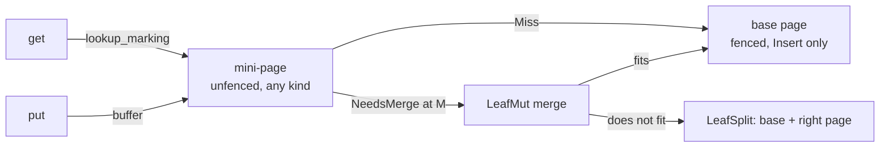
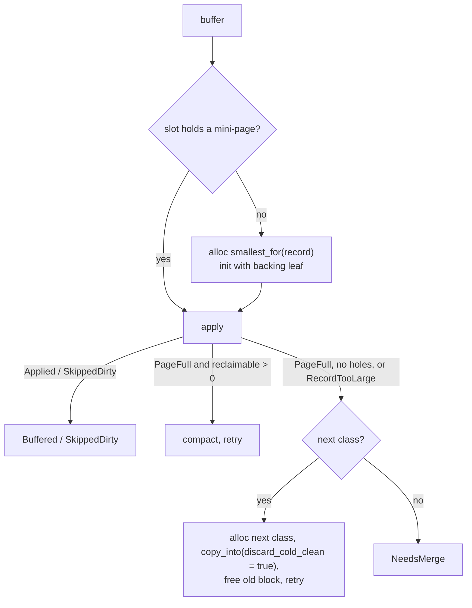

# 0011: Single-leaf mini-page component

**Status:** Agreed

**Design references:** [Shared pages](../design/bf-tree-pages.md) (roles
table, reference bit, splitting), [tree structure](../design/bf-tree-structure.md#admission-rule)
(admission rule), [build system](../design/build-system.md) (crate
boundaries). This stack creates `docs/design/bf-tree-mini-page.md` and
updates `bf-tree-pages.md`.

**Parent roadmap:** [BF-Tree implementation](0002-bf-tree-roadmap.md), milestone 5
(first stack; [plan 0013](0013-bf-tree-mini-tree.md) completes the milestone).

**Builds on:** [Leaf mapping table and page store](0008-bf-tree-leaf-store.md),
[single-threaded tree composition](0007-bf-tree-in-memory-tree.md) (split
selector and admission rule), [page mutation](0004-bf-tree-page-mutation.md)
and [prefix compression](0005-bf-tree-page-prefix.md) (record kinds, fences),
[Buck2 build](0009-buck2-build.md) (crate rules),
[circular buffer component](0010-bf-tree-circular-buffer.md) (`Block`, the
allocator the write loop uses).

**Background:** [How BF-Tree works](../explanations/bf-tree.md);
[upstream page operations](../explanations/bf-tree-upstream-pages.md).

## Goal and scope

A BF-Tree leaf is a durable **base page** plus at most one in-memory
**mini-page**. The mini-page buffers writes and caches records for that leaf
(paper §§3.1, 5). Today every write goes straight into a base page. This stack
builds the overlay as a component that is tested without the tree: one base
`Page`, one optional mini-page, and the read, write, growth, and merge rules
between them. It also prepares the page crate for that component.

```text
inner nodes  -->  LeafId  -->  logical leaf = base page + (0 or 1) mini-page
```

The base page always exists, and the page store holds it. The mini-page is
optional and transient. It appears on the first write, grows through size
classes, and disappears at a merge.

- **In scope:**
  - Page crate: `backing_leaf` as `Option<LeafId>`; retirement of the in-slot
    reference bit; a generic two-way record merge `Merge<A, B>`; indexed
    access (`find_index`, `record_at`, `upsert_indexed`); batch merges of
    dirty records into a fenced base page (`merge_batch_*`); a validation fix
    for zero-length payloads.
  - New crate `bf-tree-mini-page`: `SizeClasses`, the `MiniPage` view,
    `RefBits`, `Lookup`/`Apply`, `Mini` (a circular-buffer `Block` and its
    reference bits), the `buffer` write loop, `LeafRef` scans, and `LeafMut`
    merges.
  - The leaf-set oracle model, which later stacks extend.
  - The mini-page design document.
- **Out of scope:** any change to `Tree`, `LeafMap`, or `TreeConfig` (0012,
  0013); the circular buffer (0010) and eviction (0014); when to create `Cache`
  and `Phantom` records and full-page promotion (0015); locks (0012);
  persistence of header fields (0017).
- **Done when:** a set of leaves driven by random writes, cache fills,
  lookups, merges, and splits agrees with a `BTreeMap`; every base page holds
  only `Insert` records; every mini-page is unfenced, names its leaf, and has
  a size-class capacity; a merge of a full base page with a full largest-class
  mini-page of maximum records never returns `CannotSplit`; all workspace
  checks pass.

## Approach

### Roles and record kinds

All leaf-level pages share the [page format](../design/bf-tree-pages.md).
Two roles exist in this stack; the full-page cache arrives in 0015.

| Role | Fences | `backing_leaf` | Record kinds | Capacity |
| --- | --- | --- | --- | --- |
| Base page | Required | Unset | `Insert` only | `L` |
| Mini-page | None | The leaf it overlays | Any | One size class, `64..=M` |

| Kind | Dirty | Key exists |
| --- | --- | --- |
| `Insert` | Yes | Yes |
| `Delete` | Yes | No |
| `Cache` | No | Yes |
| `Phantom` | No | No |

A base page never stores a tombstone: a merge drops it after it removes the
base key. This is tighter than the "Insert and Delete" row that
`bf-tree-pages.md` plans for `BasePage`; diff 12 corrects that row.
Clean records always equal what the base page says, because the mini-page
is discarded at every merge. Therefore a merge applies only dirty records.



### Page crate changes

All paths are under `crates/bf-tree-page/src/`.

| Item | Change |
| --- | --- |
| `layout.rs` `Header::backing_leaf` | Field name stays. `NO_BACKING_LEAF` stays `u64::MAX`, which equals `LeafId`'s reserved raw value. |
| `lib.rs` | New `Page::backing_leaf() -> Option<LeafId>` (`LeafId::new(raw)`) and `Page::set_backing_leaf(Option<LeafId>)`. New dependency on `bf-tree-node-id`. |
| `layout.rs` `Slot::referenced`, `set_referenced`; `REFERENCED_BIT` | Removed. Bit 15 of `ref_and_value_len` becomes `RESERVED_BIT` and is always zero. `MAX_VALUE_LEN` stays 32767, because the admission rule depends on it. |
| `write.rs` `Page::set_referenced` | Removed. |
| `record.rs` `RecordRef::referenced` | Field removed. `RecordKind::is_dirty()` added. |
| `split.rs` `build_output` | No longer copies reference bits. |
| `split.rs` `Merge<'a>` | Becomes `pub struct Merge<A, B>` over two sorted record iterators; the newer side wins an equal key. Re-exported; the `split` module stays private. |
| `read.rs` `search`, `record_at` | New `pub fn find_index(&self, key) -> Result<Option<usize>, PageError>`; `record_at` becomes `pub`. |
| `write.rs` `try_upsert` | Delegates to new `pub fn upsert_indexed`, which also returns the record index. |
| new `merge.rs` | `merge_batch_fits`, `merge_batch_in_place`, `merge_batch_split`; `PageError::InvalidBatch`. |
| `validate.rs` | Rejects a set reserved bit. Excludes zero-length payloads from the overlap check. |

**Reference bit.** Readers will hold a leaf's *shared* lock (0012). Safe Rust
cannot set a bit inside bytes that other readers are reading. The reference
bits therefore live beside the mini-page in `RefBits`. Upstream also resets
the bit on every copy and has no durability need for it, so nothing is lost
by moving it out of the format. `validate` rejects the bit when set, because
validation accepts exactly the images that the page operations produce.

**Zero-length payload fix.** With `V = 0`, a record whose key equals the page
prefix has an empty stored suffix and an empty value. Its payload range is
empty and can start at the same offset as its neighbour. `validate` sorts
payload ranges by start and can misreport this pair as an overlap. Split
outputs already produce such pages, and the leaf-set model with `V = 0` will
produce them. Diff 2 skips empty ranges in the overlap check and adds a
regression fixture.

```rust
impl Page {
    pub fn backing_leaf(&self) -> Option<LeafId>;
    pub fn set_backing_leaf(&mut self, leaf: Option<LeafId>);

    /// Record index of a stored key (fences excluded), or `None` on a miss.
    pub fn find_index(&self, key: &[u8]) -> Result<Option<usize>, PageError>;
    /// Panics if `index >= self.len()`.
    pub fn record_at(&self, index: usize) -> RecordRef<'_>;
    /// `try_upsert`, plus the record index the key now occupies. On
    /// `Inserted`, every record at or above that index moved up by one.
    pub fn upsert_indexed(&mut self, key: &[u8], state: RecordState<'_>)
        -> Result<(UpsertOutcome, usize), PageError>;
}

/// Two sorted record sequences in key order. On an equal key the record
/// from `newer` is yielded and the one from `older` is skipped.
#[derive(Clone, Debug)]
pub struct Merge<A: Iterator, B: Iterator> { older: Peekable<A>, newer: Peekable<B> }

impl<A: Iterator, B: Iterator> Merge<A, B> {
    pub fn new(older: A, newer: B) -> Self;
}
```

`split_with_insert` keeps its contract and becomes
`Merge::new(self.iter(), pending.iter().copied())`. It remains until 0012
removes it.

### Batch merges into a base page

```rust
impl Page {
    /// Whether this fenced page, rebuilt with `batch` applied, fits without a
    /// split. Holes do not count: a rebuild packs the page.
    pub fn merge_batch_fits<'b>(&self, batch: impl Iterator<Item = RecordRef<'b>> + Clone)
        -> Result<bool, PageError>;
    /// Rebuild in place. `PageFull` (page unchanged) if it does not fit.
    pub fn merge_batch_in_place<'b>(&mut self, batch: impl Iterator<Item = RecordRef<'b>> + Clone)
        -> Result<(), PageError>;
    /// `self` becomes the left output and `right` the right output, as in
    /// `split_with_insert`. Errors leave both buffers unchanged.
    pub fn merge_batch_split<'r, 'b>(
        &mut self,
        right: &'r mut [u8],
        batch: impl Iterator<Item = RecordRef<'b>> + Clone,
    ) -> Result<LeafSplit<'r>, PageError>;
}
```

The virtual sequence is
`Merge::new(self.iter(), batch).filter(|r| r.state.kind() == RecordKind::Insert)`.
A `Delete` removes a base key; a `Delete` for a key that the base does not
hold is a no-op; the output holds only `Insert` records. Each function first
checks the batch in one pass: the page is fenced (`InvalidFences`), keys are
nonempty, inside the fences, and strictly increasing, each record fits
(`record_size`), and each kind is dirty (`InvalidBatch` otherwise). An empty
batch leaves the page unchanged. In place rebuilds into a 4096-byte stack
scratch image with `build_output` and copies it back. Split uses the existing
`check_split_storage`, `choose_split`, and `build_output`. 0012 calls these
functions with a one-record batch for direct base writes, so they are the
single merge path for every later stack.

### Size classes and the admission rule

```rust
/// Mini-page capacities, ascending: powers of two from 64 below `M`, then `M`.
pub struct SizeClasses(Vec<usize>);

impl SizeClasses {
    /// `M = floor64(L - 5K - V - 24)`. Requires `M >= 64` and `32 + 8 + K + V <= M`.
    pub fn derive(leaf_capacity: usize, max_key_len: usize, max_value_len: usize)
        -> Result<Self, InvalidLimits>;
    pub fn largest(&self) -> usize;
    pub fn next(&self, capacity: usize) -> Option<usize>;
    /// Smallest class whose empty page holds `record_bytes` (slot + key + value).
    pub fn smallest_for(&self, record_bytes: usize) -> Option<usize>;
    pub fn as_slice(&self) -> &[usize];
}
```

| Configuration (`L`, `K`, `V`) | `L - 5K - V - 24` | Ladder |
| --- | --- | --- |
| Defaults (4096, 64, 1024) | 2728 | 64, 128, 256, 512, 1024, 2048, 2688 |
| (512, 16, 32) | 376 | 64, 128, 256, 320 |
| (128, 8, 0) | 64 | 64 |
| (192, 1, 37) | 126 | rejected: `M = 64` but a record needs `32 + 8 + 1 + 37 = 78` |

The defaults come from `TreeConfig::default()` in `crates/bf-tree/src/lib.rs`.
A maximum default record (`8 + 64 + 1024 = 1096` bytes) first lands in the
2048 class (`2048 - 32 = 2016 >= 1096`). Only growth reaches 2688. The last
row satisfies the current tree rule `7K + 3V <= L - 72` (`118 <= 120`), so
0013 must add the ladder check to `TreeConfig::validate`.

**Admission proof.** Let `R = 8 + K + V` be the largest record and
`F = 16 + 2K` the largest finite fence pair. Measure record sizes with the
source page's prefix removed; every key in the leaf shares that prefix, and
each output's prefix is at least as long. A base page holds at most `L - 48`
record bytes (header plus two fence slots). A mini-page holds at most
`M - 32`. So the merged content is `T <= (L - 48) + (M - 32)`. Around the
midpoint, the two candidate split points differ by one record, so the better
one has a larger side of at most `T/2 + R/2`. The larger output fits when:

```text
32 + F + T/2 + R/2 <= L
=> 48 + 2K + (L + M - 80)/2 + (8 + K + V)/2 <= L
=> M <= L - 5K - V - 24
```

One two-way split therefore always absorbs a merge, and a merge never
returns `CannotSplit`. A merged sequence of zero or one record always fits in
place, because `L >= 88 + 5K + V` follows from `M >= 64`.

### `MiniPage`, `RefBits`, and the record rules

```rust
/// An unfenced page whose `backing_leaf` names the leaf it overlays.
#[derive(Debug, FromBytes, IntoBytes, KnownLayout, Immutable, Unaligned)]
#[repr(C)]
pub struct MiniPage(Page);

pub enum Lookup<'a> { Found(&'a [u8]), Absent, Miss }
pub enum Apply { Applied, SkippedDirty }

impl MiniPage {
    /// Panics unless `bytes.len()` is a legal page capacity (size classes are).
    pub fn init(bytes: &mut [u8], backing: LeafId) -> &mut Self;
    pub fn from_bytes(bytes: &[u8]) -> &Self;
    pub fn from_bytes_mut(bytes: &mut [u8]) -> &mut Self;
    pub fn page(&self) -> &Page;
    pub fn backing_leaf(&self) -> LeafId;
    /// One search; marks the slot's bit on a hit through `&self`.
    pub fn lookup_marking(&self, refs: &RefBits, key: &[u8]) -> Lookup<'_>;
    pub fn apply(&mut self, refs: &mut RefBits, key: &[u8], state: RecordState<'_>)
        -> Result<Apply, PageError>;
    pub fn compact(&mut self) -> usize;
    /// Rebuild into `dst` with the same backing leaf. With `discard_cold_clean`,
    /// `Cache`/`Phantom` records whose bit is clear are dropped. The caller
    /// starts the copy with clear bits.
    pub fn copy_into<'d>(&self, refs: &RefBits, dst: &'d mut [u8], discard_cold_clean: bool)
        -> &'d mut Self;
    /// `Insert` and `Delete` records in key order: the batch a merge applies.
    pub fn dirty(&self) -> impl Iterator<Item = RecordRef<'_>> + Clone;
}

/// One bit per slot index. A page holds at most (4096 - 32) / 8 = 508 slots.
pub struct RefBits([AtomicU64; 8]);

impl RefBits {
    pub fn mark(&self, index: usize);        // relaxed load; fetch_or only if clear
    pub fn is_set(&self, index: usize) -> bool;
    pub fn insert(&mut self, index: usize);  // open a clear bit; shift the rest up
    pub fn clear(&mut self);
}
```

`lookup_marking` returns `Found` for `Insert` or `Cache`, `Absent` for
`Delete` or `Phantom`, and `Miss` when the key is not buffered. A key that a
partial mini-page lacks may still exist in the base page. An empty key is a
`Miss`; the tree rejects empty keys first.

`apply` inserts or replaces with `upsert_indexed`, and calls
`refs.insert(index)` on `Inserted`, so bit `i` stays with slot `i`:

| Incoming | Nothing buffered | Dirty buffered | Clean buffered |
| --- | --- | --- | --- |
| `Insert(v)` | Insert | Replace | Replace |
| `Delete` | Key-only tombstone | Replace | Replace |
| `Cache(v)`, `Phantom` | Insert | Skip (`SkippedDirty`) | Replace |

A `Delete` of an unbuffered key must leave a tombstone, because the base page
may hold the key. A clean record never replaces a dirty one, because the
dirty record is newer than the base. `apply` returns `PageFull` or
`RecordTooLarge` with the page unchanged and never compacts or grows.

`RefBits` uses `Relaxed` ordering. The leaf lock orders a reader's marks
before a later writer's reads, and concurrent marks commute. Slot positions
change only in `apply`; `compact` moves payloads only; `copy_into` builds a
new page whose bits start clear. A fixed array behind a `Box` costs 64 heap
bytes per mini-page and keeps a leaf entry small (0012 tests the entry size).

### Blocks, stores, and the write loop

```rust
use bf_tree_circular_buffer::{Block, CircularBuffer, CircularBufferFull, Kind};

/// One mini-page's storage: its circular-buffer block and the reference bits
/// beside it.
pub struct Mini { pub block: Block, pub refs: Box<RefBits> }
impl Deref for Mini { type Target = MiniPage; /* MiniPage::from_bytes(block.as_ref()) */ }
impl DerefMut for Mini { /* MiniPage::from_bytes_mut(block.as_mut()) */ }

pub enum WriteOutcome { Buffered, SkippedDirty, NeedsMerge }
pub enum BufferError { Full(CircularBufferFull), Page(PageError) }

pub fn buffer(
    slot: &mut Option<Mini>,
    circular_buffer: &CircularBuffer,
    leaf: LeafId, // the block's owner and the mini-page's backing leaf
    classes: &SizeClasses,
    key: &[u8],
    state: RecordState<'_>,
) -> Result<WriteOutcome, BufferError>;
```

`buffer` allocates with `circular_buffer.alloc(class, Kind::Mini, leaf)` and
returns blocks with `circular_buffer.free(block)`. A `Block` is a byte range
in the circular buffer's slab. `MiniPage` views those bytes in place through
`zerocopy`, as `Page` views any buffer, so this crate needs no `unsafe`
code.

`Mini` also has `new(block, backing)`, `lookup_marking`, `apply`,
`compact`, and `copy_into(&self, dst: &mut Mini, discard_cold_clean)`,
which clears `dst.refs`. The block payload is exactly the requested
capacity, so a mini-page's capacity is always its size class. This crate
depends on `bf-tree-circular-buffer` directly; the circular buffer does not
know about mini-pages and treats blocks as bytes.



- An empty key or a record larger than every class fails before any
  allocation.
- `RecordTooLarge` from `apply` means the record does not fit an *empty* page
  of the current class (for example, a 1096-byte record arriving at a 64-byte
  mini-page). Only growth helps, so the loop grows without trying to compact.
- `CircularBufferFull` returns `BufferError::Full` with the logical content unchanged:
  the first allocation leaves `slot` empty, and a failed growth keeps the old
  mini-page (a compaction may already have packed it).
- `NeedsMerge` is returned only at `M` and changes nothing. After a merge the
  caller frees the block and sets `slot` to `None`. A fresh mini-page at the
  smallest fitting class then accepts any record, because `derive` requires
  `32 + R <= M`.

Tests use a real, small `CircularBuffer`. A tight capacity, or blocks
allocated beforehand to fill it, makes `CircularBufferFull` deterministic.
`used()` and `metrics()` give the live block count and bytes that a fake
allocator would otherwise count.

### Leaf views

```rust
pub struct LeafRef<'a> { pub base: &'a Page, pub mini: Option<&'a MiniPage> }
impl<'a> LeafRef<'a> {
    /// Live records in `[start, end)`: base and mini-page merged, mini-page wins,
    /// `Delete`/`Phantom` hide their keys. Bounds follow `Page::range`.
    pub fn range(self, start: Option<&[u8]>, end: Option<&[u8]>) -> Result<Scan<'a>, PageError>;
}

pub struct LeafMut<'a> { pub base: &'a mut Page, pub mini: Option<&'a MiniPage> }
impl LeafMut<'_> {
    pub fn merge_fits(&self) -> Result<bool, PageError>;
    pub fn merge_in_place(&mut self) -> Result<(), PageError>;
    pub fn merge_split<'r>(&mut self, right: &'r mut [u8]) -> Result<LeafSplit<'r>, PageError>;
}
```

`Scan` wraps `Merge<page::Iter, Flatten<option::IntoIter<page::Iter>>>` and
skips absent states. A scan always reads the base page, as the paper requires
for a partial mini-page. Point lookups in the tree use
`mini.lookup_marking` and then the base on `Miss`, so this stack adds no
`LeafRef::get`. Merging is two-phase so the caller allocates a right page only
when a split is certain. The merge borrows the mini-page and never frees it;
the caller frees the block.

### Crate layout and build

```text
crates/bf-tree-mini-page/
    BUCK
    Cargo.toml          # generated by tools/autocargo
    src/lib.rs          # re-exports, InvalidLimits
    src/class.rs        # SizeClasses
    src/refs.rs         # RefBits
    src/mini.rs         # MiniPage, Lookup, Apply, Mini
    src/write.rs        # buffer, WriteOutcome, BufferError
    src/leaf.rs         # LeafRef, Scan, LeafMut
    src/tests/          # class, refs, mini, write, leaf, model
crates/bf-tree-page/src/merge.rs
```

```python
# crates/bf-tree-mini-page/BUCK
load("//build:defs.bzl", "peppy_rust_library")

peppy_rust_library(
    name = "bf-tree-mini-page",
    deps = [
        "//crates/bf-tree-circular-buffer:bf-tree-circular-buffer",
        "//crates/bf-tree-node-id:bf-tree-node-id",
        "//crates/bf-tree-page:bf-tree-page",
        "//third-party/rust:thiserror",
        "//third-party/rust:zerocopy",
    ],
    visibility = ["//crates/bf-tree:"],
)
```

`bf-tree-page/BUCK` gains the `bf-tree-node-id` dependency and adds
`//crates/bf-tree-mini-page:` to its visibility. `bf-tree-node-id/BUCK` adds
`//crates/bf-tree-page:` and `//crates/bf-tree-mini-page:`.
`bf-tree-circular-buffer/BUCK` adds `//crates/bf-tree-mini-page:` to its
visibility (plan 0010 lists it already). `bf-tree` does not
depend on the new crate until 0013. After each `BUCK` change, run
`tools/autocargo` and commit the generated `Cargo.toml` files, the workspace
member list, and `Cargo.lock`.

## Decisions and trade-offs

- **A separate crate, not a module of `bf-tree`.** The overlay has no routing
  and no I/O, and it is the part that changes least once agreed. Its own
  crate gives it its own test binary and keeps `bf-tree` rebuilds small.
- **Derived largest class, not `L/2`.** `M` comes from the admission proof,
  as upstream derives its largest mini-page from its record limit. A larger
  top class means fewer merges. A fixed `L/2` would waste buffer space and
  turn the proof into a constraint on `K` and `V`.
- **Powers of two plus `M`.** Upstream doubles a configured minimum record
  size. peppydb has no such knob; the format accepts any multiple of 64.
- **Reference bits beside the page.** The only safe way for a shared-lock
  reader to record an access. Alternatives were typed resident slots with
  inline atomics (a second page implementation) or an `unsafe` aligned view
  (`unsafe` is allowed only in `bf-tree-circular-buffer`).
- **`validate` rejects the reserved bit.** No current file sets it, because
  the tree never called `set_referenced`. Rejection keeps the rule "validation
  accepts exactly what the operations produce".
- **Batch as a cloneable iterator, not a slice.** `MiniPage::dirty()` feeds
  the merge without allocating a `Vec`; `choose_split` already needs `Clone`.
- **Batch arguments are checked, not trusted.** One pass over the batch costs
  little next to a rebuild and turns misuse into an error instead of a
  corrupt base page.
- **First allocation at the smallest fitting class; compact before grow;
  growth drops cold clean records.** Growth is a copy, and a copy is where the
  cache forgets unreferenced clean records (upstream `copy_initialize_to`).
  Dirty records are always kept.
- **Two-phase merge.** The caller allocates and locks a right leaf only when
  a split is certain.
- **Views, not an owner.** `LeafRef`/`LeafMut` borrow a base page from any
  source (thread-local scratch in 0012) and a mini-page from any block.
- **The concrete circular buffer, not an allocation trait.** An earlier
  draft defined a `MiniStore` trait so that this crate could land before the
  circular buffer and be tested with a heap-box fake. The trait had one
  production implementation, and it cost a generic `Mini<B>`, an adapter in
  `bf-tree`, and a second error type (`StoreFull`) for the same failure.
  The circular buffer now lands first (plan 0010), and this crate uses it
  directly. Tests exercise the real allocator: exact sizes, hole reuse, and
  wrap fillers.

## Extension points

- **0013:** `bf-tree` passes its `CircularBuffer` and the leaf's ID to
  `buffer` and maps `BufferError::Full` to its own error. `Mini`'s fields
  are public, so a leaf entry can hold `Option<Block>` and
  `Option<Box<RefBits>>` separately and move them into a `Mini` for
  `buffer`.
- **0012:** calls `merge_batch_*` with a one-record batch and makes
  `check_key` public. It removes `split_with_insert` if nothing else uses it.
- **0013:** `TreeConfig::validate` derives `SizeClasses`; the circular buffer's classes
  are the ladder plus `L`. Merges go through `LeafMut`.
- **0014:** relocation uses `copy_into(.., discard_cold_clean = true)` into a
  block of the same class.
- **0015:** `Cache` and `Phantom` writes go through the same `buffer`; reads
  use `lookup_marking`.
- **0017:** may generalize `backing_leaf` to name a stored base page's own
  leaf. Only header accessors change; this API does not.
- **Must not change:** the `buffer` loop, the `apply` table, `Lookup`, the
  merge contract, and `SizeClasses::derive`.

## Proposed commit stack

Twelve diffs. Page changes come first, each buildable with the existing tree.

### `[1/12][bf-mini-page][plan] define the single-leaf mini-page component`

- **Purpose:** Agree on roles, the page changes, the mini-page API, and the
  admission proof.
- **Core changes:** This plan, and the roadmap revision that links plans
  0010 to 0023 from the milestone rows and records the final-shapes-first
  approach (milestones 5 to 9).
- **Verification:** Review.

### `[2/12][bf-mini-page][validate] accept zero-length payloads at a shared offset`

- **Purpose:** Fix a false "payloads overlap" report before the model can
  trigger it.
- **Core changes:** `validate.rs` pushes only non-empty payload ranges.
- **Verification:** A fixture split with `V = 0` whose right page has a
  record equal to its prefix now validates; byte-flip fuzzing still rejects
  real overlaps.

### `[3/12][bf-mini-page][page] record the backing leaf as a leaf ID`

- **Purpose:** Let a mini-page name its leaf with the shared ID type.
- **Core changes:** `Page::backing_leaf`, `set_backing_leaf`; page `BUCK`
  depends on `bf-tree-node-id`; node-id visibility; `tools/autocargo`.
- **Verification:** Round trip through `set_backing_leaf`; `init` gives
  `None`; split and compaction keep the field.

### `[4/12][bf-mini-page][page] retire the in-slot reference bit`

- **Purpose:** Remove state that shared-lock readers cannot update safely.
- **Core changes:** Remove `Page::set_referenced`, `Slot::referenced`,
  `RecordRef::referenced`, and their preservation in split and replacement;
  `RESERVED_BIT`; `validate` rejects it. Page tests and the page model lose
  their reference columns.
- **Verification:** Page suite passes; a fixture with the bit set fails
  validation; every page the model produces has the bit clear.

### `[5/12][bf-mini-page][page] generalize record merging and expose indexed access`

- **Purpose:** Give the mini-page crate the primitives it needs.
- **Core changes:** `Merge<A, B>` (re-exported); `split_with_insert` uses it;
  `find_index`, `pub record_at`, `upsert_indexed`, `RecordKind::is_dirty`.
- **Verification:** Split suite unchanged; a merge of two iterators with
  equal keys yields the newer record; `upsert_indexed` indices match
  `find_index` after inserts and replacements.

### `[6/12][bf-mini-page][merge] merge dirty batches into fenced base pages`

- **Purpose:** The single merge path for mini-page merges and, from 0012,
  direct writes.
- **Core changes:** `merge.rs` with `merge_batch_fits/_in_place/_split`;
  `PageError::InvalidBatch`.
- **Verification:** Tombstones remove base keys and are no-ops for missing
  keys; outputs hold only `Insert`; fit agrees with the in-place result's
  `capacity - free_bytes()`; split outputs tile the old fences; unsorted,
  out-of-range, and clean batches are rejected with both buffers unchanged;
  an empty batch changes nothing.

### `[7/12][bf-mini-page][class] create the mini-page crate with size classes`

- **Purpose:** Establish the crate and the ladder.
- **Core changes:** `crates/bf-tree-mini-page` (`BUCK`, `lib.rs`,
  `class.rs`); visibility edits; `tools/autocargo`.
- **Verification:** The four ladder rows above; every class is a legal
  capacity; `next` and `smallest_for` at boundaries.

### `[8/12][bf-mini-page][mini] add the mini-page view and reference bits`

- **Purpose:** Read side of the overlay.
- **Core changes:** `RefBits`; `MiniPage::init/from_bytes/from_bytes_mut/page/backing_leaf/lookup_marking`; `Lookup`.
- **Verification:** `lookup_marking` per kind marks exactly the hit slot;
  `RefBits::insert` at word boundaries (63, 64, 507); a concurrent marking
  test with scoped threads.

### `[9/12][bf-mini-page][mini] apply records, compact, and copy mini-pages`

- **Purpose:** Write side of one mini-page and its storage.
- **Core changes:** `apply`, `Apply`, `compact`, `copy_into`, `dirty`;
  `Mini` over a circular-buffer `Block`; the crate's dependency on
  `bf-tree-circular-buffer`.
- **Verification:** The `apply` table cell by cell; bits follow their slots
  through insertions; `copy_into` keeps dirty records, drops cold clean ones
  only when asked, keeps the backing leaf, and starts with clear bits.

### `[10/12][bf-mini-page][write] buffer writes through compaction and growth`

- **Purpose:** The write loop.
- **Core changes:** `write.rs`: `buffer`, `WriteOutcome`, `BufferError`.
- **Verification:** A scripted sequence observes the ladder; compaction is
  chosen when holes suffice; `RecordTooLarge` grows; `NeedsMerge` only at
  `M`; a full circular buffer shows `CircularBufferFull` leaves records and
  capacity unchanged; the circular buffer's live block count for the leaf is
  always 0 or 1.

### `[11/12][bf-mini-page][leaf] read and merge through leaf views`

- **Purpose:** Combine base and mini-page.
- **Core changes:** `leaf.rs`: `LeafRef`, `Scan`, `LeafMut`.
- **Verification:** `range` hides absent keys, prefers mini-page values, and
  equals a `BTreeMap` built from the same fixture; merges match the page
  tests; the boundary test fills a base page and a largest-class mini-page
  with maximum dirty records in every test configuration and never sees
  `CannotSplit`.

### `[12/12][bf-mini-page][tests] verify a leaf set against a map oracle`

- **Purpose:** The leaf-set oracle model that later stacks extend, and the
  documentation.
- **Core changes:** `tests/model.rs`; `docs/design/bf-tree-mini-page.md`;
  roles table and reference-bit text in `bf-tree-pages.md`; roadmap update.
- **Verification:** The model passes across configurations; workspace checks.

## Open questions

None.

Resolved: `InvalidBatch` stays a run-time check. If the merge shows up in
profiles (plan 0023), the sortedness check can become a `debug_assert`.

## Verification strategy

| Check | Command or procedure | Expected result |
| --- | --- | --- |
| Record-kind rules | Per-kind fixtures for `lookup_marking`, `apply`, `range` | Tables above hold exactly |
| Write isolation | The model hashes base bytes around every `buffer` call | Unchanged |
| Growth and compaction | Scripted sequences with capacity checks after each write | Compact when holes suffice; grow otherwise; `NeedsMerge` only at `M` |
| Merge correctness | Base plus batch versus `BTreeMap`; outputs tile fences | Equal; `Insert` only |
| Admission | Maximum records at the derived `M`, all test configurations | Never `CannotSplit` |
| Leaf-set model | `tools/buck2 run //crates/bf-tree-mini-page:bf-tree-mini-page-unittest -- model` | Agreement and invariants at every checked step |
| Page suite | `tools/buck2 run //crates/bf-tree-page:bf-tree-page-unittest` | Pass |
| Format | `tools/fmt.sh` | Clean |
| Lints | `tools/clippy.sh` | No diagnostics |
| Tests | `tools/buck2 test //crates/... //bin/... //go/...` | Pass |
| Generated manifests | `tools/autocargo --check`, `tools/gobuckify-remote --check` | Clean |
| Cargo | `cargo test --workspace --locked` | Pass |
| Go | `(cd go && go vet ./... && go test ./...)` | Pass |

The leaf-set model keeps a `BTreeMap` oracle and a list of leaves, each a
fenced base page in a `Box<[u8]>` plus an optional `Mini` whose block comes
from one shared `CircularBuffer`, routed
by a linear search over fences. Steps: puts and deletes through `buffer`
(merging on `NeedsMerge`, splitting when the merge does not fit, then
re-routing and retrying), cache fills from the oracle (`Cache` or
`Phantom`), marking lookups, range scans, and forced merges. Configurations:
defaults, (512, 16, 32), and (128, 8, 0), with value lengths that include
empty and maximum values. After each checked step:

1. Every base page validates, is fenced, has no backing leaf, and holds only
   `Insert` records.
2. Base pages tile the key space from unbounded to unbounded.
3. Every mini-page validates, is unfenced, names its leaf, and has a
   size-class capacity.
4. Every buffered key lies inside its leaf's fences.
5. A buffered write never changes base bytes.
6. Every clean record equals the oracle.

## Progress

- [x] Agree on the design and commit stack with the user.
- [ ] Diff 2: zero-length payload validation fix.
- [ ] Diff 3: backing leaf as `LeafId`.
- [ ] Diff 4: retire the in-slot reference bit.
- [ ] Diff 5: `Merge<A, B>` and indexed access.
- [ ] Diff 6: batch merges.
- [ ] Diff 7: mini-page crate and size classes.
- [ ] Diff 8: `MiniPage` view and `RefBits`.
- [ ] Diff 9: `apply`, `copy_into`, `Mini`.
- [ ] Diff 10: `buffer`.
- [ ] Diff 11: `LeafRef` and `LeafMut`.
- [ ] Diff 12: leaf-set model and documentation.
- [ ] Stack-wide verification; create `bf-tree-mini-page.md`; update
  `bf-tree-pages.md` and the roadmap.

## Discoveries and plan changes

- **2026-11-04: renumbered and coupled to the circular buffer.** This plan
  was 0010 and the circular buffer was 0011. The `MiniStore` trait, the
  test-only `BoxStore`, `StoreFull`, and the generic `Mini<B>` are removed;
  `buffer` takes `&CircularBuffer` directly, so the circular buffer (now
  plan 0010) lands first. See the decision "The concrete circular buffer,
  not an allocation trait".

## Agent notes

- **Entry points:** `crates/bf-tree-page/src/split.rs` (`Merge`,
  `choose_split`, `build_output`, `check_split_storage`, `unprefixed_size`),
  `write.rs` (`try_upsert`, `insert_at`, `set_referenced`), `read.rs`
  (`search`, `record_at`), `layout.rs` (`REFERENCED_BIT`, `NO_BACKING_LEAF`),
  `validate.rs` (payload overlap), `compact.rs`. Reference-bit uses in tests:
  `tests/{compact,fence,mod,model,prefix,read,split,write}.rs`.
- **No shared test helpers across crates.** `cfg(test)` does not cross
  crates. The mini-page crate writes its own small `Rng` (as each existing
  test module does) and its own fixtures.
- **Model cost.** Validating every page after every step is slow in debug
  builds with many small leaves. Check every step for the first 256 steps,
  then every 16th, and once at the end.
- **Batch lifetimes.** `RecordRef` is covariant, so a batch borrowed from a
  mini-page and a base page iterator unify to the shorter lifetime inside
  `Merge`.
- **Growth loop.** Allocate the new block before taking the old mini-page out
  of `slot`, so `CircularBufferFull` leaves `slot` intact. If the first `apply` after a
  first allocation fails with an unexpected page error, free the block and
  restore `None`.
- **Upstream reference:** `src/mini_page_op.rs` (`LeafEntryXLocked::insert`,
  `try_merge_mini_page`), `src/storage.rs` (`copy_initialize_to` with
  `discard_cold_cache`), `src/tree.rs` (`create_mem_page_size_classes`),
  `src/nodes/leaf_node.rs` (slot layout, reference bit).
- **Do not add:** a slot reference bit, a `pair_mut`, a resident
  base-plus-mini state, eviction, locks, `Tree` changes, or `unsafe`.

## Sources

- [BF-Tree paper](../references.md#bf-tree-paper): §3.1 (mini-pages), §3.2
  (shared layout), §5 (operations), §5.6 Table 1 (record states).
- Upstream at `f442e6172bf7e5483ff320d8e3ac16a70e31bbd6`:
  [`src/mini_page_op.rs`](https://github.com/microsoft/bf-tree/blob/f442e6172bf7e5483ff320d8e3ac16a70e31bbd6/src/mini_page_op.rs),
  [`src/nodes/leaf_node.rs`](https://github.com/microsoft/bf-tree/blob/f442e6172bf7e5483ff320d8e3ac16a70e31bbd6/src/nodes/leaf_node.rs),
  [`src/storage.rs`](https://github.com/microsoft/bf-tree/blob/f442e6172bf7e5483ff320d8e3ac16a70e31bbd6/src/storage.rs),
  [`src/tree.rs`](https://github.com/microsoft/bf-tree/blob/f442e6172bf7e5483ff320d8e3ac16a70e31bbd6/src/tree.rs).
- [Plan 0007](0007-bf-tree-in-memory-tree.md) for the split selector and the
  single-record admission rule; [plan 0004](0004-bf-tree-page-mutation.md)
  for the deferred overlay rules.
