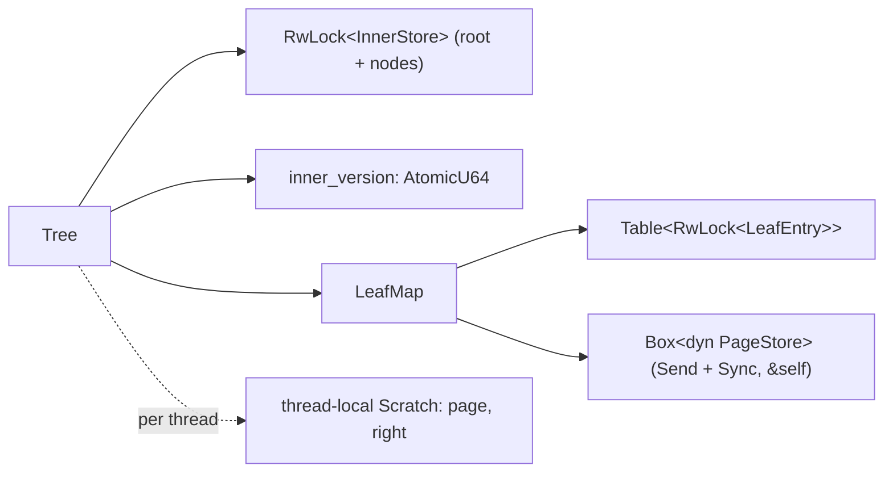

# 0012: Shared tree foundation

**Status:** Draft

**Design references:** [Tree structure](../design/bf-tree-structure.md),
[leaf storage](../design/bf-tree-leaf-store.md),
[shared pages](../design/bf-tree-pages.md),
[inner nodes](../design/bf-tree-inner-nodes.md),
[build system](../design/build-system.md). This stack creates the
[concurrency design](../design/bf-tree-concurrency.md).

**Parent roadmap:** [BF-Tree implementation](0002-bf-tree-roadmap.md),
milestone 5 (foundation). It also serves milestones 8 and 9.

**Builds on:** [Leaf mapping table and page store](0008-bf-tree-leaf-store.md),
[single-threaded tree](0007-bf-tree-in-memory-tree.md),
[mini-page component](0011-bf-tree-mini-page.md) (`Page::merge_batch_*`),
[circular buffer component](0010-bf-tree-circular-buffer.md) (its `State`
mutex moves onto `bf-tree-sync`).

## Goal and scope

The tree is single-threaded today. Every write takes `&mut self`, reads
return borrows into `OnceCell` resident copies, and writes change those
copies in place until `flush`. Mini-pages (plan 0013), eviction (0014), and
concurrency (0016) all need a tree that many threads can share, with one
lock per logical leaf and one place where base pages are read and written.
This stack makes that change first, on base leaves only, so that later
stacks add mechanisms instead of reshaping the tree.

After this stack, `Tree` is `Send + Sync`. Every operation takes `&self`.
Each leaf has its own `RwLock`. The page store is `Send + Sync` with `&self`
methods. A base page is loaded on each access into a thread-local scratch
page, and every page write goes through `LeafMap::write_through`. A write
merges a one-record batch into the base page, which is the final merge path
with a batch of one.

- **In scope:** the `bf-tree-sync` crate with poison-free `Mutex` and
  `RwLock` wrappers and `Table<T>`; moving the circular buffer's mutex onto
  it; a shareable `PageStore`;
  `LeafMap` with locked entries, guards, `load_base`, and `write_through`;
  thread-local scratch; the inner layer behind `RwLock<InnerStore>` with a
  global `inner_version`; the route, lock, validate, retry protocol; writes
  through `merge_batch_*`; the final public read, scan, and write API;
  `flush(&self)`; a compile-time `Send + Sync` check; a concurrent model test;
  the concurrency design document.
- **Out of scope:** mini-pages and the circular buffer in the tree (0013);
  eviction (0014); caching (0015); per-node inner frames (0016); durable
  store format and crash atomicity (0017, 0018); leaf merging.
- **Done when:** `Tree: Send + Sync` and every public operation takes
  `&self`; the single-threaded model suite agrees with the oracle on both
  backends, with flush and reopen; the concurrent model agrees with the
  union of per-thread oracles and passes `check_invariants` at quiescence,
  under a watchdog; `split_with_insert` and the `OnceCell` copies are gone;
  the workspace checks pass.

## Approach

### Shape



### Crate `bf-tree-sync`: poison-free locks

This stack creates `bf-tree-sync`, the one home for lock types shared by
`bf-tree-circular-buffer`, `bf-tree-store`, and `bf-tree`. A separate crate
is needed because the first two sit below `bf-tree` in the dependency
graph.


```rust
/// A mutex whose `lock` never fails.
pub struct Mutex<T>(std::sync::Mutex<T>);
impl<T> Mutex<T> {
    pub const fn new(value: T) -> Self;
    pub fn lock(&self) -> MutexGuard<'_, T>;
    pub fn try_lock(&self) -> Option<MutexGuard<'_, T>>;
    pub fn get_mut(&mut self) -> &mut T;
    pub fn into_inner(self) -> T;
}

/// A reader-writer lock whose acquisitions never fail.
pub struct RwLock<T>(std::sync::RwLock<T>);
impl<T> RwLock<T> {
    pub fn new(value: T) -> Self;
    pub fn read(&self) -> RwLockReadGuard<'_, T>;
    pub fn write(&self) -> RwLockWriteGuard<'_, T>;
    pub fn try_read(&self) -> Option<RwLockReadGuard<'_, T>>;
    pub fn try_write(&self) -> Option<RwLockWriteGuard<'_, T>>;
    pub fn get_mut(&mut self) -> &mut T;
    pub fn into_inner(self) -> T;
}

impl<T: Default> Default for Mutex<T> { /* Mutex::new(T::default()) */ }
impl<T: Default> Default for RwLock<T> { /* RwLock::new(T::default()) */ }

pub use std::sync::{MutexGuard, RwLockReadGuard, RwLockWriteGuard};
```

**Poisoning is ignored.** Each acquisition takes the guard out of a
`PoisonError` with `into_inner`. A panic inside a critical section is a bug
that has already failed its own operation. Poisoning would turn that one bug
into a failure of every later caller, including `Drop` paths and test
harnesses that catch panics. To make continuing safe, every critical section
in the tree crates must follow one rule: **check before mutating**. All
fallible checks and assertions run before the first write to the protected
data, so a panic leaves the data consistent. Plan 0010 introduced the rule
for the circular buffer's one mutex; the crate documentation now states it
for every lock in the tree crates. The circular buffer's
`std::sync::Mutex<State>` moves onto this crate's `Mutex` in the same diff,
so every lock in the tree crates comes from one place.

The wrappers add no spinning. On Linux, std's futex `RwLock` already spins
briefly before it parks. On macOS, std's queue-based `RwLock` parks readers
under reader contention; contended benchmarks therefore run on Linux only.
The next section adds `Table<T>` to this crate.

`bf-tree-sync` contains no `unsafe` code.

```python
# crates/bf-tree-sync/BUCK
load("//build:defs.bzl", "peppy_rust_library")

peppy_rust_library(
    name = "bf-tree-sync",
    visibility = [
        "//crates/bf-tree-circular-buffer:",
        "//crates/bf-tree-store:",
        "//crates/bf-tree:",
    ],
)
```

### `Table<T>` in `bf-tree-sync`

The leaf entries, the memory store's slots, and later the inner frames
(0016) need an indexable collection that grows while other threads read
it. `Table<T>` is append-only and chunked. Chunk `c` holds `64 << c`
entries. Chunks are never moved or freed, so a `&T` from `get` is valid for
the life of the table, and `get` takes no lock.

```rust
pub struct Table<T> {
    chunks: Box<[OnceLock<Box<[T]>>]>, // 48 chunks address every usize
    len: AtomicUsize,
    grow: Mutex<()>,
}

impl<T: Default> Table<T> {
    pub fn new() -> Self;
    /// Number of valid indices: `0..len()`.
    pub fn len(&self) -> usize;
    /// Lock-free. `None` at or beyond `len()`.
    pub fn get(&self, index: usize) -> Option<&T>;
    /// Make every index below `len` valid with default entries. Idempotent;
    /// growth is serialized by the mutex and publishes `len` last.
    pub fn grow_to(&self, len: usize);
}
```

Growth is `grow_to(len)` rather than "push one value". The leaf table is
indexed by IDs that the page store chooses: two concurrent splits can
receive IDs 6 and 7 from the store and reach the table in the opposite
order, and a reopened store reuses freed IDs. `grow_to(id + 1)` is correct
in every order. An entry is initialized through its own lock after growth.
`Table<RwLock<LeafEntry>>` needs `Default` on the `bf-tree-sync` wrappers,
which the previous section provides.

### A shareable page store

```rust
pub trait PageStore: Send + Sync {
    fn page_size(&self) -> usize;
    fn slots(&self) -> u64;
    fn alloc(&self) -> Result<LeafId, StoreError>;
    fn free(&self, id: LeafId) -> Result<(), StoreError>;
    fn read(&self, id: LeafId, buf: &mut [u8]) -> Result<(), StoreError>;
    fn write(&self, id: LeafId, buf: &[u8]) -> Result<(), StoreError>;
    fn sync(&self) -> Result<(), StoreError>;
    fn superblock(&self) -> &Superblock;
}
```

- `MemStore` keeps its slots in a `Table<MemSlot>` with
  `MemSlot { page: Mutex<Box<[u8]>>, freed: AtomicBool }` and a free list in
  a `Mutex<Vec<usize>>`. A read or write locks only its slot. The page box is
  allocated before the free-list mutex is taken.
- `FileStore` uses positioned I/O, which needs only `&File`. Its per-slot
  `freed` flags move to a `Table<AtomicBool>` (its length is the slot count)
  and its free list to a `Mutex<Vec<u64>>`. `alloc` holds the free-list
  mutex while it extends the file and grows the table. A read or write takes
  no store-wide lock.
- The store does not order concurrent accesses to one slot. The caller must
  serialize them; the tree does so with the leaf lock.
- Addressing stays `LeafId` until 0017.

### `LeafMap`: locked entries instead of resident copies

```rust
pub(super) struct LeafMap {
    store: Box<dyn PageStore>,
    entries: Table<RwLock<LeafEntry>>,
}

#[derive(Debug, Default)]
pub(super) struct LeafEntry {
    /// The slot holds no page.
    freed: bool,
    // Later plans add fields: `block` and `refs` (0013), `version` (0014,
    // its first reader), `dirty` (0015). The size test below guards them.
}

pub(super) struct LeafRead<'m> { id: LeafId, entry: RwLockReadGuard<'m, LeafEntry> }
pub(super) struct LeafWrite<'m> { id: LeafId, entry: RwLockWriteGuard<'m, LeafEntry> }

impl LeafMap {
    fn read(&self, id: LeafId) -> Result<LeafRead<'_>, TreeError>;   // S; UnknownLeaf if freed
    fn write(&self, id: LeafId) -> Result<LeafWrite<'_>, TreeError>; // X
    /// A fresh slot, X-locked and unreachable until a separator names it.
    fn alloc(&self) -> Result<LeafWrite<'_>, TreeError>;
    fn load_base<'s>(&self, leaf: &impl Locked, buf: &'s mut [u8]) -> Result<&'s mut Page, TreeError>;
    fn write_through(&self, pages: &mut [(LeafId, &mut [u8])]) -> Result<(), TreeError>;
    fn sync(&self) -> Result<(), TreeError>;
}
```

The lock is the paper's per-leaf reader-writer lock (§3.3). It covers the
entry and the leaf's base page in the store: every base write happens
under X, so a base page read under S is consistent. A test asserts
`size_of::<RwLock<LeafEntry>>() <= 64`; later stacks add fields and keep
the test passing.

### Thread-local scratch and the one load function

There are no resident copies. Each access loads the base page into a
per-thread scratch buffer.

```rust
const MAX_PAGE: usize = 4096; // Page::check_capacity's upper bound

pub(super) struct Scratch {
    pub(super) page: Box<[u8; MAX_PAGE]>,
    pub(super) right: Box<[u8; MAX_PAGE]>, // the right half of a split
}

thread_local! {
    static SCRATCH: RefCell<Option<Box<Scratch>>> = const { RefCell::new(None) };
}

/// Lend this thread's scratch to `f`. Tree code must not nest calls. A
/// nested call from a user callback gets a temporary scratch instead of a
/// panic, and the outer scratch goes back to the thread afterwards.
pub(super) fn with_scratch<R>(f: impl FnOnce(&mut Scratch) -> R) -> R {
    let mut scratch = SCRATCH
        .with(|cell| cell.borrow_mut().take())
        .unwrap_or_else(Scratch::boxed);
    let result = f(&mut scratch);
    SCRATCH.with(|cell| {
        let mut slot = cell.borrow_mut();
        if slot.is_none() {
            *slot = Some(scratch); // a nested temporary is dropped instead
        }
    });
    result
}
```

The buffers have the largest legal page size and are sliced to the tree's
page size, so one thread can use trees with different page sizes.

`load_base` is the only function that reads a base page. It takes a guard
(`impl Locked`, implemented by both guard types), so the caller must hold S
or X. It reads the slot and then checks the page header with a new
O(1) `Page::check_header` (capacity equals the page size, known flags only,
fences present, slot directory and free gap fit). Full `Page::validate`
runs at `open` for every slot, and in debug builds on every load so that
tests exercise it. A full validation per load costs far more than the read
itself, and every page written after `open` was produced by this process.
Bytes changed by another process while the tree is open may cause a panic,
never undefined behaviour.

### The one write function

```rust
/// Write base pages to the store. The caller must hold the X lock of every
/// leaf in `pages` and must pass the reachable leaf first. The other pages
/// are written before the first one, so an error before the last write
/// leaves the reachable leaf's stored page unchanged. Takes no tree-level
/// lock. Persistence changes only this body (0017, 0018).
pub(super) fn write_through(&self, pages: &mut [(LeafId, &mut [u8])]) -> Result<(), TreeError> {
    let (first, rest) = pages.split_first_mut().expect("at least one page");
    for (id, bytes) in rest.iter_mut().chain([first]) {
        debug_assert!(self.entry(*id).try_read().is_none(), "caller holds X");
        self.store.write(*id, bytes)?;
    }
    Ok(())
}
```

A split passes both halves in one call, so later stacks can give them one
sequence number and one atomic switch. The pages are `&mut` because 0017
stamps the leaf ID and 0018 the sequence into their headers.

### Routing layer: one lock and one version

```rust
pub(super) struct InnerStore { capacity: usize, nodes: Vec<Box<[u8]>>, root: ChildRef }

pub struct Tree {
    config: TreeConfig,
    inner: RwLock<InnerStore>,
    /// Bumped, under the inner write lock, by every structural change.
    inner_version: AtomicU64,
    leaves: LeafMap,
}

struct Route { leaf: LeafId, version: u64 }

impl Tree {
    fn route(&self, key: &[u8]) -> Route {
        let inner = self.inner.read();
        // Written only under the write lock, so stable while we hold read.
        let version = self.inner_version.load(Relaxed);
        Route { leaf: inner.find_leaf(key), version }
    }

    fn route_changed(&self, route: &Route) -> bool {
        self.inner_version.load(Acquire) != route.version
    }

    /// Insert `separator -> right` above `left`. The caller holds X on
    /// `left` and `right`.
    fn install(&self, left: LeafId, separator: Vec<u8>, right: LeafId) -> Result<(), TreeError> {
        let mut inner = self.inner.write();
        let (leaf, path) = inner.locate(&separator);
        debug_assert_eq!(leaf, left, "the separator lies in the left leaf's range");
        inner.propagate(&path, separator, ChildRef::Leaf(right))?; // 0007's loop
        self.inner_version.fetch_add(1, Release);
        Ok(())
    }
}
```

Every operation on a key uses the same protocol: read-lock the inner layer,
route, note the version, release; lock the leaf; if `route_changed`, drop
the leaf lock and start again.

```rust
fn with_leaf_write<R>(&self, key: &[u8], f: impl FnOnce(&mut LeafWrite<'_>) -> Result<R, TreeError>)
    -> Result<R, TreeError> {
    loop {
        let route = self.route(key);
        let mut leaf = self.leaves.write(route.leaf)?;
        if self.route_changed(&route) {
            continue; // the guard drops here
        }
        return f(&mut leaf);
    }
}
```

`install` finds the parent by descending with the separator under the write
lock. The route records no path, so a write allocates no path vector, and
callers that lock a leaf by ID (flush in 0013, eviction in 0014) can split
without routing first. The descent is correct because the separator is a key
of the right half, so it lies in the left leaf's old range, and that range
cannot change while the caller holds the left leaf's X lock.

### Lock protocol

```mermaid
sequenceDiagram
    participant R as Reader of key k
    participant I as inner lock + version
    participant L as leaf L lock
    participant W as Writer splitting L
    participant N as fresh leaf N lock
    R->>I: read lock, route k to L, note v, unlock
    W->>I: read lock, route to L, note v, unlock
    W->>L: X lock
    Note over W: version is v: route valid
    R->>L: S lock (waits for W)
    Note over W: load base, merge one record: does not fit
    W->>N: store.alloc, grow table, X lock (unreachable)
    Note over W: merge_batch_split into N; write_through [L, N]
    W->>I: write lock, descend by separator, insert, v+1, unlock
    W->>N: unlock
    W->>L: unlock
    Note over R: S granted; version v+1 differs from v
    R->>R: drop S, route again (k may be in N)
```


**Deadlock freedom.** Locks are ranked as in the diagram. A thread may wait
for a lock only if every lock it holds has a lower rank.

1. Routing holds the inner read lock only while it descends in-memory
   nodes. It holds no leaf lock at that time, and it waits for nothing
   else. A retry drops the leaf lock before it routes again.
2. A writer holds one reachable leaf. A split allocates a slot (innermost
   locks, released before return), then X-locks the fresh leaf. No route
   names the fresh leaf, so only a thread that locks leaves by ID can hold
   it. Such threads (`check_invariants` here; flush in 0013; eviction in
   0014) must hold no other leaf lock, so they release it without waiting.
3. `install` takes the inner write lock while it holds leaf locks. Under the
   write lock it only edits `InnerStore` and allocates inner buffers. It
   never touches a leaf. **No thread waits for a leaf lock while it holds
   the inner lock.**
4. Store, slot, and table mutexes are innermost. Their holders call nothing
   that locks.
5. `check_invariants` copies the routing layer under the read lock,
   releases it, and then locks leaves one at a time. It requires
   quiescence for a meaningful result, but it cannot deadlock.

Every wait edge goes from a lower rank to a higher rank, so no cycle exists.
User callbacks (`get_with`, `scan_with`) run under a leaf lock. They must
not call back into the tree: a write to the same leaf, or a second S lock
behind a queued writer, deadlocks.

**Correctness of routing.** A leaf's key range changes only when the leaf
splits. A split happens under that leaf's X lock, and `install` bumps the
version before the splitter releases the lock. A thread that locks leaf `L`
after routing to it with version `v` sees one of two cases. Either no split
of `L` completed since it read `v`, so `L` still owns the key. Or a split
completed, so the bump happened before the release of `L`, which happened
before this thread's acquisition, and the thread sees a version other than
`v`. A false positive (a split elsewhere) costs one retry. A split that
wrote its pages but has not installed its separator still holds `L`, so no
thread observes the intermediate state. As a guard against protocol bugs,
writes and reads call `page.check_key(key)` on the loaded base; a failure
is an internal `TreeError::Page(KeyOutOfRange)`, never wrong data.

Each operation on key `k` therefore runs under the lock of the leaf that
owns `k` at that moment. Operations on one key are serialized by that lock,
and a split moves `k` under the same lock. A key's value is the last
completed write of that key.

A global version makes every split invalidate every in-flight route. Each
retry implies that some split completed, so the system makes progress; a
single thread can starve only under a continuous stream of splits. 0016
replaces this with per-node versions.

### Writes: merge a one-record batch

```rust
fn write(&self, key: &[u8], state: RecordState<'_>) -> Result<(), TreeError> {
    let n = self.config.leaf_capacity;
    self.with_leaf_write(key, |leaf| with_scratch(|scratch| {
        let page = self.leaves.load_base(leaf, &mut scratch.page[..n])?;
        page.check_key(key)?;
        let batch = [RecordRef { key: KeyRef::from(key), state }];
        if page.merge_batch_fits(batch.iter().copied())? {
            page.merge_batch_in_place(batch.iter().copied())?;
            return self.leaves.write_through(&mut [(leaf.id(), &mut scratch.page[..n])]);
        }
        let split = self.split_leaf(leaf.id(), scratch, |page, right| {
            Ok(page.merge_batch_split(right, batch.iter().copied())?.separator)
        })?;
        drop(split.right); // after install; then the left guard drops
        Ok(())
    }))
}

struct Split<'t> { separator: Vec<u8>, right: LeafWrite<'t> }

/// Under X on the reachable leaf `left`, whose merged contents in
/// `scratch.page` do not fit: allocate and X-lock a fresh right leaf, let
/// `merge` split into `scratch.right`, write both pages through in one
/// call, and install the separator. Returns the right leaf still locked.
fn split_leaf<'t>(&'t self, left: LeafId, scratch: &mut Scratch,
    merge: impl FnOnce(&mut Page, &mut [u8]) -> Result<Vec<u8>, TreeError>) -> Result<Split<'t>, TreeError>;
```

`put` passes `Insert(value)` and `remove` passes `Delete`. A tombstone in
the batch removes the base key and never appears in the output, so a
`Delete` never splits. `put` and `remove` return `Result<(), TreeError>`:
a blind write in 0013 cannot know whether the key existed, and the API
takes its final shape now.

If `split_leaf` fails after the allocation, it frees the fresh slot before
it returns, because a written but unreachable right page would overlap its
left neighbour at the next `open`. `merge_batch_split` cannot fail under the
admission rule; an error there is an internal bug.

`split_leaf` is the skeleton that 0013 reuses with a mini-page merge in
place of the one-record batch.

### Reads and scans

```rust
impl Tree {
    pub fn get(&self, key: &[u8]) -> Result<Option<Vec<u8>>, TreeError>;
    pub fn get_with<R>(&self, key: &[u8], f: impl FnOnce(Option<&[u8]>) -> R) -> Result<R, TreeError>;
    pub fn range(&self, start: Option<&[u8]>, end: Option<&[u8]>) -> Result<Scan<'_>, TreeError>;
    pub fn iter(&self) -> Scan<'_>;
    pub fn scan_with(&self, start: Option<&[u8]>, end: Option<&[u8]>,
        visit: impl FnMut(&[u8], &[u8]) -> ControlFlow<()>) -> Result<(), TreeError>;
    pub fn put(&self, key: &[u8], value: &[u8]) -> Result<(), TreeError>;
    pub fn remove(&self, key: &[u8]) -> Result<(), TreeError>;
    pub fn flush(&self) -> Result<(), TreeError>;
}

pub struct Scan<'t> {
    tree: &'t Tree,
    records: std::vec::IntoIter<(Vec<u8>, Vec<u8>)>, // the current leaf, copied
    next: Option<Vec<u8>>,                            // its upper fence
    end: Option<Vec<u8>>,
}
impl Iterator for Scan<'_> { type Item = Result<(Vec<u8>, Vec<u8>), TreeError>; }
```

- `get_with` routes, takes S, validates, loads the base, and calls `f`
  exactly once under the lock. A retry happens only before `f` runs. `get`
  is `get_with(key, |v| v.map(<[u8]>::to_vec))`.
- Both scan forms visit one leaf at a time under its S lock. `Scan` copies
  the leaf's records in range and releases the lock before it yields them;
  it holds no lock between `next` calls. `scan_with` materializes each key
  into a reused buffer and runs the visitor under the lock.
- The continuation is the leaf's upper fence, read under its lock. Each leaf
  is scanned with `page.range(Some(cursor), end)`, where `cursor` is the scan
  start or the previous fence. The lower bound is applied to every leaf, not
  only the first, so a leaf that split after the route can never contribute
  keys below the cursor.
- A scan yields each key at most once, in increasing order, and each leaf's
  records reflect one consistent state of that leaf. A scan is not a
  snapshot across leaves.
- Bounds stay half-open `Option` pairs, as today: they match fence
  semantics, and an inclusive end is the key with a `0x00` byte appended.

### Flush and durability

`flush(&self)` calls `store.sync()`. Every write is already in the store,
so every write that returned before `flush` began is durable when it
returns. Two documented properties change:

- **Drop.** Changes are no longer lost on drop or `into_store`; they are in
  the store, synced or not. (0013 brings back buffered state that drop
  loses.)
- **Crash consistency.** Before, the store changed only during `flush`.
  Now each write lands immediately, so a process stop between the two page
  writes of a split leaves overlapping or torn fences, which `open` refuses
  with `InconsistentLeaves`. The write order in `write_through` keeps the
  reachable leaf intact on a write error, but it cannot make two writes
  atomic. Shadow paging in 0018 removes this window. Until then, the design
  documents state it.

### Admission rule

The rule `7K + 3V <= L - 72` was derived for a split of a full page plus
one pending record. A one-record batch merge has exactly that content:
the base records, minus a replaced version of the key, plus the record. So
the rule is still correct and stays. A `Delete` batch only shrinks the page.
0013 revisits the rule against the size-class ladder.

### `Send + Sync`

```rust
const _: fn() = || {
    fn shared<T: Send + Sync>() {}
    shared::<Tree>();
    shared::<Scan<'static>>();
};
```

### Deliberate replacements

- **0008's `OnceCell` resident copies** become locked entries with
  per-access loads into scratch. `OnceCell` is not `Sync`, it lets no one
  write through `&self`, and a copy that is never cleared cannot coexist with
  eviction. A resident copy is also exactly the "base plus mini-page" state
  that the mini-page design avoids. Caching (0015) brings resident pages back
  as circular-buffer `Full` blocks under the leaf lock.
- **0007's direct-write path** (`try_upsert` plus `split_with_insert`)
  becomes a one-record `merge_batch_*`. There is then one merge and one
  split path for every later caller (mini-page merges, eviction, flush,
  promotion). `Page::split_with_insert` loses its last caller and is
  removed; its useful tests move to `merge_batch_split`.

### Performance

Every `get` and `put` now reads the store, and every `put` rebuilds and
writes the page. Warm-path throughput will drop. The stack measures the
in-memory and `FileStore` baselines before and after and records the
numbers in this plan; it does not tune them. 0013 recovers writes (blind
buffering) and 0015 recovers reads (caching). Contended numbers are not
taken here; 0016 takes them on Linux.

## Decisions and trade-offs

- **Interim inner lock with a global version.** One `RwLock` and one
  counter give the final protocol shape (route without locks held, lock the
  leaf, validate, retry) with a small, auditable implementation. The cost is
  spurious retries and serialized structural changes; 0016 swaps the
  internals of `route`, `route_changed`, and `install` for frames.
- **`install` re-descends instead of using a recorded path.** A write
  records no path, and a split pays one extra descent under the write lock.
  Callers that lock by ID need no route.
- **`grow_to` instead of `push` on `Table`.** Store-chosen IDs arrive out of
  order; see the `Table` section.
- **Header check on load; full validation at open and in debug builds.**
  Keeps the trust boundary at `open` and keeps loads O(1) beyond the read.
  Alternative: validate every load, which costs more than the read.
- **Scratch is taken, not borrowed.** A user callback that re-enters gets a
  temporary buffer instead of a `RefCell` panic.
- **Owned scan items.** A borrowed item cannot outlive the leaf guard.
  `scan_with` is the zero-copy form.
- **`put`/`remove` return `()`.** Final shape for blind writes.

## Extension points

- **0013** adds `block` and `refs` to `LeafEntry`, the circular buffer to `LeafMap`,
  and a buffering step before the merge. It reuses `with_leaf_write`,
  `load_base`, `write_through`, `split_leaf`, `install`, and scratch
  unchanged.
- **0014** locks a victim's leaf by ID with no other lock held and merges it
  through the same `split_leaf` and `install`; it needs no routing path.
- **0015** adds `dirty` and a `Full` residency inside the entry, and applies
  hints after S is released.
- **0016** replaces `RwLock<InnerStore>` and `inner_version` with frames.
  `route`, `route_changed`, and `install` keep their signatures; readers
  stop taking any inner lock.
- **0017/0018** change only the bodies of `write_through` and `load_base`
  (leaf stamp, slot indirection, sequence, write-through gate). 0018's
  sequence closure runs inside `with_leaf_write` after `route_changed`.
- **Must not change later:** the public operation signatures (except the
  `flush` rename in 0018), the lock order, the guard types, and the rule
  that every base read and write goes through `load_base` and
  `write_through`.

## Proposed commit stack

Eleven diffs. The API change lands on the current map first, so the
behavioural diffs that follow are small and each is verified alone.

### `[1/11][bf-shared-tree][plan] define the shared tree foundation`

- **Purpose:** Agree on the protocol, the interfaces, and the stack.
- **Core changes:** This plan; link from the roadmap's milestone 5 row.
- **Verification:** Review the deadlock and routing arguments.

### `[2/11][bf-shared-tree][sync] create the sync crate with poison-free locks`

- **Purpose:** One home for the lock types that the circular buffer, the
  store, and the tree share.
- **Core changes:** `crates/bf-tree-sync` (`BUCK`, `lib.rs`) with `Mutex`,
  `RwLock`, and their `Default` impls; the check-before-mutate rule in the
  crate documentation; the circular buffer's `State` mutex switches to
  `bf_tree_sync::Mutex` and drops its local poison recovery;
  `bf-tree-circular-buffer/BUCK` gains the dependency; `tools/autocargo`.
- **Verification:** A thread that panics while holding each lock leaves it
  usable; `try_lock`/`try_read`/`try_write` report contention; `get_mut` and
  `into_inner` after a poisoning panic return the value; the circular
  buffer suite passes unchanged.

### `[3/11][bf-shared-tree][sync] add the append-only table`

- **Purpose:** The lock-free indexable collection for entries and slots.
- **Core changes:** `Table<T>` in `crates/bf-tree-sync/src/table.rs`;
  chunk arithmetic; `grow_to`. No BUCK change.
- **Verification:** `locate` at chunk boundaries; references stay valid
  across growth; `grow_to` idempotent and out of order; a threaded test grows
  and reads concurrently.

### `[4/11][bf-shared-tree][store] make the page store shareable`

- **Purpose:** `Send + Sync` storage with `&self` methods.
- **Core changes:** trait change; `MemStore` slot table with per-slot
  mutexes; `FileStore` freed-flag table and free-list mutex; BUCK: add
  `//crates/bf-tree-sync:bf-tree-sync` to `crates/bf-tree-store/BUCK`;
  `tools/autocargo`. The tree compiles unchanged except for `mut` bindings.
- **Verification:** the contract suite on both backends; threads write
  distinct slots and read them back; concurrent `alloc` returns distinct IDs.

### `[5/11][bf-shared-tree][api] return owned reads and add callback forms`

- **Purpose:** Move to the final public API while the map is unchanged.
- **Core changes:** `get -> Option<Vec<u8>>`, `get_with`, owned `Scan` items,
  `scan_with`, per-leaf lower bound, `put`/`remove -> ()`; `UpsertOutcome`
  no longer re-exported; doc test and tests adjusted.
- **Verification:** model suite (outcome checks removed, values checked);
  scan tests for both forms, early `Break`, and empty leaves.

### `[6/11][bf-shared-tree][write] merge a one-record batch instead of upserting`

- **Purpose:** One merge and split path.
- **Core changes:** `write` through `merge_batch_fits/_in_place/_split` on
  the resident page; `remove` as a `Delete` batch; propagation unchanged.
- **Verification:** model suite on both backends with reopen; growing
  replacements into a full leaf split exactly as before; removes never split.

### `[7/11][bf-shared-tree][page] remove the single-record split and add a header check`

- **Purpose:** Page-crate support for per-access loads.
- **Core changes:** remove `Page::split_with_insert` and move its remaining
  cases onto `merge_batch_split`; add `Page::check_header`; make
  `Page::check_key` public.
- **Verification:** page suites; `check_header` accepts every valid page and
  rejects zeroed, wrong-capacity, unfenced, and oversized-directory images
  without panicking.

### `[8/11][bf-shared-tree][leaf-map] lock leaf entries and load bases per access`

- **Purpose:** Replace resident copies with locked entries.
- **Core changes:** `LeafMap` over `Table<RwLock<LeafEntry>>`; guards;
  `alloc`; `load_base`; `write_through`; scratch; writes still take
  `&mut self` and propagate through 0007's loop; remove
  `resident_leaves`/`dirty_leaves`; test fixtures write through the map;
  entry-size test; BUCK: add `//crates/bf-tree-sync:bf-tree-sync` to
  `crates/bf-tree/BUCK`; `tools/autocargo`.
- **Verification:** all tree suites; a dropped tree's store holds every
  write; `size_of::<RwLock<LeafEntry>>() <= 64`.

### `[9/11][bf-shared-tree][inner] share the routing layer and take &self`

- **Purpose:** `Tree: Send + Sync` with the route, lock, validate protocol.
- **Core changes:** `RwLock<InnerStore>` with the root inside;
  `inner_version`; `route`, `route_changed`, `with_leaf_write`, `install`,
  `split_leaf`; `&self` everywhere; `flush(&self)`; `check_invariants`
  copies routing first; the `Send + Sync` assertion.
- **Verification:** all suites; a route taken before a split reports
  `route_changed`; a write through a stale route retries and lands in the
  right half.

### `[10/11][bf-shared-tree][tests] verify the shared tree under threads`

- **Purpose:** The concurrent oracle that later stacks extend.
- **Core changes:** `tests/concurrent.rs`: watchdog; writers on disjoint key
  prefixes with per-thread `BTreeMap` oracles; readers over all keys;
  single-writer keys with increasing counters that readers check never
  decrease; scans checked for order and well-formed values; tiny nodes for
  splits and root growth; both backends with flush and reopen after join.
  Baselines before and after the stack.
- **Verification:** 2, 4, and 8 threads; repeated runs; union of oracles
  equals the tree; invariants at quiescence.

### `[11/11][bf-shared-tree][docs] record the shared tree design`

- **Purpose:** Enduring design and plan outcomes.
- **Core changes:** create `docs/design/bf-tree-concurrency.md` (locks,
  order, protocol, guarantees, interim inner lock); update
  `bf-tree-leaf-store.md` (entries, scratch, load and write functions,
  durability and crash windows) and `bf-tree-structure.md` (writes, scans,
  admission note); this plan's outcomes.
- **Verification:** documents agree with the code and tests.

## Open questions

1. **Interim crash window.** Confirm that a stop between the two page
   writes of a split may make `open` refuse the store until 0018. The
   alternative (keeping the store unchanged between flushes) needs resident
   copies, which this stack removes.

## Verification strategy

| Check | Command or procedure | Expected result |
| --- | --- | --- |
| Single-threaded behaviour | `tools/buck2 run //crates/bf-tree:bf-tree-unittest -- model` | oracle agreement on both backends with reopen; invariants hold |
| Concurrent model | `tools/buck2 run //crates/bf-tree:bf-tree-unittest -- concurrent`, repeated 20 times | union of oracles; counters never decrease; no watchdog abort |
| Routing protocol | stale-route unit tests | `route_changed` after a split; retried write lands in the right half |
| Store contract | `tools/buck2 test //crates/bf-tree-store/...` | identical behaviour on both backends, threaded cases pass |
| Lock wrappers and table | `tools/buck2 test //crates/bf-tree-sync/...` | a panic while holding a lock leaves it usable; boundaries, idempotent growth, concurrent reads |
| Entry size | unit test | `RwLock<LeafEntry>` at most 64 bytes |
| Baselines | `tools/buck2 run @build/mode/release //crates/bf-tree:bf-tree-unittest -- --ignored --nocapture baseline` | numbers recorded here; regression expected and explained |
| Workspace | `tools/fmt.sh`; `tools/clippy.sh`; `tools/buck2 test //crates/... //bin/... //go/...`; `tools/autocargo --check`; `tools/gobuckify-remote --check`; `cargo test --workspace --locked`; `(cd go && go vet ./... && go test ./...)` | clean |

## Progress

- [ ] Agree on the design and commit stack with the user.
- [ ] Diff 2: `bf-tree-sync` lock wrappers; circular-buffer mutex moved.
- [ ] Diff 3: table.
- [ ] Diff 4: shareable store.
- [ ] Diff 5: owned read and scan API.
- [ ] Diff 6: one-record merge writes.
- [ ] Diff 7: page changes.
- [ ] Diff 8: locked leaf entries and scratch.
- [ ] Diff 9: shared routing layer and `&self`.
- [ ] Diff 10: concurrent model and baselines.
- [ ] Diff 11: design documents and roadmap.

## Discoveries and plan changes

- **2026-11-04: this stack creates `bf-tree-sync`.** Plan 0010 used to
  create the crate for the circular buffer's one mutex. The crate now
  starts here, where `Table<T>`, the leaf locks, and several crates first
  need shared lock types. Diff 2 is new; later diffs moved up by one.

## Agent notes

- **Entry points:** `crates/bf-tree/src/leaf_map.rs` (the `OnceCell` map and
  `pair_mut` to replace), `crates/bf-tree/src/write.rs`
  (`try_upsert_in_leaf`, `split_and_propagate`; the propagation loop moves
  into `InnerStore::propagate`), `crates/bf-tree/src/read.rs` (`descend`,
  `locate`), `crates/bf-tree/src/scan.rs`, `crates/bf-tree/src/store.rs`
  (`InnerStore` gains `root`), `crates/bf-tree/src/open.rs` (builds the map
  with freed flags), `crates/bf-tree/src/invariants.rs`,
  `crates/bf-tree/src/tests/mod.rs` (fixtures use `bytes_mut`),
  `crates/bf-tree-store/src/{lib,mem,file}.rs`,
  `crates/bf-tree-page/src/{split,fence,validate}.rs`.
- **0011 interface:** `merge_batch_fits` returns `Result<bool, PageError>`;
  all three take the batch as `impl Iterator<Item = RecordRef> + Clone`, so a
  one-record batch is `[record].iter().copied()`. `bf-tree-sync`'s guards
  are std's `RwLockReadGuard`/`RwLockWriteGuard`.
- **BUCK edges:** diff 2 adds `bf-tree-sync` to the circular buffer's
  deps; diff 4 adds it to `bf-tree-store`; diff 8 adds it to `bf-tree`,
  because the leaf locks and `Table` are first used by `bf-tree` there.
- **Gotchas:** bump `inner_version` before the left leaf's guard drops;
  drop the right guard before the left; call `grow_to(id + 1)`, never
  "append"; never hold the inner lock while locking a leaf, including in
  `check_invariants`; a nested `with_scratch` must not panic; any lock
  counter for tests must be `cfg(all(test, debug_assertions))`, because a
  shared counter distorts release benchmarks; `std::thread_local!` is used
  directly (0016 decides whether a shuttle switch needs it in
  `bf-tree-sync`).
- **Upstream reference:** `src/tree.rs` (`traverse_to_leaf`, `write_inner`,
  `check_parent!`), `src/storage.rs` (`PageTable` of `RwLock<PageLocation>`),
  `src/range_scan.rs` (one leaf lock at a time), `src/utils/inner_lock.rs`.
- **Do not add:** spin wrappers, exclusive-first reads, resident copies,
  borrowed reads into resident memory, `unsafe`.

## Sources

- [BF-Tree paper](../references.md#bf-tree-paper): §3.3 (mapping table and
  the per-page reader-writer lock), §3.4 (inner nodes and optimistic latch
  coupling, which 0016 completes), §5 (operations and scans).
- [Upstream `src/tree.rs`](https://github.com/microsoft/bf-tree/blob/f442e6172bf7e5483ff320d8e3ac16a70e31bbd6/src/tree.rs),
  [`src/storage.rs`](https://github.com/microsoft/bf-tree/blob/f442e6172bf7e5483ff320d8e3ac16a70e31bbd6/src/storage.rs),
  [`src/range_scan.rs`](https://github.com/microsoft/bf-tree/blob/f442e6172bf7e5483ff320d8e3ac16a70e31bbd6/src/range_scan.rs).
  peppydb differs by validating a route with a version after the leaf lock
  instead of during the descent (until 0016), and by splitting through a
  merge of a one-record batch.
- Leis, Scheibner, Kemper, Neumann, "The ART of practical synchronization"
  (DaMoN 2016): the version-validated protocol that `route_changed`
  approximates with one global version.
