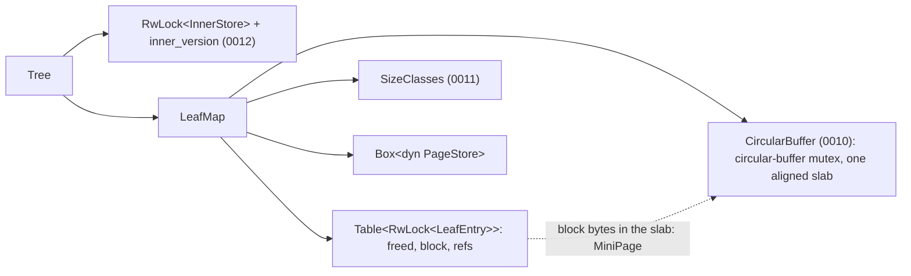
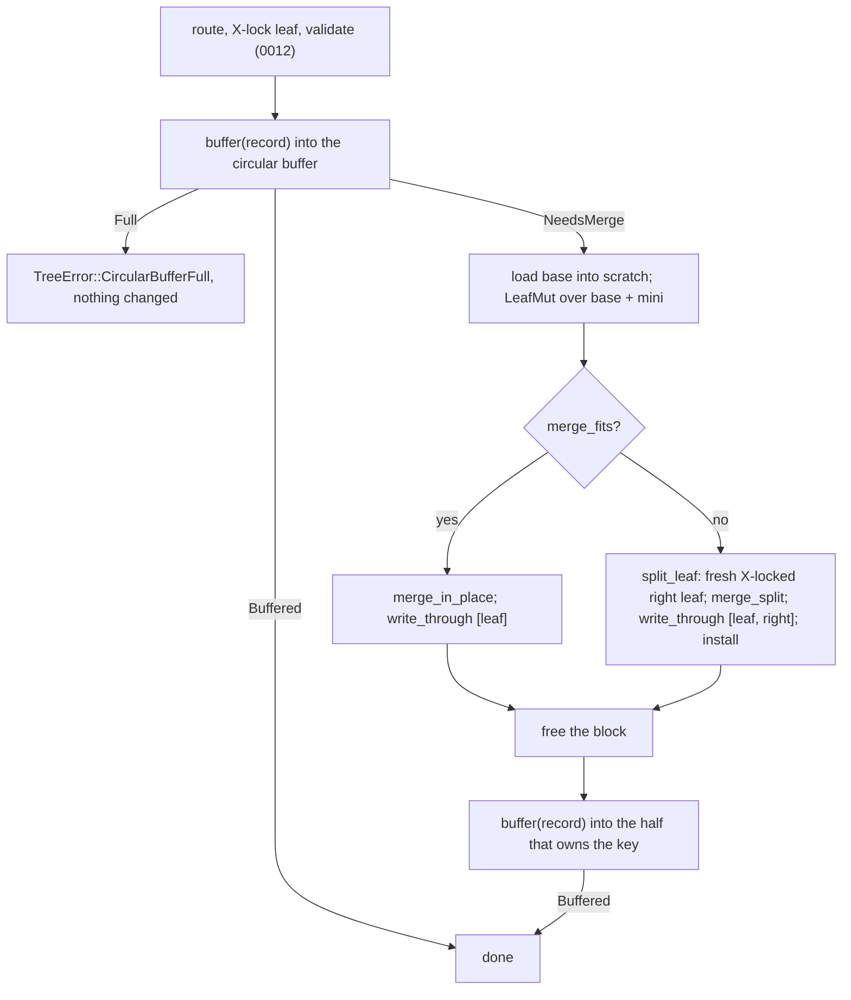

# 0013: Mini-pages in the shared tree

**Status:** Draft

**Design references:** [Mini-pages](../design/bf-tree-mini-page.md),
[circular buffer](../design/bf-tree-circular-buffer.md),
[tree structure](../design/bf-tree-structure.md),
[concurrency](../design/bf-tree-concurrency.md),
[leaf storage](../design/bf-tree-leaf-store.md).

**Parent roadmap:** [BF-Tree implementation](0002-bf-tree-roadmap.md),
milestone 5 (completes it).

**Builds on:** [Shared tree foundation](0012-bf-tree-shared-tree.md),
[mini-page component](0011-bf-tree-mini-page.md),
[circular buffer component](0010-bf-tree-circular-buffer.md).

## Goal and scope

Plan 0011 delivered a mini-page overlay that is correct for one leaf, and
plan 0010 a bounded, concurrent circular buffer. Plan 0012 made the tree
shareable, with one leaf lock, one load function, and one write function.
This stack puts mini-pages into the tree, backed by circular-buffer blocks,
and completes milestone 5.

After this stack, `put` and `remove` buffer into the leaf's mini-page
without reading the base page. Reads consult the mini-page first and read
the base only on a miss. Scans merge base and mini-page records. A
mini-page at its largest class merges into the base, in place or by a split,
under the same leaf lock, and the pending record is then buffered into the
half that owns its key. `flush` merges every mini-page before it syncs.

- **In scope:** `TreeConfig::circular_buffer_bytes` and the size-class ladder in
  `validate`; the admission rule revisited; `LeafMap` owning the
  `CircularBuffer`; `LeafEntry::{block, refs}` and the `Base`/`Mini`
  residency views; passing the `CircularBuffer` to `buffer`; blind writes; the
  merge-and-place path; reads and scans through the overlay; `flush`
  merging; `TreeError::CircularBufferFull` as an interim error; counters;
  model, blind-write, and concurrent tests; design documents; roadmap
  milestone 5 complete.
- **Out of scope:** eviction and relocation (0014: until then a full
  circular buffer is an error); `Cache` and `Phantom` writes and `Full`
  pages (0015); inner frames (0016); persistence changes (0017 onwards);
  leaf merging.
- **Done when:** a write to a leaf whose mini-page has room performs no store
  read; a read of a buffered key or tombstone performs no store read; the
  0012 model and concurrent suites pass through the overlay; after `flush`
  no leaf holds a block and a reopened tree equals the oracle; a full
  circular buffer returns `CircularBufferFull` and leaves the tree
  unchanged; the circular buffer never exceeds its budget; the workspace
  checks pass.

## Approach

### Shape



### Configuration

```rust
pub struct TreeConfig {
    pub leaf_capacity: usize,
    pub inner_capacity: usize,
    pub max_key_len: usize,
    pub max_value_len: usize,
    /// Circular-buffer budget for mini-pages, in bytes. A power of two, at
    /// least `2 * (leaf_capacity + 16)`. Not stored in the superblock.
    pub circular_buffer_bytes: usize, // default 32 MiB
}
```

`validate` derives `SizeClasses::derive(L, K, V)` and reports its failure
as `InvalidConfig`. It also checks `circular_buffer_bytes` against the circular
buffer's rule, so `CircularBuffer::new` cannot fail on a validated
configuration. The second-chance share is 0 until 0014 adds its knob:
nothing relocates yet, so the tree behaves as the final tree with that share
set to zero. The circular buffer's classes
are the ladder followed by `L`; the `L` class has no user until `Full`
pages (0015), and it costs nothing.

At the defaults (`L = 4096`, `K = 64`, `V = 1024`) the largest class is
`M = floor64(4096 - 320 - 1024 - 24) = 2688`, and the ladder is 64, 128,
256, 512, 1024, 2048, 2688. The default budget holds about 12,000 mini-pages
at the largest class. It is the final default for a tree with eviction.

`circular_buffer_bytes` is a runtime setting, so the superblock does not record it.
`From<&Superblock> for TreeConfig` fills it with the default, and
`From<&TreeConfig> for Superblock` ignores it. A new constructor
`Tree::open_with(config, store)` opens a store with chosen runtime
settings; it requires `Superblock::from(&config) == *store.superblock()`.
`Tree::open(store)` stays, as `open_with` with the superblock's
configuration.

### Admission rule

In this stack every split comes from a mini-page merge. 0011's admission
proof covers that case: with a base of at most `L - 48` content bytes and a
mini-page of at most `M - 32`, the larger split half fits when
`M <= L - 5K - V - 24`. One two-way split always suffices, so a merge never
returns `CannotSplit`. The ladder checks (`M >= 64` and a maximum record
`32 + 8 + K + V <= M`) guarantee that a fresh mini-page takes any record.

0012's rule `7K + 3V <= L - 72` protected a split of a full base plus one
record. That path is removed in diff 4, so the rule is removed with it, and
`validate` keeps the ladder derivation and the inner-node rule. Neither leaf
rule implies the other, because `M` rounds down to a multiple of 64:

- The ladder admits larger values: at `K = 64`, `L = 4096` it accepts `V`
  up to about 1.8 KiB, where `7K + 3V` stops at 1192 bytes.
- `L = 192, K = 9, V = 16` passes `7K + 3V` but gives `M = 64`, which cannot
  hold a 65-byte record. Such small configurations become invalid, and a
  store created with one no longer opens.

A sweep test records which configurations change. Until diff 4 both rules
apply, so every intermediate diff stays correct.

**Why the pending record is not folded into the merge.** Folding it in adds
one record to the merge content. The same derivation then requires
`M <= L - 6K - 2V - 32`, which is 1600 at the defaults instead of 2688. The
mini-page would merge almost twice as often. Placing the record after the
merge is always possible: a fresh mini-page at the smallest fitting class
takes any admitted record.

### Leaf entries and residency

```rust
pub(super) struct LeafEntry {
        freed: bool,
    /// A circular-buffer block holding this leaf's mini-page.
    block: Option<Block>,
    /// Reference bits for the mini-page's slots; `Some` exactly when `block` is.
    refs: Option<Box<RefBits>>,
}

pub(super) enum Residency<'e> {
    Base,
    Mini { page: &'e MiniPage, refs: &'e RefBits },
    // `Full(&'e Page)` arrives in 0015.
}
```

`block` and `refs` are two `Option`s rather than one enum because each has a
niche, so the entry needs no discriminant. `Full` pages in 0015 hold a block
without reference bits. 0012's size test keeps `RwLock<LeafEntry>` within
64 bytes. A `Block` is a handle to a byte range in the circular buffer's
slab: `Block { ptr: NonNull<u8>, addr: usize, seq: u64, len: u32 }`, 32
bytes. The `NonNull` gives `Option<Block>` its niche, so it is also 32
bytes.

0011's `buffer` works on `Option<Mini>`. `LeafWrite::take_mini` moves the
two fields into a `Mini`, and `put_mini` moves them back. That moves the two
handles and never copies block bytes.

### Allocation: one call site

`LeafMap::buffer` is the only place that allocates mini-page blocks. It
calls 0011's `buffer` with the map's `CircularBuffer` and the leaf's ID,
which is both the block's owner and the mini-page's backing leaf:

```rust
let outcome = bf_tree_mini_page::buffer(
    &mut slot, &self.circular_buffer, leaf, &self.classes, key, state,
)?;

impl From<BufferError> for TreeError {
    fn from(error: BufferError) -> Self {
        match error {
            // Interim; 0014 removes this mapping.
            BufferError::Full(CircularBufferFull) => TreeError::CircularBufferFull,
            BufferError::Page(error) => TreeError::Page(error),
        }
    }
}
```

`BufferError` is 0011's `buffer` error; it is not part of the
circular-buffer crate. The circular-buffer mutex is an innermost lock in
0012's order.
Allocation and free happen under a leaf's X lock, which the order allows.
No thread ever waits for circular-buffer room while it holds a leaf lock: in
this stack a full circular buffer fails at once, and in 0014 the writer
releases its lock before it evicts.

### Writes



```rust
fn write(&self, key: &[u8], state: RecordState<'_>) -> Result<(), TreeError> {
    self.with_leaf_write(key, |leaf| match self.leaves.buffer(leaf, key, state)? {
        WriteOutcome::Buffered | WriteOutcome::SkippedDirty => Ok(()),
        WriteOutcome::NeedsMerge => {
            let mut split = with_scratch(|scratch| self.merge_leaf(leaf, scratch))?;
            let target = match &mut split {
                Some(split) if key >= split.separator.as_slice() => &mut split.right,
                _ => leaf,
            };
            match self.leaves.buffer(target, key, state)? {
                WriteOutcome::Buffered => Ok(()),
                _ => Err(TreeError::Page(PageError::PageFull)), // unreachable: fresh mini-page
            }
        }
    })
}

/// Under X on the reachable leaf: fold its mini-page into the base page, in
/// place or by a split, write the result through, and free the block.
/// Returns the right half of a split, still X-locked. Callers: writes,
/// `flush`, and eviction (0014).
fn merge_leaf<'t>(&'t self, leaf: &mut LeafWrite<'t>, scratch: &mut Scratch)
    -> Result<Option<Split<'t>>, TreeError> {
    let Residency::Mini { page: mini, .. } = leaf.residency() else { return Ok(None) };
    let n = self.config.leaf_capacity;
    let base = self.leaves.load_base(leaf, &mut scratch.page[..n])?;
    let mut merge = LeafMut { base, mini: Some(mini) };
    let split = if merge.merge_fits()? {
        merge.merge_in_place()?;
        self.leaves.write_through(&mut [(leaf.id(), &mut scratch.page[..n])])?;
        None
    } else {
        Some(self.split_leaf(leaf.id(), scratch, |base, right| {
            Ok(LeafMut { base, mini: Some(mini) }.merge_split(right)?.separator)
        })?)
    };
    leaf.free_mini(&self.leaves.circular_buffer);
    Ok(split)
}
```

- **Writes are blind.** `buffer` never reads the base page. A `Delete` of a
  key that the base does not hold becomes a tombstone, which the merge drops.
- **The record is placed under the held locks.** After a merge both halves
  are still X-locked, so the record goes into the half whose range holds the
  key, with no second route and no retry. Each half has no mini-page after
  the merge, so `buffer` allocates the smallest fitting class, and the
  ladder check guarantees it fits. Freeing the old block first lets the
  allocation reuse its hole.
- **The merge is a `split_leaf` caller.** 0012's lock protocol, its
  deadlock argument, and `install` apply without change. The merge borrows
  the mini-page and never frees it; `merge_leaf` frees the block only after
  the pages are written and the separator is installed. A write or install
  error leaves the block in place, so no buffered record is lost.
- **`CircularBufferFull`.** An allocation failure inside `buffer` changes
  nothing (a 0011 guarantee) and returns `TreeError::CircularBufferFull`. A
  failure in the placement after a merge leaves the merge done and the
  record not written;
  the error means "this write did not happen", which is still true. The
  caller can `flush` to free blocks and retry. A freed block makes room only
  when the circular buffer's head passes it, so room appears once the blocks
  before it are dead too. A single-threaded `flush` frees every block, so the
  head passes them all. 0014 replaces the error with eviction outside the
  lock and a retry.
- 0012's one-record batch path is removed. The tree no longer calls
  `Page::merge_batch_*` directly; `LeafMut` does.

### Reads and scans

`get_with` routes, takes S, and validates as in 0012. Then:

```rust
match leaf.residency() {
    Residency::Mini { page, refs } => match page.lookup_marking(refs, key) {
        Lookup::Found(value) => return Ok(f(Some(value))),
        Lookup::Absent => return Ok(f(None)),
        Lookup::Miss => {} // fall through to the base
    },
    Residency::Base => {}
}
let base = self.leaves.load_base(&leaf, &mut scratch.page[..n])?;
Ok(f(base.get(key)?.and_then(|record| record.state.value())))
```

A hit marks its reference bit through `&RefBits`, which atomic bits allow
under S; the page bytes that other readers search do not change. Both scan
forms load the base into scratch under S and iterate
`LeafRef { base, mini }.range(cursor, end)`, which merges base and mini-page
records, lets the newer record win, and drops absent states. The scan
protocol from 0012 (one leaf at a time, per-leaf lower bound, continuation
at the upper fence) is unchanged.

### Flush

```rust
pub fn flush(&self) -> Result<(), TreeError> {
    for id in self.leaves.ids() { // the table length when flush starts
        let Some(mut leaf) = self.leaves.write_if_live(id) else { continue };
        if leaf.residency().is_mini() {
            with_scratch(|scratch| self.merge_leaf(&mut leaf, scratch))?; // a split guard drops here
        }
    }
    self.leaves.sync()
}
```

`flush` locks one leaf at a time by ID and holds no other leaf lock, as
0012's lock order requires of by-ID lockers. A split during `flush` needs no
route, because `install` finds the parent by the separator. Writers may run
meanwhile. Guarantee: every write that returned before `flush` began is in
the store when `flush` returns. A record buffered into a leaf that `flush`
had already visited, or into a leaf created after it started, belongs to a
later write and may stay buffered.

Dropping a tree, or `into_store`, loses buffered records again, as the
leaf-store design said before 0012. Call `flush` first.

### Counters

`Tree::buffered_leaves()` counts entries with a block (an O(leaves)
diagnostic that takes each S lock in turn).
`Tree::circular_buffer_used()` returns the circular buffer's used bytes,
`tail - head`. That includes dead blocks
that the head has not passed yet, so it can exceed the bytes of live
mini-pages. Both serve tests and operators; neither is on a hot path.

### Performance

A write to a leaf with a mini-page costs a leaf lock, a binary search, and a
copy into the block, with no store access. A merge costs one base read, one
rebuild, and one or two writes for many buffered records. This recovers the
write regression of 0012. Reads of unbuffered keys still read the store;
0015 recovers them. The stack measures the in-memory and `FileStore`
baselines and records them here.

## Decisions and trade-offs

- **Place the pending record after the merge.** Keeps `M` at
  `L - 5K - V - 24` and avoids a second route.
- **Replace `7K + 3V` with the ladder rule.** Every split is a merge split,
  so the ladder proof is the exact rule. It admits larger values at normal
  page sizes and rejects a few tiny configurations.
- **`circular_buffer_bytes` defaults to 32 MiB, the final default.** Until 0014, a
  workload whose buffered pages exceed it gets `CircularBufferFull`. Tests and
  benchmarks set a budget that fits their key count. Alternative: a larger
  interim default, which 0014 would have to change back.
- **`Tree::open_with` for runtime settings.** The superblock records only
  layout settings. Alternative: store `circular_buffer_bytes`, which would make a
  memory budget a property of the file.
- **Two `Option` fields, not an enum.** Keeps the entry within one cache
  line and lets `Full` reuse `block`.
- **`flush` merges in place or splits, never discards.** Nothing clean
  exists until 0015.

## Extension points

- **0014** replaces the `CircularBufferFull` mapping: a writer that gets
  `BufferError::Full` releases its lock, calls `make_room`, and retries.
  `evict_one` X-locks the victim's owner by ID, checks that `block` still
  holds the victim, and calls `merge_leaf`, the same function `flush` uses;
  it needs no routing path. `Hint::Relocate` copies a block through
  `take_mini`/`put_mini`.
- **0015** adds `Residency::Full`, `LeafEntry::dirty`, `Cache`/`Phantom`
  writes through the same `buffer`, and promotion through `merge_leaf`'s
  in-place and split paths.
- **0016** changes only the internals of routing and `install`.
- **0017/0018** change `write_through` and `load_base`; `checkpoint` uses
  the `flush` loop.
- **Must not change later:** the entry fields (only additions), the single
  allocation call site in `LeafMap::buffer`, the `merge_leaf` contract (merge in
  place or split, write through, free the block, return the right half
  locked), and the read order (mini-page first, base only on `Miss`).

## Proposed commit stack

Six diffs. Reads and `flush` land before blind writes, so that the merge
machinery is tested on hand-built mini-pages before any write creates one.

### `[1/6][bf-mini-tree][plan] integrate mini-pages into the shared tree`

- **Purpose:** Agree on the write path, the admission change, and the stack.
- **Core changes:** This plan; link from the roadmap's milestone 5 row.
- **Verification:** Review the admission derivation and the flush guarantee.

### `[2/6][bf-mini-tree][config] add the circular-buffer budget and the size-class ladder`

- **Purpose:** Configuration that the circular buffer and mini-pages need.
- **Core changes:** `TreeConfig::circular_buffer_bytes`; `validate` derives
  `SizeClasses` and checks the budget (the `7K + 3V` rule stays until diff
  4); `From` impls; `Tree::open_with`; BUCK: add
  `//crates/bf-tree-mini-page:bf-tree-mini-page` to `crates/bf-tree/BUCK`;
  `tools/autocargo`.
- **Verification:** defaults derive the expected ladder; budgets that are
  not powers of two or are too small are rejected; `open_with` rejects a
  layout mismatch and accepts a different budget.

### `[3/6][bf-mini-tree][read] read through mini-pages and merge them on flush`

- **Purpose:** The overlay for reads, scans, and merges.
- **Core changes:** `LeafMap` owns `CircularBuffer` and `SizeClasses`; entry
  fields `block` and `refs`; `Residency`; `take_mini`/`put_mini`/`free_mini`;
  `get_with` and scans through the overlay; `merge_leaf`; `flush` merges;
  `buffered_leaves`, `circular_buffer_used`; `check_invariants` checks each
  mini-page (backing leaf, keys within the leaf's fences, `refs` present
  exactly with `block`); a crate-private test helper that installs a
  mini-page; BUCK: add
  `//crates/bf-tree-circular-buffer:bf-tree-circular-buffer`;
  `tools/autocargo`.
- **Verification:** hand-built mini-pages with inserts and tombstones:
  reads hit, miss, and see absence correctly; scans merge; `flush` merges in
  place and by split, then `buffered_leaves() == 0` and reopen equals the
  oracle; entry size still at most 64 bytes.

### `[4/6][bf-mini-tree][write] buffer writes blindly through the circular buffer`

- **Purpose:** The write path of the overlay.
- **Core changes:** `LeafMap::buffer`; `write` with
  merge-and-place; `TreeError::CircularBufferFull`; remove the one-record
  merge path and the `7K + 3V` rule; config sweep test.
- **Verification:** model suites on both backends with reopen; growing
  records walk the ladder and merge; a merge split places the record in the
  correct half; `CircularBufferFull` leaves contents and circular-buffer usage
  unchanged, and a write succeeds after `flush`.

### `[5/6][bf-mini-tree][tests] verify blind writes and circular-buffer usage`

- **Purpose:** Extend the oracles.
- **Core changes:** a crate-private counting store (reads and writes per
  slot); blind-write probes in the model (keys never read before writing:
  zero store reads until a merge; buffered keys and tombstones read without
  the store); `circular_buffer_used() <= circular_buffer_bytes` after every step;
  the concurrent model with mini-pages, budgets that fit, and a concurrent
  `flush`; baselines.
- **Verification:** repeated concurrent runs under the watchdog; every
  pre-flush write present after reopen.

### `[6/6][bf-mini-tree][docs] record mini-pages in the tree`

- **Purpose:** Enduring design and roadmap.
- **Core changes:** update `bf-tree-mini-page.md` (tree integration, write
  path, placement rule), `bf-tree-structure.md` (merge splits, admission
  rule, flush), `bf-tree-circular-buffer.md` (the adapter, the interim
  `CircularBufferFull`), `bf-tree-leaf-store.md` (buffered state lost on drop);
  roadmap milestone 5 complete; this plan's outcomes.
- **Verification:** documents agree with code and tests.

## Open questions

1. **Admission change.** Confirm that dropping `7K + 3V` for the ladder rule
   is acceptable, including that a few tiny configurations become invalid.
   Recommendation: accept; the sweep test lists them.
2. **Default budget.** Confirm 32 MiB as the final default and the interim
   `CircularBufferFull` behaviour on larger workloads until 0014.

## Verification strategy

| Check | Command or procedure | Expected result |
| --- | --- | --- |
| Blind writes | counting store around `MemStore`; writes to unread keys | zero store reads until `NeedsMerge` |
| Read order | buffered key, tombstone, unbuffered key | zero, zero, and one store read |
| Merge and split | grow one leaf's mini-page to `M` with tiny nodes | in-place and split merges; record in the correct half; invariants hold |
| Flush | buffered writes, `flush`, reopen on both backends | `buffered_leaves() == 0`; reopened tree equals the oracle |
| Circular-buffer budget | `circular_buffer_used() <= circular_buffer_bytes` after every model step | holds |
| `CircularBufferFull` | tiny circular buffer, single thread | error; contents and usage unchanged; succeeds after `flush` |
| Concurrent model | `tools/buck2 run //crates/bf-tree:bf-tree-unittest -- concurrent`, repeated | oracle agreement; no watchdog abort |
| Admission sweep | config test over `L`, `K`, `V` | changes from the `7K + 3V` rule listed |
| Baselines | `tools/buck2 run @build/mode/release //crates/bf-tree:bf-tree-unittest -- --ignored --nocapture baseline` | recorded here |
| Workspace | `tools/fmt.sh`; `tools/clippy.sh`; `tools/buck2 test //crates/... //bin/... //go/...`; `tools/autocargo --check`; `tools/gobuckify-remote --check`; `cargo test --workspace --locked`; `(cd go && go vet ./... && go test ./...)` | clean |

## Progress

- [ ] Agree on the design and commit stack with the user.
- [ ] Diff 2: configuration.
- [ ] Diff 3: reads, scans, flush merges.
- [ ] Diff 4: blind writes.
- [ ] Diff 5: blind-write and circular-buffer tests.
- [ ] Diff 6: design documents and roadmap.

## Discoveries and plan changes

None yet.

## Agent notes

- **Entry points (after 0012):** `crates/bf-tree/src/leaf_map.rs`
  (`LeafEntry`, guards, `load_base`, `write_through`),
  `crates/bf-tree/src/write.rs` (`write`, `split_leaf`),
  `crates/bf-tree/src/read.rs` (`get_with`), `crates/bf-tree/src/scan.rs`,
  `crates/bf-tree/src/lib.rs` (`TreeConfig::validate`, `From` impls),
  `crates/bf-tree/src/open.rs`, `crates/bf-tree/src/invariants.rs`,
  `crates/bf-tree/src/tests/{model,concurrent,config,write}.rs`.
- **0011 and 0010 interfaces:** `buffer(slot, circular_buffer, leaf,
  classes, key, state)`; `Mini { pub block, pub refs }`; `MiniPage::from_bytes`;
  `LeafMut::merge_fits() -> Result<bool, PageError>`, `merge_in_place`,
  `merge_split(right) -> Result<LeafSplit, PageError>`;
  `LeafRef::range(start, end)`; `CircularBuffer::new(capacity, classes,
  second_chance_percent) -> Result<Self, CircularBufferError>` (pass 0
  until 0014; a `CircularBufferError` on a validated configuration is an
  internal bug); `CircularBuffer::{alloc, free, used}`. `Block` is a handle
  into the slab and exposes `addr()`, `is(&Victim)`, `AsRef<[u8]>`, and
  `AsMut<[u8]>`. It has no `len()` or `capacity()` method; use
  `block.as_ref().len()` for its byte length. `unsafe` stays inside the
  circular-buffer crate; `bf-tree` needs none.
- **Gotchas:** `check_invariants` loads every base, so blind-write probes
  run before it; free the block only after `install`; the placement after a
  split must use the separator, not a re-route; `buffered_leaves` must not
  hold one lock while taking the next; benchmarks with a million keys need a
  budget above 32 MiB until 0014; the mini-page crate's `Scan` and the
  tree's `Scan` need an import alias.
- **Upstream reference:** `src/mini_page_op.rs` (`insert`,
  `try_merge_mini_page`; upstream restarts after a merge, which this stack
  avoids), `src/storage.rs` (`PageLocation::Mini`), `src/tree.rs` (read and
  write paths), `src/circular_buffer/mod.rs` (`alloc`).
- **Do not add:** eviction, relocation, `Cache`/`Phantom` creation, `Full`
  pages, a resident base copy beside a mini-page.

## Sources

- [BF-Tree paper](../references.md#bf-tree-paper): §3.1 and §3.2
  (mini-pages and the shared layout), §4 (the circular buffer), §5.2 and §5.4
  (buffered writes, merge, and split), §5.6 (record kinds).
- [Upstream `src/mini_page_op.rs`](https://github.com/microsoft/bf-tree/blob/f442e6172bf7e5483ff320d8e3ac16a70e31bbd6/src/mini_page_op.rs)
  and [`src/tree.rs`](https://github.com/microsoft/bf-tree/blob/f442e6172bf7e5483ff320d8e3ac16a70e31bbd6/src/tree.rs).
  peppydb differs by placing the pending record after a merge under the held
  locks instead of restarting, and by keeping no resident base copy beside a
  mini-page.
- [Plan 0011](0011-bf-tree-mini-page.md) for the admission proof and the
  write loop; [plan 0012](0012-bf-tree-shared-tree.md) for the lock protocol.
