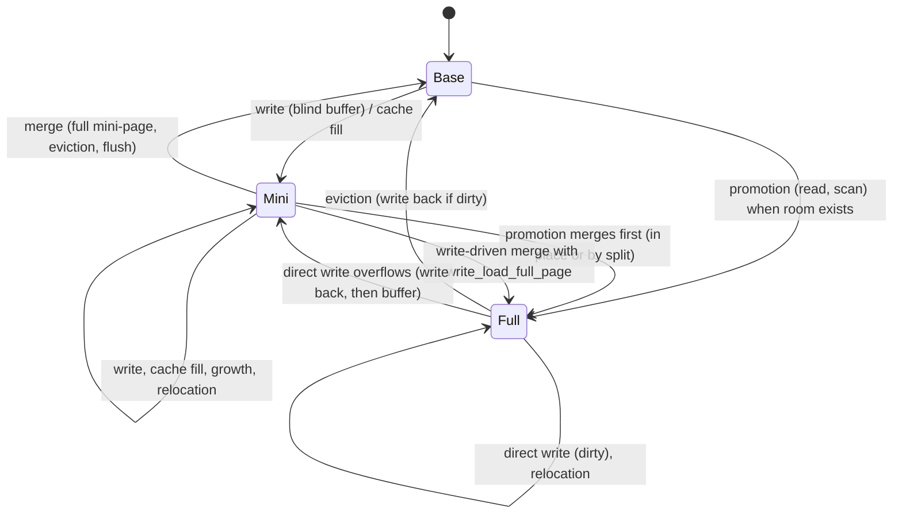
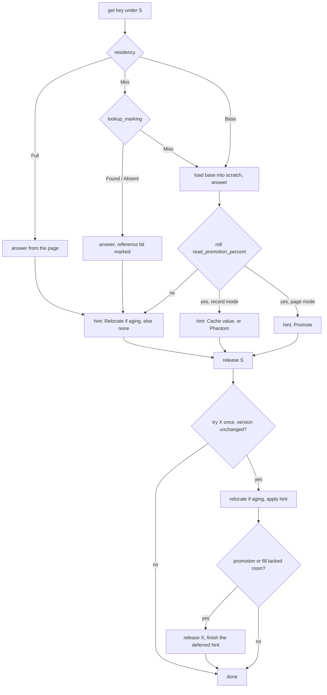

# 0015: Caching policy and full pages

**Status:** Agreed

**Design references:** [Caching policy](../design/bf-tree-caching.md)
(created by this stack), [circular buffer](../design/bf-tree-circular-buffer.md),
[mini-pages](../design/bf-tree-mini-page.md),
[concurrency](../design/bf-tree-concurrency.md),
[tree structure](../design/bf-tree-structure.md).

**Parent roadmap:** [BF-Tree implementation](0002-bf-tree-roadmap.md),
milestone 7.

**Builds on:** [Mini-page component](0011-bf-tree-mini-page.md),
[circular buffer component](0010-bf-tree-circular-buffer.md),
[shared tree foundation](0012-bf-tree-shared-tree.md),
[mini-page tree integration](0013-bf-tree-mini-tree.md),
[eviction](0014-bf-tree-eviction.md).

## Goal and scope

After plan 0014 the tree is a bounded write buffer: mini-pages hold dirty
records, eviction merges them, and every read that misses a mini-page reads
the base page from the store. Nothing a read learns is kept. This stack adds
the policy that makes BF-Tree a cache (paper §§3.1 and 5):

- a read served by the base page can leave a **cached record** (`Cache`) or
  a **cached absence** (`Phantom`) in the leaf's mini-page;
- a read, a scan, or a write-driven merge can keep the **whole page** in the
  circular buffer as a `Full` block, which then answers every key in the
  leaf's range and takes writes directly;
- reference bits decide which cached records survive a copy.

- **In scope:** `Full` residency and `LeafEntry::dirty`; direct writes to
  full pages with overflow to a mini-page; write-back of dirty full pages on
  eviction and `flush`; relocation of full pages; `Hint::Cache` and
  `Hint::Promote`; record and negative caching; page promotion, including a
  merge by split when the leaf's mini-page does not fit its page; deferred
  promotion that evicts only full pages; scan promotion; write-load
  promotion; the policy knobs and a per-tree random generator; policy
  models; the caching design document.
- **Out of scope:** adaptive or self-tuning rates; charging reference bits
  to the circular buffer's budget; inner-node frames (plan 0016);
  persistence (plans 0017 to 0019); benchmarks of the policy on Linux (plan
  0023).
- **Done when:** every policy setting agrees with the oracle under tiny
  circular buffers, reopen, and concurrency; at rate 0 reads and scans
  allocate nothing; at rate 100 with record caching the second read of a present or
  absent key reads no base page; with page caching the first read leaves
  the page `Full`; a leaf whose buffered writes outgrew its page is split
  by the first promoting read; a cache fill never replaces a buffered
  write; cold clean records are dropped on copy and referenced ones
  survive; workspace checks pass.

## Approach

### Residency



A leaf is in exactly one state. There is never a resident base page beside
a mini-page.

| State | Entry | Meaning |
| --- | --- | --- |
| `Base` | no block | Only the store holds the leaf |
| `Mini` | block (`Kind::Mini`) and `RefBits` | A mini-page overlays the base page in the store |
| `Full` | block (`Kind::Full`), no `RefBits` | The circular buffer holds the complete leaf; `dirty` means newer than the store |

`LeafEntry` gains one field. Plan 0012's size test keeps
`RwLock<LeafEntry>` within 64 bytes.

```rust
struct LeafEntry {
    version: u32,
    freed: bool,
    block: Option<Block>,          // plan 0013
    refs: Option<Box<RefBits>>,    // plan 0013
    /// A `Full` page is newer than the store. False in every other state.
    dirty: bool,
}
```

### Full pages

**Writes.** A write to a `Full` leaf goes into the page directly, because
the page is the complete leaf: `Insert` upserts, `Delete` removes, and the
clean kinds are no-ops.

```rust
/// Apply one record to a full page. Returns whether a byte changed.
/// `PageFull` leaves the page unchanged; the caller buffers instead.
fn write_full(page: &mut Page, key: &[u8], state: RecordState<'_>) -> Result<bool, PageError> {
    match state.kind() {
        RecordKind::Insert => {}
        RecordKind::Delete => return page.remove(key),
        RecordKind::Cache | RecordKind::Phantom => {
            page.check_key(key)?;
            return Ok(false);
        }
    }
    match page.try_upsert(key, state) {
        Err(PageError::PageFull) if page.reclaimable_bytes() > 0 => {
            page.compact();
            page.try_upsert(key, state)?;
        }
        result => {
            result?;
        }
    }
    Ok(true)
}
```

The page primitive is used here rather than plan 0012's one-record batch
merge: a direct write costs one record shift instead of a page rebuild, and
it never splits. When the record does not fit, the leaf writes the page back
if it is dirty (`write_through`), frees the block, becomes `Base`, and the
record is buffered by the ordinary path. A fresh mini-page always takes one
record (plan 0013's admission rule), so the fallback cannot fail for
mini-page space. Freeing the full block does not make room in the circular
buffer unless the block is at the head, because dead blocks keep their space
until the head passes them. The ordinary path therefore may evict first, as
any write does (plan 0014).

**Eviction.** Plan 0014's `evict` gains a `Full` arm: write the page back if
`dirty`, free the block, and retire the claim. A clean full page is evicted
with no store write.

**Relocation.** Plan 0014's `relocate` gains a `Full` arm: allocate a
`Kind::Full` block of size `L`, copy the bytes, keep `dirty`.

**`flush`.** After merging every mini-page, `flush` writes back every dirty
full page through `write_through` and clears `dirty`, then syncs.

**Versions.** Promotion, release, eviction, and relocation of a full page
change the block and bump `LeafEntry::version`. Direct writes do not: no
hint depends on the content of a full page, because full pages produce
only `Relocate` hints.

### Hints

```rust
pub(crate) enum Hint {
    /// Plan 0014: the block has aged into the second-chance region.
    Relocate,
    /// Leave a cached record (`Some`) or a phantom (`None`) for the key.
    Cache { key: Vec<u8>, value: Option<Vec<u8>> },
    /// Keep the whole page in the circular buffer.
    Promote,
}
```

### Reads



Every read that the base page serves rolls the read rate: a `Base` leaf and
a `Mini` leaf whose mini-page misses. `Tree::maintain` (plan 0014) applies
the hint under one `try_lock_write`, only when the version still equals
the one seen under S. Before the hint, it gives an aging block its second
chance. Each hint's validity follows from the version rule:

- `Cache` needs the base page unchanged, and every write-through bumps the
  version. It must not hide a newer buffered write of the same key. A write
  into the same mini-page does not bump the version, and need not:
  `MiniPage::apply` never lets a clean record replace a dirty one, so the
  fill becomes `SkippedDirty`.
- `Promote` needs the residency unchanged, which the version covers. The
  base page is re-read under X; it is not carried over from the read,
  because scratch is per thread and is shared by every tree on the thread.

### Record caching

`cache_fill` buffers a `Cache` or `Phantom` record through plan 0011's
`buffer` with the tree's `CircularBuffer`, allocating the smallest
class on a `Base` leaf. It follows two rules:

- **It never evicts under the lock.** On `BufferError::Full` the fill is
  deferred like a promotion (below): the reader releases its lock, frees
  room without I/O, and retries the fill once. A fill is a performance hint
  and must not make a read pay for store writes, so deferral evicts only
  blocks whose eviction costs no I/O.
- **It never merges.** On `NeedsMerge` the mini-page is full. A leaf hot
  enough to fill a mini-page with records is a candidate for the whole
  page, so the fill becomes a promotion (below), which may merge.

A `Phantom` is the negative cache: the next read of that key answers absence
without the base page. A clean record must agree with the leaf's current
base page. That invariant holds by construction: the base page changes only
by a merge, which consumes the whole mini-page and drops every clean record
(`dirty()` feeds the merge), or by a full-page write-back, when no mini-page
exists.

A mini-page that holds no dirty record merges as a no-op: `merge_leaf`
frees its block without reading or writing the base page. This is the first
stack in which such a mini-page exists; eviction and `flush` of a
cache-only mini-page cost no I/O.

### Page promotion

```rust
enum Promotion {
    Promoted,
    /// The circular buffer had no room for a page without eviction.
    NoRoom,
}

/// Keep the locked leaf's page in the circular buffer. Never evicts.
fn promote(&self, leaf: &mut LeafWrite<'_>, scratch: &mut Scratch) -> Result<Promotion, TreeError> {
    match leaf.residency() {
        Residency::Full(_) => return Ok(Promotion::Promoted),
        // Check before merging: a merge without a page to keep is wasted I/O.
        Residency::Mini(_) if !self.circular_buffer.has_room(self.page_size) => return Ok(Promotion::NoRoom),
                // In place, or by a split (plan 0013's `merge_leaf`). The merged
        // left page is left in scratch; a split's right guard drops here.
        Residency::Mini(_) => drop(self.merge_leaf(leaf, scratch)?),
        Residency::Base => self.leaves.load_base(leaf.id(), &mut scratch.page)?,
    }
    let Ok(mut block) = self.circular_buffer.alloc(self.page_size, Kind::Full, leaf.id()) else {
        return Ok(Promotion::NoRoom);
    };
    block.as_mut().copy_from_slice(&scratch.page);
    leaf.set_full(block); // dirty = false; bumps the version
    Ok(Promotion::Promoted)
}
```

**Merge by split.** When the leaf has a mini-page, promotion merges it
first, as upstream's `upgrade_to_full_page` does. If the merged records do
not fit one page, promotion splits the leaf through plan 0013's
`merge_leaf`: the leaf is X-locked, and `install` finds the parent by the
separator under the inner write lock, which respects the lock order. The left half (the leaf the hint names) becomes `Full`; the right
half stays `Base`. Without this, a leaf whose buffered writes outgrew its
page could never be promoted: every read would pay a base read and a failed
merge check, and the leaf would stay that way until a write happened to
split it.

**Deferred hints.** `promote` and `cache_fill` run under the leaf's X lock,
so they must not evict. When either lacks room, `maintain` releases the lock
and finishes the hint with no lock held:

```rust
pub(crate) struct Deferred {
    leaf: LeafId,
    version: u32,
    /// The hint to retry: `Promote`, or `Cache` with its owned key and value.
    hint: Hint,
}

fn finish_deferred(&self, deferred: Deferred) -> Result<(), TreeError> {
    let need = match deferred.hint {
        Hint::Promote => self.page_size,
        _ => self.leaves.classes().as_slice()[0],
    };
    while !self.leaves.circular_buffer().has_room(need) {
        match self.leaves.circular_buffer().claim_victim() {
            Claim::Victim(victim) if victim.kind == Kind::Full => self.evict(victim)?,
            // A clean mini-page frees without I/O; a dirty one stops the hint.
            Claim::Victim(victim) => {
                if !self.evict_if_clean(victim)? {
                    return Ok(());
                }
            }
            // A hint does not wait for other evictors.
            Claim::Busy | Claim::Empty => return Ok(()),
        }
    }
    let Some(mut leaf) = self.leaves.try_lock_write(deferred.leaf)? else {
        return Ok(());
    };
    if leaf.version() == deferred.version {
        // No room again: drop the hint.
        with_scratch(|scratch| self.apply_hint(&mut leaf, &deferred.hint, scratch))?;
    }
    Ok(())
}

/// Evict a claimed mini-page if it holds no dirty record: free its block
/// with no I/O and retire the claim. Otherwise, or if its owner is busy,
/// unclaim it and return `false`.
fn evict_if_clean(&self, victim: Victim) -> Result<bool, TreeError>;
```

A hint never evicts a mini-page that holds a dirty record. Such a mini-page
holds buffered writes, whose eviction costs a merge and possibly a split;
spending that to make room for a clean record or a clean copy of a page
inverts the priority. A mini-page with only `Cache` and `Phantom` records
repeats the base page, so freeing it loses nothing. `evict_if_clean` locks
the owner with `try_lock_write`, checks that the entry still holds the
block (`Block::is`) and that `dirty()` is empty, and unclaims otherwise. The
re-lock of the hint's own leaf also uses `try_lock_write`, so a reader never
blocks for its own hint.

This keeps read-only workloads adapting. Without it, once the circular
buffer filled with cache-only mini-pages, every later fill would fail and
nothing would evict, so the cache would freeze on its first contents.
Upstream avoids the freeze by evicting on any read whose cache insert finds
the buffer full (`src/tree.rs`, "read promotion failed, started evict"),
merges included; peppydb evicts only what is free to evict.

### Scans

Each leaf of `scan_with` is visited under S, as in plan 0012. A `Base` leaf
rolls `scan_promotion_percent` and returns `Hint::Promote`. A scan never
merges: a `Mini` leaf is served by `LeafRef`, which merges the base page
and the mini-page as a view. Because `maintain` applies a hint only when
the version is unchanged, a scan's `Promote` reaches `promote` only for a
leaf that is still `Base`, so its merge branch is unreachable from scans.

### Write-load promotion

When a write's mini-page needs a merge (`NeedsMerge` in the write path) and
`write_load_full_page` is set, the merged left page stays in the circular
buffer as `Full` if a page can be allocated without eviction; otherwise the
leaf becomes `Base` as before. When the merge splits, the left half (the
leaf being written) is the one kept, as upstream does: its write path merges,
then calls `upgrade_to_full_page` on its own leaf (`src/mini_page_op.rs`).
The pending record then goes into the half that owns the key: directly into
the full page, or buffered. There is no
deferral on the write path. Eviction and `flush` merges never keep a page,
because eviction must not allocate from the circular buffer.

### Policy and the random generator

```rust
pub struct TreeConfig {
    // ...
    /// Chance, in percent, that a read served by the base page leaves
    /// something behind. Default 20.
    pub read_promotion_percent: u8,
    /// Chance, in percent, that a scan over a `Base` leaf keeps its page.
    /// Default 20.
    pub scan_promotion_percent: u8,
    /// A promoting read caches the record (`true`) or keeps the page.
    /// Default `true`.
    pub read_record_cache: bool,
    /// A write-driven merge keeps the merged page. Default `true`.
    pub write_load_full_page: bool,
    /// Seed of the promotion rolls.
    pub policy_seed: u64,
}
```

`validate` rejects rates above 100. Rates 0 and 100 are exact and draw no
random number. All five fields are process settings and are not stored in
the superblock.

**Rates.** The paper's §§3.1 and 5.1 use 1% as the example record
promotion rate; its §6.11 evaluation uses 20%; upstream defaults to 30% in
release builds and 50% in debug builds (`src/config.rs`). With rate `p`, a
hot key is cached after about `1/p` base reads: about 100 reads at 1%, about
5 at 20%. A higher rate also caches more keys that are read once. Reference
bits limit that pollution: an unreferenced cached record does not survive
the next copy. peppydb adopts 20% for reads and scans and keeps both as
knobs. Plan 0023 measures the choice.

**Generator.** Each tree owns its policy state. A thread's generator is
bound to one tree at a time:

```rust
pub(crate) struct Policy {
    read_percent: u8,
    scan_percent: u8,
    record_cache: bool,
    write_load_full_page: bool,
    seed: u64,
    /// Process-unique tree identity; never reused, unlike an address.
    tree: u64,
    /// Generator streams handed to threads, one per first use.
    streams: AtomicU64,
}

thread_local! {
    /// The tree this thread's generator belongs to (0: none) and its state.
    static RNG: Cell<(u64, u64)> = const { Cell::new((0, 0)) };
}

impl Policy {
    fn roll(&self, percent: u8) -> bool {
        match percent {
            0 => false,
            100 => true,
            _ => {
                let x = RNG.with(|cell| {
                    let (tree, mut state) = cell.get();
                    if tree != self.tree {
                        let stream = self.streams.fetch_add(1, Ordering::Relaxed);
                        state = splitmix64(self.seed ^ splitmix64(stream));
                    }
                    let out = splitmix64_next(&mut state);
                    cell.set((self.tree, state));
                    out
                });
                ((x >> 32) * 100) >> 32 < u64::from(percent)
            }
        }
    }
}
```

- A tree's rolls depend only on its own seed. The first thread to roll for a
  fresh tree gets stream 0, so a single-threaded test is reproducible
  whatever other trees the thread used before.
- The read path writes no shared cache line: the atomic is touched only
  when a thread switches trees.
- Correctness never depends on a roll; multi-threaded runs need not be
  reproducible.

The generator is a `Cell` in its own thread-local, not part of the scratch
page, so a roll never borrows the scratch.

### Reference bits

A mini-page hit (`Found` or `Absent`) marks the record's bit through
`lookup_marking` under S (plan 0011). Every copy of a mini-page (growth in
`buffer`, relocation in plan 0014) passes `discard_cold_clean = true`: an
unreferenced `Cache` or `Phantom` is dropped, a referenced one survives
with a clear bit, and dirty records always survive. A merge drops every
clean record. The bits are cache-policy state with no durability role.

## Decisions and trade-offs

- **Record caching by default**, as in the paper and upstream. Page caching
  wins when the working set fits the circular buffer; record caching wins
  with skew over many leaves. The knob is the decision.
- **Phantoms on misses.** Upstream caches only found records on reads; the
  paper's record kinds include the phantom for exactly this negative cache.
  The cost is one small record per cached miss.
- **Hints evict only what costs no I/O.** Cache fills never merge. A fill or
  promotion that lacks room defers, and its deferral evicts full pages
  (clean, or one write-back) and mini-pages with no dirty record (free), and
  stops at a mini-page with a dirty record. Reads never do write I/O for
  someone else's buffered data, yet the cache keeps adapting in read-only
  workloads. Alternative: fills never evict at all, which froze the cache
  once it filled with clean mini-pages.
- **Promotion merges by split when it must.** Without it, promotion of an
  overgrown leaf would never succeed and every read would keep paying for
  the base page.
- **Keep the left half on a split promotion and on a write-load split.** It
  is the leaf the hint or write already holds, and it matches upstream.
  Keeping the half that owns the pending record might suit append-heavy
  workloads; plan 0023 can measure it.
- **No scratch reuse between the read and its hint.** Scratch is per thread,
  not per tree, so a "loaded leaf" tag would need the tree identity too. One
  extra base read per applied promotion is acceptable; plan 0023 may add a
  tagged reuse.
- **Per-tree generator streams.** A process-global or thread-global seed
  makes the first tree's seed win for every tree on a thread and ignores
  other trees' seeds. A shared atomic generator would add a contended write
  to every base read.
- **Direct writes through `Page::try_upsert`.** Cheaper than a one-record
  batch merge, and a full page never splits on a direct write.

## Extension points

- **Plan 0016** replaces the inner lock behind routing and `install`; the
  promotion code does not change. Its concurrent tests exercise evictions
  and promotions racing with reads.
- **Plans 0017 and 0018** stamp pages inside `write_through`. Full-page
  write-back passes the block's bytes, so the block stays equal to the
  stored page. `Tree::checkpoint` reuses `flush`'s order: merge mini-pages,
  write back dirty full pages, then commit.
- **Plan 0023** measures rates, modes, and the scratch-reuse idea. A tagged
  reuse would add a field to the scratch; no hint or entry change is needed.
- Later plans add fields or variants only. `LeafEntry`, `Hint`, `Deferred`,
  `Policy`, and the residency table must not need reshaping.

## Proposed commit stack

Seven diffs.

### `[1/7][bf-caching][plan] plan caching policy and full pages`

- **Purpose:** Agree on residency, hints, promotion, the generator, and
  the stack.
- **Core changes:** This plan; link it from milestone 7 of the roadmap.
- **Verification:** Review.

### `[2/7][bf-caching][full] keep merged pages in the circular buffer as full pages`

- **Purpose:** Introduce `Full` with its first producer.
- **Core changes:** `LeafEntry::dirty`; the `Full` residency view;
  `write_full` and the overflow fallback; `Full` arms in `evict` and
  `relocate`; `flush` writes back dirty full pages;
  `TreeConfig::write_load_full_page` (default `true`); the invariant checker
  treats a full page as the leaf's base page. Tests that assert residency
  set the knob off. About 320 lines.
- **Verification:** A write-driven merge keeps the page and the retried
  write goes in directly; direct `Insert` and `Delete` mark the page dirty;
  overflow writes back, frees, and buffers; eviction writes back a dirty
  full page and writes nothing for a clean one (store write counter);
  `flush` then reopen agrees with the oracle; the entry stays within 64
  bytes.

### `[3/7][bf-caching][promote] promote pages on reads`

- **Purpose:** Page caching, including the split promotion and deferral.
- **Core changes:** `Policy` with the per-tree generator;
  `read_promotion_percent`, `read_record_cache`, `policy_seed`;
  `Hint::Promote`; `promote`; `Deferred` and `finish_deferred`, which
  evicts full pages and clean mini-pages (`evict_if_clean`); the read path
  rolls on base-served reads. In record mode reads leave nothing yet.
  About 320 lines.
- **Verification:** With page mode at rate 100 the first read leaves the
  page `Full` and the second reads no base page; a `Mini` leaf promotes by
  merging in place; a `Mini` leaf whose merge does not fit splits on the
  first promoting read, keeps the left half `Full`, and agrees with the
  oracle; with no room the deferral evicts full pages and clean mini-pages
  without I/O and stops at a mini-page with a dirty record (which is
  unclaimed); a stale `Promote` is skipped; a fresh
  tree's roll sequence depends only on its seed, not on trees the thread
  used before; rate 20 over many rolls lands near 20%.

### `[4/7][bf-caching][record] cache records and absences on reads`

- **Purpose:** Record and negative caching.
- **Core changes:** `Hint::Cache`; `cache_fill` through `buffer`;
  `NeedsMerge` turns into a promotion; `BufferError::Full` defers the fill;
    `merge_leaf` frees a mini-page with no dirty record without I/O. About
  250 lines.
- **Verification:** At rate 100 the second read of a present key and of an
  absent key reads no base page (counting store); a hit marks the bit; a
  fill after a buffered write of the same key is `SkippedDirty`; a fill into
  a full circular buffer changes nothing under the lock, then its deferral
  frees clean mini-pages and the retried fill lands; a read-only workload
  whose working set moves keeps caching the new keys (counting store: base
  reads of the new keys stop after their first read); growth and relocation drop
  unreferenced clean records and keep referenced and dirty ones; eviction and `flush` of a
  cache-only mini-page write nothing; cached records never reach the store.

### `[5/7][bf-caching][scan] promote pages on scans`

- **Purpose:** Scan-driven page caching.
- **Core changes:** `scan_promotion_percent`; scans return `Promote` for
  `Base` leaves. About 120 lines.
- **Verification:** At scan rate 100 every scanned leaf ends `Full`; at 0 a
  scan allocates nothing; a scan over `Mini` leaves writes nothing to the
  store and leaves them `Mini`.

### `[6/7][bf-caching][model] verify every policy against the oracle`

- **Purpose:** Extend the single-threaded and concurrent models.
- **Core changes:** The model runs every combination of read rate (0, 20,
  100), mode, scan rate (0, 100), and write-load, with circular buffers of
  two, four, and eight pages (the capacity is a power of two) and reopen
  points; the concurrent model runs record mode, page mode, and no caching
  with tiny circular buffers; budget asserted throughout.
- **Verification:** Oracle agreement on `MemStore` and `FileStore`;
  invariants at quiescence; rate-0 runs leave `circular_buffer.used()` unchanged by
  reads and scans.

### `[7/7][bf-caching][docs] record the caching policy`

- **Purpose:** Enduring documentation.
- **Core changes:** Create `bf-tree-caching.md` (knobs, read flow, hints and
  their validity, promotion and deferral, reference bits, guarantees, mode
  guidance). Update `bf-tree-circular-buffer.md` (the `Full` state and its
  events) and `bf-tree-concurrency.md` (hint and deferral locking). Roadmap:
  milestone 7 complete. This plan: outcomes.
- **Verification:** Documents agree with tests; workspace checks.

## Open questions

None.

Resolved:

- **Read-only workloads with record caching stop adapting.** Fixed: a fill
  that lacks room defers like a promotion, and deferral also evicts
  mini-pages with no dirty record, which costs no I/O. It still stops at a
  mini-page with a dirty record. See "Deferred hints".
- **Which half to keep on a write-load split.** The left half, as upstream
  does. Plan 0023 can measure the alternative for append-heavy workloads.

## Verification strategy

| Check | Command or procedure | Expected result |
| --- | --- | --- |
| Results never change | Policy model over every setting, tiny circular buffers, reopen, one and several threads | Oracle agreement; invariants hold |
| Rate 0 | Reads and scans on a cold tree | `circular_buffer.used()` unchanged; no block allocated |
| Record caching | Rate 100, record mode, counting store | Second read of a present or absent key reads no base page |
| Page caching | Rate 100, page mode | First read leaves the page `Full` |
| Split promotion | Overgrown `Mini` leaf, page mode | First promoting read splits; left half `Full`; oracle agrees |
| Dirty wins | Fill after a buffered write of the same key | Buffered value survives |
| Reference bits | Growth and relocation with marked and unmarked clean records | Unmarked clean dropped; marked and dirty kept |
| Full pages | Direct writes, overflow, eviction, `flush` | Dirty pages written back once; clean pages never written |
| Generator | Fresh trees with equal and different seeds on reused threads | Sequence depends only on the tree's seed |
| Focused tests | `tools/buck2 run //crates/bf-tree:bf-tree-unittest -- caching::` | Pass |
| Workspace | `tools/fmt.sh`; `tools/clippy.sh`; `tools/buck2 test //crates/... //bin/... //go/...`; `tools/autocargo --check`; `tools/gobuckify-remote --check`; `cargo test --workspace --locked`; `(cd go && go vet ./... && go test ./...)` | Clean |

## Progress

- [x] Agree on the design and commit stack with the user.
- [x] Diff 2: full pages and write-load promotion.
- [ ] Diff 3: read promotion, split promotion, and deferral.
- [ ] Diff 4: record and negative caching.
- [ ] Diff 5: scan promotion.
- [ ] Diff 6: policy models.
- [ ] Diff 7: caching design document and roadmap.
- [ ] Stack-wide verification.

## Discoveries and plan changes

None yet.

## Agent notes

- **Entry points:** `crates/bf-tree/src/leaf_map.rs` (`LeafEntry`,
  residency views, `write_through`, `load_base`, scratch),
  `crates/bf-tree/src/read.rs` and `scan.rs` (leaf reads that return
  hints), `crates/bf-tree/src/write.rs` (`merge_leaf`, `evict`,
  `relocate`, the write path's `NeedsMerge` branch),
  `crates/bf-tree/src/lib.rs` (`TreeConfig`), `crates/bf-tree/src/invariants.rs`,
  `crates/bf-tree/src/tests/model.rs`, `crates/bf-tree-mini-page/src/`
  (`buffer`, `lookup_marking`, `copy_into`, `dirty`).
- **Upstream at `f442e6172bf7e5483ff320d8e3ac16a70e31bbd6`:** `src/tree.rs`
  (`should_promote_read`, `should_promote_scan_page`, the `read_inner`
  promotion branch, `upgrade_to_full_page`); `src/range_scan.rs`
  (`promote_or_merge_mini_page`; upstream merges for scans, peppydb does
  not); `src/mini_page_op.rs` (`merge_full_page` writes back only when the
  page changed); `src/storage.rs` (`move_mini_page_to_tail` with
  `discard_cold_cache`); `src/config.rs` (`read_promotion_rate`,
  `scan_promotion_rate`, `read_record_cache`, `write_load_full_page`).
- **Gotchas:**
    - `promote` needs the merged page that `merge_leaf` leaves in scratch;
    it calls `merge_leaf` with the scratch it already borrowed. Never nest
    `with_scratch`.
  - `finish_deferred` runs with no leaf lock held; `maintain` must drop its
    guard before calling it.
  - Tests that assert residency or store-write counts must set
    `write_load_full_page = false` unless they test it.
  - Use a counting `PageStore` wrapper in tests instead of counters in the
    tree; release builds must carry no shared test instrumentation.
  - The invariant checker must read a `Full` block, not the store, as the
    leaf's base page while the block is dirty.

## Sources

- [BF-Tree paper](../references.md#bf-tree-paper): §§3.1 and 5.1 (record
  promotion, the 1% example), §5 (point and range operations, full-page
  caching, record kinds and their replacement rules), §4 (eviction of
  mini-pages and full pages), §6.11 (the 20% rate).
- Upstream at revision `f442e6172bf7e5483ff320d8e3ac16a70e31bbd6`:
  [`src/tree.rs`](https://github.com/microsoft/bf-tree/blob/f442e6172bf7e5483ff320d8e3ac16a70e31bbd6/src/tree.rs),
  [`src/range_scan.rs`](https://github.com/microsoft/bf-tree/blob/f442e6172bf7e5483ff320d8e3ac16a70e31bbd6/src/range_scan.rs),
  [`src/mini_page_op.rs`](https://github.com/microsoft/bf-tree/blob/f442e6172bf7e5483ff320d8e3ac16a70e31bbd6/src/mini_page_op.rs),
  [`src/storage.rs`](https://github.com/microsoft/bf-tree/blob/f442e6172bf7e5483ff320d8e3ac16a70e31bbd6/src/storage.rs),
  [`src/config.rs`](https://github.com/microsoft/bf-tree/blob/f442e6172bf7e5483ff320d8e3ac16a70e31bbd6/src/config.rs).
  peppydb differs by caching phantoms on read misses, by never merging for
  a scan or a cache fill, by never evicting a dirty mini-page for a hint,
  and by applying cache maintenance after the shared lock is released,
  validated by the leaf version.
