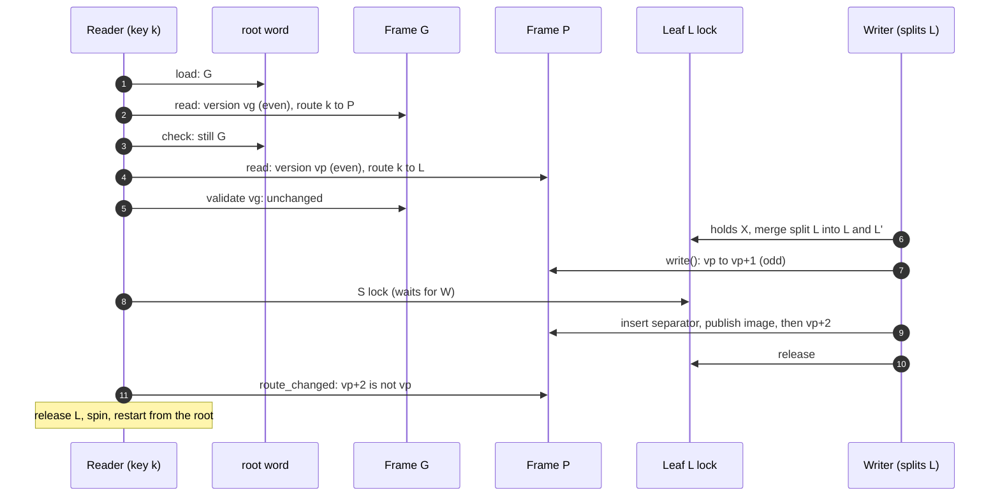
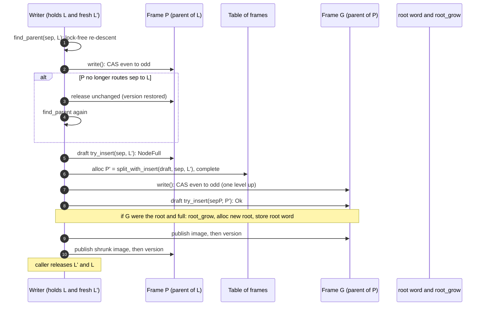

# 0016: Concurrent inner nodes with version-locked frames

**Status:** Implemented (Linux measurements pending)

**Design references:** [Concurrency](../design/bf-tree-concurrency.md)
(created by plan 0012, completed by this stack),
[tree structure](../design/bf-tree-structure.md),
[inner nodes](../design/bf-tree-inner-nodes.md),
[build system](../design/build-system.md).

**Parent roadmap:** [BF-Tree implementation](0002-bf-tree-roadmap.md), milestone 8.

**Builds on:** [Circular buffer component](0010-bf-tree-circular-buffer.md),
[shared tree foundation](0012-bf-tree-shared-tree.md) (`bf-tree-sync`,
`&self` tree, leaf locks, `Table<T>`, the interim inner lock),
[mini-page integration](0013-bf-tree-mini-tree.md),
[eviction](0014-bf-tree-eviction.md), [caching](0015-bf-tree-caching.md).

## Goal and scope

After plan 0015 the tree is `Send + Sync`, every operation takes `&self`,
each leaf has its own `RwLock`, reads are shared-first, and eviction runs
with no leaf lock held. One interim mechanism remains: all inner nodes sit
behind one `RwLock<InnerStore>`, and a global `inner_version: AtomicU64`
changes on every structural change. Every descent writes the lock word of
that one `RwLock`, so all threads contend on one cache line, and any split
anywhere invalidates every in-flight route.

This stack replaces exactly that mechanism with per-node *frames*: the
paper's optimistic latch coupling (§3.4), implemented as a version word
plus an immutable node image published through `arc-swap`, with no
`unsafe`. The protocol shape that 0012 established stays: route without
holding locks, lock the leaf, validate the route, retry. Leaf, circular-buffer,
eviction, and caching code change only where they call the routing and
validation functions, and those calls keep their signatures.

Terms used below:

- **Frame:** the concurrent home of one inner node: a version word and the
  current image.
- **Image:** an immutable copy of the node bytes. A writer never changes a
  published image; it publishes a new one.
- **Version lock:** the frame's `AtomicU64`. Even means no writer; odd
  means a writer holds the frame.
- **Optimistic latch coupling (OLC):** a reader reads a node and its
  version without locking, reads the child, and then validates that the
  parent's version did not change.
- **Level:** a frame's height above the leaves (the leaves' parents are
  level 1). A frame never changes level, because the tree grows only at the
  root.

In scope, out of scope, and completion:

- **In scope:** `Frame`, `FrameRef`, `FrameWrite`, and `Frames` in
  `crates/bf-tree`; the root in an `AtomicU64`; validated lock-free
  descent; bottom-up frame locking with top-down publication; root growth
  under a `root_grow` mutex; removal of `InnerStore` and `inner_version`;
  bulk build on open into frames; the final lock order; concurrent tests
  with overlapping keys, contended splits, and eviction during reads; a
  soak test; `#[ignore]` benchmarks and a committed Linux run recipe; the
  `arc-swap` dependency; design documents.
- **Out of scope:** shuttle or loom model checking (an open question,
  recommended to defer); leaf or inner-node merging and therefore freeing
  frames; persistence of inner nodes; page-format fast paths (plan 0023);
  per-thread frame caches; replacing the standard `RwLock`.
- **Done when:** `Tree` holds no tree-wide inner lock and no global inner
  version; readers take no inner lock; the single-threaded suites and the
  0012 to 0015 concurrent models pass unchanged; the extended concurrent
  model and the contended-split tests pass under a watchdog with
  invariants at quiescence; the soak test passes on Linux; benchmarks
  before and after the swap are recorded from the Linux recipe;
  single-thread point operations stay within about 10 percent of the
  interim design; workspace checks pass.

## Approach

### What changes and what stays

| Concern | Interim (0012) | Final (this stack) |
| --- | --- | --- |
| Inner storage | `RwLock<InnerStore>` | `Table<Frame>` (`bf-tree-sync`), never freed |
| Root | beside the inner store, under its lock | `root: AtomicU64`, a packed `ChildRef` |
| Reader routing | read-lock, route, note `inner_version`, unlock | per-level read and parent validation; no lock |
| Route validation after the leaf lock | `inner_version` unchanged | the leaf's parent frame version unchanged, or the root word unchanged |
| Structural change | inner write lock | frame write locks bottom-up, `root_grow` for a new root |
| Callers (leaf map, merge, eviction, promotion, scans) | `route`, `route_changed`, `install` | unchanged calls |

The seam is the three functions that 0012 introduces. Their signatures do
not change:

```rust
pub(crate) fn route(&self, key: &[u8]) -> Route;
pub(crate) fn route_changed(&self, route: &Route) -> bool;
/// Called by a splitter that holds `left` and the fresh `right` X-locked and
/// has written both pages through.
pub(crate) fn install(&self, left: LeafId, separator: Vec<u8>, right: LeafId)
    -> Result<(), TreeError>;
```

`Route` keeps its `leaf` field; only its private validation field changes,
from a global version to an `Anchor`. `install` takes no path, as in 0012:
it finds each parent by a lock-free re-descent with the separator. A split
is rare next to a descent, so the extra descent per level is cheap, and no
caller (writes, `flush`, eviction, promotion) has to carry a path.

### Frames

```rust
/// Every image has this many bytes; the node uses the first `capacity`.
/// `arc-swap` needs a sized `T`, and an inline array saves a pointer chase.
const IMAGE_BYTES: usize = 4096;

pub(crate) struct Image { bytes: [u8; IMAGE_BYTES] }

#[derive(Default)]
pub(crate) struct Frame {
    /// Even: no writer. Odd: a writer holds the frame. A publication adds 2
    /// in total, so an even value names exactly one published image.
    version: AtomicU64,
    /// `None` only in table entries that were never allocated. `Option`
    /// gives `Frame: Default`, which the table may require.
    image: ArcSwapOption<Image>,
}

pub(crate) struct Frames { table: Table<Frame>, capacity: usize }

/// A reader followed a stale route; the operation restarts from the root.
pub(crate) struct Retry;

impl Frames {
    /// A frame that already holds `image`, at version 0. Nothing can reach
    /// it until a published parent image or the root word names it.
    pub(crate) fn alloc(&self, image: Arc<Image>) -> InnerId;
    pub(crate) fn get(&self, id: InnerId) -> FrameRef<'_>;
    pub(crate) fn len(&self) -> usize;
}

impl<'a> FrameRef<'a> {
    pub(crate) fn read<R>(self, f: impl FnOnce(&InnerNode) -> R) -> Result<(u64, R), Retry> {
        let version = self.frame.version.load(Acquire);
        if version & 1 == 1 {
            return Err(Retry);
        }
        let image = self.frame.image.load(); // after the version
        let image = image.as_ref().expect("reachable frames hold an image");
        Ok((version, f(self.node(image))))
    }

    pub(crate) fn validate(self, seen: u64) -> Result<(), Retry> {
        match self.frame.version.load(Acquire) == seen {
            true => Ok(()),
            false => Err(Retry),
        }
    }

    /// Spin (with `bf_tree_sync::spin`, then yield) until the version is
    /// even, and take it odd with an acquire CAS. The guard reads the
    /// current image and copies it into a draft on the first `node_mut`.
    pub(crate) fn write(self) -> FrameWrite<'a>;
}

impl Drop for FrameWrite<'_> {
    fn drop(&mut self) {
        match self.draft.take() {
            Some(draft) => {
                self.frame.image.store(Some(draft));               // image first,
                self.frame.version.store(self.locked + 1, Release); // then version
            }
            // Nothing changed: the old image is current, so the old version
            // still names it.
            None => self.frame.version.store(self.locked - 1, Release),
        }
    }
}
```

`Frames::alloc` reserves an index from an atomic counter, calls 0012's
`Table::grow_to(id + 1)`, and stores the image into the default frame
before it returns the ID. `Table` therefore needs no new method.

Fresh frames (the right half of a split and a new root) are built in an
owned image and allocated complete. They are never locked: no other thread
can reach them until a publication names them. Frames are never freed,
because inner nodes only split, so an `InnerId` never names a different
node and validation has no ABA problem.

### Routing

```rust
enum Anchor {
    /// The node that named the next child was the root word, with this value.
    Root(u64),
    /// The node that named the next child, and the version it was read at.
    Parent(InnerId, u64),
}

fn try_descend(&self, key: &[u8], mut visit: impl FnMut(InnerId, usize))
    -> Result<Route, Retry>
{
    let root = self.root.load(Acquire);
    let mut anchor = Anchor::Root(root);
    let mut child = unpack_root(root);
    loop {
        let id = match child {
                        ChildRef::Leaf(leaf) => return Ok(Route { leaf, anchor }),
            ChildRef::Inner(id) => id,
        };
        let (version, route) = self.frames.get(id).read(|node| node.route(key))?;
        self.check(&anchor)?; // read the child, then validate its parent
        visit(id, route.index);
        anchor = Anchor::Parent(id, version);
        child = route.child;
    }
}

pub(crate) fn route_changed(&self, route: &Route) -> bool {
    self.check(&route.anchor).is_err()
}
```

`route` loops over `try_descend`, calling `bf_tree_sync::spin()` before
each retry. `find_parent` uses the `visit` callback to stop at the frame
whose route reaches a given child.



### Propagation

A split's caller holds the left leaf's X lock and the fresh right leaf's X
lock, and has written both pages through. `install` propagates the
separator:

1. **Lock the parent bottom-up.** Find the current parent of `left` by a
   lock-free re-descent with `separator`, which must reach `left` because
   `left` is locked. Lock it and check that it still routes `separator` to
   `left`; if a concurrent split moved `left` to a new frame in between,
   release it unchanged and descend again. If `left` is the root, take
   `root_grow` and confirm.
2. **Insert or split.** `try_insert` into the draft. On `NodeFull`,
   `split_with_insert` into an owned image, allocate the right frame
   complete, keep this frame locked, and continue one level up with the
   promoted separator. At the top, either a frame accepts the separator or
   a new root is allocated complete with `first = left`.
3. **Publish top-down.** Store the new root word (if any), then drop the
   locked guards from the highest to the lowest, so that each publishes its
   image and then its version.

```rust
pub(crate) fn install(&self, left: LeafId, separator: Vec<u8>, right: LeafId)
    -> Result<(), TreeError> {
    let (mut separator, mut left, mut right) =
        (separator, ChildRef::Leaf(left), ChildRef::Leaf(right));
    let mut locked = Vec::new();         // FrameWrite guards, bottom-up
    let mut grown = None;                // (root_grow guard, new root)
    loop {
        match self.lock_parent(&separator, left) {
            Parent::Root(guard) => {
                let root = self.frames.alloc(self.new_root_image(left, &separator, right)?);
                grown = Some((guard, root));
                break;
            }
            Parent::Frame(id, mut frame) => {
                match frame.node_mut().try_insert(&separator, right) {
                    Ok(()) => { locked.push(frame); break; }
                    Err(InnerError::NodeFull) => {}
                    Err(error) => return Err(error.into()),
                }
                let mut half = Image::new();
                separator = frame.node_mut()
                    .split_with_insert(half.node_bytes(self.frames.capacity()), &separator, right)?
                    .separator;
                right = ChildRef::Inner(self.frames.alloc(Arc::new(half)));
                left = ChildRef::Inner(id);
                locked.push(frame);
            }
        }
    }
    if let Some((_, root)) = &grown {
        self.root.store(pack_root(ChildRef::Inner(*root)), Release);
    }
    while let Some(frame) = locked.pop() {
        drop(frame); // highest first: image, then version
    }
    drop(grown);
    Ok(())
}
```

`lock_parent` returns `Parent::Frame(id, guard)` or `Parent::Root(guard)`;
`find_parent` is `try_descend` with `separator` that stops at the frame
whose route reaches `left` and returns `Retry` if it reaches any other leaf.



The root word packs a `ChildRef` with bit 63 marking a leaf (dense IDs
never reach that bit). It changes only by growth, to a newly allocated
frame, so it never returns to an earlier value.

### Correctness argument

The argument needs `arc-swap`'s `store` to be a release and its `load` an
acquire of the image pointer. Any sound `Arc` swap must provide this to
make the loaded image safe to read; diff 5 records the exact guarantee from
the crate's documentation.

1. **An even version names one image.** A writer stores a new image only
   while the version is odd, and stores it before the version becomes even
   again. A reader loads the version (acquire) before the image. If the
   reader sees even `v` at `read` and `v` again at `validate`, its image is
   the one published at `v`: a newer image was stored after the CAS to
   `v + 1`, and loading it would make the later `validate` load see at
   least `v + 1`. A guard released unchanged restores `v`, which is sound
   because the image did not change; published versions still strictly
   increase.
2. **Read the child, then validate the parent.** A child's routing range
   changes only when the child splits, and a split changes the child's
   parent. The splitter locks the parent before it publishes the shrunk
   child, and publishes the parent first. A reader that loaded the shrunk
   child image therefore sees the parent's version as odd or changed when
   it validates. A reader that loaded the old child image saw a routing
   that was correct before the split. For the top frame, the root word is
   the parent: the root word is stored before the old root's shrunk image
   is published.
3. **Fresh frames are complete before they are named.** A right half or a
   new root is allocated with its final image before any published parent
   image or root word names it. A reader that obtains its `InnerId` through
   an acquire load of the parent image or root word therefore finds it in
   the table and published. `Table::get` must be valid for any index
   obtained through such a happens-before chain.
4. **Route validation after the leaf lock.** A leaf's range shrinks only by
   its own split. That split runs under the leaf's X lock and publishes the
   new parent image before the lock is released. A leaf moves to a
   different parent only when its parent splits, which changes the parent's
   version. So if the leaf's parent version (or, for a leaf root, the root
   word) is unchanged after the reader holds the leaf lock, the leaf still
   owns the key. Point operations are therefore linearizable per key at the
   leaf lock. Scans remain consistent per leaf, as 0012 defines.
5. **Propagation always finds its parent.** The caller holds `left`'s lock,
   so `left`'s range cannot change, and `separator` lies inside it. Every
   consistent descent with `separator` reaches `left`, so `find_parent`
   fails only when a concurrent publication invalidated its route. The
   propagation is never abandoned once a child is split.
6. **Readers never block on inner nodes.** Readers take no frame lock and
   no `root_grow`. An odd version or a failed validation ends the attempt
   at once; the reader restarts from the root. A reader blocks only on a
   leaf lock held by a writer of that leaf. A retry happens only because
   another thread published, so the system as a whole makes progress.
7. **Deadlock freedom.** Give each lock a rank: leaf locks, then frame locks
   by increasing level, then `root_grow`, then the innermost locks. Every
   thread acquires waitable locks in strictly increasing rank. The exceptions
   are a split's fresh right leaf, which no other thread can reach while it
   is acquired, and fresh frames, which are never locked. A thread never
   holds two reachable frames of one level: a rejected hint is released
   before the next candidate is locked. No thread waits for a leaf lock
   while it holds a frame lock.

### Final lock order


Scans release a leaf before locking the next; eviction and `make_room` run
with no leaf lock. Frame locks are taken only by `install`, while the
thread holds the lock of the node whose split it propagates; `root_grow`
only while it holds the current root's lock. Nothing is acquired while an
innermost lock is held. Readers take no frame lock and no `root_grow`, and
hold at most one leaf S lock.

## Decisions and trade-offs

- **Immutable images through `arc-swap`, not in-place optimistic reads.**
  Reading node bytes while a writer changes them in place is a data race in
  Rust even when a later version check discards the result; `unsafe` does
  not make it defined behavior. Images make torn reads impossible and keep
  ThreadSanitizer usable. The costs are one `arc-swap` load per level, a
  4 KiB copy per modified frame, and an allocation per publication. Splits
  are rare compared with descents, so the copy is not expected to show in
  `put` throughput; diff 9 measures it.
- **No `unsafe` here, even though plan 0010 allows it in one crate.** Plan
  0010 allows `unsafe` code only in `bf-tree-circular-buffer`. The
  workspace allows `unsafe` only for a specific need that no safe design
  meets. In-place optimistic reads with atomic loads were reconsidered when
  plan 0010 changed and were rejected: `arc-swap` images are a safe design
  that meets the requirement, and diff 9 measures their cost.
- **`arc-swap` rather than `RwLock<Arc<Image>>` or `crossbeam-epoch`.**
  `arc-swap`'s `load` writes only thread-local debt slots, so readers do not
  write a shared cache line, which is the property §3.4 wants. A lock or a
  reference-count increment per level writes the shared line on every
  descent. `crossbeam-epoch` needs `unsafe` at its API.
- **Fixed 4 KiB images.** `arc-swap` requires a sized `T`, and an inline
  array avoids a second pointer chase. Small test capacities waste memory,
  which does not matter.
- **Fresh frames are allocated complete and never locked.** This removes an
  unpublished frame state from every reader path and makes claim 3 a
  property of allocation.
- **Lazy drafts, and an unchanged guard restores the version.** A parent
  rejected after locking costs no 4 KiB copy and does not spuriously
  invalidate readers.
- **No path hints.** `install` re-descends per level instead of trusting a
  path recorded before the leaf lock. Paths go stale under concurrent
  splits anyway, and dropping them keeps 0012's `install` signature and
  frees every caller from carrying one.
- **Bottom-up blocking propagation, not split-on-descent.** Frame locks wait
  rather than fail, and the level order makes waiting deadlock-free, so a
  full parent can be split in the same pass. This keeps exact reactive
  splits. The tree-structure design currently expects split-on-descent;
  diff 9 corrects it. Split-on-descent is needed when the bottom-up step is
  a non-blocking CAS that cannot wait for a full parent.
- **Frame write lock spins.** A critical section is a copy, an insert, and
  perhaps a table growth; during a multi-level split a holder also waits for
  the frame above it. Writers contend on a frame only when splits meet,
  which is rare. A per-frame `Mutex` beside the version would park instead,
  at 4 to 8 bytes per frame and a second atomic per write. The CAS loop
  calls `bf_tree_sync::spin()` and yields after a bounded count.
- **`root_grow` is kept although the old root's lock already excludes other
  growers.** Only the holder of the current root's lock can replace the
  root, so the mutex is not needed for mutual exclusion today. It makes
  root replacement one obvious critical section and keeps the order total
  if a later operation (a rebuild or a root shrink) replaces the root
  without holding it. It is taken once per root growth.
- **A temporary structure mutex in diff 6.** Diff 6 makes readers lock-free
  while structural changes are still serialized, so the reader argument
  (claims 1 to 4) is reviewed and tested on its own. Diff 7 removes the
  mutex and adds concurrent parent finding (claims 5 and 7).
- **`bf-tree-sync` gains `spin()` and an `atomic` re-export.** Every atomic
  and spin that the tree's synchronization uses goes through one crate, so a
  later model-checking switch changes one crate. This is not a spin wrapper
  around a lock.
- **Total reads in `bf-tree-inner` stay.** Images make them unnecessary for
  the protocol, but `InnerNode` derives `FromBytes` publicly, and keeping
  reads total costs nothing.

## Extension points

- **0018 write-through gate.** 0018 adds an `RwLock<()>` that
  `write_through` holds shared and `checkpoint` holds exclusively. In the
  lock order it sits after `root_grow` and before the innermost locks.
  `write_through` runs under a leaf lock and before `install`, so no code
  holds a frame lock or `root_grow` while it takes the gate; the position
  permits it but nothing uses that. `checkpoint` takes the gate exclusively
  with no leaf lock and no frame lock held. Frames add no constraint.
- **Persistence does not touch frames.** Inner nodes stay derived data.
  `open` (0008, then 0017 and 0018) rebuilds them with the bulk build, which
  now allocates complete frames through `Frames::alloc`. Checkpoints read no
  frame, and no frame state is stored.
- **Sequences and apply (0018, 0019).** The `seq` closure runs after the
  leaf lock and `route_changed`; both keep their meaning.
- **Model checking.** A later stack can switch `bf-tree-sync` to shuttle
  primitives without touching `bf-tree`'s logic; see the open question.
- **Performance (0023).** Key-comparison and page-format fast paths
  must not need frame API changes. 0023 re-records
  the benchmarks this stack introduces.
- **Must not change:** leaf locking, the circular buffer, eviction, caching, scans, and
  the public API. A future merge of leaves or inner nodes must revisit two
  assumptions documented here: frames are never freed, and a locked leaf's
  range never changes, which `install` uses to find its parent.

## Proposed commit stack

Nine diffs. Benchmarks land before the swap so that before and after use the
same harness. The frame primitive, the reader protocol, and the concurrent
writer protocol are separate diffs.

### `[1/9][bf-concurrency][plan] define version-locked inner frames`

- **Purpose:** Agree on frames, the correctness argument, and the lock order.
- **Core changes:** This plan; link from the roadmap's milestone 8 row.
- **Verification:** Review.

### `[2/9][bf-concurrency][bench] measure routing under the interim inner lock`

- **Purpose:** Record the baseline the swap must beat.
- **Core changes:** `crates/bf-tree/src/tests/bench.rs` with `#[ignore]`
  tests: `baseline_threads` (1, 2, 4, 8, and the available-parallelism
  thread counts; uniform keys; get, put, 50/50; record and page caching),
  `baseline_hot_set` (one leaf and about 32 leaves; get and 90/10), and
  `baseline_components` (descent at height 3, leaf S and X lock and
  unlock, `get_with` on a hot leaf, `put` on random leaves). Record shape
  from `PEPPYDB_BENCH_KEY`, `_VALUE`, `_CIRCULAR_BUFFER_MIB`. Debug-only counters, if
  any, stay out of release builds.
- **Verification:** The benchmarks run in release mode; numbers are kept
  for diff 9.

### `[3/9][bf-concurrency][tools] add a pinned Linux container for contended runs`

- **Purpose:** Contended benchmarks must run on Linux; make that one
  command from any checkout.
- **Core changes:** `tools/linux/Dockerfile` (base image pinned by digest;
  rustup with the `rust-toolchain.toml` toolchain and components; DotSlash;
  `unzip`) and `tools/linux-run <command>` (mounts the repository, uses a
  separate Buck2 isolation directory and cache volumes). One line in
  `AGENTS.md` under Verification.
- **Verification:** `tools/linux-run tools/buck2 test //crates/bf-tree/...`
  passes; a benchmark runs and prints.

### `[4/9][bf-concurrency][deps] add arc-swap`

- **Purpose:** The one new third-party dependency, as a mechanical diff.
- **Core changes:** `arc-swap` in `third-party/rust/Cargo.toml`;
  `tools/buckify`; `//third-party/rust:arc-swap` in `crates/bf-tree/BUCK`
  deps; `tools/autocargo`.
- **Verification:** `tools/autocargo --check`; `cargo test --workspace --locked`.

### `[5/9][bf-concurrency][frames] add version-locked image frames`

- **Purpose:** The primitive, reviewed and tested alone.
- **Core changes:** `crates/bf-tree/src/frames.rs` (`Image`, `Frame`,
  `Frames`, `FrameRef`, `FrameWrite`, `Snapshot` for quiescent walkers,
  `Retry`); `bf-tree-sync` gains `spin()` and `pub use std::sync::atomic`.
  The module carries `#[cfg_attr(not(test), expect(dead_code, reason =
  "used from diff 6"))]`, which diff 6 must remove.
- **Verification:** Read and validate across a publish; odd version gives
  `Retry`; an unchanged release restores the version and keeps earlier
  reads valid; two writers are mutually exclusive (counter in the draft);
  a threaded test with writers publishing images whose bytes all equal
  `n` and readers checking that no image is torn and that a validated read
  at version `v` holds the image published at `v`.

### `[6/9][bf-concurrency][descent] route through frames without inner locks`

- **Purpose:** Replace `RwLock<InnerStore>` and `inner_version` for
  readers (claims 1 to 4).
- **Core changes:** `Tree { root: AtomicU64, frames: Frames, structure:
  Mutex<()> (temporary), .. }`; `Anchor`, `try_descend`, `route_changed`;
  `install` uses frame guards and publishes top-down under `structure`,
  finding each parent with a descent; bulk build allocates complete
  frames; `height`, `inner_count`, and the invariant checker read
  snapshots; `store.rs` (`InnerStore`) removed. About 350 changed lines,
  including the deletions.
- **Verification:** All single-threaded and 0012 to 0015 suites pass; a
  held `FrameWrite` makes `try_descend` return `Retry` at once; a descent
  taken before a split of its leaf's parent reports `route_changed`; the
  same for a leaf root after the first split and for an inner root after
  root growth; open tests pass with frames.

### `[7/9][bf-concurrency][propagate] lock parents bottom-up and grow the root`

- **Purpose:** Concurrent structural changes (claims 5 to 7).
- **Core changes:** `lock_parent` (`find_parent`, lock, confirm, else
  `root_grow`), `find_parent`, `Parent`; remove `structure`; lock-order
  documentation on `Tree`.
- **Verification:** A parent that splits or a root that grows between
  `find_parent` and the lock is detected and re-found, and invariants hold; 12 writers on interleaved keys
  with leaf capacity 256 and inner capacity 128, ascending and random
  orders, reach height 4 or more under a watchdog and match the union
  oracle; existing concurrent models pass.

### `[8/9][bf-concurrency][tests] verify overlapping keys, splits, and eviction under contention`

- **Purpose:** Extend the 0012 concurrent model, written once, to the final
  protocol.
- **Core changes:** Overlapping keys: several writers per key write values
  tagged `(thread, n)`; readers check that each observed value was written
  and that one writer's `n` never decreases for a reader; the final value
  is some thread's last write. One writer per key with monotonic versions.
  Evictions during reads with circular buffers of a few pages. All caching policies;
  `MemStore` and `FileStore` with `flush` and reopen between phases. An
  `#[ignore]` soak test.
- **Verification:** Repeated runs pass with the watchdog; the circular-buffer budget
  holds; invariants hold at quiescence.

### `[9/9][bf-concurrency][docs] record the frame protocol and its measurements`

- **Purpose:** Complete the concurrency design and close milestone 8.
- **Core changes:** `bf-tree-concurrency.md`: frames, the correctness
  argument, the final lock order, and Linux measurements (before and after,
  hot set, components) with the recipe and
  machine; `bf-tree-structure.md`: frames replace `InnerStore`, bottom-up
  propagation replaces the split-on-descent expectation;
  `bf-tree-inner-nodes.md`: the frame owner exists; roadmap milestone 8
  complete; this plan's outcomes.
- **Verification:** Documents agree with the code and tests.

## Open questions

None.

Resolved:

1. **Shuttle: deferred.** The stack relies on deterministic interleaving
   tests, stress tests under a watchdog, and the soak test. Every atomic
   and spin still goes through `bf-tree-sync`, so a later stack can add a
   Shuttle switch in one crate plus build support (a feature and a build
   mode).
2. **Upstream comparison harness: skipped for now.** The former diff 9
   (`bench/upstream/`, a Cargo project outside the Buck2 graph) is dropped;
   the stack is nine diffs. A comparison can be run by hand later and
   recorded, without a non-Buck2 project in the repository.
3. **Linux recipe: Docker under `tools/`.** A pinned container
   (`tools/linux/Dockerfile`, base image by digest) and `tools/linux-run`.
   CI may run the recipe later as a check that it works, not for numbers.

## Verification strategy

| Check | Command or procedure | Expected result |
| --- | --- | --- |
| Frame semantics | `tools/buck2 run //crates/bf-tree:bf-tree-unittest -- frames::` | No torn image; validated reads match their version |
| Reader protocol | deterministic `route_changed` and `Retry` tests | Stale routes detected for leaf, inner, and root anchors |
| Concurrent splits | contended-split tests, tiny nodes, 12 threads, watchdog | Union oracle agrees; invariants hold |
| Concurrent model | `-- concurrent` filter | Overlapping-key, monotonic, eviction, and policy cases pass; budget holds |
| Soak | `tools/linux-run tools/buck2 run @build/mode/release //crates/bf-tree:bf-tree-unittest -- --ignored concurrent_soak` | Passes |
| Benchmarks | `tools/linux-run tools/buck2 run @build/mode/release //crates/bf-tree:bf-tree-unittest -- --ignored --nocapture tests::bench::` at diff 2 and the tip | Recorded; single thread within about 10%; reads scale at least as well as the interim design |
| Formatting and lints | `tools/fmt.sh`; `tools/clippy.sh` | Clean |
| Buck2 tests | `tools/buck2 test //crates/... //bin/... //go/...` | Pass |
| Generated files | `tools/autocargo --check`; `tools/gobuckify-remote --check` | Clean |
| Cargo | `cargo test --workspace --locked` | Pass |
| Go | `(cd go && go vet ./... && go test ./...)` | Pass |

Contended numbers come only from Linux: the macOS standard `RwLock` parks
readers under reader-reader contention and misrepresents leaf locks.
Single-thread component numbers may come from either platform, labelled.

## Progress

- [x] Agree on the design and commit stack with the user.
- [x] Diff 2: interim baselines.
- [ ] Diff 3: Linux container recipe (committed; container run pending a working Docker engine).
- [x] Diff 4: `arc-swap`.
- [x] Diff 5: frame primitive.
- [x] Diff 6: lock-free descent.
- [x] Diff 7: concurrent propagation and root growth.
- [x] Diff 8: concurrent model extensions and soak.
- [x] Diff 9: design documents, measurements, roadmap.
- [x] Stack-wide verification on macOS.
- [ ] Linux: container check, contended benchmarks, and soak (needs a working Docker engine).

## Verification outcomes (2026-11-05)

| Check | Outcome |
| --- | --- |
| Frames | `tests/frames.rs`: a read validates until a publication; a held frame gives `Retry`; an unchanged release restores the version; snapshots are immutable; 4 writers doing 2000 locked increments each lose no update (version 16000); 2 writers making 20,000 publications each against 4 readers produce no torn image, and every validated read holds the image published at its version. 20 of 20 release runs. |
| Reader protocol | `tests/route.rs`: a held frame makes `try_descend` return `Retry` at once; a route survives splits under other parents but not under its own; a leaf-root route is anchored at the root word and changed by root growth; a route under the root changes when the root grows; `confirm` rejects a stale parent and releases it unchanged; `find_parent` finds the root as the parent until it grows. |
| Concurrent splits | `twelve_writers_on_interleaved_keys_split_concurrently` (leaf capacity 256, inner capacity 128; ascending and scrambled orders): height 4 or more, the union oracle agrees, invariants hold. |
| Contention model | `tests/contention.rs`: overlapping writers (6 writers, 6 readers and scanners, 1500 operations per phase, two phases with `flush` and reopen) for record caching, page caching with full pages, and no caching, on a `MemStore` with a 1 KiB circular buffer and a `FileStore` with a 2 KiB circular buffer; plus an 8-writer run with 512-byte leaves. Every key ends with one of its writers' last writes; the budget holds; invariants hold at quiescence. |
| Repeated runs | Concurrent, route, frames, and contention suites: 30 of 30 and 20 of 20 release runs; 48 of 48 debug runs with 12 copies in parallel (the load that exposed the test flaw recorded in Discoveries). |
| Soak | `concurrent_soak` on macOS for 30 s: 125 rounds, 12 threads, pass. Linux soak pending. |
| Benchmarks | macOS only (Apple M4 Pro, 12 cores; release; `tools/buck2 run @build/mode/release //crates/bf-tree:bf-tree-unittest -- --ignored --nocapture tests::bench::`; 1M 8-byte keys, 16-byte values, 32 MiB buffer, 1 s per point). Before is diff 2 (interim lock), after is the tip, same harness. Full tables in the [concurrency design](../design/bf-tree-concurrency.md#measurements). |
| Workspace | `tools/fmt.sh`, `tools/clippy.sh`, `tools/buck2 test //crates/... //bin/... //go/...` (17 targets), `tools/autocargo --check`, `tools/gobuckify-remote --check`, `cargo test --workspace --locked` (327 tests), and `go vet` and `go test` pass. Miri was not needed: the stack does not change `crates/bf-tree-circular-buffer`. |
| Pending | Linux container check (diff 3: `tools/linux-run tools/buck2 test //crates/bf-tree/...`), Linux contended benchmarks at diff 2 and the tip, and the Linux soak. The local Docker Desktop engine returned HTTP 500 for every API call during this work. |

Single-thread components (ns per operation, before and after): descent
126–132 and 127–129; leaf S lock and unlock 6.1 and 6.2; leaf X lock and
unlock 2.8 and 2.8; `get_with` on a hot leaf 170–177 and 197–201 (+15%);
`put` on random leaves 587–625 and 610–642.

Throughput (M ops/s at 1, 2, 4, 8, and 12 threads):

| Workload | Before | After |
| --- | --- | --- |
| Record caching, get | 1.44, 2.92, 3.88, 2.10, 1.63 | 1.39, 2.91, 6.36, 12.26, 14.19 |
| Record caching, put | 1.53, 3.35, 4.30, 2.04, 1.62 | 1.47, 3.40, 6.94, 12.87, 14.31 |
| Record caching, 50/50 | 1.64, 3.25, 4.13, 2.08, 1.64 | 1.62, 3.42, 6.91, 13.08, 14.75 |
| Page caching, get | 1.62, 3.26, 4.55, 2.13, 1.67 | 1.57, 3.39, 6.79, 9.02, 6.06 |
| Page caching, put | 1.53, 3.32, 4.16, 2.04, 1.63 | 1.53, 3.43, 7.00, 12.77, 14.26 |
| Page caching, 50/50 | 1.51, 3.09, 4.66, 2.15, 1.67 | 1.48, 3.12, 6.19, 9.76, 9.81 |
| Hot set 1 leaf (117 keys), get | 5.24, 5.52, 3.64, 2.25, 2.00 | 4.66, 6.74, 4.15, 2.45, 2.10 |
| Hot set 1 leaf, 90/10 | 5.23, 5.23, 5.98, 2.44, 2.36 | 4.55, 6.44, 4.24, 2.81, 2.60 |
| Hot set 32 leaves (3945 keys), get | 4.66, 7.37, 3.33, 1.88, 1.52 | 4.29, 7.32, 13.49, 24.18, 26.95 |
| Hot set 32 leaves, 90/10 | 4.68, 7.44, 3.33, 1.89, 1.52 | 4.28, 7.79, 12.85, 22.52, 24.27 |

Interpretation: before, every descent wrote the cache line of the one
inner `RwLock`, so throughput fell beyond 4 threads. After, descents write
no shared cache line, and throughput scales to 12 threads on uniform keys
and on a 32-leaf hot set. A single hot leaf stays bound by its leaf lock
(the macOS `RwLock`, which parks readers under reader-reader contention).
Page-caching `get` flattens at 8 to 12 threads; this was not investigated
(possibly full-page promotion contention or macOS reader parking).
Single-thread uniform `get` and `put` stay within about 5 percent; the
hot-leaf `get_with` component regresses about 15 percent, above the plan's
10 percent target (see Discoveries).

## Discoveries and plan changes

- **The writer needs a release fence after the CAS.** The plan's sketch
  took the version odd with an acquire CAS and then stored the image. On
  weak memory that store can become visible before the odd version, so a
  reader could load the new image and still validate against the old even
  version. `FrameRef::write` issues `fence(Release)` after the CAS, the
  standard seqlock writer fence; the module documentation gives the
  argument. `arc-swap` documents that each of its concurrent operations
  contains a `SeqCst` read-modify-write.
- **`FrameWrite` holds the current image as an `Arc`.** A borrow cannot
  outlive an `arc-swap` load guard, so the write guard loads the image
  with `load_full` when it locks. This costs one reference-count increment
  per frame write lock, on writers only.
- **The routing layer is one `Inner` type.** The root word, the frames,
  and `root_grow` (the structure mutex in diff 6) live in
  `crates/bf-tree/src/inner.rs` behind the existing `tree.inner` field, so
  callers and fixtures changed mechanically. `Path` and `locate` remain for
  tests only.
- **A concurrent test checked invariants without quiescence.**
  `threads_agree_under_constant_eviction` (plan 0014) ran
  `check_invariants` while its flusher thread still ran. A flush merge
  can split a leaf, so the checker could see a new leaf page before its
  parent was published (`FenceMismatch`). The panic then skipped the
  flusher's stop flag, so the scope never joined and the watchdog fired.
  It appeared about once in 20 runs under 12-way parallel load after
  diff 7. The test now checks after the flusher stops, and background
  loops stop through a drop guard, so a failure reports itself instead of
  hanging.
- **Single-thread hot-leaf regression, deferred to plan 0023.** The
  `get_with` component on one hot leaf is about 15 percent slower than
  under the interim lock (197–201 ns against 170–177 ns), above the 10
  percent target. Uniform single-thread `get` and `put` stay within about
  5 percent, and the descent component over keys spread across the tree
  did not change. The likely cause is one `arc-swap` load per level, each
  with a `SeqCst` read-modify-write, which shows only when the whole
  descent is cached. This is not confirmed.
  [Plan 0023](0023-bf-tree-io-perf.md) should measure it and consider a
  cheaper per-level load, for example a cached `arc-swap` load.
- **The before-and-after benchmarks are from macOS.** The plan required
  contended numbers from the Linux recipe. The local Docker engine was
  unavailable, so the stack recorded macOS numbers at diff 2 and at the
  tip with the same harness and labelled them. Linux numbers, the Linux
  soak, and diff 3's container check remain open in Progress.
- **The soak test is `concurrent_soak` in `tests/contention.rs`.** It runs
  rounds of the contention model across caching policies, buffer sizes
  (1, 2, and 4 KiB), and backends for `PEPPYDB_SOAK_SECS` seconds
  (default 60). `tools/linux-run` forwards `PEPPYDB_SOAK_SECS` (added to
  diff 3 when the docs were written).
- **Use the `tests::bench::` filter.** The `baseline_` filter in the
  verification strategy also matches `baseline_throughput` and
  `baseline_file_store` in `tests/model.rs`. The recorded runs, and the
  comments in `bench.rs` and `tools/linux-run` (corrected in diffs 2 and
  3), use `tests::bench::`, which selects exactly the three benchmarks of
  this stack.
- **`tools/linux-run` uses volumes, not a Buck2 isolation directory.**
  Linux build outputs live in named volumes mounted over `buck-out/` and
  `target/`, which keeps them apart from the host's as the Agent notes
  require.

## Agent notes

- **Entry points (after plan 0015):**
  `crates/bf-tree/src/read.rs` (`descend` with a visitor; becomes
  `try_descend`), `crates/bf-tree/src/write.rs` (`split_and_propagate`;
  after 0012 the separator installation is `install`),
  `crates/bf-tree/src/store.rs` (`InnerStore`, deleted in diff 6),
  `crates/bf-tree/src/open.rs` (`build_inner` writes into `InnerStore`),
  `crates/bf-tree/src/invariants.rs` and `lib.rs` (`inner`, `inner_mut`),
  `crates/bf-tree-inner` (unchanged), `crates/bf-tree-sync` (gains `spin`
  and `atomic`).
- **Upstream at `f442e61`:** `src/utils/inner_lock.rs` (`try_read`,
  `check_version`, upgrade by CAS, the write guard bumps the version on
  drop), `src/tree.rs` (`traverse_to_leaf` reads the child and then runs
  `check_parent!`; `write_inner` takes the leaf X lock and then checks the
  parent), `src/mini_page_op.rs` (merge with parent upgrade).
- **Ordering:** load the version before the image; store the image before
  the version. Hold at most one `arc-swap` guard at a time in a descent;
  each thread has few fast debt slots.
- **Gotchas:** call `spin()` before restarting; never wait on a frame while
  holding a leaf S lock (validation is a load, never a wait); release
  benchmarks must carry no shared instrumentation, because a shared counter
  bounces a line on every operation; `check_invariants` runs only at
  quiescence; Buck2 in the container needs its own isolation directory so
  macOS and Linux `buck-out` do not collide; plan 0009 lists other Linux
  setup needs (`unzip`, preinstalled Rust components).

## Sources

- [BF-Tree paper](../references.md#bf-tree-paper): §3.3 (per-leaf
  reader-writer lock), §3.4 (in-memory inner nodes, optimistic latch
  coupling, readers write no shared cache line), §6.4 (scalability).
- Viktor Leis, Florian Scheibner, Alfons Kemper, Thomas Neumann, "The ART
  of Practical Synchronization", DaMoN 2016: the optimistic lock coupling
  protocol the version word follows.
- [Upstream `src/utils/inner_lock.rs`](https://github.com/microsoft/bf-tree/blob/f442e6172bf7e5483ff320d8e3ac16a70e31bbd6/src/utils/inner_lock.rs),
  [`src/tree.rs`](https://github.com/microsoft/bf-tree/blob/f442e6172bf7e5483ff320d8e3ac16a70e31bbd6/src/tree.rs),
  [`src/mini_page_op.rs`](https://github.com/microsoft/bf-tree/blob/f442e6172bf7e5483ff320d8e3ac16a70e31bbd6/src/mini_page_op.rs).
  peppydb differs by reading immutable images instead of bytes in place,
  by blocking bottom-up propagation instead of split-on-descent, and by
  allocating fresh frames complete.
- [Plan 0009](0009-buck2-build.md) (shuttle needs a feature, not
  `cfg(test)`; Linux setup) and the
  [build-system design](../design/build-system.md#build-modes-are-platforms).
