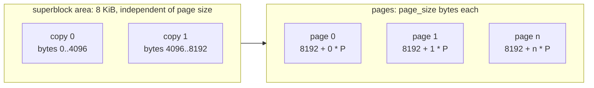
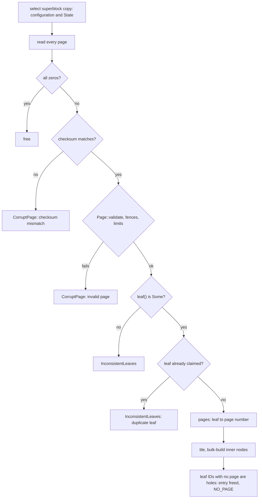

# 0017: Durable store format

**Status:** Agreed

**Design references:** [Leaf storage](../design/bf-tree-leaf-store.md),
[shared pages](../design/bf-tree-pages.md),
[build system](../design/build-system.md). This stack creates
`docs/design/bf-tree-persistence.md`.

**Parent roadmap:** [BF-Tree implementation](0002-bf-tree-roadmap.md),
milestone 9 (first of three tree-side stacks).

**Builds on:** [Leaf mapping table and page store](0008-bf-tree-leaf-store.md),
[shared tree foundation](0012-bf-tree-shared-tree.md) (`&self` store,
`LeafMap::write_through`, `load_base`),
[mini-page tree integration](0013-bf-tree-mini-tree.md),
[eviction](0014-bf-tree-eviction.md),
[caching and full pages](0015-bf-tree-caching.md),
[concurrency](0016-bf-tree-concurrency.md).

## Goal and scope

Today a `LeafId` is also the store page number that holds the leaf, and the
superblock records only the configuration. Shadow paging (plan 0018) must
write a new version of a leaf to a different page, and a checkpoint must
record an atomic commit point. Both need a store format that this stack
defines: page numbers that are distinct from leaves, stored pages that name
their leaf and carry a checksum, and a superblock that can hold a committed
state and survive a torn write.

This stack changes the format and the addressing only. Writes stay in
place, so durability and crash behaviour are unchanged from plan 0008.

- **In scope:** a `PageNumber` type distinct from `LeafId`; `PageStore`
  addressed by page numbers, with `state()` and `commit(&State)`; dual
  superblocks with CRC32C (superblock version 2) at fixed offsets; the
  `crc32c` crate; a leaf-to-page table in `LeafMap`; a 32-bit `leaf` header
  field and a 32-bit page CRC32C that replace the inactive
  `snapshot_version` field; `write_through` stamps the leaf and seals the
  checksum of each stored page; `load_base` resolves the page number and
  checks the checksum and the stamp; `Tree::open` verifies every page and
  rebuilds the leaf-to-page table from page headers; store and open
  corruption tests on both backends; the persistence design document.
- **Out of scope:** writes to fresh pages, write sequences, checkpoints,
  recovery selection, and the crash model (plan 0018); sequenced apply,
  the pre-commit hook, and snapshots (plan 0019); direct I/O (plan 0023);
  persisting inner nodes or a fence list.
- **Done when:** both backends pass the store contract with page-number
  addressing; a commit can tear either superblock copy and open selects the
  intact one; copies that disagree on configuration are rejected; a tree
  flushed, closed, and reopened from a `FileStore` equals its oracle and
  passes `check_invariants`; the leaf-to-page table rebuilt by `open`
  matches the table before close; a stored page with a flipped byte is
  rejected on load and on open; and the workspace checks pass.

## Approach

### On-disk layout



- Superblock copy `c` lives at byte `c * 4096`. Each copy is one 4096-byte
  block, whatever the page size. The second copy is therefore at a known
  offset, and `FileStore::open` never needs to guess the page size from a
  damaged first copy.
- Page number `i` lives at byte `8192 + i * page_size`. For the default
  4096-byte pages, page number 0 is the third 4096-byte block of the file.
  The 8 KiB area also keeps every page offset 4096-aligned for 4096-byte
  pages, which direct I/O (plan 0023) requires.
- A valid file length is `8192 + n * page_size` for some `n >= 0`.
- A new page is zero. A freed page keeps its old bytes. The store does not
  zero on `free`, because plan 0018 selects pages by their header, not by
  allocation state. Plan 0008's contract that a freed page is all zeros
  ends here.

### Superblock version 2

```rust
/// On-disk superblock copy, version 2. Little-endian. Zero-padded to 4096
/// bytes. `crc` is the CRC32C of every byte before it.
#[derive(FromBytes, IntoBytes, KnownLayout, Immutable, Unaligned)]
#[repr(C)]
struct EncodedSuperblock {
    magic: [u8; 8],          // b"PEPPYBF\0"
    version: U32,            // 2
    page_size: U32,
    inner_capacity: U32,
    max_key_len: U32,
    max_value_len: U32,
    checkpoint_id: U64,
    applied_seq: U64,
    write_seq: U64,
    crc: U32,
}
const _: () = assert!(size_of::<EncodedSuperblock>() == 56);

/// The committed checkpoint the store's pages reflect. All zero for a new
/// store. Plan 0018 gives `applied_seq` and `write_seq` their meaning.
#[derive(Clone, Copy, Debug, Default, PartialEq, Eq)]
pub struct State {
    pub checkpoint_id: u64,
    pub applied_seq: u64,
    pub write_seq: u64,
}
```

`Superblock` keeps only the configuration (page size and limits), as in
plan 0008. The store holds a `Superblock` and a `State` side by side.

- **Encode:** `Superblock::encode(&self, state: &State, block: &mut [u8])`
  writes one 4096-byte copy with its CRC.
- **Decode:** `Superblock::decode(block) -> Result<(Superblock, State), _>`
  rejects a bad magic, a version other than 2, a CRC mismatch, and an
  invalid configuration.
- **Select:** `Superblock::select(copy0, copy1)` decodes both copies and
  skips any copy that fails. At least one copy must be intact. If both are
  intact, they must describe the same configuration. Otherwise the store is
  rejected: a mismatch is never a torn write, because a commit never
  changes the configuration. The intact copy with the higher
  `checkpoint_id` wins. Equal ids (both copies of a new store) are allowed.
- **Commit:** `commit(&State)` writes copy `state.checkpoint_id % 2`, then
  syncs, then replaces the in-memory state. The previous commit is in the
  other copy, so a torn commit leaves it intact. `commit` requires
  `state.checkpoint_id == self.state().checkpoint_id + 1` and otherwise
  returns `StoreError::CommitOrder`. This catches two callers committing
  at once, which would overwrite the same copy.
- `create` writes both copies with `State::default()` and syncs.

Version-1 stores are rejected. No deployed data exists.

### Page numbers and the store trait

A page number is the position of one page-sized region in the store, as
SQLite's `Pgno` is. It says where a page is. A `LeafId` says which leaf a
page belongs to. This stack separates the two. The name "slot" is avoided
because it already names the entries of a page's slot directory.

```rust
/// The position of a page in the store. Page numbers are not leaves: plan
/// 0018 writes each new version of a leaf to a fresh page number, and the
/// page header names the leaf.
#[derive(Clone, Copy, Debug, PartialEq, Eq, PartialOrd, Ord, Hash)]
pub struct PageNumber(u64);

impl PageNumber {
    /// `None` for `u64::MAX`, which the leaf map uses as "no page".
    pub const fn new(raw: u64) -> Option<Self>;
    pub const fn raw(self) -> u64;
}

pub trait PageStore: Send + Sync {
    fn page_size(&self) -> usize;
    /// Page numbers ever allocated, live or freed: `0..page_count()`.
    fn page_count(&self) -> u64;
    /// A freed page if any (old bytes kept), else a new zero page.
    fn alloc(&self) -> Result<PageNumber, StoreError>;
    /// Return a page for reuse. Its bytes are not changed.
    fn free(&self, page_number: PageNumber) -> Result<(), StoreError>;
    fn read(&self, page_number: PageNumber, buf: &mut [u8]) -> Result<(), StoreError>;
    fn write(&self, page_number: PageNumber, buf: &[u8]) -> Result<(), StoreError>;
    /// Make every completed write durable.
    fn sync(&self) -> Result<(), StoreError>;
    fn superblock(&self) -> &Superblock;
    /// The last committed state.
    fn state(&self) -> State;
    /// Durably and atomically replace the committed state. The caller
    /// syncs its page writes first.
    fn commit(&self, state: &State) -> Result<(), StoreError>;
}
```

`StoreError::{UnknownPage, FreedPage}` carry a `PageNumber`. New variants:
`NoSuperblock` (neither copy is intact) and `CommitOrder`. `bf-tree-store`
no longer depends on `bf-tree-node-id`. `bf-tree` re-exports `PageNumber`
and `State`.

The code from plan 0008 names these `PageStore::slots()`,
`StoreError::UnknownSlot`, and `StoreError::FreedSlot`. Diff 6 renames them
to `page_count()`, `UnknownPage`, and `FreedPage`.

`MemStore` keeps the state in a mutex. `FileStore` serializes commits with
a commit mutex and keeps the state in a separate short-held mutex, so
`state()` never waits for a commit's sync.

### Base-page identity and page checksum

A page number no longer identifies a leaf, so a stored base page must name
its leaf. Otherwise `open` cannot rebuild the leaf-to-page table once plan
0018 moves leaves between pages. A stored page also needs a checksum, so
that `load_base` and `open` detect damaged bytes instead of trusting them.
This stack introduces both while writes are still in place, so the open
path is proven before shadow paging depends on it.

The header stays 32 bytes. The inactive `snapshot_version` field is split
into a 32-bit leaf stamp and a 32-bit CRC32C (user decision 2026-11-06; see
[Open questions](#open-questions)):

| Bytes | Before | After this stack |
| --- | --- | --- |
| `8..16` | `backing_leaf: U64`: the leaf a mini-page overlays | Unchanged, with its literal meaning only. `NO_BACKING_LEAF` for base pages and full pages |
| `16..24` | `lsn: U64`, inactive | Unchanged here. Plan 0018 renames it to `write_seq` |
| `24..28` | `snapshot_version: U64`, inactive | `leaf: U32`: the leaf a stored base page belongs to. `u32::MAX` means none (mini-pages, fresh scratch pages) |
| `28..32` | (part of `snapshot_version`) | `crc: U32`: CRC32C of the whole page, computed with this field taken as zero |

```rust
// crates/bf-tree-page; new accessors on `Page`.
impl Page {
    /// The leaf this stored base page belongs to, or `None`.
    pub fn leaf(&self) -> Option<LeafId>;
    /// `PageError::LeafIdTooLarge` if `leaf.raw() >= u32::MAX`.
    pub fn set_leaf(&mut self, leaf: Option<LeafId>) -> Result<(), PageError>;
    /// CRC32C of every page byte, with the `crc` field taken as zero.
    pub fn checksum(&self) -> u32;
    /// The `crc` field as stored.
    pub fn stored_checksum(&self) -> u32;
    /// Store `checksum()` in the `crc` field. Call after every other change.
    pub fn seal(&mut self);
    /// `stored_checksum() == checksum()`.
    pub fn verify_checksum(&self) -> bool;
}
```

Only `write_through` seals. Mini-pages and in-memory full pages do not
maintain the checksum. A full page loaded from the store keeps the stored
`leaf` and `crc` until its next write-through, which stamps and seals it
again. Page rebuild helpers (split, merge, and compaction) may copy or
clear the two fields: `write_through` always sets `leaf` and seals last.
`Page::validate` stays structural; the tree checks the checksum and the
leaf.

```rust
// crates/bf-tree/src/leaf_map.rs; the only page write in the tree.
pub(crate) fn write_through(&self, pages: &mut [(LeafId, &mut [u8])]) -> Result<(), TreeError> {
    // The reachable leaf is written last, as in plan 0012.
    let (first, rest) = pages.split_first_mut().expect("at least one page");
    for (leaf, bytes) in rest.iter_mut().chain([first]) {
        let page = Page::mut_from_bytes(bytes)?;
        page.set_leaf(Some(*leaf))?;
        page.seal(); // last header change; plan 0018 stamps write_seq before this
        let page_number = match self.page_of(*leaf) {
            Some(page_number) => page_number, // in place in this stack; plan 0018 changes this
            None => {
                let page_number = self.store.alloc()?;
                self.pages[leaf.index()].store(page_number.raw(), Ordering::Release);
                page_number
            }
        };
        self.store.write(page_number, bytes)?;
    }
    Ok(())
}
```

The stamp and seal are applied in `write_through`, so a page built in
scratch (a merge output, or a split's right half, which inherits the left
half's header) never reaches the store with the wrong leaf or a stale
checksum. `load_base(id)` reads `pages[id]` and checks, in this order:

1. The checksum, on the raw bytes before any structural check. A mismatch
   is `TreeError::CorruptLeaf { id, reason: "checksum mismatch" }`.
2. The header check that `load_base` already performs (full
   `Page::validate` in debug builds).
3. `leaf() == Some(id)`. A mismatch is
   `TreeError::CorruptLeaf { id, reason: "names another leaf" }`. It
   catches a page-table bug or a misdirected write on the first load.

### Leaf-to-page table

```rust
pub(crate) struct LeafMap {
    store: Box<dyn PageStore>,
    entries: Table<RwLock<LeafEntry>>,
    /// Page number of each leaf's stored page, or `NO_PAGE` (`u64::MAX`).
    /// Written under the leaf's exclusive lock. Read under either lock.
    pages: Table<AtomicU64>,
    // circular_buffer and the other fields from plans 0013-0016 are unchanged
}
```

The table lives beside `entries`, not inside `LeafEntry`. Plan 0012 keeps
`RwLock<LeafEntry>` within 64 bytes, and only base-page I/O reads the page
number.

`LeafMap::alloc` appends a new `LeafId` with `NO_PAGE`. The first
`write_through` of the leaf allocates its page number. Leaf IDs are
append-only within a process. Plan 0018's checkpoint argument depends on
this rule. `alloc` returns the new `TreeError::TooManyLeaves` when the next
ID would not fit the 32-bit `leaf` field (`>= u32::MAX`). `LeafId` stays a
`u64` in memory.

### Open



`open` reads every page and handles it as follows:

1. An all-zero page was allocated and never written. It is freed. (An
   all-zero page does not pass the checksum, so this test comes first.)
2. A page that fails its checksum makes `open` fail with the new
   `TreeError::CorruptPage { page_number, reason }`. Writes are in place in
   this stack, so no older copy of the leaf exists to fall back to. Plan
   0018 refines this rule for pages that a crash can tear.
3. A page that fails structural validation is also `CorruptPage`.
4. A page whose `leaf()` is `None` is `InconsistentLeaves`.
5. Two pages that name the same leaf are `InconsistentLeaves`. Plan 0018
   replaces this rule with selection by write sequence.
6. Otherwise `open` maps the leaf to the page number.

The tiling check and bulk build from plan 0008 are unchanged. `open` sizes
the tables to the largest named leaf plus one. Leaf IDs with no page are
holes: a leaf that was allocated but never flushed. Holes stay freed and
are never routed to.

## Decisions and trade-offs

- **Fixed 8 KiB superblock area:** Each copy has a known offset, so `open`
  does not probe page sizes. The cost is up to 8 KiB minus two pages of
  padding for small test page sizes. For 4096-byte pages it costs nothing.
- **Configuration and state in one checksummed copy:** One write commits
  both. Configuration never changes after create, so both copies must
  agree. Disagreement is reported, not resolved by id.
- **`commit` enforces id succession:** This is cheap, and it turns a
  concurrent-checkpoint bug into an error instead of a silently overwritten
  copy. Plan 0018 serializes checkpoints, so the check should never fire.
- **No zeroing on `free`:** Zeroing saves nothing once plan 0018 selects
  pages by header, and it costs one page write per freed page. Every new
  page is still zero, so an allocated page that was never written is easy
  to detect.
- **Page table beside `entries`:** This keeps the leaf entry within a cache
  line (the plan 0012 size test). Only cold-leaf I/O and open read it.
- **`backing_leaf` keeps its literal meaning:** It names only the leaf that
  a mini-page overlays. A separate `leaf` field names the leaf of a stored
  base page. This keeps the model "a mini-page points to its backing leaf;
  a base page points to nothing", and `Page::backing_leaf()` keeps its
  plan 0011 documentation.
- **Split the inactive field into a 32-bit leaf and a 32-bit CRC:**
  CRC32C is 4 bytes, so 4 bytes remain for the leaf. The header stays 32
  bytes, so no page capacity, mini-page size class, or admission
  calculation changes, and the layout still matches upstream's header size.
  The cost is a limit of 2^32 - 1 leaves per tree: 16 TiB of 4 KiB leaves,
  far beyond peppydb's needs. `LeafId` stays `u64` in memory, and
  `LeafMap::alloc` reports `TooManyLeaves` at the limit instead of
  truncating an ID.
- **Page checksum coverage:** The CRC32C covers the whole page (all
  `capacity` bytes) with the `crc` field taken as zero, so it protects the
  header, the slot directory, the payloads, and the free gap. Only
  `write_through` seals, so the checksum costs one pass over each page
  written to the store and nothing on the in-memory write path.
  Hardware-accelerated CRC32C is much cheaper than the page I/O it
  protects.
- **`snapshot_version` is free because peppydb does not use CPR:**
  Upstream uses `snapshot_version` for Concurrent Prefix Recovery (CPR)
  checkpoints: each page carries a checkpoint version, and a write to a
  page with an older version copies the page first (per-page copy-on-write;
  see `src/nodes/leaf_node.rs`, `src/mini_page_op.rs`, and
  `src/snapshot.rs` in [Sources](#sources)). peppydb replaces CPR with
  shadow paging and the `write_seq` stamp (plan 0018). peppydb snapshots
  (plans 0019 and 0022) copy the committed pages that `write_seq` selects.
  No per-page snapshot version is needed.
- **Stamp and seal in `write_through`:** One place sets identity and the
  checksum for every stored page. This follows the roadmap's rule of one
  write-through function.
- **Name it "page number", not "slot":** A page number is a position, as
  SQLite's `Pgno` is, and `LeafId` stays the identity. "Slot" already means
  a slot-directory entry inside a page, so reusing it for store positions
  would make "slot" ambiguous in every layer.
- **Introduce the stamp and checksum before shadow paging:** The
  leaf-to-page rebuild and checksum handling are verified with simple
  in-place semantics. Plan 0018 then changes only the `write_through`
  internals and the selection rule.
- **CRC32C from the `crc32c` crate:** See resolved question 2.

## Extension points

- **Plan 0018** gives `State::applied_seq` and `State::write_seq` their
  meaning. It changes `write_through` internals to fresh pages, renames
  the `lsn` header field to `write_seq`, and stamps `write_seq` before
  `seal()`. It replaces open's duplicate-leaf rule with selection, and
  classifies pages that fail their checksum as torn or corrupt. It must not
  need to change the trait, the superblock layout, the page header layout,
  or `PageNumber`.
- **Plan 0019** writes snapshot files with `Superblock::encode` and dense
  page numbers. Pages are copied verbatim, so their leaf stamps and
  checksums stay valid. A snapshot is a valid store file by construction.
- **Plan 0020** (`engine-wal`) depends on `//third-party/rust:crc32c`
  directly.
- **Plan 0023** adds `Io { Cached, Direct }` to `FileStore`. The 4096-byte
  copies and the 8192-byte page origin are already aligned.
- **Header space:** No inactive header field remains. Later per-page
  metadata needs a larger header or a page trailer.
- **Persisted fence list or inner nodes (deferred):** These could live in
  extra pages that the superblock names. That needs a new superblock
  version but no change to `PageNumber` addressing.

## Proposed commit stack

Eight diffs. Diff 6 may exceed the 300-line guideline: the store trait is
readdressed and its one tree caller must change in the same buildable
commit.

### `[1/8][bf-store-format][plan] define the durable store format`

- **Purpose:** Agree on the layout, the superblock, page-number addressing,
  base-page identity, and page checksums.
- **Core changes:** This plan. Link it from the roadmap's milestone 9 row.
- **Verification:** Review.

### `[2/8][bf-store-format][deps] add the crc32c crate`

- **Purpose:** Provide the checksum that superblocks and pages need (and
  the WAL in plan 0020).
- **Core changes:** Add `crc32c` to `third-party/rust/Cargo.toml` and run
  `tools/buckify`. If reindeer warns about the build script, add
  `third-party/rust/fixups/crc32c/fixups.toml` with
  `buildscript.run = true`. Add `//third-party/rust:crc32c` to the `deps`
  of `bf-tree-store` and run `tools/autocargo`.
- **Verification:** A `bf-tree-store` test of the RFC 3720 §B.4 check value,
  `crc32c(b"123456789") == 0xE306_9283`; `tools/autocargo --check`; both
  Buck2 and Cargo builds.
- **Size:** About 30 lines plus generated files.

### `[3/8][bf-store-format][page] replace snapshot_version with a leaf stamp and a page checksum`

- **Purpose:** Give stored pages an identity field and a checksum without
  changing the header size.
- **Core changes:** In `bf-tree-page`: replace `Header::snapshot_version`
  with `leaf: U32` (`NO_LEAF = u32::MAX`) and `crc: U32`; `init` and
  `init_with_fences` set `leaf` to none and `crc` to zero; add `Page::leaf`,
  `set_leaf`, `checksum`, `stored_checksum`, `seal`, and `verify_checksum`;
  add `PageError::LeafIdTooLarge`; add the `crc32c` dependency and run
  `tools/autocargo`. Split, merge, and compaction copy both fields as they
  copy the other header fields today; no rebuild helper seals. The
  `bf-tree-pages.md` header table changes in diff 8.
- **Verification:** `set_leaf` and `leaf` round trip, including `None`;
  `seal` then `verify_checksum` holds; flipping any one byte (header, slot,
  payload, or free gap) makes `verify_checksum` fail; `set_leaf` with raw
  ID `u32::MAX` returns `LeafIdTooLarge`; layout constants and golden bytes
  updated; existing page model tests pass.
- **Size:** About 200 lines.

### `[4/8][bf-store-format][superblock] encode dual checksummed superblocks`

- **Purpose:** Build the commit point's codec as pure functions, separate
  from I/O.
- **Core changes:** `State`; `EncodedSuperblock` version 2;
  `Superblock::{encode, decode, select}`; `COPY_BYTES = 4096`,
  `PAGES_OFFSET = 8192`; `StoreError::NoSuperblock`.
- **Verification:** Round trip; each field flip fails the CRC; a version-1
  block is rejected; `select` takes the higher id; `select` falls back when
  either copy is torn (truncated, zeroed, or bit-flipped); copies with
  different configurations are rejected; both copies torn give
  `NoSuperblock`.

### `[5/8][bf-store-format][store] commit state through alternating superblock copies`

- **Purpose:** Give both backends the committed state before addressing
  changes.
- **Core changes:** `PageStore::{state, commit}`; `MemStore` keeps the
  state; `FileStore` uses the 8 KiB area, writes both copies on create,
  selects on open, and checks `(len - 8192) % page_size == 0`;
  `CommitOrder`. `Tree::create` also requires `state() == State::default()`.
  Pages are still addressed by `LeafId` here.
- **Verification:** Contract tests on both backends: commit, reopen, and
  `state()` agree; a non-successor id is rejected. File tests: overwrite
  copy `id % 2` with garbage after a commit, and open returns the previous
  state; truncated and ragged files are rejected; a file whose copy 0 is
  zeroed opens from copy 1 without probing.

### `[6/8][bf-store-format][page-number] address store pages by page number, separately from leaves`

- **Purpose:** Decouple leaves from page numbers and make stored pages name
  their leaf and carry a checksum.
- **Core changes:** `PageNumber`; trait and backends take `PageNumber`;
  rename `slots()` to `page_count()` and `UnknownSlot`/`FreedSlot` to
  `UnknownPage`/`FreedPage`; `free` keeps bytes; remove the
  `bf-tree-node-id` dependency from `bf-tree-store` and run
  `tools/autocargo`. In `bf-tree`: `pages: Table<AtomicU64>` in `LeafMap`;
  `write_through` stamps `leaf`, seals, and allocates on first write;
  `load_base` resolves the page number, verifies the checksum, and checks
  the stamp; `LeafMap::alloc` returns `TreeError::TooManyLeaves` at the
  32-bit limit; `open` builds the table from headers, marks holes, and
  rejects duplicate claims. Re-export `PageNumber` and `State`.
- **Verification:** The existing model suites on both backends; reopen
  equals the oracle; the rebuilt page table equals the table before close;
  every stored page passes its checksum and names the leaf that maps to its
  page number; `alloc` at the limit returns `TooManyLeaves` (test with a
  table seeded near the limit, not by allocating 2^32 leaves); the
  `RwLock<LeafEntry>` size test still passes.
- **Size:** About 400 lines; see the note above.

### `[7/8][bf-store-format][open] reject inconsistent page claims and damaged pages on open`

- **Purpose:** Cover the new failure modes with targeted fixtures.
- **Core changes:** `TreeError::CorruptPage { page_number, reason }` for a
  page that fails its checksum or structural validation on open. Fixtures
  and small fixes: a stored page with no leaf; two pages that claim one
  leaf; a stamp mismatch on load; a leaf ID beyond the bound in
  [Agent notes](#agent-notes); holes below the largest leaf; zero pages
  reused after open; one flipped byte in a stored page.
- **Verification:** On both backends, a flipped byte in a stored page makes
  `open` return `CorruptPage` and, for a tree that is already open, makes
  `load_base` return `CorruptLeaf { reason: "checksum mismatch" }`; each
  other fixture returns its documented error and never panics; flush and
  reopen interleaved with model steps on `FileStore`.

### `[8/8][bf-store-format][docs] document the durable store format`

- **Purpose:** Record the format as enduring design.
- **Core changes:** Create `docs/design/bf-tree-persistence.md` (layout,
  superblock, `State`, base-page identity, page checksums, the leaf limit,
  the CRC32C source). Update `bf-tree-leaf-store.md` (page-number
  addressing, no zeroing, the page table) and `bf-tree-pages.md` (header
  table with `leaf` and `crc`, field roles, and the CPR note). Tick the
  roadmap.
- **Verification:** The documents agree with the tests; all workspace
  checks pass.

## Open questions

None.

Resolved:

1. **Where does a stored base page name its leaf? Option B with a split
   32-bit leaf and 32-bit CRC (user decision 2026-11-06).** The inactive
   `snapshot_version` field becomes `leaf: U32` (bytes `24..28`) and
   `crc: U32` (bytes `28..32`). `backing_leaf` keeps its literal meaning.
   Options considered:
   - (i) **Chosen:** split `snapshot_version` into a 32-bit leaf and a
     32-bit CRC. It keeps `backing_leaf` literal, adds a page checksum, and
     keeps the 32-byte header. Cost: at most 2^32 - 1 leaves per tree.
   - (ii) **Grow the header** (for example to 40 bytes) for a 64-bit leaf
     and a CRC. Rejected: it changes every capacity, mini-page size class,
     and admission calculation, and departs from upstream's header size.
   - (iii) **Option A:** `backing_leaf` holds a stored base page's own
     leaf, and `snapshot_version` stays free for a checksum. Rejected: it
     gives `backing_leaf` a role-dependent meaning ("the leaf whose records
     this page holds") instead of "the leaf this overlay covers".
   - (iv) **Plain option B:** a 64-bit `leaf` in `snapshot_version`.
     Rejected: no header field would remain for a checksum, which would
     then need a page trailer (reducing `L`) or bits taken from
     `write_seq`.
2. **CRC32C source: (a) the `crc32c` crate.** It is hardware-accelerated
   (SSE 4.2 and ARMv8 CRC), and `engine-wal` (plan 0020) depends on the
   same crate directly, so no cross-component utility export is needed.
   Rejected: (b) a hand-written table-driven function in `bf-tree-store`,
   which `engine-wal` could not use without a `bf-tree` re-export or a
   second copy; (c) the generic `crc` crate, which is software only and
   slower on the WAL's per-record path.

## Verification strategy

| Check | Command or procedure | Expected result |
| --- | --- | --- |
| CRC32C vector | `tools/buck2 run //crates/bf-tree-store:bf-tree-store-unittest -- crc` | `crc32c(b"123456789") == 0xE306_9283` |
| Page checksum | `tools/buck2 run //crates/bf-tree-page:bf-tree-page-unittest -- checksum` | Seal and verify hold; any single flipped byte fails; leaf ID `u32::MAX` rejected |
| Codec | `tools/buck2 run //crates/bf-tree-store:bf-tree-store-unittest -- superblock` | Vectors, torn copies, and configuration mismatch behave as specified |
| Store contract | Shared contract module over `MemStore` and `FileStore` | Identical behaviour; commit order enforced |
| Torn commit | Overwrite the newer copy after a commit; reopen | Previous state selected |
| Identity | Model suite with flush and reopen on both backends | Oracle equality; rebuilt page table equals the pre-close table; every stored page passes its checksum |
| Damaged page | Diff 7: flip one byte of a stored page on both backends | `open` returns `CorruptPage`; `load_base` returns `CorruptLeaf` with "checksum mismatch" |
| Corruption | Diff 7 fixtures | Documented errors, no panic |
| Workspace | `tools/fmt.sh`; `tools/clippy.sh`; `tools/buck2 test //crates/... //bin/... //go/...`; `tools/autocargo --check`; `tools/gobuckify-remote --check`; `cargo test --workspace --locked`; `(cd go && go vet ./... && go test ./...)` | Clean |

## Progress

- [x] Agree on the design and commit stack with the user.
- [x] Diff 2: `crc32c` crate.
- [x] Diff 3: leaf stamp and page checksum in `bf-tree-page`.
- [x] Diff 4: superblock codec.
- [ ] Diff 5: committed state in both backends.
- [ ] Diff 6: page-number addressing, leaf stamps, and checksums in the tree.
- [ ] Diff 7: open fixtures and damaged pages.
- [ ] Diff 8: design documents and roadmap.
- [ ] Stack-wide verification.

## Discoveries and plan changes

- 2026-11-06: renamed `Slot` to `PageNumber` (review feedback).
- 2026-11-06: option B with split leaf/CRC field; page CRC32C in scope; CRC
  source is the `crc32c` crate (review feedback).

## Agent notes

- **Entry points:** `crates/bf-tree-store/src/lib.rs` (`PageStore`,
  `Superblock`, `StoreError`), `file.rs` (offsets, `create`, `open`),
  `mem.rs`, `tests/{contract,file,superblock}.rs`;
  `crates/bf-tree/src/leaf_map.rs` (`write_through`, `load_base`, `alloc`),
  `open.rs` (page scan, `tile`, `build_inner`), `lib.rs` (`create`,
  re-exports, `From` conversions); `crates/bf-tree-page/src/layout.rs`
  (`Header`, `NO_BACKING_LEAF`) and `split.rs` (outputs inherit header
  fields, including `snapshot_version` today, which is why the stamp and
  seal belong in `write_through`).
- **One write function:** After diff 6, `store.write(` must appear only in
  `write_through` (and in the store's own tests).
- **Checksum before validation:** `load_base` and `open` check the CRC on
  bytes that may not be a valid page. Take an unvalidated view (as
  `load_base` already does with `zerocopy`), and compute the CRC over the
  slice length, never over a `capacity` read from a damaged header. For a
  valid page the two are equal.
- **Zero header:** An all-zero header reads as `leaf() == Some(LeafId(0))`,
  not `None`, because the sentinel is `u32::MAX`. `open` must test for an
  all-zero page before it reads the header. An all-zero page fails the
  checksum, which is another reason for that order.
- **Unused dependency in diff 2:** If a lint flags `crc32c` as unused
  outside tests in `bf-tree-store`, list it in `test_deps` in diff 2 and
  move it to `deps` in diff 4.
- **Untrusted leaf IDs:** `open` sizes tables from leaf IDs read from disk.
  Bound them before growing a `Table`. The intended bound is
  `leaf < store.page_count()`: every live leaf holds a distinct page
  number, and a hole arises only from a leaf whose page once occupied a
  page number. Confirm this argument while implementing, including after
  plan 0018's reuse of freed pages. If it does not hold, collect claims in
  a `BTreeMap` and reject IDs above a generous multiple of `page_count()`.
- **Holes:** `LeafMap::alloc` must append after the largest existing index,
  including holes, and never reuse a hole.
- **Copy writes:** Write the full 4096-byte copy, not only the 56 encoded
  bytes, so direct I/O (plan 0023) needs no special case.
- **Upstream:** `src/fs/mod.rs` (`VfsImpl` allocates offsets; peppydb uses
  fixed page numbers) and `src/storage.rs` (`PageTable`, `PageLocation`).

## Sources

- [BF-Tree paper](../references.md#bf-tree-paper), §3.3 (base pages and the
  mapping table) and §5.7 (logging, snapshots, and recovery).
- [Upstream `src/fs/mod.rs`](https://github.com/microsoft/bf-tree/blob/f442e6172bf7e5483ff320d8e3ac16a70e31bbd6/src/fs/mod.rs)
  and [`src/storage.rs`](https://github.com/microsoft/bf-tree/blob/f442e6172bf7e5483ff320d8e3ac16a70e31bbd6/src/storage.rs).
- Upstream CPR checkpoints and `snapshot_version`:
  [`src/nodes/leaf_node.rs`](https://github.com/microsoft/bf-tree/blob/f442e6172bf7e5483ff320d8e3ac16a70e31bbd6/src/nodes/leaf_node.rs)
  (the header field),
  [`src/mini_page_op.rs`](https://github.com/microsoft/bf-tree/blob/f442e6172bf7e5483ff320d8e3ac16a70e31bbd6/src/mini_page_op.rs)
  (about lines 505-545: copy-on-write of a page whose version is older than
  the checkpoint), and
  [`src/snapshot.rs`](https://github.com/microsoft/bf-tree/blob/f442e6172bf7e5483ff320d8e3ac16a70e31bbd6/src/snapshot.rs).
- RFC 3720 §B.4: CRC32C (Castagnoli) check values, including
  `crc32c(b"123456789") == 0xE306_9283`.
