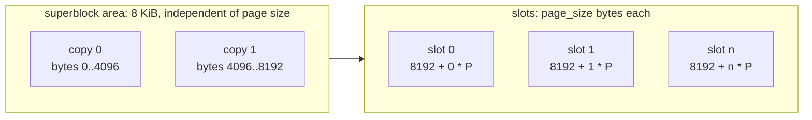
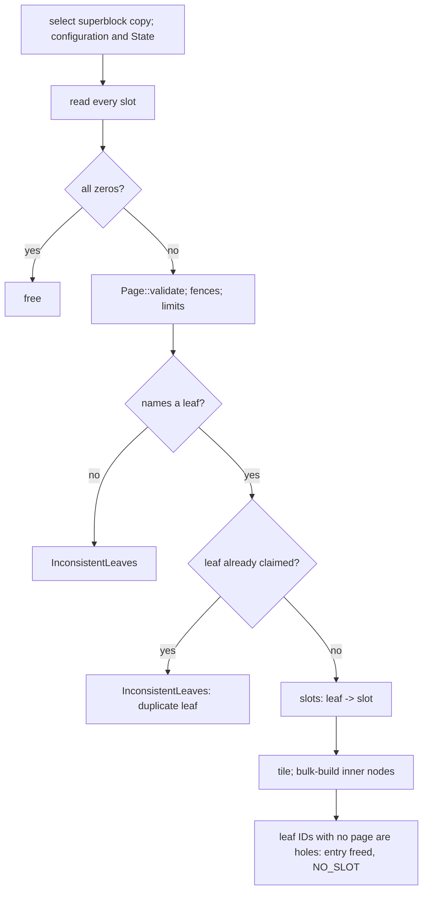

# 0017: Durable store format

**Status:** Draft

**Design references:** [Leaf storage](../design/bf-tree-leaf-store.md),
[shared pages](../design/bf-tree-pages.md),
[build system](../design/build-system.md). This stack creates
`docs/design/bf-tree-persistence.md`.

**Parent roadmap:** [BF-Tree implementation](0002-bf-tree-roadmap.md),
milestone 9 (first of three tree-side stacks).

**Builds on:** [Leaf mapping table and page store](0008-bf-tree-leaf-store.md),
[shared tree foundation](0012-bf-tree-shared-tree.md) (`&self` store,
`LeafMap::write_through`, `load_base`),
[mini-page tree integration](0013-bf-tree-mini-tree.md),
[eviction](0014-bf-tree-eviction.md),
[caching and full pages](0015-bf-tree-caching.md),
[concurrency](0016-bf-tree-concurrency.md).

## Goal and scope

Today a `LeafId` is also the store slot that holds the leaf, and the
superblock records only the configuration. Shadow paging (plan 0018) must
write a new version of a leaf to a different slot, and a checkpoint must
record an atomic commit point. Both need a store format that this stack
defines: slots that are distinct from leaves, stored pages that name their
leaf, and a superblock that can hold a committed state and survive a torn
write.

This stack changes the format and the addressing only. Writes stay in
place, so durability and crash behaviour are unchanged from plan 0008.

- **In scope:** a `Slot` type distinct from `LeafId`; `PageStore` addressed
  by slots, with `state()` and `commit(&State)`; dual superblocks with
  CRC32C (superblock version 2) at fixed offsets; a leaf-to-slot table in
  `LeafMap`; `write_through` stamps the leaf into each stored page;
  `load_base` resolves the slot and checks the stamp; `Tree::open` rebuilds
  the leaf-to-slot table from page headers; the CRC32C source; store and
  open corruption tests on both backends; the persistence design document.
- **Out of scope:** writes to fresh slots, write sequences, checkpoints,
  recovery selection, and the crash model (plan 0018); sequenced apply,
  the pre-commit hook, and snapshots (plan 0019); direct I/O (plan 0023);
  page checksums; persisting inner nodes or a fence list.
- **Done when:** both backends pass the store contract with slot
  addressing; a commit can tear either superblock copy and open selects the
  intact one; copies that disagree on configuration are rejected; a tree
  flushed, closed, and reopened from a `FileStore` equals its oracle and
  passes `check_invariants`; the leaf-to-slot table rebuilt by `open`
  matches the table before close; and the workspace checks pass.

## Approach

### On-disk layout



- Superblock copy `c` lives at byte `c * 4096`. Each copy is one 4096-byte
  block, whatever the page size. The second copy is therefore at a known
  offset, and `FileStore::open` never needs to guess the page size from a
  damaged first copy.
- Slot `i` lives at byte `8192 + i * page_size`. For the default 4096-byte
  pages this is "slots start at page 2". The 8 KiB area also keeps every
  slot offset 4096-aligned for 4096-byte pages, which direct I/O (plan
  0023) requires.
- A valid file length is `8192 + n * page_size` for some `n >= 0`.
- A new slot is zero. A freed slot keeps its old bytes. The store does not
  zero on `free`, because plan 0018 selects pages by their header, not by
  slot state. Plan 0008's "a freed slot is all zeros" contract ends here.

### Superblock version 2

```rust
/// On-disk superblock copy, version 2. Little-endian. Zero-padded to 4096
/// bytes. `crc` is the CRC32C of every byte before it.
#[derive(FromBytes, IntoBytes, KnownLayout, Immutable, Unaligned)]
#[repr(C)]
struct EncodedSuperblock {
    magic: [u8; 8],          // b"PEPPYBF\0"
    version: U32,            // 2
    page_size: U32,
    inner_capacity: U32,
    max_key_len: U32,
    max_value_len: U32,
    checkpoint_id: U64,
    applied_seq: U64,
    write_seq: U64,
    crc: U32,
}
const _: () = assert!(size_of::<EncodedSuperblock>() == 56);

/// The committed checkpoint the store's pages reflect. All zero for a new
/// store. Plan 0018 gives `applied_seq` and `write_seq` their meaning.
#[derive(Clone, Copy, Debug, Default, PartialEq, Eq)]
pub struct State {
    pub checkpoint_id: u64,
    pub applied_seq: u64,
    pub write_seq: u64,
}
```

`Superblock` keeps only the configuration (page size and limits), as in
plan 0008. The store holds a `Superblock` and a `State` side by side.

- **Encode:** `Superblock::encode(&self, state: &State, block: &mut [u8])`
  writes one 4096-byte copy with its CRC.
- **Decode:** `Superblock::decode(block) -> Result<(Superblock, State), _>`
  rejects a bad magic, a version other than 2, a CRC mismatch, and an
  invalid configuration.
- **Select:** `Superblock::select(copy0, copy1)` decodes both copies and
  skips any copy that fails. At least one copy must be intact. If both are
  intact, they must describe the same configuration. Otherwise the store is
  rejected: a mismatch is never a torn write, because a commit never
  changes the configuration. The intact copy with the higher
  `checkpoint_id` wins. Equal ids (both copies of a new store) are allowed.
- **Commit:** `commit(&State)` writes copy `state.checkpoint_id % 2`, then
  syncs, then replaces the in-memory state. The previous commit is in the
  other copy, so a torn commit leaves it intact. `commit` requires
  `state.checkpoint_id == self.state().checkpoint_id + 1` and otherwise
  returns `StoreError::CommitOrder`. This catches two callers committing
  at once, which would overwrite the same copy.
- `create` writes both copies with `State::default()` and syncs.

Version-1 stores are rejected. No deployed data exists.

### Slots and the store trait

```rust
/// A physical page slot. Slots are not leaves: plan 0018 writes each new
/// version of a leaf to a fresh slot, and the page header names the leaf.
#[derive(Clone, Copy, Debug, PartialEq, Eq, PartialOrd, Ord, Hash)]
pub struct Slot(u64);

impl Slot {
    /// `None` for `u64::MAX`, which the leaf map uses as "no slot".
    pub const fn new(raw: u64) -> Option<Self>;
    pub const fn raw(self) -> u64;
}

pub trait PageStore: Send + Sync {
    fn page_size(&self) -> usize;
    /// Slots ever allocated, live or freed: indices `0..slots()`.
    fn slots(&self) -> u64;
    /// A freed slot if any (old bytes kept), else a new zero slot.
    fn alloc(&self) -> Result<Slot, StoreError>;
    /// Return a slot for reuse. Its bytes are not changed.
    fn free(&self, slot: Slot) -> Result<(), StoreError>;
    fn read(&self, slot: Slot, buf: &mut [u8]) -> Result<(), StoreError>;
    fn write(&self, slot: Slot, buf: &[u8]) -> Result<(), StoreError>;
    /// Make every completed write durable.
    fn sync(&self) -> Result<(), StoreError>;
    fn superblock(&self) -> &Superblock;
    /// The last committed state.
    fn state(&self) -> State;
    /// Durably and atomically replace the committed state. The caller
    /// syncs its page writes first.
    fn commit(&self, state: &State) -> Result<(), StoreError>;
}
```

`StoreError::{UnknownSlot, FreedSlot}` carry a `Slot`. New variants:
`NoSuperblock` (neither copy is intact) and `CommitOrder`. `bf-tree-store`
no longer depends on `bf-tree-node-id`. `bf-tree` re-exports `Slot` and
`State`.

`MemStore` keeps the state in a mutex. `FileStore` serializes commits with
a commit mutex and keeps the state in a separate short-held mutex, so
`state()` never waits for a commit's sync.

### Base-page identity

A slot no longer identifies a leaf, so a stored base page must name its
leaf. Otherwise `open` cannot rebuild the leaf-to-slot table once plan
0018 moves leaves between slots. This stack introduces the stamp while
writes are still in place, so the open path is proven before shadow paging
depends on it. Where the stamp lives is the main open question; see
[Open questions](#open-questions). The rest of this plan assumes the
recommendation, option A: `backing_leaf` holds the leaf.

```rust
// crates/bf-tree/src/leaf_map.rs; the only page write in the tree.
pub(crate) fn write_through(&self, pages: &mut [(LeafId, &mut [u8])]) -> Result<(), TreeError> {
    for (leaf, bytes) in pages.iter_mut() {
        Page::mut_from_bytes(bytes)?.set_backing_leaf(Some(*leaf));
        let slot = match self.slot_of(*leaf) {
            Some(slot) => slot, // in place in this stack; plan 0018 changes this
            None => {
                let slot = self.store.alloc()?;
                self.slots[leaf.index()].store(slot.raw(), Ordering::Release);
                slot
            }
        };
        self.store.write(slot, bytes)?;
    }
    Ok(())
}
```

The stamp is applied in `write_through`, so a page built in scratch (a
merge output, or a split's right half, which inherits the left half's
header) never reaches the store with the wrong leaf. `load_base(leaf)`
reads `slots[leaf]` and checks that the page names `leaf`. A mismatch is
`CorruptLeaf`: it catches a slot-table bug or a misdirected write on the
first load.

### Leaf-to-slot table

```rust
pub(crate) struct LeafMap {
    store: Box<dyn PageStore>,
    entries: Table<RwLock<LeafEntry>>,
    /// Slot of each leaf's stored page, or `NO_SLOT` (`u64::MAX`). Written
    /// under the leaf's exclusive lock. Read under either lock.
    slots: Table<AtomicU64>,
    // circular_buffer and the other fields from plans 0013-0016 are unchanged
}
```

The table lives beside `entries`, not inside `LeafEntry`. Plan 0012 keeps
`RwLock<LeafEntry>` within 64 bytes, and only base-page I/O reads the slot.

`LeafMap::alloc` appends a new `LeafId` with `NO_SLOT`. The first
`write_through` of the leaf allocates its slot. Leaf IDs are append-only
within a process. Plan 0018's checkpoint argument depends on this rule.

### Open



The tiling check and bulk build from plan 0008 are unchanged. `open` sizes
the tables to the largest named leaf plus one. Leaf IDs with no page are
holes: a leaf that was allocated but never flushed. Holes stay freed and
are never routed to. With in-place writes, two slots that name the same
leaf are corruption. Plan 0018 replaces that rule with selection by write
sequence.

## Decisions and trade-offs

- **Fixed 8 KiB superblock area:** Each copy has a known offset, so `open`
  does not probe page sizes. The cost is up to 8 KiB minus two pages of
  padding for small test page sizes. For 4096-byte pages it costs nothing.
- **Configuration and state in one checksummed copy:** One write commits
  both. Configuration never changes after create, so both copies must
  agree. Disagreement is reported, not resolved by id.
- **`commit` enforces id succession:** This is cheap, and it turns a
  concurrent-checkpoint bug into an error instead of a silently overwritten
  copy. Plan 0018 serializes checkpoints, so the check should never fire.
- **No zeroing on `free`:** Zeroing saves nothing once plan 0018 selects
  pages by header, and it costs one page write per freed slot. Every new
  slot is still zero, so an allocated slot that was never written is easy
  to detect.
- **Slot table beside `entries`:** This keeps the leaf entry within a cache
  line (the plan 0012 size test). Only cold-leaf I/O and open read it.
- **Stamp in `write_through`:** One place sets identity for every stored
  page. This follows the roadmap's rule of one write-through function.
- **Introduce the stamp before shadow paging:** The leaf-to-slot rebuild is
  verified with simple in-place semantics. Plan 0018 then changes only the
  `write_through` internals and the selection rule.

## Extension points

- **Plan 0018** gives `State::applied_seq` and `State::write_seq` their
  meaning. It changes `write_through` internals to fresh slots and renames
  the `lsn` header field to `write_seq`. It replaces open's duplicate-leaf
  rule with selection. It must not need to change the trait, the
  superblock layout, or `Slot`.
- **Plan 0019** writes snapshot files with `Superblock::encode` and dense
  slots. A snapshot is a valid store file by construction.
- **Plan 0020** (`engine-wal`) uses the same CRC32C source. See the open
  question.
- **Plan 0023** adds `Io { Cached, Direct }` to `FileStore`. The 4096-byte
  copies and the 8192-byte slot origin are already aligned.
- **Page checksums (deferred):** Under option A, the inactive
  `snapshot_version` field stays free for a page checksum. No other header
  field would need to change.
- **Persisted fence list or inner nodes (deferred):** These could live in
  extra slots that the superblock names. That needs a new superblock
  version but no change to `Slot` addressing.

## Proposed commit stack

Seven diffs. Diff 5 may exceed the 300-line guideline: the store trait is
readdressed and its one tree caller must change in the same buildable
commit.

### `[1/7][bf-store-format][plan] define the durable store format`

- **Purpose:** Agree on the layout, the superblock, slot addressing, and
  base-page identity.
- **Core changes:** This plan. Link it from the roadmap's milestone 9 row.
- **Verification:** Review the open questions, especially base-page identity
  and the CRC32C source.

### `[2/7][bf-store-format][crc] add a CRC32C implementation`

- **Purpose:** Provide the checksum that superblocks need (and the WAL in
  plan 0020).
- **Core changes:** With the recommendation: add `crc32c` to
  `third-party/rust/Cargo.toml`, run `tools/buckify`, add a fixup if
  reindeer warns about the build script, and add the dependency to
  `bf-tree-store`. With the alternative: add `crates/bf-tree-store/src/crc.rs`,
  a table-driven function of about 40 lines.
- **Verification:** RFC 3720 §B.4 check vectors (`"123456789"` gives
  `0xE3069283`; 32 zero bytes give `0x8A9136AA`); a flipped bit changes the
  sum; `tools/autocargo --check`.

### `[3/7][bf-store-format][superblock] encode dual checksummed superblocks`

- **Purpose:** Build the commit point's codec as pure functions, separate
  from I/O.
- **Core changes:** `State`; `EncodedSuperblock` version 2;
  `Superblock::{encode, decode, select}`; `COPY_BYTES = 4096`,
  `SLOTS_OFFSET = 8192`; `StoreError::NoSuperblock`.
- **Verification:** Round trip; each field flip fails the CRC; a version-1
  block is rejected; `select` takes the higher id; `select` falls back when
  either copy is torn (truncated, zeroed, or bit-flipped); copies with
  different configurations are rejected; both copies torn give
  `NoSuperblock`.

### `[4/7][bf-store-format][store] commit state through alternating superblock copies`

- **Purpose:** Give both backends the committed state before slots change.
- **Core changes:** `PageStore::{state, commit}`; `MemStore` keeps the
  state; `FileStore` uses the 8 KiB area, writes both copies on create,
  selects on open, and checks `(len - 8192) % page_size == 0`;
  `CommitOrder`. `Tree::create` also requires `state() == State::default()`.
  Slots are still addressed by `LeafId` here.
- **Verification:** Contract tests on both backends: commit, reopen, and
  `state()` agree; a non-successor id is rejected. File tests: overwrite
  copy `id % 2` with garbage after a commit, and open returns the previous
  state; truncated and ragged files are rejected; a file whose copy 0 is
  zeroed opens from copy 1 without probing.

### `[5/7][bf-store-format][slot] address store slots separately from leaves`

- **Purpose:** Decouple leaves from slots and make stored pages name their
  leaf.
- **Core changes:** `Slot`; trait and backends take `Slot`; `free` keeps
  bytes; remove the `bf-tree-node-id` dependency from `bf-tree-store` and
  run `tools/autocargo`. In `bf-tree`: `slots: Table<AtomicU64>` in
  `LeafMap`; `write_through` stamps `backing_leaf` and allocates on first
  write; `load_base` resolves the slot and checks the stamp; `open` builds
  the table from headers, marks holes, and rejects duplicate claims.
  Re-export `Slot` and `State`. Update the `backing_leaf` documentation in
  `bf-tree-page` (option A).
- **Verification:** The existing model suites on both backends; reopen
  equals the oracle; the rebuilt slot table equals the table before close;
  every stored page names the leaf whose slot holds it; the
  `RwLock<LeafEntry>` size test still passes.

### `[6/7][bf-store-format][open] reject inconsistent slot claims on open`

- **Purpose:** Cover the new failure modes with targeted fixtures.
- **Core changes:** Fixtures and small fixes only: a stored page with no
  leaf; two slots that claim one leaf; a stamp mismatch on load; a leaf ID
  beyond the bound in [Agent notes](#agent-notes); holes below the largest
  leaf; zero slots reused after open.
- **Verification:** Each fixture returns its documented error and never
  panics; flush and reopen interleaved with model steps on `FileStore`.

### `[7/7][bf-store-format][docs] document the durable store format`

- **Purpose:** Record the format as enduring design.
- **Core changes:** Create `docs/design/bf-tree-persistence.md` (layout,
  superblock, `State`, base-page identity, CRC32C source). Update
  `bf-tree-leaf-store.md` (slot addressing, no zeroing, the slot table) and
  `bf-tree-pages.md` (header field roles). Tick the roadmap.
- **Verification:** The documents agree with the tests; all workspace
  checks pass.

## Open questions

1. **Where does a stored base page name its leaf?**

   | | A: `backing_leaf` = own leaf (recommended) | B: `snapshot_version` becomes `leaf` |
   | --- | --- | --- |
   | Meaning | "The leaf whose records this page holds": the overlaid leaf for a mini-page, the leaf itself for a base page or full-page copy | `backing_leaf` keeps its literal meaning; a new `leaf` field holds identity for stored pages |
   | Mental model | Changes it: a base page no longer "points to nothing" | Keeps "a mini-page points to its backing leaf; a base page points to nothing" |
   | Uniformity | Every leaf-level page carries its leaf in one field; a full-page copy loaded from the store is already correct | Two identity fields with role-dependent use; a full-page copy has `leaf` set and `backing_leaf` unset |
   | Free header space | `snapshot_version` stays free for a page checksum | No header field is left. A checksum would need a larger header (which changes every capacity and admission calculation), a page trailer (which reduces `L`), or bits taken from `write_seq` |
   | Plan 0011 accessor | `Page::backing_leaf()` returns `Some` for stored pages; its documentation changes | Unchanged; add `Page::leaf()` |

   The mental model behind B is reasonable: "backing" literally describes
   an overlay. But a stored page must carry identity somewhere once slots
   move. A spends a field that already means "which leaf". B spends the
   only field that could hold a checksum or any later recovery metadata.
   Recommendation: **A**. Document `backing_leaf` as "the leaf whose
   records this page holds", and leave `Page::validate` structural (the
   tree checks that a stored page names a leaf).

2. **CRC32C source.** (a) The third-party `crc32c` crate, via
   `tools/buckify`: hardware-accelerated (SSE 4.2 and ARMv8 CRC), and
   `engine-wal` can depend on it directly. It has a build script, which
   may need a reindeer fixup. (b) A hand-written table-driven function in
   `bf-tree-store`: about 40 lines with no dependency. But `engine-wal`
   may depend only on `bf-tree` or third-party crates. So `bf-tree` would
   have to re-export a checksum utility in its public API, or the WAL would
   keep a second copy. (c) The generic `crc` crate: software only and no
   build script. It is slower on the WAL's per-record path.
   Recommendation: **(a)**. The WAL checksums every record, so hardware
   speed matters there. A shared third-party crate also avoids a
   cross-component utility export.

## Verification strategy

| Check | Command or procedure | Expected result |
| --- | --- | --- |
| Codec | `tools/buck2 run //crates/bf-tree-store:bf-tree-store-unittest -- superblock` | Vectors, torn copies, and configuration mismatch behave as specified |
| Store contract | Shared contract module over `MemStore` and `FileStore` | Identical behaviour; commit order enforced |
| Torn commit | Overwrite the newer copy after a commit; reopen | Previous state selected |
| Identity | Model suite with flush and reopen on both backends | Oracle equality; rebuilt slot table equals the pre-close table |
| Corruption | Diff 6 fixtures | Documented errors, no panic |
| Workspace | `tools/fmt.sh`; `tools/clippy.sh`; `tools/buck2 test //crates/... //bin/... //go/...`; `tools/autocargo --check`; `tools/gobuckify-remote --check`; `cargo test --workspace --locked`; `(cd go && go vet ./... && go test ./...)` | Clean |

## Progress

- [ ] Agree on the design and commit stack with the user.
- [ ] Diff 2: CRC32C.
- [ ] Diff 3: superblock codec.
- [ ] Diff 4: committed state in both backends.
- [ ] Diff 5: slot addressing and leaf stamps.
- [ ] Diff 6: open fixtures.
- [ ] Diff 7: design documents and roadmap.
- [ ] Stack-wide verification.

## Discoveries and plan changes

None yet.

## Agent notes

- **Entry points:** `crates/bf-tree-store/src/lib.rs` (`PageStore`,
  `Superblock`, `StoreError`), `file.rs` (offsets, `create`, `open`),
  `mem.rs`, `tests/{contract,file,superblock}.rs`;
  `crates/bf-tree/src/leaf_map.rs` (`write_through`, `load_base`, `alloc`),
  `open.rs` (slot scan, `tile`, `build_inner`), `lib.rs` (`create`,
  re-exports, `From` conversions); `crates/bf-tree-page/src/layout.rs`
  (`Header`, `NO_BACKING_LEAF`) and `split.rs` (outputs inherit header
  fields, which is why the stamp belongs in `write_through`).
- **One write function:** After diff 5, `store.write(` must appear only in
  `write_through` (and in the store's own tests).
- **Untrusted leaf IDs:** `open` sizes tables from leaf IDs read from disk.
  Bound them before growing a `Table`. The intended bound is
  `leaf < store.slots()`: every live leaf holds a distinct slot, and a hole
  arises only from a leaf whose page once occupied a slot. Confirm this
  argument while implementing, including after plan 0018's reuse of freed
  slots. If it does not hold, collect claims in a `BTreeMap` and reject IDs
  above a generous multiple of `slots()`.
- **Holes:** `LeafMap::alloc` must append after the largest existing index,
  including holes, and never reuse a hole.
- **Copy writes:** Write the full 4096-byte copy, not only the 56 encoded
  bytes, so direct I/O (plan 0023) needs no special case.
- **Upstream:** `src/fs/mod.rs` (`VfsImpl` allocates offsets; peppydb uses
  fixed slots) and `src/storage.rs` (`PageTable`, `PageLocation`).

## Sources

- [BF-Tree paper](../references.md#bf-tree-paper), §3.3 (base pages and the
  mapping table) and §5.7 (logging, snapshots, and recovery).
- [Upstream `src/fs/mod.rs`](https://github.com/microsoft/bf-tree/blob/f442e6172bf7e5483ff320d8e3ac16a70e31bbd6/src/fs/mod.rs)
  and [`src/storage.rs`](https://github.com/microsoft/bf-tree/blob/f442e6172bf7e5483ff320d8e3ac16a70e31bbd6/src/storage.rs).
- RFC 3720 §B.4: CRC32C (Castagnoli) check values.
