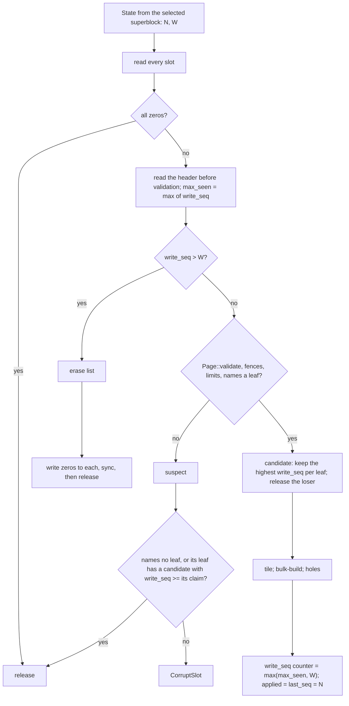

# 0018: Shadow paging, checkpoint, and recovery

**Status:** Draft

**Design references:** [Persistence](../design/bf-tree-persistence.md)
(created by plan 0017), [concurrency](../design/bf-tree-concurrency.md),
[leaf storage](../design/bf-tree-leaf-store.md),
[circular buffer](../design/bf-tree-circular-buffer.md).

**Parent roadmap:** [BF-Tree implementation](0002-bf-tree-roadmap.md),
milestone 9 (second of three tree-side stacks).

**Builds on:** [Durable store format](0017-bf-tree-store-format.md),
[shared tree foundation](0012-bf-tree-shared-tree.md),
[eviction](0014-bf-tree-eviction.md),
[caching and full pages](0015-bf-tree-caching.md),
[concurrency](0016-bf-tree-concurrency.md).

## Goal and scope

After plan 0017, pages are still written in place. A crash during `flush`
can leave the store unopenable, for example a split whose left half landed
but whose right half did not. Nothing records which writes the store
reflects. This stack makes the store crash-atomic and makes the
checkpoint record what it contains:

- **Shadow paging:** Every page write goes to a fresh slot and carries a
  global write sequence. A committed page is never overwritten.
- **Checkpoint:** The superblock commit is the only step that changes what
  a reopen selects. It records the applied watermark `N` and the write
  watermark `W`.
- **Recovery:** `open` selects the committed image. It erases pages that
  were written after `W`, so that they cannot reappear after a later
  commit.

- **In scope:** rename `lsn` to `write_seq`; fresh-slot `write_through`
  under a write-through gate; the superseded-slot list; `Tree::checkpoint`
  (renamed from `flush`) with `N`, `W`, commit, and freeing; the `seq`
  closure on the internal write path, with `applied` and `last_seq`
  watermarks; `create` commits an initial checkpoint; `open` selection,
  erasure, the write-counter restart, and suspect-page handling; a
  fault-injecting store and crash model with multi-generation crashes and
  concurrent checkpoints; design-document updates.
- **Out of scope:** `Tree::apply`, the `Log` trait, the pre-commit hook,
  one sequence space across internal and external sequences, and snapshots
  (plan 0019); the WAL (plan 0020); direct I/O and measurements (plan
  0023); page checksums, a persisted fence list, and leaf reclamation.
- **Done when:** checkpoints run while writers and evictions run; after
  every injected crash `open` succeeds, reports the last committed `N`, and
  replaying the oracle's entries above `N` yields the oracle's final state;
  a multi-generation crash test without full replay passes; the model,
  concurrent, crash, and workspace suites pass.

## Approach

### Two properties

1. **Blind writes make replay idempotent.** Every put or delete overwrites
   what it finds. If the committed image reflects every entry at or below
   `N`, replaying all entries above `N` in order gives the right result.
   This is true even when some of those entries are already in the image.
2. **The leaf lock gives per-key order.** A write's sequence is assigned
   while its leaf lock is held, and the write is applied before the lock is
   released. So for each key, sequence order equals apply order.

Together these allow a fuzzy checkpoint. Writers never pause, and the
checkpoint reads `N` before it starts. The paper's online snapshot pauses
writers (§5.7). This stack deliberately departs from that.

### Page header

| Bytes | Field | Before | After |
| --- | --- | --- | --- |
| `8..16` | `backing_leaf` | leaf stamp (plan 0017, option A) | unchanged |
| `16..24` | `lsn` | inactive | `write_seq`: the write-through operation that wrote this page; both halves of a split share one value; zero in mini-pages |
| `24..32` | `snapshot_version` | inactive | still inactive; reserved for a page checksum |

### Write-through to fresh slots

```rust
pub(crate) struct LeafMap {
    // ... fields from plans 0012-0017
    slots: Table<AtomicU64>,
    /// Last write sequence drawn. A page's `write_seq` is the value its
    /// write-through drew.
    write_seq: AtomicU64,
    /// Held shared by every write-through for its whole duration; held
    /// exclusively by a checkpoint to read `write_seq` with none in flight.
    gate: RwLock<()>,
    /// Slots that a later write of the same leaf replaced, each with the
    /// replacing write's sequence.
    superseded: Mutex<Vec<(Slot, u64)>>,
}

pub(crate) fn write_through(&self, pages: &mut [(LeafId, &mut [u8])]) -> Result<u64, TreeError> {
    let _in_flight = self.gate.read();
    let seq = self.write_seq.fetch_add(1, Ordering::AcqRel) + 1;
    for (leaf, bytes) in pages.iter_mut() {
        let page = Page::mut_from_bytes(bytes)?;
        page.set_backing_leaf(Some(*leaf));
        page.set_write_seq(seq);
        let slot = self.store.alloc()?;
        self.store.write(slot, bytes)?;
        let old = self.slots[leaf.index()].swap(slot.raw(), Ordering::AcqRel);
        if let Some(old) = Slot::new(old) {
            self.superseded.lock().push((old, seq));
        }
    }
    Ok(seq)
}
```

- A split passes both halves in one call, so both share one `seq`. A crash
  commits both halves or neither, and tiling holds.
- A superseded slot is not freed at once, even if no commit ever selected
  it. A checkpoint that has read its `W` but not yet committed may have
  selected that slot. The first commit whose `W` covers the replacing
  write frees it.
- **File growth:** Between checkpoints, a leaf written through `n` times
  holds `n + 1` slots. Checkpoint frequency bounds file growth. Freed
  slots are reused before the file grows, and the file never shrinks.

### Sequences and watermarks

```rust
pub struct Tree {
    // ...
    /// Every write with a sequence at or below this has been applied.
    /// Advanced with `fetch_max` after the leaf lock is released.
    applied: AtomicU64,
    /// Highest sequence assigned or accepted. `put` and `remove` draw from
    /// it here; plan 0019 also advances it from external sequences.
    last_seq: AtomicU64,
    /// One checkpoint at a time.
    checkpointing: Mutex<()>,
}

/// The common write path. `seq` runs after the leaf lock is taken and the
/// route validated, and before the record is applied. A retry (circular buffer full,
/// route changed) runs it again.
pub(crate) fn write(
    &self,
    key: &[u8],
    state: RecordState<'_>,
    mut seq: impl FnMut() -> Result<u64, TreeError>,
) -> Result<u64, TreeError>;

pub fn put(&self, key: &[u8], value: &[u8]) -> Result<(), TreeError> {
    let seq = self.write(key, RecordState::Insert(value), || {
        Ok(self.last_seq.fetch_add(1, Ordering::AcqRel) + 1)
    })?;
    self.applied.fetch_max(seq, Ordering::Release);
    Ok(())
}
```

A retry asks for a new sequence. The abandoned sequence names no applied
write, which is harmless. The `N` argument below needs only that a
sequence is assigned under the lock that its applied record is applied
under. `Tree::applied_seq()` returns `applied`. `Tree::committed()`
returns `store.state()`.

### Checkpoint

```rust
/// Make every write applied before this call durable as one atomic commit.
/// Writers keep running. Must not be called with a leaf lock held, for
/// example from a scan visitor.
pub fn checkpoint(&self) -> Result<State, TreeError>;
```

```mermaid
sequenceDiagram
    participant K as checkpoint
    participant T as tree
    participant G as gate
    participant S as store
    K->>K: lock checkpointing mutex
    K->>T: N = applied
    loop every leaf index, re-reading the table length
        K->>T: under the leaf lock: merge the mini-page; write back a dirty Full page
    end
    K->>G: acquire exclusive
    K->>T: W = write_seq
    K->>G: release
    K->>S: sync
    K->>S: commit(State { id + 1, N, W })
    K->>T: free superseded slots with seq <= W (unless a snapshot pins them)
```

The pass is the merge loop from plan 0013's `flush` plus plan 0015's
write-back of dirty `Full` pages. Its loop bound is the current table
length, re-read on every step. Leaf IDs are append-only (plan 0017).

**Why `N` is complete at commit.** Take any write with sequence `s <= N`.
Either its sequence was assigned before `N` was read, or `s` names an
abandoned retry and no record. (`applied` reached `N` only after some
write with sequence `N` was assigned, and sequences are assigned in
increasing order.) The writer assigned `s` while it held the lock of some
leaf `X`. It applied the record and only then released the lock. Now
consider where the record is when the pass runs:

- **Still buffered in `X`:** The pass locks `X` after `N` was read, so it
  locks `X` after the writer released it. It then sees the record and
  merges it. The merge's write-through draws its sequence before the gate,
  so the sequence is at most `W`.
- **Already written through** by an eviction, a split, a promotion, or a
  write-back: that write-through either finished before the gate or was in
  flight when the gate was taken. The gate waits for it, so its sequence
  is at most `W`.
- **Buffered in a new right leaf `Y`:** A split buffers its pending record
  into the half that owns the key while both halves are locked (plan
  0013). `Y` is created while the writer still holds `X`. The pass has not
  locked `X` yet, so its position is at most `X < Y`. Because the loop
  re-reads the length, the pass reaches `Y` later. A pass that took a
  snapshot of buffered leaf IDs at its start would miss `Y`.

So every record with sequence `<= N` is in a page with `write_seq <= W`,
or in a later page of the same leaf that is also `<= W`.

**Why `W` is complete at commit.** Every write-through holds the gate
shared from drawing its sequence until it has written every page, swapped
the slot table, and recorded its superseded slots. The exclusive
acquisition waits for all write-throughs in flight. So every operation
with sequence `<= W` has finished its writes before `sync`, and its
superseded entries are in the list before the free step. Operations that
start after the gate draw sequences above `W`, and `open` ignores them.
The gate blocks only write-throughs, and only for one counter read.
Buffered writes never take it.

**Why freeing is safe.** An entry `(old, s)` with `s <= W` means a page of
the same leaf with sequence `s` (or later) is committed. The committed
image therefore does not reference `old`. Freeing happens after `commit`
returns, so a crash before the free step only leaves extra slots for
`open` to release.

**Failures.** A store error in the pass, `sync`, or `commit` returns
without committing or freeing anything. After a failed `sync` or `commit`,
the operating system may have dropped dirty pages, and a later sync can
report success without them. So a failed sync or commit sets a flag, and
every later `checkpoint` returns `TreeError::CheckpointFailed`. The caller
must reopen. Reads and writes continue. (This is an open question to
confirm.)

### Create

`Tree::create` writes the first leaf through `write_through` (sequence 1),
syncs, and commits `State { checkpoint_id: 1, applied_seq: 0, write_seq: 1 }`.
A store that is created and never checkpointed then reopens as an empty
tree, not as a store with no committed page.

### Open: select the committed image



| What a slot holds after a crash | `open` |
| --- | --- |
| all zeros | release: allocated, never written |
| intact page, `write_seq > W` | erase and release: written after the checkpoint |
| torn page whose header landed (`write_seq > W`) | erase and release |
| intact page, `write_seq <= W`, newest for its leaf | **committed page** |
| intact page, `write_seq <= W`, older than another page of its leaf | release: superseded |
| torn page in a new slot whose header did not land (no leaf) | release |
| torn page in a reused slot with the old header (an older page of some leaf) | release: that leaf has a newer committed page |
| invalid page claiming `<= W` with no newer page of its leaf | `CorruptSlot { slot, reason }` |

**Erase pages above `W` before the next commit.** Suppose `open` only
released such a page `P` (leaf `L`, sequence `s > W`) and restarted the
counter above `s`. If no later write reuses `P`'s slot, the next commit
has `W' > s`. A second crash and open would then find `P` at or below
`W'`. If `L` was not written since the first open, `P` would win over
`L`'s committed page and resurrect state that the first recovery
discarded. That state includes effects that the log may never have made
durable, or one half of a split whose sibling was lost. So `open` writes
a zero page into every slot whose header claims `> W`, syncs once, and
only then releases those slots. The cost is bounded by the write-throughs
since the last checkpoint.

Restarting the counter above `max_seen`, not only above `W`, keeps every
sequence in the file unique. The argument then does not depend on every
erase having landed. An open generation stored in the superblock and in
each page would also fence these pages, but it needs a header field, and
the only free one is reserved for a checksum.

**Suspect pages and checksums.** Structural validation decides torn pages
here. A page checksum would detect corruption that still validates, such
as damaged value bytes. It would not remove the superseded and nameless
rules: a torn page fails a checksum just as it may fail validation. It
would close one silent case. Suppose bit rot raises a committed page's
`write_seq` above `W`. `open` erases that page, and an older superseded
page of the same leaf, still in a freed slot, can win. With a checksum,
the damaged header would be detected first. Checksums remain deferred
(see plan 0017's open question on base-page identity).

**Header atomicity assumption.** The 32-byte header lies in the first
device sector of a page and lands atomically. The crash model tears at
64-byte sectors, so the header lands whole or not at all.

## Decisions and trade-offs

- **Superseded list instead of a committed/current slot pair:** A pair
  cannot express "free this intermediate slot only after a commit covers
  its replacement". The list can, and it costs 16 bytes per write-through
  until the next checkpoint.
- **Selection by header scan, not a mapping-table file:** `open` already
  reads every slot to rebuild inner nodes. A persisted map would be a
  second structure to make atomic. A fence list for faster open is
  deferred.
- **Erase at open:** This is the smallest fix that keeps the selection
  rule purely "newest at or below `W`". The alternatives (an open
  generation, or a persisted discard range) need header space or
  superblock state that grows with crashes.
- **Gate as `RwLock<()>` from `bf-tree-sync`:** Write-throughs share it.
  The checkpoint holds it exclusively for one load. Lock order (final):
  leaf lock -> frame write locks -> `root_grow` -> gate (shared) ->
  `superseded`, circular-buffer mutex, store internals. The checkpoint takes the
  checkpointing mutex first and the gate exclusively, with no leaf or frame
  lock held.
- **Checkpoint mutex inside the tree:** Two concurrent checkpoints would
  race on the commit id and the free step. Serializing them inside the
  tree means no caller (such as plan 0021's policy thread and an explicit
  call) needs a shared lock that writers might wait on.
- **`flush` becomes `checkpoint`:** The guarantee changes to an atomic
  commit point that returns the committed `State`. Keeping the old name
  would understate it.
- **Always commit, even when nothing changed:** This is simpler, and each
  call yields a distinct `checkpoint_id`. The engine's policy decides when
  to call.

## Extension points

- **Plan 0019** adds `apply`, `put_logged`, `remove_logged`, the `Log`
  trait, and the one-sequence-space rule. It uses the same `write` closure,
  `applied`, and `last_seq`. It adds the pre-commit hook between `sync` and
  `commit` (`checkpoint_with`). It adds a snapshot pin, checked by the free
  step under the `superseded` mutex. It must not change the protocol,
  `write_through`, or the selection rule. `select_committed` takes the
  `State` to select against as a parameter, so a snapshot can pass the
  state it read once.
- **Plan 0021** calls `checkpoint_with` from a policy thread. The
  checkpointing mutex makes concurrent calls safe without stalling writers.
- **Plan 0023** measures checkpoint cost against dirty leaves and open cost
  against slots, under both I/O modes.
- **Leaf reclamation (deferred)** must erase, or otherwise fence, every
  stored page of a reclaimed leaf before it commits. Freed slots keep old
  pages, and selection would otherwise resurrect the leaf.
- **Persisted fence list (deferred)** would make open proportional to
  leaves rather than slots. Selection by header stays as the repair path.

## Proposed commit stack

Eight diffs. Diff 3 keeps the tree green between in-place writes and
commits: fresh slots make old pages look like duplicate leaves, so open
must select the newest page per leaf in the same diff.

### `[1/8][bf-checkpoint][plan] define shadow paging and checkpoints`

- **Purpose:** Agree on the protocol, the `N`/`W` arguments, and the
  recovery rules.
- **Core changes:** This plan. Link it from the roadmap.
- **Verification:** Review.

### `[2/8][bf-checkpoint][page] rename the log sequence field to write_seq`

- **Purpose:** Give the header field its meaning.
- **Core changes:** `Header::lsn` becomes `write_seq`; add `Page::write_seq`
  and `set_write_seq`; split, merge, and compaction preserve it; mini-page
  `init` sets zero.
- **Verification:** Layout constants; the page model checks that the field
  survives every rebuild.

### `[3/8][bf-checkpoint][shadow] write every base page to a fresh slot`

- **Purpose:** Committed pages are never overwritten.
- **Core changes:** `write_seq` counter, gate, and `superseded` list in
  `LeafMap`; `write_through` as above. Interim `flush`: take the
  superseded entries recorded so far, sync, then free them (each entry's
  replacement finished writing before the sync, so it is now durable). `open`
  selects the newest page per leaf and restarts the counter above
  `max_seen`. Invalid pages remain `CorruptLeaf`.
- **Verification:** Two write-throughs of a leaf leave one superseded
  entry; split halves share a sequence; the model suites pass on both
  backends; after flush, the store holds one slot per leaf.

### `[4/8][bf-checkpoint][commit] commit the write watermark and erase uncommitted pages`

- **Purpose:** Atomic commit point and safe recovery.
- **Core changes:** `flush` takes the gate exclusively for `W`, syncs,
  commits `id + 1` with `W`, and frees entries `<= W`. `create` commits.
  `open` filters by `W`, erases pages above `W` and syncs, and keeps the
  counter restart. `TreeError::CheckpointFailed` and the poison flag.
- **Verification:** A page written after the commit is ignored and erased
  on open; a crash between commit and free reopens cleanly; holding the
  gate shared blocks the commit; a failed commit leaves the store at the
  previous state and poisons later calls; two-generation regression: write
  leaf `L` through after a commit, crash with that page landed, open, write
  only leaf `M`, commit, crash, open, and assert `L` is at its committed
  state.

### `[5/8][bf-checkpoint][open] classify torn and suspect pages on open`

- **Purpose:** Accept every torn write a crash can produce, and report
  real corruption.
- **Core changes:** `select_committed(store, config, &State)` with the
  suspect rules; `TreeError::CorruptSlot { slot, reason }`.
- **Verification:** Hand-built fixtures for every row of the selection
  table, at every 64-byte tear boundary; an invalid unsuperseded page gives
  `CorruptSlot`.

### `[6/8][bf-checkpoint][checkpoint] record the applied watermark and rename flush`

- **Purpose:** Make the checkpoint state which writes it contains.
- **Core changes:** `Tree::checkpoint -> Result<State, _>` replaces
  `flush`, with the checkpointing mutex, `N`, and the commit. Add the
  `write` closure, `applied`, `last_seq`, `applied_seq()`, `committed()`.
  The pass loop re-reads the table length. Rename every test caller.
- **Verification:** The returned `applied_seq` is at least every sequence
  completed before the call; a checkpoint thread runs inside plan 0012's
  concurrent model test, which still matches the oracle; a forced split
  during the pass buffers into a new leaf that the pass merges; concurrent
  `checkpoint` calls produce consecutive ids.

### `[7/8][bf-checkpoint][crash] add a fault-injecting store and crash model`

- **Purpose:** Prove recovery against an oracle.
- **Core changes:** A `#[cfg(test)]` `FaultStore` in `bf-tree` tests. It has
  a durable side and a volatile side. `sync` and `commit` persist. A crash
  loses, lands, or tears each in-flight page at 64-byte sectors. It can
  fail a commit before or after the copy lands, and it can fail-stop after
  the `k`-th store call (which covers crashes mid-pass, mid-split, and
  mid-erase). The single-threaded model records `(seq, op)` per write, and
  after each crash asserts: open succeeds, `applied_seq` equals the last
  successful commit's `N`, the state equals the oracle at `N`, and replay
  from `N + 1` equals the final oracle. Multi-generation rounds keep
  crashing the recovered store without copying it to a fresh store; some
  rounds replay none or only part of the lost entries (the oracle is
  truncated to match).
- **Verification:** The model with a tiny circular buffer (most write-throughs are
  evictions) and with a default circular buffer; many seeds; runs in seconds in a
  debug build.

### `[8/8][bf-checkpoint][crash] crash with checkpoints running beside writers`

- **Purpose:** Cover the fuzzy checkpoint and record the design.
- **Core changes:** A concurrent crash variant: writer threads plus a
  checkpoint thread, crash at a random point. After open, each key's value
  equals the oracle's value at some sequence in `[N, last assigned]`. After
  replay from `N + 1`, the state equals the full oracle. A file-growth test
  (`n` write-throughs of one leaf hold `n + 1` slots until the next
  checkpoint). Update `bf-tree-persistence.md` (protocol, arguments,
  selection table, growth), `bf-tree-concurrency.md` (lock order with the
  gate), and `bf-tree-leaf-store.md`.
- **Verification:** Many seeds; all workspace checks.

## Open questions

1. **Poison after a failed `sync` or `commit`?** Recommendation: yes. Later
   checkpoints fail until reopen, because a retried sync may report success
   for writes the kernel dropped. Writers and readers continue.
2. **Visit every leaf in the pass, or keep a buffered-leaf hint?** Locking
   every leaf is simple and uncontended. An atomic "buffered or dirty"
   hint per entry could skip clean leaves. Recommendation: lock every leaf
   now, and let plan 0023 measure.

## Verification strategy

| Check | Command or procedure | Expected result |
| --- | --- | --- |
| Commit atomicity | Fail or tear the commit; reopen | Previous state; oracle at its `N` |
| Torn pages | Diff 5 fixtures; crash model tears | Released or committed exactly as the table says |
| Split atomicity | Fail-stop between and after a split's two writes | Reopen tiles; neither half committed |
| Stale resurrection | Diff 4 two-generation test; multi-generation crash model | Leaf at its committed state |
| Fuzzy `N` | Checkpoint thread in the concurrent model; concurrent crash variant | Oracle after replay; per-key bounds before replay |
| Pass coverage | Split during the pass into a new leaf | New leaf merged and committed |
| Growth | Diff 8 growth test | `n + 1` slots until the checkpoint, then 1 |
| Focused | `tools/buck2 run //crates/bf-tree:bf-tree-unittest -- crash` | Pass |
| Workspace | `tools/fmt.sh`; `tools/clippy.sh`; `tools/buck2 test //crates/... //bin/... //go/...`; `tools/autocargo --check`; `tools/gobuckify-remote --check`; `cargo test --workspace --locked`; `(cd go && go vet ./... && go test ./...)` | Clean |

## Progress

- [ ] Agree on the design and commit stack with the user.
- [ ] Diff 2: `write_seq` header field.
- [ ] Diff 3: fresh-slot writes.
- [ ] Diff 4: commit, erase, and create.
- [ ] Diff 5: suspect classification.
- [ ] Diff 6: checkpoint and watermarks.
- [ ] Diff 7: fault store and crash model.
- [ ] Diff 8: concurrent crash variant and documents.
- [ ] Stack-wide verification.

## Discoveries and plan changes

None yet.

## Agent notes

- **Entry points:** `crates/bf-tree/src/leaf_map.rs` (`write_through`,
  `load_base`, the flush pass from plans 0013 and 0015), `open.rs`
  (selection goes before `tile`), `lib.rs` (`create`, `flush` ->
  `checkpoint`), the write path that plan 0012 introduced (where the `seq`
  closure goes, after `route_changed`); `crates/bf-tree-page/src/layout.rs`.
- **Gate placement:** Take it shared inside `write_through` only, never
  around a lock acquisition. Take it exclusively only in `checkpoint`, with
  no leaf or frame lock held.
- **Header before validation:** Read `write_seq` and `backing_leaf` from
  the raw 32-byte header (`Header::ref_from_prefix`) before
  `Page::validate`. Torn pages still contribute to `max_seen` and to the
  erase decision.
- **Free outside the mutex:** Drain covered entries under `superseded`,
  then call `store.free` after releasing it.
- **Test helpers stay crate-private:** `FaultStore`, recorders, and fixture
  writers live under `#[cfg(test)]` in `bf-tree`. Nothing test-only becomes
  `pub`.
- **Crash model hygiene:** Do not move a store out from under an open tree
  without a checkpoint. Buffered records live in mini-pages, not in the
  store.
- **Upstream:** `src/snapshot.rs` and `doc/snapshot-recovery.md` describe
  an in-place, pause-based snapshot that this design avoids.

## Sources

- [BF-Tree paper](../references.md#bf-tree-paper), §5.7: logging,
  snapshots, and recovery.
- [Upstream `src/snapshot.rs`](https://github.com/microsoft/bf-tree/blob/f442e6172bf7e5483ff320d8e3ac16a70e31bbd6/src/snapshot.rs)
  and [`doc/snapshot-recovery.md`](https://github.com/microsoft/bf-tree/blob/f442e6172bf7e5483ff320d8e3ac16a70e31bbd6/doc/snapshot-recovery.md).
