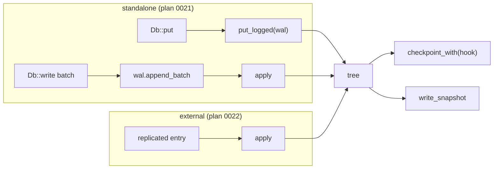
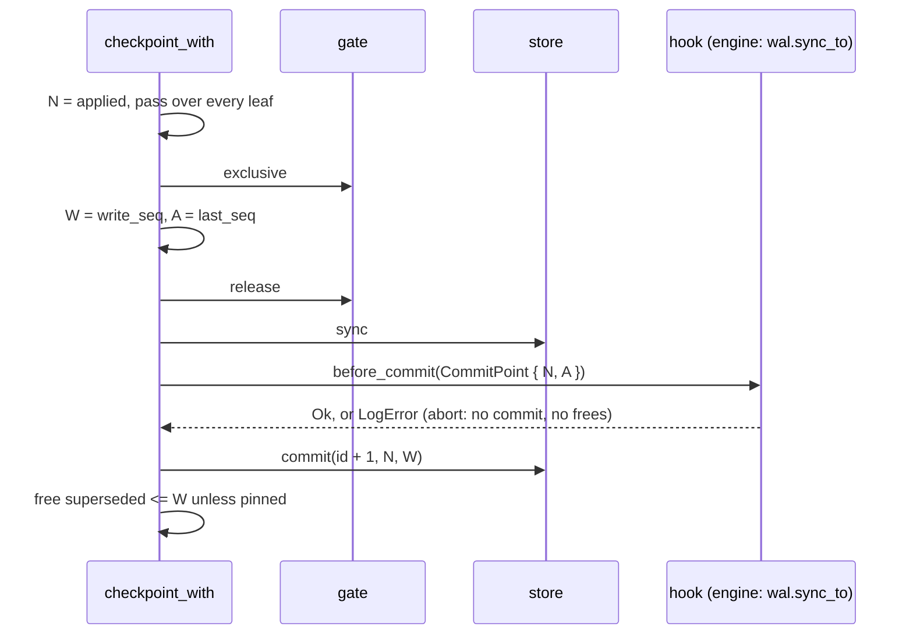

# 0019: Apply, log hook, and snapshots

**Status:** Agreed

**Design references:** [Persistence](../design/bf-tree-persistence.md),
[concurrency](../design/bf-tree-concurrency.md),
[architecture](../design/architecture.md).

**Parent roadmap:** [BF-Tree implementation](0002-bf-tree-roadmap.md),
milestone 9 (third of three tree-side stacks).

**Builds on:** [Shadow paging, checkpoint, and recovery](0018-bf-tree-checkpoint.md),
[durable store format](0017-bf-tree-store-format.md).

## Goal and scope

After plan 0018 the tree commits atomic checkpoints that record an applied
watermark `N`. But only the tree's own `put` and `remove` produce
sequences. The engine (plans 0020-0022) needs three more things:

- a way to apply entries that a log sequenced: its own WAL in standalone
  mode, or a replicated log in external mode;
- a guarantee that a checkpoint never commits an effect whose log record
  could still be lost;
- a consistent copy of the committed image that a follower can install.

The tree stays log-agnostic. It persists no log, and it defines the
contract that any log meets.

- **In scope:** `Op`, `Entry`, the `Log` trait and its own `LogError`;
  `Tree::apply`, `put_logged`, and `remove_logged`; one sequence space with
  explicit rules for internal and external sequences; the pre-commit hook
  `checkpoint_with` and `CommitPoint`; `write_snapshot`, which reads the
  committed state once; replica and log-aware crash tests; design-document
  updates.
- **Out of scope:** the WAL itself (plan 0020); `Db`, its policy thread,
  and `WriteBatch` (plan 0021); external mode and snapshot installation
  (plan 0022); parallel apply; transactions or isolation of a batch from
  readers.
- **Done when:** entries applied through `apply` match an oracle; a
  log-assigned sequence is fixed under the leaf lock; the hook receives a
  sequence at or above every effect the checkpoint captured; a crash model
  with a log that loses unsynced records never shows a partial batch or an
  effect without a durable record; a snapshot taken while writers and
  checkpoints run opens to its returned state, and a replica that replays
  from `N + 1` equals the leader; and the workspace checks pass.

## Approach

### Contract

```rust
/// One write. Payloads borrow from the caller.
#[derive(Clone, Copy, Debug, PartialEq, Eq)]
pub enum Op<'a> {
    Put { key: &'a [u8], value: &'a [u8] },
    Delete { key: &'a [u8] },
}

/// One sequenced unit: a WAL record or a replicated log entry. `ops` may be
/// empty (for example, a replicated no-op entry); it still advances the
/// applied watermark.
#[derive(Clone, Copy, Debug)]
pub struct Entry<'a> {
    pub seq: u64,
    pub ops: &'a [Op<'a>],
}

/// Assigns sequences to writes as the tree applies them.
///
/// `append` runs with the leaf locked and the route validated, before the
/// record is applied. It must return strictly increasing sequences in real
/// time across all callers. It must not wait for durability and must not
/// call into the tree. If the tree must retry the write, for example after
/// making room in the circular buffer, it calls `append` again for the same `op`. The
/// log then holds an earlier record that no applied write used. Replaying
/// both records is harmless.
pub trait Log: Send + Sync {
    fn append(&self, op: Op<'_>) -> Result<u64, LogError>;
}

/// A log failure, distinct from store failures. `Copy`, like `TreeError`.
#[derive(Clone, Copy, Debug, PartialEq, Eq, thiserror::Error)]
pub enum LogError {
    #[error("log is closed")]
    Closed,
    #[error("log I/O error during {op}: {kind}")]
    Io { op: &'static str, kind: std::io::ErrorKind, code: Option<i32> },
    #[error("log failed: {0}")]
    Other(&'static str),
}

// New TreeError variants:
//   Log(LogError)                       // from Log::append or the pre-commit hook
//   SequenceOrder { seq: u64, applied: u64 }
//   MixedSequencing
//   SnapshotOutput { kind: std::io::ErrorKind, code: Option<i32> }

impl Tree {
    /// The key and value rules every write must pass. Public so that a log
    /// owner (the engine's batches) can reject an operation before logging it.
    pub fn check_op(&self, op: &Op<'_>) -> Result<(), TreeError>;
    pub fn apply(&self, entry: Entry<'_>) -> Result<(), TreeError>;
    pub fn put_logged(&self, log: &dyn Log, key: &[u8], value: &[u8]) -> Result<u64, TreeError>;
    pub fn remove_logged(&self, log: &dyn Log, key: &[u8]) -> Result<u64, TreeError>;
    pub fn checkpoint_with(
        &self,
        before_commit: impl FnOnce(CommitPoint) -> Result<(), LogError>,
    ) -> Result<State, TreeError>;
    pub fn write_snapshot(&self, out: &mut dyn std::io::Write) -> Result<State, TreeError>;
}
```

Reporting log failures as store I/O errors would make a WAL disk failure
look like tree-file damage, and the engine could not tell which file to
blame. `TreeError::Log` keeps them separate,
and plans 0020 and 0021 map `WalError` into `LogError`.



### Apply and logged writes

```rust
pub fn apply(&self, entry: Entry<'_>) -> Result<(), TreeError> {
    for op in entry.ops {
        self.check_op(op)?; // key and value limits; nothing applied on error
    }
    self.accept_external(entry.seq)?; // ordering and sequencing rules below
    for op in entry.ops {
        self.write(op.key(), op.state(), || Ok(entry.seq))?;
    }
    self.applied.fetch_max(entry.seq, Ordering::Release); // once per entry
    Ok(())
}

pub fn put_logged(&self, log: &dyn Log, key: &[u8], value: &[u8]) -> Result<u64, TreeError> {
    self.check_op(&Op::Put { key, value })?;
    self.claim(Sequencing::External)?;
    let op = Op::Put { key, value };
    let seq = self.write(key, op.state(), || {
        let seq = log.append(op).map_err(TreeError::Log)?;
        self.last_seq.fetch_max(seq, Ordering::AcqRel);
        Ok(seq)
    })?;
    self.applied.fetch_max(seq, Ordering::Release); // after the lock is released
    Ok(seq)
}
```

- An entry advances `applied` once, after its last operation. A checkpoint
  therefore never records a sequence in the middle of an entry.
- `apply` requires one caller at a time, with increasing sequences. The
  `N` argument of plan 0018 needs every sequence at or below `N` to have
  been assigned before `N` was read. A serial applier provides that for
  external entries. For logged writes, the `Log` contract (strictly
  increasing in real time) provides it.
- An error from `Log::append` aborts the write under the lock, before
  anything is applied.
- An error after an entry started applying (a store I/O failure) can leave
  it partly applied. The caller must stop and recover by reopening and
  replaying. The entry's sequence is not marked applied, so a retry of the
  same entry is accepted.

### One sequence space

`last_seq` (introduced by plan 0018) is the only sequence counter. Plan
0018's internal sequences and this plan's external sequences are the same
space:

| Path | Sequence source | Effect on `last_seq` |
| --- | --- | --- |
| `put`, `remove` | internal: `last_seq.fetch_add(1) + 1` | advances by one |
| `put_logged`, `remove_logged` | `Log::append` | `fetch_max(seq)` |
| `apply` | `entry.seq` | `fetch_max(seq)` |

After `open`, `applied = last_seq = N`.

Mixing the two sources in one process is unsafe. Suppose an external log
has applied up to 10, and then `put` takes 11. If the log's real entry 11
arrives later, a checkpoint may already record `N >= 11`, and replay from
`N + 1` would skip entry 11. So the tree latches the source on first use:

```rust
enum Sequencing { Unset, Internal, External } // an AtomicU8 in the tree

fn claim(&self, wanted: Sequencing) -> Result<(), TreeError>; // MixedSequencing on conflict

fn accept_external(&self, seq: u64) -> Result<(), TreeError> {
    self.claim(Sequencing::External)?;
    let applied = self.applied.load(Ordering::Acquire);
    if seq <= applied {
        return Err(TreeError::SequenceOrder { seq, applied });
    }
    self.last_seq.fetch_max(seq, Ordering::AcqRel);
    Ok(())
}
```

- `put` and `remove` claim `Internal`. `apply`, `put_logged`, and
  `remove_logged` claim `External`. A conflicting call returns
  `MixedSequencing`. Every engine mode uses one source: standalone recovery
  replays through `apply` and then writes through `put_logged`, and both
  are external.
- The latch resets on open. A store written with internal sequences can
  continue under a log that starts at `N + 1`. This is a deliberate choice
  by the caller, not an accident within one process.
- `apply` rejects `seq <= applied_seq()`. Re-applying an old entry after
  newer ones would overwrite newer values. Replay idempotence holds only
  when the replay continues through every later entry in order, and that is
  the only replay recovery performs.

### Pre-commit hook

```rust
/// What a checkpoint is about to commit.
#[derive(Clone, Copy, Debug, PartialEq, Eq)]
pub struct CommitPoint {
    /// `N`: every entry at or below this is in the image.
    pub applied_seq: u64,
    /// At least the sequence of every effect in the image. Effects above
    /// `N` may be present (the checkpoint is fuzzy).
    pub captured_seq: u64,
}

pub fn checkpoint(&self) -> Result<State, TreeError> {
    self.checkpoint_with(|_| Ok(()))
}
```



**Why the hook is needed.** The checkpoint is fuzzy. Pages written before
the gate can hold effects with sequences above `N`, and in standalone mode
their WAL records may not be durable yet. Without the hook, a crash after
the commit can leave a committed effect with no durable record. If that
effect is one operation of a batch, the batch is partial: replay cannot
restore the rest, because the record is gone. A single write also becomes
visible without its record, and a replica fed from the log diverges. The
hook applies WAL-before-data at checkpoint granularity.

**Why `captured_seq` covers the image.** Every effect in a page with
`write_seq <= W` was applied before that page's write-through. Its
sequence entered `last_seq` (by `fetch_add` or `fetch_max`) before it was
applied. The gate waits for every write-through at or below `W`. So `A`,
read under the exclusive gate, is at least every captured sequence. `A`
may also include sequences that were assigned but not yet applied.
Syncing the log through them costs a little and is harmless. The hook
runs after `sync` and before `commit`. It holds the checkpointing mutex
and no tree lock. It must not call `checkpoint` (which would deadlock on
the mutex). A hook error does not poison the tree, because the store did
not fail. A later checkpoint retries.

Plan 0021's hook is `|point| wal.sync_to(point.captured_seq)`. In
external mode the replicated log is already durable, so the hook is a
no-op.

### Snapshot

```rust
pub fn write_snapshot(&self, out: &mut dyn Write) -> Result<State, TreeError> {
    let _pin = self.leaves.pin_frees(); // taken under the `superseded` mutex
    let state = self.leaves.store().state(); // read once
    let chosen = select_committed(self.leaves.store(), &self.config, &state)?; // no side effects
    tile(chosen.bounds())?; // the output must open
    let mut block = [0; 4096];
    self.leaves.store().superblock().encode(&state, &mut block)?;
    out.write_all(&block)?; // copy 0
    out.write_all(&block)?; // copy 1
    for page_number in chosen.pages_in_leaf_order() {
        self.leaves.store().read(page_number, &mut page)?;
        out.write_all(&page)?; // dense: snapshot page i
    }
    out.flush()?;
    Ok(state)
}
```

- **Read the state once.** Selection and the output superblock must use
  the same `State`. If they read it separately, a commit in between can
  pair a superblock carrying `W_old` with pages selected under
  `W_new > W_old`. Opening that snapshot treats those pages as written
  after the checkpoint and erases them, so leaves go missing. In the other
  order, the superblock claims an `N` that the pages do not reflect, and
  replay skips entries.
- **Pin.** While any pin is held, the free step keeps covered entries for
  a later commit. The pin is taken under the `superseded` mutex, so a
  concurrent free step either finished draining before the pin or sees
  it. In the first case `state()` already reflects that commit, because
  commit precedes the free step. Committed pages of `state` are therefore
  never freed or reused during the copy.
- **Concurrent writers** write only fresh pages. A read that races a write
  into a reused page sees a page that is above `W` or superseded, and
  selection drops it.
- `select_committed` is side-effect free. Erasing and releasing pages
  remain `open`'s job.
- The output is a store file: the 8 KiB superblock area, then one page per
  leaf. `FileStore::open` and `Tree::open` read it, and `applied_seq` says
  where a log resumes. Pages are copied verbatim, so their `leaf` stamps
  and CRCs (plan 0017) stay valid, and `Tree::open` of the snapshot
  (including plan 0022's `install_snapshot`) verifies them.

## Decisions and trade-offs

- **The sequence latch over documentation alone:** It costs one atomic
  per write and turns a silent replay gap into an error. The alternative
  (`fetch_max` only, with mixing documented as a caller error) is simpler
  but fails silently.
- **`captured_seq` in the hook, not only `N`:** `N` is too small to make
  every committed effect durable. Passing both lets the engine sync exactly
  what is needed and log both.
- **Hook after `sync`, before `commit`:** This is the simplest order that
  holds WAL-before-data. Running the hook concurrently with `sync` would
  overlap two fsyncs; plan 0023 may measure that.
- **`apply` rejects stale sequences:** Recovery never needs to re-apply an
  entry at or below `N`, and an out-of-order old entry corrupts state.
- **Entry-granular watermark:** A replicated applied index must never fall
  inside an entry.
- **Logical logging:** Entries carry operations, and replay routes them
  through the tree. The paper describes physiological logging (a page plus
  an operation, §5.7). Upstream's replay re-executes inserts and ignores
  the page offset. Leaves split and move between a write and its replay,
  and logical replay does not need to reconcile that. Shadow paging makes
  logical replay safe: the base it replays onto is always a consistent
  committed tree.
- **Snapshot output errors get their own variant:** This keeps output I/O
  failures distinct from tree-file failures, for the same reason as
  `LogError`.

## Extension points

- **Plan 0020** implements nothing tree-side. Its `Wal::append` returns
  sequences that are strictly increasing in real time, and its
  `sync_to(seq)` serves the hook.
- **Plan 0021** wraps the WAL in a `Log` adapter. It uses `put_logged`,
  `remove_logged`, `apply` for batches and replay,
  `checkpoint_with(|p| wal.sync_to(p.captured_seq))`,
  `wal.truncate_below(state.applied_seq)`, and `write_snapshot`. It must not
  need new tree hooks.
- **Plan 0022** calls `apply` from the replicated log and installs
  `write_snapshot` output by opening it.
- **Parallel apply (deferred)** would need caller-provided per-key order
  and a contiguous-prefix applied watermark instead of `fetch_max`. The
  `Entry` and `Log` types would not change.

## Proposed commit stack

Six diffs.

### `[1/6][bf-apply][plan] define apply, the log hook, and snapshots`

- **Purpose:** Agree on the log contract, the sequence rules, the hook
  argument, and snapshot consistency.
- **Core changes:** This plan. Link it from the roadmap.
- **Verification:** Review.

### `[2/6][bf-apply][apply] apply sequenced entries and logged writes`

- **Purpose:** Let a log sequence writes.
- **Core changes:** `Op`, `Entry`, `Log`, `LogError`, `TreeError::Log`;
  `apply`, `put_logged`, `remove_logged` on plan 0018's `write` closure; a
  crate-private recording `Log` for tests.
- **Verification:** Applied entries equal the oracle; an invalid op
  rejects the whole entry unchanged; an empty entry advances
  `applied_seq`; a multi-op entry advances it once; a failing `append`
  applies nothing and returns `TreeError::Log`; two threads writing one key
  through a recording log end at the value of the higher sequence.

### `[3/6][bf-apply][seq] use one sequence space for internal and external writes`

- **Purpose:** Prevent replay gaps from mixed sources.
- **Core changes:** `Sequencing` latch; `claim`, `accept_external`;
  `SequenceOrder`, `MixedSequencing`; the latch resets on open.
- **Verification:** `put` after `apply` (and the reverse) returns
  `MixedSequencing`; `apply` at or below `applied_seq` returns
  `SequenceOrder`; retrying a failed entry is accepted; after reopen, `put`
  continues from `N + 1`; `last_seq` follows the highest external sequence.

### `[4/6][bf-apply][hook] call a pre-commit hook with the captured sequence`

- **Purpose:** WAL-before-data for checkpoints.
- **Core changes:** `CommitPoint`; `checkpoint_with`; `checkpoint`
  delegates to it; `A` read under the exclusive gate.
- **Verification:** `captured_seq` is at least the sequence of every write
  completed before the call, and at least `applied_seq`; a hook error
  commits nothing, frees nothing, keeps the previous state, and a later
  checkpoint succeeds; with writers running, every page committed has
  effects at or below the `captured_seq` the hook saw (checked by recording
  the sequence of each buffered record in the test log).

### `[5/6][bf-apply][snapshot] stream the committed image while the tree runs`

- **Purpose:** A follower-installable copy without pausing anything.
- **Core changes:** `write_snapshot`; the free pin; a side-effect-free
  `select_committed(.., &State)` shared with `open`; `SnapshotOutput`.
- **Verification:** A snapshot taken during a write storm with a
  checkpoint thread opens, tiles, and reports the returned state; its
  contents equal the tree reopened from the same commit; replay from
  `N + 1` equals the leader; a pin defers frees until a
  commit after it ends; an output writer that fails returns
  `SnapshotOutput`.

### `[6/6][bf-apply][crash] prove log-aware recovery and replica catch-up`

- **Purpose:** Prove end-to-end recovery with a log that loses data, and
  record the design.
- **Core changes:** A crate-private lossy test log with a durable prefix
  and a volatile tail. `sync_to` moves the prefix forward, and a crash
  keeps the prefix plus a random prefix of the tail. It extends plan 0018's
  crash model with batches (`apply` of multi-op entries after appending
  them) and `put_logged`, using the hook. A replica test: the leader
  writes and checkpoints, streams a snapshot to a temporary file, and the
  follower opens it, applies the entries above its `N`, and equals the
  leader. Update `bf-tree-persistence.md` (contract, sequence rules, hook,
  snapshot) and `architecture.md` if needed.
- **Verification:** After each crash, open plus replay of the durable log
  equals the oracle of the durable log, so every batch is all or nothing
  and no committed effect lacks a record. Many seeds; all workspace
  checks.

## Open questions

None.

Resolved (2026-11-06, review):

1. **Should a latch conflict be an error or a panic?** It is a programming
   error, but a panic in a library is harsh. **Resolved (2026-11-06): an
   error** (`MixedSequencing`); nothing changes before it is returned.
2. **Should `apply` with `seq <= applied_seq` be a no-op instead of an
   error?** A no-op would make re-delivery silent. An error makes a caller
   bug visible. **Resolved (2026-11-06): an error** (`SequenceOrder`). Plan
   0022 can choose to skip such entries explicitly before calling.

## Verification strategy

| Check | Command or procedure | Expected result |
| --- | --- | --- |
| Apply semantics | Diff 2 tests | Oracle equality; entry-granular watermark |
| Sequence rules | Diff 3 tests | Conflicts and stale sequences rejected |
| Hook coverage | Diff 4 tests with writers running | `captured_seq` covers every committed effect |
| Lossy-log crashes | Diff 6 crash model | Open plus durable replay equals the durable oracle; no partial batch |
| Snapshot | Diff 5 storm test; diff 6 replica test | Opens at the returned state; replica equals leader |
| Focused | `tools/buck2 run //crates/bf-tree:bf-tree-unittest -- apply snapshot crash` | Pass |
| Workspace | `tools/fmt.sh`; `tools/clippy.sh`; `tools/buck2 test //crates/... //bin/... //go/...`; `tools/autocargo --check`; `tools/gobuckify-remote --check`; `cargo test --workspace --locked`; `(cd go && go vet ./... && go test ./...)` | Clean |

## Progress

- [x] Agree on the design and commit stack with the user.
- [x] Diff 2: apply and logged writes.
- [ ] Diff 3: one sequence space.
- [ ] Diff 4: pre-commit hook.
- [ ] Diff 5: snapshots.
- [ ] Diff 6: lossy-log crash model, replica test, documents.
- [ ] Stack-wide verification.

## Discoveries and plan changes

None yet.

## Agent notes

- **Entry points:** `crates/bf-tree/src/lib.rs` (public API, `TreeError`),
  the plan 0018 write path (`write` and its `seq` closure), `checkpoint` and
  the gate in `leaf_map.rs`, `select_committed` in `open.rs`, and the crash
  model in `src/tests/`. Put the new API in a `crates/bf-tree/src/apply.rs`
  module, and the snapshot in `snapshot.rs`.
- **Mark applied after the lock:** `applied.fetch_max` runs after `write`
  returns, never under the leaf lock. Doing it under the lock would record
  a batch's sequence before its last operation.
- **`last_seq` before the effect:** In every path, the sequence must enter
  `last_seq` before the record is applied. Otherwise `captured_seq` can
  miss it.
- **Test helpers stay crate-private:** The recording log, the lossy log,
  and the fault store are `#[cfg(test)]`. Do not export them for the
  engine; plan 0021 builds its own fault hooks.
- **Upstream:** `src/wal/mod.rs` (`append_and_wait`), `src/wal/operations.rs`
  (record shape), `src/snapshot.rs` (`new_from_snapshot` replays logically).

## Sources

- [BF-Tree paper](../references.md#bf-tree-paper), §5.7: logging,
  snapshots, and recovery.
- [Upstream `src/wal/`](https://github.com/microsoft/bf-tree/tree/f442e6172bf7e5483ff320d8e3ac16a70e31bbd6/src/wal)
  and [`src/snapshot.rs`](https://github.com/microsoft/bf-tree/blob/f442e6172bf7e5483ff320d8e3ac16a70e31bbd6/src/snapshot.rs).
