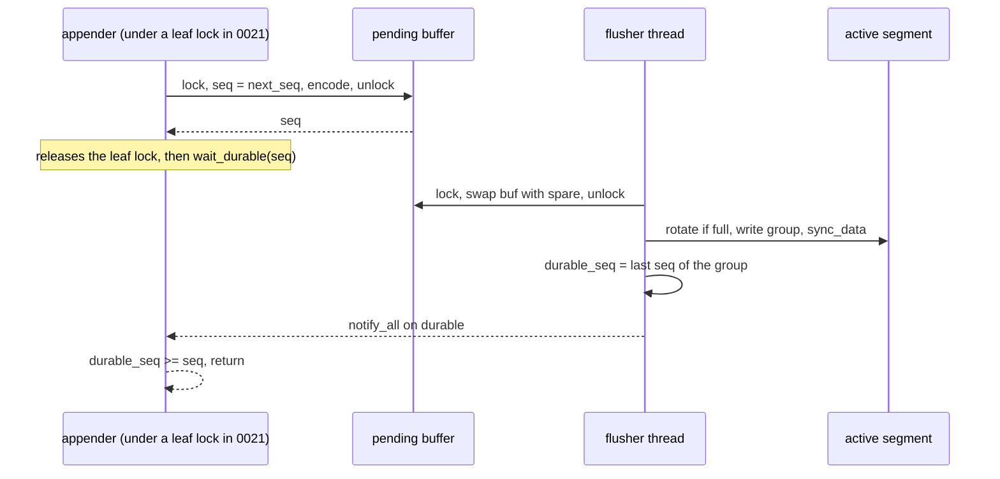
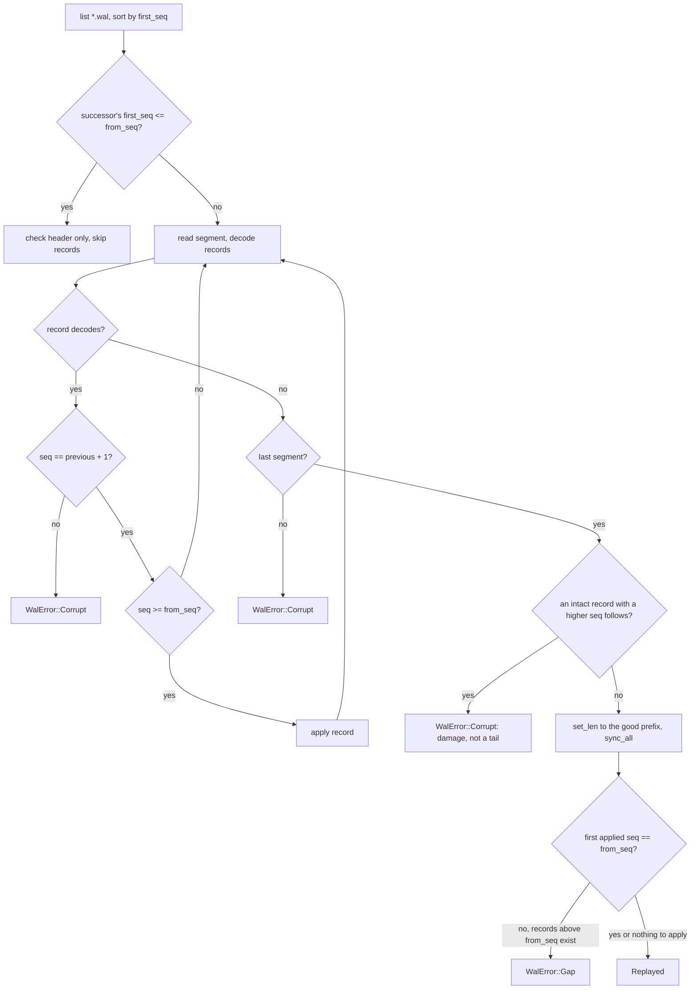

# 0020: Engine write-ahead log

**Status:** Agreed

**Design references:** [Project direction](../design/architecture.md),
[build system](../design/build-system.md),
[persistence](../design/bf-tree-persistence.md) (from plans 0017-0019),
[engine](../design/engine.md) (created by this stack).

**Parent roadmap:** [BF-Tree implementation](0002-bf-tree-roadmap.md), milestone 9.

**Builds on:** [Durable store format](0017-bf-tree-store-format.md) (the CRC32C
source), [apply, log hook, and snapshots](0019-bf-tree-apply.md) (the `Log`
trait this log will serve through an adapter in plan 0021).

## Goal and scope

The tree is durable only at checkpoints. An embedded database must make every
acknowledged write durable. This stack builds the write-ahead log (WAL) that
does so: an append-only sequence of checksummed records in segment files,
appended by many threads, made durable by one flusher thread with group commit,
replayed on open, and truncated after checkpoints.

The WAL is a separate internal crate, `engine-wal`, in the `engine` component.
The entry crate `engine` arrives in [plan 0021](0021-engine-db.md). The WAL
does not depend on `bf-tree`: it knows sequences, operations, and bytes, not
trees. Plan 0021 connects it to the tree.

- **In scope:**
  - the crate `crates/engine-wal` with its `BUCK` file and generated manifest;
  - the record and segment format, with CRC32C per record;
  - `Wal`: `append`, `append_batch`, the flusher thread, `wait_durable`,
    `sync_to`, `durable_seq`, `last_seq`, `appended_bytes`, `truncate_below`,
    `close`, and a crash-simulation path, `abandon`;
  - `Wal::replay(dir, from_seq, ..)` with torn-tail repair in the last
    segment only;
  - `WalError`, a dedicated error type;
  - `docs/design/engine.md`, first version (WAL sections).
- **Out of scope:** the `Db`, the tree adapter, checkpoint policy (0021);
  external-log mode (0022); latency and recovery-rate measurements (0023);
  WAL compression; WAL direct I/O; segment preallocation (an 0023 experiment).
- **Done when:** records round-trip through segments and replay; concurrent
  appenders receive distinct, contiguous sequences and share fsyncs; a torn
  tail in the last segment is repaired and later appends follow good bytes;
  damage in a sealed segment, a non-increasing sequence, or a missing range is
  `WalError::Corrupt` or `WalError::Gap`; `truncate_below` deletes exactly the
  redundant sealed segments; `abandon` loses only records that were never
  reported durable; and the workspace checks pass.

## Approach

### Crate and dependencies

```text
crates/engine-wal/
  BUCK
  src/lib.rs        Wal, WalOptions, WalError, Op, Record, Replayed
  src/record.rs     record and segment-header encoding
  src/segment.rs    segment files: naming, listing, create, append, repair
  src/replay.rs     Wal::replay
  src/flusher.rs    pending buffer, flusher thread, durability waits
  src/tests/        unit tests (crate-private helpers only)
```

```python
# crates/engine-wal/BUCK
load("//build:defs.bzl", "peppy_rust_library")

# Internal crate of the engine component. Only the engine entry crate
# may depend on it.
peppy_rust_library(
    name = "engine-wal",
    deps = [
        "//third-party/rust:crc32c",      # see "CRC32C" below
        "//third-party/rust:thiserror",
    ],
    test_deps = ["//third-party/rust:tempfile"],
    visibility = ["//crates/engine:"],
)
```

The visibility pattern names a package that plan 0021 creates. Buck2 accepts
a pattern for a package that does not exist yet. After adding the `BUCK` file,
run `tools/autocargo`; it adds `crates/engine-wal` to the workspace members
and writes `crates/engine-wal/Cargo.toml`. Commit both.

**CRC32C.** Plan 0017 decided the source: the third-party `crc32c` crate,
added through `tools/buckify` in 0017's diff 2 (with a reindeer fixup for its
build script if needed). `engine-wal` lists `//third-party/rust:crc32c`
directly. It does not depend on `bf-tree` or its internal crates for the
checksum.

Not chosen: a hand-written table-driven implementation. `engine-wal` would
have needed its own copy, because it must not depend on an internal crate of
another component.

The code calls one function, `crc32c(&[u8]) -> u32`, behind a private module.
Tests check the RFC 3720 §B.4 value, `crc32c(b"123456789") == 0xE306_9283`.

### Operations without the tree

`engine-wal` has its own operation type. Plan 0021 converts between it and
`bf_tree::Op`; the conversion copies two slice references.

```rust
/// One logged change. Keys and values borrow the caller's bytes.
#[derive(Clone, Copy, Debug, PartialEq, Eq)]
pub enum Op<'a> {
    Put { key: &'a [u8], value: &'a [u8] },
    Delete { key: &'a [u8] },
}

/// A decoded record: one sequence and the operations it carries.
/// A single write has one operation; a batch has zero or more.
#[derive(Debug, PartialEq, Eq)]
pub struct Record<'a> {
    pub seq: u64,
    pub ops: Vec<Op<'a>>,
}
```

### On-disk format

```text
<dir>/
  00000000000000000001.wal    segments named {first_seq:020}.wal
  00000000000000012034.wal    the last segment is the active one

segment header, 32 bytes:
  magic "PEPPYWAL" (8) | version u32 = 1 | reserved u32 = 0
  | first_seq u64 | header_crc u32 (crc32c of bytes 0..24) | zero (4)

record:
  len u32 | crc u32 | seq u64 | kind u8 | payload
  len = byte count of seq + kind + payload; at least 9
  crc = crc32c(len bytes ‖ seq ‖ kind ‖ payload)

payload by kind:
  0 Put     key_len u32 | value_len u32 | key | value
  1 Delete  key_len u32 | key
  2 Batch   count u32 | count × (kind u8 (0 or 1) | Put or Delete payload)
```

All integers are little-endian. Rules that the decoder enforces:

- `len` must be at least 9 and at most `MAX_RECORD_BYTES` (16 MiB). The lower
  bound matters: a zero-filled tail has `len = 0`, and `crc32c` of an empty
  input is 0, so without the bound and without `len` inside the checksum a
  run of zeros would decode as a record. Both defences are kept.
- The payload must consume exactly `len - 9` bytes. A batch must not nest a
  batch.
- The first record of a segment has `seq >= first_seq`. Every record has a
  sequence exactly one greater than the previous record in the log (see
  "Sequences" below).

Key and value lengths are `u32`, so the format does not depend on the tree's
limits. The engine validates limits before it appends (0021).

### Sequences

The WAL is the sequence source in standalone mode. `append` assigns the next
sequence under the pending-buffer mutex and encodes the record in the same
critical section, so buffer order equals sequence order and sequences are
contiguous. A batch takes one sequence. There is one sequence space: plan 0019
makes the tree accept the WAL's sequences through `Log::append` and
`Tree::apply`, and plan 0021 opens the WAL at `max(applied, last replayed) + 1`.

### Write path and group commit

```rust
pub struct WalOptions {
    /// Wait this long after the first pending append before writing.
    /// Zero (the default) writes as soon as the previous sync ends.
    pub flush_interval: Duration,
    /// Seal the active segment once it holds at least this many bytes.
    pub segment_bytes: u64, // default 64 MiB
}

pub struct Wal {
    shared: Arc<Shared>,
    flusher: Mutex<Option<JoinHandle<()>>>,
}

struct Shared {
    dir: PathBuf,
    options: WalOptions,
    pending: Mutex<Pending>,     // appenders and the flusher only
    wake: Condvar,               // flusher waits here, paired with `pending`
    durable_seq: AtomicU64,      // highest synced sequence
    durable_lock: Mutex<()>,     // waiters on `durable`; never held with `pending`
    durable: Condvar,
    force_to: AtomicU64,         // sync_to target; skips the flush interval
    appended_bytes: AtomicU64,   // for checkpoint policy
    last_seq: AtomicU64,         // highest assigned sequence
    state: AtomicU8,             // Open, Closing, Abandoned
    failed: OnceLock<(&'static str, io::ErrorKind)>, // sticky; each caller gets Failed
    first_error: Mutex<Option<io::Error>>,           // the original, returned once by close
}

struct Pending {
    buf: Vec<u8>,
    next_seq: u64,
    first_in_buf: Option<u64>,   // names a new segment on rotation
    first_pending_at: Option<Instant>,
}
```

```rust
impl Wal {
    /// Assign the next sequence and copy the encoded record into the
    /// pending buffer. No I/O. Safe to call under a tree leaf lock.
    pub fn append(&self, op: Op<'_>) -> Result<u64, WalError> {
        self.append_with(|buf, seq| record::encode_op(buf, seq, op))
    }

    fn append_with(&self, encode: impl FnOnce(&mut Vec<u8>, u64)) -> Result<u64, WalError> {
        self.check_open()?;                        // Failed, Closed
        let mut pending = self.shared.pending.lock();
        let seq = pending.next_seq;
        let before = pending.buf.len();
        encode(&mut pending.buf, seq);
        pending.next_seq += 1;
        pending.first_in_buf.get_or_insert(seq);
        pending.first_pending_at.get_or_insert_with(Instant::now);
        let added = pending.buf.len() - before;
        self.shared.last_seq.store(seq, Ordering::Release);
        drop(pending);
        self.shared.appended_bytes.fetch_add(added as u64, Ordering::Relaxed);
        self.shared.wake.notify_one();
        Ok(seq)
    }
}
```

`append_batch(&[Op])` checks the encoded size against `MAX_RECORD_BYTES`
before it takes the mutex (`WalError::RecordTooLarge`), so a rejected batch
consumes no sequence.



The flusher loop:

1. Lock `pending`. Wait on `wake` while the buffer is empty and the state is
   `Open`. If the buffer is empty and the state is `Closing`, exit.
2. If `flush_interval > 0`, the state is `Open`, and `force_to` is below the
   buffer's last sequence, wait until `first_pending_at + flush_interval`.
3. Swap the buffer with a reusable spare `Vec`, note the first and last
   sequences, and unlock. Appenders continue into the empty buffer.
4. If the active segment holds `>= segment_bytes`, create the next segment,
   named by the group's first sequence. The old one is already synced, so it is
   sealed with no torn tail.
5. `write_all`, then `sync_data`. On error, store `Failed` in `failed`, wake
   every waiter, and exit. No later record can become durable, so every
   later `append`, `wait_durable`, and `sync_to` returns the error.
6. Store `durable_seq`, lock `durable_lock`, `notify_all`.

Every waiter whose record was in the group shares one fsync. Writers that
arrive during the fsync form the next group. This is group commit without a
timer.

**Why the default interval is zero.** A positive interval adds its whole
length to every write's latency. Under concurrency the groups form anyway,
during the previous fsync. The interval helps only when fsync is so cheap that
groups stay small. The option stays for such devices; plan 0023 measures both
settings.

**Waiting.** `wait_durable(seq)` reads `durable_seq` first (no lock on the fast
path). Otherwise it locks `durable_lock`, re-checks, and waits on `durable`
without a timeout. The flusher stores `durable_seq` before it takes
`durable_lock`, so no wakeup is lost. Waiters never touch the `pending` mutex,
which keeps appenders' critical section short.

**`sync_to(seq)`** makes everything up to `seq` durable now. It raises
`force_to` with `fetch_max`, wakes the flusher, and waits like `wait_durable`.
The flusher skips the interval wait when `force_to` covers the buffer. Plan
0021 calls it from the checkpoint's pre-commit hook.

**Segment creation** uses `create_new`, writes the header, calls `sync_all`, and
syncs the directory, so a segment that holds durable records also has a
durable directory entry. A group never spans two segments; a segment may
exceed `segment_bytes` by one group.

### Replay

```rust
pub struct Replayed {
    /// Highest sequence in the log after repair, replayed or not.
    pub last_seq: Option<u64>,
    /// Records passed to `apply`.
    pub records: u64,
    /// Bytes removed from the end of the last segment.
    pub truncated_bytes: u64,
}

impl Wal {
    /// Pass every record with `seq >= from_seq` to `apply`, in order.
    /// Repairs a torn tail in the last segment. Must run before `open`.
    pub fn replay<E: From<WalError>>(
        dir: &Path,
        from_seq: u64,
        apply: impl FnMut(Record<'_>) -> Result<(), E>,
    ) -> Result<Replayed, E>;
}
```



Rules and their reasons:

- **Torn tails only in the last segment.** Rotation happens only after the
  previous group synced, so a sealed segment cannot end in a partial write.
  Any undecodable record there is damage: `WalError::Corrupt`.
- **A tail is a tail only if nothing intact follows.** After the first bad
  record in the last segment, replay scans the remaining bytes for an intact
  record with a higher sequence. If it finds one, the damage is in the middle
  of acknowledged data, and truncating would silently drop it; replay returns
  `Corrupt` instead. The scan reads at most the bytes after the tear, usually
  one partial group. A false match needs a CRC32C collision.
- **Repairs are synced before anything follows them.** `set_len` is followed
  by `sync_all` before `replay` returns. Plan 0021 then opens the WAL, which
  creates a new segment; that segment makes the repaired one sealed. Without
  the sync, a crash could leave the old torn bytes in what is now a sealed
  segment, and the next open would fail.
- **A torn header in the last segment** (a crash during segment creation)
  means the segment holds nothing durable. Replay deletes the file. In a sealed
  segment it is `Corrupt`. A header whose `first_seq` differs from the file
  name is `Corrupt`.
- **Contiguity.** Within the scanned segments, sequences increase by exactly
  one. Across a segment boundary, the next segment's first record must follow
  the previous segment's last record, except at segments skipped as wholly
  below `from_seq`. If records at or above `from_seq` exist, the first of them
  must be exactly `from_seq`; otherwise `WalError::Gap { expected, found }`.
  A gap means a segment that held records the tree has not applied is missing.
- **Skipping old segments.** A segment whose successor starts at or below
  `from_seq` holds only records the checkpoint covers. Replay checks its header
  and does not read its records. Such segments normally exist only when a
  deletion by `truncate_below` did not reach the disk before a crash.

### Truncation

```rust
/// Delete every sealed segment whose successor's first_seq <= applied + 1.
/// Such a segment holds only records at or below `applied`.
/// The last (active) segment is never deleted. Returns the count deleted.
pub fn truncate_below(&self, applied: u64) -> Result<usize, WalError>;
```

`truncate_below` lists the directory, deletes oldest first, and ignores
`NotFound`, so concurrent calls (a manual and a background checkpoint) are
safe. It does not sync the directory: a deletion that does not survive a crash
leaves a redundant segment that replay skips and the next truncation deletes.

### Close and simulated crashes

- `close(&self)`: set `Closing`, wake the flusher, join it. The flusher drains
  the buffer first, so every appended record becomes durable. Returns the
  stored failure, if any. Later `append` calls return `WalError::Closed`.
- `Drop` calls `close` and ignores its result.
- `abandon(self, written: usize)`: set `Abandoned`, join the flusher (it exits
  after any group already in flight), then write the first `written` bytes of
  the pending buffer to the active segment **without** syncing, and drop the
  rest. Waiters for the dropped records receive `WalError::Closed`.

`abandon` exists for crash tests. Dropping a `Wal` drains it, so a test that
only drops a database never loses unsynced log bytes and never exercises the
case that the WAL exists for. `abandon` loses the pending records, and
`written` produces a torn record at any byte offset. It is `pub` because the
engine's tests in another crate need it; Buck2 visibility limits it to
`//crates/engine:`. Its documentation states that production code calls
`close`. It covers process crashes exactly. A power loss can also lose bytes
that were written but not synced; such bytes belong to a group whose waiters
were never woken, so `abandon` with a partial `written` covers that case too.

### Errors

```rust
#[derive(Debug, thiserror::Error)]
pub enum WalError {
    #[error("WAL I/O error during {op}: {source}")]
    Io { op: &'static str, #[source] source: std::io::Error },
    #[error("WAL segment {segment} is corrupt at offset {offset}: {reason}")]
    Corrupt { segment: u64, offset: u64, reason: &'static str },
    #[error("WAL is missing records: expected sequence {expected}, found {found}")]
    Gap { expected: u64, found: u64 },
    #[error("WAL record of {bytes} bytes exceeds the limit")]
    RecordTooLarge { bytes: usize },
    #[error("the WAL flusher stopped after an error during {op}: {kind}")]
    Failed { op: &'static str, kind: std::io::ErrorKind },
    #[error("the WAL is closed")]
    Closed,
}
```

`Failed` carries only an operation name and an `ErrorKind`, so the WAL can
build one for every waiter; `io::Error` is not `Clone`. `close` returns the
original `Io` error once. `WalError` is the WAL's own type. It is not disguised as a store error; plan
0021 wraps it in the tree's `LogError` at the `Log` boundary and unwraps it
again in `engine::Error::Wal`.

## Decisions and trade-offs

- **A separate `engine-wal` crate that does not depend on `bf-tree`.** The log
  is testable without a tree, rebuilds only when it changes, and cannot reach
  into tree internals. Cost: a second `Op` type and a conversion in 0021.
- **Logical records with per-record CRC.** A torn tail is the common failure;
  per-record checksums find it exactly. Segment checksums would reject a whole
  segment for one torn record.
- **`len` inside the checksum and a minimum body length.** Zero-filled tails
  appear after some crashes on some file systems. Either defence alone rejects
  them; both are cheap.
- **One flusher thread, no timer by default.** Simplest correct group commit.
  The interval stays as an option and is measured in 0023.
- **Encoding under the pending mutex.** The CRC covers the sequence, which is
  known only under the mutex. Encoding is a copy plus a hardware CRC, so the
  critical section is short; 0023 measures it with large values. Alternative:
  encode outside with a placeholder and patch the sequence and CRC under the
  lock; rejected until a measurement shows a need.
- **Separate condition variable for durability waiters.** Waiters do not
  contend with appenders on the `pending` mutex.
- **No segment manifest.** File names carry the first sequence; a directory
  listing is the index. Segment creation syncs the directory.
- **Forward scan after a bad record.** Distinguishes a torn tail from
  corruption in the middle of the active segment at the cost of scanning a
  few bytes at recovery.
- **Strict contiguity.** The WAL assigns sequences without gaps, so a gap can
  only mean lost data. Strictness turns silent loss into an error.
- **`abandon` is public within the component.** Cross-crate crash tests need
  it, and `cfg(test)` does not cross crates.

## Extension points

- **Plan 0021** wraps `Wal` in a local adapter that implements
  `bf_tree::Log`, calls `replay` and `open` from `Db::open`, uses
  `wait_durable` after writes, `sync_to` in the checkpoint hook,
  `truncate_below` after checkpoints, `appended_bytes` and `last_seq` in the
  checkpoint policy, and `abandon` in crash tests. None of these need a
  change to the WAL.
- **Plan 0022** does not use the WAL; external mode has none.
- **Plan 0023** measures append cost, group sizes, interval settings, and
  replay rate. Possible later additions, each additive: segment preallocation
  (the decoder already treats zeros as a torn tail; preallocation would make
  "zeros after the last record" the normal end of a segment), a group-size
  metric, and a backpressure limit on the pending buffer.
- **Phase 2** may ship WAL records to followers. `Record` and `replay` already
  expose decoded entries with sequences; a streaming reader over sealed
  segments would be a new function, not a format change.
- Later plans must not need to change the record format, the naming scheme,
  or the replay rules.

## Proposed commit stack

Six diffs. The format, the reader, and the writer are separate so each can be
reviewed against its own tests.

### `[1/6][engine-wal][plan] plan the engine write-ahead log`

- **Purpose:** Agree on the format, group commit, replay rules, and errors.
- **Core changes:** This plan; link it from the roadmap's milestone 9 row.
- **Verification:** Review. Check local links.

### `[2/6][engine-wal][record] add the engine-wal crate and record format`

- **Purpose:** Fix the on-disk format before any file I/O.
- **Core changes:**
  - `crates/engine-wal/BUCK` (as above), `src/lib.rs` with `Op`, `Record`,
    `WalError`; `src/record.rs` with `encode_header`, `decode_header`,
    `encode_op`, `encode_batch`, `decode(&[u8]) -> Option<(Record, usize)>`.
  - The `//third-party/rust:crc32c` dependency (the crate 0017 adds).
  - `tools/autocargo`; commit the root `Cargo.toml`, `Cargo.lock`, and
    `crates/engine-wal/Cargo.toml`.
- **Verification:** Round trip of every kind, empty keys and values, empty
  batch, maximum lengths; every cut of a record fails to decode; every
  single-bit flip fails; `len` of 0, 8, and `u32::MAX` fail; 64 zero bytes
  fail; nested batch fails; trailing payload bytes fail; header round trip,
  bad magic, version, and header CRC. `tools/buck2 test //crates/engine-wal/...`,
  `tools/autocargo --check`.

### `[3/6][engine-wal][replay] replay segments and repair torn tails`

- **Purpose:** The recovery reader, testable from hand-built segment files.
- **Core changes:** `src/segment.rs` (naming, `list_segments`, header I/O);
  `src/replay.rs` (`Wal::replay`, `Replayed`, forward scan, contiguity and gap
  checks, skipping old segments, deletion of a last segment with a torn
  header).
- **Verification:** Tests over files written by a test helper: replay from 1
  and from the middle; torn tail at every byte offset of the last record is
  truncated and synced; garbage after good records is a tail; a flipped byte
  in a middle record of the last segment, with intact records after it, is
  `Corrupt`; any damage in a sealed segment is `Corrupt`; a duplicated or
  decreasing sequence is `Corrupt`; a missing segment above `from_seq` is
  `Gap`; a missing segment wholly below `from_seq` is accepted; name/header
  mismatch is `Corrupt`; empty and absent directories replay nothing.

### `[4/6][engine-wal][flusher] append records with group commit`

- **Purpose:** The writer: cheap appends, one flusher, durability waits.
- **Core changes:** `src/flusher.rs`: `WalOptions`, `Wal::open(dir, options,
  next_seq)` (reuses an empty last segment named `next_seq`, else creates
  one), `append`, `append_batch`, the flusher loop with rotation,
  `wait_durable`, `sync_to`, `durable_seq`, `last_seq`, `close`, `Drop`,
  sticky `Failed`.
- **Verification:** Append-close-replay round trips with interval 0 and
  10 ms; `sync_to` returns well before a 1 s interval elapses; rotation at a
  tiny `segment_bytes` names segments by first sequence; append after close
  is `Closed`; `RecordTooLarge` consumes no sequence; reopen with
  `next_seq = last + 1` continues the log.

### `[5/6][engine-wal][truncate] truncate below a checkpoint and simulate crashes`

- **Purpose:** Bound the log and give the engine a real crash path.
- **Core changes:** `truncate_below`, `appended_bytes`, `abandon`.
- **Verification:**
  - Truncation deletes exactly the segments whose successor starts at or
    below `applied + 1`; never the active one; concurrent calls succeed.
  - Eight appender threads: sequences are distinct and contiguous, replay
    order equals sequence order, and the number of fsyncs (counted by a
    crate-private test counter) is below the number of records.
  - `abandon(0)` after unsynced appends: replay holds exactly the records
    that `wait_durable` confirmed. `abandon(k)` for every `k` in one record
    yields a torn tail that replay repairs.
  - A flusher failure (directory made read-only on Unix, or a crate-private
    fault hook) makes waiters and later appends return `Failed`.

### `[6/6][engine-wal][docs] document the write-ahead log`

- **Purpose:** Record the enduring design.
- **Core changes:** Create `docs/design/engine.md` with the WAL format,
  group commit, replay rules, truncation, and guarantees; update this plan's
  progress and the roadmap.
- **Verification:** Workspace checks; local links.

## Open questions

None.

Resolved:

- **CRC32C source.** Resolved in 0017: the `crc32c` crate.
- **Maximum record size: 16 MiB (review, 2026-11-07).** `MAX_RECORD_BYTES`
  bounds one record (a put, a delete, or a whole batch), not a segment
  file. It rejects garbage lengths in a torn tail, and it bounds the memory
  that replay and the pending buffer hold for one record. With the tree's
  default limits, 16 MiB is about 15,000 maximum-size operations per
  `WriteBatch` (plan 0021); larger bulk loads use several batches.

## Verification strategy

| Check | Command or procedure | Expected result |
| --- | --- | --- |
| Format | Unit tests in `record.rs` | Every kind round-trips; every cut, flip, and zero run is rejected |
| Torn tails | Cut and garbage tests in `replay` | Good prefix replayed; file truncated and synced |
| Corruption | Sealed-segment, middle-of-active, sequence, and gap fixtures | `Corrupt` or `Gap`, never a panic, never silent loss |
| Group commit | Eight appenders, fsync counter | Contiguous sequences; fewer fsyncs than records |
| Crash | `abandon(k)` sweeps | Only unconfirmed records lost |
| Truncation | Rotation plus `truncate_below` | Exactly the redundant sealed segments removed |
| Visibility | `bin/peppydb` depends on `engine-wal` (local experiment) | Buck2 visibility error |
| Workspace | `tools/fmt.sh`; `tools/clippy.sh`; `tools/buck2 test //crates/... //bin/... //go/...`; `tools/autocargo --check`; `tools/gobuckify-remote --check`; `cargo test --workspace --locked`; `(cd go && go vet ./... && go test ./...)` | All pass |

## Progress

- [x] Agree on the design and commit stack with the user.
- [x] Diff 2: crate and record format.
- [x] Diff 3: replay and torn-tail repair.
- [ ] Diff 4: append and group commit.
- [ ] Diff 5: truncation and simulated crashes.
- [ ] Diff 6: design document.
- [ ] Stack-wide verification.

## Discoveries and plan changes

None yet.

## Agent notes

- **Entry points:** `build/defs.bzl` (`peppy_rust_library`),
  `crates/bf-tree-store/BUCK` (an internal crate's visibility),
  `crates/bf-tree-store/src/file.rs` (positioned I/O and `io_error` style).
- **Upstream reference:** `src/wal/mod.rs` (`append_and_wait`, the
  group-commit shape) and `src/wal/operations.rs` at
  `f442e6172bf7e5483ff320d8e3ac16a70e31bbd6`.
- **Gotchas:**
  - Sync the truncation before returning from `replay`; see "Repairs are
    synced".
  - After a crash with no writes, the last segment can be header-only and
    named `next_seq`. `open` must reuse it rather than fail on `create_new`.
  - Do not hold `pending` while waiting on `durable`, and do not hold
    `durable_lock` while taking `pending`.
  - Keep the spare buffer's capacity bounded (shrink above, for example,
    4 MiB) so a burst does not pin memory.
  - `Op` here and `bf_tree::Op` share a name. Code in `engine` names the
    crate (`engine_wal::Op`); do not re-export one under the other's name.
  - Test helpers stay crate-private. Only `abandon` is public, by design.

## Sources

- [BF-Tree paper](../references.md#bf-tree-paper), §5.7: logging and
  recovery; the paper's evaluation disables logging (§6.1).
- [Microsoft implementation](../references.md#microsoft-bf-tree-implementation)
  at `f442e6172bf7e5483ff320d8e3ac16a70e31bbd6`:
  [`src/wal/mod.rs`](https://github.com/microsoft/bf-tree/blob/f442e6172bf7e5483ff320d8e3ac16a70e31bbd6/src/wal/mod.rs).
- [RocksDB overview](../references.md#rocksdb-overview): the write-ahead
  log's role in an embedded engine.
- RFC 3720, §B.4: the CRC32C check value.
