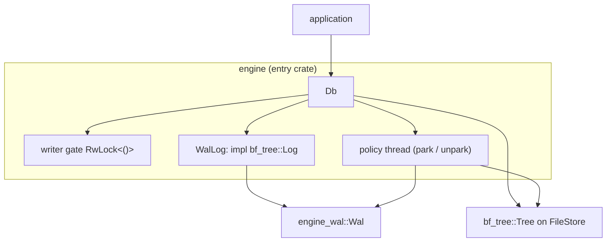
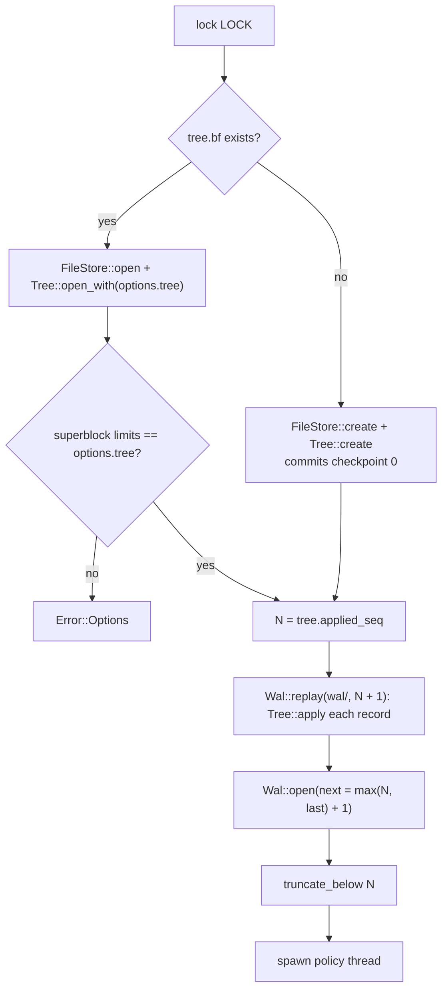

# 0021: Engine `Db`

**Status:** Agreed

**Design references:** [Project direction](../design/architecture.md),
[engine](../design/engine.md) (from plan 0020),
[persistence](../design/bf-tree-persistence.md),
[concurrency](../design/bf-tree-concurrency.md),
[build system](../design/build-system.md).

**Parent roadmap:** [BF-Tree implementation](0002-bf-tree-roadmap.md), milestone 9.

**Builds on:** [Engine write-ahead log](0020-engine-wal.md),
[apply, log hook, and snapshots](0019-bf-tree-apply.md),
[shadow paging, checkpoint, and recovery](0018-bf-tree-checkpoint.md).

## Goal and scope

The tree recovers to its last checkpoint. The WAL records every write. This
stack composes them into `Db`, the application-facing embedded database:
open with recovery, durable writes, atomic batches, reads, a background
checkpoint policy that bounds the log, and an orderly close. It creates the
`engine` entry crate, the only crate of the component that other components
may use.

- **In scope:**
  - `crates/engine` (entry crate, `PUBLIC`) with `Options`, `Mode`
    (`Standalone` only; 0022 adds `External`), `Error`, `WriteBatch`, `Db`;
  - `Db::{open, put, delete, write, get, get_with, range, scan_with,
    checkpoint, write_snapshot, applied_seq, close}` and `Drop`;
  - the `bf_tree::Log` adapter over `engine_wal::Wal`;
  - the checkpoint policy thread, kicked through atomics only;
  - WAL-before-data through the tree's pre-commit hook;
  - crash tests that lose unsynced WAL bytes, tear the WAL, and add torn
    tree pages;
  - a lock file against two processes opening one database;
  - updates to `docs/design/engine.md` and `docs/design/architecture.md`.
- **Out of scope:** external-log mode and snapshot installation (0022);
  direct I/O and measurements (0023); isolation of batches from readers;
  snapshot-consistent scans across leaves; a command-line tool.
- **Done when:** no acknowledged write is lost across a crash that discards
  unsynced WAL bytes, at any checkpoint state; a batch is all or nothing
  after any crash; checkpoints run on policy, truncate the WAL, and never
  stall writers on a shared lock; a reopen with different limits returns
  `Error::Options`; workspace checks pass.

## Approach

### Shape



```text
<path>/
  LOCK          held with File::try_lock for the Db's lifetime
  tree.bf       the tree's store file (plans 0017-0019)
  wal/          WAL segments (plan 0020)
```

### Crate and boundaries

```python
# crates/engine/BUCK
load("//build:defs.bzl", "peppy_rust_library")

# The engine component's entry crate. Other components depend on this
# crate only; engine-* crates are internal.
peppy_rust_library(
    name = "engine",
    deps = [
        "//crates/bf-tree:bf-tree",
        "//crates/engine-wal:engine-wal",
        "//third-party/rust:thiserror",
    ],
    test_deps = ["//third-party/rust:tempfile"],
    visibility = ["PUBLIC"],
)
```

Run `tools/autocargo` and commit the generated manifests. `engine` depends on
`bf-tree` only, never on `bf-tree-*` crates; Buck2 visibility enforces it.
`engine` re-exports, under their own names, the types that appear in its
public signatures: `engine_wal::WalError` and the `bf-tree` types below.

**What `bf-tree` must export** (from 0012-0019; this stack adds a re-export to
`crates/bf-tree/src/lib.rs` only if one is missing):

| Item | Used for |
| --- | --- |
| `Tree`, `TreeConfig`, `TreeError` | the tree, its options, its errors |
| `FileStore`, `PageStore`, `StoreError`, `Superblock` | creating and opening `tree.bf`; comparing limits |
| `Op`, `Entry`, `Log`, `LogError` | logged writes, batches, replay |
| `Checkpoint` (or the type `checkpoint_with` returns) | the committed `applied_seq` |
| `Scan` and the scan visitor types | `Db::range`, `Db::scan_with` |

**Contract the engine relies on** (stated by 0018 and 0019; listed here
because correctness depends on each item):

1. `Tree::put_logged` / `remove_logged` call `Log::append` after the leaf lock
   and route validation, before modifying the leaf. If `append` fails, the
   leaf is unchanged.
2. `Tree::apply(entry)` validates every operation before writing any, writes
   each with `entry.seq`, and advances the applied sequence once, after the
   last operation.
3. The checkpoint reads the applied sequence `N` before it visits leaves, and
   it visits each buffered leaf under that leaf's lock. A write whose
   sequence was assigned before `N` was read therefore lands in the
   checkpoint.
4. `checkpoint_with(hook)` calls `hook` after the store write sequence `W` is
   fixed and before the superblock commit. A hook error aborts the commit.
5. `checkpoint` is serialized inside the tree and must not be called with a
   leaf lock held.

### Options and errors

```rust
#[derive(Clone, Copy, Debug)]
pub struct Options {
    /// Tree limits and runtime knobs. Limits are fixed at creation; a
    /// reopen must pass the same ones.
    pub tree: TreeConfig,
    pub mode: Mode,                      // Standalone (0022 adds External)
    pub flush_interval: Duration,        // 0
    pub segment_bytes: u64,              // 64 MiB
    pub checkpoint_wal_bytes: u64,       // 256 MiB
    pub checkpoint_interval: Duration,   // 60 s
}

#[derive(Clone, Copy, Debug, Default, PartialEq, Eq)]
pub enum Mode {
    /// The engine keeps a WAL; writes return once durable.
    #[default]
    Standalone,
}

#[derive(Debug, thiserror::Error)]
pub enum Error {
    #[error(transparent)]
    Tree(TreeError),
    #[error(transparent)]
    Wal(#[from] WalError),
    #[error("I/O error during {op}: {source}")]
    Io { op: &'static str, #[source] source: std::io::Error },
    #[error("options disagree with the database: {0}")]
    Options(&'static str),
    #[error("the database is open in another process or handle")]
    Locked,
}

/// The WAL's errors cross the tree as `LogError`, which is `Copy` like
/// `TreeError`. The mapping is lossless for the variants a WAL produces:
/// the WAL's sticky failure is only an operation name and an `ErrorKind`.
fn to_log_error(error: &WalError) -> LogError {
    match *error {
        WalError::Closed => LogError::Closed,
        WalError::Failed { op, kind } => LogError::Io { op, kind, code: None },
        _ => LogError::Other("wal"),
    }
}

impl From<TreeError> for Error {
    /// A log failure inside a tree call is the WAL's error, not the tree's.
    fn from(error: TreeError) -> Self {
        match error {
            TreeError::Log(LogError::Closed) => Error::Wal(WalError::Closed),
            TreeError::Log(LogError::Io { op, kind, .. }) => Error::Wal(WalError::Failed { op, kind }),
            other => Error::Tree(other),
        }
    }
}
```

`Options::validate` rejects `segment_bytes < 4096`, `checkpoint_wal_bytes ==
0`, and a zero `checkpoint_interval`. The tree validates `tree`.

### Open and recovery

```rust
pub fn open(path: impl AsRef<Path>, options: Options) -> Result<Db, Error> {
    options.validate()?;
    fs::create_dir_all(&path)?;
    let lock = lock_file(&path)?;                      // Error::Locked on conflict
    let tree = open_or_create_tree(&path, &options)?;  // Error::Options on limit mismatch
    let applied = tree.applied_seq();
    let wal_dir = path.join("wal");
    let replayed = Wal::replay(&wal_dir, applied + 1, |record| {
        let ops: Vec<bf_tree::Op> = record.ops.iter().map(to_tree_op).collect();
        tree.apply(Entry { seq: record.seq, ops: &ops }).map_err(Error::from)
    })?;
    let next = applied.max(replayed.last_seq.unwrap_or(0)) + 1;
    let wal = Wal::open(&wal_dir, options.wal(), next)?;
    wal.truncate_below(applied)?;
    Db::start(path, options, lock, tree, wal)           // spawns the policy thread
}
```



- Replay is idempotent from the tree's point of view: records above `N` that a
  checkpoint already captured are applied again in order, and the final state
  equals the log's.
- A missing `wal/` replays nothing. A `tree.bf` without its WAL directory is a
  valid database at its checkpoint.
- `create` writes the tree and its initial checkpoint before the WAL exists,
  so a crash during creation leaves either nothing or an empty valid tree.
  A crash between `FileStore::create` and the initial commit leaves a file
  that `Tree::open` rejects; `open` then reports the error rather than
  recreating over it.

### Writes

```rust
/// The WAL as the tree's log. A local newtype: neither the trait nor
/// `Wal` belongs to this crate.
struct WalLog<'a>(&'a Wal);

impl bf_tree::Log for WalLog<'_> {
    fn append(&self, op: bf_tree::Op<'_>) -> Result<u64, LogError> {
                self.0.append(to_wal_op(op)).map_err(|error| to_log_error(&error))
    }
}

pub fn put(&self, key: &[u8], value: &[u8]) -> Result<(), Error> {
    let wal = &self.shared.wal;
    let seq = {
        let _single = self.shared.gate.read();
        self.shared.tree.put_logged(&WalLog(wal), key, value)?
    };
    self.shared.policy.note_append(wal);   // atomics only
    wal.wait_durable(seq)?;
    Ok(())
}
```

`put_logged` appends to the WAL inside the leaf lock (contract 1), so the
per-key order of sequences equals the per-key order of application. The wait
happens after the leaf lock and the gate are released, so a slow fsync holds
no lock.

**Guarantee boundary: reads can see writes that are not yet durable.** A
writer applies its write before it waits for the fsync. A concurrent `get`
can return the new value; if the process crashes before the fsync, that value
is lost, and a later reader sees the old one. The writer never received `Ok`,
so no acknowledged write is lost. This matches the "read uncommitted
durability" behaviour of engines that apply before syncing; callers that need
read-after-durable must wait for their own write. The design document states
it, and a crash test demonstrates it.

**After a WAL failure** every write returns `Error::Wal(Failed)`. Writes that
were applied but never synced remain visible until the database is reopened.
The database must be reopened; the reopen replays exactly what is durable.

### Write batches

```rust
#[derive(Clone, Debug, Default)]
pub struct WriteBatch { ops: Vec<(Vec<u8>, Option<Vec<u8>>)> }

pub fn write(&self, batch: WriteBatch) -> Result<(), Error> {
    let ops = batch.normalize();                 // sort by key, last op per key wins
    if ops.is_empty() { return Ok(()); }
    self.check_ops(&ops)?;                       // tree limits, before anything is logged
    let wal = &self.shared.wal;
    let seq = {
        let _exclusive = self.shared.gate.write();
        let seq = wal.append_batch(&wal_ops(&ops))?;
        self.shared.tree.apply(Entry { seq, ops: &tree_ops(&ops) })?;
        seq
    };
    self.shared.policy.note_append(wal);
    wal.wait_durable(seq)?;
    Ok(())
}
```

- **The writer gate.** A batch takes one sequence at append time but touches
  several leaves, so it cannot hold all their locks. Without the gate, a
  single write to one of its keys could take sequence `S + 1` and apply
  before the batch writes that key with `S`. The live tree would keep the
  batch's value; replay would keep the single write's. Single writes hold the
  gate shared; a batch holds it exclusive across `append_batch` and
  `apply`. Readers and checkpoints never take it. Cost: batches serialize
  against all writers while they run.
- **Validate before logging.** A logged batch that the tree rejects would fail
  every future replay. `check_ops` calls 0019's public `Tree::check_op`
  on every operation before `append_batch`.
- **Normalize.** Sorting and keeping the last operation per key makes the
  batch's effect independent of the order in which `apply` writes its
  operations, and makes replay of a batch whose effects a checkpoint partly
  captured converge regardless of per-page sequence rules.
- **Atomic for durability, not isolated.** One record, one sequence: after a
  crash the batch is wholly present or wholly absent. A concurrent reader may
  observe some of its operations before others.

### Checkpoints and WAL-before-data

```rust
fn checkpoint(&self) -> Result<Checkpoint, Error> {
    let wal = &self.wal;
    // Writers stop kicking for the bytes this checkpoint will cover.
    self.policy.begin(wal.appended_bytes());
        let checkpoint = self.tree.checkpoint_with(|point| {
        // WAL-before-data: every effect in the pages being committed has a
        // sequence at or below `captured_seq`, and its record was appended
        // before it was applied.
        wal.sync_to(point.captured_seq).map_err(|error| to_log_error(&error))
    })?;
    wal.truncate_below(checkpoint.applied_seq)?;
    self.policy.finish(checkpoint.applied_seq);
    Ok(checkpoint)
}
```

**Why the hook is required.** The checkpoint commits pages that can contain
effects with sequences above `N`, from writes that ran while it merged
leaves. Those writes may not be durable in the WAL yet. Without the hook, a
crash after the commit leaves the tree holding effects that the WAL lacks.
Two guarantees break:

- *Batch atomicity.* A batch whose operations were partly merged survives
  partly, and the WAL holds no record to complete it.
- *State is a prefix of the log.* The database state would contain writes
  that its WAL never recorded. Anything that treats the WAL as the history,
  such as log shipping to a follower (0022 tests, phase 2), would diverge.
The hook runs after `W` is fixed (contract 4) and receives 0019's
`CommitPoint`. Its `captured_seq` is at least the sequence of every effect
in the pages the commit includes, and each of those records was appended
before its effect was applied. Syncing to `captured_seq` therefore covers
all of them; `wal.last_seq()` would also be correct but syncs more.

### Checkpoint policy without a shared mutex

A writer must never wait for a checkpoint. A design where the policy thread
holds a mutex for the whole checkpoint while every `put` takes the same mutex
to report its bytes stalls all writers for the checkpoint's duration. Here
writers touch only atomics, and the policy thread sleeps with `park_timeout`.

```rust
struct Policy {
    threshold: u64,
    bytes_at_checkpoint: AtomicU64,   // wal.appended_bytes() when the last one began
    applied_at_checkpoint: AtomicU64, // committed applied_seq of the last one
    kicked: AtomicBool,
    stop: AtomicBool,
    thread: OnceLock<Thread>,         // the policy thread, for unpark
}

impl Policy {
    /// Called by writers after appending. One relaxed load and a subtraction
    /// in the common case; at most one writer per threshold crossing unparks.
    fn note_append(&self, wal: &Wal) {
        let grown = wal.appended_bytes() - self.bytes_at_checkpoint.load(Ordering::Relaxed);
        if grown >= self.threshold
            && !self.kicked.load(Ordering::Relaxed)
            && !self.kicked.swap(true, Ordering::AcqRel)
        {
            if let Some(thread) = self.thread.get() {
                thread.unpark();
            }
        }
    }
}
```

The policy thread loop:

```text
deadline = now + checkpoint_interval
loop:
    park_timeout(deadline - now)            # spurious wakeups are harmless
    if stop: return
    grown = kicked.swap(false) or bytes since checkpoint >= threshold
    due   = now >= deadline and wal.last_seq() > applied_at_checkpoint
    if grown or due: run checkpoint(); on error keep it for close()
    if now >= deadline: deadline = now + checkpoint_interval
```

- `begin` stores `bytes_at_checkpoint` at the start, so writes during a long
  checkpoint do not re-kick it for bytes it already covers. Writes that
  cross the threshold again during the checkpoint set `kicked`, and the next
  loop iteration runs another checkpoint.
- Manual `Db::checkpoint` uses the same function. The tree serializes
  checkpoints; `truncate_below` tolerates concurrent calls.
- A background error is stored in `Mutex<Option<Error>>` that only the policy
  thread and `close` touch. Writers never take it. `close` reports it.

### Reads

`get`, `get_with`, `range`, and `scan_with` forward to the tree with the same
signatures (0012's final scan API). They take no engine lock. Scans are
consistent per leaf, not across leaves.

### Close and drop

- `close(self)`: stop the policy thread (set `stop`, unpark, join), run one
  checkpoint, `wal.close()` (drains; nothing is pending after the
  checkpoint's hook except writes that arrived later), release `LOCK`, and
  return the first error among the checkpoint, the WAL, and the stored
  background error. A reopen after `close` replays nothing.
- `Drop` (without `close`): stop the policy thread and `wal.close()` without a
  checkpoint. Writers cannot be in flight, because they borrow the `Db`. A
  reopen replays the WAL.
- `Db` is `Send + Sync`; a compile-time assertion checks it.

### Crash testing

Dropping a `Db` drains the WAL, so it never loses unsynced bytes. The tests
use a crate-private `Db::crash(self, written: usize)` (in `cfg(test)` of the
`engine` crate) that stops the policy thread, calls `Wal::abandon(written)`,
and drops the tree without a checkpoint. To create records that are applied
but not durable, tests open with `flush_interval = 1 h` and call the tree's
logged writes directly (crate-private access to `shared.tree`), without
waiting. `sync_to` ignores the interval, so a checkpoint still syncs.

Scenarios:

| Scenario | Expected after reopen |
| --- | --- |
| Acknowledged writes, then unsynced writes, `crash(0)` | Every acknowledged write present; every unsynced write absent |
| Same, `crash(k)` for `k` across one record | As above; the torn record is repaired away |
| Unsynced writes and an unsynced batch, then a checkpoint, then `crash(0)`, with `segment_bytes` large so nothing is truncated | The writes and the batch are present, and the state equals a replay of the durable WAL from sequence 1 onto an empty map (state is a prefix of the log) |
| Writers and batches on 4 threads with checkpoints racing them, `crash` at a random moment | Every batch wholly present or absent; state equals the replay of the durable WAL |
| Negative control: hook replaced by a no-op (local patch, not committed) | The prefix-of-the-log assertion of the first checkpoint test fails deterministically |
| Reader sees an unsynced write, then `crash(0)` | The write is absent: documents the guarantee boundary |
| `crash` with checkpoints running concurrently with 4 writer threads | Every acknowledged write present; batches whole |
| A garbage page appended to `tree.bf` after a crash | Open succeeds (the page is released by 0018's rules); state equals the oracle |
| Two crashes without a full replay in between | As above at each generation |

### Guarantees

The design document records these, and the crash tests check each:

1. A write or batch that returned `Ok` survives any crash of the process.
2. A batch is wholly present or wholly absent after any crash.
3. After recovery, the state equals the replay of the durable WAL history:
   it contains no write that the WAL lacks.
4. For each key, the recovered value is the value of the highest sequence
   for that key in the durable WAL, which is also the order live readers saw.
5. A torn WAL tail loses only records that were never acknowledged.
6. A reopen with limits different from the store's is refused.

Not guaranteed: isolation of a batch from concurrent readers; durability of
a value a reader saw before its writer returned; snapshot-consistent scans
across leaves; detection of every device corruption of a committed page.
Plan 0017's page CRC32C detects a damaged body, but a corrupted header that
makes a committed page look uncommitted or superseded is released on open
(see the known limit in plan 0018).

## Decisions and trade-offs

- **One `Db` type with a runtime `Mode`.** Misuse fails at the call, not at
  compile time. Replication will wrap the engine, and one type keeps the
  surface small. Alternative: `Db<Standalone>` / `Db<External>`; revisit if
  the modes diverge.
- **Writer gate over per-batch leaf locking or multi-version reads.** Cheap,
  and it keeps the tree's per-key ordering argument unchanged. Cost: batches
  serialize writers.
- **Atomic kick with `park`/`unpark`.** Writers never block on the policy.
  Alternative: a condition variable, which needs a mutex shared with writers.
- **Sync everything appended in the hook.** Correct regardless of what bound
  the tree passes. Cost: may sync a few records written after `W`; they would
  be synced within one fsync anyway.
- **Validate limits in the engine before logging.** A poisoned WAL record is
  unrecoverable without manual repair.
- **Normalize batches.** Removes any dependence on within-entry write order.
  Cost: a sort per batch.
- **Lock file with `std::fs::File::try_lock`.** Prevents two processes from
  writing one WAL and one store. Safe std API, no `libc`.
- **Reopen with different limits is an error.** A caller with a wrong idea of
  what fits should hear about it rather than run with the store's limits.

## Extension points

- **Plan 0022** adds `Mode::External`, `Error::WrongMode`, `Db::apply`,
  `Db::checkpoint_with`, and `Db::install_snapshot`. It makes `Shared::wal`
  an `Option<Wal>` and skips the policy thread in external mode. It must not
  change the standalone write path, the policy, or the recovery order.
- **Plan 0023** adds `Options::io` (`bf_tree::Io`) and engine benchmarks. It
  passes `io` to `FileStore::create`/`open`; nothing else changes.
- **Phase 2** uses external mode. A future `Db::put` returning its sequence,
  per-call durability options (for example "applied, not durable"), or a
  read-after-durable option are additive.
- `Options` gains fields; `Error` gains variants; `Db` gains methods. None of
  these require reshaping what this stack introduces.

## Proposed commit stack

Seven diffs.

### `[1/7][engine-db][plan] plan the embedded database`

- **Purpose:** Agree on the API, recovery, the gate, the policy, and the
  crash tests.
- **Core changes:** This plan; link it from the roadmap's milestone 9 row.
- **Verification:** Review. Check local links.

### `[2/7][engine-db][open] add the engine crate with open, recovery, and reads`

- **Purpose:** The entry crate and the recovery path, before writes exist.
- **Core changes:** `crates/engine/BUCK`; `Options`, `Mode`, `Error`
  (with the `TreeError` mapping); `Db::open` (lock file, create or open the
  tree, limit check, `Wal::replay` through `Tree::apply`, `Wal::open`,
  `truncate_below`); `get`, `get_with`, `range`, `scan_with`,
  `applied_seq`; `close` and `Drop` without the policy thread; any missing
  re-exports in `crates/bf-tree/src/lib.rs`; `tools/autocargo`.
- **Verification:** Create, close, reopen; a WAL written by a test through
  `engine_wal::Wal` is replayed into the tree; reopen with different limits
  is `Options`; a second open is `Locked`; a stale `wal/` with a gap is
  `Error::Wal(Gap)`; Buck2 visibility forbids `engine` → `bf-tree-page`.

### `[3/7][engine-db][write] write durably through the WAL`

- **Purpose:** Durable single writes.
- **Core changes:** `WalLog` adapter; `put`, `delete`; op conversions.
- **Verification:** Round trips; drop and reopen keeps every write;
  concurrent writers (6 threads, disjoint keys) against an oracle, live and
  after reopen; a WAL `Failed` error surfaces as `Error::Wal`.

### `[4/7][engine-db][batch] add atomic write batches`

- **Purpose:** All-or-nothing multi-key writes.
- **Core changes:** `WriteBatch` (`put`, `delete`, `len`, `is_empty`,
  `normalize`), `check_ops`, the writer gate, `Db::write`.
- **Verification:** Batch round trip; empty batch appends nothing; an
  oversized key in a batch is rejected and leaves no WAL record; duplicate
  keys keep the last operation; threads mixing batches and single writes on
  four keys: the live state equals a replay of the WAL into a map, and so does
  the reopened state.

### `[5/7][engine-db][checkpoint] checkpoint on policy and truncate the WAL`

- **Purpose:** Bound the WAL, recovery time, and store growth.
- **Core changes:** `Db::checkpoint` with the hook, `write_snapshot`,
  `Policy` and its thread, close ordering, background error reporting.
- **Verification:** The byte trigger fires and old segments disappear; the
  interval trigger fires only when something new arrived; manual and
  background checkpoints race safely; a writer-latency test runs a
  checkpoint of a large tree concurrently and asserts that the slowest
  `put` is far below the checkpoint's duration (no shared lock); a snapshot
  opens as a database at its `applied_seq`.

### `[6/7][engine-db][crash] test crashes that lose unsynced WAL bytes`

- **Purpose:** Exercise the cases the WAL and the hook exist for.
- **Core changes:** `cfg(test)` `Db::crash`; the scenarios in the table above;
  a randomized crash model (writers, batches, checkpoints, crash at a random
  point with a random `written`, reopen, compare with the acknowledged
  oracle, repeat for several generations).
- **Verification:** All scenarios pass; the negative control fails as
  expected when run locally; the model runs at least 200 crash generations in
  the default test run within a few seconds.

### `[7/7][engine-db][docs] document the database and its guarantees`

- **Purpose:** Record the enduring design.
- **Core changes:** `docs/design/engine.md` (API, recovery, gate, policy,
  WAL-before-data, guarantees and non-guarantees);
  `docs/design/architecture.md` (engine row in the code-layout table, the
  `engine` and `engine-wal` crates); this plan's outcomes; roadmap.
- **Verification:** Workspace checks; local links.

## Open questions

None. The hook bound, `Tree::check_op`, and `Tree::open_with` are settled
by plans 0019 and 0013.

## Verification strategy

| Check | Command or procedure | Expected result |
| --- | --- | --- |
| Acknowledged writes survive | Crash scenarios and the crash model | Oracle of acknowledged writes equals the reopened state |
| WAL-before-data | Checkpoint-then-crash tests; negative control | Pass; control fails |
| Batch atomicity | Crash model with batches | Each batch wholly present or absent |
| Per-key order | Mixed batch and single-write threads; WAL replayed into a map | Live and reopened states equal the map |
| Writers not stalled | Concurrent checkpoint latency test | Slowest `put` well below checkpoint duration |
| Policy | Byte and interval triggers with tiny thresholds | Checkpoints happen; old segments removed |
| Options and lock | Mismatched limits; second open | `Options`; `Locked` |
| Visibility | Local experiment: `engine` depends on `bf-tree-page` | Buck2 visibility error |
| Workspace | `tools/fmt.sh`; `tools/clippy.sh`; `tools/buck2 test //crates/... //bin/... //go/...`; `tools/autocargo --check`; `tools/gobuckify-remote --check`; `cargo test --workspace --locked`; `(cd go && go vet ./... && go test ./...)` | All pass |

## Progress

- [x] Agree on the design and commit stack with the user.
- [ ] Diff 2: crate, open, recovery, reads.
- [x] Diff 3: durable writes.
- [x] Diff 4: write batches.
- [ ] Diff 5: checkpoint policy.
- [ ] Diff 6: crash tests.
- [ ] Diff 7: documentation.
- [ ] Stack-wide verification.

## Discoveries and plan changes

None yet.

## Agent notes

- **Entry points:** `crates/bf-tree/src/lib.rs` (re-exports, `Tree` API from
  0012-0019), `crates/bf-tree/BUCK` (entry-crate pattern),
  `crates/engine-wal/src/lib.rs` (0020).
- **Lock order:** leaf lock → WAL `pending` mutex (inside `Log::append`). The
  writer gate is taken before any leaf lock. The policy thread and
  `checkpoint` hold no leaf lock and no gate; `sync_to` takes only the WAL's
  durability lock. The checkpoint hook must not take the writer gate or a
  leaf lock: the tree may call it while holding its write-through gate
  exclusively, and a writer holding the engine gate may be waiting for that
  write-through gate.
- **Gotchas:**
  - `Log::append` runs under a leaf lock: no I/O, no waiting, no tree calls.
  - Do not call `wait_durable` while holding the gate.
  - Keep test helpers crate-private; engine tests cannot call
    `Tree::check_invariants` (crate-private in `bf-tree`), so they compare
    contents with an oracle through `range`.
  - `File::try_lock` returns `TryLockError::WouldBlock` on conflict; map it to
    `Error::Locked`.
  - Use `flush_interval = 1 h` only together with `sync_to` or `close`;
    otherwise writers wait an hour.

## Sources

- [BF-Tree paper](../references.md#bf-tree-paper), §5.7.
- [Microsoft implementation](../references.md#microsoft-bf-tree-implementation)
  at `f442e6172bf7e5483ff320d8e3ac16a70e31bbd6`:
  [`src/wal/mod.rs`](https://github.com/microsoft/bf-tree/blob/f442e6172bf7e5483ff320d8e3ac16a70e31bbd6/src/wal/mod.rs)
  (`append_and_wait`),
  [`src/snapshot.rs`](https://github.com/microsoft/bf-tree/blob/f442e6172bf7e5483ff320d8e3ac16a70e31bbd6/src/snapshot.rs)
  (recovery by logical replay).
- [RocksDB overview](../references.md#rocksdb-overview): the database API,
  write batches, and WAL recovery of an embedded engine.
